::: {.callout-note}
## TL;DRs

- コンピューターは内部的に情報を２進数で取り扱う
- コンピューターが取り扱う情報の最小単位を ビット（bit），8ビットをまとめた単位を バイト（byte） と呼ぶ
- 負の整数は2の補数で表す．減算は「符号を反転して足す」ことで加算器だけで計算できる
- 乗算はシフトと加算，除算はシフトと減算（と引き戻し）の繰り返しで計算する

:::

## 数値データと２進数

コンピューターは，数値だけでなく文字・画像・音声などあらゆる情報を，0 と 1 の並びである２進数で表して扱います．２進数の1桁を **ビット（bit）**，8ビットをまとめた単位を **バイト（byte）** と呼びます．メモリの容量やファイルのサイズは，このバイトを単位として数えます．

コンピューター内部の値を読み解くには，２進数と，私たちが普段使う10進数とを行き来する必要があります．また，プログラムでは２進数を短く書くために16進数もよく使われます．これらの表記は使う数字の種類こそ違いますが，「各桁の数字に，桁の位置で決まる重みを掛けて足し合わせる」という同じ仕組みで数を表しています．たとえば 39 は，10進数では $3 \times 10 + 9$，２進数では `100111`，すなわち $1 \times 2^5 + 1 \times 2^2 + 1 \times 2^1 + 1 \times 2^0$ です．

::: {#def- .custom_problem .blog-custom-border}
### r進数

$r$ を2以上の整数とする．0 以上 $r-1$ 以下の整数 $a_0, a_1, \ldots, a_{n-1}$ を用いて，非負整数 $N$ を

$$
N = a_{n-1} r^{n-1} + a_{n-2} r^{n-2} + \cdots + a_1 r + a_0 = \sum_{i=0}^{n-1} a_i r^i
$$

と表し，各桁の数字を並べて

$$
N = (a_{n-1} a_{n-2} \cdots a_1 a_0)_{(r)}
$$

と書く表記法を **r進数**（base-$r$ 表記）という．$r$ を **基数**（radix），$r^i$ を第 $i$ 桁の **重み** と呼ぶ．

:::

::: {#exm- .custom_problem }
### r進数と 10進数の 39 の対応表

| 名称 | 基数 $r$ | 使う数字 | 39 の表記 |
|:----:|:--------:|:--------|:---------:|
| ２進数 | 2 | 0, 1 | $100111_{(2)}$ |
| 8進数 | 8 | 0 〜 7 | $47_{(8)}$ |
| 10進数 | 10 | 0 〜 9 | $39_{(10)}$ |
| 16進数 | 16 | 0 〜 9, A 〜 F | $27_{(16)}$ |

:::
***

::: {#exm- .custom_problem }
###  ビット数と表せる数の範囲

$n$ ビットの0と1の組み合わせは $2^n$ 通りあります．そのため，扱うビット数によって表せる数の範囲が決まります．負の数を考えない場合（符号なし整数），表せる範囲は 0 から $2^n - 1$ までです．

| ビット数 | 組み合わせの数 | 表せる範囲（符号なし整数） |
|:--------:|:--------------:|:--------------------------|
| 8ビット（1バイト） | $2^8$ | 0 〜 255 |
| 16ビット（2バイト） | $2^{16}$ | 0 〜 65,535 |
| 32ビット（4バイト） | $2^{32}$ | 0 〜 4,294,967,295 |
| 64ビット（8バイト） | $2^{64}$ | 0 〜 18,446,744,073,709,551,615 |

:::
***

### 2進数と16進数

$16 = 2^4$ なので，16進数の1桁は２進数のちょうど4桁（4ビット）に対応します．そのため，16進数と２進数は10進数を経由せずに，1桁ずつ置き換えるだけで変換できます．

::: {#exm- .custom_problem }
### 16進数 5ED4 を２進数で表す

16進数の各桁を，それぞれ4ビットの２進数に置き換えます．

| 16進数の桁 | 5 | E | D | 4 |
|:----------:|:----:|:----:|:----:|:----:|
| 10進数での値 | 5 | 14 | 13 | 4 |
| ２進数（4ビット） | 0101 | 1110 | 1101 | 0100 |

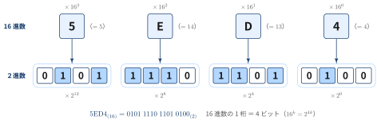{width="100%" fig-align="center"}

置き換えた4ビットをそのまま並べると，２進数での表現が得られます．

$$
5\text{ED}4_{(16)} = 0101\ 1110\ 1101\ 0100_{(2)}
$$

この置き換えが成り立つのは，$16^i = 2^{4i}$ だからです．

$$
\begin{aligned}
5\text{ED}4_{(16)} &= 5 \times 16^3 + 14 \times 16^2 + 13 \times 16^1 + 4 \times 16^0\\
&= 5 \times 2^{12} + 14 \times 2^{8} + 13 \times 2^{4} + 4 \times 2^{0}\\
&= 24276
\end{aligned}
$$

16進数の各桁の値は 0 〜 15，つまり4ビットに収まる大きさなので，$2^{4i}$ を掛けると２進数の第 $4i$ 〜 $4i+3$ 桁にちょうど収まり，隣の桁と重なりません
:::
***

[コンピューター内部の値を16進数で表すと都合が良い場面]{.mini-section}

コンピューター内部の値は２進数なので，そのまま書くと桁数が多くなり，10進数で書くとどのビットが1なのかが見えなくなります．16進数は，２進数のビットの並びを保ったまま桁数を $1/4$ に縮められるため，次のような場面でよく使われます．

- **バイト単位のデータを読む**：1バイト（8ビット）は16進数のちょうど2桁になる．メモリやファイルの中身を `5E D4` のように2桁ずつ区切って表示すれば，バイトの境目がそのまま見える．
- **特定のビットの状態を読む**：16進数の1桁が4ビットに独立に対応するので，桁ごとにビットの並びを読み取れる．たとえば `0x5ED4` の下位4ビットは，最後の桁 `4` を見るだけで `0100` とわかる．10進数の 24276 からは，割り算をしないと同じ情報が得られない
- **長いアドレスを短く書く**：64ビットのメモリアドレスは，２進数では64桁になるが，16進数なら16桁で書ける

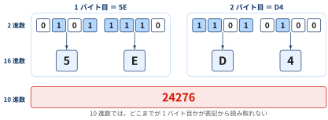{width="100%" fig-align="center"}

なお，プログラムでは `0x5ED4` のように先頭に `0x` を付けて16進数であることを示すのが一般的です．

## コンピューターが情報を２進数で扱う理由

コンピューターが情報を２進数で扱うのは，コンピューターを構成する部品の物理的な特性によるものです．

- CPUやメモリは IC（集積回路）という電子部品で構成されている．
- ICには外部と信号をやり取りするためのピン（足）が並んでおり，各ピンの電圧は，0V か +5V のように2つの状態のどちらか一方しかとらない

そこで +5V を 1，0V を 0 に対応づけると，ピン1本で２進数1桁（1ビット）を表せ，8本のピンがあれば２進数8桁（8ビット）の数値を表せます．このように，ICが2つの状態しか区別しないことから，コンピューターの内部では数値が２進数で保持されます．

なお，+5V は昔の TTL と呼ばれる回路での代表的な値です．現在のCPUのコアは1V前後，DDR5 メモリは1.1Vで動作しています．電圧の値は違っても，2つの電圧で0と1を区別する原理は同じです．

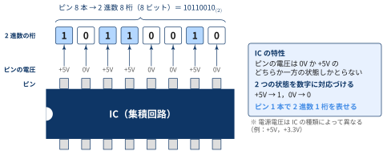{width="100%" fig-align="center"}

::: {.callout-note}
## 32ビットCPU・64ビットCPUとピンの本数

「32ビットCPU」「64ビットCPU」というときのビット数は，CPUが1回の命令で処理できるデータの大きさを表します．一般には，CPU内部にある汎用レジスタのビット数を指します（レジスタについては [プログラムが動く環境とは (2)](../2020-10-09-cpu-and-programming/index.qmd) を参照）．

- 32ビットCPU：汎用レジスタが32ビット．1回の命令で２進数32桁のデータを扱う
- 64ビットCPU：汎用レジスタが64ビット．1回の命令で２進数64桁のデータを扱う

「1本の線で1ビット」という対応はチップの内部でも同じで，64ビットのレジスタは1ビットを記憶する回路を64個並べたものです．ただし，CPUのビット数（内部のレジスタの幅）と，外部とデータをやり取りするピンの本数（データバスの幅）は別に決まります．たとえば Intel 8088 は16ビットCPUですが，データ用のピンは8本しかなく，16ビットのデータを2回に分けて読み書きします．
:::

## 算術演算

ここからは，２進数で表された整数に対して，コンピューターがどのように四則演算を行っているかを見ていきます．


### 補数

自然数の集合では，加算と乗算は「閉じている」，つまり，どの2つの数を選んで計算しても，結果がまた自然数になります．しかし，減算は閉じていません．たとえば $3−5$ の結果である $−2$ は，自然数ではないからです．

そこで，減算についても閉じるように，負の数を含めた整数へと集合を広げて考える必要があります．計算機では，この負の数を表すために補数という仕組みを使います．

負の数を２進数で表すには，「どのビットパターンを負の数に割り当てるか」を決める必要があります．素朴に考えると次の3つの方法があります．

- **符号と絶対値**（sign and magnitude）：最上位ビットを符号（0なら正，1なら負）とし，残りのビットで絶対値を表す
- **1の補数**（one's complement）：正の数の全ビットを反転したものを，その負の数とする
- **2の補数**（two's complement）：正の数の全ビットを反転して1を足したものを，その負の数とする

4ビットのいくつかのビットパターンを，それぞれの方法で読むと次のようになります．

| ビットパターン | 符号と絶対値 | 1の補数 | 2の補数 |
|:-------------:|:-----------:|:-------:|:-------:|
| `0000` | $0$ | $0$ | $0$ |
| `0111` | $7$ | $7$ | $7$ |
| `1000` | $-0$ | $-7$ | $-8$ |
| `1001` | $-1$ | $-6$ | $-7$ |
| `1110` | $-6$ | $-1$ | $-2$ |
| `1111` | $-7$ | $-0$ | $-1$ |

符号と絶対値，および1の補数には，次の欠点があります．

- $+0$（`0000`）と $-0$（`1000` や `1111`）の2つのゼロができ，ゼロの判定が面倒になる
- 符号と絶対値では，加算器が「どちらの符号の結果になるか」を判定する余分な手順を必要とする

2の補数にはこれらの欠点がありません．ゼロは `0000` の1つだけで，後で見るように，加算・減算を符号を気にせず同じ回路で計算できます．そのため，現在のコンピューターはほぼすべて，符号付き整数を2の補数で表します．

::: {#def- .custom_problem .blog-custom-border}
### 2の補数表現

$n$ ビットのビットパターン $x_{n-1} x_{n-2} \cdots x_1 x_0$（各 $x_i$ は 0 か 1）が表す値を

$$
x = -x_{n-1} \cdot 2^{n-1} + \sum_{i=0}^{n-2} x_i 2^i
$$

とする表現法を **2の補数表現** という．最上位ビット $x_{n-1}$ を **符号ビット** と呼ぶ．符号ビットが 0 なら値は 0 以上，1 なら負となる．$n$ ビットの2の補数表現で表せる範囲は $-2^{n-1}$ 以上 $2^{n-1}-1$ 以下である．

:::

符号なし整数との違いは，最上位ビットの重みが $+2^{n-1}$ ではなく $-2^{n-1}$ になっている点だけです．たとえば4ビットの `1110` は，符号なしで読むと $8+4+2 = 14$，2の補数で読むと $-8+4+2 = -2$ です．

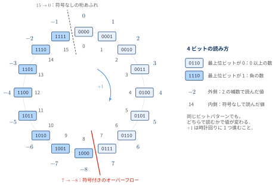{width="90%" fig-align="center"}

4ビットの16通りのパターンを円周上に並べると，$+1$ は時計回りに1つ進むことに対応します．2の補数では `0000` から時計回りに $0, 1, \ldots, 7$，反時計回りに $-1, -2, \ldots, -8$ が並びます．表せる範囲は $-8$ 〜 $7$ で，負の側が1つ多くなっています．

[「2の補数」という名前の由来]{.mini-section}

::: {#def- .custom_problem .blog-custom-border}
### 1の補数と2の補数

$n$ ビットで表された非負整数 $x$ に対して，$(2^n - 1) - x$ を $x$ の **1の補数**，$2^n - x$ を $x$ の **2の補数** と呼ぶ．

:::

$2^n - 1$ は全ビットが1の数（4ビットなら `1111`）なので，1の補数は $x$ の全ビットを反転したものになります．2の補数は1の補数に1を足したものです．

2の補数表現では，負の数 $-x$ を，$x$ の2の補数 $2^n - x$ のビットパターンで表します．たとえば4ビットで $-2$ は $2^4 - 2 = 14$，つまり `1110` です．$x$ と $2^n - x$ を足すとちょうど $2^n$ になり，$n$ ビットからあふれた桁を捨てると 0 になります．「足すと 0 になる」ので，$2^n - x$ を $-x$ として扱えるわけです．

[$n$ ビットで表せる範囲]{.mini-section}

$n$ ビットの $2^n$ 通りのビットパターンを，符号なし整数ではすべて 0 以上の数に，1の補数表現と2の補数表現では半分ずつ負の数と 0 以上の数に割り当てます．表せる範囲は次のとおりです．

| ビット数 | 符号なし整数 | 1の補数表現 | 2の補数表現 |
|:-------:|:-----------|:-----------|:-----------|
| $n$ | $0$ 〜 $2^n - 1$ | $-(2^{n-1} - 1)$ 〜 $2^{n-1} - 1$ | $-2^{n-1}$ 〜 $2^{n-1} - 1$ |
| 4 | 0 〜 15 | −7 〜 7 | −8 〜 7 |
| 8 | 0 〜 255 | −127 〜 127 | −128 〜 127 |
| 16 | 0 〜 65,535 | −32,767 〜 32,767 | −32,768 〜 32,767 |
| 32 | 0 〜 4,294,967,295 | −2,147,483,647 〜 2,147,483,647 | −2,147,483,648 〜 2,147,483,647 |
| 64 | 0 〜 18,446,744,073,709,551,615 | −9,223,372,036,854,775,807 〜 9,223,372,036,854,775,807 | −9,223,372,036,854,775,808 〜 9,223,372,036,854,775,807 |

符号なし整数と2の補数表現は，どちらも $2^n$ 通りのパターンすべてに異なる数を割り当てます．2の補数表現の範囲が負の側に1つ多いのは，0 を0以上の側（符号ビットが 0 の側）に含めるためです．0 以上の数は $0$ 〜 $2^{n-1} - 1$ の $2^{n-1}$ 個，負の数は $-1$ 〜 $-2^{n-1}$ の $2^{n-1}$ 個です．

1の補数表現では，全ビットが0のパターンが $+0$，全ビットが1のパターンが $-0$ となり，2つのパターンが同じ 0 を表します．そのため異なる数は $2^n - 1$ 個しか表せず，範囲は正負対称の $-(2^{n-1} - 1)$ 〜 $2^{n-1} - 1$ になります．

::: {#thm- .custom_problem .blog-custom-border}
### 符号の反転

2の補数表現の $n$ ビットの数 $x$ について，全ビットを反転した数を $\bar{x}$ とすると

$$
-x = \bar{x} + 1
$$

が成り立つ．

:::

$x$ と $\bar{x}$ を足すと，どの桁でも 0 と 1 の組み合わせになるので，結果は全ビットが1の `11…1` になります．これは2の補数表現では $-1$ です．よって $x + \bar{x} = -1$，すなわち $-x = \bar{x} + 1$ です．

::: {#exm- .custom_problem }
### 4ビットで符号を反転する

- $2 = $ `0010` → 反転すると `1101` → 1を足すと `1110` $= -2$
- $-2 = $ `1110` → 反転すると `0001` → 1を足すと `0010` $= 2$
- $-8 = $ `1000` → 反転すると `0111` → 1を足すと `1000` $= -8$

最後の例のように，最小値 $-2^{n-1}$ だけは対応する正の数 $2^{n-1}$ が範囲外なので，符号を反転すると自分自身に戻ってしまいます．
:::
***

[符号拡張]{.mini-section}

8ビットの値を16ビットのレジスタに読み込むときのように，数をより多いビット数で表し直したい場面があります．

::: {#def- .custom_problem .blog-custom-border}
### 符号拡張とゼロ拡張

$n$ ビットの数を $m$ ビット（$m > n$）で表し直すとき，追加した上位 $m - n$ ビットをすべて元の符号ビットと同じ値で埋める操作を **符号拡張**（sign extension），すべて 0 で埋める操作を **ゼロ拡張**（zero extension）という．

- 2の補数表現の符号付き整数には符号拡張
- 符号なし整数にはゼロ拡張

:::

符号拡張の例は次のとおりです．

- $2 = $ `0010`（4ビット）→ `0000 0010`（8ビット）
- $-2 = $ `1110`（4ビット）→ `1111 1110`（8ビット）

負の数（符号ビットが1）の上位を1で埋めても値が変わらないことは，2の補数表現の定義式から示せます．

::: {#thm- .custom_problem .blog-custom-border}
### 符号拡張は値を変えない

$n$ ビットのビットパターン $x_{n-1} x_{n-2} \cdots x_0$ が2の補数表現で表す値を $x$ とする．$m > n$ とし，上位に $m - n$ 個の $x_{n-1}$ を追加した $m$ ビットのビットパターン $y_{m-1} y_{m-2} \cdots y_0$，すなわち

$$
y_i = \begin{cases} x_i & (0 \leq i \leq n-1) \\ x_{n-1} & (n \leq i \leq m-1) \end{cases}
$$

が2の補数表現で表す値を $y$ とする．このとき $y = x$ が成り立つ．

:::

::: {.callout-note collapse="false" icon=false}
## Proof

2の補数表現の定義より

$$
x = -x_{n-1} \cdot 2^{n-1} + \sum_{i=0}^{n-2} x_i 2^i, \qquad
y = -y_{m-1} \cdot 2^{m-1} + \sum_{i=0}^{m-2} y_i 2^i
$$

である．$y$ の和を $0 \leq i \leq n-2$ の部分と $n-1 \leq i \leq m-2$ の部分に分ける．$m > n$ より $n - 1 \leq m - 2$ なので，後者は空ではない．$i \leq n-2$ では $y_i = x_i$，$i \geq n-1$ では $y_i = x_{n-1}$ なので

$$
y = -x_{n-1} \cdot 2^{m-1} + \sum_{i=0}^{n-2} x_i 2^i + x_{n-1} \sum_{i=n-1}^{m-2} 2^i
$$

となる．最後の和は初項 $2^{n-1}$，公比 2，項数 $m - n$ の等比数列の和なので

$$
\sum_{i=n-1}^{m-2} 2^i = 2^{n-1} \left( 2^{m-n} - 1 \right) = 2^{m-1} - 2^{n-1}
$$

である．これを代入すると

$$
\begin{aligned}
y &= -x_{n-1} \cdot 2^{m-1} + x_{n-1} \left( 2^{m-1} - 2^{n-1} \right) + \sum_{i=0}^{n-2} x_i 2^i \\
  &= -x_{n-1} \cdot 2^{n-1} + \sum_{i=0}^{n-2} x_i 2^i \\
  &= x
\end{aligned}
$$

を得る．$\blacksquare$

:::

### 加算と減算

[加算]{.mini-section}

２進数の加算は，10進数の筆算と同じく，最下位ビットから順に各桁を足し，2になったら上の桁へ1を繰り上げます．$7 + 6$ を8ビットで計算すると次のとおりです．

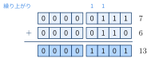{width="60%" fig-align="center"}

[減算は「符号を反転して足す」]{.mini-section}

減算 $x - y$ は，$y$ の符号を反転して足す $x + (-y)$ として計算します．$7 - 6$ を8ビットで計算すると，$-6$ は `0000 0110` を反転して1を足した `1111 1010` です．これを 7 に足すと次のようになります．

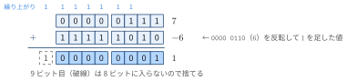{width="100%" fig-align="center"}

8ビットからあふれた9ビット目の1を捨てると，正しい答え 1 が得られます．

捨ててよい理由は，2の補数の定義から説明できます．$-y$ のビットパターンは $2^n - y$ なので，加算器が実際に計算しているのは $x + (2^n - y) = (x - y) + 2^n$ です．$2^n$ は $n+1$ ビット目の1にあたるので，それを捨てると $x - y$ が残ります．

この性質のおかげで，CPUは減算専用の回路を持たずに済みます．$y$ の全ビットを反転する回路と，最下位ビットへの繰り上がり入力を1にする仕組みを加算器に付けるだけで，減算も同じ加算器で計算できます．

[オーバーフロー]{.mini-section}

::: {#def- .custom_problem .blog-custom-border}
### オーバーフロー

- 演算の正しい結果が $n$ ビットで表せる範囲に収まらないことを **オーバーフロー**（overflow）という．
- 表せる範囲は，符号なし整数なら $0$ 以上 $2^n - 1$ 以下，2の補数表現の符号付き整数なら $-2^{n-1}$ 以上 $2^{n-1} - 1$ 以下とする．

:::

4ビットの2の補数で $7 + 1$ を計算すると，`0111 + 0001 = 1000` となり，結果は $-8$ と読まれてしまいます．上の円の図でいえば，$7$ から時計回りに1つ進んで赤線をまたぎ，$-8$ に移った状態です．

2の補数の加減算でオーバーフローが起こるのは，次の4つの場合だけです．

| 演算 | $A$ | $B$ | オーバーフローを示す結果 |
|:----:|:---:|:---:|:-----------------------:|
| $A + B$ | $\geq 0$ | $\geq 0$ | $< 0$ |
| $A + B$ | $< 0$ | $< 0$ | $\geq 0$ |
| $A - B$ | $\geq 0$ | $< 0$ | $< 0$ |
| $A - B$ | $< 0$ | $\geq 0$ | $\geq 0$ |

- 符号の異なる数どうしの加算は，結果の絶対値がどちらのオペランドの絶対値も超えないため，オーバーフローしない
- 減算は $A + (-B)$ なので，同じ符号どうしの減算もオーバーフローしない

同じ符号の数を足したのに結果の符号が変わったときだけがオーバーフローです．回路の上では，「符号ビットへの繰り上がり入力」と「符号ビットからの繰り上がり出力」が一致しないことで検出できます．

符号なし整数では，最上位ビットからの繰り上がり出力が1になったとき（加算），または借りが生じたとき（減算）がオーバーフローです．円の図では，破線の $15 \to 0$ の境目をまたぐことに対応します．

オーバーフローの扱いは命令セットや言語によって異なります．

- MIPS：`add`・`sub` はオーバーフローで例外を発生させ，`addu`・`subu` は無視する
- x86-64：例外は発生させず，フラグレジスタの OF（符号付き）と CF（符号なし）を立てる．必要ならプログラムがフラグを調べて分岐する
- C言語：符号なし整数の演算結果は mod $2^n$ で折り返す（$x \bmod m$ は $x$ を $m$ で割った余り．例：8ビットなら $(255 + 1) \bmod 256 = 0$）．符号付き整数のオーバーフローは未定義動作

::: {.callout-note}
## NumPy の整数型はオーバーフローすると折り返す

Python の `int` は必要に応じて桁数を増やすためオーバーフローしませんが，NumPy の整数型は固定長の2の補数表現です．たとえば `int8` の配列で `127 + 1` を計算すると，警告なしに `-128` になります．

```python
import numpy as np

a = np.array([127], dtype=np.int8)
print(a + np.int8(1))  # [-128]
```

ビットで見ると，`0111 1111`（127）に1を足すと繰り上がりが符号ビットまで伝わり，`1000 0000` になります．2の補数ではこれは $-128$ です．実際，`0111 1111` と `1000 0000` を足すと `1111 1111` $= -1$ となり，$127 + (-128) = -1$ が成り立ちます．

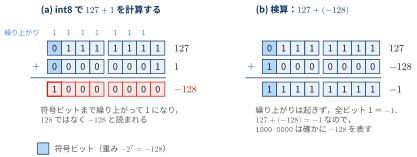{width="100%" fig-align="center"}

件数の集計やIDの演算で小さい整数型を使うと，結果が気づかないうちに折り返すことがあります．値の範囲に余裕のある型（`int64` など）を選ぶのが安全です．
:::

### シフト演算

シフト演算は，ビットの並び全体を左または右へずらす演算です．

::: {#def- .custom_problem .blog-custom-border}
### シフト演算

$n$ ビットのビット列の各ビットを，$k$ ビットだけ上位（左）または下位（右）へ移す演算を **シフト演算** という．範囲外に出た $k$ ビットは捨て，空いた $k$ ビットに入れる値によって次の3種類に分ける．

- **論理左シフト**：下位（右端）の空きを 0 で埋める
- **論理右シフト**：上位（左端）の空きを 0 で埋める
- **算術右シフト**：上位（左端）の空きを元の符号ビットで埋める

:::

左シフトでは空きが下位側にできるため，符号ビットを気にする必要がありません．算術左シフトは論理左シフトと同じ操作になるので（x86-64 の `sal` と `shl` は同じ命令です），区別しないのが一般的です．

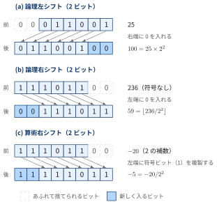{width="70%" fig-align="center"}

[シフトと2のべき乗の乗除算]{.mini-section}

10進数で数を左に1桁ずらすと10倍になるのと同じく，２進数を左に1ビットずらすと2倍になります．$x = \sum_i a_i 2^i$ を $k$ ビット左にずらすと，各ビットの重みが $2^i$ から $2^{i+k}$ に変わるので

$$
\sum_i a_i 2^{i+k} = 2^k \sum_i a_i 2^i = 2^k x
$$

となります．たとえば $9 = $ `0000 1001` を4ビット左シフトすると `1001 0000` $= 144 = 9 \times 2^4$ です．ただし上位からあふれたビットに1が含まれていると，正しい積にはなりません．

逆に右へ $k$ ビットずらすと，$2^k$ で割って小数点以下を切り捨てた値になります．符号なし整数には論理右シフトを使います．符号付き整数の場合，論理右シフトでは符号ビットに 0 が入って負の数が正の数に変わってしまうため，符号ビットを複製する算術右シフトを使います．図の (c) では $-20$ を2ビット算術右シフトして $-5$ を得ています．

| 演算 | MIPS | x86-64 | C言語 / Python |
|:----|:----:|:------:|:--------------:|
| 論理左シフト | `sll` | `shl` | `<<` |
| 論理右シフト | `srl` | `shr` | 符号なし型の `>>` |
| 算術右シフト | `sra` | `sar` | 符号付き型の `>>` |

C言語で負の符号付き整数を右シフトした結果は処理系定義ですが，主要なコンパイラは算術右シフトを使います．Python の `>>` は常に算術右シフトとして振る舞います．

::: {.callout-important}
## 算術右シフトは負の数の整数除算と一致しない

算術右シフトで $k$ ビットずらす操作は，$2^k$ で割って **小さい方へ** 丸める（床関数）ことにあたります．一方，C言語などの整数除算は **0 の方へ** 丸めます．両者は負の数で食い違います．

- $-5$ を8ビットで表すと `1111 1011`．2ビット算術右シフトすると `1111 1110` $= -2$
- C言語の `-5 / 4` は $-1.25$ を0の方へ丸めて $-1$

そのため，コンパイラが「2のべき乗による符号付き除算」をシフトに置き換えるときは，負の数に補正を加えた命令列を生成します．なお Python の `-5 // 4` は床関数で丸めるので $-2$ となり，`-5 >> 2` と一致します．
:::

### 乗算

２進数の乗算も10進数の筆算と同じ手順で計算できます．$8 \times 9$ を4ビットどうしで計算すると次のとおりです．

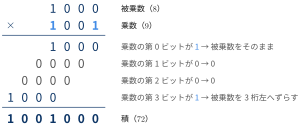{width="85%" fig-align="center"}

筆算の各段に並ぶ数を，次のように定式化します．

::: {#def- .custom_problem .blog-custom-border}
### 部分積

被乗数を $a$，乗数を $n$ ビットの $b = \sum_{i=0}^{n-1} b_i 2^i$（各 $b_i$ は 0 か 1）とすると，積は

$$
a \times b = \sum_{i=0}^{n-1} b_i \,(a \times 2^i)
$$

と書ける．各項 $b_i \,(a \times 2^i)$ を **部分積** と呼ぶ．部分積は，$b_i = 1$ なら被乗数を $i$ ビット左シフトしたもの，$b_i = 0$ なら 0 である．

:::

乗数の各桁は 0 か 1 なので，筆算の各段（部分積）は「被乗数をずらして書く」か「0 を書く」かのどちらかです．つまり２進数の乗算は，**乗数のビットが1の桁について，被乗数を左にずらしたものを足し合わせる** 操作です．$n$ ビットと $m$ ビットの積は最大で $n + m$ ビットになるので，$n$ ビットどうしの積を正確に保持するには $2n$ ビットが必要です．

[乗算のハードウェア]{.mini-section}

筆算の手順をそのまま回路にしたのが次の構成です．被乗数レジスタは $2n$ ビットで，被乗数を右半分に置いた状態から始めます．積レジスタは 0 で初期化します．

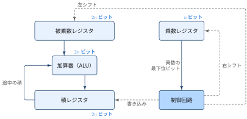{width="90%" fig-align="center"}

制御回路は次の手順を $n$ 回繰り返します．

1. 乗数の最下位ビットを調べる．1なら，積レジスタに被乗数レジスタの値を足す．0なら何もしない
2. 被乗数レジスタを左に1ビットシフトする（筆算で次の段を1桁左へずらすことにあたる）
3. 乗数レジスタを右に1ビットシフトする（次の桁が最下位ビットに来る）

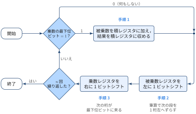{width="85%" fig-align="center"}

::: {#exm- .custom_problem }
### $2 \times 3$ を4ビットで計算する

乗数 `0011`（3），被乗数 `0010`（2）として，上の手順を4回繰り返します．

| 繰り返し | 手順 | 乗数 | 被乗数 | 積 |
|:-------:|:-----|:----:|:------:|:--:|
| 0 | 初期値 | `0011` | `0000 0010` | `0000 0000` |
| 1 | 1. 最下位ビットが1 → 積 ＋ 被乗数 | `0011` | `0000 0010` | `0000 0010` |
|   | 2. 被乗数を左シフト | `0011` | `0000 0100` | `0000 0010` |
|   | 3. 乗数を右シフト | `0001` | `0000 0100` | `0000 0010` |
| 2 | 1. 最下位ビットが1 → 積 ＋ 被乗数 | `0001` | `0000 0100` | `0000 0110` |
|   | 2. 被乗数を左シフト | `0001` | `0000 1000` | `0000 0110` |
|   | 3. 乗数を右シフト | `0000` | `0000 1000` | `0000 0110` |
| 3 | 1. 最下位ビットが0 → 何もしない | `0000` | `0000 1000` | `0000 0110` |
|   | 2. 被乗数を左シフト | `0000` | `0001 0000` | `0000 0110` |
|   | 3. 乗数を右シフト | `0000` | `0001 0000` | `0000 0110` |
| 4 | 1. 最下位ビットが0 → 何もしない | `0000` | `0001 0000` | `0000 0110` |
|   | 2. 被乗数を左シフト | `0000` | `0010 0000` | `0000 0110` |
|   | 3. 乗数を右シフト | `0000` | `0010 0000` | `0000 0110` |

最終的な積は `0000 0110` $= 6$ です．
:::
***

[改良と高速化]{.mini-section}

上の構成は仕組みを理解するためのもので，実際には次のような改良が加えられています．

- **被乗数を動かさず積をずらす**：被乗数を左へずらす代わりに積レジスタを右へずらせば，被乗数レジスタと加算器は $n$ ビットで済む．さらに，積レジスタの右半分は最初は使われていないので，そこに乗数を入れておけば乗数レジスタも不要になる
- **加算を並列に行う**：乗数の各ビットに対応する部分積は互いに独立なので，加算器を木の形に並べて同時に足し合わせれば，$n$ 回の逐次加算を約 $\log_2 n$ 段の加算にできる

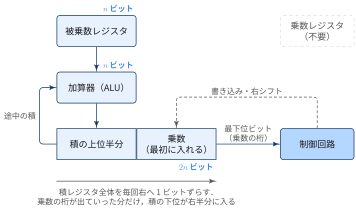{width="90%" fig-align="center"}

[符号付き整数の乗算と定数倍]{.mini-section}

符号付き整数の乗算の最も簡単な方法は，被乗数と乗数をそれぞれ正の数に直して掛け，元の符号が異なっていれば最後に積の符号を反転することです．実際のハードウェアでは，2の補数のまま計算できる **ブースのアルゴリズム**（Booth's algorithm）などが使われます．

$n$ ビットどうしの積は $2n$ ビットになるため，命令セットは積の上位半分の扱いを決めています．MIPS の `mult` は64ビットの積を `Hi`・`Lo` という2つのレジスタに分けて格納し，x86-64 の `mul`・`imul`（1オペランド形式）は128ビットの積を `rdx` と `rax` に格納します．C言語の `int` どうしの乗算のように結果を $n$ ビットに収める場合は，上位半分が捨てられ，収まらなければオーバーフローになります．

また，定数を掛ける乗算はシフトと加算で置き換えられます．たとえば $x \times 10 = x \times 8 + x \times 2$ なので，`(x << 3) + (x << 1)` で計算できます．コンパイラは，乗算命令より速い場合にこの置き換えを行います．

### 除算

[筆算で考える]{.mini-section}

まず符号なし整数の除算を考えます．

::: {#def- .custom_problem .blog-custom-border}
### 符号なし整数の除算

非負整数 $a$ と正の整数 $b$ に対して

$$
a = q \times b + r, \qquad 0 \leq r < b
$$

を満たす非負整数の組 $(q, r)$ はただ1つ存在する．$q$ を $a \div b$ の **商**，$r$ を **剰余** と呼び，$a$ を **被除数**，$b$ を **除数** という．

:::

$74 \div 8$ を２進数の筆算で計算すると次のとおりです．

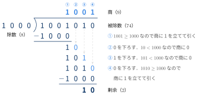{width="90%" fig-align="center"}

10進数の筆算では商の各桁を 0〜9 から試行錯誤して選びますが，２進数では商の各桁は 0 か 1 しかありません．**除数が今の部分被除数から引けるなら商の桁は 1 で引き算を行い，引けないなら 0** とするだけです．

[除算のハードウェア]{.mini-section}

コンピューターは「引けるかどうか」を事前に判定せず，まず実際に引いてみて，結果が負になったら除数を足し戻して元に戻します．

::: {#def- .custom_problem .blog-custom-border}
### 引き戻し法

途中の剰余から除数を引き，結果が 0 以上なら商のビットを 1 とし，負なら除数を足し戻して途中の剰余を元に戻したうえで商のビットを 0 とする．この操作を商の上位ビットから1ビットずつ繰り返す除算の方式を **引き戻し法**（restoring division）という．

:::

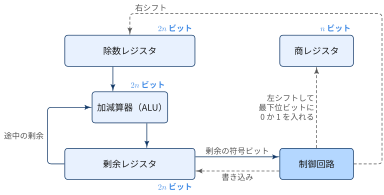{width="90%" fig-align="center"}

$2n$ ビットの剰余レジスタの右半分に被除数を，$2n$ ビットの除数レジスタの左半分に除数を入れ，商レジスタを 0 で初期化してから，制御回路が次の手順を $n + 1$ 回繰り返します．

1. 剰余レジスタから除数レジスタの値を引き，結果を剰余レジスタに書き込む
2. 剰余の符号ビットを調べる
    - 剰余 $\geq 0$ なら，商レジスタを左に1ビットシフトし，最下位ビットを 1 にする
    - 剰余 $< 0$ なら，剰余に除数を足して元の値に戻し，商レジスタを左に1ビットシフトして最下位ビットを 0 にする
3. 除数レジスタを右に1ビットシフトする

繰り返しが $n$ 回ではなく $n+1$ 回なのは，除数を左半分（$2^n$ 倍の位置）から動かし始めるためです．被除数は $n$ ビットなので $2^n$ 未満で，除数の $2^n$ 倍より必ず小さくなります．したがって1回目の商ビットは常に 0 です．このビットは，その後の $n$ 回の左シフトで $n$ ビットの商レジスタの外へ押し出されます．

::: {#exm- .custom_problem }
### $7 \div 2$ を4ビットで計算する

被除数 `0111`（7），除数 `0010`（2）として，上の手順を5回繰り返します．各手順のうち「1.」の行は，引き算の直後の剰余を示しています．

| 繰り返し | 手順 | 商 | 除数 | 剰余 |
|:-------:|:-----|:--:|:----:|:----:|
| 0 | 初期値 | `0000` | `0010 0000` | `0000 0111` |
| 1 | 1. 剰余 − 除数 | `0000` | `0010 0000` | `1110 0111` |
|   | 2. 負 → 除数を足し戻す，商に 0 | `0000` | `0010 0000` | `0000 0111` |
|   | 3. 除数を右シフト | `0000` | `0001 0000` | `0000 0111` |
| 2 | 1. 剰余 − 除数 | `0000` | `0001 0000` | `1111 0111` |
|   | 2. 負 → 除数を足し戻す，商に 0 | `0000` | `0001 0000` | `0000 0111` |
|   | 3. 除数を右シフト | `0000` | `0000 1000` | `0000 0111` |
| 3 | 1. 剰余 − 除数 | `0000` | `0000 1000` | `1111 1111` |
|   | 2. 負 → 除数を足し戻す，商に 0 | `0000` | `0000 1000` | `0000 0111` |
|   | 3. 除数を右シフト | `0000` | `0000 0100` | `0000 0111` |
| 4 | 1. 剰余 − 除数 | `0000` | `0000 0100` | `0000 0011` |
|   | 2. 0以上 → 商に 1 | `0001` | `0000 0100` | `0000 0011` |
|   | 3. 除数を右シフト | `0001` | `0000 0010` | `0000 0011` |
| 5 | 1. 剰余 − 除数 | `0001` | `0000 0010` | `0000 0001` |
|   | 2. 0以上 → 商に 1 | `0011` | `0000 0010` | `0000 0001` |
|   | 3. 除数を右シフト | `0011` | `0000 0001` | `0000 0001` |

商は `0011` $= 3$，剰余は `0001` $= 1$ となり，$7 = 3 \times 2 + 1$ が得られます．
:::
***

乗算と同じく，実際のハードウェアでは除数を動かさずに剰余レジスタを左へずらし，商のビットを剰余レジスタの右半分に詰めていくことで，加減算器とレジスタを $n$ ビットに減らしています．また，負になっても足し戻さずに次の段で除数を足す **引き放し法**（nonrestoring division）や，1段で商を複数ビットずつ求める SRT 除算などの高速化手法もあります．ただし乗算と違って，「前の段の剰余の符号を見てから次の段を決める」という依存関係があるため，除算は並列化が難しく，乗算より時間のかかる演算です．

[符号付き整数の除算]{.mini-section}

符号付き整数の除算も，乗算と同じく被除数と除数を正の数に直して割り，あとから商と剰余の符号を決めます．符号の決め方は次のように定めます．

::: {#def- .custom_problem .blog-custom-border}
### 符号付き整数の除算（0方向への丸め）

整数 $a$ と 0 でない整数 $b$ に対して，$a \div b$ の商 $q$ と剰余 $r$ を

$$
q = \operatorname{sgn}(a)\operatorname{sgn}(b) \left\lfloor \frac{|a|}{|b|} \right\rfloor, \qquad r = a - q \times b
$$

とする．ここで $\operatorname{sgn}$ は符号関数（正なら $1$，負なら $-1$，0 なら $0$）とする．このとき $|r| < |b|$ であり，$r \neq 0$ なら剰余 $r$ の符号は **被除数 $a$ の符号と一致する**．

:::

つまり，商は被除数と除数の符号が異なれば負になり，剰余は被除数と同じ符号になります．

| 被除数 | 除数 | 商 | 剰余 | 検算 |
|:-----:|:----:|:--:|:----:|:----|
| $+7$ | $+2$ | $+3$ | $+1$ | $+7 = (+3)(+2) + 1$ |
| $-7$ | $+2$ | $-3$ | $-1$ | $-7 = (-3)(+2) - 1$ |
| $+7$ | $-2$ | $-3$ | $+1$ | $+7 = (-3)(-2) + 1$ |
| $-7$ | $-2$ | $+3$ | $-1$ | $-7 = (+3)(-2) - 1$ |

$-7 \div 2$ は「商 $-4$，剰余 $+1$」としても $-7 = (-4) \times 2 + 1$ を満たします．しかしそうすると，$7 \div 2$ の商 $3$ と $-7 \div 2$ の商 $-4$ とで絶対値が変わり，$-(x \div y) = (-x) \div y$ が成り立たなくなります．剰余の符号を被除数に合わせると，商の絶対値は符号によらず一定になります（商を0の方へ丸めることと同じです）．

::: {.callout-note}
## 言語によって符号付き除算の丸め方が違う

C言語（C99 以降）や Java はハードウェアと同じく商を0の方へ丸めるため，`-7 / 2` は `-3`，`-7 % 2` は `-1` です．一方 Python の `//` と `%` は商を小さい方へ丸め，剰余を **除数と同じ符号** にするため，`-7 // 2` は `-4`，`-7 % 2` は `1` になります．負の値を含むデータで剰余を使ってグループ分けや周期の計算をするときは，この違いに注意が必要です．
:::

[ゼロ除算とオーバーフロー]{.mini-section}

除算には，加減算や乗算にない例外的なケースがあります．

- **ゼロ除算**：MIPS はハードウェアではゼロ除算を検出せず，ソフトウェアで除数を検査する．x86-64 の `div`・`idiv` はゼロ除算で例外を発生させる
- **符号付き除算のオーバーフロー**：最小値を $-1$ で割った $-2^{n-1} \div (-1) = 2^{n-1}$ は $n$ ビットの2の補数で表せない．x86-64 ではこの場合も例外になる

## Appendix: 1の補数表現の加算と循環桁上げ

1の補数表現の欠点は「0の表現が2つある」ことです．4ビットでは `0000` が $+0$，`1111` が $-0$ です．この欠点はゼロの判定だけでなく，加算の定義も面倒にします．

[2の補数と同じ加算器では結果がずれる]{.mini-section}

2の補数表現では，ビットパターンを符号なし整数として足し，最上位ビットからあふれた桁上げを捨てれば正しい結果が得られました．同じ手順を1の補数表現で行うと，次のようになります．

- `1111`（$-0$）＋ `0001`（$1$）＝ `1 0000`．5ビット目を捨てると `0000`（$+0$）．$-0 + 1$ は $1$ になるべきなので，$1$ だけ小さい
- `1110`（$-1$）＋ `0011`（$3$）＝ `1 0001`．5ビット目を捨てると `0001`（$1$）．正しい結果は $2$ なので，やはり $1$ だけ小さい

2つ目の例が示すとおり，ずれは $-0$ に限った話ではありません．**最上位ビットから桁上げが出ると，結果は必ず正しい値より $1$ 小さくなります**．なお2の補数表現では `1111` は $-1$ なので，`1111` ＋ `0001` ＝ `0000`（$0$）は正しい結果です．

[ずれる理由：mod が違う]{.mini-section}

ずれの原因は，1の補数表現と加算器とで，値を同一視するときの mod が違うことにあります．

::: {#thm- .custom_problem .blog-custom-border}
### 1の補数表現は mod $2^n - 1$ の表現である

$n$ ビットの1の補数表現で値 $v$ を表すビットパターンを，符号なし整数として読んだ値を $P$ とする．このとき

$$
P \equiv v \pmod{2^n - 1}
$$

が成り立つ．

:::

$v \geq 0$ なら $P = v$ です．$v < 0$ なら，パターンは $|v|$ の全ビットを反転したもの，つまり $|v|$ の1の補数なので $P = (2^n - 1) - |v| = (2^n - 1) + v$ となり，$P$ と $v$ の差は $2^n - 1$ です．$-0$ を表す `1…1` も $P = 2^n - 1 \equiv 0$ なので，同じ式に当てはまります．

一方，$n$ ビットの加算器は mod $2^n$ で計算します．最上位ビットからの桁上げを捨てる操作は，和から $2^n$ を引くことにあたります．2の補数表現はパターンと値が mod $2^n$ で一致するので，$2^n$ を引いても値は変わりません．ところが1の補数表現で正しい結果を得るには，引いてよいのは $2^n - 1$ までです．$2^n$ を引くと引きすぎになり，

$$
(P_a + P_b) - 2^n \equiv a + b - 1 \pmod{2^n - 1}
$$

と，結果が $1$ だけ小さくなります．

[循環桁上げ（end-around carry）]{.mini-section}

引きすぎた $1$ を戻せば，正しい結果になります．

::: {#def- .custom_problem .blog-custom-border}
### 循環桁上げ

1の補数表現の加算で，最上位ビットから桁上げが出たとき，それを捨てずに結果の最下位ビットに足し戻す操作を **循環桁上げ**（end-around carry）と呼ぶ．

:::

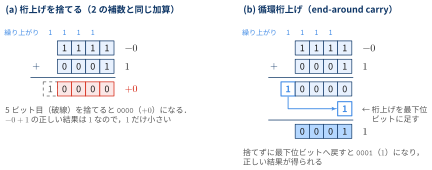{width="100%" fig-align="center"}

先ほどの2つ目の例も，`0001` に桁上げの $1$ を足して `0010`（$2$）となり，正しい結果が得られます．足し戻したときに再び桁上げが出ることはありません．$P_a, P_b \leq 2^n - 1$ なので，桁上げを捨てた値は $P_a + P_b - 2^n \leq 2^n - 2$ で，$1$ を足しても $2^n - 1$ 以下に収まるからです．

回路としては，加算器の最上位ビットの桁上げ出力を最下位ビットの桁上げ入力につなげば実現できます．ただし，桁上げが加算器を2周する場合があります．たとえば `1100`（$-3$）＋ `1011`（$-4$）＝ `1 0111` では，桁上げを足し戻した `0111` ＋ `1` で再び下位から上位まで桁上げが伝わり，`1000`（$-7$）になります．そのぶん，2の補数の加算器より結果が確定するまでの時間が長くなります．

[結果の 0 も2通りある]{.mini-section}

加算の結果としても $-0$ が現れます．`0011`（$3$）＋ `1100`（$-3$）＝ `1111` で，桁上げが出ないのでそのまま $-0$ になります．そのため「結果が 0 か」「2つの値が等しいか」を判定する回路は，`0000` と `1111` の両方を 0 として扱う必要があります．2の補数表現なら，`0011` ＋ `1101` ＝ `1 0000` の桁上げを捨てた `0000` だけが 0 です．

このように1の補数表現は，加算に循環桁上げという余分な手順を必要とし，ゼロの判定も2通り必要になります．2の補数表現が広く使われるようになった理由の1つです．ただし1の補数の和は，バイトの並び順に依存しないなどの性質から，IPv4・TCP・UDP のヘッダのチェックサム（RFC 1071）で今も使われています．

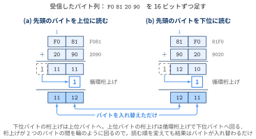{width="90%" fig-align="center"}

***

## Appendix: ポケモン金・銀のダメージ計算で起きるオーバーフロー

本文で扱ったシフト演算・1バイトの乗除算・オーバーフローがすべて登場する実例として，ゲームボーイ版『ポケットモンスター 金・銀』（1999年）のダメージ計算で起きるオーバーフローがあります．「はらだいこ」を使った「ふといほね」持ちのガラガラが，育てきるとかえってほとんどダメージを与えられなくなるという，対戦で知られた現象です．

[前提：ダメージ計算は1バイトの乗除算で行われる]{.mini-section}

ゲームボーイのCPUは8ビットCPUで，レジスタは1つ8ビット（1バイト）です．2つのレジスタを組にすると，16ビットの値も扱えます．能力値（攻撃力・防御力など）は最大 999 なので，16ビットで保持されています．

一方，ダメージ計算に使われる乗算・除算のサブルーチンは，**乗数と除数を1バイト（0〜255）で受け取ります**．本文の乗算ハードウェアでいえば，乗数レジスタが8ビットしかない状態です．そのため，攻撃力と防御力は，ダメージ計算に入る前に1バイトに収めておく必要があります．

[攻撃力・防御力を1バイトに収める処理]{.mini-section}

金・銀では，この処理を次のように行います．

::: {#def- .custom_problem .blog-custom-border}
### 金・銀における能力値の切り詰め

ダメージ計算に使う攻撃力を $A$，防御力を $D$（どちらも16ビットの非負整数）とする．

1. $A \geq 256$ または $D \geq 256$ なら，$A$ と $D$ の **両方** を4で割り，小数点以下を切り捨てる（結果が 0 なら 1 とする）．この割り算は1回だけ行う
2. 1の結果の **下位8ビットだけ** を攻撃力・防御力として使う．つまり $A \bmod 256$ と $D \bmod 256$ を使う

:::

この2つの手順は，どちらもビット操作として実現されています．

- **4で割る**：16ビットの値全体を2ビット論理右シフトする．本文のシフト演算の節で見たとおり，これは $2^2 = 4$ で割って小数点以下を切り捨てることにあたる．このとき上位バイトの下位2ビットは，下位バイトの上位2ビットへ移る
- **下位8ビットだけを使う**：上位バイトをそのまま捨てる．上位バイトが 0 でなければ，捨てた分（$256$ の倍数）だけ値が小さくなる．つまり，結果は元の値の mod 256 になる

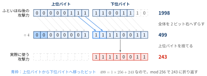{width="100%" fig-align="center"}

この処理は，「能力値は 999 を超えない」という前提で設計されています．$\lfloor 999 / 4 \rfloor = 249 \leq 255$ なので，前提が守られていれば4で1回割った時点で上位バイトは必ず 0 になり，上位バイトを捨てても情報は失われません．

[上限 999 をすり抜ける2倍の補正]{.mini-section}

ところが，この前提を破る経路があります．

- **はらだいこ**：HPを最大HPの半分だけ消費して，攻撃のランクを最大の +6 まで上げる技．金・銀のランク補正は +6 で 4倍（400%）．ランク補正を掛けた能力値には 999 の上限が掛かる
- **ふといほね**：カラカラ・ガラガラに持たせると攻撃力が2倍になる道具．

問題は，ふといほねの2倍が **999 の上限を掛けた後，ダメージ計算の直前に** 掛けられ，そこで上限を掛け直していないことです．そのため，ダメージ計算に渡る攻撃力は最大で $999 \times 2 = 1998$ になり，$\lfloor 1998 / 4 \rfloor = 499$ と，4で1回割っても1バイトに収まりません．

同じ理由で，防御側の「リフレクター」（防御力を2倍にする技）も 999 の上限を掛けた後に2倍するため，防御力の側でも同じオーバーフローが起こります．

[ガラガラの攻撃力はいくつになるか]{.mini-section}

レベル50のガラガラの攻撃力の実数値は，最大まで育てると 131 です（種族値 80，個体値 15，努力値最大）．実数値を $A_0$ として，はらだいこ（4倍）とふといほね（2倍）を掛けた後の流れを追うと次のようになります．

| 実数値 $A_0$ | はらだいこ後 | ふといほね後 | $\div 4$ | 実際に使われる攻撃力 |
|:-----------:|:-----------:|:-----------:|:-------:|:-------------------:|
| 100 | 400 | 800 | 200 | **200** |
| 127 | 508 | 1016 | 254 | **254** |
| 128 | 512 | 1024 | 256 | **0** |
| 129 | 516 | 1032 | 258 | **2** |
| 131 | 524 | 1048 | 262 | **6** |

はらだいこ後が 999 以下である限り，実際に使われる攻撃力は $\lfloor 8A_0 / 4 \rfloor \bmod 256 = 2A_0 \bmod 256$ です．実数値が 127 までは正しく 254 以下に収まりますが，128 以上になると $2A_0$ が 256 以上になって mod 256 で折り返し，攻撃力はほぼ 0 になります．つまり，**実数値が 128〜131 のよく育てたガラガラほど弱くなる** という逆転が起きます．本文の円の図でいえば，最大値 255 から時計回りに1つ進んで 0 に戻ったのと同じ状態です．

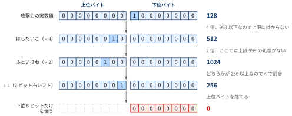{width="100%" fig-align="center"}

[ダメージへの影響]{.mini-section}

金・銀のダメージ計算は，ソースコードの処理順に書くと次のとおりです．各段階の割り算はすべて小数点以下を切り捨てます．

$$
\text{基礎ダメージ} = \min\!\left(997,\ \left\lfloor \frac{1}{50} \left\lfloor \frac{\left(\lfloor 2L / 5 \rfloor + 2\right) \times P \times A}{D} \right\rfloor \right\rfloor \right) + 2
$$

ここで $L$ は攻撃側のレベル，$P$ は技の威力，$A$・$D$ は切り詰めた後の攻撃力・防御力です（タイプ強化の道具や急所の補正は $\min$ の内側で掛かります）．この基礎ダメージに対して，タイプ一致補正（1.5倍），タイプ相性補正（タイプごとに2倍・0.5倍・0倍），乱数補正（$217/255$〜$255/255$，およそ 85〜100%）の順に掛けたものが最終的なダメージです．

攻撃力が $A = 0$ になると，$\min$ の中身は防御力・威力・レベルによらず 0 になり（急所の2倍を掛けても 0 のまま），基礎ダメージは最低値の **2** になります．後から補正を掛けても

- タイプ一致：$2 \times 1.5 = 3$
- タイプ一致＋効果抜群（2倍）：$6$
- タイプ一致＋効果抜群（4倍）：$12$

にしかならず，乱数補正を考えると最大でも 10〜12 ダメージです．

::: {#exm- .custom_problem }
### レベル50のガラガラの「じしん」

ガラガラ（レベル50，ふといほね，はらだいこ使用後）が，防御力 100 の相手に「じしん」（威力100，じめんタイプでタイプ一致，相性は等倍）を使った場合を計算します．攻撃力が 256 以上なので防御力も4で割られて $D = 25$ になり，$\lfloor 2 \times 50 / 5 \rfloor + 2 = 22$ です．

| 実数値 $A_0$ | 攻撃力 $A$ | 基礎ダメージ | タイプ一致後 | 乱数補正後 |
|:-----------:|:---------:|:-----------:|:-----------:|:---------:|
| 127 | 254 | 449 | 673 | 572〜673 |
| 128 | 0 | 2 | 3 | 2〜3 |
| 131 | 6 | 12 | 18 | 15〜18 |

実数値が 1 違うだけで，ダメージは数百から一桁まで落ちます．
:::
***

## 📘 用語集

:::{.glossary-container}

```yaml
glossary:
  - def: 被乗数 (multiplicand)
    description: |
      乗算 $a \times b$ で掛けられる側の数 $a$．２進数の筆算やシフト加算型の乗算回路では，乗数のビットが1の桁に合わせて左へずらしながら積に足し込む．

  - def: 乗数 (multiplier)
    description: |
      乗算 $a \times b$ で掛ける側の数 $b$．
      シフト加算型の乗算回路では最下位ビットから1ビットずつ調べ，そのビットが1のときだけ被乗数を積に足す．

  - def: 積 (product)
    description: |
      乗算の結果．$n$ ビットと $m$ ビットの積は最大で $n + m$ ビットになるため，
      $n$ ビットどうしの積を正確に保持するには $2n$ ビットが必要になる．

  - def: オペコード (opcode)
    description: |
      機械語命令のうち，実行する演算の種類（加算・減算・シフト・メモリからの読み込みなど）を指定する部分．
      operation code の略で，命令コードとも呼ぶ．
      例えば MIPS の `add $t0, $t1, $t2` では `add` にあたる部分がオペコードで，CPU はこの値を解読して動作を決める．

  - def: オペランド (operand)
    description: |
      演算や命令の対象となる値．$a + b$ の $a$ と $b$ がオペランドにあたる．
      機械語命令ではオペコード以外の部分で指定し，レジスタ・即値（命令に直接書かれた定数）・メモリアドレスのいずれかをとる．
      例えば `add $t0, $t1, $t2` では，結果の格納先 `$t0` と加算される値 `$t1`・`$t2` の3つがオペランドにあたる．
```

:::


References
----------
- D. A. パターソン，J. L. ヘネシー（成田光彰 訳）『コンピュータの構成と設計 第5版 上』日経BP社，2014年．2.4節「符号付き数と符号なし数」，2.6節「論理演算」，3.2節「加算と減算」，3.3節「乗算」，3.4節「除算」，3.9節「誤信と落とし穴」
- [pret/pokegold](https://github.com/pret/pokegold)：『ポケットモンスター 金・銀』の逆アセンブル．`engine/battle/effect_commands.asm` の `TruncateHL_BC`・`SpeciesItemBoost`・`BattleCommand_DamageCalc`
- [pret/pokecrystal](https://github.com/pret/pokecrystal)：『ポケットモンスター クリスタルバージョン』の逆アセンブル
- [pokecrystal: Bugs and Glitches](https://github.com/pret/pokecrystal/blob/master/docs/bugs_and_glitches.md)：“Thick Club and Light Ball can make (Special) Attack wrap around above 1024”，“Reflect and Light Screen can make (Special) Defense wrap around above 1024”
