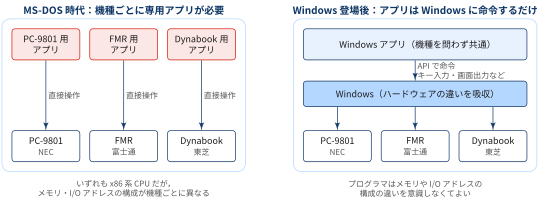
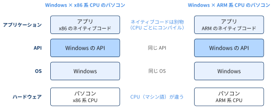
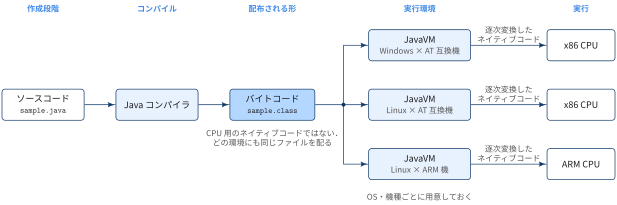

::: {.callout-note}
## TL;DRs

- **MS-DOS 時代の問題**: PC-9801・FMR・Dynabook などは同じ x86 系 CPU を積んでいても，メモリや I/O アドレスの構成が機種ごとに違った．アプリケーションがハードウェアを直接操作していたため，機種ごとに専用のアプリケーションが必要だった
- **Windows の革新**: アプリケーションはキー入力や画面出力をハードウェアに直接ではなく，Windows に API で命令して行う．機種ごとの違いは Windows が吸収するので，1 つのアプリケーションが機種を問わず動くようになり，プログラマはハードウェア構成の違いを意識しなくてよくなった
- **それでも残る CPU の壁**: 市販のアプリケーションは特定の CPU のネイティブコードで配布される．OS と API が同じでも，CPU が違えば（x86 と ARM など）CPU ごとにコンパイルし直す必要がある

:::

## CPU以外の違いを乗り越えたWindows

コンピュータのハードウェアはCPUだけでなく，メインメモリ，SSDなどの外部記憶媒体，I/Oを介して接続されたキーボードといった入力装置，ディスプレイやスピーカーやプリンタといった出力装置があります．それぞれの周辺装置をどのように制御するかは，コンピュータの機種ごとで異なります．

Windowsはこのようなハードウェア構成の違いを乗り越えることに大きく貢献したOSです．Windowsの前身OSであるMS-DOSが広く使われていた時代は，NECのPC-9801，富士通のFMR，東芝のDynabookなど，様々なアーキテクチャーに基づいたパソコンがありました．これらの機種はいずれもx86系CPUを搭載していましたが，メモリーやI/Oアドレスの構成が異なっていたので，MS-DOS用のアプリケーションは機種ごとに専用のものが必要でした（I/Oアドレス空間が機種によって異なる）．理由としては，OSのパフォーマンス不足などが理由でアプリケーションが直接ハードウェアを操作する必要があったためと言われています．

Windows登場後は，Windowsアプリケーションは，キー入力もディスプレイ出力もハードウェアではなくWindowsに命令を与えることで間接的に実現しています．これによってプログラマはメモリやI/Oアドレスの構成の違いを意識する必要がなくなりました．

{width="100%" fig-align="center"}

ただし，WindowsであってもCPUの種類の違いまでは吸収できません．なぜなら，市販のWindowsアプリケーションは，特定のCPUのネイティブコードの形で提供されるからです．


::: {.callout-note}
### PC/AT互換機と現代の一般的なPC

PC/AT互換機とは，IBMが1984年に発売したIBM PC/ATとハードウェア構成（BIOS，メモリマップ，I/Oアドレス，割込み番号，ISAバスなど）が共通するパソコンのことです．ただし現在のPCを「PC/AT互換機」と呼ぶことは少なくなっています．PC/ATから受け継いだ部分の多くが，次のように置き換えられたためです．

:::: {.no-border-top-table}

| 項目 | PC/AT | 現代のPC |
|---|---|---|
| ファームウェア | BIOS | UEFI（Windows 11 はUEFIが必須要件） |
| 拡張バス | ISAバス | PCI Express |
| 周辺機器の接続 | PS/2，シリアル・パラレルポート，フロッピーディスク | USB，NVMe SSD |
| デバイス構成の把握 | 固定のI/Oアドレス・割込み番号 | OSが起動時にACPIやPCI Expressの情報から取得 |

: {tbl-colwidths="[22,34,44]"}

::::

現代のOSはデバイスの構成をファームウェアから問い合わせ，違いをデバイスドライバで吸収するので，「ハードウェア構成がPC/ATと互換かどうか」はアプリケーションにとってほとんど意味を持ちません．代わりに重要になったのが，本文で見た「OSでも吸収できないCPUの違い」，つまり**命令セットアーキテクチャ（ISA）による分類**です．

:::: {.no-border-top-table}

| ISA | 別名 | 主な搭載機器 |
|---|---|---|
| x86_64 | x64，AMD64，Intel 64 | 一般的なWindows PC，Intel搭載のMac，多くのサーバー |
| ARM64 | AArch64，arm64 | スマートフォン，AppleシリコンのMac（2020年〜），Windows on ARMのPC（Snapdragon Xなど） |

: {tbl-colwidths="[16,28,56]"}

::::

ソフトウェアの配布ページで「Windows x64 / ARM64」「Linux amd64 / arm64」「macOS Appleシリコン / Intel」のように選択肢が分かれているのは，この分類に対応しています．なお，Rosetta 2（macOS）やPrism（Windows 11）のように，x86_64のネイティブコードをARM64のネイティブコードへ変換して実行する仕組みもありますが，変換のオーバーヘッドがあるうえ，デバイスドライバのようにカーネルモードで動くコードは変換できません．

:::


### OSが同じならAPIは基本的に同じ

::: {#def- .custom_problem .blog-custom-border}
### API

_ Application Programming Interfaceの略
- Windowsアプリケーションが「Windowsに命令を与える」ときの，アプリケーションからOSへの命令の仕方を定めたものを，APIと呼ぶ
- キー入力，マウス入力，ディスプレイ出力，ファイル入出力のように周辺機器と入出力を行う機能などを，任意のアプリケーションから利用可能な関数セットとして提供している

:::

APIは，OSが同じなら，どのハードウェアでも基本的には同じです．上で見たように，機種ごとのメモリやI/Oアドレスの構成の違いはOSが吸収し，アプリケーションには同じAPIを見せるからです．

もちろん，CPUの種類が違えばマシン語が違うので，ネイティブコードまで同じではありません．たとえば同じWindowsでも，x86系CPUのパソコンとARM系CPUのパソコンでは，アプリケーションが呼び出すWindowsのAPIは同じですが，ソースコードをそれぞれのCPU向けにコンパイルしたネイティブコードが別々に必要です．

{width="90%" fig-align="center"}

## Appendix: どこでも同じ実行環境を提供するJava仮想マシン

エミュレーターとは異なる手法で，基底のハードウェアやOSとは結びついていないプログラムの実行環境を提供するものもあります．Javaがその一例です．Javaには以下の二つの側面があります

- プログラミング言語としてのJava，
- プログラムの実行環境としてのJava

Javaは，他のプログラミング言語と同様に，Javaの文法で記述されたソースコードをコンパイルしたものを実行します．ただし，コンパイル後に生成されるのは，特定のCPU用のネイティブコードではなく，バイトコードと呼ばれるものです．

バイトコードの実行環境をJava仮想マシン(JavaVM = Java Virtual Machine)と呼びます．JavaVMは，Javaバイトコードを逐次ネイティブコードに変換しながら実行します．例えば，AT互換機用のJavaコンパイラとJava仮想マシンを使った場合は，プログラマが作成したソースコード(sample.java)をコンパイラがバイトコード(sample.class)に変換します．JavaVM(java.exe)がバイトコードをx86系CPUのネイティブコードに変換し，CPUが実際の処理を行います．

コンパイル後のバイトコードを実行時にネイティブコードに変換するという手法は，同じバイトコードを異なる環境で動作させるための手段です．様々な種類のOSやハードウェアの機種に合わせてJava仮想マシンを作成しておけば，同じバイトコードのアプリケーションがどの環境でも動作します．実行時に毎回バイトコードをネイティブコードに変換するJavaの仕組みは実行速度を遅くする原因になります．

{width="100%" fig-align="center"}

## 📘 用語集

:::{.glossary-container}

```yaml
glossary:
  - def: PC/AT互換機（IBM PC/AT Compatibles）
    description: |
      IBM が1984年に発売したパソコン「IBM PC/AT」とハードウェア・ソフトウェアの互換性を持つパソコンの総称．IBM PC/AT は x86 系 CPU（Intel 80286）を搭載し，拡張バスなどの仕様が公開されていたため，多くのメーカーが互換機を製造して事実上の業界標準となった．メモリや I/O アドレスの構成が共通なので，同じ OS・アプリケーションがメーカーを問わず動く．日本では長く NEC の PC-9801 など独自アーキテクチャの機種が主流だったが，DOS/V（1990年）による日本語表示の実現や Windows の普及を経て，AT 互換機へ移行した．現在一般に「Windows パソコン」と呼ばれる x86 系 PC の多くはこの系譜にあり，Windows だけでなく Linux や FreeBSD などもインストールできる．

  - def: マシン語（機械語，Machine Language）
    description: |
      CPU が直接解釈・実行できる命令の体系．命令は 0 と 1 の並び（バイナリ）で表される．どのような命令があり，それをどのようなビット列で表すか（命令セットアーキテクチャ）は CPU の種類ごとに決まっている．そのため，x86 系 CPU のマシン語は ARM 系 CPU では解釈できない．人間が直接読み書きするのは難しいため，通常は C 言語などの高水準言語や，命令を英略語に対応させたアセンブリ言語でプログラムを書き，コンパイラやアセンブラでマシン語に変換する．

  - def: ネイティブコード（Native Code）
    description: |
      特定の CPU のマシン語で書かれ，その CPU がそのまま実行できる形になったプログラム．C 言語などのソースコードをコンパイラで変換して作る．Windows の EXE ファイルのように，市販のアプリケーションはこの形で配布される．特定の CPU 向けに作られるため，CPU の種類が異なる環境ではそのまま実行できない．また，プログラムが呼び出す API も OS ごとに異なるため，通常は CPU と OS の組合せごとに別のネイティブコードを用意する必要がある．Java のバイトコードのように，実行時に仮想マシンがネイティブコードへ変換する中間形式と対比して使われることが多い．

  - def: ソースコード（Source Code）
    description: |
      プログラマが C 言語や Java などのプログラミング言語の文法に従って書いた，人間が読めるテキスト形式のプログラム．テキストファイルなので，文字コードの問題を除けば，どのような環境でも表示・編集できる．CPU はソースコードを直接実行できないため，コンパイラでネイティブコードに変換してから実行する．インタプリタのように実行しながら逐次解釈する方式や，Java のようにバイトコードへ変換してから仮想マシンで実行する方式もある．変換元（source）となるコードという意味でこう呼ばれ，市販アプリケーションでは通常ソースコードは配布されず，ネイティブコードだけが配布される．
  - def: バイトコード（Bytecode）
    description: |
      特定の CPU のマシン語ではなく，仮想マシン（実行環境ソフトウェア）が解釈することを前提に作られた中間形式の命令列．Java では，ソースコード（`.java`）を Java コンパイラ（`javac`）でコンパイルするとバイトコード（`.class` ファイル）が生成される．バイトコードは CPU や OS に依存しないため，同じファイルをどの環境にも配布でき，各環境に用意された Java 仮想マシン（JavaVM）が実行時にその CPU のネイティブコードへ変換しながら実行する．命令が 1 バイト単位の操作コードで表されることからこう呼ばれる．Python（`.pyc`）や .NET の中間言語（CIL）など，Java 以外の言語処理系でも同様の仕組みが使われている．
```

:::
