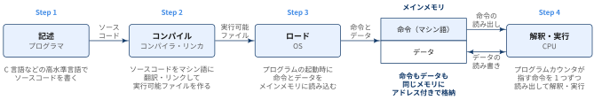
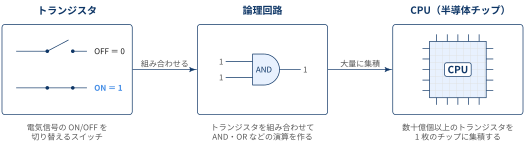
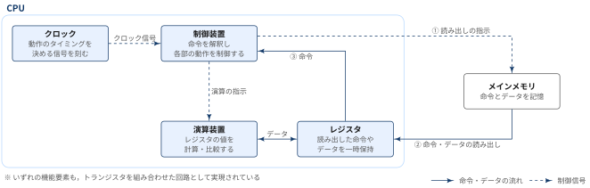
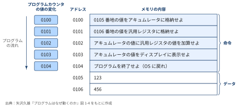
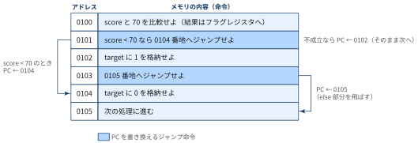
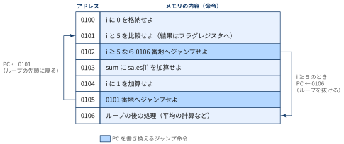
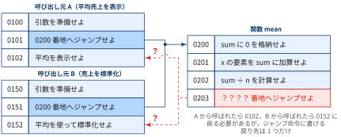
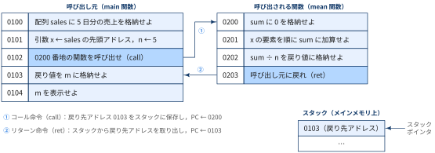

::: {.callout-note}
## TL:DRs

- CPUが実行できるのは機械語の**命令**だけであり，プログラムはメモリ上に並んだ命令の列
- 命令は「何をするか（オペコード）」と「何に対して行うか（オペランド）」で構成される
- **レジスタ**はCPU内部にある少数の高速な記憶領域で，演算対象のデータやメモリアドレスを一時的に保持する
- CPUは，プログラムカウンタが指す命令を読み出し → 解釈し → レジスタ上で実行する，というサイクルを繰り返す

:::

## CPU とは？

::: {#def- .custom_problem .blog-custom-border}
### CPU

- Central Processing Unitの略称
- 最終的にマシン語になったプログラムの内容を解釈して実行する装置
- 物理的には，電気信号のON/OFFを切り替えるスイッチである**トランジスタ**が大量に集積された半導体チップ（集積回路）として作られている

:::

{width="100%" fig-align="center"}

[CPUの物理的構成]{.mini-section}

{width="100%" fig-align="center"}

[CPUを構成する機能要素]{.mini-section}

{width="100%" fig-align="center"}

:::: {.no-border-top-table}

| 構成要素 | 役割 |
| --- | --- |
| レジスタ | CPU内部にある少数の高速な記憶領域．演算対象のデータや，命令・データが置かれたメモリのアドレスを一時的に保持する．次に実行する命令のアドレスを保持するプログラムカウンタなど，用途ごとに種類がある |
| 制御装置 | メインメモリからレジスタへの命令の読み出しを指示し，読み出された命令を解釈する．そして，その内容に応じて演算装置やレジスタ，メモリとのデータ転送などCPU各部の動作を制御する |
| 演算装置 | レジスタに格納された値を使って，加減算などの算術演算，AND・ORなどの論理演算，大小の比較を行う |
| クロック | CPUが動作するタイミングとなる一定周期の信号（クロック信号）を刻む．その速さはクロック周波数（Hz）で表され，周波数が高いほど1秒間に多くの処理を進められる |
| メインメモリ | CPUの外部にある．実行中のプログラムの命令とデータを記憶する装置．記憶場所はアドレスで区別され，CPUはアドレスを指定して読み書きする．電源を切ると内容は失われる |
: {tbl-colwidths="[20,80]"}

::::

## レジスタとプログラミング

::: {.callout-note}
### Key Points

- レジスタに格納される値は，「命令」と「データ」の２パターンがある
- 「データ」の内容も，(1) 演算に使われる値，(2) メモリのアドレスを表す値，に分かれる

:::


CPUの種類に応じて正確には異なりますが，役割ベースではレジスタは以下のように分類できます．

:::: {.no-border-top-table}

| レジスタ | 格納する値・役割 |
| --- | --- |
| プログラムカウンタ | 次に実行する命令が格納されているメモリのアドレス．命令を1つ実行するたびに，次の命令のアドレスへ更新される |
| 命令レジスタ | メインメモリから読み出した命令．制御装置はこのレジスタの命令を解釈する．プログラムからは直接参照できない |
| アキュムレータ | 演算の対象となるデータや，演算の結果．演算レジスタとも呼ぶ．現在のCPUでは，汎用レジスタがこの役割を兼ねることが多い |
| 汎用レジスタ | 用途が固定されておらず，データやアドレスなど任意の値を一時的に格納できる |
| フラグレジスタ | 直前の演算結果の状態（結果がゼロか，負か，オーバーフローが起きたかなど）．条件分岐の判定に使われる |
| ベースレジスタ | データを格納するメモリ領域の先頭アドレス（基準となるアドレス） |
| インデックスレジスタ | ベースレジスタが指すアドレスからの相対的な位置．配列の要素を順に参照するときなどに使う |
| スタックポインタ | スタック領域で，最後にデータを格納した位置のアドレス |
| リンクレジスタ | 関数を呼び出したときの戻り先アドレス．ARMやRISC-Vなどが持つレジスタで，関数の中から別の関数を呼び出すときは，値をスタックに退避してから呼び出す．x86-64にはなく，戻り先アドレスは直接スタックに保存される |
: {tbl-colwidths="[25,75]"}

::::

### アセンブリ言語とレジスタ

**アセンブリ言語**は，マシン語の命令1つ1つに `mov`（転送）や `add`（加算）といった人間が読める名前（ニーモニック）を付けた低水準言語です．
アセンブリ言語の命令はマシン語の命令とほぼ1対1に対応しており，アセンブラによってマシン語に変換されます．

マシン語の命令はレジスタを対象に動作するため，アセンブリ言語では

- どのレジスタに
- どの値を置き
- どのレジスタ同士で演算するか

をプログラマ自身が指定します．
たとえば，`int` 型（4バイト＝32ビット）の変数 `a`，`b`，`c` について，C言語で `c = a + b;` と書く処理は，x86-64 のアセンブリ言語では次のようになります．

```c
int a, b, c;   /* それぞれ 4 バイトの整数 */
c = a + b;
```

```nasm
mov eax, dword [rbp-4]    ; メモリ上の int 型変数 a（4バイト）の値をレジスタ eax に読み込む
add eax, dword [rbp-8]    ; eax の値に int 型変数 b（4バイト）の値を加え，結果を eax に格納する
mov dword [rbp-12], eax   ; eax の値を int 型変数 c（4バイト）に書き込む
```

- `dword` は4バイト（32ビット）単位でメモリを読み書きすることを表し，`int` 型の大きさに対応します
- `eax` は演算に使う32ビットのレジスタで，上の表でのアキュムレータにあたる
- `rbp` は関数が使うメモリ領域のベースアドレスを保持するレジスタ．`int` 型の変数は4バイトずつ並ぶため，`a`，`b`，`c` はそれぞれ `[rbp-4]`，`[rbp-8]`，`[rbp-12]` と4バイト間隔のアドレスに置かれてる
- 各行の `mov` や `add` がオペコード，`eax` や `dword [rbp-4]` がオペランド

C言語では変数 `a`，`b`，`c` を書くだけで，値をどのレジスタに読み込むかを意識する必要はありません．
レジスタの割り当てやメモリとの間の読み書きは，コンパイラがマシン語に変換するときに決めてくれます．
一方，アセンブリ言語では次の手順をすべて自分で書くことになります．

::: {.callout-note}
## C言語のプログラムをアセンブリ言語で確認する

`gcc` に `-S` オプションを付けると，マシン語に変換する前のアセンブリ言語のファイル（`.s`）を出力できます．
`-masm=intel` を付けると，上の例と同じ Intel 記法で出力されます（ただし，メモリの指定は `DWORD PTR -4[rbp]` のような書き方になり，命令の並びも上の例とは多少異なります）．

```bash
gcc -S -masm=intel sample.c   # sample.s が生成される
```

最適化オプション（`-O2` など）の有無によって，出力されるレジスタの使い方は変わります．

:::

## プログラムの流れを決めるプログラムカウンタ

::: {.callout-note}
### Key Points

- プログラムカウンタには，次に実行すべき命令のアドレスが入っている
- CPUが命令を1つ実行するたびに，プログラムカウンタは次の命令のアドレスへ自動的に進む（順次実行）
- 条件分岐・繰り返し処理・関数呼び出しは，いずれも**プログラムカウンタの値を別のアドレスに書き換える**ジャンプ命令で実現されている
- デバッガのブレークポイントは，プログラムカウンタが特定のアドレスに達したところで実行を止める仕組み

:::

{width="100%" fig-align="center"}

上の図では，0100番地から0104番地に命令が，0105番地と0106番地にデータが置かれています．
プログラムの起動時にプログラムカウンタには0100が設定され，CPUが1つ命令を実行するたびに0101，0102，…と値が1つずつ進みます．
CPUは毎回プログラムカウンタが指すアドレスから命令を読み出すので，命令は**メモリに並んだ順に**実行されます．これを**順次実行**と呼びます．

順次実行だけでは，上から下へ一直線に進むプログラムしか書けません．
「条件によって処理を変える」「同じ処理を繰り返す」「まとまった処理を呼び出す」といったプログラムの流れは，すべて**プログラムカウンタの値を書き換える命令（ジャンプ命令）**によって作られています．

### 条件分岐

条件分岐は，次の2つの命令の組み合わせで実現されます．

1. **比較命令**：2つの値を比較し，その結果（等しいか，大きいか，小さいか）をフラグレジスタに記録する
2. **条件ジャンプ命令**：フラグレジスタを参照し，条件が成り立っていればプログラムカウンタを指定したアドレスに書き換える．成り立っていなければ何もせず，プログラムカウンタはそのまま次の命令へ進む

::: {#exm- .custom_problem }
### 購入確率スコア（0〜100の整数）が閾値70以上の顧客をキャンペーンの配信対象にする処理

```c
int score = 82;   /* モデルが出力した購入確率スコア（0〜100） */
int target;       /* 1：配信対象，0：対象外 */

if (score >= 70) {
    target = 1;
} else {
    target = 0;
}
```

このif文は，x86-64のアセンブリ言語ではおおよそ次のようになります．

```nasm
    cmp dword [rbp-4], 70       ; score と 70 を比較し，結果をフラグレジスタに記録する
    jl  .not_target             ; score < 70 なら .not_target へジャンプ
    mov dword [rbp-8], 1        ; target = 1
    jmp .end                    ; else 部分を飛ばして .end へジャンプ
.not_target:
    mov dword [rbp-8], 0        ; target = 0
.end:
```

`jl`（jump if less）が条件ジャンプ命令，`jmp` が条件なしでジャンプする無条件ジャンプ命令です．
これをメモリ上の命令の並びとして表すと，次の図のようになります．

{width="100%" fig-align="center"}

:::
***


ソースコード上の `if` と `else` は，CPUから見ると「フラグレジスタを見て，次に実行する命令のアドレスを決める」という操作にすぎません．
閾値による二値分類（`predict_proba` の出力を0.5で切って0/1のラベルにする処理など）や，欠損値・外れ値を判定して処理を変える前処理も，最終的にはこの比較命令と条件ジャンプ命令の組み合わせとして実行されます．

### 繰り返し処理

繰り返し処理（ループ）は，**前のアドレスに戻るジャンプ命令**で実現されます．
ループの末尾でプログラムカウンタをループの先頭のアドレスに書き換えると，同じ命令の並びがもう一度実行されます．
ただし，それだけでは永遠に終わらないので，ループの先頭で終了条件を比較し，条件を満たしたらループの後ろへジャンプして抜け出します．

::: {#exm- .custom_problem }
### 5日分の売上の合計を求める処理

```c
int sales[5] = {120, 98, 143, 110, 87};  /* 5日分の売上 */
int sum = 0;

for (int i = 0; i < 5; i++) {
    sum += sales[i];
}
```

このforループは，メモリ上では次のような命令の並びになります．

{width="100%" fig-align="center"}

0101番地から0105番地までの命令は，データの件数（ここでは5回）だけ繰り返し実行されます．

:::
***


pandasやNumPyの `sum()` や `mean()` を使う場合も，CPUの上では同じようにループが実行されています．
ただし，そのループはC言語などで書かれたコンパイル済みのコードの中で実行されるため，Pythonの `for` 文で1行ずつ処理するよりも，CPUが実行する命令の数を大幅に減らせます．

### 関数呼び出し

関数呼び出しも，プログラムカウンタを関数の先頭アドレスに書き換えるジャンプの一種です．
ただし，関数の処理が終わったら**呼び出し元に戻ってくる**必要があります．

[なぜジャンプ命令だけでは関数呼び出しを実現できないのか]{.mini-section}

ジャンプ命令のジャンプ先アドレスは，命令の中に書き込まれた**固定の値**です．
そのため，関数の呼び出し元が1か所だけなら，関数の最後に「呼び出し元の次の命令へジャンプせよ」と書いておけば戻れます．

しかし，関数は複数の場所から呼び出されるのが普通です．
たとえば平均を計算する関数 `mean` は，平均売上を表示する処理（呼び出し元A）からも，売上を標準化する処理（呼び出し元B）からも呼び出されます．

{width="100%" fig-align="center"}

- Aから呼ばれたときは0102番地へ，Bから呼ばれたときは0152番地へ戻らなければならない
- 一方，関数の最後のジャンプ命令に書ける戻り先は1つだけ
- しかも，ジャンプした時点でプログラムカウンタは0200に上書きされるため，関数の側からは「どこから呼ばれたのか」がわからない

つまり，関数呼び出しを実現するには次の2つが必要です．

1. **呼び出す時点で戻り先アドレスを記録しておく**：呼び出し元の次の命令のアドレスは，ジャンプする直前のプログラムカウンタからわかる
2. **戻るときは，記録しておいたアドレスへジャンプする**：ジャンプ先を命令に固定で書くのではなく，実行時に記録された値を使う

これを1命令ずつで行うのが，次のコール命令（call）とリターン命令（ret）です．

[コール命令とリターン命令]{.mini-section}

::: {#def- .custom_problem .blog-custom-border}
### コール命令とリターン命令

- **コール命令（call）**：呼び出し元の次の命令のアドレス（戻り先アドレス）をスタックに保存してから，プログラムカウンタを関数の先頭アドレスに書き換える
- **リターン命令（ret）**：スタックから戻り先アドレスを取り出し，プログラムカウンタに書き戻す

:::


スタックはメインメモリ上の領域で，最後に格納したデータの位置をスタックポインタ（x86-64では `rsp`）が保持しています．
関数の中からさらに別の関数を呼び出しても，戻り先アドレスがスタックに積み重なっていくため，正しい順番で呼び出し元に戻れます．

::: {#exm- .custom_problem }
### 売上データの平均を計算する関数 `mean` を `main` 関数から呼び出すプログラム

```c
#include <stdio.h>

double mean(const double *x, int n) {
    double sum = 0.0;
    for (int i = 0; i < n; i++) {
        sum += x[i];
    }
    return sum / n;
}

int main(void) {
    double sales[5] = {120, 98, 143, 110, 87}; 
    double m = mean(sales, 5);
    printf("平均売上: %.1f\n", m); 
    return 0;
}
```

`m = mean(sales, 5);` の行で，プログラムカウンタは次のように移動します．

{width="100%" fig-align="center"}

前処理・特徴量の作成・評価指標の計算などを関数に分けて書いても，CPUの上では「戻り先アドレスをスタックに積んでジャンプし，終わったら取り出して戻る」という操作が繰り返されているだけです．

:::
***


[サブルーチン呼び出し vs 関数呼び出し]{.mini-section}

CPUの解説では「関数呼び出し」の代わりに「サブルーチン呼び出し」という言葉もよく使われます．
結論からいうと，現代の多くのプログラミング言語では両者は同じ仕組みで動いており，違いは**値を返すかどうか**と，**どの文脈で使われる用語か**の2点です．

:::: {.no-border-top-table}

| | サブルーチン | 関数 |
| --- | --- | --- |
| 本来の意味 | 名前を付けて呼び出せる処理のまとまりの総称．処理が終わると呼び出し元に戻る | サブルーチンのうち，呼び出し元に値（戻り値）を返すもの |
| 戻り値 | なくてもよい（画面への表示やファイルへの書き込みなど，副作用が目的のことが多い） | ある（戻り値を式の中で使える） |
| 呼び出し方 | 文として呼び出す（例：Fortranの `CALL FOO(X)`） | 式の一部として呼び出す（例：`y = f(x)`） |
: {tbl-colwidths="[16,42,42]"}

::::

**言語による呼び分け**

- **明確に区別する言語**：Fortran（`SUBROUTINE` / `FUNCTION`），Pascal・Ada（`procedure` / `function`），Visual Basic（`Sub` / `Function`）
- **区別しない言語**：C言語，Python，JavaScriptなど．すべてを「関数」と呼び，値を返さないものはC言語では `void` 型の関数，Pythonでは `None` を返す関数として扱う
- **シェルスクリプト**：`function` と呼ぶが，性質はサブルーチンに近い．`return` で返せるのは終了ステータス（0〜255の整数）だけ

**関数型プログラミングでの「関数」**

関数型プログラミングの文脈では，「関数」をより厳密な意味で使うことがあります．
同じ入力に対して常に同じ出力を返し，副作用を持たない**純粋関数**だけを関数と呼び，副作用を持つ処理は手続き（procedure）やサブルーチンと呼んで区別します．


### ブレークポイント

::: {#def- .custom_problem .blog-custom-border}
### ブレークポイント

- **ブレークポイント**は，プログラムの指定した位置で実行を一時停止させるデバッガの機能のこと
- 「プログラムカウンタが特定のアドレスに達したところで実行を止める」仕組みのこと

:::

x86-64のCPUで動くデバッガ（`gdb` など）は，一般に次の手順でブレークポイントを実現しています．

{width="100%" fig-align="center"}

つまりブレークポイントとは，「プログラムカウンタが特定のアドレスに達したところで実行を止める」仕組みです．
止まっている間は，プログラムカウンタやほかのレジスタ，変数の値を自由に調べられます．

::: {#exm- .custom_problem }
### Pythonにおけるブレークポイント

Pythonでは，`breakpoint()` を書いた行で処理を止め，その時点の変数を調べられます．

```python
def preprocess(df):
    df = df.dropna(subset=["sales"])
    breakpoint()   # ここで停止し，df の行数や統計量を確認できる
    df["sales_z"] = (df["sales"] - df["sales"].mean()) / df["sales"].std()
    return df
```

Pythonのデバッガ（`pdb`）は，CPUの命令を `int3` に置き換えるのではなく，Pythonインタプリタが1行ずつ実行する仕組みを利用して停止します．

:::
***

## Appendix: `mean` 関数の引数 `const double *x`

::: {.callout-note}
### Key Points

- `double *x` は，配列の値そのものではなく**先頭アドレス**を受け取る
- `x[i]` は「先頭アドレス + `i` × 8バイト」の位置にある値．CPUは**ベースレジスタ**（先頭アドレス）と**インデックスレジスタ**（`i`）からこのアドレスを計算する
- `const` は，`x` が指す先の値を関数の中で書き換えないという約束
- ポインタは要素数の情報を持たないため，要素数 `n` を別の引数で渡す

:::

```c
double mean(const double *x, int n)
```

[`double *x`：配列の先頭アドレスを受け取るポインタ]{.mini-section}

- `double *x` は「`x` は `double` 型の値が置かれているメモリの**アドレス**を格納する変数（ポインタ）である」という意味
- `x` 自体には売上の値ではなく，値が置かれているアドレスが入る

`main` 関数で `mean(sales, 5)` と書くと，配列名 `sales` は自動的に**配列の先頭要素のアドレス**（`&sales[0]`）に変換されて渡されます．
つまり，5つの売上の値をコピーして渡しているのではなく，「売上データはメモリのここから始まる」というアドレス1つだけを渡しています．
実際に `gcc -S` で確認すると，`main` 関数は 

1. `sales` の先頭アドレスを計算して（`lea` 命令）
2. x86-64のLinuxで第1引数を渡すレジスタ `rdi` に格納して
3. `mean` を呼び出す

という流れになっています．

```nasm
lea  rax, [rbp-48]   ; 配列 sales の先頭アドレスを計算する
mov  esi, 5          ; 第2引数 n = 5
mov  rdi, rax        ; 第1引数 x = sales の先頭アドレス
call mean            ; mean を呼び出す
```

データが100万件あっても，渡すのはアドレス（x86-64では8バイト）だけなので，関数呼び出しのたびにデータ全体をコピーする必要がありません．

[`x[i]`：先頭アドレスから i 番目の値を読む]{.mini-section}

関数の中の `x[i]` は，`*(x + i)` と同じ意味で，「先頭アドレス `x` から `i` 個先の `double` 型の値」を表します．
`double` 型は1つ8バイトなので，`x[i]` が読み出すのは `x` のアドレス + `i` × 8バイトの位置にある値です．

| 式 | 読み出すメモリの位置 | 値（`sales` の場合） |
| --- | --- | --- |
| `x[0]` | `x` + 0バイト | 120 |
| `x[1]` | `x` + 8バイト | 98 |
| `x[2]` | `x` + 16バイト | 143 |
| `x[3]` | `x` + 24バイト | 110 |
| `x[4]` | `x` + 32バイト | 87 |

[ベースレジスタとインデックスレジスタで `x[i]` を読む]{.mini-section}

`x[i]` の「先頭アドレス + `i` × 8バイト」という計算は，レジスタの表で紹介した**ベースレジスタ**と**インデックスレジスタ**の組み合わせで行われます．

- **ベースレジスタ**：基準となるアドレス．ここでは配列の先頭アドレス `x`
- **インデックスレジスタ**：基準からの位置．ここでは先頭から何番目の要素かを表す `i`

CPUは，この2つのレジスタの値から読み出すメモリのアドレスを計算します．
たとえば `x` が1000番地（説明用の値）を指していて `i` が2のとき，`x[2]` として読み出すのは 1000 + 2 × 8 = 1016 番地の値です．

![ベースレジスタとインデックスレジスタによる x[i] の読み出し（アドレスは説明用の値）](figures/base-index-register.svg){width="100%" fig-align="center"}

x86-64には「ベースレジスタ専用」「インデックスレジスタ専用」のレジスタはありません．
`rdi` や `rax` などの汎用レジスタを，命令の中でベースやインデックスとして指定します．
メモリの位置は `[ベース + インデックス × スケール + 変位]` の形で指定でき，スケールには1・2・4・8のいずれかを書けます．
`double` 型は8バイトなので，スケールに8を指定すれば `x[i]` の位置をそのまま表せます．

NumPyの配列（`ndarray`）も同じ考え方で要素の位置を計算しています．
`ndarray` はデータの先頭アドレスと，インデックスが1増えたときに進むバイト数（`strides`）を持っています．
`float64` 型の1次元配列なら `strides` は `(8,)` で，`x[i]` の位置は「先頭アドレス + `i` × 8バイト」です．
`x[::2]` のように1つおきに取り出した配列では `strides` が `(16,)` になるため，データをコピーせずに1つおきの要素を参照できます．

[`const`：受け取ったデータを書き換えない約束]{.mini-section}

`const double *x` の `const` は，「`x` が指す先の値を，この関数の中では書き換えない」という宣言です．
関数の中で `x[0] = 0.0;` のように書くと，コンパイルエラーになります．

ポインタで渡すと関数は呼び出し元のデータそのものにアクセスできるため，うっかり書き換えると呼び出し元の `sales` まで変わってしまいます．
`const` を付けておけば，平均を計算するだけの関数が入力データを壊さないことをコンパイラに保証させられます．

[`int n`：要素数を別に渡す理由]{.mini-section}

ポインタ `x` が持っているのは先頭アドレスだけで，配列に何個の要素があるかという情報は含まれていません．
そのため，`mean` 関数は要素数 `n` を別の引数として受け取り，`i < n` の間だけループします．
`n` に実際の要素数より大きい値を渡すと，配列の外のメモリを読んでしまい，でたらめな結果になったりプログラムが異常終了したりします．

NumPyの配列（`ndarray`）は，データの先頭アドレスに加えて，形状（`shape`）や要素の型（`dtype`）といった情報を一緒に持っています．
そのため，`np.mean(x)` のように配列を渡すだけで，要素数を指定しなくても平均を計算できます．

## 📘 用語集

:::{.glossary-container}

```yaml
glossary:
  - def: アセンブル
    description: |
      アセンブリ言語で書かれたプログラムを，マシン語に変換すること．変換を行うプログラムをアセンブラと呼ぶ．
      アセンブリ言語の命令はマシン語の命令とほぼ1対1に対応しているため，変換は機械的に行える．

  - def: 逆アセンブル
    description: |
      マシン語のプログラムを，対応するアセンブリ言語の表記に戻すこと．変換を行うプログラムを逆アセンブラ（ディスアセンブラ）と呼ぶ．
      `objdump -d` などで実行可能ファイルやオブジェクトファイルの中身を確認するときに使う．
      変数名やコメントはマシン語に残らないため，逆アセンブルしても元のソースコードは復元できない．

  - def: オペコード (opcode)
    description: |
      命令のうち「何をするか」を表す部分．転送・加算・比較・分岐など，CPUに実行させる操作の種類を指定する．
      アセンブリ言語では `mov`（転送）や `add`（加算）などのニーモニックで書く．

  - def: オペランド (operand)
    description: |
      命令のうち「何に対して行うか」を表す部分．操作の対象となるレジスタ，メモリのアドレス，数値（即値）などを指定する．
      たとえば `add eax, dword [rbp-8]` では，`eax` と `dword [rbp-8]` がオペランドである．
      命令によってオペランドの個数は異なり，オペランドを持たない命令もある．
```

:::
