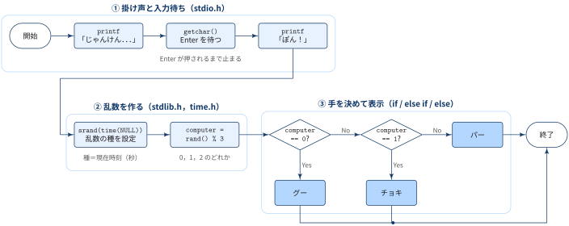
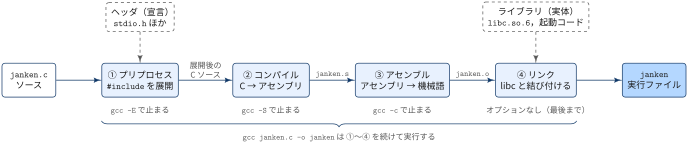
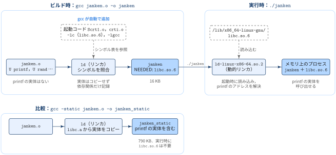

::: {.callout-note}
## TL;DRs

- **ヘッダとライブラリ**: `#include <stdio.h>` で取り込むのは関数の**宣言**だけ．関数の**実体**は libc（Linux では glibc の `libc.so.6`）にあり，gcc がリンク時に自動で結び付ける
- **gcc**: `gcc -Wall -Wextra -std=c11 janken.c -o janken` でコンパイルし，`./janken` で実行する．内部ではプリプロセス → コンパイル → アセンブル → リンクの4段階が走る
- **`srand(time(NULL))`**: 現在時刻（秒）を種にして，実行のたびに違う乱数列を使う．`srand` が無いと毎回同じ手，同じ1秒の中で実行しても同じ手になる
- **ベイズ更新**: 相手のクセはディリクレ分布で表せる．観測した手の母数に1を足すだけで事後分布が更新され，事後平均に対する最善手（5:3:2 の相手にはパー）を選べる

:::

## じゃんけんプログラム


::: {.callout-note}
### 動作

- Enter を押すと，コンピュータがグー・チョキ・パーのどれかを出します．


:::


```c
#include <stdio.h>
#include <stdlib.h>
#include <time.h>

void main() {
  int computer;

  printf("じゃんけん．．．");
  getchar();
  printf("ぽん！\n");

  srand(time(NULL));
  computer = rand() % 3;

  if (computer == 0) {
    printf("グー\n");
  } else if (computer == 1) {
    printf("チョキ\n");
  } else {
    printf("パー\n");
  }
}
```

[動作ロジック]{.mini-section}

{width="100%" fig-align="center"}

処理は3つのまとまりに分かれます．

1. **掛け声と入力待ち**：「じゃんけん．．．」を表示し，`getchar()` で Enter を待つ．押されたら「ぽん！」を表示する
2. **乱数を作る**：`srand(time(NULL))` で種を設定し，`rand() % 3` で 0・1・2 のどれかを作る
3. **手を決めて表示**：`computer == 0` ならグー，そうでなく `computer == 1` ならチョキ，どちらでもなければパー

③の判定は上から順に行われるので，`else` に来た時点で `computer` は 2 と決まっています．

上記の実行は，Ubuntu 24.04・gcc 13.3・glibc の環境で確認しています．

## C の書き方

### 文・ブロック・変数

C のプログラムは，次の要素からなります．

:::: {.no-border-top-table}

| 要素 | このコードでの例 | 説明 |
| --- | --- | --- |
| プリプロセッサ指令 | `#include <stdio.h>` | コンパイルの前に処理される命令．`#` で始まり，末尾に `;` を付けない |
| 関数 | `main() { ... }` | 処理のまとまり．`{ }` で囲んだ範囲（ブロック）が関数の中身 |
| 文 | `computer = rand() % 3;` | 処理の最小単位．末尾に `;` を付ける |
| 変数宣言 | `int computer;` | 変数は使う前に**型**を決めて宣言する．宣言しただけでは中身は不定 |
| 条件分岐 | `if (...) { } else if (...) { } else { }` | 条件が真になった最初のブロックだけを実行する |
: {tbl-colwidths="[22,33,45]"}

::::


::: {.callout-caution}
### `=` vs `==`

`if (computer = 0)` と書き間違えると，`computer` に 0 を代入したうえで「0 は偽」と判定されるため，グーが永遠に出なくなります．

:::


### `main` 関数

プログラムは `main` 関数から実行が始まります．ただし [`void main()` は C の規格に沿った書き方ではありません]{.regmonkey-bold}．
規格が定める `main` の形は 

- `int main(void)` と
- `int main(int argc, char *argv[])` 

の2つで，戻り値の `int` は OS に返す終了ステータスです．
警告を有効にしてコンパイルすると，gcc も指摘します．

```bash
% gcc -Wall janken.c -o janken
janken.c:5:6: warning: return type of 'main' is not 'int' [-Wmain]
    5 | void main() {
      |      ^~~~
```

### 1行ずつの意味

:::: {.no-border-top-table}

| コード | 意味 |
| --- | --- |
| `printf("じゃんけん．．．");` | 文字列を標準出力に書き出す．改行 `\n` は付けていない |
| `getchar();` | 標準入力から1文字読む．戻り値は捨てており，**Enter が押されるまで待つ**ためだけに使っている |
| `printf("ぽん！\n");` | 掛け声の後半を表示して改行する |
| `srand(time(NULL));` | 現在時刻を seed にして，乱数列の出発点を決める（[後述](#srand-role)） |
| `computer = rand() % 3;` | 疑似乱数を3で割った余りを取り，0・1・2 のどれかにする |
| `if` 〜 `else` | 0 ならグー，1 ならチョキ，それ以外（2）ならパーを表示する |
: {tbl-colwidths="[38,62]"}

::::

### 書き直した版 {#rewrite}

規格に沿った `main` にし，手の名前を配列で引くようにすると次のようになります．`fflush(stdout)` の意味は「[実行結果を読む](#read-output)」で説明します．

```c
#include <stdio.h>
#include <stdlib.h>
#include <time.h>

int main(void) {
  const char *hand[] = {"グー", "チョキ", "パー"};

  printf("じゃんけん．．．");
  fflush(stdout);
  getchar();
  printf("ぽん！\n");

  srand((unsigned int)time(NULL));
  int computer = rand() % 3;

  printf("%s\n", hand[computer]);
  return 0;
}
```

- `hand[computer]` は，配列 `hand` の `computer` 番目の文字列です．`if` の連鎖が配列の添字に置き換わるので，手の種類を増やしてもコードの形は変わらない．
- ソースファイルを UTF-8 で保存すると，文字列 `"グー"` は `e3 82 b0 e3 83 bc` の6バイトになる
- C の `char` は1バイト単位なので，日本語1文字は `char` 3つ分

## ライブラリの意味

### 3つのヘッダ

:::: {.no-border-top-table}

| ヘッダ | 使っているもの | 役割 |
| --- | --- | --- |
| `stdio.h` | `printf`，`getchar`，`fflush` | 標準入出力（standard input/output） |
| `stdlib.h` | `rand`，`srand` | 汎用ユーティリティ（乱数，メモリ確保，型変換など） |
| `time.h` | `time` | 時刻の取得と変換 |
: {tbl-colwidths="[18,32,50]"}

::::

`NULL` は `stdio.h`・`stdlib.h`・`time.h` のどれにも定義されています．

### ヘッダは「宣言」，ライブラリは「実体」

`#include` で取り込まれるのは，「`rand` という関数があり，引数なしで `int` を返す」という**宣言**だけです．
実際，プリプロセス後のソースには次のような行が並んでいます．

```bash
% gcc -E janken.c | grep -E "extern int (printf|rand) "
extern int printf (const char *__restrict __format, ...);
extern int rand (void) __attribute__ ((__nothrow__ , __leaf__));
```

関数の**実体**（機械語）は，C 標準ライブラリ libc に入っています．Linux では glibc の共有ライブラリ `libc.so.6` です．
コンパイルしただけのオブジェクトファイルを `nm` で見ると，`printf` や `rand` は `U`（undefined：このファイルには実体がない）になっています．

```bash
% gcc -c janken.c
% nm janken.o
                 U getchar
0000000000000000 T main
                 U printf
                 U puts
                 U rand
                 U srand
                 U time
```

この「穴」を埋めるのがリンクです．gcc は libc を自動でリンクし，出来上がった実行ファイルは起動時に `libc.so.6` を読み込みます（動的リンク）．
gcc が裏で何を追加しているかは，see [Appendix: gcc がリンク時に libc を結び付ける仕組み](#appendix-link)．

```bash
% ldd ./janken
	linux-vdso.so.1 (0x0000781b55caf000)
	libc.so.6 => /lib/x86_64-linux-gnu/libc.so.6 (0x0000781b55a00000)
	/lib64/ld-linux-x86-64.so.2 (0x0000781b55cb1000)
```

libc 以外のライブラリは自動ではリンクされません．たとえば `math.h` の `exp` や `sqrt` の実体は libm にあるので，`-lm` を付けます（[Appendix](#appendix-uniform) のコードで使います）．

::: {.callout-note}
### `printf` が `puts` に化けている

`nm` の結果には，ソースに書いていない `puts` があります．gcc は，書式指定を含まず `\n` で終わる `printf("ぽん！\n")` を，より軽い `puts("ぽん！")` に置き換えます．
`gcc -S janken.c` で出力したアセンブリにも `call puts@PLT` が並んでいます．ソースとリンクされる関数が1対1でないことがある，という例です．

:::

## gcc でのコンパイルと実行

### 基本の手順

```bash
# コンパイル（-o で実行ファイル名を指定．省略すると a.out）
% gcc janken.c -o janken

# 実行（カレントディレクトリの janken を明示して起動する）
% ./janken
```

警告を多めに出し，C11 規格に沿ってコンパイルするには次のようにします．学習中はこちらを推奨します．

```bash
% gcc -Wall -Wextra -std=c11 janken.c -o janken
```

:::: {.no-border-top-table}

| オプション | 意味 |
| --- | --- |
| `-o <name>` | 出力ファイル名 |
| `-Wall -Wextra` | よくある誤りへの警告を有効にする．`void main` や `if (x = 0)` を検出できる |
| `-std=c11` | C11 規格に沿ってコンパイルする |
| `-l<name>` | ライブラリ `lib<name>` をリンクする（例：`-lm` で libm） |
: {tbl-colwidths="[25,75]"}

::::

### 4つの段階

`gcc` コマンド1つの中で，次の4段階が順に実行されています．オプションを付けると，各段階の途中結果で止められます．

{width="100%" fig-align="center"}

:::: {.no-border-top-table}

| 段階 | 処理 | 止めるオプション | 出力 |
| --- | --- | --- | --- |
| ① プリプロセス | `#include` の展開・マクロ置換 | `gcc -E janken.c` | 展開後の C ソース（このコードは約2,200行に膨らむ） |
| ② コンパイル | C をアセンブリ言語に翻訳 | `gcc -S janken.c` | `janken.s` |
| ③ アセンブル | アセンブリを機械語に変換 | `gcc -c janken.c` | `janken.o`（オブジェクトファイル） |
| ④ リンク | `janken.o` と libc を結び付ける | `gcc janken.o -o janken` | `janken`（実行ファイル） |
: {tbl-colwidths="[16,30,24,30]"}

::::

ヘッダ（宣言）が使われるのは①②，ライブラリ（実体）が使われるのは④です．

## 乱数とは {#random-number}

::: {#def- .custom_problem .blog-custom-border}
### 乱数

- **乱数**とは，次に出る値を予測できず，どの値も同じ確率で出る数の並びのこと

:::

::: {#exm- .custom_problem }
### 正二十面体と乱数

手で乱数を作る道具として，**乱数サイ**（乱数さい）があります．正二十面体の各面に 0〜9 の数字を2回ずつ書いたサイコロで，どの面も同じ形・同じ面積なので，各数字が $2/20 = 1/10$ の確率で出ます．

色違いのサイを3個使い，百の位・十の位・一の位に割り当てれば，000〜999 の3桁の乱数を作れます．中学校数学の標本調査で使われる道具です．

じゃんけんなら，乱数サイを振って「0〜2 ならグー，3〜5 ならチョキ，6〜8 ならパー，9 なら振り直し」とすれば，3つの手を同じ確率で出せます．

:::
***


### 真の乱数と疑似乱数

:::: {.no-border-top-table}

| 種類 | 作り方 | 例 | 特徴 |
| --- | --- | --- | --- |
| 真の乱数 | 物理現象の観測 | サイコロ，熱雑音，放射性崩壊 | 再現できない．生成が遅い |
| 疑似乱数 | 決まった計算式（漸化式） | `rand()`，メルセンヌ・ツイスタ | seed が同じなら同じ列．高速 |
: {tbl-colwidths="[14,26,30,30]"}

::::

コンピュータは決まった手順で計算する機械なので，`rand()` が返すのは**疑似乱数**です．
疑似乱数は，内部状態 $X_n$ を漸化式で更新し，そこから出力を作ります．

$$
X_{n+1} = f(X_n), \qquad \text{出力}_n = g(X_n)
$$

最初の状態 $X_0$ を決めるのが seed です．seed が同じなら，その後の列はすべて同じになります．
状態の数は有限なので，いつか同じ状態に戻り，列は周期的に繰り返します．この長さを**周期**と呼びます．

### 線形合同法

最も古典的な疑似乱数の作り方が**線形合同法**（Linear Congruential Generator, LCG）です．

::: {#def-lcg .custom_problem .blog-custom-border}
[線形合同法]{.def-title}

整数の定数 $a$（乗数），$c$（増分），$m$（法）を決め，種 $X_0$ から

$$
X_{n+1} = (a X_n + c) \bmod m
$$

で次の値を作る．$X_n$ は $0, 1, \dots, m-1$ のどれかなので，周期は最大で $m$．

:::

定数の選び方で質が大きく変わります．$c \neq 0$ のとき，周期が最大の $m$ になる条件は次の3つです（Hull–Dobell の定理）．

1. $c$ と $m$ が互いに素
2. $m$ を割り切るすべての素数で $a-1$ が割り切れる
3. $m$ が4の倍数なら，$a-1$ も4の倍数

$m = 2^{31}$，$a = 1103515245$，$c = 12345$ はこの条件を満たし，周期は $2^{31}$ です．
ただし $m$ が2のべき乗の線形合同法には，**下位ビットの周期が短い**という弱点があります．$X_n$ の下位 $k$ ビットだけを見ると周期は $2^k$ しかなく，最下位ビットは 0 と 1 を交互に繰り返すだけです．

```python
x = 1
for _ in range(12):
    x = (1103515245 * x + 12345) % 2**31
    print(x % 2, end=" ")
# 0 1 0 1 0 1 0 1 0 1 0 1
```

これを `rand() % 2` でコイン投げに使うと，表と裏が交互に出るだけになります．

### C 規格の参考実装

C の規格（C11 7.22.2.2）は，`rand` の参考実装として次の線形合同法を載せています．

```c
static unsigned long int next = 1;

int rand(void) /* RAND_MAX は 32767 と仮定 */
{
  next = next * 1103515245 + 12345;
  return (unsigned int)(next / 65536) % 32768;
}

void srand(unsigned int seed)
{
  next = seed;
}
```

- `next / 65536` で下位16ビットを捨て，`% 32768` でその上の15ビット（ビット16〜30）だけを返す．周期の短い下位ビットを出力に使わないための工夫
- `next` の初期値が 1 なので，`srand` を呼ばずに `rand` を使うと `srand(1)` と同じ列になる

### glibc の `rand()` の実装

規格が定めているのは「`rand()` は 0 以上 `RAND_MAX` 以下の疑似乱数を返す」ことだけで，計算式は処理系に任されています．
Linux の glibc では `RAND_MAX` は $2^{31}-1 = 2147483647$ で，`rand()` の中身は線形合同法ではなく `random()` と同じ**加算型ラグ付きフィボナッチ法**（additive lagged Fibonacci generator）です．

::: {#def-glibc-rand .custom_problem .blog-custom-border}
[glibc の `rand()`（既定の TYPE_3）]{.def-title}

種 $s$（$0 < s < 2^{31}$）から，次の手順で数列 $r_0, r_1, \dots$ を作る．

$$
\begin{aligned}
r_0 &= s \\
r_i &= 16807\, r_{i-1} \bmod (2^{31}-1) && (1 \le i \le 30) \\
r_i &= r_{i-31} && (31 \le i \le 33) \\
r_i &= (r_{i-3} + r_{i-31}) \bmod 2^{32} && (i \ge 34)
\end{aligned}
$$

$k$ 回目（$k = 0, 1, \dots$）の `rand()` は $r_{k+344}$ を1ビット右シフトした値 $\lfloor r_{k+344} / 2 \rfloor$ を返す．

:::

- 2行目は Park–Miller の「最小標準」線形合同法（$a = 16807$，$c = 0$，$m = 2^{31}-1$）で，種から31個の初期状態を作る
- 4行目が本体．3つ前と31個前の値を足すだけの単純な漸化式だが，状態が31個の整数（約1,000ビット）あるため，周期は約 $16 \times (2^{31}-1)$ と長い
- 最初の310個（$r_{34}$〜$r_{343}$）は捨てる．初期状態の規則性を消すための「空回し」
- 最下位ビットは周期が短いので，1ビット右シフトして捨てる

この手順を Python で書くと，glibc の `rand()` とまったく同じ値が出ます．

```python
def glibc_rand(seed, n):
    """glibc で srand(seed) した後に rand() が返す最初の n 個（0 < seed < 2**31）"""
    r = [seed]
    for i in range(1, 31):                 # 種から初期状態を作る（Park–Miller 法）
        r.append(16807 * r[i - 1] % 2147483647)
    for i in range(31, 34):
        r.append(r[i - 31])
    for i in range(34, 344 + n):           # 加算型ラグ付きフィボナッチ法
        r.append((r[i - 31] + r[i - 3]) % 2**32)
    return [x >> 1 for x in r[344:]]       # 最初の 310 個は捨て，下位1ビットを落とす

print(glibc_rand(1, 5))
# [1804289383, 846930886, 1681692777, 1714636915, 1957747793]
```

C 側で `srand(1)` の後に `rand()` を5回呼んだ結果と比べると，一致します．

```c
#include <stdio.h>
#include <stdlib.h>

int main(void) {
  srand(1);
  for (int i = 0; i < 5; i++) printf("%d ", rand());
  printf("\n");
  return 0;
}
/* 出力: 1804289383 846930886 1681692777 1714636915 1957747793 */
```

::: {.callout-warning}
### `rand()` は暗号には使えない

上のとおり，`rand()` の出力は seed さえわかれば完全に再現できます．数回分の出力から内部状態を推定することもできるため，パスワードやトークンの生成には使えません．
Linux では `getrandom(2)` や `/dev/urandom` など，OS が提供する暗号論的に安全な乱数を使います．

:::

### `rand() % 3` の偏り {#modulo-bias}

`rand()` は $0$ から $2^{31}-1$ までの $2^{31}$ 通りの値を返します．$2^{31} = 3 \times 715827882 + 2$ なので，`% 3` を取ると

:::: {.no-border-top-table}

| `rand() % 3` | 対応する `rand()` の値の個数 |
| --- | --- |
| 0（グー） | 715,827,883 |
| 1（チョキ） | 715,827,883 |
| 2（パー） | 715,827,882 |
: {tbl-colwidths="[30,70]"}

::::

となり，パーだけが1個少なくなります．確率の差は約 $1/2^{31} \approx 4.7 \times 10^{-10}$ なので，じゃんけんでは無視できます．
ただし，`RAND_MAX` が 32767 の処理系で `rand() % 10000` のように大きな数で割ると偏りが目立ちます（[クセを入れる](#biased-hand) で扱います）．

## `srand(time(NULL))` の役割 {#srand-role}

### 種を時刻にする

`time(NULL)` は，1970年1月1日 0時0分0秒（UTC）からの経過秒数（UNIX 時刻）を返します．

```bash
% date +%s
1794822898
```

この値を `srand` に渡すと，実行した時刻によって種が変わり，`rand()` が返す列も変わります．
glibc では種と最初の手が次のように対応します．1秒ずれるだけで，最初の `rand()` の値はまったく別物になります．

:::: {.no-border-top-table}

| 種 `t`（UNIX 時刻） | 日時（JST） | 最初の `rand()` | `% 3` | 手 |
| --- | --- | --- | --- | --- |
| 1794787200 | 2026-11-16 09:00:00 | 1145346454 | 1 | チョキ |
| 1794787201 | 2026-11-16 09:00:01 | 1914286678 | 1 | チョキ |
| 1794787202 | 2026-11-16 09:00:02 | 1606902615 | 0 | グー |
| 1794787203 | 2026-11-16 09:00:03 | 1300796588 | 2 | パー |
| 1794787204 | 2026-11-16 09:00:04 | 996857732 | 2 | パー |
| 1794787205 | 2026-11-16 09:00:05 | 1772629431 | 0 | グー |
: {tbl-colwidths="[20,26,20,10,24]"}

::::

つまり，このプログラムのコンピュータの手は「**Enter を押した時刻（秒）で決まる**」ということです．

### `srand` を呼ばないと

`srand` を呼ばずに `rand()` を使うと，規格により `srand(1)` と同じ扱いになります．glibc では最初の値が `1804289383` で，$1804289383 \bmod 3 = 1$ なので，**毎回チョキ**を出します．

```bash
% for i in 1 2 3 4 5; do ./janken_nosrand; done
チョキ
チョキ
チョキ
チョキ
チョキ
```

### 同じ1秒の中で実行すると

種の単位は秒なので，1秒以内に何回実行しても同じ手になります．シェルのループで続けて実行すると，それがわかります．

```bash
% for i in 1 2 3 4 5; do echo | ./janken | tail -1; done
グー
グー
グー
グー
グー
```

人が Enter を押して遊ぶぶんには問題ありませんが，プログラムから何度も呼ぶ用途には向きません．

## クセを入れる {#biased-hand}

### グー:チョキ:パー = 5:3:2

人間のじゃんけんには「最初はグーが多い」などのクセがあると言われます．コンピュータにも，グー・チョキ・パーを $5:3:2$ の比率で出すクセを入れてみます．

考え方は「**0〜9 の一様乱数を，長さ 5・3・2 の区間に振り分ける**」です．

$$
r \in \{0, 1, \dots, 9\} \quad\longmapsto\quad
\begin{cases}
\text{グー} & (0 \le r \le 4) \quad \text{確率 } 5/10 \\
\text{チョキ} & (5 \le r \le 7) \quad \text{確率 } 3/10 \\
\text{パー} & (8 \le r \le 9) \quad \text{確率 } 2/10
\end{cases}
$$

```c
#include <stdio.h>
#include <stdlib.h>
#include <time.h>

int main(void) {
  const char *hand[] = {"グー", "チョキ", "パー"};
  const int weight[] = {5, 3, 2}; /* グー:チョキ:パー = 5:3:2 */
  const int total = 5 + 3 + 2;

  printf("じゃんけん．．．");
  fflush(stdout);
  getchar();
  printf("ぽん！\n");

  srand((unsigned)time(NULL));
  int r = rand() % total; /* 0〜9 の一様乱数 */

  int computer = 0;
  while (r >= weight[computer]) { /* r が入る区間を探す */
    r -= weight[computer];
    computer++;
  }
  printf("%s\n", hand[computer]);
  return 0;
}
```

`while` ループは，$r$ から区間の長さを順に引いていき，引けなくなった区間を選びます．$r = 6$ なら，$6 \ge 5$ なのでグーの区間を引いて $r = 1$，$1 < 3$ なのでチョキで止まります．
重みの配列を書き換えるだけで，どんな比率にもできます．これは累積分布関数の逆関数で乱数を変換する**逆関数法**を，離散分布に当てはめたものです．

10万回引いた結果は 50,238 : 29,914 : 19,848 で，ほぼ $5:3:2$ になります（$\chi^2 = 2.54$，$p = 0.28$．検定の方法は [Appendix](#appendix-uniform)）．

### `%` で割ったときの偏りを消す

[前述](#modulo-bias)のとおり，`rand() % n` は `RAND_MAX + 1` が $n$ で割り切れないと偏ります．glibc で `% 10` なら $2^{31} \bmod 10 = 8$ なので，0〜7 が 8〜9 より $1/2^{31}$ だけ出やすい程度で，実用上は問題ありません．

一方，`RAND_MAX` が 32767 の処理系で `rand() % 10000` とすると，$32768 = 3 \times 10000 + 2768$ なので，0〜2767 は4通り，2768〜9999 は3通りの `rand()` の値から作られ，**前者が約1.33倍出やすく**なります．
偏りを完全になくすには，割り切れる範囲を超えた値を捨てて引き直します（棄却法）．

```c
/* 0 以上 n 未満の整数を偏りなく返す */
int uniform_int(int n) {
  int limit = (RAND_MAX / n) * n; /* n の倍数の個数だけ使う */
  int r;
  do {
    r = rand();
  } while (r >= limit);
  return r % n;
}
```

### クセのある相手にはどう勝つか

自分がグー・チョキ・パーを出したときの期待利得（勝ち $+1$，あいこ $0$，負け $-1$）を，相手の手の確率 $p = (p_G, p_C, p_P)$ で書くと

$$
\begin{aligned}
E[\text{グー}] &= p_C - p_P && \text{（チョキに勝ち，パーに負ける）}\\
E[\text{チョキ}] &= p_P - p_G && \text{（パーに勝ち，グーに負ける）}\\
E[\text{パー}] &= p_G - p_C && \text{（グーに勝ち，チョキに負ける）}
\end{aligned}
$$

です．$p = (0.5, 0.3, 0.2)$ を代入すると $E[\text{グー}] = 0.1$，$E[\text{チョキ}] = -0.3$，$E[\text{パー}] = 0.2$ となり，**パーを出し続けるのが最善**で，1回あたり平均 $0.2$ 勝ち越せます．

一方，元のプログラムのように $p = (1/3, 1/3, 1/3)$ なら，どの手の期待利得も $0$ です．クセのない相手には，どんな戦略でも勝ち越せません．
問題は，現実には相手のクセ $p$ を知らないことです．これを対戦しながら推定するのが，次のベイズ更新です．

## ベイズ統計で相手のクセを学ぶ

### 設定

相手（コンピュータ）は，未知の確率 $p = (p_G, p_C, p_P)$ で独立に手を出すとします．
私たちは対戦のたびに相手の手を観測し，$p$ についての信念を確率分布として持ち，それを更新していきます．

- **事前分布**：対戦前の，$p$ についての信念
- **尤度**：$p$ のもとで，観測した手の並びが出る確率
- **事後分布**：観測を踏まえて更新した信念．$\text{事後} \propto \text{尤度} \times \text{事前}$

### ディリクレ分布

$p$ は3つの確率の組なので，「足して1になる3つの非負の数」の上の分布が必要です．それが**ディリクレ分布**です．

::: {#def-dirichlet .custom_problem .blog-custom-border}
[ディリクレ分布]{.def-title}

パラメーター $\alpha = (\alpha_G, \alpha_C, \alpha_P)$（すべて正）のディリクレ分布 $\mathrm{Dir}(\alpha)$ の密度は


$$
\begin{align}
\pi(p \mid \alpha) &= \frac{\Gamma(\alpha_0)}{\Gamma(\alpha_G)\,\Gamma(\alpha_C)\,\Gamma(\alpha_P)}\; p_G^{\alpha_G - 1}\, p_C^{\alpha_C - 1}\, p_P^{\alpha_P - 1},
\\
&\text{where}\,\, \alpha_0 = \alpha_G + \alpha_C + \alpha_P \nonumber
\end{align}
$$

で，平均は $E[p_k] = \alpha_k / \alpha_0$．各成分の周辺分布はベータ分布 $p_k \sim \mathrm{Beta}(\alpha_k,\, \alpha_0 - \alpha_k)$ になる．

:::

$\alpha_k$ は「手 $k$ をこれまでに何回見たか」に相当する擬似的な回数と解釈できます．

:::: {.no-border-top-table}

| 事前分布 | 意味 |
| --- | --- |
| $\mathrm{Dir}(1, 1, 1)$ | どの $p$ も同じくらいありうる（一様分布）．情報がないときの標準的な選択 |
| $\mathrm{Dir}(10, 10, 10)$ | 「たぶんほぼ均等」という強めの信念．各手を10回ずつ見た後と同じ重み |
: {tbl-colwidths="[30,70]"}

::::

### 更新の式

$N$ 回の対戦で，相手がグー・チョキ・パーを $n_G, n_C, n_P$ 回出したとします．尤度は

$$
P(\text{観測} \mid p) \propto p_G^{n_G}\, p_C^{n_C}\, p_P^{n_P}
$$

で，事前分布 $\mathrm{Dir}(\alpha)$ と掛けると $p_k$ の指数が足し合わされるだけなので，事後分布もディリクレ分布になります（共役事前分布）．

::: {#thm-dirichlet-update .custom_problem .blog-custom-border}
### ディリクレ分布の更新

$$
p \sim \mathrm{Dir}(\alpha_G, \alpha_C, \alpha_P)
\quad\xrightarrow{\ \text{観測 } (n_G, n_C, n_P)\ }\quad
p \mid \text{観測} \sim \mathrm{Dir}(\alpha_G + n_G,\ \alpha_C + n_C,\ \alpha_P + n_P)
$$

次に相手が手 $k$ を出す確率（事後予測確率）は，事後平均と一致する．

$$
P(\text{次が } k \mid \text{観測}) = \frac{\alpha_k + n_k}{\alpha_0 + N}
$$

:::

1回ごとに見れば，**観測した手の $\alpha$ に1を足す**だけです．今回の事後分布が，次の対戦の事前分布になります．
たとえば $\mathrm{Dir}(1, 1, 1)$ から始めて，10回でグー6回・チョキ1回・パー3回を観測すると

$$
\mathrm{Dir}(1, 1, 1) \;\longrightarrow\; \mathrm{Dir}(7, 2, 4), \qquad
E[p] = \left(\tfrac{7}{13}, \tfrac{2}{13}, \tfrac{4}{13}\right) = (0.538,\ 0.154,\ 0.308)
$$

です．同じ観測でも，事前分布が $\mathrm{Dir}(10, 10, 10)$ なら $\mathrm{Dir}(16, 11, 13)$，平均 $(0.400, 0.275, 0.325)$ となり，均等に近いままです．事前の信念が強いほど，少ない観測では動きにくくなります．

### 手の選び方

期待利得は $p$ について線形なので，事後分布で平均した期待利得は，事後平均 $\hat p = E[p \mid \text{観測}]$ を代入したものと一致します．

$$
E\bigl[\,E[\text{パー}] \mid \text{観測}\,\bigr] = E[p_G - p_C \mid \text{観測}] = \hat p_G - \hat p_C
$$

したがって，毎回「事後平均 $\hat p$ のもとで期待利得が最大の手」を出せば，いまの信念のもとで最善の手になります．

### C での実装

5:3:2 のクセを持つ相手と1000回対戦し，事前分布 $\mathrm{Dir}(1,1,1)$ から更新しながら手を選ぶプログラムです．

```c
#include <stdio.h>
#include <stdlib.h>

/* 0=グー, 1=チョキ, 2=パー */
const char *hand[] = {"グー", "チョキ", "パー"};

/* 相手：クセ 5:3:2 で手を出す */
int computer_hand(void) {
  const int weight[] = {5, 3, 2};
  int r = rand() % 10, k = 0;
  while (r >= weight[k]) { r -= weight[k]; k++; }
  return k;
}

/* 勝ち +1，あいこ 0，負け -1（グーはチョキに，チョキはパーに，パーはグーに勝つ） */
int payoff(int me, int you) {
  if (me == you) return 0;
  return ((me + 1) % 3 == you) ? 1 : -1;
}

/* 事後平均 p から，期待利得が最大の手を返す */
int best_response(const double alpha[3]) {
  double a0 = alpha[0] + alpha[1] + alpha[2];
  double p[3] = {alpha[0] / a0, alpha[1] / a0, alpha[2] / a0};
  double ev[3] = {p[1] - p[2],   /* グー：チョキに勝ち，パーに負け */
                  p[2] - p[0],   /* チョキ：パーに勝ち，グーに負け */
                  p[0] - p[1]};  /* パー：グーに勝ち，チョキに負け */
  int best = 0;
  for (int k = 1; k < 3; k++)
    if (ev[k] > ev[best]) best = k;
  return best;
}

int main(void) {
  double alpha[3] = {1.0, 1.0, 1.0}; /* 事前分布 Dirichlet(1, 1, 1) */
  int total_payoff = 0;
  const int checkpoints[] = {10, 30, 100, 300, 1000};
  int cp = 0;

  srand(20201015);
  for (int t = 1; t <= 1000; t++) {
    int me = best_response(alpha);  /* 1. いまの事後分布で手を決める */
    int you = computer_hand();      /* 2. 対戦して相手の手を観測 */
    total_payoff += payoff(me, you);
    alpha[you] += 1.0;              /* 3. 観測した手の α に 1 を足す */

    if (t == checkpoints[cp]) {
      double a0 = alpha[0] + alpha[1] + alpha[2];
      printf("n=%4d  alpha=(%3.0f, %3.0f, %3.0f)  "
             "mean=(%.3f, %.3f, %.3f)  next=%s  avg=%+.3f\n",
             t, alpha[0], alpha[1], alpha[2],
             alpha[0] / a0, alpha[1] / a0, alpha[2] / a0,
             hand[best_response(alpha)], (double)total_payoff / t);
      if (++cp == 5) break;
    }
  }
  return 0;
}
```

```bash
% gcc -Wall -Wextra -std=c11 bayes_janken.c -o bayes_janken
% ./bayes_janken
n=  10  alpha=(  7,   2,   4)  mean=(0.538, 0.154, 0.308)  next=パー  avg=+0.400
n=  30  alpha=( 15,   6,  12)  mean=(0.455, 0.182, 0.364)  next=パー  avg=+0.267
n= 100  alpha=( 46,  30,  27)  mean=(0.447, 0.291, 0.262)  next=パー  avg=+0.150
n= 300  alpha=(146,  87,  70)  mean=(0.482, 0.287, 0.231)  next=パー  avg=+0.193
n=1000  alpha=(500, 313, 190)  mean=(0.499, 0.312, 0.189)  next=パー  avg=+0.186
```

### 結果の読み方

事後分布から，各成分の 95% 信用区間（周辺ベータ分布の 2.5%・97.5% 点）と，「パーが本当に最善の手である確率」$P\bigl(E[\text{パー}] \text{ が最大} \mid \text{観測}\bigr)$ を計算すると次のようになります．後者は事後分布から20万回サンプリングして求めました．

:::: {.no-border-top-table}

| 対戦数 $n$ | 事後分布 | $p_G$ の 95% 区間 | $p_C$ の 95% 区間 | $p_P$ の 95% 区間 | パーが最善である確率 | 平均利得 |
| --- | --- | --- | --- | --- | --- | --- |
| 10 | $\mathrm{Dir}(7, 2, 4)$ | 0.28–0.79 | 0.02–0.38 | 0.10–0.57 | 0.90 | +0.400 |
| 30 | $\mathrm{Dir}(15, 6, 12)$ | 0.29–0.62 | 0.07–0.33 | 0.21–0.53 | 0.91 | +0.267 |
| 100 | $\mathrm{Dir}(46, 30, 27)$ | 0.35–0.54 | 0.21–0.38 | 0.18–0.35 | 0.83 | +0.150 |
| 300 | $\mathrm{Dir}(146, 87, 70)$ | 0.43–0.54 | 0.24–0.34 | 0.19–0.28 | 0.96 | +0.193 |
| 1000 | $\mathrm{Dir}(500, 313, 190)$ | 0.47–0.53 | 0.28–0.34 | 0.17–0.21 | 0.93 | +0.186 |
: {tbl-colwidths="[10,18,14,14,14,16,14]"}

::::

- 対戦が増えるほど信用区間が狭まり，事後平均が真の値 $(0.5, 0.3, 0.2)$ に近づく
- 最善の手は早い段階からパーに定まり，平均利得は理論上の上限 $+0.2$ に近づいていく（序盤の $+0.400$ は運によるもの）
- 1000回後でも「パーが最善である確率」が 0.93 にとどまるのは，パーとグーの期待利得の差 $E[\text{パー}] - E[\text{グー}] = p_G - 2p_C + p_P$ が真の値で $0.1$ と小さく，見分けるのに多くの観測が要るため

::: {.callout-note}
### 毎回「最善」だけを選ぶ戦略の弱点

- 上記の実装は，いつも事後平均で最善の手を選ぶ**貪欲法**
- 相手が途中でクセを変えると，古い観測が $\alpha$ に残り続けるため追従が遅れる
- 古い観測の重みを減らす（毎回 $\alpha$ に $0.99$ などを掛けてから1を足す）と，最近の観測を重視できる．
- また，事後分布から $p$ を1つサンプリングして，その $p$ での最善手を出す**トンプソン・サンプリング**にすると，確信が持てない間は他の手も試すようになる

:::

## Appendix: 一様離散分布の検証 {#appendix-uniform}

元のプログラムが公平であるためには，`rand() % 3` が $\{0, 1, 2\}$ 上の一様離散分布に従っている必要があります．これを **χ² 適合度検定**で確かめます．

### χ² 適合度検定

$k$ 通りの値を $N$ 回観測し，値 $i$ の観測度数を $O_i$，帰無仮説（ここでは一様分布）のもとでの期待度数を $E_i = N/k$ とします．

$$
\chi^2 = \sum_{i=1}^{k} \frac{(O_i - E_i)^2}{E_i}
$$

帰無仮説が正しければ，$N$ が大きいとき $\chi^2$ は自由度 $k-1$ の χ² 分布に従います．$p$ 値は，その分布で観測値以上の $\chi^2$ が出る確率です．

自由度 $\nu = 2m$ が偶数のとき，χ² 分布の上側確率は初等関数で書けます．

$$
P(X \ge x) = e^{-x/2} \sum_{j=0}^{m-1} \frac{(x/2)^j}{j!}
$$

特に自由度2（3通りの値）なら $P(X \ge x) = e^{-x/2}$ です．これを使えば，C だけで $p$ 値まで計算できます．

## Appendix: gcc がリンク時に libc を結び付ける仕組み {#appendix-link}


{width="100%" fig-align="center"}

### gcc が実際に渡しているもの

`gcc` 自身はリンクをしません．内部で `collect2`（実体はリンカ `ld`）を呼び出しています．
`-###` を付けると，実行せずにそのコマンドを表示できます（以下は抜粋）．

```bash
% gcc -### janken.o -o janken 2>&1 | grep collect2
.../collect2 ... -dynamic-linker /lib64/ld-linux-x86-64.so.2 -pie -z now ...
    .../Scrt1.o .../crti.o .../crtbeginS.o
    janken.o
    -lgcc --as-needed -lgcc_s -lc -lgcc --as-needed -lgcc_s
    .../crtendS.o .../crtn.o
```

自分で書いたのは `janken.o` だけです．残りはすべて gcc が自動で付け加えています．

:::: {.no-border-top-table}

| 自動で追加されるもの | 役割 |
| --- | --- |
| `Scrt1.o`，`crti.o`，`crtbeginS.o` など | 起動コード．プログラムの本当の入口 `_start` を持ち，libc の `__libc_start_main` を経由して `main` を呼ぶ．`main` の戻り値は，ここから終了ステータスとして OS に返される |
| `-lc` | C 標準ライブラリ libc．`printf`・`rand`・`time` などの実体 |
| `-lgcc`，`-lgcc_s` | gcc の補助ライブラリ．CPU が直接持たない演算などを補う関数 |
| `-dynamic-linker /lib64/ld-linux-x86-64.so.2` | 実行時に共有ライブラリを読み込む動的リンカのパスを，実行ファイルに書き込む |
: {tbl-colwidths="[36,64]"}

::::

`-lc` は，ライブラリ検索パスから `libc.so` を探します．Ubuntu の `libc.so` は実はテキストファイル（リンカスクリプト）で，本物の共有ライブラリ `libc.so.6` などを指しています．

```bash
% grep GROUP /usr/lib/x86_64-linux-gnu/libc.so
GROUP ( /lib/x86_64-linux-gnu/libc.so.6 /usr/lib/x86_64-linux-gnu/libc_nonshared.a  AS_NEEDED ( /lib64/ld-linux-x86-64.so.2 ) )
```

### リンク時に起きること：照合と記録

動的リンクのとき，`ld` は `janken.o` の未定義シンボル（`U printf` など）が `libc.so.6` に定義されているかを照合します．
見つかっても `printf` の機械語はコピーしません．代わりに，次の2つを実行ファイルに記録します．

- **依存する共有ライブラリ**：`NEEDED libc.so.6`
- **どのシンボルを，どのバージョンで使うか**：`printf@GLIBC_2.2.5` など

```bash
% readelf -d janken | grep NEEDED
 0x0000000000000001 (NEEDED)             Shared library: [libc.so.6]

% nm -D janken | grep " U "
                 U getchar@GLIBC_2.2.5
                 U __libc_start_main@GLIBC_2.34
                 U printf@GLIBC_2.2.5
                 U puts@GLIBC_2.2.5
                 U rand@GLIBC_2.2.5
                 U srand@GLIBC_2.2.5
                 U time@GLIBC_2.2.5
```

実行ファイルになっても，`printf` は `U`（未定義）のままです．`ld` がリンク時に確かめたのは「実行時に `libc.so.6` から取ってこられる」ことだけです．
`__libc_start_main` は，上の表の起動コードが呼ぶ libc の関数です．

### 実行時に起きること：読み込みと解決

`./janken` を実行すると，カーネルは実行ファイルに書かれた動的リンカを先に起動します．

```bash
% readelf -l janken | grep interpreter
      [Requesting program interpreter: /lib64/ld-linux-x86-64.so.2]
```

動的リンカ `ld-linux-x86-64.so.2` は，`NEEDED` に従って `/lib/x86_64-linux-gnu/libc.so.6` をメモリに読み込みます．続いて，`printf` などのシンボルを `libc.so.6` 内の実際のアドレスに結び付け，最後に `_start` へ制御を渡します．
ここで初めて `printf` の呼び出しが実体につながります．本文の `ldd` は，この読み込みの結果を表示するコマンドです．

Ubuntu の gcc は既定で `-z now` を付けるので，すべてのシンボルが起動時にまとめて解決されます．`-z now` が無い場合は，各関数が初めて呼ばれたときに解決されます（遅延束縛）．

### 比較：静的リンク

`-static` を付けると，`ld` は静的ライブラリ `libc.a` から必要な関数の機械語を実行ファイルにコピーします．

```bash
% gcc -static janken.o -o janken_static
% ls -l janken janken_static
-rwxrwxr-x 1 ryo_billiken ryo_billiken  16152 Nov 16 18:56 janken
-rwxrwxr-x 1 ryo_billiken ryo_billiken 790576 Nov 16 19:15 janken_static

% nm janken_static | grep " T printf$"
00000000004054e0 T printf
```

`printf` が `T`（このファイルのテキスト領域に定義されている）に変わり，サイズは約49倍になりました．

:::: {.no-border-top-table}

| | 動的リンク（既定） | 静的リンク（`-static`） |
| --- | --- | --- |
| `printf` の実体 | 実行時に `libc.so.6` から使う | 実行ファイルに含まれる |
| 実行ファイルのサイズ | 16 KB | 790 KB |
| 実行時に必要なもの | `libc.so.6` と動的リンカ | なし |
| libc の更新 | 再リンクせずに反映される | 再リンクしないと反映されない |
| メモリ | 複数のプロセスで `libc.so.6` を共有できる | プロセスごとに別々に持つ |
: {tbl-colwidths="[24,38,38]"}

::::

## References

- ISO/IEC 9899:2011（C11），7.22.2 Pseudo-random sequence generation functions（[N1570 draft](https://www.open-std.org/jtc1/sc22/wg14/www/docs/n1570.pdf)）
- [glibc `stdlib/random_r.c`](https://sourceware.org/git/?p=glibc.git;a=blob;f=stdlib/random_r.c)：`srandom_r` と `random_r` の実装
- `man 3 rand`，`man 3 random`
- Donald E. Knuth, *The Art of Computer Programming, Vol. 2: Seminumerical Algorithms*, 3rd ed., Addison-Wesley, 1997（線形合同法と Hull–Dobell の定理は 3.2.1 節）
- [サイコロ - Wikipedia](https://ja.wikipedia.org/wiki/%E3%82%B5%E3%82%A4%E3%82%B3%E3%83%AD)（乱数賽）
- [ウチダ 教材総合カタログ 中学校](https://www.uchida.co.jp/education/catalog/mate89jr/seo/0434.html)（乱数さい）
