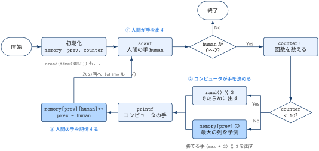
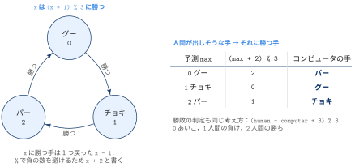
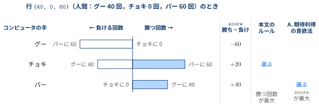
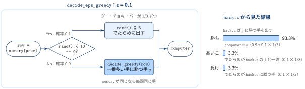
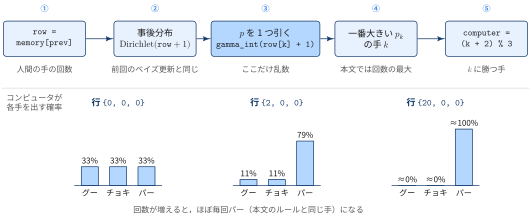
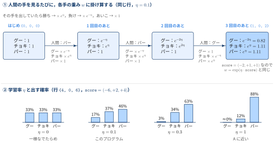
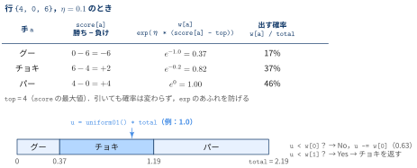

::: {.callout-note}
## TL;DRs

- **2次元配列**: `int memory[3][3]` は「行 × 列」の表として扱えるが，メモリ上は9個の `int` が行の順に一列に並んでいる
- **`while (-1)`**: C の条件式は `0` 以外がすべて真なので無限ループになる．ループを抜けるのは `break` だけ
- **「その他=終了」にならない入力**: 文字や EOF を入力すると `scanf` が失敗して `human` が更新されず，無限ループになる．`scanf` の戻り値で成否を確認する
- **学習の正体**: `memory` は直前の手ごとに次の手を数えた表（1次マルコフ連鎖の遷移回数）で，予測は各行の最頻値．周期的なクセには強いが，アルゴリズムを知っている相手にはほぼ全敗する
- **意思決定は貪欲法**: いまの `memory` のもとで「次の1回で勝つ確率」が最大の手を，推定の不確かさも相手の出方も考えずに選ぶ．同じ `memory` のまま意思決定だけを替えた方法（期待利得の貪欲法，ε-greedy，Thompson sampling，Hedge）は [Appendix](#appendix-decision) で比べる

:::

## 経験から手を決めるじゃんけんプログラム

[前回](../2020-10-15-rock-paper-scissors/index.qmd)のじゃんけんプログラムは，毎回でたらめ（乱数）に手を出すだけでした．
今回は，人間が出した手を記憶しておき，その記憶から人間の次の手を予測して，それに勝つ手を出すプログラムです．

::: {.callout-note}
### 動作

- `0`（グー），`1`（チョキ），`2`（パー）を入力すると，コンピュータが手を出す
- 0，1，2 以外の数を入力すると終了する
- 最初の9回は乱数で手を出し，10回目からは記憶をもとに手を出す

:::

```{.c filename="janken2.c"}
#include <stdio.h>
#include <stdlib.h>
#include <time.h>

int main(void) {
  // 人間の手
  int human;

  // 人間が出した直前の手を仮にグーとしておく
  int prev = 0;

  // 人間の手を記憶する2次元配列
  int memory[3][3] = { { 0, 0, 0 }, { 0, 0, 0 }, { 0, 0, 0 } };

  // 人間が出すと予測される手
  int max;

  // じゃんけんの回数
  int counter = 0;

  // コンピュータの手
  int computer;

  // 乱数の種を設定する
  srand(time(NULL));

  // じゃんけんを繰り返し行う
  while (-1) {
    // 人間が手を決める
    printf("じゃんけん (0=グー、1=チョキ、2=パー、その他=終了)... ");
    scanf("%d", &human);
    printf("ぽん！\n");

    // 0、1、2以外が入力されたら終了する
    if (human < 0 || human > 2) break;

    // じゃんけんの回数をカウントする
    counter++;

    // コンピュータが手を決める
    if (counter < 10) {
      // 10回未満なら乱数で手を決める
      computer = rand() % 3;
    } else {
      // 10回以上なら記憶をもとに手を決める
      max = 0;
      if (memory[prev][max] < memory[prev][1]) max = 1;
      if (memory[prev][max] < memory[prev][2]) max = 2;
      computer = (max + 2) % 3;
    }

    // コンピュータの手を表示する
    if (computer == 0) {
      printf("コンピュータの手は「グー」です。\n");
    } else if (computer == 1) {
      printf("コンピュータの手は「チョキ」です。\n");
    } else {
      printf("コンピュータの手は「パー」です。\n");
    }
    printf("\n");

    // 人間の手を記憶する
    memory[prev][human]++;
    prev = human;
  }
}
```

`gcc -Wall janken2.c -o janken2` で，警告なしでコンパイルできます．

[動作ロジック]{.mini-section}

{width="100%" fig-align="center"}

`while` ループの1回が，じゃんけん1回に対応します．

1. **人間が手を出す**：`scanf` で `human` に 0〜2 を読む．範囲外なら `break` でループを抜けて終了する
2. **コンピュータが手を決める**：`counter++` で回数を数え，9回目までは `rand() % 3` で，10回目からは `memory` から予測して手を決める
3. **人間の手を記憶する**：`memory[prev][human]++` で「直前の手が `prev` のあとに `human` を出した」ことを1回分記録し，`prev` を今回の手に更新する

コンピュータが手を決めるのは，人間の今回の手を記録する**前**です．
`human` はすでに読み込んでいますが，予測には使っていないので後出しにはなりません．


## 2次元配列 `memory` で手を記憶する

::: {#def-array2d .custom_problem .blog-custom-border}
[2次元配列（two-dimensional array）]{.def-title}

- 添字を2つ持つ配列．`型 配列名[行数][列数];` の形で定義する
- 各要素には `配列名[行][列]` でアクセスする．どちらの添字も `0` から始まる
- 表の形のデータ（行 × 列）を扱うのに便利

:::

`memory[3][3]` の行は**直前の手** `prev`，列は**今回の手** `human` です．
`memory[i][j]` は「`i` を出した次に `j` を出した回数」で，教材でも「グーの次に」「チョキの次に」「パーの次に」を行に，「グーを出した回数」「チョキを出した回数」「パーを出した回数」を列にした表で説明されています．

人間が `0 1 2 0 1 2 0 1 2`（グー→チョキ→パーのくり返し）と9回出したあとの `memory` は次のとおりです．

![0 1 2 0 1 2 0 1 2 と9回出したあとの memory．行が直前の手 prev，列が今回の手 human．毎回 memory[prev][human] に1を足し，予測では prev の行の中で最大の列を探す](figures/memory-table.svg){width="100%" fig-align="center"}

- グーの次は3回ともチョキ，チョキの次は3回ともパー，という人間のクセが表に現れている
- `memory[0][0] = 1` は，1回目に「直前の手を仮にグーとしておく」（`prev = 0`）ことで記録された1回で，実際にグーの次にグーを出したわけではない
- 10回目は直前の手がパー（`prev = 2`）なので，パーの行 `{2, 0, 0}` を見る．最大はグー（`max = 0`）なので，人間はグーを出すと予測し，グーに勝つパーを出す

[2次元配列のメモリ配置]{.mini-section}

2次元配列は「表」として書けますが，メモリ上は1次元に並んでいます．
C の2次元配列は**行優先**で，`memory[0][0]`, `memory[0][1]`, `memory[0][2]`, `memory[1][0]`, ... の順に9個の `int` が隙間なく続きます．

- `memory[i][j]` の場所は「先頭の場所 + 4 × (3 × i + j) バイト」（`int` が4バイトの場合）
- `memory[i]` は `i` 行目（`int` 3個の1次元配列）を表す

`int memory[3][3] = { { 0, 0, 0 }, { 0, 0, 0 }, { 0, 0, 0 } };` は，内側の `{ }` が1行分に対応します．
初期値の数が足りない要素は0になるので，`int memory[3][3] = {0};` と書いても同じです．

## 記憶から手を決める

### 一番多く出た手を探す

```{.c}
max = 0;
if (memory[prev][max] < memory[prev][1]) max = 1;
if (memory[prev][max] < memory[prev][2]) max = 2;
computer = (max + 2) % 3;
```

最初の3行は，`prev` の行の中で値が最大の列番号を `max` に求めています．

1. ひとまずグー（列 `0`）を最大とする
2. チョキ（列 `1`）のほうが多ければ，`max` を `1` にする
3. その時点の最大よりパー（列 `2`）のほうが多ければ，`max` を `2` にする

比較が `<`（より大きいときだけ更新）なので，回数が同じときは番号の小さい手が残ります．
一度もじゃんけんしていない行（`{0, 0, 0}`）では，人間はグーを出すと予測されます．

### 勝てる手は `(max + 2) % 3` {#sec-winning-hand}

{width="90%" fig-align="center"}

0=グー，1=チョキ，2=パーと番号を付けると，どの手も**番号を1つ進めた手**（`(x + 1) % 3`）に勝ちます．
逆に，手 `x` に勝つのは番号を1つ戻した `x - 1` です．

ただし `x = 0`（グー）のとき `x - 1` は `-1` になり，C の `%` は負の数に対して負の余りを返す（`-1 % 3` は `-1`）ので，`(x - 1) % 3` では 2（パー）が得られません．
3で割った余りの世界では「1つ戻る」と「2つ進む」は同じなので，`x - 1` の代わりに `x + 2` を使って `(max + 2) % 3` と書きます．

[書き直した版](#rewrite)では，同じ考え方で勝敗も判定しています．
`(human - computer + 3) % 3` は，`0` ならあいこ，`1` なら人間の負け，`2` なら人間の勝ちです．

## C の書き方

前回のプログラムから新しく出てきた要素です．

:::: {.no-border-top-table}

| コード | 意味 |
| --- | --- |
| `while (-1) { ... }` | 条件が真のあいだ `{ }` をくり返す．C の条件式は `0` 以外がすべて真なので，`-1` は常に真で無限ループになる．ふつうは `while (1)` と書く |
| `break;` | いま実行しているループを途中で抜ける．このプログラムでループを終わらせる唯一の方法 |
| <code>human &lt; 0 &#124;&#124; human &gt; 2</code> | <code>&#124;&#124;</code> は「または」．左が真なら右は評価しない（短絡評価） |
| `scanf("%d", &human);` | キーボードから整数を1個読み，`human` に格納する．`&` は `human` の場所（アドレス）を渡すため（[配列の記事](../2020-10-17-array-in-c-language/index.qmd#sec-amp)で解説） |
| `counter++;` | `counter` に1を足す．`counter = counter + 1;` と同じ |
| `memory[prev][human]++;` | 2次元配列の要素 `memory[prev][human]` に1を足す |
| `(max + 2) % 3` | `%` は割り算の余り．0〜2 の範囲に収める |
: {tbl-colwidths="[35,65]"}

::::

## 実行してみる {#sec-run}

`0 1 2` をくり返し入力すると，10回目からコンピュータが毎回勝ちます．

| 回 | `prev` | 見る行 | 予測 `max` | コンピュータ | 人間 | 結果 |
| --- | --- | --- | --- | --- | --- | --- |
| 10 | 2（パー） | `{2, 0, 0}` | 0（グー） | パー | グー | 人間の負け |
| 11 | 0（グー） | `{1, 3, 0}` | 1（チョキ） | グー | チョキ | 人間の負け |
| 12 | 1（チョキ） | `{0, 0, 3}` | 2（パー） | チョキ | パー | 人間の負け |
: {tbl-colwidths="[8,14,14,16,16,12,20]"}

予測がどこまで効くかは，人間の出し方によります．
同じロジックを Python で再現し，3000回対戦させた結果は次のようになりました（1〜9回目は乱数）．

| 人間の出し方 | あいこ | 人間の負け | 人間の勝ち |
| --- | --- | --- | --- |
| グー→チョキ→パーのくり返し | 0.1% | 99.8% | 0.2% |
| 一様にでたらめ（各 1/3） | 33.8% | 31.5% | 34.7% |
| グー:チョキ:パー = 5:3:2 でたらめ | 20.1% | 50.0% | 30.0% |
| コンピュータの予測を読んで出す | 0.1% | 0.1% | 99.8% |
: {tbl-colwidths="[40,20,20,20]"}

- **くり返し**：直前の手から次の手が決まるので，`memory` の各行に1つだけ大きな値ができ，ほぼ確実に読まれる
- **一様にでたらめ**：予測の手がかりがなく，勝ち・負け・あいこがほぼ 1/3 ずつになる
- **5:3:2**：どの行でもグーが最大になるので，コンピュータは毎回パーを出す．[前回](../2020-10-15-rock-paper-scissors/index.qmd)の期待利得の計算で求めた「5:3:2 の相手にはパーを出し続けるのが最善」と同じ手を，経験から選んでいる
- **予測を読む**：コンピュータの手は `memory` と `prev` から決まるので，人間が同じ表を付けておけば次の手が分かる．それに勝つ手を出せば，ほぼ全勝できる

## 「その他=終了」にならない入力 {#sec-infinite-loop}

画面には「その他=終了」とありますが，終了するのは `3` や `-1` のような**範囲外の整数**だけです．
文字（`a` など）を入力したり，Ctrl-D（EOF）を押したりすると，プログラムは止まらなくなります．

```{.zsh}
% echo "1 a" | timeout 1 ./janken2 | head
じゃんけん (0=グー、1=チョキ、2=パー、その他=終了)... ぽん！
コンピュータの手は「チョキ」です。

じゃんけん (0=グー、1=チョキ、2=パー、その他=終了)... ぽん！
コンピュータの手は「チョキ」です。
...（timeout で止めるまで続く）
```

1. 2回目の `scanf("%d", &human)` は `a` を整数として読めずに失敗する．失敗すると `human` には何も書き込まれず，前回の `1` が残る
2. `a` は読み捨てられずに入力に残るので，3回目以降の `scanf` も同じ `a` で失敗し続ける
3. `human` は `1` のまま範囲内なので `break` されず，人間がチョキを出し続けたものとして，じゃんけんが際限なく続く

最初の入力から文字だった場合は，`human` は初期化されていない不定な値のまま判定されます．
手元の環境では，最適化なし（`-O0`）では無限ループし，`-O2` では即座に終了しました．どちらになるかは決まっていません．

`scanf` は値を格納できた変数の個数を返すので（[配列の記事の Appendix](../2020-10-17-array-in-c-language/index.qmd#appendix-scanf-return)），`1` 以外なら終了するようにすれば防げます．

```{.c}
if (scanf("%d", &human) != 1) break;  /* 数字以外・EOF でも終了 */
```

## 書き直した版 {#rewrite}

最初のリストの `while (-1)` を `while (1)` にし，`scanf` の戻り値を確認して文字や EOF でも終了するようにしました．
あわせて，手の名前と勝敗を配列で引くようにしています．

```{.c filename="janken_learn.c"}
#include <stdio.h>
#include <stdlib.h>
#include <time.h>

int main(void) {
  const char *hand[] = {"グー", "チョキ", "パー"};
  const char *result[] = {"あいこ", "あなたの負け", "あなたの勝ち"};
  int memory[3][3] = {0};
  int prev = 0;
  int counter = 0;
  int human, computer;

  srand((unsigned int)time(NULL));

  while (1) {
    printf("じゃんけん (0=グー，1=チョキ，2=パー，その他=終了)... ");
    if (scanf("%d", &human) != 1) break;  /* 数字以外・EOF でも終了 */
    if (human < 0 || human > 2) break;
    printf("ぽん！\n");

    counter++;
    if (counter < 10) {
      computer = rand() % 3;
    } else {
      int max = 0;
      if (memory[prev][max] < memory[prev][1]) max = 1;
      if (memory[prev][max] < memory[prev][2]) max = 2;
      computer = (max + 2) % 3;
    }

    printf("コンピュータの手は「%s」．%s\n\n",
           hand[computer], result[(human - computer + 3) % 3]);

    memory[prev][human]++;
    prev = human;
  }
  return 0;
}
```

```{.zsh}
% gcc -Wall -Wextra -std=c11 janken_learn.c -o janken_learn
% printf "0\n1\na\n" | ./janken_learn
じゃんけん (0=グー，1=チョキ，2=パー，その他=終了)... ぽん！
コンピュータの手は「チョキ」．あなたの勝ち

じゃんけん (0=グー，1=チョキ，2=パー，その他=終了)... ぽん！
コンピュータの手は「チョキ」．あいこ

じゃんけん (0=グー，1=チョキ，2=パー，その他=終了)... %
```

警告なしでコンパイルでき，3つ目の入力 `a` で終了します（コンピュータの手は乱数なので，実行のたびに変わります）．

- `int max` はループの中で宣言している．`max` は予測のときしか使わないので，使う場所の近くで宣言したほうが読みやすい
- `result[(human - computer + 3) % 3]` は，`if` を使わずに勝敗の文字列を選んでいる（[勝てる手は `(max + 2) % 3`](#sec-winning-hand) と同じ考え方）

上記の実行は，Ubuntu 24.04・gcc 13.3・glibc の環境で確認しています．

## このプログラムの「学習」を読み直す

### `memory` は遷移の回数を数えた表

`memory[i][j]` を行の合計で割ると，「直前に `i` を出したとき，次に `j` を出す割合」になります．

$$
\hat{P}(\text{次の手} = j \mid \text{直前の手} = i) = \frac{\texttt{memory[i][j]}}{\sum_{k=0}^{2} \texttt{memory[i][k]}}
$$

次の手が直前の手だけで決まる（それより前の手には依存しない）とみなすモデルを **1次マルコフ連鎖**と呼び，$\hat{P}$ はその遷移確率の推定値です．
`max` を求める3行は，この推定値が最大の手（各行の最頻値）を選んでいます．行の合計で割っても大小関係は変わらないので，コードでは割り算を省いています．

[前回](../2020-10-15-rock-paper-scissors/index.qmd)のベイズ更新では，人間の手は直前の手とは関係なく，毎回同じ確率 $p$ で出ると考え，出た手の回数を数えてディリクレ分布を更新しました．
今回のプログラムは，その数え方を「直前の手ごと」に3つに分けたものとみなせます．

- 各行に一様な事前分布 $\mathrm{Dirichlet}(1, 1, 1)$ を置くと，行 `i` の事後分布は $\mathrm{Dirichlet}(\texttt{memory[i][0]} + 1, \texttt{memory[i][1]} + 1, \texttt{memory[i][2]} + 1)$ になる
- 事後平均が最大の手は，`memory` の行が最大の手と一致する（同数の扱いを除く）

### 意思決定は貪欲法 {#sec-greedy}

`memory` が「何を覚えるか」なら，`max` を求めて `(max + 2) % 3` を出す部分は「覚えたことからどう決めるか」です．
この決め方は**貪欲法**（greedy method）に当たります．

::: {#def-greedy .custom_problem .blog-custom-border}
[貪欲法（greedy method）]{.def-title}

- 選択を1回ずつ行う問題で，各時点で**いま分かっている情報のもとで目先の評価が最もよい選択肢**を選ぶ方法
- その選択が先々に与える影響や，評価そのものの不確かさは考えない

:::

このプログラムの各部分は，貪欲法の要素に次のように対応します．

:::: {.no-border-top-table}

| 貪欲法の要素 | このプログラム |
| --- | --- |
| いま分かっている情報 | 直前の手 `prev` と，その行の回数 `memory[prev]` |
| 目先の評価 | 手 `a` を出したとき，**次の1回で**勝つ確率の推定値 $\hat{P}(\text{人間の手} = (a + 1) \bmod 3 \mid \texttt{prev})$ |
| 選ぶもの | 評価が最大の手．人間が一番よく出す手 `max` に勝つ `(max + 2) % 3` |
: {tbl-colwidths="[25,75]"}

::::

式で書くと，コンピュータの手 $a^*$ は

$$
a^* = \operatorname*{arg\,max}_{a \in \{0, 1, 2\}} \hat{P}\bigl(\text{人間の手} = (a + 1) \bmod 3 \mid \texttt{prev}\bigr)
= \Bigl(\operatorname*{arg\,max}_{j} \hat{P}(j \mid \texttt{prev}) + 2\Bigr) \bmod 3
$$

です．手 $a$ は番号を1つ進めた $(a + 1) \bmod 3$ に勝つので，「勝つ確率が最大の手」と「一番出やすい手に勝つ手」は同じものになります．


### アルゴリズムのハッキング {#sec-hack}

貪欲法は乱数を使わないので，同じ `memory` と `prev` からは必ず同じ手が出ます．
しかも `memory` と `prev` は**人間が出した手だけ**で決まります．
人間側も同じ表を付けておけば，10回目以降のコンピュータの手は事前に計算でき，それに勝つ手を出せば全勝できます．

```{.c filename="hack.c"}
#include <stdio.h>
#include <stdlib.h>

/* janken2.c と同じ規則で，コンピュータの手を計算する */
int predict_computer(const int row[3]) {
  int max = 0;
  if (row[max] < row[1]) max = 1;
  if (row[max] < row[2]) max = 2;
  return (max + 2) % 3;
}

int main(int argc, char *argv[]) {
  int n = (argc > 1) ? atoi(argv[1]) : 100;  /* じゃんけんの回数 */
  int memory[3][3] = {0};  /* 相手と同じ記憶を自分でも付ける */
  int prev = 0;
  int counter, human, computer;

  for (counter = 1; counter <= n; counter++) {
    if (counter < 10) {
      human = 0;  /* 9回目までは相手が乱数なので読めない．何を出してもよい */
    } else {
      computer = predict_computer(memory[prev]);
      human = (computer + 2) % 3;  /* computer に勝つ手 */
    }
    printf("%d\n", human);

    /* 相手と同じように記憶を更新する */
    memory[prev][human]++;
    prev = human;
  }
  printf("9\n");  /* 範囲外の数を送って相手を終了させる */
  return 0;
}
```

- `predict_computer` は，本文のプログラムの `max` を求める3行と `(max + 2) % 3` をそのまま写したもの
- コンピュータの手 `computer` に勝つのは，番号を1つ戻した `(computer + 2) % 3`（[勝てる手は `(max + 2) % 3`](#sec-winning-hand) と同じ考え方）
- `memory[prev][human]++` と `prev = human` も本文と同じ．これで人間側の `memory` は，コンピュータ側の `memory` と常に一致する

`hack` の出力をパイプで本文のプログラムの入力につなぐと，人間の代わりに `hack` がじゃんけんをします．
[書き直した版](#rewrite)の `janken_learn` と1000回対戦させ，10回目以降の結果を数えると次のようになります．

```{.zsh}
% gcc -Wall -Wextra -std=c11 hack.c -o hack
% ./hack 1000 | ./janken_learn | grep -o 'あなたの勝ち\|あなたの負け\|あいこ' | tail -n +10 | sort | uniq -c
    991 あなたの勝ち
```

`tail -n +10` で1〜9回目を除いているので，10回目から1000回目までの991回すべてに勝っています．
最初のリストの `janken2` に同じ入力を与えても，コンピュータの手は同じになり，結果は991勝0敗0分けです．

最初の数回は次のように進みます．1〜9回目にグーを9回出したので，グーの行は `{9, 0, 0}` になっています．

| 回 | `prev` | 見る行 | コンピュータ（予測） | 人間（`hack`） | 結果 |
| --- | --- | --- | --- | --- | --- |
| 10 | 0（グー） | `{9, 0, 0}` | パー | チョキ | 人間の勝ち |
| 11 | 1（チョキ） | `{0, 0, 0}` | パー | チョキ | 人間の勝ち |
| 12 | 1（チョキ） | `{0, 1, 0}` | グー | パー | 人間の勝ち |
| 13 | 2（パー） | `{0, 0, 0}` | パー | チョキ | 人間の勝ち |
: {tbl-colwidths="[8,16,18,22,20,16]"}

`hack` はコンピュータの出力を一度も読んでいません．`./hack 30` の出力は

```
0 0 0 0 0 0 0 0 0 1 1 2 1 2 2 2 0 1 0 1 0 1 1 1 2 0 1 2 1 0 9
```

という**あらかじめ決まった列**で，それだけで10回目以降に全勝できます．
一見でたらめに見えますが，コンピュータの予測が毎回ちょうど1つずつ外れるように作られた列です．

## Appendix: 同じ `memory` から手を決める別の方法 {#appendix-decision}

`memory[prev][human]++` による記憶の仕方はそのままにして，手の決め方だけを替えます．
本文の `max` を求める部分を関数にくくり出し，`memory[prev]`（直前の手の行）を受け取ってコンピュータの手を返す形にそろえます．

```{.c}
/* 本文のルール：一番多い手に勝つ手（勝つ確率の貪欲法） */
int decide_greedy(const int row[3]) {
  int max = 0;
  if (row[max] < row[1]) max = 1;
  if (row[max] < row[2]) max = 2;
  return (max + 2) % 3;
}
```

ループの中は `computer = decide_greedy(memory[prev]);` になり，この関数を差し替えるだけで意思決定の方法を変えられます．
`memory[prev]` は `prev` 行目（`int` 3個の1次元配列）なので，そのまま関数に渡せます．

### 準備：手ごとの累積利得

コンピュータの手 `a` は `(a + 1) % 3` に勝ち，`(a + 2) % 3` に負けます．
そこで，この行の記録に対して**毎回 `a` を出していたら何勝何敗だったか**を

$$
\texttt{score}[a] = \texttt{row}[(a + 1) \bmod 3] - \texttt{row}[(a + 2) \bmod 3]
$$

と書きます．行の合計で割ると，$\hat{P}$ のもとで `a` を出したときの期待利得（勝ち $+1$，負け $-1$，あいこ $0$）になります．

本文のルールは `row[(a + 1) % 3]`（勝つ回数）だけを見ており，`row[(a + 2) % 3]`（負ける回数）を見ていません．

### A. 期待利得の貪欲法

評価を「勝つ確率」から「期待利得」に替えた貪欲法です．乱数は使いません．

```{.c}
int decide_payoff(const int row[3]) {
  int score[3], a, best = 0;
  for (a = 0; a < 3; a++) {
    score[a] = row[(a + 1) % 3] - row[(a + 2) % 3];
  }
  for (a = 1; a < 3; a++) {
    if (score[best] < score[a]) best = a;
  }
  return best;
}
```

2つの評価で選ぶ手が分かれるのは，人間の手の出やすさが1つに偏っていないときです．
たとえば行が `{40, 0, 60}`（グー 40%，チョキ 0%，パー 60%）なら

| コンピュータの手 | 勝つ回数 | 負ける回数 | `score` | 本文のルール | 期待利得の貪欲法 |
| --- | --- | --- | --- | --- | --- |
| グー | 0（チョキ） | 60（パー） | $-60$ | | |
| チョキ | 60（パー） | 40（グー） | $+20$ | 選ぶ | |
| パー | 40（グー） | 0（チョキ） | $+40$ | | 選ぶ |
: {tbl-colwidths="[18,16,16,12,19,19]"}

本文のルールは一番出やすいパーに勝つチョキを選びますが，チョキは40%の確率でグーに負けます．
パーなら勝つのは40%だけですが，負けることはありません．1回あたりの期待利得はチョキが $+0.2$，パーが $+0.4$ です．

{width="90%" fig-align="center"}

[書き直した版](#rewrite)に組み込んだ全体のプログラムは次のとおりです．10回目以降に手を決める1行が `decide_payoff(memory[prev])` に替わります．

```{.c filename="janken_payoff.c"}
#include <stdio.h>
#include <stdlib.h>
#include <time.h>

/* A. 期待利得の貪欲法：累積利得 score[a] が最大の手 */
int decide_payoff(const int row[3]) {
  int score[3], a, best = 0;
  for (a = 0; a < 3; a++) {
    score[a] = row[(a + 1) % 3] - row[(a + 2) % 3];  /* 勝つ回数 - 負ける回数 */
  }
  for (a = 1; a < 3; a++) {
    if (score[best] < score[a]) best = a;
  }
  return best;
}

int main(void) {
  const char *hand[] = {"グー", "チョキ", "パー"};
  const char *result[] = {"あいこ", "あなたの負け", "あなたの勝ち"};
  int memory[3][3] = {0};
  int prev = 0;
  int counter = 0;
  int human, computer;

  srand((unsigned int)time(NULL));

  while (1) {
    printf("じゃんけん (0=グー，1=チョキ，2=パー，その他=終了)... ");
    if (scanf("%d", &human) != 1) break;  /* 数字以外・EOF でも終了 */
    if (human < 0 || human > 2) break;
    printf("ぽん！\n");

    counter++;
    if (counter < 10) {
      computer = rand() % 3;
    } else {
      computer = decide_payoff(memory[prev]);
    }

    printf("コンピュータの手は「%s」．%s\n\n",
           hand[computer], result[(human - computer + 3) % 3]);

    memory[prev][human]++;
    prev = human;
  }
  return 0;
}
```

- `score[a]` は「この行の記録に対して毎回 `a` を出していたら，勝ち数 − 負け数はいくつだったか」．行の合計で割れば期待利得になるが，最大の手を探すだけなら割らなくてよい
- 2つ目の `for` は，本文の `max` を求める3行と同じく「より大きいときだけ更新」する．同数なら番号の小さい手が残る
- 乱数を使わないので，`memory` と `prev` が同じなら必ず同じ手を出す

[アルゴリズムのハッキング](#sec-hack)の `hack.c` をそのまま当てると，予測の規則が違うので全勝はできません．
`hack.c` の `predict_computer` を A の規則に差し替えた `hack_payoff.c` なら，また全勝できます．

```{.c filename="hack_payoff.c（predict_computer だけを差し替え）"}
/* janken_payoff.c と同じ規則で，コンピュータの手を計算する */
int predict_computer(const int row[3]) {
  int score[3], a, best = 0;
  for (a = 0; a < 3; a++) score[a] = row[(a + 1) % 3] - row[(a + 2) % 3];
  for (a = 1; a < 3; a++) if (score[best] < score[a]) best = a;
  return best;
}
```

```{.zsh}
% gcc -Wall -Wextra -std=c11 janken_payoff.c -o janken_payoff
% ./hack 10000 | ./janken_payoff | grep -o 'あなたの勝ち\|あなたの負け\|あいこ' | tail -n +10 | sort | uniq -c
   6661 あなたの勝ち
   3330 あなたの負け
% ./hack_payoff 10000 | ./janken_payoff | grep -o 'あなたの勝ち\|あなたの負け\|あいこ' | tail -n +10 | sort | uniq -c
   9991 あなたの勝ち
```

評価を期待利得に替えても，乱数を使わない限り「規則を知っている相手には全敗する」という貪欲法の弱点は残ります．

### B. ε-greedy

確率 $\varepsilon$ ででたらめに出し，残りは本文のルールに従います．

```{.c}
int decide_eps_greedy(const int row[3]) {
  if (rand() % 10 == 0) return rand() % 3;  /* ε = 0.1 */
  return decide_greedy(row);
}
```

[書き直した版](#rewrite)に組み込んだ全体のプログラムは次のとおりです．
`memory` の更新は変えず，10回目以降に手を決める1行だけが `decide_eps_greedy(memory[prev])` に替わります．

```{.c filename="janken_eps.c"}
#include <stdio.h>
#include <stdlib.h>
#include <time.h>

/* 本文のルール：一番多い手に勝つ手（勝つ確率の貪欲法） */
int decide_greedy(const int row[3]) {
  int max = 0;
  if (row[max] < row[1]) max = 1;
  if (row[max] < row[2]) max = 2;
  return (max + 2) % 3;
}

/* ε-greedy：10% の確率ででたらめに出し，残りは貪欲法に従う */
int decide_eps_greedy(const int row[3]) {
  if (rand() % 10 == 0) return rand() % 3;  /* ε = 0.1 */
  return decide_greedy(row);
}

int main(void) {
  const char *hand[] = {"グー", "チョキ", "パー"};
  const char *result[] = {"あいこ", "あなたの負け", "あなたの勝ち"};
  int memory[3][3] = {0};
  int prev = 0;
  int counter = 0;
  int human, computer;

  srand((unsigned int)time(NULL));

  while (1) {
    printf("じゃんけん (0=グー，1=チョキ，2=パー，その他=終了)... ");
    if (scanf("%d", &human) != 1) break;  /* 数字以外・EOF でも終了 */
    if (human < 0 || human > 2) break;
    printf("ぽん！\n");

    counter++;
    if (counter < 10) {
      computer = rand() % 3;
    } else {
      computer = decide_eps_greedy(memory[prev]);
    }

    printf("コンピュータの手は「%s」．%s\n\n",
           hand[computer], result[(human - computer + 3) % 3]);

    memory[prev][human]++;
    prev = human;
  }
  return 0;
}
```

- `rand() % 10 == 0` は，0〜9 のうち 0 が出たとき，つまり確率 $1/10$ で真になる．これが $\varepsilon = 0.1$
- 真のときは `rand() % 3` ででたらめに出す．偽のとき（確率 $0.9$）は `decide_greedy` で本文と同じ手を出す
- `decide_greedy(row)` と `decide_eps_greedy(row)` の引数 `row` には，`memory[prev]`（直前の手の行，`int` 3個）がそのまま渡る．関数の中で `row[j]` と書くと `memory[prev][j]` を読むことになる
- `rand()` を2回呼んでいるが，1回目（でたらめにするか）と2回目（どの手にするか）は別の乱数なので，2つの判定は独立

{width="100%" fig-align="center"}

貪欲法の手を $g$ とすると，コンピュータが各手を出す確率は

$$
P(\texttt{computer} = g) = 0.9 + 0.1 \times \frac{1}{3} \approx 0.933
$$

$$
P(\texttt{computer} = \text{ほかの手}) = 0.1 \times \frac{1}{3} \approx 0.033
$$

です．`memory` の更新はコンピュータの手に関係なく人間の手だけで決まるので，[アルゴリズムのハッキング](#sec-hack)の `hack.c` は，ε-greedy が相手でも $g$ を正確に計算できます．
`hack.c` を書き換えずに `janken_eps` と対戦させると，10回目以降の結果はほぼこの確率どおりになります．

```{.zsh}
% gcc -Wall -Wextra -std=c11 janken_eps.c -o janken_eps
% ./hack 10000 | ./janken_eps | grep -o 'あなたの勝ち\|あなたの負け\|あいこ' | tail -n +10 | sort | uniq -c
    312 あいこ
   9354 あなたの勝ち
    325 あなたの負け
```

9991回のうち 93.6% が `hack.c` の勝ちです．でたらめな10%のうち，`hack.c` の手と同じならあいこ，`hack.c` に勝つ手なら負け，$g$ と同じなら結局 `hack.c` の勝ちになります．

多腕バンディット問題では，ε-greedy のでたらめな選択は「ほかの腕を試す」探索の役割を持ちます．
じゃんけんでは何を出しても人間の手を観測できるので，探索の意味はありません．
効果は「たまに読みを外す」ことだけで，残り90%は読まれるため，予測を読む相手にはやはり大きく負け越します．

### C. Thompson sampling

[前回](../2020-10-15-rock-paper-scissors/index.qmd)のベイズ更新を使う方法です．
行 `prev` の事後分布 $\mathrm{Dirichlet}(\texttt{row}[0] + 1, \texttt{row}[1] + 1, \texttt{row}[2] + 1)$ から人間の手の確率 $p$ を1つ引き，その $p$ で一番出やすい手に勝つ手を出します．

$p = (p_G, p_C, p_P)$ は前回の記事のディリクレ分布と同じ記号で，コードでは添字 $k = 0, 1, 2$ がそれぞれ $G, C, P$（グー，チョキ，パー）に当たります．
ディリクレ乱数は，手ごとに $g_k \sim \mathrm{Gamma}(\texttt{row}[k] + 1, 1)$ を独立に引き，$p_k = g_k / (g_0 + g_1 + g_2)$ と合計で割れば得られます．
最大の成分を探すだけなら割る必要はありません．
形状パラメータ $m$ が正の整数のガンマ乱数は，指数乱数 $-\log U$（$U$ は $(0, 1)$ の一様乱数）を $m$ 個足せば作れます．

::: {.callout-note}
## ベータ乱数を3つ直接引かない理由

- $p_G, p_C, p_P$ をそれぞれ別のベータ分布から独立に引くと，合計が 1 になりません．
- 本来は1つが大きければほかが小さくなる，という負の相関がありますが，それも失われます．
- 周辺分布（1成分だけを見た分布）がベータ分布でも，3成分の同時分布は「独立なベータ分布3つ」ではありません．
- ガンマ乱数を3つ引いて合計で割れば，合計 1 と成分間の相関の両方が自動的に正しくなります．これがディリクレ乱数を作る標準的な方法です．
- ベータ分布を使う方法もあります．$p_G \sim \mathrm{Beta}(\alpha_G, \alpha_C + \alpha_P)$ を引き，次に $p_C / (1 - p_G) \sim \mathrm{Beta}(\alpha_C, \alpha_P)$ を引いて，残りを $p_P$ とする順番に引く方法（stick-breaking）でも，正しく同じ分布になります．

:::

```{.c}
#include <math.h>  /* log．リンク時に -lm を付ける */

/* (0, 1) の一様乱数 */
double uniform01(void) {
  return (rand() + 1.0) / (RAND_MAX + 2.0);
}

/* 形状 m（正の整数）のガンマ乱数：指数乱数 m 個の和 */
double gamma_int(int m) {
  double s = 0.0;
  for (int i = 0; i < m; i++) s -= log(uniform01());
  return s;
}

int decide_thompson(const int row[3]) {
  double g[3];
  int k, max = 0;
  for (k = 0; k < 3; k++) g[k] = gamma_int(row[k] + 1);
  if (g[max] < g[1]) max = 1;
  if (g[max] < g[2]) max = 2;
  return (max + 2) % 3;
}
```

- 回数が少ない行では $p$ のばらつきが大きく，手もばらける．回数が増えて1つの手が際立つと，ほぼ本文のルールと同じ手になる
- 相手が読もうとしても，引いた $p$ は相手には分からない．相手にできるのは，各行の回数を拮抗させてコンピュータの手をばらけさせることくらいで，結果はほぼ引き分けになる
- 評価は本文と同じ「勝つ確率」なので，A の `{40, 0, 60}` のような相手にはチョキを選んでしまう

{width="100%" fig-align="center"}

[書き直した版](#rewrite)に組み込んだ全体のプログラムは次のとおりです．`log` を使うので，コンパイル時に `-lm`（数学ライブラリ）を付けます．

```{.c filename="janken_thompson.c"}
#include <math.h>
#include <stdio.h>
#include <stdlib.h>
#include <time.h>

/* (0, 1) の一様乱数 */
double uniform01(void) {
  return (rand() + 1.0) / (RAND_MAX + 2.0);
}

/* 形状 m（正の整数）のガンマ乱数：指数乱数 m 個の和 */
double gamma_int(int m) {
  double s = 0.0;
  for (int i = 0; i < m; i++) s -= log(uniform01());
  return s;
}

/* C. Thompson sampling：Dirichlet(row + 1) から p を引き，一番出やすい手に勝つ */
int decide_thompson(const int row[3]) {
  double g[3];
  int k, max = 0;
  for (k = 0; k < 3; k++) g[k] = gamma_int(row[k] + 1);
  if (g[max] < g[1]) max = 1;
  if (g[max] < g[2]) max = 2;
  return (max + 2) % 3;
}

int main(void) {
  const char *hand[] = {"グー", "チョキ", "パー"};
  const char *result[] = {"あいこ", "あなたの負け", "あなたの勝ち"};
  int memory[3][3] = {0};
  int prev = 0;
  int counter = 0;
  int human, computer;

  srand((unsigned int)time(NULL));

  while (1) {
    printf("じゃんけん (0=グー，1=チョキ，2=パー，その他=終了)... ");
    if (scanf("%d", &human) != 1) break;  /* 数字以外・EOF でも終了 */
    if (human < 0 || human > 2) break;
    printf("ぽん！\n");

    counter++;
    if (counter < 10) {
      computer = rand() % 3;
    } else {
      computer = decide_thompson(memory[prev]);
    }

    printf("コンピュータの手は「%s」．%s\n\n",
           hand[computer], result[(human - computer + 3) % 3]);

    memory[prev][human]++;
    prev = human;
  }
  return 0;
}
```

- `uniform01` は `rand()` を $(0, 1)$ の小数に直す．`+ 1.0` と `+ 2.0` で 0 と 1 ちょうどを避け，`log(0)` を計算しないようにしている
- `gamma_int(row[k] + 1)` を3つ並べたものは，合計で割れば $\mathrm{Dirichlet}(\texttt{row} + 1)$ からの1回分のサンプル $p$ になる．最大の成分を探すだけなら割らなくてよい
- `gamma_int` は `row[k] + 1` 回ループするので，同じ行で何千回も対戦すると1回の計算が重くなる（ここでは単純さを優先している）

```{.zsh}
% gcc -Wall -Wextra -std=c11 janken_thompson.c -o janken_thompson -lm
% ./hack 10000 | ./janken_thompson | grep -o 'あなたの勝ち\|あなたの負け\|あいこ' | tail -n +10 | sort | uniq -c
   3208 あいこ
   3424 あなたの勝ち
   3359 あなたの負け
```

`hack.c` も `hack_payoff.c` も，勝ち・負け・あいこがほぼ 1/3 ずつになり，読み切れません（`hack_payoff.c` では 3344 勝 3295 敗 3352 分け）．

### D. Hedge（乗算型重み更新）

累積利得 `score[a]` が大きい手ほど高い確率で出します．手 `a` を出す確率は

$$
\pi(a) = \frac{\exp(\eta \, \texttt{score}[a])}{\sum_{b=0}^{2} \exp(\eta \, \texttt{score}[b])}
$$

で，$\eta > 0$ は学習率です．$\eta \to \infty$ で A（期待利得の貪欲法），$\eta = 0$ で一様なでたらめになります．

[乗算型重み更新とは]{.mini-section}

Hedge の元の形は，手ごとに重み $w(a)$ を持ち，人間の手 $h$ を1回見るたびに

$$
w(a) \leftarrow w(a) \times e^{\eta \, u(a, h)}, \qquad
u(a, h) = \begin{cases} +1 & a \text{ が } h \text{ に勝つ} \\ 0 & \text{あいこ} \\ -1 & a \text{ が } h \text{ に負ける} \end{cases}
$$

と**掛け算で**更新するものです．「その手を出していたら勝てた」手の重みは $e^{\eta}$ 倍に増え，「負けていた」手の重みは $e^{-\eta}$ 倍に減ります．

指数の掛け算は指数の足し算なので，すべての重みを $1$ から始めると，何回更新したあとでも

$$
w(a) = e^{\eta \, (u_1 + u_2 + \cdots)} = \exp(\eta \cdot \texttt{score}[a])
$$

になります．`score[a]` は `memory` の行から計算できるので，重みそのものを覚えておく必要はありません．
`memory[prev][human]++` という記憶の仕方を変えずに Hedge を実装できるのはこのためです．

{width="100%" fig-align="center"}

- 上段の3回目のあと，行は `{1, 0, 2}`（グー1回，パー2回）で，`score` は $(-2, +1, +1)$．掛け算を重ねた重み $e^{-2\eta}, e^{\eta}, e^{\eta}$ とちょうど一致する
- 下段は，同じ行でも $\eta$ によって出す確率が大きく変わることを示している．$\eta$ が小さいと記録をあまり信用せずにばらけて出し，大きいと記録を強く信用して一番よい手に集中する

```{.c}
#include <math.h>  /* exp．リンク時に -lm を付ける */

#define ETA 0.1

int decide_hedge(const int row[3]) {
  double w[3], total = 0.0, u;
  int score[3], a, top;
  for (a = 0; a < 3; a++) score[a] = row[(a + 1) % 3] - row[(a + 2) % 3];
  top = score[0];
  for (a = 1; a < 3; a++) if (top < score[a]) top = score[a];
  for (a = 0; a < 3; a++) {
    w[a] = exp(ETA * (score[a] - top));  /* top を引いて exp のあふれを防ぐ */
    total += w[a];
  }
  u = uniform01() * total;  /* uniform01 は C と同じ */
  for (a = 0; a < 2; a++) {
    if (u < w[a]) return a;
    u -= w[a];
  }
  return 2;
}
```

Hedge はオンライン学習の代表的なアルゴリズムで，$\eta$ を対戦回数 $T$ に合わせて選ぶと，直前の手の行ごとに「後から振り返って一番よかった1つの手を出し続けた場合」との利得の差（後悔，regret）が $O(\sqrt{T})$ に抑えられます．
1回あたりの差は $T$ が増えるほど0に近づき，相手がどんな出し方をしてもこの保証は崩れません．

{width="100%" fig-align="center"}

[書き直した版](#rewrite)に組み込んだ全体のプログラムは次のとおりです．`exp` を使うので，コンパイル時に `-lm` を付けます．

```{.c filename="janken_hedge.c"}
#include <math.h>
#include <stdio.h>
#include <stdlib.h>
#include <time.h>

/* (0, 1) の一様乱数 */
double uniform01(void) {
  return (rand() + 1.0) / (RAND_MAX + 2.0);
}

#define ETA 0.1  /* 学習率 */

/* D. Hedge：exp(ETA * score[a]) に比例する確率で手を選ぶ */
int decide_hedge(const int row[3]) {
  double w[3], total = 0.0, u;
  int score[3], a, top;
  for (a = 0; a < 3; a++) score[a] = row[(a + 1) % 3] - row[(a + 2) % 3];
  top = score[0];
  for (a = 1; a < 3; a++) if (top < score[a]) top = score[a];
  for (a = 0; a < 3; a++) {
    w[a] = exp(ETA * (score[a] - top));  /* top を引いて exp のあふれを防ぐ */
    total += w[a];
  }
  u = uniform01() * total;  /* [0, total) のどこかに点を打つ */
  for (a = 0; a < 2; a++) {
    if (u < w[a]) return a;  /* 点が a の区間に入った */
    u -= w[a];
  }
  return 2;
}

int main(void) {
  const char *hand[] = {"グー", "チョキ", "パー"};
  const char *result[] = {"あいこ", "あなたの負け", "あなたの勝ち"};
  int memory[3][3] = {0};
  int prev = 0;
  int counter = 0;
  int human, computer;

  srand((unsigned int)time(NULL));

  while (1) {
    printf("じゃんけん (0=グー，1=チョキ，2=パー，その他=終了)... ");
    if (scanf("%d", &human) != 1) break;  /* 数字以外・EOF でも終了 */
    if (human < 0 || human > 2) break;
    printf("ぽん！\n");

    counter++;
    if (counter < 10) {
      computer = rand() % 3;
    } else {
      computer = decide_hedge(memory[prev]);
    }

    printf("コンピュータの手は「%s」．%s\n\n",
           hand[computer], result[(human - computer + 3) % 3]);

    memory[prev][human]++;
    prev = human;
  }
  return 0;
}
```

- `score[a]` は A と同じ累積利得．A は最大の手だけを選ぶが，Hedge は `score` の差に応じた確率で全部の手を出しうる
- `score[a] - top` で最大値を引いてから `exp` を取る．全部の重みに同じ数 $e^{-\eta \cdot \texttt{top}}$ が掛かるだけなので確率は変わらず，`score` が大きくなっても `exp` があふれない
- 最後の `for` は，長さ `w[0]`，`w[1]`，`w[2]` の区間を並べた帯に `u` を落とし，入った区間の手を返している（図の下段）
- `ETA` を大きくすると A に，0 に近づけると一様なでたらめに近づく

```{.zsh}
% gcc -Wall -Wextra -std=c11 janken_hedge.c -o janken_hedge -lm
% ./hack 10000 | ./janken_hedge | grep -o 'あなたの勝ち\|あなたの負け\|あいこ' | tail -n +10 | sort | uniq -c
   3106 あいこ
   3683 あなたの勝ち
   3202 あなたの負け
```

Thompson sampling と同じく，`hack.c` でも `hack_payoff.c` でも勝ち・負け・あいこがほぼ 1/3 ずつです（`hack_payoff.c` では 3548 勝 3296 敗 3147 分け）．

### 比較

同じロジックを Python で再現し，3000回対戦させたときの**コンピュータの1回あたりの利得**（勝ち $+1$，負け $-1$）です．
1〜9回目はどの方法も乱数で，値は乱数の種を替えた20回（予測を読む相手は5回）の平均です．

| 人間の出し方 | 本文（勝つ確率の貪欲法） | A. 期待利得の貪欲法 | B. ε-greedy | C. Thompson | D. Hedge |
| --- | --- | --- | --- | --- | --- |
| グー→チョキ→パーのくり返し | +0.997 | +0.997 | +0.896 | +0.996 | +0.988 |
| 一様にでたらめ | −0.006 | −0.003 | −0.005 | +0.000 | −0.003 |
| 5:3:2 でたらめ | +0.200 | +0.191 | +0.180 | +0.198 | +0.187 |
| 4:0:6 でたらめ | +0.200 | **+0.394** | +0.181 | +0.202 | **+0.391** |
| コンピュータの予測を読んで出す | −0.997 | −0.997 | −0.895 | **−0.024** | **−0.031** |
: {tbl-colwidths="[24,16,16,14,14,16]"}

「予測を読んで出す」相手は，コードと `memory` を知っていて，コンピュータが各手を出す確率を計算し，それに対して期待利得が最大の手を出します（乱数の結果までは知りません）．

- **一様にでたらめ**な相手には，どの方法でも利得は0のまま．クセのない相手には勝ち越せない
- **4:0:6** のように偏りが2つの手にまたがる相手には，期待利得で評価する A と D が本文の約2倍の利得を得る
- **予測を読む**相手には，乱数を使わない本文と A はほぼ全敗する．B は10%のでたらめの分だけ負けが減るだけで，C と D はほぼ引き分けまで持ち込める

| 方法 | 評価 | 乱数 | 偏った相手 | 読んでくる相手 |
| --- | --- | --- | --- | --- |
| 本文 | 勝つ確率 | なし | 偏りが1つの手なら強い | 全敗 |
| A. 期待利得の貪欲法 | 期待利得 | なし | 強い | 全敗 |
| B. ε-greedy | 勝つ確率 | 一定の割合だけ | 少し弱くなる | ほぼ全敗 |
| C. Thompson sampling | 勝つ確率 | 事後分布から | 偏りが1つの手なら強い | ほぼ引き分け |
| D. Hedge | 期待利得 | 累積利得に応じて | 強い | ほぼ引き分け |
: {tbl-colwidths="[24,14,22,20,20]"}


## References

- 矢沢久雄『プログラムはなぜ動くのか』日経BP，第12章「コンピュータに『考え』させるためには」，リスト12-3
- ISO/IEC 9899:2011（C11），6.5.5 Multiplicative operators（`%` の符号），6.8.5 Iteration statements（[N1570 draft](https://www.open-std.org/jtc1/sc22/wg14/www/docs/n1570.pdf)）
- `man 3 scanf`
- George W. Brown, "Iterative Solution of Games by Fictitious Play," in *Activity Analysis of Production and Allocation*, Wiley, 1951（仮想プレイ）
- Yoav Freund and Robert E. Schapire, "A Decision-Theoretic Generalization of On-Line Learning and an Application to Boosting," *Journal of Computer and System Sciences*, 55(1), 1997（Hedge）
- Nicolò Cesa-Bianchi and Gábor Lugosi, *Prediction, Learning, and Games*, Cambridge University Press, 2006（Follow the Leader と Hedge の後悔の上界）
