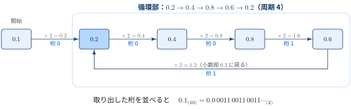
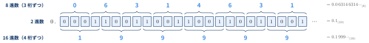

[コンピューターは数値をどう表現しているのか (1)](../2020-10-06-how-number-represented/index.qmd) では2進数・補数と整数の四則演算を扱いました．本記事では小数に目を向け，10進数では「きりのよい」 $0.1$ が2進数では無限に続く循環小数になることを手計算で確かめます．あわせて，有限小数になるかどうかが「何進数で書くか」によって決まることを，8進数・16進数・3進数の例で見ていきます．

## 0.1 を2進数で表す

[手計算：2を掛けて整数部を取る]{.mini-section}

小数部に2を掛け，整数部（0か1）を桁として取り出します．

```text
0.1 ×2 = 0.2  → 0
0.2 ×2 = 0.4  → 0
0.4 ×2 = 0.8  → 0
0.8 ×2 = 1.6  → 1   (小数部 0.6)
0.6 ×2 = 1.2  → 1   (小数部 0.2)
0.2 ×2 = 0.4  → 0   ← 0.2 が再び現れた
```

小数部が 0.2 に戻ったので，ここから 0, 0, 1, 1 を永遠に繰り返します．小数部が0になることはありません．

$$
0.1_{(10)} = 0.0\,0011\,0011\,0011\cdots_{(2)} = 0.0(0011)_{(2)}
$$

ここで $(0011)$ は，括弧内の桁が無限に繰り返されることを表します．

{width="100%" fig-align="center"}

[なぜ必ず繰り返しになるのか]{.mini-section}

$0.1 = 1/10$ から始めると，2を掛けて整数部を取り除いた後の小数部は常に $k/10$（$k = 0, 1, \dots, 9$）の形をしています．取りうる値は高々10通りしかないので，計算を続ければいずれ

- 小数部が $0$ になって終わる（有限小数）
- 一度現れた小数部が再び現れ，以降は同じ桁の並びを繰り返す（循環小数）

のどちらかになります．$0.1$ の場合は後者で，$0.2$ が再登場した時点で周期4の循環が確定します．

[検算]{.mini-section}

循環部 $0.(0011)_{(2)}$ を $x$ とおくと，4桁ずらした $2^4 x = 0011.(0011)_{(2)}$ との差から

$$
16x - x = 0011_{(2)} = 3 \Rightarrow x = \frac{3}{15} = \frac{1}{5}
$$

$0.0(0011)_{(2)}$ はこれを1桁右にずらした（$1/2$ 倍した）ものなので，$\dfrac{1}{5}\times\dfrac{1}{2} = \dfrac{1}{10}$ となり，確かに $0.1$ に一致します．

## 8進数・16進数で表す

8 $= 2^3$，16 $= 2^4$ なので，2進数を小数点から右へ3桁ずつ区切れば8進数，4桁ずつ区切れば16進数の1桁にそのまま対応します．

{width="100%" fig-align="center"}

$$
\begin{aligned}
0.1_{(10)} &= 0.\,000\,110\,011\,001\,100\,110\,011\,001\cdots_{(2)} = 0.0(6314)_{(8)}\\[4pt]
0.1_{(10)} &= 0.\,0001\,1001\,1001\,1001\cdots_{(2)} = 0.1(9)_{(16)}
\end{aligned}
$$

[直接計算でも確認する]{.mini-section}

2進数のときと同じ手順で，8または16を掛けて整数部を取り出しても同じ結果になります．

```text
8進数                              16進数
0.1 ×8 = 0.8  → 0                  0.1 ×16 = 1.6  → 1
0.8 ×8 = 6.4  → 6                  0.6 ×16 = 9.6  → 9
0.4 ×8 = 3.2  → 3                  0.6 ×16 = 9.6  → 9   ← 0.6 が再び現れた
0.2 ×8 = 1.6  → 1
0.6 ×8 = 4.8  → 4
0.8 ×8 = 6.4  → 6   ← 0.8 が再び現れた
```

16進数の $0.1(9)_{(16)}$ は，

$$
\frac{1}{16} + \frac{9}{16^2}\cdot\frac{1}{1 - 1/16} = \frac{1}{16} + \frac{9}{240} = \frac{24}{240} = \frac{1}{10}
$$

と検算できます．

8進数でも16進数でも $0.1$ は無限小数のままです．どちらも底が2のべき乗で，素因数として2しか持たないため，2進数で有限にならない数は8進数・16進数でも有限になりません．変わるのは循環の見え方（周期の長さ）だけです．

## 0.45 も2進数では無限小数になる

$0.45$ は次のように分解できます．

$$
0.45 = 0.5 - 0.05
$$

- $0.5 = 1/2 = 0.1_{(2)}$ は2進数で表せる（有限小数）
- $0.05 = 0.1 / 2$ は $0.1$ の2進表現を1桁右にずらしたもので，$0.00(0011)_{(2)}$ という無限小数

もし $0.45$ が2進数の有限小数だとすると，$0.05 = 0.5 - 0.45$ は「有限小数 − 有限小数」なので有限小数になってしまい，矛盾します．よって $0.45$ も2進数では無限小数です．

この議論を，背理法を用いて数学的に厳密な形で書き直します．

[準備：2進数の有限小数とは]{.mini-section}

::: {#def- .custom_problem .blog-custom-border}
[2進数の有限小数]{.def-title}

非負の実数 $x$ が2進数の有限小数で表せるとは，ある非負整数 $m, n$ を用いて

$$
x = \frac{m}{2^n}
$$

と書けることをいう．

:::

実際，$x = d_0.d_1 d_2 \cdots d_n{}_{(2)}$（各 $d_i \in \{0, 1\}$）と小数第 $n$ 位で終わるなら，両辺に $2^n$ を掛けた $2^n x = d_0 d_1 \cdots d_n{}_{(2)}$ は整数です．これを $m$ とおけば $x = m/2^n$ です．逆に $x = m/2^n$ なら，整数 $m$ を2進数で書いて小数点を右から $n$ 桁目の位置に打てば，有限小数の表記が得られます．

この形の数には次の性質があります．

- **差について閉じている**: $\dfrac{m_1}{2^{n_1}} - \dfrac{m_2}{2^{n_2}} = \dfrac{m_1 2^{n_2} - m_2 2^{n_1}}{2^{n_1 + n_2}}$ となり，分子は整数なので，差が非負ならやはり $m/2^n$ の形
- **2倍について閉じている**: $2 \cdot \dfrac{m}{2^n} = \dfrac{2m}{2^n}$ もやはり $m/2^n$ の形

次の補題と命題を，いずれも背理法で示します．

::: {#lem- .custom_problem .blog-custom-border}
[0.1 は2進数の有限小数で表せない]{.def-title}

$0.1 = 1/10$ は，非負整数 $m, n$ を用いて $m/2^n$ の形に書くことはできない．

:::

::: {.callout-note collapse="false" icon=false}
## Proof

$0.1 = \dfrac{1}{10} = \dfrac{m}{2^n}$ を満たす非負整数 $m, n$ が存在すると仮定する．分母を払うと

$$
2^n = 10m = 5 \cdot 2m
$$

となり，素数 $5$ が $2^n = 2 \times 2 \times \cdots \times 2$ を割り切る．素数 $p$ が積 $ab$ を割り切るなら $p \mid a$ または $p \mid b$ が成り立つ（ユークリッドの補題）ので，これを繰り返し用いると $5 \mid 2$ となる（$n = 0$ のときは $5 \mid 1$）．これは誤りであるから矛盾する．

よって $0.1$ は2進数の有限小数で表せない．$\square$

:::

::: {#prp- .custom_problem .blog-custom-border}
[0.45 は2進数の有限小数で表せない]{.def-title}

$0.45$ は，非負整数 $m, n$ を用いて $m/2^n$ の形に書くことはできない．

:::

::: {.callout-note collapse="false" icon=false}
## Proof

$0.45$ が2進数の有限小数で表せる，すなわち $0.45 = m/2^n$ と書けると仮定する．

1. $0.5 = 1/2^1$ は2進数の有限小数である
2. 差について閉じているので，$0.05 = 0.5 - 0.45 \,(> 0)$ も2進数の有限小数である
3. 2倍について閉じているので，$0.1 = 2 \times 0.05$ も2進数の有限小数である

3. は補題に反する．よって仮定は誤りであり，$0.45$ は2進数の有限小数で表せない．$\square$

:::

分解を経由せず，分母の素因数を直接見て示すこともできます．

::: {.callout-note collapse="true" icon=false}
## Proof（別証）

$0.45 = \dfrac{9}{20} = \dfrac{m}{2^n}$ と仮定する．分母を払うと

$$
9 \cdot 2^n = 20m = 5 \cdot 4m
$$

となり，素数 $5$ が $9 \cdot 2^n = 3 \times 3 \times 2 \times \cdots \times 2$ を割り切る．ユークリッドの補題より $5 \mid 3$ または $5 \mid 2$ となるが，これは矛盾である．$\square$

:::

どちらの証明でも，矛盾の原因は「分母の素因数 $5$ が，2のべき乗 $2^n$ では打ち消せない」ことにあります．これが後で述べる一般的な条件につながります．

[循環小数になることの確認]{.mini-section}

なお，上の命題が示すのは「有限小数にならない」ことです．有理数の2進展開は，2を掛けたあとの小数部が $k/20$（$k = 0, 1, \dots, 19$）の有限通りしか取らないので，有限小数でなければ必ず循環小数になります．

実際に2を掛ける手順で求めると

```text
0.45 ×2 = 0.9  → 0
0.9  ×2 = 1.8  → 1   (小数部 0.8)
0.8  ×2 = 1.6  → 1   (小数部 0.6)
0.6  ×2 = 1.2  → 1   (小数部 0.2)
0.2  ×2 = 0.4  → 0
0.4  ×2 = 0.8  → 0
0.8  ×2 = 1.6  → 1   ← 0.8 が再び現れた
```

$$
0.45_{(10)} = 0.01(1100)_{(2)}
$$

となります．$0.45 = 0.25 + 0.2 = 0.01_{(2)} + 0.(0011)_{(2)}$ と分解しても同じ結果が得られます．

::: {#def- .custom_problem .blog-custom-border}
[有限小数で表せる条件]{.def-title}

既約分数 $p/q$ が $b$ 進数で有限小数として表せるのは，分母 $q$ の素因数がすべて $b$ の素因数であるときに限る．

:::

$0.1 = 1/10$ や $0.45 = 9/20$ は分母に素因数5を含むので，2進数（さらに8進数・16進数）では有限小数になりません．一方，$0.5 = 1/2$ や $0.375 = 3/8$ のように分母が2のべき乗なら有限小数になります．

## 0.333… は3進数なら 0.1

有限小数になるかどうかは数そのものではなく底で決まります．10進数で無限小数の $1/3$ は，3進数では

$$
\frac{1}{3} = 0.333\cdots_{(10)} = 0.1_{(3)}
$$

と1桁で書けます．3進数の小数第1位は $3^{-1}$ の位なので当然です．

逆に，10進数で有限小数の $0.1$ を3進数にすると，3を掛けて整数部を取る手順で

```text
0.1 ×3 = 0.3  → 0
0.3 ×3 = 0.9  → 0
0.9 ×3 = 2.7  → 2   (小数部 0.7)
0.7 ×3 = 2.1  → 2   (小数部 0.1)
0.1 ×3 = 0.3  → 0   ← 0.1 が再び現れた
```

$$
0.1_{(10)} = 0.(0022)_{(3)}
$$

と無限小数になります．

| 数 | 10進数 | 2進数 | 3進数 |
|:---:|:---:|:---:|:---:|
| $1/2$ | $0.5$ | $0.1$ | $0.(1)$ |
| $1/3$ | $0.(3)$ | $0.(01)$ | $0.1$ |
| $1/10$ | $0.1$ | $0.0(0011)$ | $0.(0022)$ |

: 同じ数でも底によって有限小数になったり無限小数になったりする {tbl-colwidths="[16,28,28,28]"}

## 0.999… = 1 を10進数と3進数で考える

[10進数の場合]{.mini-section}

$0.999\cdots_{(10)} = 1$ は次のように確かめられます．

1. $1/3 = 0.333\cdots$ の両辺を3倍すると $1 = 0.999\cdots$
2. $x = 0.999\cdots$ とおくと $10x = 9.999\cdots$．差を取って $9x = 9$，よって $x = 1$
3. 等比級数として $\displaystyle 0.999\cdots = \sum_{k=1}^{\infty} \frac{9}{10^k} = 9 \cdot \frac{1/10}{1 - 1/10} = 1$

[3進数の場合]{.mini-section}

3進数で使える数字は 0, 1, 2 だけなので，「9が並ぶ」に対応するのは「最大の数字2が並ぶ」 $0.222\cdots_{(3)}$ です．10進数と同じ3通りの考え方で確かめられます．

1. $1/2 = 0.111\cdots_{(3)}$ の両辺を2倍すると $1 = 0.222\cdots_{(3)}$
2. $x = 0.222\cdots_{(3)}$ とおくと $3x = 2.222\cdots_{(3)}$．差を取って $2x = 2$，よって $x = 1$
3. 等比級数として $\displaystyle 0.222\cdots_{(3)} = \sum_{k=1}^{\infty} \frac{2}{3^k} = 2 \cdot \frac{1/3}{1 - 1/3} = 1$

10進数の (1) で使った $1/3$ は，3進数では $0.1_{(3)}$ と有限小数なので，3倍しても $1$ になるだけで循環小数は現れません．3進数で同じ役割を果たすのは，3進数で無限小数になる $1/2$ です．

[一般化]{.mini-section}

$b$ 進数では「最大の数字 $b-1$ が無限に並ぶ小数」が繰り上がった値に等しくなります．

$$
0.(b-1)(b-1)(b-1)\cdots_{(b)} = \sum_{k=1}^{\infty} \frac{b-1}{b^k} = 1
$$

この結果から，有限小数は2通りの書き方を持つことがわかります．

| 底 | 有限小数での表記 | 無限小数での表記 |
|:---:|:---:|:---:|
| 10進数 | $0.5$ | $0.4999\cdots$ |
| 2進数 | $0.1_{(2)}$ | $0.0111\cdots_{(2)}$ |
| 3進数 | $0.1_{(3)}$ | $0.0222\cdots_{(3)}$ |

: {tbl-colwidths="[20,40,40]"}

## References

- [[再掲載] コンピューターは数値をどう表現しているのか (1)](../2020-10-06-how-number-represented/index.qmd)：2進数・補数・整数の四則演算
- [[再掲載] コンピューターは数値をどう表現しているのか (2)](../2020-10-20-how-number-represented-2/index.qmd)：符号なし・符号付き減算とオーバーフローの練習問題
- [Bash とシフト演算](../2026-11-10-shell-shift-operation/index.qmd)：2のべき乗とビット演算（$m/2^n$ は $m$ を $n$ ビット右にずらした値）
- [18世紀までの関数論とテイラー展開](../2025-02-01-function-and-taylor-expansion/index.qmd)：無限等比級数の公式，背理法による $e$ の無理性の証明
- [収束の条件とCauchyの判定法](../2025-07-02-convergence-in-sequence/index.qmd)：無限小数を級数の極限として扱う際の収束の議論
