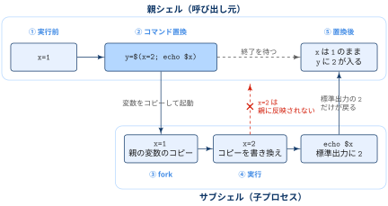

::: {.callout-note}
## TL;DRs

- `var=$(cmd)` でコマンドの標準出力を変数に代入する
- 旧記法の `` var=`cmd` `` はネストやバックスラッシュの扱いが分かりにくいので `$(cmd)` を使う
- コマンド置換は末尾の改行をすべて削除し，サブシェルで実行される．展開結果は `"$(cmd)"` とクオートして単語分割・パス名展開を防ぐ
- `local v=$(cmd)` は `cmd` の終了ステータスを失う．宣言と代入は2行に分ける

:::

シェルスクリプトでは「コマンドの出力を変数に入れたい」「変数同士を足し算したい」という場面が頻繁にあります．
bash ではそれぞれ

- **コマンド置換 (command substitution)**: `$(cmd)` または `` `cmd` ``
- **算術展開 (arithmetic expansion)**: `$((expr))`

という展開を使います．

:::: {.no-border-top-table}

| 記法 | 名前 | 中身の解釈 | 結果 |
|---|---|---|---|
| `$(cmd)` | コマンド置換 | コマンドとしてサブシェルで実行 | 標準出力の文字列 |
| `` `cmd` `` | コマンド置換 | 同上 | 同上 |
| `$((expr))` | 算術展開 | 整数の算術式として評価 | 計算結果の数値 |
| `((expr))` | 算術コマンド | 整数の算術式として評価 | 終了ステータス (真なら 0) |

::::

## コマンド置換

### 基本形: `$(cmd)` と `` `cmd` ``

コマンド置換は，カッコ内のコマンドを実行し，その**標準出力**で自分自身を置き換えます．

```bash
today=$(date +%F)
echo "$today"
# 2026-11-26

branch=`git branch --show-current`
echo "$branch"
# main
```

- `$(cmd)` と `` `cmd` `` はどちらも同じコマンド置換
- バッククオートは Bourne shell 時代からの旧記法
- POSIX でも `$(cmd)` が推奨されている

### `$(...)` を使うべき理由

[1. ネストが素直に書ける]{.mini-section}

`$(...)` はそのまま入れ子にできますが，バックスラッシュではネストする内側のバッククオートをエスケープする必要があります．

```bash
echo $(echo outer $(echo inner))
# outer inner

echo `echo outer \`echo inner\``
# outer inner
```

2段程度ならまだ読めますが，3段以上になるとバッククオート版はほぼ解読不能です．

[2. バックスラッシュの扱いが直感どおり]{.mini-section}

バッククオートの中では `\\` が `\` に変換されるなど，バックスラッシュが一段余計に解釈されます．
`$(...)` の中は通常のコマンドラインと同じルールで解釈されます．

```bash
echo $(echo 'a\\b')
# a\\b

echo `echo 'a\\b'`
# a\b
```

シングルクオートの中ですらバックスラッシュが変換されてしまうのは，バッククオートの分かりにくいところです．

[3. 内側でダブルクオートを自由に使える]{.mini-section}

`$(...)` の中は独立したクオートの文脈になるので，外側をダブルクオートで囲んでいても内側で再びダブルクオートを使えます．

```bash
v="$(echo "a b")"
echo "$v"
# a b
```

### コマンド置換の挙動

[末尾の改行はすべて削除される]{.mini-section}

コマンド置換は出力の**末尾の改行をすべて**取り除きます (途中の改行は残ります)．

```bash
v=$(printf 'a\n\n\n')
printf '[%s]\n' "$v"
# [a]
```

`echo` の出力を代入しても値の最後に改行が付かないのはこのためです．
逆に，末尾の改行も含めて正確に保持したい場合は，ダミー文字を付けてから削るのが定番の回避策です．

```bash
v=$(printf 'a\n\n\n'; echo x)
v=${v%x}    # 末尾の x を削除．改行3つが残る
```

[サブシェルで実行される]{.mini-section}

`$(...)` の中身は**サブシェル**(子プロセス) で実行されます．
そのため，中で変数を書き換えても呼び出し元には反映されません．

```bash
x=1
y=$(x=2; echo $x)
echo "x=$x y=$y"
# x=1 y=2
```

{width="100%" fig-align="center"}

サブシェルは起動時に親シェルの変数をコピーして持つので，中で `$x` を参照すると `1` が見えます．
`x=2` で書き換えられるのはこのコピーだけで，サブシェルが終了するとコピーごと消えます．
呼び出し元に戻ってくるのは標準出力に書かれた文字列 (`2`) だけなので，`y` には `2` が入り，`x` は `1` のままです．

また，コマンド置換のたびにプロセスが fork されるので，大きなループの中で多用すると遅くなります．
文字列の切り出しや置換程度なら `${var#prefix}` や `${var//a/b}` などのパラメータ展開で済ませる方が高速です．

[代入の終了ステータスはコマンドの終了ステータスになる]{.mini-section}

`var=$(cmd)` という単純な代入文の終了ステータス `$?` は，`cmd` の終了ステータスになります．
これを利用すると，出力の取得と成否判定を同時に行えます．

```bash
v=$(false)
echo $?
# 1

if out=$(git rev-parse --show-toplevel 2>/dev/null); then
    echo "repo root: $out"
else
    echo "not a git repository"
fi
```

::: {.callout-warning}
### `local` と同時に代入すると終了ステータスが失われる

関数内で `local v=$(cmd)` と書くと，`$?` は `cmd` ではなく `local` コマンド自身の終了ステータス (通常は 0) になります．
`export`，`declare`，`readonly` でも同じです．

```bash
f() { local v=$(false); echo "local: $?"; }
f
# local: 0

g() { local v; v=$(false); echo "split: $?"; }
g
# split: 1
```

終了ステータスを使いたい場合は，宣言と代入を2行に分けます (ShellCheck の SC2155 で指摘される問題です)．
:::

[`local` とコマンド置換の推奨パターン]{.mini-section}

宣言と代入を分けたうえで，代入の直後に終了ステータスを判定するのが基本形です．

```bash
# パターン1: 失敗したらそのまま呼び出し元に失敗を返す
read_version() {
  local version
  version="$(cat "$1")" || return

  echo "version=${version}"
}
```

`|| return` は直前のコマンドの終了ステータスをそのまま返すので，`cmd` が失敗すると関数も同じステータスで失敗します．
エラーメッセージを出したい場合は `if !` で判定します．

```bash
# パターン2: エラーメッセージを出してから失敗を返す
get_root() {
  local root
  if ! root="$(git -C "$1" rev-parse --show-toplevel 2>/dev/null)"; then
    echo "error: not a git repository: $1" >&2
    return 1
  fi

  echo "root=${root}"
}

get_root /tmp
# error: not a git repository: /tmp
echo $?
# 1
```

1行で済ませたいなら `version="$(cat "$1")" || { echo "error: cannot read $1" >&2; return 1; }` のように `{ ...; }` でまとめても構いません．

`set -e` を使っているスクリプトでも，宣言と代入を分けることには意味があります．
`local v=$(false)` は `local` が成功扱いになるため `set -e` でも止まりませんが，分けて書けば代入の失敗でスクリプトが終了します．

```bash
set -e
f() { local v=$(false); echo "reached"; }      # 止まらずに reached が出力される
g() { local v; v=$(false); echo "reached"; }   # v=$(false) の時点でスクリプトが終了する
```

`readonly` や `export` を付けたい変数も同じ考え方で，**代入 → 判定 → 属性の付与**の順に書きます．
`export` 自体は常に成功するので，判定は `export` より前に置く必要があります．

```bash
# パターン3: 判定してから readonly / export を付ける
CONFIG="$(cat config.txt)" || exit 1
readonly CONFIG

BUILD_ID="$(git rev-parse --short HEAD)" || exit 1
export BUILD_ID
```

[クオートしないと単語分割とパス名展開がかかる]{.mini-section}

クオートせずに `$(cmd)` を展開すると，その結果に対して**単語分割** (`IFS` による分割) と**パス名展開** (`*` などのglob展開) が行われます．

```bash
# カレントディレクトリに t.sh があるとする
printf '<%s>\n' $(printf 'a  b\n*')
# <a>
# <b>
# <t.sh>      ← * がファイル名に展開されてしまった

printf '<%s>\n' "$(printf 'a  b\n*')"
# <a  b
# *>
```

出力をそのまま1つの文字列として扱いたい場合は，必ず `"$(cmd)"` とダブルクオートで囲みます．
なお，`v=$(cmd)` のような代入の右辺では単語分割もパス名展開も行われないため，クオートしなくても値は変わりません (ただし囲んでおいても害はありません)．

[ファイルの読み込みは `$(<file)` で書ける]{.mini-section}

`$(cat file)` は bash では `$(<file)` と書けます．`cat` を起動しない分だけ高速です．

```bash
printf 'hello\n' > f.txt
v=$(<f.txt)
echo "[$v]"
# [hello]
```

`$(cat f.txt)` と `$(<f.txt)` では，ファイルを読むまでに起動するプロセスの数が違います．

{width="100%" fig-align="center"}

- `$(cat f.txt)`: コマンド置換のために子プロセスを fork し，その子プロセスが `cat` を exec してファイルを読む
- `$(<f.txt)`: bash 自身がファイルを開いて内容を読む．bash 5.2 以降では子プロセスも作らない

`strace` でプロセスの生成 (`clone`) と外部コマンドの起動 (`execve`) を数えると，違いがはっきり分かります (bash 5.2.21)．

```bash
strace -f -e trace=clone,execve bash -c 'v=$(cat f.txt)' 2>&1 | grep -cE 'clone|execve\("/usr/bin/cat'
# 2      ← clone 1回 + cat の execve 1回

strace -f -e trace=clone,execve bash -c 'v=$(<f.txt)' 2>&1 | grep -cE 'clone|execve\("/usr/bin/cat'
# 0      ← プロセスを1つも作らない
```


## 算術展開

### 基本形: `$((expr))`

`$((expr))` は，中身を**整数の算術式**として評価し，その結果で置き換えます．
演算子の前後のスペースは自由です．

```bash
echo $((1 + 2))
# 3

echo $((1+ 2))
# 3

n=5
echo $((n * 2))
# 10
```

`$((...))` の中では，変数名に `$` を付けなくても値が参照されます．
`$((n * 2))` と `$(($n * 2))` は同じ結果になりますが，`$` なしの方が読みやすく，未定義変数が空文字に展開されて構文エラーになる事故も防げます．
ただし，位置パラメータ `$1` や特殊変数 `$#` には `$` が必要です．

```bash
echo $((unset_var + 1))   # 未定義変数は 0 として扱われる
# 1

echo $(($# + 1))          # 引数の個数 + 1
```

### 主な演算子

C 言語とほぼ同じ演算子が使えます．

:::: {.no-border-top-table}

| 分類 | 演算子 | 例 | 結果 |
|---|---|---|---|
| 四則演算 | `+` `-` `*` `/` | `$((10 / 3))` | `3` |
| 剰余 | `%` | `$((10 % 3))` | `1` |
| べき乗 | `**` | `$((2 ** 10))` | `1024` |
| 比較 | `<` `<=` `>` `>=` `==` `!=` | `$((7 > 3))` | `1` (真) |
| 論理 | `&&` `\|\|` `!` | `$((3 == 3 && 2 > 5))` | `0` (偽) |
| ビット演算 | `&` `\|` `^` `~` `<<` `>>` | `$((1 << 4))` | `16` |
| 三項演算子 | `cond ? a : b` | `$((x > 0 ? 10 : 20))` | `10` (x=1 のとき) |
| 代入 | `=` `+=` `-=` `*=` `/=` ... | `$((n += 10))` | n に 10 を加算 |
| インクリメント | `++` `--` (前置/後置) | `$((n++))` | 加算前の n |

::::

比較演算子・論理演算子の結果は，C 言語と同様に**真なら 1，偽なら 0** です．
シェルの終了ステータス (成功が 0) とは逆なので注意してください．

インクリメントや代入は変数を書き換える副作用を持ちます．

```bash
n=5
echo $((n++)) $n $((++n))
# 5 6 7
```

### 整数演算のみ

bash の算術展開は **64bit 符号付き整数** しか扱えません．小数を含む式はエラーになります．

```bash
echo $((1.5 + 1))
# bash: 1.5+1: syntax error: invalid arithmetic operator (error token is ".5+1")
```

除算は**0方向への切り捨て**，剰余の符号は被除数と同じです．また，オーバーフローはエラーにならず黙って折り返します．

```bash
echo $((10 / 3)) $((-7 / 2)) $((-7 % 2))
# 3 -3 -1

echo $((9223372036854775807 + 1))
# -9223372036854775808

echo $((10 / 0))
# bash: 10/0: division by 0 (error token is "0")
```

### 基数指定と先頭ゼロの罠

数値リテラルは `0x` で16進数，`base#number` で任意の基数 (2〜64) を指定できます．
そして**先頭が `0` の数値は8進数**として解釈されます．

```bash
echo $((0x1f)) $((2#1010)) $((16#ff)) $((010))
# 31 10 255 8
```

この8進数ルールは，日付や時刻のようにゼロ埋めされた文字列を計算に使うときによく問題になります．

```bash
echo $((08))
# bash: 08: value too great for base (error token is "08")

echo $((10#08))   # 10進数として明示する
# 8

month=$(date +%m)          # 例: "08"
next=$((10#$month + 1))    # 10# を付けないと 8月・9月だけエラーになる
```

### 算術コマンド `((expr))`

先頭の `$` を外した `((expr))` は**算術コマンド**です．
式を評価するだけで出力はせず，結果が**非ゼロなら終了ステータス 0 (成功)，ゼロなら 1 (失敗)** を返します．
条件分岐や変数の更新に便利です．

```bash
x=3
(( y = x * 2 ))
echo $y
# 6

if (( x > 2 )); then
    echo big
fi
# big

(( count += 1 ))   # count=$((count + 1)) と同じ
```

数値比較は `[ "$x" -gt 2 ]` や `[[ $x -gt 2 ]]` でも書けますが，`(( x > 2 ))` の方が見慣れた演算子で書けて読みやすいです．


### `$((...))` と `$( (...) )` の区別

`$((` は算術展開の開始として解釈されます．
コマンド置換の中でサブシェル `( ... )` を使いたい場合は，`$(` と `(` の間にスペースを入れて曖昧さをなくします．

```bash
echo $( (echo sub) )
# sub
```

## Google Shell Style Guide の関連ルール

[Google Shell Style Guide](https://google.github.io/styleguide/shellguide.html) は，Google 社内で bash スクリプトを書くときのコーディング規約です．
`$(cmd)` を使うべきという規約は「Features and Bugs」章の [Command Substitution](https://google.github.io/styleguide/shellguide.html#s6.2-command-substitution) 節に書かれています．
それ以外にも，コマンド置換や算術展開に関するルールがいくつかの節に分かれて載っています．

:::: {.no-border-top-table}

| 節 | ルールの要点 |
|---|---|
| [Command Substitution](https://google.github.io/styleguide/shellguide.html#s6.2-command-substitution) | バッククオートではなく `$(command)` を使う |
| [Quoting](https://google.github.io/styleguide/shellguide.html#s5.7-quoting) | コマンド置換は整数が返る場合でもクオートする |
| [Use Local Variables](https://google.github.io/styleguide/shellguide.html#s7.6-use-local-variables) | `local` の宣言とコマンド置換による代入は分ける |
| [Arrays](https://google.github.io/styleguide/shellguide.html#s6.7-arrays) / [Pipes to While](https://google.github.io/styleguide/shellguide.html#s6.8-pipes-to-while) | クオートなしの `$(...)` で配列や引数リストを作らない |
| [Eval](https://google.github.io/styleguide/shellguide.html#s6.6-eval) | `eval $(...)` で変数を設定しない |
| [Arithmetic](https://google.github.io/styleguide/shellguide.html#s6.9-arithmetic) | `(( … ))` / `$(( … ))` を使い，`let`・`$[ … ]`・`expr` は使わない |
| [Builtin Commands vs. External Commands](https://google.github.io/styleguide/shellguide.html#s8.2-builtin-commands-vs-external-commands) | `expr` や `sed` を呼ぶコマンド置換より組み込み機能を使う |

::::

### Command Substitution: `$(command)` を使う

> Use `$(command)` instead of backticks.
>
> Nested backticks require escaping the inner ones with `\ `. The `$(command)` format doesn't change when nested and is easier to read.

```bash
# This is preferred:
var="$(command "$(command1)")"

# This is not:
var="`command \`command1\``"
```

バッククオートは入れ子にすると内側を `\` でエスケープする必要があるのに対し，`$(command)` は入れ子にしても書き方が変わらず読みやすい，というのが理由です．
本記事の「`$(...)` を使うべき理由」で確認したネストの問題そのものです．
良い例で `"$(command1)"` が `"$(command ...)"` の内側にさらにダブルクオート付きで書かれている点にも注目してください．`$(...)` の中は独立したクオートの文脈になるため，このように素直に書けます．

### Quoting: コマンド置換はクオートする

> Always quote strings containing variables, command substitutions, spaces or shell meta characters, unless careful unquoted expansion is required or it's a shell-internal integer (see next point).

```bash
# "quote command substitutions"
# Note that quotes nested inside "$()" don't need escaping.
flag="$(some_command and its args "$@" 'quoted separately')"

# "quote command substitutions", even when you expect integers
number="$(generate_number)"
```

コマンド置換は，意図的にクオートを外す場合を除いて常にクオートする，というルールです．
「整数が返ると分かっていてもクオートする」と明記されている点がポイントです．

本文で説明したとおり，`var=$(cmd)` のような代入の右辺では単語分割もパス名展開も起きないため，クオートの有無で結果は変わりません．
それでもクオートするのは，「コマンド置換は常に `"$(...)"` と書く」と統一しておけば，引数として渡す場面でクオートを付け忘れる事故を防げるからです．
ガイド全体でも，代入の右辺を含めてコマンド置換はすべて `"$(...)"` の形で書かれています．

### Use Local Variables: 宣言と代入を分ける

> Declaration and assignment must be separate statements when the assignment value is provided by a command substitution; as the `local` builtin does not propagate the exit code from the command substitution.

```bash
my_func2() {
  local name="$1"

  # Separate lines for declaration and assignment:
  local my_var
  my_var="$(my_func)"
  (( $? == 0 )) || return

  …
}
```

```bash
my_func2() {
  # DO NOT do this:
  # $? will always be zero, as it contains the exit code of 'local', not my_func
  local my_var="$(my_func)"
  (( $? == 0 )) || return

  …
}
```

本文の callout「`local` と同時に代入すると終了ステータスが失われる」と同じ内容で，ガイドでは "must" (必須) として書かれています．
`local name="$1"` のように右辺がコマンド置換でなければ1行で書いてよく，分ける必要があるのはコマンド置換の場合だけです．

### Arrays / Pipes to While: クオートなしの `$(...)` でリストを作らない

[Arrays](https://google.github.io/styleguide/shellguide.html#s6.7-arrays) 節では，悪い例として次のコードが挙げられています．

```bash
# Command expansions return single strings, not arrays. Avoid
# unquoted expansion in array assignments because it won't
# work correctly if the command output contains special
# characters or whitespace.

declare -a files=($(ls /directory))

mybinary $(get_arguments)
```

コマンド置換が返すのは配列ではなく**1つの文字列**です．
クオートせずに展開すると，本文で見た単語分割とパス名展開を経てからリストになるため，出力に空白や `*` が含まれると要素が壊れます．

[Pipes to While](https://google.github.io/styleguide/shellguide.html#s6.8-pipes-to-while) 節にも，`for` ループについて同じ趣旨の注意があります．

> Be cautious using a for-loop to iterate over output, as in `for var in $(...)`, as the output is split by whitespace, not by line. [...] a `while read` loop or `readarray` is often safer and clearer.

出力を行単位で扱いたいなら，`for var in $(...)` ではなく `while read` ループか `readarray` (`mapfile` の別名) を使います．

```bash
readarray -t lines < <(cmd)

while IFS= read -r line; do
  echo "${line}"
done < <(cmd)
```

### Eval: `eval $(...)` を避ける

> `eval` should be avoided.

```bash
# What does this set?
# Did it succeed? In part or whole?
eval $(set_my_variables)
```

コマンドの出力を `eval` に渡して変数を設定するパターンは，何が設定されたのか，成功したのか (全部か一部か) を確認できないため避けるべきとされています．
クオートなしの `$(...)` を使っているので，値に空白が含まれると単語分割で壊れるという問題もあります．

### Arithmetic: `(( … ))` と `$(( … ))` を使う

算術展開に関するルールは [Arithmetic](https://google.github.io/styleguide/shellguide.html#s6.9-arithmetic) 節にまとまっています．

[使う記法]{.mini-section}

> Always use `(( … ))` or `$(( … ))` rather than `let` or `$[ … ]` or `expr`.
>
> Never use the `$[ … ]` syntax, the `expr` command, or the `let` built-in.

```bash
# This form is non-portable and deprecated
i=$[2 * 10]

# Despite appearances, 'let' isn't one of the declarative keywords,
# so unquoted assignments are subject to globbing wordsplitting.
# For the sake of simplicity, avoid 'let' and use (( … ))
let i="2 + 2"

# The expr utility is an external program and not a shell builtin.
i=$( expr 4 + 4 )

# Quoting can be error prone when using expr too.
i=$( expr 4 '*' 4 )
```

本文の「その他の算術記法」の表で紹介した `let`・`$[ … ]`・`expr` は，ガイドでは "Never use" と明確に禁止されています．
理由はそれぞれ次のとおりです．

- `$[ … ]`: 非可搬かつ非推奨の記法
- `let`: 宣言系のキーワードではないので，クオートしない代入式にはパス名展開と単語分割がかかる
- `expr`: 組み込みではなく外部コマンドで，`*` のクオートなどを間違えやすい

> Stylistic considerations aside, the shell's built-in arithmetic is many times faster than `expr`.

とあるように，速度の面でも組み込みの算術の方が有利です．

[数値比較は `(( … ))` で行う]{.mini-section}

> `<` and `>` don't perform numerical comparison inside `[[ … ]]` expressions (they perform lexicographical comparisons instead; see [Testing Strings](https://google.github.io/styleguide/shellguide.html#s6.4-testing-strings)). For preference, don't use `[[ … ]]` *at all* for numeric comparisons, use `(( … ))` instead.

`[[ 10 < 9 ]]` は文字列として比較するので真になります．
数値の大小比較には `[[ … ]]` を使わず，`(( a < b ))` と書くことが推奨されています．

[単独の `(( … ))` 文と `set -e`]{.mini-section}

> It is recommended to avoid using `(( … ))` as a standalone statement, and otherwise be wary of its expression evaluating to zero
>
> - particularly with `set -e` enabled. For example, `set -e; i=0; (( i++ ))` will cause the shell to exit.

本文の callout「`set -e` と `((count++))` の組み合わせ」で確認した落とし穴です．
ガイドは `(( … ))` を単独の文として使うこと自体を避けるよう勧めています．
なお，ガイドの良い例にも `(( i += 3 ))` のような単独の文は登場するので，禁止ではなく「評価結果が 0 になりうるなら注意する」という推奨と読むのが妥当です．
カウンタを増やすだけなら，評価結果に関係なく成功する `i=$(( i + 1 ))` と書くのが一番安全です．

[`$` を省略し，カッコの内側にスペースを入れる]{.mini-section}

> When using variables, the `${var}` (and `$var`) forms are not required within `$(( … ))`. The shell knows to look up `var` for you, and omitting the `${…}` leads to cleaner code.

```bash
# Increment the variable "i" by three.
# Note that:
#  - We do not write ${i} or $i.
#  - We put a space after the (( and before the )).
(( i += 3 ))

hr=2
min=5
sec=30
echo "$(( hr * 3600 + min * 60 + sec ))" # prints 7530 as expected
```

ガイドは変数を常に `"${var}"` と波カッコ付きで書くスタイルを採っていますが，算術式の中だけは `$` を省略してよい (推奨) としています．
またコメントにあるとおり，`((` の後ろと `))` の前にスペースを入れて `$(( 2 + 2 ))` のように書くのがガイドのスタイルです．
本記事の `$((1 + 2))` のような詰めた書き方も文法上は同じですが，ガイドに合わせるなら `$(( 1 + 2 ))` と書きます．

### Builtin Commands vs. External Commands: 組み込みを優先する

> Given the choice between invoking a shell builtin and invoking a separate process, choose the builtin.

```bash
# Prefer this:
addition="$(( X + Y ))"
substitution="${string/#foo/bar}"

# Instead of this:
addition="$(expr "${X}" + "${Y}")"
substitution="$(echo "${string}" | sed -e 's/^foo/bar/')"
```

組み込み機能で書けるなら，外部コマンドを呼ぶコマンド置換は使わないというルールです．
`$(expr ...)` や `$(echo ... | sed ...)` はそのたびにサブシェルと外部プロセスを起動しますが，`$(( … ))` やパラメータ展開はシェルの中だけで完結するので高速です．
本文の「サブシェルで実行される」で述べた fork のコストを避けるための指針です．

## Appendix: bash 5.3 の `${ cmd; }`

bash 5.3 では，**サブシェルを作らずに現在のシェルでコマンドを実行する**コマンド置換 `${ cmd; }` が追加されました．
`$(cmd)` と同じく標準出力で置き換えられますが，fork しないので中での変数の変更やカレントディレクトリの移動が呼び出し元にそのまま残ります．

{width="100%" fig-align="center"}

以下は bash 5.3.20 で確認した結果です (手元の bash が 5.2 以前なら `docker run --rm -it bash:5.3` で試せます)．

```bash
x=1
y=${ x=2; echo $x; }
echo "x=$x y=$y"
# x=2 y=2      ← $(...) なら x=1 y=2

echo "$BASHPID ${ echo $BASHPID; } $(echo $BASHPID)"
# 1 1 8        ← ${ ...; } は親と同じプロセス，$(...) は別プロセス

cd /tmp
d=${ cd /; pwd; }
echo "d=$d now=$PWD"
# d=/ now=/    ← cd の効果も残る
```

末尾の改行が削除される点や，`v=${ false; }` の `$?` が中のコマンドの終了ステータス (この例では `1`) になる点は `$(cmd)` と同じです．

[書き方のルール]{.mini-section}

- `{` の直後に空白・タブ・改行のいずれか (または後述の `|`) を置く
- `}` の直前は `;` か改行で終える．`${ cmd }` のように `;` を省くと `}` がコマンドの引数として読まれ，置換が閉じない
- `${echo hi;}` のように `{` の直後に空白がないと，通常のパラメータ展開とみなされて `bad substitution` になる

[`${| cmd; }`: 標準出力ではなく `REPLY` の値を使う]{.mini-section}

`|` を付けた `${| cmd; }` は，標準出力を捕まえる代わりに，コマンド実行後の変数 `REPLY` の値で置き換えます．
`REPLY` はこの置換の中だけのローカル変数として扱われ，呼び出し元の `REPLY` は書き換わりません．

```bash
REPLY=orig
r=${| REPLY=hello; }
echo "r=$r REPLY=$REPLY"
# r=hello REPLY=orig

r=${| x=9; REPLY=$((x * 2)); }
echo "r=$r x=$x"
# r=18 x=9     ← REPLY 以外の変数の変更は残る
```

`echo` で文字列を出力して `$(...)` で受け取る代わりに，関数が `REPLY` に結果を入れて返す書き方ができるので，fork のコストを避けながら関数の戻り値を受け取れます．

```bash
to_upper() { REPLY=${1^^}; }

name=${| to_upper "bash"; }
echo "$name"
# BASH
```

[使いどころと注意点]{.mini-section}

- ループの中など，コマンド置換を何度も繰り返す場面では fork しない分だけ速い
- 逆に，変数の書き換え・`cd`・`set` などの副作用がすべて呼び出し元に残る．`$(cmd)` の「中で何をしても外に影響しない」という性質に頼っていたコードをそのまま置き換えると挙動が変わる
- bash 5.2 以前と zsh 5.9 では `bad substitution` エラーになる．実行環境の bash のバージョンを固定できない場合や，ほかのシェルでも動かす必要がある場合は `$(cmd)` を使う

## Appendix: zsh との違い

zsh でも `$(cmd)`，`` `cmd` ``，`$((expr))`，`((expr))` は同じように使え，末尾改行の削除・サブシェルでの実行・`local v=$(cmd)` で終了ステータスが失われる点・`set -e` と `((count++))` の罠も bash と共通です．
一方で，次の点は挙動が異なります (zsh 5.9 のデフォルト設定で確認)．

:::: {.no-border-top-table}

| 項目 | bash | zsh |
|---|---|---|
| クオートなし `$(cmd)` の単語分割 | される | される |
| クオートなし `$(cmd)` のパス名展開 | される | されない |
| クオートなし `$var` の単語分割 | される | されない |
| 小数の算術演算 | エラー | 使える |
| 先頭ゼロ `010` | 8進数 (`8`) | 10進数 (`10`) |
| `${ cmd; }` | bash 5.3 以降 | 5.9 では未対応 |

::::

### 単語分割とパス名展開

zsh はデフォルトでパラメータ展開 `$var` の結果を単語分割しませんが，**コマンド置換 `$(cmd)` の結果は `IFS` で単語分割します**．
ただし，その結果に対してパス名展開は行いません．

```zsh
printf '<%s>\n' $(printf 'a  b\n*')
# <a>
# <b>
# <*>        ← bash と違ってファイル名に展開されない

v=$(printf 'a  b\n*')
printf '<%s>\n' $v
# <a  b
# *>         ← 変数経由なら分割されない
```

この違いから，bash 用のスクリプトを zsh で動かす (またはその逆の) ときに引数の数が変わることがあります．
どちらのシェルでも `"$(cmd)"` とクオートしておけば同じ挙動になります．

出力を**行単位**で配列にしたい場合，zsh では `(f)` パラメータ展開フラグが使えます．

```zsh
arr=($(printf 'a b\nc d\n'))
echo ${#arr}
# 4          ← 空白でも分割される

lines=(${(f)"$(printf 'a b\nc d\n')"})
echo ${#lines}
# 2          ← 改行でのみ分割される
```

bash で同じことをするには `mapfile -t lines < <(cmd)` を使います．

### 浮動小数点演算

zsh の算術展開は浮動小数点数をサポートしています．
オペランドに小数が1つでも含まれれば浮動小数点演算になり，整数同士なら bash と同じく整数演算です．

```zsh
echo $((1.5 + 1)) $((10 / 3)) $((10 / 3.0)) $((2 ** 0.5))
# 2.5 3 3.3333333333333335 1.4142135623730951
```

`typeset -F` で小数点以下の桁数を指定した浮動小数点変数を宣言したり，`zsh/mathfunc` モジュールで数学関数を使ったりもできます．

```zsh
typeset -F 3 x=10
(( x /= 3 ))
echo $x
# 3.333

zmodload zsh/mathfunc
echo $(( sqrt(2) ))
# 1.4142135623730951
```

### 先頭ゼロの数値

zsh はデフォルトで先頭が `0` の数値を**10進数**として扱うため，bash のような `08` のエラーは起きません．
`setopt OCTAL_ZEROES` を有効にすると bash と同じく8進数として解釈されます．

```zsh
echo $((010)) $((08))
# 10 8

setopt OCTAL_ZEROES
echo $((010))
# 8
```

bash と zsh の両方で動かす前提なら，`10#` を付けて基数を明示しておくのが確実です．

References
----------

[bash]{.mini-section}

- [GNU Bash Reference Manual: Command Substitution](https://www.gnu.org/software/bash/manual/html_node/Command-Substitution.html)：`$(cmd)` / `` `cmd` `` / `$(<file)`，bash 5.3 の `${ cmd; }` / `${| cmd; }`
- [GNU Bash Reference Manual: Arithmetic Expansion](https://www.gnu.org/software/bash/manual/html_node/Arithmetic-Expansion.html)：`$((expr))` と `$[expr]` の非推奨
- [GNU Bash Reference Manual: Shell Arithmetic](https://www.gnu.org/software/bash/manual/html_node/Shell-Arithmetic.html)：演算子の一覧と優先順位，`base#n` と先頭ゼロの8進数
- [GNU Bash Reference Manual: Conditional Constructs](https://www.gnu.org/software/bash/manual/html_node/Conditional-Constructs.html)：算術コマンド `((expr))` の終了ステータス
- [Bash NEWS](https://tiswww.case.edu/php/chet/bash/NEWS)：bash 5.3 で追加された `${ command; }` / `${| command; }` の告知
- [POSIX.1-2024: Shell Command Language](https://pubs.opengroup.org/onlinepubs/9799919799/utilities/V3_chap02.html)：2.6.3 Command Substitution，2.6.4 Arithmetic Expansion

[zsh]{.mini-section}

- [zsh Manual: Expansion](https://zsh.sourceforge.io/Doc/Release/Expansion.html)：コマンド置換の単語分割，パラメータ展開フラグ `(f)`
- [zsh Manual: Arithmetic Evaluation](https://zsh.sourceforge.io/Doc/Release/Arithmetic-Evaluation.html)：浮動小数点演算，`typeset -F`，`zsh/mathfunc`
- [zsh Manual: Options](https://zsh.sourceforge.io/Doc/Release/Options.html)：`OCTAL_ZEROES`，`SH_WORD_SPLIT`

[スタイルガイド・解説]{.mini-section}

- [Google Shell Style Guide](https://google.github.io/styleguide/shellguide.html)：Command Substitution，Quoting，Arithmetic，Use Local Variables など
- [ShellCheck SC2155](https://www.shellcheck.net/wiki/SC2155)：Declare and assign separately to avoid masking return values
- [BashFAQ/082](https://mywiki.wooledge.org/BashFAQ/082)：バッククオートより `$(...)` が推奨される理由
- [BashFAQ/105](https://mywiki.wooledge.org/BashFAQ/105)：`set -e` が期待どおりに動かないケース (`((count++))` を含む)
