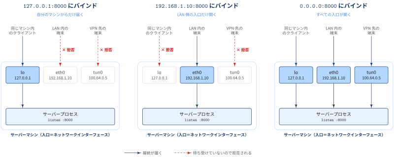

## IPアドレス `0.0.0.0`にバインド

pythonでhttp serverを立てて，Quartoで作成したウェブサイトを以下のコマンドで公開するとします

```{.zsh}
% python -m http.server 3000 --directory ./_site/
Serving HTTP on 0.0.0.0 port 3000 (http://0.0.0.0:3000/) ..
```

バインド先を設定せずにserverを立ち上げたところ，`0.0.0.0` で立ち上げているようです．
このとき，Firewallの3000 portをホスト側でAllowすると，同じnetworkの他の端末(例:iPad)からでもアクセスできるようになりました．

[プライベートIPアドレスをバインド先に指定した場合]{.mini-section}

自宅内のネットワークのみで有効なプライベートIPアドレス（クラスC `192.168.0.0` ~ `192.168.255.255`）を指定してhttp serverを立たてみます．

```{.zsh}
% python -m http.server 3000 --directory ./_site/ --bind 192.168.10.105
Serving HTTP on 192.168.10.105 port 3000 (http://192.168.10.105:3000/) ...
```

このとき，同じネットワーク内にあるiPadからアクセスできるようになりました．
iPad側では `http://192.168.10.105:3000` に接続することでQuarto contentsにアクセスできるようになりましたが，
このiPad側での操作は `0.0.0.0` で立ち上げたときと同じ操作となります．


::: { .blog-custom-border}
**❓ Question**

python http.server を使用して `0.0.0.0` にバインドしてhttp serverを立てたときの挙動は，プライベートネットワーク内部で割り当てられたプライベートIPアドレスを指定したときと同じ挙動をするのか？

:::

### `0.0.0.0/8` が満たすべき性質

IPv4において `0.0.0.0` (IPv6では`::/0`) はSepcial-Purpose Address Registry，つまり特別な目的用に予約されたアドレスです．


|Attribute            | Value                      |
|---------------------|----------------------------|
| Address Block        | `0.0.0.0/8`               |
| Name                 | This host on this network |
| RFC                  | [RFC1122], Section 3.2.1.3 |
| Allocation Date      | September 1981             |
| Termination Date     | N/A                        |
| Source               | True                       |
| Destination          | False                      |
| Forwardable          | False                      |
| Global               | False                      |
| Reserved-by-Protocol | True                       |

: RFC6890 {tbl-colwidths="[25,25]"}

上記より`0.0.0.0` ~ `0.255.255.255`について以下の情報を得ることができます

- `Global`セクションが`False`となっていることから，グローバルIPアドレスとして使用できない．利用はローカルネットワークに限定される
- `Source`セクション`True`より，送信元アドレスとして有効
- `Destination`セクション`False`より，宛先アドレスとして使用できない = ルーティング不可

ただし，`0.0.0.0`の具体的な意味はここからではまだわかりません．

[`0.0.0.0/0` vs `0.0.0.0/32`]{.mini-section}

|Attribute|	`0.0.0.0/0` |	`0.0.0.0/32`|
|---|---|---|
|Subnet Mask|	`0.0.0.0` (all bits variable)|`255.255.255.255` (all bits fixed)|
|Range|	All IPv4 addresses (`0.0.0.0` to `255.255.255.255`)	| `0.0.0.0`|

### Python http serverにおける `0.0.0.0`

バインド先を指定しないでhttp serverを立てるとき，バインド先を指定しない = 有効な宛先がないことを意味します．
このとき使用されるのが `0.0.0.0` です．

この文脈での `0.0.0.0` は **catch-all wildcard** と呼ばれるもので，そのマシン上のすべてのネットワークインターフェースに対して，
バインドするという特別な意味を持っています（バインドについては [Appendix: バインド](#appendix-bind) を参照）．コンピューターが複数のネットワークに接続していて，すべてのネットワークにバインドしたい場合に
`0.0.0.0`を指定します．ただし，不必要に使用してしまうと誤って外部のネットワークに共有してしまったりするので使用は控えたほうが良いです．


::: { .blog-custom-border}
**📘 REMARKS**

- Python HTTP Serverにおける `0.0.0.0` はルーティングにおけるデフォルトルートとしての`0.0.0.0`は異なります
- 文脈に応じて `0.0.0.0` が指す内容が異なることに注意してください
- `python hhtp.server`の文脈では`0.0.0.0`にバインドすると以下のインターフェースからアクセス可能となります
  - Localhost (`127.0.0.1`)
  - The private network (例: `192.168.x.x`)
  - Public network interfaces (Firewallでアクセスを許容していた場合) 

:::

Python http serverをprivate networkに限定する意図を込めて，以下のスクリプトでホスティングすることが望ましいです

```{.bash}
$ python3 -m http.server -b <your-local-private-network IP> 8080 --directory ./_site/
```

## Appendix: バインド {#appendix-bind}

::: {#def- .custom_problem .blog-custom-border}
[バインド（bind）]{.def-title}

- サーバープログラムが「どの IP アドレス＋ポート番号で接続を待ち受けるか」を OS に登録する操作
- ソケットを特定の住所（`IP:ポート`）に紐づける，というイメージ

:::

コンピューターはネットワークインターフェースごとに IP アドレスを持っています．例えば，1台のマシンが次の3つの入口を持っているとします．

:::: {.no-border-top-table}

| インターフェース | IP アドレス | 役割 |
|---|---|---|
| `lo` | `127.0.0.1` | ループバック．自分自身からのみ到達可能 |
| `eth0` | `192.168.1.10` | 自宅・社内 LAN |
| `tun0` | `100.64.0.5` | VPN など |

::::

どのアドレスにバインドするかで，**誰が接続できるか**が決まります．

{width="100%" fig-align="center"}

- `127.0.0.1:8000` にバインド → 同じマシン内からしか接続できない
- `192.168.1.10:8000` にバインド → その LAN 経由の接続だけ受け付ける
- `0.0.0.0:8000` にバインド → そのマシンが持つすべてのインターフェースで受け付ける

本文の「誤って外部のネットワークに共有してしまう」というのは，ローカル開発用のつもりで `0.0.0.0` を指定すると，
同じ Wi-Fi 上の他人や VPN 越しの相手からもアクセスできてしまう，という意味です．

::: { .blog-custom-border}
**📘 REMARKS**

- 開発中は `127.0.0.1` にバインドしておくのが安全
- 他のマシンから繋ぐ必要があるときだけ，必要なインターフェースのアドレス（例: `192.168.1.10`）か `0.0.0.0` を選ぶ
- バインドはあくまで「自分のマシンのどの入口を開けるか」の話．「同じネットワーク上のすべてのインターフェース」ではなく，「そのマシン上のすべてのネットワークインターフェース」が正しい

:::

## Appendix: プライベートアドレス

::: {#def- .custom_problem .blog-custom-border}
[プライベートアドレス]{.def-title}

- 社内や家庭内など，限られたネットワークの中だけで有効なIPアドレスのこと
- 組織内で一意でない場合は，宛先を混同して正常に通信できないので各デバイスに一意に割り当てる必要がある

:::

:::: {.no-border-top-table}

| Class   | IP Address Range               |       CIDR       |
|---------|--------------------------------| -----------------|
| Class A | 10.0.0.0 ~ 10.255.255.255      | `10.0.0.0/8`     |
| Class B | 172.16.0.0 ~ 172.31.255.255    | `172.16.0.0/12`  |
| Class C | 192.168.0.0 ~ 192.168.255.255  | `192.168.0.0/16` |

::::

ネットワーク部に着目すると，それぞれのクラスが大規模ネットワーク向け，中規模ネットワーク向け，小規模ネットワーク向けに対応していることがわかります．


References
----------
- [RFC5735](https://datatracker.ietf.org/doc/html/rfc5735#section-3)
