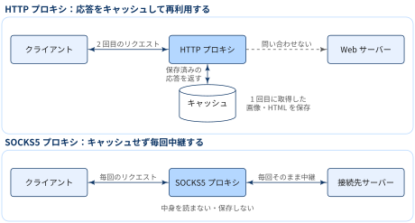
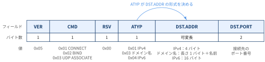

## What we want to do

アクセス元のglobal IPが制限されたサイト(例: 社内用gitlabサーバー)へアクセスする場合，

- 許可されたglobal IPに属するプライベートIPネットワークに接続している端末からアクセス
- 別端末から上記の端末へssh接続し，プロキシサーバー的に使用をする

という2つの方法が考えられます．後者の方法をFirefoxを用いて設定する方法を紹介します．

<strong > &#9654;&nbsp; なぜFirefoxなのか？</strong>

- Google chromeでもproxy設定は可能ですが，Extension installが必要
- Firefoxはブラウザレベルでproxyの設定が可能

## Firefoxにおけるsocks5 proxy設定

1. Firefoxを開いて，右上のメニューボタン（三本線）をクリック
2. メニューから「設定」を選択
3. ネットワーク設定を開く
4. 「手動でプロキシ設定をする」オプションを選択
5. 「SOCKS v5」を選択し，SOCKSホストを`127.0.0.1`，ポートを`1080`で設定
6. 変更を保存


### How to use

Linux, Windows, MacOS問わず

```{.bash}
ssh <username>@<proxy-server> -D 1080
```

とまず，ssh接続を確立します．`-D` オプションはダイナミックポートフォワーディング (Dynamic Port Forwarding)の設定です．
上記を実行するとローカルの `1080`番ポート にSOCKS5プロキシが立ち上がります．
このプロキシは，Firefoxの代理としてSSH接続先の端末から外部のサーバーへ接続する **フォワードプロキシ** として働きます（詳しくは Appendix の「フォワードプロキシとリバースプロキシ」を参照）．

Firefoxで `SOCKS5プロキシ 127.0.0.1:1080`と設定すると， 

```{mermaid}
sequenceDiagram
    participant Client as クライアント
    participant LocalSOCKS as localhost:1080 (SOCKSプロキシ)
    participant SSHTunnel as SSHトンネル
    participant RemoteServer as リモートサーバー
    participant ExternalServer as 外部サーバー

    %% 1. クライアントがSOCKSプロキシに接続
    Client->>LocalSOCKS: データ送信 (接続要求, 宛先IP/ポート)

    %% 2. SOCKSプロキシがSSHトンネル経由でリモートサーバーに転送
    LocalSOCKS->>SSHTunnel: データ転送 (暗号化)

    %% 3. SSHトンネルがリモートサーバーに転送
    SSHTunnel->>RemoteServer: データ中継 (トンネル経由)

    %% 4. リモートサーバーが外部サーバーに接続
    RemoteServer->>ExternalServer: 外部サーバー接続要求 (TCP/UDP)
    ExternalServer-->>RemoteServer: 接続応答

    %% 5. 応答をクライアントに返送
    RemoteServer-->>SSHTunnel: 応答データ
    SSHTunnel-->>LocalSOCKS: 暗号化データ戻し
    LocalSOCKS-->>Client: レスポンス転送

```

という順序で通信されるようになります．

## Appendix: socks5とは

::: {#def- .custom_problem .blog-custom-border}
### socks5

- **SOCKS**（SOCKet Secure）は，クライアントとサーバーの間に置いたプロキシサーバーにTCP/UDPの通信を中継させるためのプロトコル
- フォワードプロキシ（後述の「フォワードプロキシとリバースプロキシ」参照）を実現するプロトコルの一つ
- **SOCKS5** はそのバージョン5で，1996年に RFC 1928 として標準化された．SOCKS4 に比べて，認証方式の交渉，IPv6，ドメイン名による宛先指定，UDPの中継が加わっている
- SOCKS5プロキシは中継するデータの中身（HTTPなのか，SSHなのか等）を解釈しない．クライアントから「どのホストの何番ポートにつなぐか」だけを受け取り，あとはバイト列をそのまま流す

:::

### HTTPプロキシとの違い

SOCKSはアプリケーション層とトランスポート層（TCP/UDP）の間で動くプロトコルで，OSI参照モデルでは第5層（セッション層）として説明されることが多いです．
HTTPを理解して中継するHTTPプロキシとは，次の点で異なります．

| 観点 | HTTPプロキシ | SOCKS5プロキシ |
|---|---|---|
| 中継できる通信 | HTTP（HTTPSは `CONNECT` メソッドでトンネルを張る） | TCP/UDP上の任意のプロトコル |
| 通信内容の解釈 | HTTPヘッダを読み，書き換えることもある（`X-Forwarded-For` の付与など） | 読まない |
| キャッシュ | できる | しない |
| 暗号化 | しない | しない |

- SOCKS5自体には暗号化の機能はない
- 本記事の構成で通信が暗号化されるのは，SOCKS5の通信をSSHトンネルに載せているから
- また，SOCKS5を使うにはアプリケーション側がSOCKSに対応している必要があり．Firefoxのほか，`curl` や `git` などはSOCKS5プロキシを指定できます．

```{.bash}
# curl: ホスト名の解決もプロキシ側で行う
curl --socks5-hostname 127.0.0.1:1080 https://gitlab.example.com

# git: 特定のホストへのHTTP(S)通信だけをSOCKS5経由にする
git config --global http.https://gitlab.example.com.proxy socks5h://127.0.0.1:1080
```

### SOCKS5プロキシはキャッシュを行わない

HTTPプロキシは一般的に，ウェブコンテンツ（画像，HTML，動画など）をキャッシュすることで，再アクセス時にデータ転送を高速化します．
一方，**SOCKS5プロキシはキャッシュを行わない**という違いがあります．

{width="100%" fig-align="center"}

- SOCKS5はデータ転送のトンネルを作る役割を果たすため，通信内容のデータを確認・保存することがない
- あくまで「データを中継する」プロトコルであり，内容に依存しないため，キャッシュ機能は持たない

SOCKS5はキャッシュ機能を持たないことで，シンプルかつ高速な通信環境を提供してくれるものと理解していればOKだとおもいます．
キャッシュ管理の手間やストレージコストが不要というメリットもあります．

### バージョンによる違い

| 項目 | SOCKS4 | SOCKS4a | SOCKS5 |
|---|---|---|---|
| 認証 | ユーザーIDのみ（パスワードなし） | ユーザーIDのみ | 認証なし / ユーザー名・パスワード（RFC 1929） / GSSAPI などを交渉して選ぶ |
| 宛先の指定 | IPv4アドレス | IPv4アドレス，ドメイン名 | IPv4アドレス，IPv6アドレス，ドメイン名 |
| 中継できる通信 | TCP | TCP | TCP，UDP |

### 接続の手順

SOCKS5のクライアントは，プロキシサーバーとTCP接続を張ったあと，次の3段階でやり取りします．

1. **認証方式の交渉**: クライアントが対応する認証方式の一覧を送り，サーバーがその中から1つを選んで返す（`0x00` = 認証なし，`0x02` = ユーザー名・パスワード）
2. **認証**: 1で認証ありの方式が選ばれた場合だけ行う
3. **リクエスト**: 接続先を伝える．サーバーが成功を返したら，以降は同じTCP接続上でデータがそのまま中継される

接続確立からデータ転送，切断までの流れは次のとおりです．

```{mermaid}
sequenceDiagram
    participant Client as クライアント
    participant SOCKS5ProxyServer as SOCKS5プロキシサーバー
    participant ExternalServer as 外部サーバー

    %% 1. 接続要求とハンドシェイク
    Client->>SOCKS5ProxyServer: 接続要求 (Handshake: バージョン, 認証方式)
    SOCKS5ProxyServer-->>Client: 認証方式応答 (成功/失敗)

    %% 2. 外部サーバーへの接続要求
    Client->>SOCKS5ProxyServer: 外部サーバー接続要求 (宛先IP, ポート)
    note right of Client: クライアントのIPアドレスは隠蔽される
    SOCKS5ProxyServer->>ExternalServer: 接続確立要求 (プロキシのIPを使用)

    %% 3. 接続確立確認
    ExternalServer-->>SOCKS5ProxyServer: 接続成功応答
    SOCKS5ProxyServer-->>Client: 接続確立成功通知

    %% 4. データ転送 (カプセル化)
    Client->>SOCKS5ProxyServer: データ送信 (カプセル化されたパケット)
    note over SOCKS5ProxyServer: データをそのまま中継 (IPアドレス非公開)
    SOCKS5ProxyServer->>ExternalServer: データ転送 (TCP/UDP)
    ExternalServer-->>SOCKS5ProxyServer: レスポンスデータ
    SOCKS5ProxyServer-->>Client: レスポンス転送

    %% 5. 通信終了
    Client->>SOCKS5ProxyServer: 通信終了リクエスト
    SOCKS5ProxyServer->>ExternalServer: 接続切断
    SOCKS5ProxyServer-->>Client: 通信終了通知
```

3のリクエストは次の形式です．

{width="100%" fig-align="center"}

- `VER`: プロトコルのバージョン．SOCKS5 なら `0x05`
- `CMD`: やりたいこと．`0x01` = CONNECT（TCPで接続先につなぐ），`0x02` = BIND（接続先からの接続を待ち受ける），`0x03` = UDP ASSOCIATE（UDPを中継する）
- `RSV`: 予約領域．常に `0x00`
- `ATYP`: 宛先アドレスの種類．`0x01` = IPv4，`0x03` = ドメイン名，`0x04` = IPv6
- `DST.ADDR` / `DST.PORT`: 接続先のアドレスとポート番号

### 名前解決をどちらで行うか（socks5 と socks5h）

`ATYP` にドメイン名を指定できるため，SOCKS5では接続先のホスト名を **クライアント側で解決する** か **プロキシ側で解決する** かを選べます．
`curl` や `git` のプロキシURLでは，この違いをスキームで書き分けます．

| スキーム | 名前解決を行う場所 | プロキシに渡す宛先 |
|---|---|---|
| `socks5://` | クライアント | IPアドレス |
| `socks5h://` | プロキシサーバー | ホスト名 |

本記事のように社内サーバーへアクセスする場合，社内DNSでしか解決できないホスト名はクライアント側では解決できません．
Firefoxでは，プロキシ設定画面の「SOCKS v5 を使用するときは DNS もプロキシーを使用する」にチェックを入れて，プロキシ側（＝SSH接続先）で名前解決させます．
プロキシ側で解決させると，DNSの問い合わせがクライアント側のネットワークに漏れない（DNSリーク対策）という利点もあります．

### `ssh -D` が提供するSOCKSサーバーの範囲

OpenSSHの `ssh -D` は，ローカルにSOCKS4/SOCKS5の両方に対応したサーバーを立てます．ただし対応しているのは CONNECT（TCP）だけで，UDP ASSOCIATE や BIND は使えません．
また，認証方式は「認証なし」のみです．`ssh -D 1080` で立ち上がるポートは既定で `localhost` だけで待ち受けるため，他の端末から使われることはありません．

## Appendix: プロキシサーバーの仕組み

クライアントの依頼に応じて，外部のサーバーにサービスを要求し，その結果をクライアントに提供するサーバーをプロキシサーバーといいます．
SOCKS5は，プロキシサーバーを利用してサーバーとクライアント間のパケットをルーティングするインターネットプロトコルのことを指します．

### フォワードプロキシとリバースプロキシ

プロキシサーバーは，誰の代理として働くかによって2種類に分けられます．

::: {#def- .custom_problem .blog-custom-border}
### フォワードプロキシ

- クライアントの代理として，クライアントが指定した外部のサーバーへ接続するプロキシを **フォワードプロキシ**（forward proxy）と呼ぶ
- クライアント側に置かれ，クライアントは「このプロキシを使う」と自分で設定して利用する
- 接続先のサーバーから見える送信元は，クライアントではなくプロキシとなる

:::

これと対になるのが，サーバーの代理としてクライアントからの接続を受け付ける **リバースプロキシ**（reverse proxy）です．

| 観点 | フォワードプロキシ | リバースプロキシ |
|---|---|---|
| 誰の代理か | クライアント | サーバー |
| 置かれる場所 | クライアント側のネットワーク | サーバー側のネットワーク |
| 設定するのは | クライアント（ブラウザ・OSのプロキシ設定） | サーバーの管理者（クライアントは存在を意識しない） |
| 主な用途 | 社内からのアクセス制御，送信元IPの集約，本記事のような踏み台経由のアクセス | 負荷分散，TLS終端，キャッシュ，WAF |
| 代表例 | SOCKS5プロキシ，Squid などのHTTPプロキシ | nginx，HAProxy，CDN |

本記事の構成は，`ssh -D` で立てたSOCKS5プロキシを，Firefoxが自分の代理として使っているので，フォワードプロキシにあたります．
接続先のGitLabサーバーからは，Firefoxを動かしている端末ではなく，SSH接続先の端末からアクセスが来たように見えます．

SOCKS5プロキシサーバーのメリットとして，安全性，匿名性，利便性の3つがあります．

<strong > &#9654;&nbsp; 安全性</strong>

- SOCKS5は，ユーザー名とパスワードによる認証機能をサポートしているため，外部の不正アクセスや認証されていないクライアントからの利用を防ぐことができる
- SSHトンネルと組み合わせることで，安全にSOCKS5プロキシサーバー経由の通信を暗号化することができる = リモートアクセス時のデータ転送が保護され，悪意のあるネットワーク環境でも安全に通信可能
- プロキシサーバーを中間地点として使用することで，DDoS攻撃などの直接的な大量トラフィック攻撃を遮断することが可能

<strong > &#9654;&nbsp; 匿名性</strong>

- ネットワーク全体のトラフィックがプロキシサーバー経由で処理されるため，外部から見えるIPアドレスが プロキシのIPになる = SOCKS5プロキシを介することで，クライアントのIPアドレス/端末名を隠すことができる
- 一括でアクセス元をプロキシのIPに集約し，クライアントIPを隠蔽することでセキュリティとプライバシー保護が可能になるという活用方法がある

SOCKS5プロキシは，クライアントから送信されたデータをそのまま中継しますが，データ送信時のヘッダ情報（IPアドレスなど）をカプセル化します．
そのため，外部サーバーはデータの中身だけを認識し，送信元（クライアント）に関する情報は知ることができないという仕組みになっています．


<strong > &#9654;&nbsp; 利便性</strong>

- SOCKS5はプロトコル非依存であり，TCPとUDPの両方の通信をサポートしている = FTP, SMTP, P2P, VoIP, DNSリクエスト, オンラインゲームなど多様なアプリケーションで利用可能
