::: {.callout-note}
## TL;DRs

- Web ブラウザと Web サーバーは HTTP でやりとりする．サーバーはレスポンスの先頭行（ステータスライン）に **3桁のステータスコード** を書いて，リクエストの処理結果を伝える
- 百の位で意味が決まる：1xx 情報，2xx 成功，3xx リダイレクト，4xx クライアントエラー，5xx サーバーエラー
- 4xx は「送ったリクエストに問題がある」，5xx は「サーバー側で処理できなかった」．調べる場所がまったく違うので，トラブル時はまず百の位を見る
- DNS エラー・接続拒否・経路が無いなどの失敗では **HTTP レスポンス自体が返らない**．ステータスコードは存在せず，404 や 408 にはならない
- リバースプロキシを挟むと，5xx は「誰が返したか」（プロキシか，アップストリームか）の切り分けが重要になる

:::

## Web サーバーと Web ブラウザ

Web ページを見るときは，クライアント側で **Web ブラウザ**（Chrome，Firefox，Safari，Edge など）を使い，サーバー側では **Web サーバー**（Apache，nginx など）が動いています．Web ブラウザは Web サーバーから HTML・CSS・JavaScript・画像などのファイルを受け取り，それを解釈して画面に表示します．

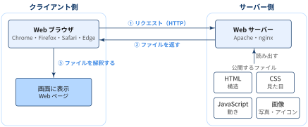{width="90%" fig-align="center"}

| 言語 | 役割 |
|---|---|
| HTML | Web ページの構造（見出し・段落・リンクなど）を記述する言語 |
| CSS | 色・レイアウトなどの見た目を記述する言語 |
| JavaScript | ページに動きやユーザー操作への反応を付けるプログラミング言語 |

: {tbl-colwidths="[20,80]"}

Web ブラウザと Web サーバーの間の通信には **HTTP**（HyperText Transfer Protocol）が使われます．

::: {#def-http .custom_problem .blog-custom-border}
### HTTP

- クライアント（Web ブラウザなど）が **リクエスト** を送り，サーバーが **レスポンス** を返す，という1往復を単位とするアプリケーション層のプロトコル
- 既定のポート番号は HTTP が 80，TLS で暗号化した HTTPS が 443
- リクエストは「何をしたいか」を **メソッド**（GET，POST など）で，「どのリソースに対してか」を **URL** で指定する
- レスポンスは処理結果を **ステータスコード** で伝える
- **ステートレス** なプロトコル: サーバーは過去のリクエストの内容を覚えておらず，1つ1つのリクエストを独立したものとして処理する

:::

ステートレスとはどういうことか，ログイン状態やショッピングカートのような「続きの作業」をどう実現しているかは，[Appendix: HTTP プロトコルは1回完結](#sec-appendix-stateless) で解説します．

### リクエストとレスポンスの構造 {#sec-request-response}

[TCP 接続の確立から切断まで]{.mini-section}

HTTP は TCP の上で動くプロトコルです．クライアントはいきなり HTTP のリクエストを送るのではなく，まずサーバーとの間に TCP の接続を確立し，その接続を通してリクエストとレスポンスをやりとりします（その前に，DNS でホスト名を IP アドレスに変換しておきます）．

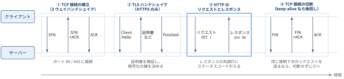{width="100%" fig-align="center"}

| 段階 | やりとり | 内容 |
|---|---|---|
| ① TCP 接続の確立 | `SYN` → `SYN+ACK` → `ACK` | クライアントが接続要求（`SYN`）を送り，サーバーが了承と自分側の接続要求（`SYN+ACK`）を返し，クライアントが了承（`ACK`）を返す．3回のやりとりで双方の送受信の準備が整うので **3ウェイハンドシェイク** と呼ぶ |
| ② TLS ハンドシェイク | `ClientHello` → 証明書など → `Finished` | HTTPS のときだけ行う．サーバーの証明書を検証して相手が本物かを確かめ，暗号化に使う鍵を決める．以降の HTTP メッセージはすべて暗号化される |
| ③ HTTP のやりとり | リクエスト → レスポンス | 確立した接続の上で，リクエストを送りレスポンスを受け取る．レスポンスの先頭行にステータスコードが入る |
| ④ TCP 接続の切断 | `FIN` → `FIN+ACK` → `ACK` | どちらかが終了の合図（`FIN`）を送り，互いに了承して接続を閉じる（本来は `FIN` と `ACK` を2往復させる4段階だが，図では `ACK` と `FIN` が1つにまとまった場合を描いている） |

: {tbl-colwidths="[18,24,58]"}

- HTTP/1.1 では，1回のやりとりが終わっても接続をすぐには切らず，同じ接続で次のリクエストを送る（**keep-alive**，持続的接続）．ページの HTML・CSS・画像を取りに行くたびに ① をやり直さずに済む．どちらかが `Connection: close` ヘッダを送ると，そのレスポンスの後に接続を閉じる
- ① や ② で失敗すると ③ に進めないので，HTTP のステータスコードは返らない．サーバーのポートで誰も待ち受けていなければ，`SYN` に対して `RST` が返り，接続拒否（connection refused）になる（[後述](#sec-not-http-error)）

[メッセージの構造]{.mini-section}

③ でやりとりする HTTP/1.1 のメッセージはテキストで，リクエストもレスポンスも「先頭行・ヘッダ・空行・ボディ」の4つの部分でできています．

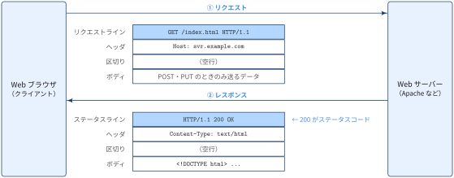{width="100%" fig-align="center"}

| 部分 | リクエスト | レスポンス |
|---|---|---|
| 先頭行 | リクエストライン：`メソッド URL HTTPバージョン` | ステータスライン：`HTTPバージョン ステータスコード 理由フレーズ` |
| ヘッダ | `Host`，`User-Agent`，`Authorization` など | `Content-Type`，`Content-Length`，`Server` など |
| 空行 | ヘッダの終わりを示す | ヘッダの終わりを示す |
| ボディ | POST・PUT で送るデータ（GET では通常なし） | HTML・画像・JSON などの本体 |

: {tbl-colwidths="[15,40,45]"}

### HTTP メソッド

リクエストラインの先頭に書くメソッドで，クライアントがリソースに対して何をしたいかを伝えます．

| メソッド | 意味 |
|---|---|
| `GET` | 指定した URL のリソース（HTML ファイル，画像など）を取得する |
| `HEAD` | `GET` と同じだが，ヘッダだけを取得する（ボディは返らない） |
| `POST` | 指定した URL にデータを送信する（フォームの送信など） |
| `PUT` | 指定した URL にデータを保存する（ファイルのアップロードなど） |
| `DELETE` | 指定した URL のリソースを削除する |
| `OPTIONS` | その URL で使えるメソッドなどを問い合わせる（CORS のプリフライトで使われる） |

: {tbl-colwidths="[20,80]"}

### telnet で HTTP を話してみる

HTTP/1.1 はテキストのプロトコルなので，`telnet` で Web サーバーの 80 番ポートに接続し，リクエストを手で打ち込めばレスポンスを受け取れます．`svr.example.com` で Apache が動いているとします．

```bash
$ telnet svr.example.com 80        # ← 80 番ポートに接続
Trying 192.168.1.200...
Connected to svr.example.com.
Escape character is '^]'.
GET / HTTP/1.1                     # ← メソッド，URL，HTTP バージョン
Host: svr.example.com              # ← ホスト名を指定
                                   # ← [Enter] のみ（空行でヘッダ終了）
```

すると，次のようなレスポンスが返ってきます．

```default
HTTP/1.1 200 OK
Date: Thu, 12 Apr 2018 15:46:18 GMT
Server: Apache/2.4.18 (Ubuntu)
Last-Modified: Wed, 11 Apr 2018 18:07:29 GMT
ETag: "2c39-56a2b5e85bf9d"
Accept-Ranges: bytes
Content-Length: 11321
Vary: Accept-Encoding
Content-Type: text/html

<!DOCTYPE html PUBLIC "-//W3C//DTD XHTML 1.0 Transitional//EN" "http://www.w3.org/TR/xhtml1/DTD/xhtml1-transitional.dtd">
<html xmlns="http://www.w3.org/1999/xhtml">
<head>
（略）
Connection closed by foreign host.
```

空行より前が **レスポンスヘッダ**，後ろが **レスポンスボディ** です．先頭行 `HTTP/1.1 200 OK` の `200` がステータスコードで，「リクエストは正常に処理された」ことを表しています．

| ヘッダ | 意味 |
|---|---|
| `Date` | レスポンスを生成した日時 |
| `Server` | サーバーのソフトウェア名とバージョン |
| `Last-Modified` | リソースの最終更新日時 |
| `ETag` | リソースの版を識別する値．Apache の既定ではファイルサイズと更新時刻から作る（`2c39` は 16 進で 11321 ＝ `Content-Length`） |
| `Accept-Ranges` | 範囲指定での取得（`Range` リクエスト）をバイト単位で受け付けること |
| `Content-Length` | ボディのバイト数 |
| `Vary` | キャッシュが応答を使い分けるときに考慮すべきリクエストヘッダ |
| `Content-Type` | ボディの形式（MIME タイプ） |

: {tbl-colwidths="[22,78]"}


## ステータスコードの分類

ステータスコードは3桁の整数で，**百の位でクラス（大分類）が決まります**．クライアントは知らないコードを受け取っても，百の位から大まかな意味を判断できます（例えば未知の `599` は `500` と同じく扱う）．

| クラス | 意味 | 代表例 |
|---|---|---|
| **1xx** 情報 | リクエストを受け取り，処理を続けていることを示す中間応答 | `100 Continue`，`101 Switching Protocols`（WebSocket へのプロトコル切り替え） |
| **2xx** 成功 | リクエストが正常に処理された | `200 OK`，`201 Created`（新しいリソースを作成した），`204 No Content`（成功したが返す本文が無い） |
| **3xx** リダイレクト | リクエストを完了するには，クライアントが追加の動作をする必要がある | `301 Moved Permanently`（恒久的な移転），`302 Found`（一時的な転送），`304 Not Modified`（キャッシュをそのまま使ってよい） |
| **4xx** クライアントエラー | クライアントのリクエストに問題があり，処理できなかった | `400`，`401`，`403`，`404`，`405`，`408` |
| **5xx** サーバーエラー | リクエスト自体は正しいが，サーバー側の問題で処理できなかった | `500`，`502`，`503` |

: {tbl-colwidths="[18,37,45]"}

- 3xx のうち `301`・`302` は `Location` ヘッダで移動先を伝え，ブラウザは自動でそこへアクセスし直す．`304` はボディを返さず，「手元のキャッシュを使ってよい」ことだけを伝える
- ステータスラインの末尾の `OK` や `Not Found` は **理由フレーズ** で，人間向けの説明にすぎない．プログラムはコード（数字）だけで判断する．HTTP/2 以降では理由フレーズ自体が無い（`curl -v` では `< HTTP/2 200` と表示される）

### ステータスコードはどこで決まるか

サーバーはリクエストを受け取ってから，いくつかの段階を順に通して処理します．どの段階で処理が止まったかによって，返るステータスコードが変わります．

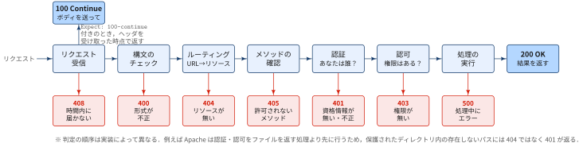{width="100%" fig-align="center"}

## 各ステータスコードの解説

本記事で扱う11個のコードを一覧にまとめます．以下の各節で1つずつ解説します．

| コード | 理由フレーズ | 一言でいうと | 誰の問題か |
|---|---|---|---|
| `100` | Continue | ボディを送ってよい | ―（中間応答） |
| `200` | OK | 成功 | ― |
| `400` | Bad Request | リクエストの形式がおかしい | クライアント |
| `401` | Unauthorized | 誰なのか分からない（認証が必要） | クライアント |
| `403` | Forbidden | 誰かは分かったが許可しない | クライアント（の権限） |
| `404` | Not Found | その URL にリソースが無い | クライアント（の URL） |
| `405` | Method Not Allowed | そのメソッドは使えない | クライアント（のメソッド） |
| `408` | Request Timeout | リクエストが時間内に届き終わらない | クライアント（の送信） |
| `500` | Internal Server Error | サーバー内部で予期しないエラー | サーバー |
| `502` | Bad Gateway | 中継先から正しい応答をもらえない | サーバー（の上流） |
| `503` | Service Unavailable | 今は一時的に受け付けられない | サーバー |

: {tbl-colwidths="[10,25,40,25]"}

ただし「誰の問題か」はあくまでステータスコードの定義上の分担です．`403` の原因がサーバー側のファイルのパーミッション設定だった，ということはよくあります．

### 100 Continue

::: {#def-100 .custom_problem .blog-custom-border}
### 100 Continue

- リクエストのヘッダを受け取った時点で「ここまでは問題ない．ボディを送ってよい」と伝える **中間応答**（1xx）
- クライアントが `Expect: 100-continue` ヘッダを付けたときに返す
- この後に，リクエスト全体に対する最終的なレスポンス（`200` など）が別に返る

:::

大きなファイルをアップロードするとき，いきなりボディまで送ってしまうと，認証エラーなどで拒否された場合にその転送がまるごと無駄になります．そこでクライアントはまずヘッダだけを送り，サーバーの返事を待ちます．

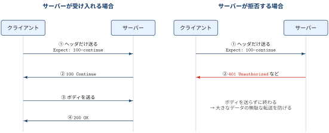{width="100%" fig-align="center"}

`curl` は大きなボディを送るとき自動で `Expect: 100-continue` を付けます．`curl -v` の出力に `< HTTP/1.1 100 Continue` が見えたら，この仕組みが働いています．

### 200 OK

::: {#def-200 .custom_problem .blog-custom-border}
### 200 OK

- リクエストが成功したことを示す
- ボディの意味はメソッドによって変わる：`GET` ならリソースそのもの，`HEAD` ならボディなし（ヘッダのみ），`POST` なら処理結果

:::

注意したいのは，**`200` が返っても期待どおりとは限らない** ことです．例えば次のようなケースがあります．

- エラーメッセージを書いた HTML や JSON を `200` で返している（いわゆる soft 404）
- 意図したバーチャルホストではなく既定のサイト（Apache の「Apache2 Ubuntu Default Page」など）が `200` で返っている
- CDN やブラウザのキャッシュから古い内容が返っている

### 400 Bad Request

::: {#def-400 .custom_problem .blog-custom-border}
### 400 Bad Request

- リクエストの構文が不正などの理由で，サーバーがリクエストを処理できない（処理しない）ことを示す
- クライアントは **同じリクエストを再送しても同じ結果になる**．内容を直す必要がある

:::

典型例は，HTTP/1.1 で必須の `Host` ヘッダが無い，ヘッダや Cookie が大きすぎる，API に送った JSON が壊れている，といったものです．先ほどの telnet の例で `Host:` 行を省くと，Apache は `400 Bad Request` を返します．

### 401 Unauthorized と 403 Forbidden {#sec-401-403}

`401` と `403` はどちらも「アクセスできない」ことを示しますが，止まっている段階が違います．

::: {#def-401 .custom_problem .blog-custom-border}
### 401 Unauthorized

- リクエストに有効な **認証** 情報（ユーザー名とパスワード，トークンなど）が無いため，処理できないことを示す
- サーバーは `WWW-Authenticate` ヘッダで認証方式（`Basic`，`Bearer` など）を伝えなければならない
- 名前は “Unauthorized”（認可されていない）だが，意味は「認証されていない」（unauthenticated）

:::

::: {#def-403 .custom_problem .blog-custom-border}
### 403 Forbidden

- サーバーはリクエストを理解したが，実行を **拒否** したことを示す
- 認証情報があっても，そのユーザーに権限が無ければ `403` になる．認証し直しても結果は変わらない

:::

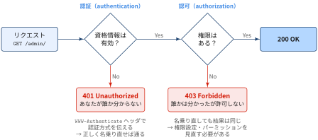{width="90%" fig-align="center"}

- 認証（authentication）は「相手が誰か」を確かめること，認可（authorization）は「その相手に何を許すか」を決めること
- リソースが存在すること自体を知られたくない場合，サーバーは `403` の代わりに `404` を返すことがある（GitHub で権限の無い private リポジトリを開くと `404` になるのはこのため）

### 404 Not Found

::: {#def-404 .custom_problem .blog-custom-border}
### 404 Not Found

- 指定された URL に対応するリソースが，サーバー上に見つからないことを示す
- それが一時的なものか恒久的なものかは示さない（恒久的に削除したことを明示するなら `410 Gone`）

:::

URL の打ち間違い，ページの削除・移動，リンク切れなどで返ります．**`404` が返ったということは，サーバーまでは到達して HTTP で会話できている** という点が重要です．サーバーが見つからない場合（DNS エラーなど）は `404` にはなりません（[後述](#sec-not-http-error)）．

### 405 Method Not Allowed

::: {#def-405 .custom_problem .blog-custom-border}
### 405 Method Not Allowed

- URL にリソースはあるが，リクエストのメソッドがそのリソースでは使えないことを示す
- サーバーは `Allow` ヘッダで使えるメソッドの一覧を返さなければならない（例：`Allow: GET, HEAD`）

:::

静的な HTML ファイルに `POST` した，`GET` しか定義していない API エンドポイントに `DELETE` した，といった場合に返ります．`404` は「URL が違う」，`405` は「URL は合っているがメソッドが違う」と区別します．

### 408 Request Timeout

::: {#def-408 .custom_problem .blog-custom-border}
### 408 Request Timeout

- サーバーが待てる時間内に，クライアントが **リクエストを送り終えなかった** ことを示す
- サーバーは接続を閉じる（`Connection: close`）．クライアントは新しい接続でリクエストを送り直せる

:::

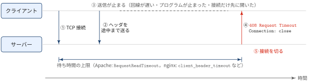{width="100%" fig-align="center"}

`408` が返るのは，**TCP 接続はできていて，サーバーがリクエストの到着を待っている** 状態に限られます．サーバーが応答を返すのに時間がかかりすぎた場合は，クライアント側のタイムアウト（ステータスコードなし）か，プロキシが返す `504 Gateway Timeout` であって，`408` ではありません．

### 500 Internal Server Error

::: {#def-500 .custom_problem .blog-custom-border}
### 500 Internal Server Error

- サーバーが予期しない状態になり，リクエストを処理できなかったことを示す
- 5xx の中で最も汎用的なコード．原因の詳細はレスポンスではなく **サーバー側のログ** に出る

:::

アプリケーションの未処理の例外，設定ファイルの誤り，CGI スクリプトの実行失敗などで返ります．原因の詳細（スタックトレースなど）をレスポンスに含めると内部情報の漏えいになるため，本番環境では汎用的なエラーページだけを返し，詳細はログに書くのが原則です．

### 502 Bad Gateway と 503 Service Unavailable

実際の Web システムでは，クライアントのリクエストを nginx や Apache（`mod_proxy`）などの **リバースプロキシ** が受け取り，背後のアプリケーションサーバー（**アップストリーム**）へ転送する構成がよく使われます．このときクライアントに届く 5xx を誰が返したかで，意味が変わります．

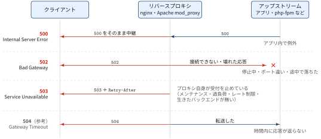{width="100%" fig-align="center"}

::: {#def-502 .custom_problem .blog-custom-border}
### 502 Bad Gateway

- ゲートウェイやプロキシとして動くサーバーが，転送先（アップストリーム）から **有効な応答を受け取れなかった** ことを示す
- 転送先が停止している，接続先のポートが違う，応答の途中で接続が切れた，などで返る

:::

::: {#def-503 .custom_problem .blog-custom-border}
### 503 Service Unavailable

- 過負荷やメンテナンスのため，サーバーが **一時的に** リクエストを処理できないことを示す
- 復旧の目安を `Retry-After` ヘッダ（秒数または日時）で伝えることができる

:::

- `500` はアップストリーム自身がエラーを返し，プロキシがそれを中継したもの．原因はアプリケーションにある
- `502` はプロキシがアップストリームとうまく通信できなかったもの．アプリケーションに届いてすらいないことが多い
- `503` は「今は受け付けない」という一時的な状態を表す．計画メンテナンスで意図的に返すこともある
- 参考：アップストリームが時間内に応答しなかった場合は `504 Gateway Timeout` になる

## HTTP エラーではないもの {#sec-not-http-error}

ステータスコードはサーバーが返す HTTP レスポンスの一部です．したがって **HTTP レスポンスが返ってくる段階までたどり着けなければ，ステータスコードは存在しません**．ブラウザで URL を開いたときの処理は，大まかに次の順で進みます．

1. ホスト名を DNS で IP アドレスに変換する（名前解決）
2. その IP アドレスのポート 80 / 443 に TCP 接続する
3. HTTPS なら TLS のハンドシェイクを行い，証明書を検証する
4. HTTP リクエストを送り，HTTP レスポンス（ステータスコード付き）を受け取る

1〜3 のどこかで失敗した場合，ブラウザは HTTP のステータスコードではなく独自のエラー画面を表示します．

| 失敗した段階 | 状況 | Chrome の表示例 | curl のエラー |
|---|---|---|---|
| 名前解決 | ホスト名が DNS で見つからない | `DNS_PROBE_FINISHED_NXDOMAIN` | `curl: (6) Could not resolve host` |
| TCP 接続 | ポートで待ち受けているプロセスが無い | `ERR_CONNECTION_REFUSED` | `curl: (7) Failed to connect ... Connection refused` |
| TCP 接続 | 経路が無い・ファイアウォールで破棄される | `ERR_CONNECTION_TIMED_OUT` など | `curl: (7) ... No route to host` / `curl: (28) ... Connection timed out` |
| TLS | 証明書の期限切れ・ホスト名不一致など | `NET::ERR_CERT_DATE_INVALID` など | `curl: (60) SSL certificate problem` |

: {tbl-colwidths="[13,30,27,30]"}

::: {.callout-important}
## 混同しやすいポイント

- **DNS でホスト名が見つからない → `404` ではない**．`404` はサーバーに到達し，HTTP で会話できたうえで「その URL のリソースが無い」と言われた状態．DNS エラーではサーバーにすら到達していない
- **IP パケットの経路が無くてタイムアウトした → `408` ではない**．`408` はサーバーが接続を受け付け，リクエストの到着を待っていたのに届き終わらなかった状態．経路が無ければサーバーは何も受け取っていないので，`408` を返すこともできない．起きるのはクライアント側の接続タイムアウト（ステータスコードなし）
- **ログイン失敗 → 必ず `401` とは限らない**．HTTP 認証（Basic 認証など）なら `401` だが，フォームでログインする Web アプリでは，エラーメッセージ付きの画面を `200` で返したり，`401` / `403` を返したりと実装による

:::

## トラブルシューティング

### 切り分けの全体像

「Web ページが見られない」と言われたら，まず **HTTP レスポンスが返っているか** を確認し，返っていればステータスコードの百の位で調べる場所を決めます．

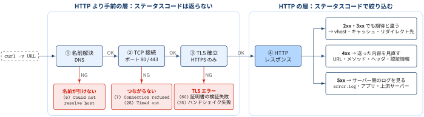{width="100%" fig-align="center"}

[よく使うコマンド]{.mini-section}

```bash
# リクエストとレスポンスのヘッダを全部見る（> が送信，< が受信）
% curl -v https://svr.example.com/path

# ステータスコードだけを表示する
% curl -sS -o /dev/null -w '%{http_code}\n' https://svr.example.com/path

# HEAD リクエストでヘッダだけ取得する
% curl -I https://svr.example.com/path

# リダイレクトをたどって，最終的なステータスコードと URL を確認する
% curl -sS -L -o /dev/null -w '%{http_code} %{url_effective}\n' http://svr.example.com/

# DNS を通さずに特定の IP に接続する（DNS とサーバーの問題を切り分ける）
% curl -v --resolve svr.example.com:443:192.168.1.200 https://svr.example.com/
```

[サーバー側で見る場所（Ubuntu の Apache の場合）]{.mini-section}

| 見る場所 | 何が分かるか |
|---|---|
| `/var/log/apache2/access.log` | リクエストごとのメソッド・URL・ステータスコード．4xx はここで確認する |
| `/var/log/apache2/error.log` | 403・500・502・503 などの原因．`AH` で始まるメッセージ ID で検索できる |
| `sudo apachectl configtest` | 設定ファイルの構文チェック |
| `sudo ss -ltnp` | どのプロセスがどのポートで待ち受けているか |
| `journalctl -u apache2 -e` | サービスの起動失敗など |

: {tbl-colwidths="[38,62]"}

nginx なら `/var/log/nginx/access.log` と `/var/log/nginx/error.log` です．アクセスログ（combined 形式）はステータスコードが9番目のフィールドなので，`awk` で集計すると全体の傾向が分かります．

```bash
# 192.168.1.10 - - [24/Nov/2026:10:00:00 +0900] "GET /index.html HTTP/1.1" 200 11321 "-" "curl/8.5.0"
% awk '{print $9}' /var/log/apache2/access.log | sort | uniq -c | sort -rn
  15230 200
    812 304
    145 404
     12 500
```

### DNS エラー（名前解決の失敗） {#sec-dns-error}

ブラウザに `DNS_PROBE_FINISHED_NXDOMAIN` や `ERR_NAME_NOT_RESOLVED` が出る，curl が `curl: (6) Could not resolve host` で止まる，という場合は名前解決の失敗です．HTTP リクエストを送る前の段階で止まっているので，**ステータスコードは返らず，Web サーバーのアクセスログにも何も残りません**．調べるのはクライアント側と DNS です．

[Step 1：名前解決の失敗かを確かめる]{.mini-section}

```bash
# OS のアプリと同じ仕組み（/etc/hosts → DNS の順）で名前を引く．何も出なければ名前解決の失敗
% getent hosts svr.example.com
192.168.1.200   svr.example.com

# IP アドレスが分かっているなら，DNS を通さずにアクセスしてみる
% curl -v --resolve svr.example.com:443:192.168.1.200 https://svr.example.com/
```

`--resolve` を付けると正常に応答が返るなら，Web サーバーは正常で，問題は DNS だけだと切り分けられます．

[Step 2：DNS サーバーの返事を見る]{.mini-section}

`dig` で DNS に直接問い合わせ，ヘッダの `status` と `ANSWER SECTION` を確認します．

```bash
% dig svr.example.com

;; ->>HEADER<<- opcode: QUERY, status: NXDOMAIN, id: 41234
;; flags: qr rd ra; QUERY: 1, ANSWER: 0, AUTHORITY: 1, ADDITIONAL: 1
...
;; SERVER: 127.0.0.53#53(127.0.0.53) (UDP)

# 別の DNS サーバー（公開リゾルバ）に聞いて結果を比べる
% dig @8.8.8.8 svr.example.com +short
```

- `status: NOERROR` かつ `ANSWER SECTION` に IP アドレスがある：名前解決は成功している
- `status: NXDOMAIN`：その名前は存在しない
- `status: SERVFAIL`：DNS サーバーが答えを出せなかった
- `connection timed out; no servers could be reached`：DNS サーバーに問い合わせが届いていない

[Step 3：どの DNS サーバーに聞いているかを確かめる]{.mini-section}

Ubuntu では systemd-resolved が名前解決を仲介しているので，`/etc/resolv.conf` には `nameserver 127.0.0.53`（自分自身）しか書かれていません．実際に問い合わせている上流の DNS サーバーは `resolvectl` で確認します．

```bash
% resolvectl status          # インターフェースごとの DNS サーバー
% resolvectl query svr.example.com
% sudo resolvectl flush-caches   # キャッシュを消す
```

[よくある原因と対処]{.mini-section}

| 症状 | 原因 | 確認・対処 |
|---|---|---|
| `NXDOMAIN` | ホスト名の打ち間違い．DNS レコードが未登録・削除済み．ドメインの有効期限切れ | URL のスペルを確認する．DNS の管理画面でレコードを確認する．`whois` でドメインの期限を確認する |
| 社内のホスト名だけ `NXDOMAIN` | VPN が切れていて，社内 DNS ではなく公開 DNS に問い合わせている | VPN に接続し，`resolvectl status` で社内 DNS が使われているか確認する |
| `NOERROR` だが `ANSWER` が空 | 名前はあるが，問い合わせた種類のレコードが無い（AAAA だけあって A が無い，など） | `dig svr.example.com A` と `dig svr.example.com AAAA` を比べ，足りないレコードを登録する |
| `SERVFAIL` | 権威 DNS サーバーの障害．DNSSEC の検証失敗 | `dig +cd svr.example.com`（検証を無効化）で答えが返るなら DNSSEC の設定ミス．ドメインの管理者に連絡する |
| `no servers could be reached` | ネットワークが切れている．`resolv.conf` の DNS サーバーが誤り．ファイアウォールがポート 53 を遮断している | `resolvectl status` で DNS サーバーを確認する．その IP に `ping` が通るか確かめる |
| `dig` では引けるのに，ブラウザや curl では失敗する（またはその逆） | `dig` は `/etc/hosts` を見ない．ブラウザは独自のキャッシュや DNS over HTTPS を使うことがある | `getent hosts` と `/etc/hosts` を確認する．Chrome なら `chrome://net-internals/#dns` でキャッシュを消す |
| DNS レコードを変えたのに古い IP に行く | 古い結果が TTL の間キャッシュされている | `dig` の出力の TTL（秒）を確認する．`dig @<権威サーバー>` で新しい値になっているか確かめ，TTL が切れるのを待つかキャッシュを消す |

: {tbl-colwidths="[24,38,38]"}

::: {.callout-important}
## DNS が「間違った IP」を返すと 404 になることもある

名前解決そのものに失敗した場合はステータスコードが返りませんが，DNS が **古い・誤った IP アドレス** を返した場合は，リクエストが別のサーバーに届きます．すると，そのサーバーが `404` を返したり，別のサイトが表示されたり，証明書のホスト名が合わずに TLS エラーになったりします．「サーバーの設定は正しいのに `404` になる」ときは，`dig` で引いた IP が本当に目的のサーバーかを確認します．

:::

以下，ステータスコードが返った場合について，コードごとによくある原因と対処をまとめます．

### 100 Continue のトラブル

`100` 自体はエラーではありませんが，中継するプロキシやサーバーが `Expect: 100-continue` に対応していないと，**アップロードが毎回少し遅れる** という形で現れます．curl は `100` を一定時間（既定 1 秒）待ってからボディを送り始めるためです．

| 症状 | 原因 | 対処 |
|---|---|---|
| 大きめの POST・PUT だけ毎回 1 秒ほど遅い | 経路上のサーバーが `100 Continue` を返さない | `curl -H 'Expect:'` でヘッダを付けないようにする．クライアントライブラリの設定で無効化する |
| `417 Expectation Failed` が返る | サーバーが `Expect` ヘッダを受け付けない | 同上 |

: {tbl-colwidths="[30,35,35]"}

### 200 OK なのにおかしい

| 症状 | 原因 | 確認・対処 |
|---|---|---|
| 「Apache2 Ubuntu Default Page」が表示される | リクエストの `Host` に一致するバーチャルホストが無く，既定のサイトが返っている | `sudo apachectl -S` でバーチャルホストの一覧と `ServerName` を確認する．サイト設定を `a2ensite` で有効にしたか確認する |
| 更新したはずのページが古い | ブラウザ・CDN・リバースプロキシのキャッシュ | `curl -I` で `Age`，`Cache-Control`，`ETag` を見る．キャッシュを削除（パージ）する |
| API が `200` なのにエラー内容を返す | アプリがエラーも `200` で返す設計 | ボディを確認する．API の設計としては適切な 4xx / 5xx を返すように直す |

: {tbl-colwidths="[28,36,36]"}

### 400 Bad Request

| 症状・メッセージ | 原因 | 対処 |
|---|---|---|
| 自作クライアントや telnet で `400` | `Host` ヘッダが無い．改行が `\r\n` になっていない | HTTP/1.1 では `Host` が必須．行末を CRLF にする |
| `Size of a request header field exceeds server limit`（Apache）／`Request Header Or Cookie Too Large`（nginx） | Cookie が増えすぎてヘッダが上限を超えた | ブラウザでそのサイトの Cookie を削除する．必要ならサーバー側の上限（Apache: `LimitRequestFieldSize`，nginx: `large_client_header_buffers`）を上げる |
| `The plain HTTP request was sent to HTTPS port`（nginx） | `http://` で 443 番ポートにアクセスした | URL を `https://` にする．プロキシの転送先設定のスキームを確認する |
| API が `400` を返す | JSON の構文エラー，必須パラメータの欠落，`Content-Type` の指定漏れ | レスポンスボディのエラーメッセージを読む．`curl -H 'Content-Type: application/json' -d @body.json` のように送る |

: {tbl-colwidths="[32,32,36]"}

### 401 Unauthorized

まずレスポンスの `WWW-Authenticate` ヘッダを見て，サーバーがどの認証方式を求めているかを確認します．

```bash
% curl -sI https://svr.example.com/admin/ | grep -i www-authenticate
WWW-Authenticate: Basic realm="Restricted Area"

% curl -u alice:password https://svr.example.com/admin/                  # Basic 認証
% curl -H "Authorization: Bearer $TOKEN" https://api.example.com/v1/me    # トークン認証
```

| 症状 | 原因 | 対処 |
|---|---|---|
| 正しいパスワードなのに Basic 認証が通らない | `AuthUserFile` のパスの誤り，`htpasswd` のユーザー名の誤り | `error.log` を確認する．`htpasswd -v /etc/apache2/.htpasswd alice` でパスワードを検証する |
| API が急に `401` を返すようになった | トークンの有効期限切れ | トークンを再発行する．クライアントにトークン更新処理を入れる |
| ブラウザでは通るがスクリプトからは `401` | `Authorization` ヘッダを付け忘れている．リダイレクトで別ホストへ移ったとき curl がヘッダを外した | `curl -v` で送信ヘッダ（`>` 行）を確認する |
| Apache の背後の PHP / CGI アプリに認証情報が届かない | Apache が `Authorization` ヘッダを CGI に渡していない | `CGIPassAuth On`（Apache 2.4.13 以降）を設定する |

: {tbl-colwidths="[30,36,34]"}

### 403 Forbidden

Apache の `403` は，`error.log` に理由がはっきり出ます．

| `error.log` のメッセージ | 原因 | 対処 |
|---|---|---|
| `AH01630: client denied by server configuration` | `Require all denied` や IP 制限（`Require ip ...`）で拒否された | 該当する `<Directory>` / `<Location>` の `Require` を見直す |
| `AH00132: file permissions deny server access` | ファイルを Apache の実行ユーザー（`www-data`）が読めない | `chmod o+r` や所有者の変更で読めるようにする |
| `AH00035: access to /... denied because search permissions are missing on a component of the path` | パスの途中のディレクトリに実行（`x`）権限が無い | `namei -l /var/www/html/index.html` でパス上の全ディレクトリの権限を確認する |
| `AH01276: Cannot serve directory ...: No matching DirectoryIndex ... found, and server-generated directory index forbidden by Options directive` | ディレクトリに `index.html` が無く，一覧表示も禁止されている | `index.html` を置く．または URL をファイル名まで指定する |
| `AH00037: Symbolic link not allowed or link target not accessible` | シンボリックリンクの追跡が許可されていない | `Options FollowSymLinks` を設定する．リンク先の権限を確認する |

: {tbl-colwidths="[40,32,28]"}

- RHEL 系で権限が正しいのに `403` になる場合は SELinux を疑う．`ls -Z` でコンテキストを確認し，`restorecon -Rv /var/www/html` で直す
- クラウドの WAF やロードバランサの IP 制限で `403` が返っている場合，Web サーバーのログには何も残らない．アクセスログにリクエストが記録されていなければ，手前の層を疑う

### 404 Not Found

`404` はサーバーに到達している証拠なので，**サーバー上のどこを探しに行ったか** を確かめます．なお Apache は既定のログレベルでは「ファイルが無い」ことを `error.log` に書かないので，`access.log` で該当リクエストを確認します．

| 症状 | 原因 | 確認・対処 |
|---|---|---|
| ファイルを置いたのに `404` | `DocumentRoot` が想定と違う．別のバーチャルホストに振り分けられている | `sudo apachectl -S` でどのバーチャルホストが使われるか確認する |
| Windows では見えていたのにサーバーでは `404` | Linux のファイル名は大文字・小文字を区別する（`Index.html` と `index.html` は別） | ファイル名とリンクの表記を揃える |
| トップページ以外が全部 `404`（WordPress，Laravel など） | `mod_rewrite` が無効，または `AllowOverride None` で `.htaccess` が読まれていない | `sudo a2enmod rewrite` と `AllowOverride All` を設定して Apache を再起動する |
| SPA で画面遷移は動くが，リロードすると `404` | `/users/1` のような URL に対応するファイルがサーバーに無い | すべてのパスで `index.html` を返す設定（Apache: `FallbackResource /index.html`）にする |
| プロキシ経由だと `404`，直接だと `200` | プロキシがパスを書き換えている（nginx の `proxy_pass` の末尾 `/` の有無など） | アップストリーム側のアクセスログで，実際に届いたパスを確認する |

: {tbl-colwidths="[28,36,36]"}

### 405 Method Not Allowed

`405` には使えるメソッドの一覧（`Allow` ヘッダ）が付いているので，まずそれを確認します．

```bash
% curl -si -X DELETE https://api.example.com/v1/items | grep -iE '^(HTTP|allow)'
HTTP/1.1 405 Method Not Allowed
Allow: GET, HEAD, POST
```

| 症状 | 原因 | 対処 |
|---|---|---|
| フォーム送信で `405` | フォームの `method` とサーバーのルート定義が合っていない．静的ファイルの URL に `POST` している | フォームの `action` と `method` を見直す |
| `POST` したのに，サーバーのログには `GET` が記録されて `405` | `http`→`https` や末尾 `/` 付与の `301` / `302` リダイレクトで，ブラウザや curl が `POST` を `GET` に変えて再送した | 最初から正しい URL に送る．メソッドを保ったまま転送したいなら `307` / `308` を使う |
| ブラウザから API を呼ぶと CORS エラーになり，サーバーには `OPTIONS` の `405` が残っている | CORS のプリフライト（`OPTIONS`）を API が処理していない | API で `OPTIONS` に応答し，`Access-Control-Allow-*` ヘッダを返す |

: {tbl-colwidths="[30,38,32]"}

なお Apache の `<LimitExcept GET POST> Require all denied </LimitExcept>` のようにメソッドを制限した場合は，`405` ではなく `403` が返ります．

### 408 Request Timeout

| 症状 | 原因 | 対処 |
|---|---|---|
| `access.log` に `"-" 408` という行が大量にある | ブラウザが先読みのために接続だけ開き，リクエストを送らずに放置した．Apache が時間切れで閉じたときに記録される | 実害は無いことが多い．リクエストライン（`"-"`）が空なら，この現象を疑う |
| 回線の遅い環境からの大きなアップロードだけ失敗する | ボディの受信がタイムアウト内に終わらない | Apache: `mod_reqtimeout` の `RequestReadTimeout`（既定はヘッダ 20〜40 秒，ボディ 20 秒，いずれも毎秒 500 バイト受信するごとに延長）を調整する．nginx: `client_header_timeout` / `client_body_timeout`（既定 60 秒） |
| ロードバランサ経由のときだけ断続的に失敗する | ロードバランサと Web サーバーのアイドルタイムアウトの長さが食い違っている | Web サーバー側の keep-alive タイムアウトを，ロードバランサのアイドルタイムアウトより長くする |

: {tbl-colwidths="[28,36,36]"}

### 500 Internal Server Error

`500` はレスポンスに理由が書かれていないので，**必ずサーバー側のログを見ます**．

| `error.log` のメッセージ | 原因 | 対処 |
|---|---|---|
| `Invalid command 'RewriteEngine', perhaps misspelled or defined by a module not included in the server configuration` | `.htaccess` に書いたディレクティブのモジュールが有効になっていない | `sudo a2enmod rewrite` などでモジュールを有効にする．`.htaccess` の書き間違いでも同じ `500` になる |
| `End of script output before headers` | CGI スクリプトがヘッダを出力する前に終了した．実行権限が無い．shebang 行に改行コード `\r`（Windows で編集した）が混ざっている | `chmod +x` を付ける．スクリプトを直接実行してエラーを確かめる．`dos2unix` で改行を直す |
| （アプリのログ）`Traceback ...` / `PHP Fatal error: ...` | アプリケーションの未処理の例外 | アプリのログ（`journalctl -u <サービス名>`，php-fpm のログなど）でスタックトレースを読む |
| （アプリのログ）データベースに接続できない | DB の停止，接続数の上限，認証情報の誤り | DB の状態と接続設定を確認する |

: {tbl-colwidths="[38,34,28]"}

### 502 Bad Gateway

`502` はリバースプロキシが返しているので，**プロキシのエラーログ** に「アップストリームとの通信で何が起きたか」が書かれています（以下は nginx の例）．

| `error.log` のメッセージ | 原因 | 対処 |
|---|---|---|
| `connect() failed (111: Connection refused) while connecting to upstream` | アップストリームのプロセスが停止している．`proxy_pass` のポートが違う | `systemctl status <アプリ>` と `ss -ltnp` で，想定のポートで待ち受けているか確認する |
| `connect() to unix:/run/php/php8.3-fpm.sock failed (2: No such file or directory)` | php-fpm が停止している．設定に書いたソケットのパス（PHP のバージョン）が違う | `ls /run/php/` で実際のソケット名を確認し，設定を合わせる |
| `connect() ... failed (13: Permission denied) while connecting to upstream` | ソケットファイルの権限不足．RHEL 系では SELinux がプロキシの外向き接続を禁止している | ソケットの所有者・権限を確認する．SELinux なら `sudo setsebool -P httpd_can_network_connect 1` |
| `upstream prematurely closed connection while reading response header from upstream` | アップストリームが応答の途中で落ちた（メモリ不足で強制終了，ワーカーのタイムアウトなど） | アプリのログと `dmesg`（OOM killer）を確認する |
| `upstream sent too big header while reading response header from upstream` | アップストリームの応答ヘッダ（大きな Cookie など）がプロキシのバッファに収まらない | `proxy_buffer_size` / `proxy_buffers` を大きくする |

: {tbl-colwidths="[40,32,28]"}

- Docker でプロキシとアプリを別コンテナにしているとき，プロキシ側の設定で `proxy_pass http://localhost:8000` と書くと `502` になる．コンテナ内の `localhost` はプロキシのコンテナ自身を指すため．Compose のサービス名（`http://app:8000`）で指定する
- Apache（`mod_proxy`）でアップストリームの応答を読めなかった場合も `502` で，`error.log` に `AH01102: error reading status line from remote server` などが出る

### 503 Service Unavailable

| 症状 | 原因 | 対処 |
|---|---|---|
| メンテナンス中のページが出る | 運用で意図的に `503` を返している | `Retry-After` を付けておくと，クライアントやクローラーが再訪のタイミングを判断できる |
| アクセスが集中したときだけ `503` | nginx の `limit_req` / `limit_conn` によるレート制限（既定のステータスが `503`） | `error.log` の `limiting requests` を確認する．制限値を見直す．クライアントに再試行を促すなら `limit_req_status 429;` にする |
| Apache のリバースプロキシで，アプリが落ちると `503` | Apache の `mod_proxy` はアップストリームに **接続できない** 場合に `503` を返す（nginx なら `502` になる状況）．`error.log` に `AH00957: ... attempt to connect to ... failed` と `AH01114` が出る | アップストリームを起動する．復旧後もしばらく `503` が続く場合は，`mod_proxy` がそのアップストリームを一定時間（`retry`，既定 60 秒）使用不可として扱っているため |
| Kubernetes の Ingress 経由で `503` | Service に Ready な Pod が1つも無い（ingress-nginx は `503` を返す） | `kubectl get endpoints <service>` で転送先があるか確認する．readinessProbe の失敗を調べる |

: {tbl-colwidths="[25,40,35]"}

同じ「アップストリームが落ちている」状況でも，nginx では `502`，Apache の `mod_proxy` では `503` になります．コードの番号だけで決めつけず，プロキシのエラーログで実際の原因を確認するのが確実です．

## Appendix: HTTP プロトコルは1回完結 {#sec-appendix-stateless}

### 1回の要求と応答で完結する

HTTP はもともと「要求されたデータを返すこと」だけを目的に作られたプロトコルです．そのため，1回の要求と応答で通信は完結し，過去に行った通信と関連付けられることはありません．

例えば，HTML ファイルとその中で使われている画像ファイルをダウンロードする場合，それぞれが「通信の確立 → 要求 → 応答 → 通信の切断」という独立したやりとりになります．

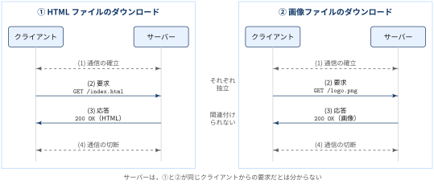{width="100%" fig-align="center"}

::: {#def-stateless .custom_problem .blog-custom-border}
### ステートレスプロトコル

- 通信相手との過去のやりとりの状態（state）を保持せず，1回の要求と応答で完結するプロトコルをステートレスプロトコルという
- サーバーは，各リクエストをそれだけで完結した独立のものとして処理する
- HTTP はステートレスプロトコルである

:::

ステートレスであることには，サーバーの実装が単純になる，負荷分散で毎回別のサーバーにリクエストが振り分けられても処理できる，といった利点があります．

::: {.callout-note}
## keep-alive とステートレスは別の話

[リクエストとレスポンスの構造](#sec-request-response) で見たとおり，HTTP/1.1 の keep-alive では，図の (1) 通信の確立と (4) 切断を毎回は行わず，1つの TCP 接続で複数のリクエストを送ります．しかし，接続を使い回していても，**リクエスト同士はやはり独立** しています．サーバーは「同じ接続で前に来たリクエスト」の内容を覚えて処理に使うことはしません．keep-alive は通信を効率化する仕組みであり，HTTP がステートレスであることは変わりません．

:::

### ステートレスでは困る場面

ネットショッピングのように，複数のページにまたがる「続きの作業」があるサービスでは，ステートレスのままでは対応しきれません．

1. 商品を選ぶページで，鉛筆とケシゴムをカートに入れる
2. 購入手続きのページへ進み，合計金額を確認して購入する

ユーザーにとっては 1 と 2 は一続きの作業ですが，サーバーにとっては無関係な2つのリクエストにすぎません．2 のリクエストを受け取ったサーバーには，それが「さっき鉛筆とケシゴムを選んだ人」からのものなのか分かりません．その間に別のユーザーのリクエストが割り込んでくることもあります．これでは購入手続きが成立しません．

### Cookie で「続き」を伝える

そこで，HTTP のやりとりに関する情報をクライアント側に保存しておき，次の通信時にその情報をサーバーに提示する，という方法がとられます．サーバーは提示された情報からユーザーを特定し，前回からの続きの通信として扱えます．このときやりとりされる情報を **Cookie（クッキー）** といいます．

::: {#def-cookie .custom_problem .blog-custom-border}
### Cookie

- サーバーがレスポンスの `Set-Cookie` ヘッダでクライアントに渡し，クライアントが以後の同じサイトへのリクエストに `Cookie` ヘッダで付けて送り返す小さなデータ
- ブラウザが自動で保存・送信するので，ユーザーは意識しない
- HTTP 本体の仕様（RFC 9110）ではなく，状態管理のための別の仕様（RFC 6265）で定められた拡張

:::

Cookie は，それだけでは「データを持ち運ぶ」だけの仕組みです．受け取った Cookie を見て，ユーザーごとに内容の違う Web ページを作るには，サーバー側のプログラムが必要です．昔は CGI（Common Gateway Interface）で動くプログラムがその役割を担い，今では Web アプリケーションのフレームワークが担っています．

現在よく使われるのは，Cookie には **セッション ID**（ユーザーを見分けるための番号）だけを入れ，カートの中身などの状態はサーバー側（セッションストア）に保存しておく方法です．

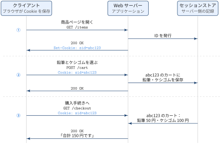{width="100%" fig-align="center"}

実際のヘッダは次のようになります．

```default
# ① レスポンス：サーバーがセッション ID を渡す
HTTP/1.1 200 OK
Set-Cookie: sid=abc123; Path=/; HttpOnly; Secure; SameSite=Lax

# ② 以後のリクエスト：ブラウザが自動で付けて送る
POST /cart HTTP/1.1
Host: shop.example.com
Cookie: sid=abc123
```

| 方法 | 状態の置き場所 | 特徴 |
|---|---|---|
| Cookie に状態そのものを入れる | クライアント | サーバーは何も覚えなくてよい．ただし利用者が中身を書き換えられるので，金額などをそのまま信用してはいけない |
| Cookie にセッション ID を入れる | サーバー（セッションストア） | Cookie は ID だけなので小さく，中身を改ざんされない．ID を盗まれるとなりすまされるので，`HttpOnly`・`Secure` を付けて守る |
| トークン（JWT など）を `Authorization` ヘッダで送る | トークンの中（署名付き） | API でよく使われる．ブラウザ以外のクライアントからも扱いやすい |

: {tbl-colwidths="[28,22,50]"}

どの方法でも，サーバーは「そのリクエストに付いてきた情報」だけで相手を判断しています．そのため，以前にログインしていても，リクエストに `Cookie` や `Authorization` が付いていなければ，サーバーには誰からのリクエストか分かりません．[401 Unauthorized](#sec-401-403) が返るのはこの状態です．

## 📘 用語集

:::{.glossary-container}

```yaml
glossary:
  - def: HTTP（HyperText Transfer Protocol）
    description: |
      Web ブラウザと Web サーバーの間でリソースをやりとりするためのアプリケーション層のプロトコル．クライアントのリクエストに対してサーバーがレスポンスを返す．意味論は RFC 9110，HTTP/1.1 のメッセージ形式は RFC 9112 で定められている．
  - def: ステータスライン（status line）
    description: |
      HTTP/1.1 レスポンスの先頭行．`HTTP/1.1 200 OK` のように，HTTP バージョン・ステータスコード・理由フレーズを空白で区切って並べる．HTTP/2 以降では理由フレーズが無い．
  - def: 理由フレーズ（reason phrase）
    description: |
      ステータスコードの後ろに付く `OK` や `Not Found` などの短い説明文．人間向けの補足であり，クライアントはステータスコードの数字だけで処理を判断する．
  - def: 認証（authentication）
    description: |
      通信相手が誰であるかを確かめること．パスワード，トークン，クライアント証明書などを使う．HTTP では失敗すると `401 Unauthorized` になる．
  - def: 認可（authorization）
    description: |
      認証された相手に，どの操作を許可するかを決めること．HTTP では権限が無いと `403 Forbidden` になる．
  - def: リバースプロキシ（reverse proxy）
    description: |
      クライアントからのリクエストをサーバー側で受け取り，背後のサーバー（アップストリーム）へ転送する中継サーバー．TLS の終端，負荷分散，静的ファイル配信などを担う．nginx や Apache の `mod_proxy` がよく使われる．
  - def: アップストリーム（upstream）
    description: |
      リバースプロキシから見た転送先のサーバー．アプリケーションサーバー（gunicorn，php-fpm など）であることが多い．
  - def: バーチャルホスト（virtual host）
    description: |
      1台の Web サーバーで複数のサイトを運用する仕組み．Apache はリクエストの `Host` ヘッダ（HTTPS では TLS の SNI）を見て，どのサイトの設定で処理するかを決める．
  - def: DocumentRoot
    description: |
      Apache で，URL のパスに対応するファイルを探しにいくディレクトリ．Ubuntu の既定は `/var/www/html` で，`http://host/a.html` は `/var/www/html/a.html` に対応する．
  - def: CORS プリフライト（preflight request）
    description: |
      ブラウザが別オリジンの API へ特定のリクエストを送る前に，`OPTIONS` メソッドで「このリクエストを送ってよいか」をサーバーに問い合わせること．サーバーが適切な `Access-Control-Allow-*` ヘッダを返さないと，本来のリクエストは送られない．
  - def: ステートレス（stateless）
    description: |
      通信の相手との過去のやりとりを，サーバーが状態（state）として保持しない性質．HTTP では，各リクエストはそれだけで完結した独立のものとして処理される．サーバーの実装が単純になり，負荷分散で別のサーバーにリクエストが振り分けられても処理できる利点がある．ログイン状態などを扱うには，Cookie やトークンでリクエストごとに情報を送り直す．
  - def: Cookie（クッキー）
    description: |
      サーバーが `Set-Cookie` ヘッダでクライアントに保存させ，クライアントが以後のリクエストに `Cookie` ヘッダで付けて送り返す小さなデータ．ステートレスな HTTP で，別々のリクエストを同じユーザーの続きとして扱うために使う．仕様は RFC 6265．
  - def: セッション ID（session ID）
    description: |
      サーバーがユーザーごとに発行する識別番号．Cookie に入れてクライアントに持たせ，サーバー側ではこの ID に結び付けてログイン状態やカートの中身などを保存する．盗まれると他人になりすませるため，推測できない値にし，`HttpOnly` や `Secure` 属性で保護する．
  - def: 3ウェイハンドシェイク（3-way handshake）
    description: |
      TCP で接続を確立するときの3回のやりとり．クライアントが `SYN` を送り，サーバーが `SYN+ACK` を返し，クライアントが `ACK` を返す．これで双方が互いの送受信の準備ができたことを確認し，データを送れる状態になる．
  - def: keep-alive（持続的接続，persistent connection）
    description: |
      HTTP のやりとりが1回終わっても TCP 接続を閉じず，同じ接続で次のリクエストを送る仕組み．HTTP/1.1 では既定で有効で，`Connection: close` ヘッダで接続を閉じるよう指示する．接続確立のやり直しが不要になるので，ページの読み込みが速くなる．
  - def: DNS（Domain Name System）
    description: |
      `svr.example.com` のようなホスト名を IP アドレスに変換する仕組み．名前解決に失敗すると，HTTP リクエストを送る前に通信が終わるので，HTTP のステータスコードは返らない．
```

:::


References
----------
- [RFC 9110 > HTTP Semantics > 15. Status Codes](https://www.rfc-editor.org/rfc/rfc9110#name-status-codes)
- [RFC 9112 > HTTP/1.1](https://www.rfc-editor.org/rfc/rfc9112)
- [MDN Web Docs > HTTP レスポンスステータスコード](https://developer.mozilla.org/ja/docs/Web/HTTP/Status)
- [Apache HTTP Server > mod_reqtimeout](https://httpd.apache.org/docs/2.4/mod/mod_reqtimeout.html)
- [Apache HTTP Server > mod_proxy](https://httpd.apache.org/docs/2.4/mod/mod_proxy.html)
- [nginx > ngx_http_core_module](https://nginx.org/en/docs/http/ngx_http_core_module.html)
- [nginx > ngx_http_limit_req_module](https://nginx.org/en/docs/http/ngx_http_limit_req_module.html)
- [curl > Exit codes](https://everything.curl.dev/cmdline/exitcode.html)
