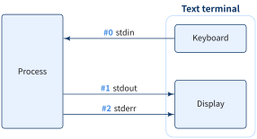

## 標準ストリーム

標準ストリーム（standard streams）とは，Unix系OS において，プログラムの活動実体であるプロセスとその実行環境の間でやり取りされる
データの通り道（入出力チャネル） のことです．特に，キーボードからの入力を標準入力，ディスプレイへの出力を標準出力と呼びます.

多くのコマンドは，何も指定しなくても実行結果をディスプレイに表示しますが，これは標準出力としてディスプレイを使うことが デフォルトとして設定されているためです.



:::: {.no-border-top-table}

| 名称     | ファイル記述子| 方向 | 主な用途                      |
| ------- | ------- | -- | ------------------------- |
| 標準入力<br>(stdin)| `0`     | 入力 | キーボードや他プログラムの出力からデータを受け取る |
| 標準出力<br>(stdout) | `1`     | 出力 | 通常の結果やメッセージを出力する          |
| 標準エラー出力<br>(stderr) | `2`     | 出力 | エラーメッセージなどを出力する           |
: {tbl-colwidths="[21,24,10,35]"}

::::

### stdour，stderrのストリームが別れていることのメリット

標準出力（stdout） は，通常の処理結果やプログラムの出力を表します．
これをリダイレクトしたりパイプで別のコマンドに渡した場合，
出力内容がファイルや別のコマンドへ送られるため，端末上には表示されません．

標準エラー出力（stderr） は，エラーメッセージや警告を伝えるための専用ストリームとなっています．
通常のリダイレクト（`CMD > file1` など）では stderr はリダイレクトされず，端末画面にそのまま表示されます．
そのため，

- ユーザーは標準出力をファイルや他の処理系に渡していても，エラーメッセージを見落とすことなく確認できる 
- ログ処理とエラー監視を独立して制御できる

### リダイレクト

::: {.callout-note}
### リダイレクト

- 標準出入力先を変更する機能のことをリダイレクトといいます
- 標準出入力とリダイレクトを理解することで，コマンドがどこに出力するのかをコントロールできます

:::

::: {#exm- .custom_problem }
### Bash 標準ストリームのリダイレクト一覧
<br>

:::: {.no-border-top-table}

| 構文             | 意味                              |
| -------------- | ------------------------------- |
| `< FileA`      | 標準入力を **FileA** に変更             |
| `> FileA`      | 標準出力を **FileA** に変更（上書き）．コマンドの出力先を画面上からファイルに切り替えること        |
| `>> FileA`     | 標準出力を **FileA** の末尾に追記          |
| `2> FileA`     | 標準エラー出力を **FileA** に変更（上書き）     |
| `2>> FileA`    | 標準エラー出力を **FileA** の末尾に追記       |
| `> FileA 2>&1` | 標準出力と標準エラー出力をまとめて **FileA** に変更 |
| `&> FileA`     | 標準出力と標準エラー出力をまとめて **FileA** に変更 |
| `2>&1`         | 標準エラー出力（stderr）を標準出力（stdout）の現在の設定にリダイレクト |
| `2>&1 1> /dev/null` | ラーを標準出力，標準出力を `/dev/null` に捨てる |

::::


:::
---

というメリットがあります．

[`/dev/null` ファイル]{.mini-section}

Linux系OSでは `/dev/null` という疑似デバイスファイルを用意してあります．
`/dev/null` に書き込まれたデータはすべて破棄され，どこからどれだけ読み込んでも何もデータを返しません．

エラーメッセージのみ出力させたくない場合は

```bash
echo 'stderr' 2> /dev/null
```

としたりします．


::: {.callout-note}
### `<< EOF` という似て非なるヒアドキュメント構文

```bash
command <<EOF
... 任意のテキスト ...
EOF
```

- `<<EOF` は「この後に続く行を，`EOF` が現れるまで標準入力として command に渡す」という意味
- `<<EOF` でなくても `<<WORD` や `<<INPUT` としても良いですが，慣例的に `EOF` が使われる

:::

### パイプ

::: {.callout-note}
### パイプ

- コマンドによって得られた結果を別コマンドに引き渡す機能のこと
- 通常では標準エラー出力（`STDERR`）はパイプされない

:::

`CMD1` の実行結果を `CMD2` の標準入力に渡す場合

```bash
CMD1 | CMD2
```

標準出力と標準エラー出力をまとめてパイプで渡したい場合は，`2>&1 |`，または `|&` を用います．

```bash
## 標準エラー出力用のパイプ
sed |& wc -l

## ファイル記述子とパイプの組み合わせ
sed 2>&1 | wc -l
```

## 標準データストリーム，リダイレクト，パイプの実践

### CASE 1: FileAの内容を並び替えて，その結果を別のファイルFileBに保存する

```bash
sort < FileA > FileB
```

1. `sort` コマンドは FileA の内容を読み取り（`< FileA`）
2. `sort`コマンドを実行し，並び替えを行う
3. その結果を `FileB` に出力（`> FileB`）

ただし，同じ動作は

```bash
sort FileA > FileB
```

でも達成できます．

### CASE 2: エラーメッセージのみ出力させる

ユーザーがリダイレクトを用いて設定しなくては行けないことは

- 標準出力結果を `/dev/null` へ捨てる
- 標準エラー出力を標準出力へ渡す

の２点となるので，以下の①と④を組み合わせて設定すればよいですが，設定順序がポイントなります．

:::: {.no-border-top-table}

|Index| 目的               | コマンド例                                        | 意味                   |
|-----| ---------------- | -------------------------------------------- | -------------------- |
| ①  | 標準出力を捨てる         | `CMD > /dev/null`<br>`CMD 1> /dev/null`      | 結果は捨てるが，エラーは表示       |
| ②  | 標準エラーを捨てる        | `CMD 2> /dev/null`                           | エラーだけ捨てる             |
| ③  | 標準出力・標準エラーを両方捨てる | `CMD &> /dev/null`<br>`CMD > /dev/null 2>&1` | すべての出力を破棄            |
| ④  | 標準エラーを標準出力へ渡す    | `CMD 2>&1`                                   | 両者を一緒に処理（例：パイプでまとめる） |
: {tbl-colwidths="[5,35,25,35]"}

::::

[正しい設定例]{.mini-section}

まず正しい例は

```bash
CMD1 2>&1 1> /dev/null
```

[Bashはリダイレクトを左から右へ順に評価するため]{.regmonkey-bold}，先にエラーを標準出力に結合し，次に出力を破棄という設定順番になります．

[誤った設定例]{.mini-section}

```bash
CMD 1> /dev/null 2>&1
```

だと，先に標準出力を破棄，次にエラーを現在の標準出力設定に結合になるので，標準出力及び標準エラー出力両方が `/dev/null` に捨てられてしまいます．

::: {#exm- .custom_problem }
### poetryで標準エラー出力のみを表示する場合
<br>

`poetry` コマンドを用いるときなど，標準出力結果には興味がないがエラーだけ知りたいという場合があります．この場合は

```bash
poetry update 1> /dev/null

poetry update > /dev/null

poetry update 2>&1 1> /dev/null
```

のいずれかの実行で標準エラー出力のみを表示することができます．最後の設定は標準エラー出力を標準出力にリダイレクトしているので，
厳密には挙動は同じではないことに注意してください．

:::
---

### CASE 3: ファイルへの書き込みと標準出力を同時に行う

`tee` コマンドを使うと標準出力を保持しつつファイルにも書き込むことができます．

::: {.callout-note}
### `tee` コマンド

- `tee`コマンドは，標準入力から読み込んだデータを標準出力とファイルの両方に出力するコマンド

    ```bash
    CMD | tee ファイル名
    ```

- デフォルトは上書き挙動だが，`-a` オプションを付与することで**追記(append)**設定も可能

:::

::: {#exm- .custom_problem }
<br>

`/etc/passwd` ファイルの内容に行番号を付け，その結果をパイプを通してファイルへ出力し，さらにその結果をパイプでheadコマンドに渡す場合は

```bash
$ nl /etc/passwd | tee test.txt | head -3
     1	root:x:0:0:root:/root:/usr/bin/zsh
     2	daemon:x:1:1:daemon:/usr/sbin:/usr/sbin/nologin
     3	bin:x:2:2:bin:/bin:/usr/sbin/nologin
```

:::
---

::: {#exm- .custom_problem }
### エラーを端末に表示しつつファイルに書く
<br>

標準出力を `/dev/null` に流しながら，標準エラー出力をファイルに書きたい場合は

```bash
CMD 1> /dev/null 2> error.log
```

で十分ですが，これだと端末にエラー出力が表示されません．標準エラー出力表示を維持したい場合は，Bashのプロセス置換 `>(...)` を用いて

```bash
CMD 1> /dev/null 2> >(tee error.log)
```

と記述します．

:::
---

### CASE 4: ファイルに書いた SQL を `bq query` に渡す

```bash
# 動く
bq query --use_legacy_sql=false < query.sql

# 動く
bq query --use_legacy_sql=false "$(cat query.sql)"

# 動かない
bq query --use_legacy_sql=false query.sql
```

最後のコマンドを実行すると，次のエラーになります．

```
Syntax error: Unexpected identifier "query" at [1:1]
```

[なぜ `bq query query.sql` は動かないのか]{.mini-section}

コマンドがデータを受け取る経路には，**コマンドライン引数（argv）**と**標準入力（stdin）**の2つがあり，両者は別物です．
引数を「ファイル名」として読むか「データそのもの」として読むかは，**シェルではなく各コマンドが決めます**．

| コマンド | 位置引数の解釈 | 引数がないとき |
|---|---|---|
| `sort FileA` | ファイル名として開いて中身を読む | 標準入力から読む |
| `bq query 'SQL'` | **SQL 文字列そのもの**として扱う | 標準入力から SQL を読む |

: {tbl-colwidths="[25,40,35]"}

`bq query query.sql` では，`query.sql` という9文字が SQL として BigQuery に送られます．
先頭の `query` を SQL のキーワードとして解釈できないので，1行1列目（`[1:1]`）で構文エラーになります．

[シェルがコマンドに渡しているもの]{.mini-section}

3つの書き方の違いは，シェルがコマンドを起動する時点で argv と stdin に何を入れているかを見ると分かります．
次の `show` 関数は，受け取った引数と標準入力をそのまま表示するだけの関数です．

```bash
show() {
  echo "argc=$#"
  for a in "$@"; do printf '  argv: [%s]\n' "$a"; done
  [ ! -t 0 ] && printf '  stdin: [%s]\n' "$(cat)"
}
```

`query.sql` の中身が次のとおりだとします．

```sql
SELECT *
FROM t
```

```bash
$ show query.sql < /dev/null
argc=1
  argv: [query.sql]
  stdin: []

$ show < query.sql
argc=0
  stdin: [SELECT *
FROM t]

$ show "$(cat query.sql)" < /dev/null
argc=1
  argv: [SELECT *
FROM t]
  stdin: []
```

| 書き方 | argv | stdin | `bq query` の結果 |
|---|---|---|---|
| `bq query query.sql` | `query.sql`（ファイル名の文字列） | 空 | ✗ `query.sql` を SQL として実行 |
| `bq query < query.sql` | なし | ファイルの中身 | ✓ 標準入力から SQL を読む |
| `bq query "$(cat query.sql)"` | ファイルの中身 | 空 | ✓ 引数の SQL を実行 |

: {tbl-colwidths="[30,25,15,30]"}

[1. `< query.sql`：リダイレクトで標準入力に流す]{.mini-section}

`< query.sql` は **シェルが** `query.sql` を開き，そのファイルを `bq` の標準入力（ファイル記述子 `0`）につなぐ指定です．
`< query.sql` という文字列自体は argv に入らないので，`bq` からは「SQL 引数が渡されなかった」ように見えます．
`bq query` は SQL 引数がないと標準入力から SQL を読むので，ファイルの中身がそのまま実行されます．

同じ理屈で，パイプやヒアドキュメントで渡しても動きます．

```bash
cat query.sql | bq query --use_legacy_sql=false

bq query --use_legacy_sql=false <<'EOF'
SELECT 1 AS x
EOF
```

[2. `"$(cat query.sql)"`：コマンド置換で引数に展開する]{.mini-section}

`$(...)` はコマンド置換です．シェルが先に `cat query.sql` を実行し，その標準出力で `$(...)` の部分を置き換えてから `bq` を起動します．
結果として，ファイルの中身が SQL 文字列の引数として渡されます．なお，出力の末尾の改行は取り除かれます．

::: {.callout-important}
### ダブルクォートを外さない

`$(cat query.sql)` を `"..."` で囲まないと，Bash は置換結果を空白・改行で単語に分割し，さらに `*` などをワイルドカードとして展開します．
カレントディレクトリに `a.txt` と `b.txt` がある状態で実行すると，`SELECT *` の `*` がファイル名に化けます．

```bash
$ show $(cat query.sql) < /dev/null
argc=6
  argv: [SELECT]
  argv: [a.txt]
  argv: [b.txt]
  argv: [query.sql]
  argv: [FROM]
  argv: [t]
  stdin: []
```

:::

[どちらを使うか]{.mini-section}

基本は 1 の `< query.sql` を使うのが無難です．

- クォートの付け忘れによる単語分割やワイルドカード展開の心配がない
- 引数の長さ制限を受けない（Linux では1つの引数は 128 KiB までなので，巨大な SQL を `"$(cat ...)"` で渡すと `Argument list too long` になる）

2 は，SQL の一部をシェル変数で組み立てたいときなど，文字列として扱いたい場面で使います．


References
----------

- [UNIXの絵本, 株式会社アンク著](https://www.shoeisha.co.jp/book/detail/4798109339)
- [Linux Crash Course - Data Streams (stdin, stdout & stderr)](https://www.youtube.com/watch?v=zMKacHGuIHI)
- [tee コマンドのすすめ](../2026-10-02-stdout-log/index.qmd)
- [Bash Reference Manual: Redirections](https://www.gnu.org/software/bash/manual/html_node/Redirections.html)
- [Bash Reference Manual: Command Substitution](https://www.gnu.org/software/bash/manual/html_node/Command-Substitution.html)
- [Bash Reference Manual: Word Splitting](https://www.gnu.org/software/bash/manual/html_node/Word-Splitting.html)
- [BigQuery: bq command-line tool reference](https://docs.cloud.google.com/bigquery/docs/reference/bq-cli-reference)
