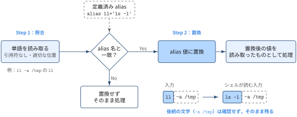
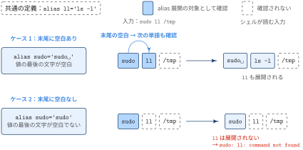

## Aliasとは

::: {#def- .custom_problem .blog-custom-border}
### `alias` コマンド

- aliasは，コマンド及びコマンドとオプションの組み合わせに別名をつける機能
- `alias`および`unalias`組み込みコマンドを使用して，alias名と対応する値を設定・解除する
- alias 定義において，コマンドはシングルクオートで囲むのが一般的

[syntax]{.mini-section}

```bash
alias エイリアス名='コマンド'
```

:::

[コマンド挙動]{.mini-section}

引数を指定せずに `alias` コマンドを実行すると，現在設定されているエイリアス一覧を表示します

```zsh
% alias
clear-trash='gio trash --empty'
ls='ls -F --color=auto --group-directories-first'
grep='grep --color=auto'
....
```

エイリアスの設定は以下のようにコマンドをシングルクオートで囲って定義します

```zsh
% alias setclip='xclip -selection clipboard -o'
```

[Aliasかどうかの確認]{.mini-section}

`type` コマンドは指定したコマンドが，バイナリなのか，エイリアスなのかなどの情報を示すコマンドです．

```bash
$ type ls
ls is an alias for ls -F --color=auto --group-directories-first
```

[Aliasの名前と置換テキストの制約]{.mini-section}

- **名前の制約**: `/`, `$`, `` ` ``, `=`およびシェルのメタキャラクタや引用符文字をalias名に含めることはできません
- **置換テキスト**: 有効なシェル入力（メタキャラクタを含む）を含めることができます
- **再帰的展開の防止**: 置換テキストの最初の単語はaliasとしてテストされますが，展開中のaliasと同一の単語は2回展開されません．例えば，`ls`を`ls -F`にaliasしても，Bashは再帰的に展開しようとしません


[Aliasの制限]{.mini-section}

- **引数の扱い**: cshのように置換テキストに引数を使用するメカニズムはありません
- **非対話モードでの展開**: シェルが非対話モードの場合，`shopt`を使用して`expand_aliases`オプションを設定しない限り，aliasは展開されません

### Aliasの展開動作

aliasの展開は，シェルがコマンドラインを読み取る段階で行われる単純な文字列の置き換えです．処理は次の2ステップで進みます．

1. シェルが適切な位置（基本的には単純コマンドの先頭）で引用符で囲まれていない単語を読み取ると，その単語がalias名と一致するかをチェック
2. 一致する場合，シェルはその単語をalias値に置き換え，元の単語の代わりにその値を読み取ったかのように処理

{width="100%" fig-align="center"}

ポイントは，置換が単語単位で行われることです．alias置換を試みるとき，シェルは単語の後に続く文字を確認しません．たとえば `alias ll='ls -l'` を定義して `ll -a /tmp` と入力すると，置き換わるのは先頭の `ll` だけです．後ろの `-a /tmp` は中身を確認されないまま残り，シェルは `ls -l -a /tmp` を読み取ったものとして処理します．

また，チェックの対象は「引用符で囲まれていない単語」に限られます．`\ll` や `'ll'` のように引用すればaliasを経由せずにコマンドを実行できるのはこのためです（後述の「Aliasを一時的に解除する方法」を参照）．

[連続的なalias展開]{.mini-section}

上のルールでは，チェックされるのは原則としてコマンドの先頭の単語だけです．そのため，`sudo` のように別のコマンドを引数にとるコマンドの後ろでは，aliasは展開されません．これを補うのが次のルールです．

- alias値の最後の文字が空白の場合，シェルはaliasに続く次のコマンド単語もalias展開の対象として確認します

{width="100%" fig-align="center"}

`alias sudo='sudo '` のように値の末尾に空白を入れておくと，`sudo ll /tmp` の `ll` もaliasとして確認され，シェルは `sudo ls -l /tmp` を読み取ります．末尾に空白がない場合，`ll` は展開されないまま `sudo` に渡ります．aliasはシェルの機能で `sudo` からは見えないため，`sudo` は `ll` というコマンドを探して `command not found` で失敗します．

```bash
# ~/.bashrc
alias sudo='sudo '   # sudo の後ろの単語も alias 展開の対象にする
```

[Aliasの定義と実行タイミング]{.mini-section}

aliasの展開はコマンドを読み取る段階で行われます．このことから，aliasを定義するタイミングについて次の注意点が生まれます．

- aliasは，コマンドが**実行される時**ではなく，**読み取られる時**に展開されます
- 同じ行に他のコマンドと一緒に記述されたalias定義は，シェルが次の入力行を読み取るまで有効になりません
- 複合コマンド内のalias定義は，シェルが複合コマンド全体を解析・実行するまで有効になりません
- alias定義に続くその行のコマンドは，新しいaliasの影響を受けません

たとえば，aliasを定義して同じ行ですぐに使おうとしても展開されません．`hello` を含む行全体が，aliasを定義するより前にまとめて読み取られているためです．次の行からは定義済みのaliasとして展開されます．

```bash
$ alias hello='echo hello'; hello
bash: hello: command not found
$ hello
hello
```


## Aliasを一時的に解除する方法

設定されているaliasを一時的に無効化してコマンドを実行したい場合，以下の方法があります：

### 1. バックスラッシュを使用

```bash
\command
```

`ls`がaliasされている場合

```bash
\ls
```

### 2. commandコマンドを使用

```bash
command command_name
```

`ls`がaliasされている場合

```bash
command ls
```

## `.bash_aliases`ファイル

- `.bash_aliases`は，ユーザーのホームディレクトリに配置される設定ファイルで，bashのalias定義を管理するために使用
- `.bashrc`ファイルを直接編集せずにalias設定を整理するために使用

::: {.callout-note}
### `.bash_aliases`の利点

- **設定の分離**: `.bashrc`とalias定義を分けることで，設定ファイルの管理が容易になる
- **可読性の向上**: alias定義を専用ファイルにまとめることで，設定を見つけやすくなる
- **メンテナンス性**: バックアップや他の環境への移行が簡単になる

:::

[使用方法]{.mini-section}

#### 1. `.bash_aliases`ファイルの作成

`.bash_aliases`はデフォルトで存在しないため，必要に応じて作成する必要があります

```bash
touch ~/.bash_aliases
```

#### 2. `.bashrc`での読み込み設定

通常，`.bashrc`には以下のような記述が含まれており，`.bash_aliases`が存在する場合は自動的に読み込まれます：

```bash
# Alias definitions.
# You may want to put all your additions into a separate file like
# ~/.bash_aliases, instead of adding them here directly.

if [ -f ~/.bash_aliases ]; then
    . ~/.bash_aliases
fi
```

::: {.callout-note}

- `.bashrc`に読み込みの記述がない場合は，手動で追加する必要があります

:::


#### 3. aliasの定義例

`.bash_aliases`ファイル内でaliasを定義します：

```bash
# ディレクトリ操作
alias ll='ls -alF'
alias la='ls -A'
alias l='ls -CF'

# 安全な操作
alias rm='rm -i'
alias cp='cp -i'
alias mv='mv -i'

# よく使うコマンド
alias ..='cd ..'
alias ...='cd ../..'
alias grep='grep --color=auto'
```

#### 4. 設定の反映

aliasを追加・変更した後，以下のコマンドで設定を反映します：

```bash
source ~/.bash_aliases
```

または

```bash
source ~/.bashrc
```

::: {.callout-note}
## なぜ `export` ではなく `source` なのか

「設定を反映する」と聞くと `export` を思い浮かべるかもしれませんが，aliasの反映に使うのは `source` です．2つはまったく別の役割を持つコマンドです．

- `source`（`.`）: 指定したファイルを**今のシェル自身で**1行ずつ実行する
- `export`: 今のシェルの**変数**に「子プロセスへ渡す」印を付ける．ファイルを読み込むことはない．主な用途は `export PATH="$HOME/.local/bin:$PATH"` のように，`PATH` などの環境変数を，そのシェルから起動するコマンドやスクリプトに引き継がせること

{width="100%" fig-align="center"}

aliasを使いたいのは今のシェルなので，`~/.bash_aliases` に書かれた `alias` コマンドを今のシェルで実行する必要があります．これを行うのが `source` です．2.で見た `.bashrc` の `. ~/.bash_aliases` も同じ仕組みで，新しく開いたターミナルでaliasが使えるのは，起動時にこの行が実行されるからです．

一方，`bash ~/.bash_aliases` のようにファイルを実行すると，中身は子プロセスで実行されます．子プロセスでaliasが定義されても，プロセスの終了とともに消え，親である今のシェルには何も戻りません．`export` もこの問題は解決できません．`export` が働くのは親→子の一方向だけで，対象も変数（と `export -f` による関数）に限られ，aliasを渡す仕組みはありません．

```bash
$ export ~/.bash_aliases     # ファイルを読み込むコマンドではない
bash: export: `/home/user/.bash_aliases': not a valid identifier

$ alias ll='ls -l'
$ export ll                  # エラーにはならないが，印が付くのは変数 ll であって alias ではない
$ bash -c 'type ll'
bash: line 1: type: ll: not found
```

:::


References
----------
- [gnu bash manual > aliases](https://www.gnu.org/software/bash/manual/html_node/Aliases.html)
