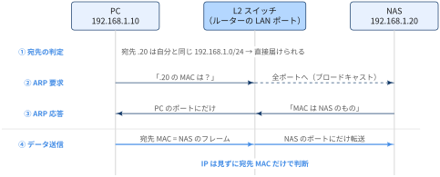
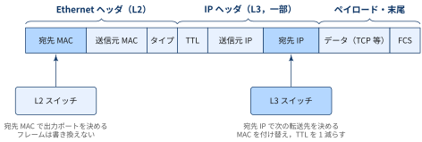
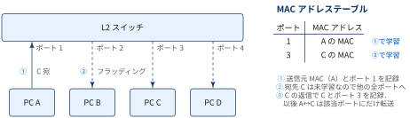
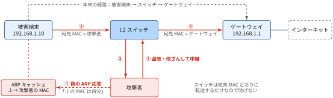
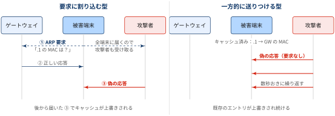
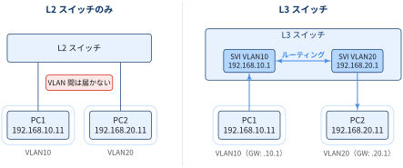
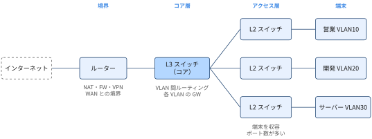

## L2スイッチとL3スイッチ

LAN の中で PC やサーバーをつなぐ機器が「スイッチ」です．
スイッチは、受信したデータを転送する際に参照する情報の違いによって、L2スイッチとL3スイッチに分けられます。

::: {#def- .custom_problem .blog-custom-border}
### L2スイッチ（レイヤ2スイッチ）

- OSI 参照モデルの **データリンク層（L2）** で動作するスイッチ
- フレームの **宛先 MAC アドレス** を見て，どのポートから出すかを決める
- 「どの MAC アドレスの端末がどのポートの先にいるか」の対応を，受信したフレームの送信元 MAC から自動で学習し，スイッチ内部のメモリ上の **MAC アドレステーブル** に保持する
- 転送できる範囲は同じネットワーク（同じ VLAN・同じサブネット）の中だけ

:::

::: {#exm- .custom_problem }
### 自宅ネットワークでのL2スイッチの役割

実は，自宅でも L2スイッチはほぼ確実に使われています．
家庭用ルーターの背面にある LAN ポート（3〜4口のもの）の中身が L2スイッチです．

複数の端末を仮定用ルーターに接続し，端末間でやり取りすることを考えます．このとき，**IP で宛先を指定して**やり取りを行うと思いますが，同じネットワーク内では最終的に **MAC アドレスで届けています** ．
たとえば PC（`192.168.1.10`）から NAS（`192.168.1.20`）へファイルを送る場合，流れは次のようになります．

1. PC は宛先 IP が自分と同じネットワーク（`192.168.1.0/24`）だと判断する
2. ARP で「`192.168.1.20` の MAC アドレスは何？」と問い合わせる．この問い合わせはブロードキャストなので，スイッチは全ポートへ流す
3. 問い合わせを受け取った端末のうち，IP アドレスが一致した NAS だけが応答する．応答は PC の MAC アドレス宛ての **ユニキャスト** なので，スイッチは PC のポートにだけ転送し，PC は NAS の MAC アドレスを知る
4. PC は宛先 MAC アドレスを付けたフレームを送り出し，L2スイッチはその MAC アドレスを見て，NAS がつながっているポートにだけ転送する

{#fig-home-l2-arp}

ユーザーやアプリが意識するのは IP アドレスですが，実際に同じ LAN 内を運ぶ段階では，スイッチは IP を見ずに MAC アドレスだけで転送先を決めています．
IP アドレスを宛先 MAC アドレスに変換する作業（ARP）は，送信側の機器が裏で自動的に行っています．

:::
***

::: {#def- .custom_problem .blog-custom-border}
### L3スイッチ（レイヤ3スイッチ）

- L2スイッチの機能に加えて，**ネットワーク層（L3）** のルーティング機能を持つスイッチ
- パケットの **宛先 IP アドレス** を見て，ルーティングテーブルから次の転送先を決める
- ルーティングを専用ハードウェア（ASIC）で処理するため，LAN 内の異なるネットワーク間（VLAN 間）の転送を高速に行える

:::

両者の違いは，フレームの中の **どのフィールドを見て転送するか** にあります．

{#fig-frame-header}

L2スイッチはフレームを書き換えずにそのまま別のポートへ流します．
一方 L3スイッチ（およびルーター）はネットワークをまたいでパケットを中継するため，

- Ethernet ヘッダの送信元・宛先 MAC を，次の区間用のもの（自分の MAC と次の転送先の MAC）に付け替える
- IP ヘッダの TTL を1減らす（0 になったパケットは破棄する）

という処理を行います．IP アドレス自体は（NAT をしない限り）始点から終点まで変わりません．

::: {.callout-note}
### ハブ・L2スイッチ・L3スイッチ・ルーター

| 機器 | 動作する層 | 転送の判断に使う情報 |
|---|---|---|
| リピーターハブ | L1（物理層） | なし．受信した信号を全ポートへ流す |
| L2スイッチ | L2（データリンク層） | 宛先 MAC アドレス |
| L3スイッチ | L2 + L3（ネットワーク層） | 宛先 MAC アドレス + 宛先 IP アドレス |
| ルーター | L3（ネットワーク層） | 宛先 IP アドレス |

:::

## L2スイッチの仕組み

### MAC アドレスの学習とフラッディング

L2スイッチは電源を入れた直後，どのポートに誰がつながっているかを知りません．
フレームを受け取るたびに **送信元 MAC アドレス** と受信ポートの組を MAC アドレステーブルに記録し，少しずつ対応表を作っていきます．

{#fig-mac-learning}

1. PC A が PC C 宛てのフレームを送ると，スイッチは「A の MAC はポート1の先にいる」と記録する
2. 宛先の C はまだテーブルにないので，受信ポート以外の全ポートへフレームをコピーして送る（**フラッディング**）．C 以外の PC は自分宛てではないので破棄する
3. C が返信すると「C の MAC はポート3の先にいる」と記録される．以後 A と C の間のフレームは該当ポートにだけ転送される

宛先がブロードキャスト（`ff:ff:ff:ff:ff:ff`）のフレームも，同じく全ポートへ送られます．
IP アドレスから MAC アドレスを調べる ARP の要求はブロードキャストなので，同じネットワーク内の全端末に届きます．
テーブルのエントリは一定時間（Cisco 機器の既定では 300 秒）通信がないと消え，端末の移動にも追従できるようになっています．

::: {.callout-note}
### スイッチとハブの違い

リピーターハブは受け取った信号を常に全ポートへ流すため，同時に送信すると衝突（コリジョン）が起こり，ほかの端末宛ての通信も見えてしまいます．
L2スイッチは宛先のポートにだけ転送するので，ポートごとに通信が分離され，全二重で同時に送受信できます．

:::

[ARPスプーフィング]{.mini-section}

ARP には「返ってきた応答が本物か」を確かめる仕組みがありません．
これを悪用し，同じ LAN 内の攻撃者が「ゲートウェイ（`192.168.1.1`）の MAC は自分だ」という偽の ARP 応答を送りつけるのが **ARP スプーフィング**（ARP ポイズニング）です．

{#fig-arp-spoofing}

偽の応答を送るタイミングには2通りあります．
被害端末の ARP 要求はブロードキャストなので攻撃者にも届き，それに割り込んで本物より後に偽の応答を返すこともできます．
ただし多くの OS は，要求していない ARP 応答でも既存のエントリなら上書きするため，要求を待たずに偽の応答を数秒おきに送り続けるだけで乗っ取れます．
`arpspoof` などの代表的な攻撃ツールは主に後者の方法を使います．

{#fig-arp-spoofing-patterns}

対策としては，

- 業務用スイッチの **Dynamic ARP Inspection**（DHCP スヌーピングで作った IP と MAC の対応表と照合し，矛盾する ARP を破棄する）
- 通信そのものを [TLS](../2025-09-06-ssl-tls/index.qmd) で暗号化して，経路を乗っ取られても中身を読まれない・改ざんを検知できるようにする


### VLAN：1台のスイッチでネットワークを分ける

ブロードキャストは同じネットワーク内の全端末に届くので，端末が増えるほど余計なトラフィックが増えます．
また，部署ごとに通信範囲を分けたいという要件もあります．
そこで，1台の L2スイッチをポート単位で複数の論理的なネットワークに分割するのが **VLAN（Virtual LAN）** です．

::: {#def- .custom_problem .blog-custom-border}
### VLAN

- 1台の物理スイッチを，VLAN ID で区別される複数の論理的な L2 ネットワーク（ブロードキャストドメイン）に分割する機能
- 異なる VLAN の端末同士は，同じスイッチにつながっていても L2 では通信できない
- スイッチ間を1本のケーブルで複数 VLAN 分つなぐ場合は，フレームに VLAN ID のタグを付ける（IEEE 802.1Q，タグ VLAN）

:::

通常，1つの VLAN には1つの IP サブネットを割り当てます（例：VLAN10 = `192.168.10.0/24`，VLAN20 = `192.168.20.0/24`）．
VLAN をまたぐ通信は「別のネットワークへの通信」になるので，L2スイッチだけでは実現できず，ルーティングが必要になります．

## L3スイッチの仕組み

### VLAN 間ルーティング

L3スイッチでは，VLAN ごとに IP アドレスを持った仮想的なインターフェース **SVI（Switched Virtual Interface）** を作れます．
各 VLAN の端末は，この SVI の IP アドレスをデフォルトゲートウェイに設定します．

{#fig-vlan-routing}

PC1（VLAN10）から PC2（VLAN20）へ送る流れは次のとおりです．

1. PC1 は宛先 `192.168.20.11` が自分のサブネット外だと判断し，デフォルトゲートウェイ（SVI `192.168.10.1`）の MAC 宛てにフレームを送る
2. L3スイッチは宛先 IP を見て，`192.168.20.0/24` が VLAN20 の SVI に直結していることをルーティングテーブルから知る
3. MAC を付け替え，TTL を1減らして VLAN20 側の PC2 へ転送する

同じ VLAN 内の通信（例：PC1 と同じ VLAN10 の別の PC）は，ゲートウェイを経由せず L2スイッチと同じように MAC だけで転送されます．

::: {.callout-note}
### L3スイッチがない場合：ルーター・オン・ア・スティック

L2スイッチとルーターをタグ VLAN のケーブル1本でつなぎ，ルーター側で VLAN ごとのサブインターフェースを作って VLAN 間ルーティングする構成もあります．
機器は少なくて済みますが，VLAN 間の通信がすべてその1本のケーブルとルーターの処理能力に集中するため，トラフィックが多い LAN では L3スイッチが使われます．

:::

### L3スイッチとルーターの違い

L3スイッチもルーターも IP アドレスでルーティングしますが，得意分野が違います．

:::: {.no-border-top-table}

| 観点 | L3スイッチ | ルーター |
|---|---|---|
| 主な役割 | LAN 内の VLAN 間ルーティング | LAN と WAN（インターネット・拠点間）の接続 |
| ポート | Ethernet ポートが多数（24〜48 ポートなど） | ポート数は少ない．WAN 回線用のインターフェースを持つ |
| 転送処理 | ASIC によるハードウェア処理で高速 | ソフトウェア処理の比重が大きく，多機能 |
| 付加機能 | 最低限（静的ルート，OSPF など） | NAT，PPPoE，VPN，ファイアウォール，QoS など |

::::

近年はルーターの高速化や L3スイッチの多機能化で境界は曖昧になっていますが，
「LAN の中を速くつなぐのが L3スイッチ，LAN の外との出入口がルーター」と覚えておくと構成図が読みやすくなります．

### 典型的な構成

オフィスや大学のネットワークでは，役割の違う機器を階層的に組み合わせるのが一般的です．

{#fig-office-network}

- **アクセス層（L2スイッチ）**：各フロア・部屋の PC やプリンターを収容する．ポート数が多く安価な L2スイッチを並べ，ポートごとに VLAN を割り当てる
- **コア層（L3スイッチ）**：各 VLAN のデフォルトゲートウェイとなり，部署間やサーバー VLAN への通信を高速にルーティングする
- **境界（ルーター）**：インターネットとの接続，NAT，VPN，ファイアウォールを担う

使い分けの目安は次のとおりです．

- 家庭や小規模オフィスで，ネットワークが1つ（サブネットが1つ）で足りる → L2スイッチ（家庭用ルーターの LAN ポートの増設にも使われる）
- 部署・用途ごとに VLAN を分け，VLAN 間で通信させたい → L3スイッチ
- 研究室のサーバー群を別サブネットに置き，PC からは高速にアクセスさせたい → サーバー VLAN を切って L3スイッチでルーティング
- インターネットや他拠点とつなぎたい → ルーター（L3スイッチの代わりにはならない）

::: {.callout-note}
### Docker のネットワークも同じ構造

Docker の既定の bridge ネットワークでは，ホスト上の `docker0` が Linux bridge，つまり **ソフトウェアの L2スイッチ** として各コンテナの仮想 NIC（veth）を収容しています．
コンテナから外部への通信は，ホストの Linux カーネルが **ルーター** としてルーティングし，NAT（iptables の MASQUERADE）をかけて送り出します．
`docker network create` でネットワークを分けるのは，VLAN でブロードキャストドメインを分けるのと同じ発想です．

:::

## 手元で観察してみる

自分の PC から，L2 と L3 の境界を確認できます．

```bash
# 同じネットワーク内で通信した相手の IP と MAC の対応（ARP キャッシュ）
ip neigh

# ルーティングテーブル．default via の後ろがデフォルトゲートウェイ
ip route

# 宛先までに経由するルーター・L3スイッチの一覧
traceroute 8.8.8.8
```

- `ip neigh` に出てくるのは同じサブネット内の相手だけです．別のサブネットの相手は，ゲートウェイの MAC 宛てに送るので，ARP キャッシュにはゲートウェイの MAC が載ります
- `traceroute` は TTL を1ずつ増やしながらパケットを送り，TTL が 0 になった機器が返す ICMP Time Exceeded を集めて経路を表示します．TTL を減らすのは L3 の機器だけなので，**L2スイッチは何台経由しても `traceroute` には現れません**．1ホップ目に表示されるのはデフォルトゲートウェイ（L3スイッチの SVI や家庭用ルーター）です

📘 用語集
-----------------------

:::{.glossary-container}

```yaml
glossary:
  - def: VLAN (Virtual LAN)
    description: |
      1台の物理スイッチを，VLAN ID で区別される複数の論理的な L2 ネットワーク（ブロードキャストドメイン）に分割する機能．
      ポート単位で VLAN を割り当て，異なる VLAN の端末同士は同じスイッチにつながっていても L2 では通信できない．
      通常は1つの VLAN に1つの IP サブネットを割り当て，VLAN 間の通信には L3スイッチやルーターによるルーティングが必要になる．
      スイッチ間を1本のケーブルで複数 VLAN 分つなぐ場合は，フレームに VLAN ID のタグを付ける（IEEE 802.1Q，タグ VLAN）．

  - def: MAC アドレス (Media Access Control address)
    description: |
      Ethernet や Wi-Fi のネットワークインターフェース（NIC）ごとに割り当てられる 48 ビットの識別子で，`00:1a:2b:3c:4d:5e` のように 16 進数 12 桁で表記する．
      上位 24 ビットはメーカーを表す OUI（Organizationally Unique Identifier），下位 24 ビットはメーカーが割り当てる番号．
      同じネットワーク（L2）の中でフレームの宛先・送信元を指定するのに使われ，L2スイッチはこれだけを見て転送先のポートを決める．
      IP アドレスと違ってルーターや L3スイッチを越えるたびに付け替えられるので，通信の始点から終点まで同じとは限らない．
      全ビットが 1 の `ff:ff:ff:ff:ff:ff` はブロードキャストアドレス．Linux では `ip link` で自分の MAC アドレスを確認できる．

  - def: ARP (Address Resolution Protocol)
    description: |
      同じネットワーク内で，IP アドレスから対応する MAC アドレスを調べるためのプロトコル（RFC 826）．
      IPv4 専用で，IPv6 では NDP が同じ役割を担う．

  - def: NDP (Neighbor Discovery Protocol)
    description: |
      IPv6 で ARP の代わりに使われるプロトコル（RFC 4861）．ICMPv6 のメッセージとして IPv6 の上で動く．
      Neighbor Solicitation をマルチキャストで送り，Neighbor Advertisement で MAC アドレスを返してもらう．
      アドレス解決のほか，ルーターの発見やアドレスの自動設定（SLAAC）も担う．Linux では `ip -6 neigh` で確認できる．
```

:::
