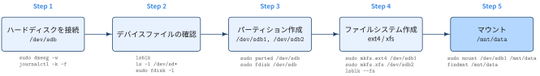
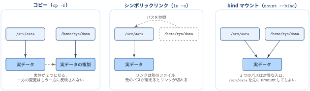
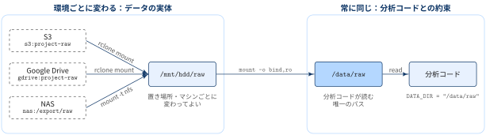
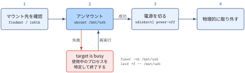

## mount とは

マウントとは, ハードディスクやUSBメモリなどドライブを利用するための仕組みです.
Linuxでは，外部ストーレージハードディスクやUSBメモリを指してもすぐに，`/usb` のような場所が使えるわけではありません．
「**ブロックデバイス上のファイルシステムを，ディレクトリに結びつける**」という`mount`コマンドの実行を通して初めて利用できるようになります．

::: {#def- .custom_problem .blog-custom-border}
### `mount` コマンド

- `mount`：デバイス上のファイルシステムを，ファイル階層の指定したディレクトリ（**マウントポイント**）に接続する
- 既定では root 権限が必要

[syntax]{.mini-section}

:::{.padding-left-10}

```bash
mount -t <type> <device> <dir>`
```

:::

:::

```bash
sudo mount -t ext4 /dev/sdb1 /mnt/usb
```

このコマンドは「`/dev/sdb1` にある ext4 のファイルシステムを `/mnt/usb` に接続せよ」とカーネルに指示します．
マウント後，パス `/mnt/usb` は `/dev/sdb1` のファイルシステムのルートを指すようになります．

{#fig-mount-tree width="100%"}

::: {.callout-note}
### マウントポイントの元の中身は消えていない

- マウントポイントのディレクトリに元々ファイルがあった場合，マウント中はその中身と所有者・パーミッションが見えなくなります．
- 削除されたわけではなく，アンマウントすれば再び見えるようになります．

「USB を挿していないのに `/mnt/usb` に書き込んでしまい，あとでマウントしたらファイルが消えた」ように見えるのはこのためです．

:::

[options]{.mini-section}

::: {.no-border-top-table}

| オプション | 意味 | 例 |
|---|---|---|
| `-a`, `--all` | `/etc/fstab` に書かれたファイルシステムを上から順にすべてマウントする．`noauto` の行とマウント済みのものは除く | `sudo mount -a` |
| `-r`, `--read-only` | 読み取り専用でマウントする．`-o ro` と同じ | `sudo mount -r /dev/sdb1 /mnt/usb` |
| `-w`, `--rw` | 読み書き可能でマウントする．`-o rw` と同じ．書き込み禁止のデバイスでも読み取り専用に切り替えず失敗させる | `sudo mount -w /dev/sdb1 /mnt/usb` |
| `-t`, `--types` | ファイルシステムの種類を指定する．省略すると自動判定される．`-a` と組み合わせると対象を絞れる（`no` を付けると除外） | `sudo mount -t ext4 /dev/sdb1 /mnt/usb` |
| `-o`, `--options` | マウントオプションをカンマ区切りで指定する．矛盾するものは後に書いた方が勝つ | `sudo mount -o noexec,nosuid /dev/sdb1 /mnt/usb` |
| `--bind` | 既存のディレクトリツリーを別の場所にもう一度接続し，2つのパスから同じ内容にアクセスできるようにする | `sudo mount --bind /srv/data /home/ryo/data` |
| `-f`, `--fake` | マウントのシステムコールだけを行わず，それ以外の処理を実行する．現在では，「このマウントが成功するか」を確かめるドライラン（試し実行）としては意味がない．| `sudo mount -f /dev/sdb1 /mnt/usb` |

: {tbl-colwidths="[20,35,40]"}

:::


## マウントまでの流れ

新しいハードディスクを接続してから使えるようになるまでには，次の5段階があります．

{#fig-mount-workflow width="100%"}

[Step 1: ハードディスクをマシンに接続する]{.mini-section}

ディスクを接続すると，カーネルがそれを検出し，udev がデバイスファイル（例: `/dev/sdb`）を作成します．
検出の様子はカーネルログで確認できます．

```bash
# カーネルログを追いかけながらディスクを接続する
sudo dmesg -w
# または
journalctl -k -f
```

[Step 2: デバイスファイルが作成されていることを確認する]{.mini-section}

```bash
lsblk
ls -l /dev/sd*
sudo fdisk -l
```

容量やモデル名から，接続したディスクがどのデバイスファイルになったかを特定します．
この後の手順はディスクの中身を消すので，**ここで対象を取り違えないこと** が最も重要です．

[Step 3: パーティションを作成する]{.mini-section}

`parted`（または `fdisk`）でパーティションテーブルとパーティションを作ります．
以下は GPT でディスクを半分ずつ2つに分ける例です．

```bash
sudo parted /dev/sdb --script mklabel gpt
sudo parted /dev/sdb --script mkpart data1 ext4 0% 50%
sudo parted /dev/sdb --script mkpart data2 xfs 50% 100%
lsblk /dev/sdb   # /dev/sdb1, /dev/sdb2 ができている
```

[Step 4: 各パーティションにファイルシステムを作成する]{.mini-section}

```bash
sudo mkfs.ext4 -L data1 /dev/sdb1
sudo mkfs.xfs -L data2 /dev/sdb2
lsblk --fs /dev/sdb   # FSTYPE・LABEL・UUID が付いている
```

`mkfs` を実行した時点でファイルシステムの UUID が生成されます．
fstab に書くときはこの UUID（または `-L` で付けた LABEL）を使います．

[Step 5: マウントする]{.mini-section}

```bash
sudo mount --mkdir /dev/sdb1 /mnt/data
findmnt /mnt/data
```

- 起動時に自動でマウントしたい場合は，`/etc/fstab` に追記します（後述）．
- マウント状況の確認は `df -h --total` でも可能です

::: {.callout-warning}
### Step 3・4 は既存データを消す

- `mklabel` はパーティションテーブルを，`mkfs` はファイルシステムを作り直すため，そのディスク上のデータには実質アクセスできなくなります．
- `/dev/sda` と `/dev/sdb` を取り違えると OS の入ったディスクを壊すことになるので，実行前に `lsblk` で必ず確認しましょう．

:::

## デバイスの指定方法

デバイスは通常 `/dev/sda1` のようなブロックデバイスのファイル名で指定します．
NFS の場合は `server:/dir` のような形式になります．

ただし `/dev/sdX` という名前は **不安定** です．
ディスクの増設や USB の抜き差しで，前回 `/dev/sdb1` だったものが次は `/dev/sdc1` になることがあります．
そのため，ファイルシステムやパーティションに付いた識別子（タグ）で指定することが強く推奨されています．

::: {.no-border-top-table}

| タグ | 何の識別子か | 特徴 |
|---|---|---|
| `LABEL=<label>` | ファイルシステム | 人が付ける名前．`e2label` などで設定する |
| `UUID=<uuid>` | ファイルシステム | `mkfs` 時に生成される．小文字の16進数で書く |
| `PARTLABEL=<label>` | パーティション（GPT） | `mkfs` や `mkswap` をし直しても変わらない |
| `PARTUUID=<uuid>` | パーティション（GPT） | 同上 |
| `ID=<id>` | ハードウェア | udev が生成する．定義が曖昧なので一般用途には非推奨 |

:::

各デバイスのファイルシステム・LABEL・UUID は `lsblk --fs` で一覧でき，特定のデバイスの詳細は `blkid -p <device>` で確認できます．

```bash
# 一覧
lsblk --fs

# UUID を指定してマウント
sudo mount UUID=0a1b2c3d-1234-5678-9abc-def012345678 /mnt/usb

# LABEL を指定してマウント（-L / -U でも同じ）
sudo mount LABEL=mydisk /mnt/usb
```

::: {.callout-warning}
### UUID が本当に一意とは限らない

- `dd` でディスクを丸ごとコピーした場合など，同じ UUID を持つファイルシステムが複数できることがあります．
- `lsblk -o +UUID,PARTUUID` で重複がないか確認しておきましょう．

:::

## マウント状況の確認

引数なしの `mount` でもマウント一覧は表示されますが，この表示は後方互換のために残されているだけです．
スクリプトで使う場合も含め，`findmnt` を使うのが推奨されています．

```bash
# ツリー形式で全マウントを表示
findmnt

# 特定のマウントポイントを調べる
findmnt /mnt/usb

# VFS レベルのオプションとファイルシステムレベルのオプションを分けて表示
findmnt -o TARGET,SOURCE,FSTYPE,VFS-OPTIONS,FS-OPTIONS
```

かつては `mount` / `umount` がマウント一覧を `/etc/mtab` というファイルに書き込んで管理していました．
現在の Linux では，名前空間やコンテナと整合が取れないためこの仕組みは無効化されており，`/etc/mtab` はカーネルが提供する `/proc/mounts`（環境によっては `/proc/self/mounts`）へのシンボリックリンクになっています．

[`/proc/self/mounts` を直接読む]{.mini-section}

カーネルが管理しているマウント一覧そのものは，`/proc/self/mounts` を `cat` すれば確認できます．
書式は fstab と同じ6フィールド（デバイス・マウントポイント・種類・オプション・dump・pass）で，dump と pass は常に `0` です．

```bash
$ cat /proc/self/mounts

sysfs /sys sysfs rw,nosuid,nodev,noexec,relatime 0 0
proc /proc proc rw,nosuid,nodev,noexec,relatime 0 0
udev /dev devtmpfs rw,nosuid,relatime,size=31840668k,nr_inodes=7960167,mode=755,inode64 0 0
...
```

`/proc/self` は「このファイルを読んでいるプロセス自身」の `/proc/<PID>` を指すシンボリックリンクです．
マウントの一覧はマウント名前空間ごとに異なるため，カーネルは「どのプロセスから見たマウント一覧か」を `/proc/<PID>/mounts` として提供しています．
`/proc/mounts` は `self/mounts` へのシンボリックリンクで，読んだプロセス自身から見たマウント一覧になります．

```bash
$ ls -l /proc/mounts /etc/mtab

lrwxrwxrwx 1 root root 19 Jul 15  2023 /etc/mtab -> ../proc/self/mounts
lrwxrwxrwx 1 root root 11 Nov  2 09:43 /proc/mounts -> self/mounts
```

したがって `cat /proc/mounts`・`cat /etc/mtab`・`cat /proc/self/mounts` はどれも同じ内容を表示します．
コンテナの中で実行すれば，ホストではなくコンテナのマウント名前空間の一覧が表示されます．
なお，マウント ID や親子関係・propagation などの詳しい情報は `/proc/self/mountinfo` にあり，`findmnt` はこちらを読んでいます．

## `/etc/fstab` と `mount -a`

起動時に何をどこへマウントするかは `/etc/fstab` に書きます．
1行が1つのマウントに対応し，空白区切りで6つのフィールドを持ちます．

```default
# <source>                                 <target>   <type> <options>          <dump> <pass>
UUID=0a1b2c3d-1234-5678-9abc-def012345678  /data      ext4   defaults,noatime   0      2
LABEL=backup                               /backup    ext4   defaults,nofail    0      2
server:/export                             /mnt/nfs   nfs    defaults,_netdev   0      0
```

::: {.no-border-top-table}

| フィールド | `fstab(5)` での名前 | 意味 | 例 |
|---|---|---|---|
| `<source>` | `fs_spec` | マウントするデバイスやリモートのファイルシステム．`UUID=`・`LABEL=` などのタグ，デバイスファイルのパス，NFS なら `server:/dir` で書く | `UUID=0a1b...`, `/dev/sdb1`, `server:/export` |
| `<target>` | `fs_file` | マウントポイント．スワップ領域のようにマウントポイントを持たないものは `none` と書く | `/data`, `none` |
| `<type>` | `fs_vfstype` | ファイルシステムの種類．`auto` にすると自動判定，bind マウントでは `none` を使う | `ext4`, `xfs`, `nfs`, `swap` |
| `<options>` | `fs_mntops` | マウントオプションをカンマ区切りで書く（後述）．特に指定がなければ `defaults` | `defaults,noatime` |
| `<dump>` | `fs_freq` | `dump(8)` によるバックアップの対象にするか．`0` なら対象外．`dump` はほぼ使われないので通常 `0` | `0` |
| `<pass>` | `fs_passno` | 起動時に `fsck` でチェック(ファイルシステム整合性確認)する順番．ルートファイルシステムは `1`，それ以外は `2`，`0` ならチェックしない．同じ番号のものは並列にチェックされる | `1`, `2`, `0` |

: {tbl-colwidths="[13,17,45,25]"}

:::

- `<dump>` と `<pass>` は省略でき，省略すると `0` として扱われます．
- `/etc/fstab` では `/dev/disk/by-uuid/...` のような udev のシンボリックリンクより，`UUID=...` のようなタグで書く方が読みやすく移植性も高いとされています．

[`mount -a`]{.mini-section}

`mount -a` は fstab に書かれたファイルシステムを上から順にすべてマウントします（`noauto` が付いた行は除く）．
すでにマウント済みのものはスキップされます．

```bash
# fstab の全エントリをマウント
sudo mount -a

# ext4 だけ
sudo mount -a -t ext4

# _netdev が付いていないものだけ
sudo mount -a -O no_netdev
```

::: {.callout-warning}
### fstab の書式チェックに `mount -a` を使わない

fstab を編集したあと `mount -a` で確認するのはよくある方法ですが，man ページでは悪い習慣とされています．
書式や参照先の検証には `findmnt --verify` を使います．
fstab の記述ミスは次回起動時の失敗につながるため，再起動前に必ず確認しておきましょう．

```bash
sudo findmnt --verify --verbose
```

:::


[一般ユーザーにマウントを許可する]{.mini-section}

通常マウントできるのは root だけですが，fstab のオプションに `user` を付けると一般ユーザーも `mount <dir>` でマウントできます．

```default
/dev/cdrom  /cd  iso9660  ro,user,noauto,unhide  0  0
```

| オプション | マウントできるユーザー | アンマウントできるユーザー |
|---|---|---|
| `user` | 誰でも | マウントした本人だけ |
| `users` | 誰でも | 誰でも |
| `owner` | デバイスファイルの所有者 | 同左 |
| `group` | デバイスファイルのグループのメンバー | 同左 |

`user` / `users` を付けると，安全のため `noexec,nosuid,nodev` も自動的に有効になります（`owner` / `group` は `nosuid,nodev`）．
実行を許可したい場合は `user,exec` のように後ろで上書きします．

## マウントオプション

`-o` に渡す，または fstab の第4フィールドに書くオプションのうち，ファイルシステムの種類に依存しない主なものをまとめます．

::: {.no-border-top-table}

| オプション | 意味 |
|---|---|
| `defaults` | `rw,suid,dev,exec,auto,nouser,async` をまとめて指定する |
| `ro` / `rw` | 読み取り専用 / 読み書き可能でマウントする |
| `noexec` | このファイルシステム上のバイナリを直接実行させない |
| `nosuid` | set-user-ID / set-group-ID ビットやファイルケーパビリティを無視する |
| `noatime` | 読み込み時にアクセス時刻（atime）を更新しない．ディレクトリにも効く |
| `sync` / `async` | I/O を同期 / 非同期で行う．フラッシュメディアで `sync` を使うと寿命を縮めることがある |
| `auto` / `noauto` | `mount -a` の対象にする / しない |
| `nofail` | デバイスが存在しなくてもエラーにしない．外付けディスクを fstab に書くときに使う |
| `_netdev` | ネットワーク接続が必要なデバイスであることを示し，ネットワークが立ち上がるまでマウントを待たせる |
| `remount` | マウント済みのファイルシステムのオプションを変更する．デバイスやマウントポイントは変わらない |

: {tbl-colwidths="[25,75]"}

:::

```bash
# 外付けディスクを，実行・setuid 禁止でマウント
sudo mount -o noexec,nosuid,nodev LABEL=mydisk /mnt/usb

# マウントポイントのディレクトリがなければ作ってからマウント（util-linux 2.38 以降）
sudo mount --mkdir /dev/sdb1 /mnt/usb

# 読み取り専用で再マウントしていたものを書き込み可能に戻す
sudo mount -o remount,rw /mnt/usb
```

## bind マウントと move

[bind マウント]{.mini-section}

bind マウントは，ファイル階層の一部を別の場所にもう一度接続する操作です．
実行後は，同じ内容に2つのパスからアクセスできます．

```bash
sudo mount --bind /srv/data /home/ryo/data
```

fstab では次のように書きます．

```default
/srv/data  /home/ryo/data  none  bind  0  0
```

bind は「コピー」や「シンボリックリンク」とは異なり，ファイルシステムを接続する操作の一種にすぎません．
カーネルにはどちらが bind で作られたかという情報は残らず，元の `/srv/data` を先にアンマウントすることもできます．

{#fig-bind-vs-copy-symlink width="100%"}

`--bind` は1つのファイルシステムだけを接続し，その下にマウントされている別のファイルシステム（サブマウント）は含みません．
サブマウントも含めて接続したい場合は `--rbind` を使います．

[読み取り専用の bind マウント]{.mini-section}

```bash
# util-linux 2.27 以降は1行で書ける（内部では2回のシステムコールで，アトミックではない）
sudo mount -o bind,ro /srv/data /home/ryo/data

# 従来の書き方
sudo mount --bind /srv/data /home/ryo/data
sudo mount -o remount,bind,ro /srv/data /home/ryo/data
```

読み取り専用になるのは新しいマウントポイント（`/home/ryo/data`）だけで，元の `/srv/data` からは引き続き書き込めます．
また，`-o rbind,ro` としてもサブマウントまでは読み取り専用になりません．
util-linux 2.39 以降では実験的機能として `-o rbind,ro=recursive` が使えます．

[サブツリーのマウント]{.mini-section}

bind マウントの接続元は，マウントポイントそのものである必要はありません．
ファイルシステムの途中のディレクトリ（サブツリー）だけを，別の場所に接続できます．

```bash
# HDD 全体を /mnt/hdd にマウントし，その中の raw/ だけを /data/raw に接続する
sudo mount /dev/sda1 /mnt/hdd
sudo mount --bind /mnt/hdd/raw /data/raw
```

`/data/raw` からは `/mnt/hdd/raw` の中身だけが見え，HDD 上のほかのディレクトリは見えません．

`--bind` を付けずに `mount` すると，第1引数はデバイスとして解釈されます．
`/mnt/hdd/raw` はただのディレクトリなので，次のエラーになります．

```default
mount: /data/raw: /mnt/hdd/raw is not a block device.
```

::: {#exm- .custom_problem }
### データ分析プロジェクトとサブツリーマウント

データ分析プロジェクトでは，「データが物理的にどこに置かれているか」と「プログラムが参照するパス」を分離しておくことが重要です．
たとえば，実体のデータがクラウドストレージ上にあり，`rclone mount` で HDD 上のディレクトリにマウントしているとします．

```bash
rclone mount s3:project-raw /mnt/hdd/raw --daemon --read-only --allow-other
```

このとき `/mnt/hdd/raw` は，S3 上のデータを見せる FUSE の仮想ファイルシステムになります．
分析コードにとって必要なのは「データが読めること」だけで，それが S3 にあるかどうかは関係ありません．
そこで，分析コードが読むパスを `/data/raw` に固定し，bind マウントで実体とつなぎます．

```bash
sudo mount -o bind,ro /mnt/hdd/raw /data/raw
```

{#fig-bind-data-separation width="100%"}

この構成にすると，データの実体が S3 / Google Drive / NAS のどこにあっても，**分析コードは常に `/data/raw` を読むだけでよい** という[データ配置と分析コードの分離]{.regmonkey-bold}が実現できます．

- **置き場所の変更にコードが影響されない**：データを NAS に移したら，`/data/raw` の接続元を差し替えるだけで済む
- **マシン間でパスが揃う**：手元の PC と分析サーバーでマウント元が違っても，コード・設定ファイル・ノートブックに書くパスは同じ
- **生データを誤って壊さない**：`ro` を付けておけば，分析コードのバグで生データを上書き・削除することがない

接続元の差し替えは，アンマウントしてから bind し直すだけです．

```bash
# 実体を S3 から NAS に切り替える
sudo umount /data/raw
sudo mount -t nfs nas:/export/raw /mnt/nas/raw
sudo mount -o bind,ro /mnt/nas/raw /data/raw
```

::: {.callout-note}
### `rclone mount` には `--allow-other` が必要

- FUSE でマウントしたファイルシステムには，既定ではマウントした本人しかアクセスできず，**root でもアクセスできません**．
- そのままでは `sudo mount --bind` が失敗したり，別ユーザーで動く分析ジョブから読めなかったりするので，`--allow-other` を付けてマウントしましょう．
- 一般ユーザーがこのオプションを使うには，`/etc/fuse.conf` で `user_allow_other` を有効にしておく必要があります．

:::


:::
***


[move]{.mini-section}

`mount --move` は，マウント済みのツリーを別の場所へアトミックに移動します．
ファイルの物理的な場所は変わりません．移動元はマウントポイントである必要があります．

```bash
sudo mount --move /mnt/old /mnt/new
```

## umount：ブロックデバイスを安全に取り外す

USB メモリや外付けディスクは，**アンマウントしてから** 取り外します．
Linux はディスクへの書き込みをいったんメモリ（ページキャッシュ）に溜めてからまとめて書き出すため，
コピーが終わったように見えても，データがまだディスクに届いていないことがあります．
`umount` はこの未書き込みのデータを書き出してからファイルシステムを切り離すので，アンマウントが成功すればデータは安全です．

::: {#def- .custom_problem .blog-custom-border}
### `umount`

- マウントされているファイルシステムを，ファイル階層から切り離す
- 対象は **マウントポイントのディレクトリ** で指定する．デバイス名でも指定できるが非推奨（同じデバイスが複数のディレクトリにマウントされていると失敗するため）
- ファイルを開いているプロセスや，そこをカレントディレクトリにしているプロセスがある（**busy** な）間はアンマウントできない
- 既定では root 権限が必要．fstab に `user` オプションがある場合や，自分がマウントした FUSE ファイルシステムは一般ユーザーでもアンマウントできる

[syntax]{.mini-section}

:::{.padding-left-10}

```bash
umount [-dflnrv] {<dir>|<device>}
umount -a [-dflnrv] [-t <fstype>] [-O <option>...]
```

:::

:::

[options]{.mini-section}

::: {.no-border-top-table}

| オプション | 意味 | 例 |
|---|---|---|
| `-a`, `--all` | `/proc/self/mountinfo` にあるファイルシステムをすべてアンマウントする．`proc`・`sysfs`・`devpts` などは除く | `sudo umount -a -t nfs` |
| `-A`, `--all-targets` | 指定したファイルシステムがマウントされているマウントポイントを，現在のマウント名前空間からすべてアンマウントする | `sudo umount -A /dev/sdb1` |
| `-R`, `--recursive` | 指定したディレクトリ以下にネストしたマウントも再帰的にアンマウントする．途中で1つでも失敗するとそこで止まる．マウントポイントでの指定のみ対応 | `sudo umount -R /mnt/chroot` |
| `-t`, `--types` | 指定した種類のファイルシステムだけを対象にする．リストの先頭に `no` を付けると，列挙した種類すべてを除外する．種類名はカーネル上の名前（例: `nfs4`）で，fstab の表記と異なることがある | `sudo umount -a -t nonfs,nfs4` |
| `-O`, `--test-opts` | fstab で指定したオプションが付いているファイルシステムだけを対象にする（`no` を付けると除外） | `sudo umount -a -O _netdev` |
| `-l`, `--lazy` | ファイル階層からすぐに切り離し，busy でなくなった時点で後片付けする．応答しないネットワーク共有でシャットダウンが固まるのを防ぐ用途向け | `sudo umount -l /mnt/nfs` |
| `-f`, `--force` | 強制的にアンマウントする（到達できない NFS サーバーなど）．ハングしないことは保証されない | `sudo umount -f /mnt/nfs` |
| `-c`, `--no-canonicalize` | パスの正規化（`stat(2)` / `readlink(2)`）を行わない．NFS サーバー停止時のハング回避に使う．正規化済みの絶対パスで指定する | `sudo umount -c /mnt/nfs` |
| `-r`, `--read-only` | アンマウントに失敗したら，読み取り専用での再マウントを試みる | `sudo umount -r /data` |
| `-d`, `--detach-loop` | ループデバイスだった場合，ループデバイスも解放する．`mount` が作ったループデバイスは autoclear により自動解放されるので不要 | `sudo umount -d /mnt/iso` |
| `-q`, `--quiet` | 「not mounted」のエラーメッセージを表示しない | `sudo umount -q /mnt/usb` |
| `-v`, `--verbose` | 詳細を表示する | `sudo umount -v /mnt/usb` |

: {tbl-colwidths="[20,45,35]"}

:::

{#fig-umount-flow width="100%"}

[Step 1: マウント先を確認する]{.mini-section}

```bash
lsblk --fs /dev/sdb
findmnt --source /dev/sdb1
```

[Step 2: アンマウントする]{.mini-section}

`umount` にはマウントポイントとデバイスのどちらを渡してもかまいません．

```bash
sudo umount /mnt/usb
# または
sudo umount /dev/sdb1
```

[失敗した場合：target is busy]{.mini-section}

ファイルシステムが **使用中（busy）** だと，アンマウントは失敗します．
次のどれかに当てはまると busy になります．

- ユーザーやプロセスが，そのファイルシステム上のファイルを開いている
- ユーザーのシェルやプロセスが，そのファイルシステム内のディレクトリをカレントディレクトリにしている
- そのファイルシステム上のスワップファイルが使われている
- その下に別のファイルシステムがマウントされている（サブマウント）

このとき `umount` を実行すると，次のようなエラーメッセージが表示されます．

```default
umount: /mnt/usb: target is busy.
```

使用中のプロセスを特定して，別のディレクトリへ移動させるか終了させてから再実行します．
自分のシェルが `/mnt/usb` の中にいるだけ，ということもよくあるので，まず `cd ~` してから再実行してみましょう．

[関連プロセスの探索]{.mini-section}

使用中のプロセスは `fuser` か `lsof` で探せます．
どちらも，PID・実行ユーザー・実行コマンドなどを表示します．

```bash
# マウントポイントを使っているプロセスを表示
sudo fuser -vm /mnt/usb

# lsof でも確認できる（+f -- を付けると，ファイルシステム全体が対象になる）
sudo lsof +f -- /mnt/usb

# 全プロセスの一覧から grep で絞り込む方法もある（遅いが，オプションを覚えなくてよい）
sudo lsof | grep /mnt/usb
```

`fuser -v` の出力の `ACCESS` 列は，`c` がカレントディレクトリ，`f` が開いているファイル，`e` が実行中のバイナリを表します．
`sudo` を付けないと，他のユーザーのプロセスが表示されないことに注意してください．

[プロセスを終了させる]{.mini-section}

内容を確認して，終了させてよいプロセスであれば `kill` します．

```bash
# まずは SIGTERM（標準）．プロセスに後片付けをさせてから終了させる
sudo kill <PID>

# SIGTERM で終了しない場合だけ SIGKILL（強制終了）
sudo kill -9 <PID>
```

`SIGKILL` はプロセスに後片付けの機会を与えないため，そのプロセスが書き込み途中だったファイルが壊れることがあります．
エディタやコピー中のコマンドなら，`kill` する前に自分で保存・完了させるのが安全です．
プロセスがいなくなれば，`umount` を実行できるようになります．

`lsof` や `fuser` で何も見つからないのに busy のままなら，サブマウントやスワップファイルを疑います．

```bash
# /mnt/usb の下にマウントされているものを表示
findmnt -R /mnt/usb

# 使用中のスワップを表示
swapon --show
```

::: {.callout-warning}
### `umount -l`（lazy unmount）で取り外さない

`umount -l` はファイルシステムをすぐにファイル階層から切り離し，使用中の参照がなくなった時点で後片付けをします．
コマンド自体は成功しますが，裏ではまだファイルシステムが生きていて書き込みが残っている可能性があるため，その直後にデバイスを抜くのは危険です．
取り外す前には，`fuser` などで使用中のプロセスを確実に終了させてから通常の `umount` を使いましょう．

:::

[Step 3: デバイスの電源を切る]{.mini-section}

USB デバイスは，アンマウント後に電源を切ってから抜くとより安全です．
デスクトップの「安全に取り外す」ボタンと同じ処理を，`udisksctl` でコマンドラインから行えます．

```bash
udisksctl power-off -b /dev/sdb
```

パーティション（`/dev/sdb1`）ではなく，ディスク全体（`/dev/sdb`）を指定する点に注意してください．
複数のパーティションがマウントされている場合は，すべてアンマウントしてから実行します．

## References

- [`mount(8)` - Linux manual page](https://man7.org/linux/man-pages/man8/mount.8.html)
- [`umount(8)` - Linux manual page](https://man7.org/linux/man-pages/man8/umount.8.html)
- [`fstab(5)` - Linux manual page](https://man7.org/linux/man-pages/man5/fstab.5.html)
- [`findmnt(8)` - Linux manual page](https://man7.org/linux/man-pages/man8/findmnt.8.html)
- [`mount_namespaces(7)` - Linux manual page](https://man7.org/linux/man-pages/man7/mount_namespaces.7.html)

## 📘 用語集

:::{.glossary-container}

```yaml
glossary:
  - def: マウントポイント
    description: |
      ファイルシステムを接続する先のディレクトリ（例: `/mnt/usb`）．
      マウント中は，そのパスがデバイス上のファイルシステムのルートを指し，
      ディレクトリに元々あった中身は見えなくなる（削除はされず，アンマウントすると再び見える）．

  - def: デバイスファイル
    description: |
      ハードウェアやカーネルの機能を，ファイルとして読み書きできるようにした特殊ファイル．`/dev` 以下に置かれる．
      ディスクのようにブロック単位で読み書きするものをブロックデバイス（例: ディスク全体の `/dev/sdb`，そのパーティションの `/dev/sdb1`），
      端末のように1文字ずつ扱うものをキャラクタデバイス（例: `/dev/tty`）と呼ぶ．
      `ls -l` で先頭が `b` ならブロックデバイス，`c` ならキャラクタデバイス．
      現在の Linux では，デバイスが接続されると udev が自動で作成する．

  - def: ブロックデバイス
    description: |
      データを固定長のブロック（セクタ）単位で読み書きし，任意の位置へランダムアクセスできるデバイス．
      HDD・SSD・USB メモリなどのディスクや，そのパーティション，ループデバイス（`/dev/loop0`）が該当する．
      カーネルはページキャッシュを介して読み書きするため，書き込んだデータがすぐにはディスクへ届かないことがある．
      ファイルシステムを作成（`mkfs`）してマウントできるのはブロックデバイスで，一覧は `lsblk` で確認できる．

  - def: fsck (file system check)
    description: |
      ファイルシステムの整合性を検査し，壊れた箇所を修復するコマンド．
      実体は種類ごとのプログラム（`fsck.ext4`（= `e2fsck`）など）で，`fsck` はそれを呼び出すフロントエンド．
      電源断などで正常にアンマウントされなかったときに，メタデータの不整合を直すために使う．
      起動時には `/etc/fstab` の第6フィールド（`<pass>`）の順に自動実行される（`0` なら実行しない）．
      マウント中のファイルシステムに実行すると壊れるおそれがあるため，必ずアンマウントしてから実行する（例: `sudo fsck /dev/sdb1`）．
      XFS では `fsck.xfs` は何もせず，修復には `xfs_repair` を使う．
```

:::
