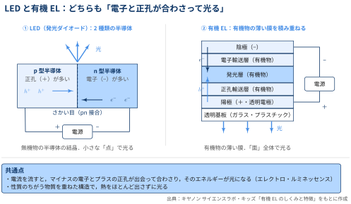
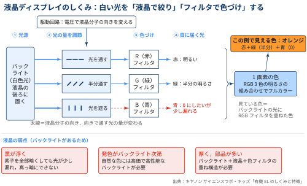
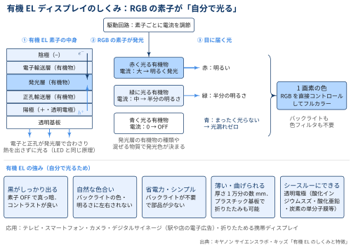

::: {.callout-note}
## TL:DRs

- 有機ELは「電気（エレクトロ）で有機物を光らせる（ルミネッセンス）」現象．素子としては OLED（Organic Light Emitting Diode）と呼ばれる
- 発光の原理は LED と同じで，**マイナスの電子とプラスの正孔が合わさるときに光を出す**．LED は無機物の半導体，有機ELは有機物の薄い膜を使う点がちがう
- 有機ELディスプレイは RGB の素子が**自分で光る**ため，液晶ディスプレイに必要なバックライトと色フィルタが要らない
- その結果，黒がしっかり出る・自然な色・省電力・薄くて曲げられる・透明にできる，といった特徴をもつ

:::

## 有機ELとは？

::: {#def- .custom_problem .blog-custom-border}
### 有機EL

- **電気を使った有機物の発光現象**を指す言葉
- 「オルガニック・エレクトロ・ルミネッセンス（organic electro-luminescence）」の略語
  - オルガニックは有機物（有機化合物）で，生物の体を作っている炭素が入った化合物のこと
  - ルミネッセンスとは，ホタルやヒカリゴケなどの生物発光や夜光塗料のように，熱を出さずに光を出す現象のこと
  - ルミネッセンスを電気のエネルギーで起こすのがエレクトロ・ルミネッセンス

:::

「有機EL」は本来，現象の名前です．ディスプレイなどに使われる部品（素子）は，世界的には **OLED（Organic Light Emitting Diode：有機発光ダイオード）** と呼ばれます．名前に「ダイオード」が入っているとおり，身のまわりの LED（Light Emitting Diode：発光ダイオード）と非常によく似たしくみで光ります．

### 有機ELの仕組み

有機ELを理解するには，まず LED の光り方を押さえておくとわかりやすいです

::: {.callout-note}
### LED は2種類の半導体のさかい目で光る

- LED は，性質がことなる2種類の半導体を貼り合わせて，そのさかい目部分で光らせる技術
- **n型半導体**：電子（マイナス）をよぶんに持った状態の半導体
- **p型半導体**：電子が足りない状態，つまり **正孔**（電子が抜けた穴．プラスの電気を持つように振る舞う）が多い半導体

:::

電流を流すと，n型からは電子が，p型からは正孔が，それぞれ2つの半導体のさかい目（pn接合）に向かって移動します．さかい目で電子と正孔が出会って合わさると，そのときに余ったエネルギーが光として出てくる仕組みになっています．

::: {.callout-note}
### 有機EL：有機物の薄い膜を積み重ねて光らせる

- 有機ELは，電極と有機物の薄い膜を何層も重ねて，その真ん中の**発光層**で光らせる技術
- **陰極（−）側**：電子を送り込み，電子輸送層が発光層まで運ぶ（LED の n型にあたる）
- **陽極（＋）側**：正孔を送り込み，正孔輸送層が発光層まで運ぶ（LED の p型にあたる）
- LED の「さかい目」にあたるのが発光層で，ここで電子と正孔が出会って光る

:::

有機ELは，次のような層が透明な基板（ガラスやプラスチックなどの薄い板）の上に積み重なった構造をしています

:::: {.no-border-top-table}

| 層 | 役割 |
|---|---|
| 陰極（−） | 電子を送り込む電極 |
| 電子輸送層 | 電子を発光層まで効率良く運ぶ有機物の層 |
| **発光層** | 電子と正孔が合わさって光る有機物の層 |
| 正孔輸送層 | 正孔を発光層まで効率良く運ぶ有機物の層 |
| 陽極（＋） | 正孔を送り込む電極．光を外に出すため透明な電極を使う |
| 透明基板 | 全体を支えるガラスやプラスチックの板 |

: {tbl-colwidths="[25,75]"}

::::

プラスとマイナスの電極に電源をつなぐと，陰極からは電子が，陽極からは正孔が送り込まれ，それぞれ輸送層を通って発光層に集まります．そして LED の半導体のさかい目と同じように，**発光層で電子と正孔が合わさって光を出す**という仕組みです．光は透明な陽極と基板を通って外に出てきます．

{width="100%" fig-align="center"}

::: {.callout-tip}
## なぜ電子と正孔が合わさると光るのか？

電子と正孔が合わさる（再結合する）と，発光層の有機物はエネルギーの高い「励起状態」になります．この状態は不安定なので，物質はすぐにもとの安定した「基底状態」に戻ろうとし，そのとき差分のエネルギーを光として放出します．

放出される光の色（波長）は，このエネルギー差，つまり材料となる物質によって決まります．そのため発光層に使う有機物の種類や，混ぜる物質を変えることで，赤・緑・青などさまざまな色の光を出すことができます．
:::

[LEDと有機ELの共通点と相違点]{.mini-section}

- いくつかの物質を重ねた構造であることや，電気エネルギーで熱をほとんど出さずに光を出すという点で，LED と有機ELはとてもよく似ています
- 大きくちがうのは材料で，LED が無機物の半導体の結晶を使うのに対し，有機ELは発光する部分などに**有機物**を使います．

### 有機ELの特徴

有機ELの素子は，それぞれが**自分で光る（自発光）** という性質があります．この性質と，有機物の薄い膜でできていることから，次のような特徴が生まれます．

:::: {.no-border-top-table}

| 特徴 | 理由 |
|---|---|
| 黒がしっかり出る | 素子を OFF にすると光がまったく出ず真っ暗になるため，コントラストの良い映像になる |
| 自然な色合い | 色ごとの素子が直接光るので，バックライトの色や明るさに左右されない |
| 省電力・シンプル | バックライトが要らず，部品が少なくてすむ |
| 薄い・曲げられる | 素子の厚さは1万分の数 mm 程度．基板をプラスチックにすれば曲げたり折りたたんだりできる |
| シースルーにできる | 電極を透明な物質（酸化インジウムスズ・酸化亜鉛・炭素の単分子膜など）で作れば，透けて見えるディスプレイになる |
: {tbl-colwidths="[25,75]"}

::::

こうした特徴を活かして，有機ELはテレビ，スマートフォン，カメラの電子ビューファインダー，駅や店のデジタルサイネージ（電子広告），折りたためる携帯ディスプレイなどに使われています．

## 有機ELディスプレイ vs 液晶ディスプレイ

::: {.callout-note}
### ディスプレイの基本原則

- ディスプレイの1画素は，赤（R）・緑（G）・青（B）の3つの小さな点（サブ画素）でできており，3色の明るさの組み合わせでさまざまな色を表現する．
- 液晶ディスプレイと有機ELディスプレイのちがいは，**この RGB の光をどうやって作るか**にある．

:::

[液晶ディスプレイ：白い光を「絞って」「色づけ」する]{.mini-section}

液晶ディスプレイは，液晶そのものは光らず，後ろに置いた**バックライト**（白色光）の光を使い，次の手順で色を作ります．

1. バックライトが白い光を出す
2. 駆動回路で電圧をかけて液晶分子の向きを変え，通す光の量を調節する
3. R・G・B の**カラーフィルタ**を通して色をつける
4. 3色の明るさの組み合わせで，1画素の色が決まる

{width="100%" fig-align="center"}

各サブ画素は「液晶セル1つ＋フィルタ1つ」の組で，この組み合わせは固定されています．R・G・B の3組はそれぞれ独立に「通す／半分／遮る」を切り替えられ，その組み合わせで目に見える色が決まります．

液晶は光を完全には遮れないため，青を0にしたくても光が少し漏れてしまいます．その結果，画面を真っ黒にしたいときでも黒が浮いて見えてしまいます．また発色はバックライトの性能に左右され，バックライト・液晶・カラーフィルタを重ねるぶん厚みも出てしまいます．

[有機ELディスプレイ：RGB の素子が「自分で光る」]{.mini-section}

- 有機ELディスプレイでは，赤・緑・青それぞれに光る有機物でできた素子が並んでおり，駆動回路が素子ごとに流す電流を調節
- 電流を大きくすれば明るく光り，0にすれば完全に消える

{width="100%" fig-align="center"}

- 光らせたくない素子は電流を止めるだけで消えるので，光漏れがなく真っ黒を表現できます
- バックライトもカラーフィルタも不要で，構造がシンプルなぶん薄く・軽く・曲げられるディスプレイにできます

[比較まとめ]{.mini-section}

| 観点 | 液晶ディスプレイ | 有機ELディスプレイ |
|---|---|---|
| 光源 | バックライト（白色光） | 素子そのものが光る（自発光） |
| 明るさの調節 | 電圧で液晶分子の向きを変え，通す光の量を調節する | 素子に流す電流の量を変える |
| 色の作り方 | 白い光にカラーフィルタを重ねる | 赤・緑・青に光る有機物を使い分ける |
| 黒の表現 | 光が少し漏れて黒が浮く | 素子 OFF で真っ黒．コントラストが高い |
| 色の自然さ | バックライトの性能に左右される | バックライトに左右されない |
| 構造・厚さ | バックライト＋液晶＋フィルタの重ね構造で厚い | 部品が少なく薄い．曲げたり透明にしたりできる |

: {tbl-colwidths="[20,40,40]"}

## References

- [キヤノン サイエンスラボ・キッズ「有機ELのしくみと特徴」](https://global.canon/ja/technology/kids/mystery/m_04_12.html)
- [キヤノン：技術のご紹介｜サイエンスラボ（有機ELの発光原理）](https://global.canon/ja/technology/s_labo/light/002/03.html)
