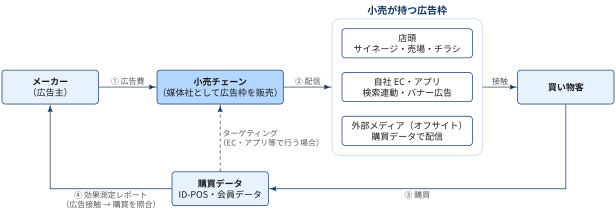
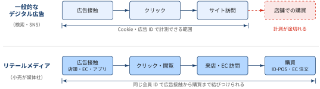

## この記事について

:::: {.no-border-top-table}

| 観点 | 内容 |
|---|---|
| **What：何のドキュメントか** | リテールメディアの仕組み（お金・広告・データの流れ）と，実務での活用方法をまとめたドキュメント． |
| **Who：誰に向けたものか** | 小売・メーカー・広告代理店でリテールメディアに関わる担当者や，その効果測定を担うデータサイエンティスト． |
| **How：どう使うか** | 関係者の役割と，広告接触から効果測定までの流れを確認するための入門資料として使う． |

: {tbl-colwidths="[30,70]"}

::::

## リテールメディアとは


::: {#def- .custom_problem .blog-custom-border}
### リテールメディア

- **リテールメディア**とは，小売事業者が自社の店舗・EC・アプリ・購買データを広告媒体として，メーカーなどの広告主に販売する仕組み
- リテールメディアという仕組みの中では．小売業者は「商品を仕入れて売る立場」だけでなく，**媒体社**として広告枠を販売する立場にもなる

:::


{width="100%" fig-align="center"}

図の流れを番号順に整理すると次のとおり．

| # | 流れ | 内容 |
|---|---|---|
| ① | 広告費 | メーカー（広告主）が小売チェーンに広告費を支払う |
| ② | 配信 | 小売チェーンが自社の広告枠に広告を配信する |
| ③ | 購買 | 広告に接触した買い物客の購買が，ID-POS・会員データとして記録される |
| ④ | 効果測定 | 広告接触と購買を照合し，効果測定レポートとしてメーカーに返す |

: {tbl-colwidths="[8,17,75]"}

[リテールメディアが注目される背景]{.mini-section}

消費財メーカーがマーケティングのPDCAを回すには，

- 「自社の商品が消費者に買われたか」という購買データ（CVデータ）
- 消費者に施策を届ける接点

の両方が必要です．しかし，消費財メーカーはこの2つをどちらも自社で持ちにくい立場にあります．

| 必要なもの | 消費財メーカーの課題 | リテールが持っているもの |
|---|---|---|
| **購買データ** | D2Cなどの施策は広がっているが，売上の大部分は依然として小売店で発生しており，購買データが自社に蓄積されない | ID-POS・会員データとして，消費者一人ひとりの購買データを蓄積している |
| **消費者との接点** | 購買データがあっても，消費者に直接施策を打てなければPDCAを回せない | 店頭に加え，自社アプリ・LINE・メールなど，消費者と直接つながる接点を構築している |

: {tbl-colwidths="[16,42,42]"}

消費財メーカーはリテールと組むことで，購買データにもとづいて施策を打ち，その結果を購買で検証するという新しいマーケティングを実現できる可能性があります．こうしたリテールが提供する取り組みがリテールメディアであり，さまざまなリテールが参入を始めています．

[リテールメディア vs その他デジタル広告]{.mini-section}

リテールメディアは「購買につながる」メディアとして期待されています．
検索広告やSNS広告などのデジタル広告は，認知や興味の段階で消費者に接触し，その後の購買は小売の店頭やECで起こります．
一方，リテールメディアは購買が起こる場所そのものを広告枠とし，購買データも小売が持っています．
そのため，その他のデジタル広告と比べて，次の2点で購買に近いメディアといえます．

:::: {.no-border-top-table}

| メリット | 内容 |
|---|---|
| **広告の接触と購買を結びつけられる** | 一般的なデジタル広告と違い，広告の接触と実際の購買を，同じ会員IDで結びつけられる |
| **購買の直前に接触できる** | 店舗のサイネージ広告や看板は，来店客が購入する直前に目にするため，リセンシー効果が高い顧客接点となる |

: {tbl-colwidths="[30,70]"}

::::

{width="100%" fig-align="center"}

検索広告やSNS広告で計測できるのはクリックやサイト訪問までのことが多く，実店舗での購買までは追いにくいです．
リテールメディアでは，購買データを持つ小売自身が媒体社となるため，「広告を見た人が実際にその商品を買ったか」を測定できるというメリットがあります．

### 小売が持つ広告枠

小売が販売する広告枠は，大きく3種類に分けられます．

:::: {.no-border-top-table}

| 広告枠 | 主な例 | 特徴 |
|---|---|---|
| 店頭（インストア） | デジタルサイネージ，売場の棚・エンド，チラシ | 購買の直前に接触する．来店客全員に届くが，個人単位の接触ログは取りにくい |
| 自社EC・アプリ（オンサイト） | 検索連動広告，バナー広告，クーポン配信 | 会員IDで接触ログが取れるため，購買データを使ったターゲティングと効果測定がしやすい |
| 外部メディア（オフサイト） | SNS・動画・ディスプレイ広告 | 小売の購買データでセグメントを作成し，外部の媒体で配信する．店外でのリーチを広げられる |

: {tbl-colwidths="[22,30,48]"}

::::

## プレーヤーごとの活用観点

:::: {.no-border-top-table}

| プレーヤー | 立場 | 主な活用の目的 |
|---|---|---|
| 小売チェーン | 媒体社 | 広告収入による収益源の多様化，購買データの収益化 |
| メーカー | 広告主 | 売場に近い場所での販促，新規購買者の獲得，販促費の効果検証 |
| 広告代理店 | 仲介・運用 | 複数の小売にまたがる出稿の計画・運用・効果の比較 |
| ベンダー | 基盤提供 | 広告配信システム，データクリーンルーム，効果測定ツールの提供 |

: {tbl-colwidths="[20,15,65]"}

::::

### 小売チェーン


::: {.callout-note}
### 収入源の確保

- 小売にとってリテールメディアの広告収入は，商品販売とは別の新たな収入源の確保につながる．
- ただし，媒体としての価値は**会員IDで識別できる購買データの量と質**で決まる．
- 業態によって，持っている広告枠とデータの強みが異なる．
:::

:::: {.no-border-top-table}

| 業態 | 強みとなる資産 | 活用の例 |
|---|---|---|
| EC・ECモール | 検索・閲覧・購買の行動ログ | 検索連動広告，商品ページ内の広告．接触から購買までをオンラインで一貫して測定できる |
| スーパー・GMS | 来店頻度の高い会員の購買履歴，チラシ | 食品・日用品メーカー向けのクーポン配信，売場サイネージ |
| ドラッグストア | 医薬品・化粧品・日用品の購買履歴，アプリ会員 | 化粧品・日用品メーカー向けの新商品の試用促進，カテゴリをまたいだターゲティング |
| コンビニ | 店舗数と来店頻度，レジ周りのサイネージ | 新商品の認知拡大．ただし会員IDに紐づかない購買が多く，個人単位の測定には限界がある |

: {tbl-colwidths="[18,32,50]"}

::::

小売が媒体価値を高めるには，次の取り組みが必要になります

- 会員アプリやポイントカードの利用率を上げ，ID付きの購買の比率を高める
- 店頭とオンラインの接触ログを会員IDで統合する
- 広告主が他の小売と比較できるよう，効果測定の指標と方法を明示する

### メーカー（広告主）


::: {.callout-note}
### 販促費を効果を測定できる広告に置き換える

- メーカーにとってリテールメディアは，**従来の販促費（棚代・リベート・チラシ協賛など）を，効果を測定できる広告に置き換える手段**として位置づけられることが多い．
- 目的によって，配信する対象と効果を見る指標が異なる．
:::

:::: {.no-border-top-table}

| 目的 | 使い方の例 | 主に見る指標 |
|---|---|---|
| 新規購買者の獲得 | 競合ブランドの購買者や，カテゴリの未購買者に配信する | 新規購買者数，新規購買者の比率 |
| リピートの促進 | 過去購買者に買い替え時期に合わせてクーポンを配信する | リピート率，購買間隔 |
| 新商品の立ち上げ | 発売時期に店頭サイネージとアプリで同時に露出する | 認知・試用率，発売初期の販売数 |
| 販促費の配分の見直し | 小売ごとの広告効果を比較し，予算の配分を変える | iROAS，広告による売上の増分 |

: {tbl-colwidths="[22,48,30]"}

::::

### 広告代理店の役割


::: {.callout-note}
### メーカーと複数の小売をつなぐ

- リテールメディアは小売ごとに広告枠，入稿の仕様，管理画面，効果測定の指標が異なり，複数の小売に出稿する場合，これらを個別に扱う負担が大きい．
- 広告代理店は，この**メーカーと複数の小売の間をつなぐ役割**を担う．
:::

:::: {.no-border-top-table}


| 役割 | 内容 |
|---|---|
| 出稿計画 | どの小売のどの枠（店頭・EC・オフサイト）に，どれだけ予算を配分するかを設計する |
| 運用 | 複数の小売の管理画面での入稿・入札・配信設定をまとめて行う |
| 効果の横比較 | 小売ごとに異なる指標を共通の基準にそろえ，小売間・他のメディアと比較する |
| 統合的な施策設計 | テレビ・SNSなどのマス広告と，売場に近いリテールメディアを組み合わせた施策を設計する |
| 小売側の支援 | 媒体としての広告商品の設計や，広告主への販売を小売に代わって行う（メディアレップ） |

: {tbl-colwidths="[22,78]"}

::::


## Appendix: この記事での用語集

:::{.glossary-container}

```yaml
glossary:
  - def: リセンシー効果
    description: |
      購買の直前に接触した広告ほど購買の意思決定に影響しやすいという考え方．
      日用品や食品のように売場で購入する商品を決めることが多いカテゴリでは，売場での最後のひと押しになりやすい点が評価されている．

  - def: デジタルサイネージ
    description: |
      店頭や駅などに設置したディスプレイに，映像や画像の広告・情報を表示する媒体．
      紙のポスターと違い，表示内容をネットワーク経由で切り替えられるため，時間帯や店舗ごとに配信内容を変えられる．
      リテールメディアでは，売場やレジ周りで購買直前の来店客に接触する広告枠として使われる．

  - def: 売場サイネージ
    description: |
      小売店の売場に設置するデジタルサイネージ．棚やエンド（陳列棚の端），冷蔵ケースの扉，カートなどに取り付ける．
      商品の目の前で広告を表示できるため，その場での購入の判断を後押ししやすい．
      設置した店舗・期間の売上と，設置していない店舗・期間の売上を比べる形で効果を測定することが多い．

  - def: ディスプレイ広告
    description: |
      Webサイトやアプリの広告枠に，画像・動画・テキストで表示される広告の総称．
      検索キーワードに連動して表示される検索連動広告と対比して使われることが多い．
      リテールメディアのオフサイト広告では，小売の購買データで作成したセグメントに向けて，外部のWebサイトやアプリでディスプレイ広告を配信する．

  - def: バナー広告
    description: |
      Webサイトやアプリの広告枠に，画像で表示される広告．ディスプレイ広告の一種．
      クリックすると広告主の商品ページなどに遷移する．
      リテールメディアでは，小売の自社EC・アプリのトップページや商品一覧ページに表示される．

  - def: オウンドメディア
    description: |
      企業が自社で保有・運営するメディア．自社サイト，EC，アプリ，メールマガジン，公式SNSアカウントなどが該当する．
      広告費を払って枠を買う「ペイドメディア」，口コミや報道などで第三者が発信する「アーンドメディア」と合わせて，トリプルメディアと呼ばれる．
      リテールメディアは，小売が自社のオウンドメディア（店舗・EC・アプリ）の枠を，メーカーにとってのペイドメディアとして販売する仕組みといえる．

  - def: iROAS (incremental Return On Advertising Spend)
    description: |
      広告費1円あたり，広告によって増えた売上がいくらかを表す指標．
      `iROAS = 広告による売上の増分 / 広告費` で計算する．
      通常のROASは広告に接触した人の売上をすべて分子に含めるため，広告がなくても購入していた人の売上まで広告の成果として数えてしまう．
      iROASは，配信しなかった対照群と比べた売上の増分（インクリメンタリティ）だけを分子に使うため，広告の効果をより正しく評価できる．

  - def: メディアレップ (Media Representative)
    description: |
      媒体社に代わって広告枠を広告主・広告代理店に販売する事業者．媒体社の営業代行にあたる．
      広告商品の設計，広告主への提案・販売，入稿・配信・レポートなどの運用を媒体社から受託する．
      リテールメディアでは，広告販売の組織やノウハウを持たない小売に代わって，広告代理店やその関連会社がこの役割を担うことがある．
```

:::
