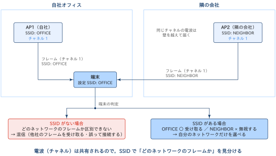
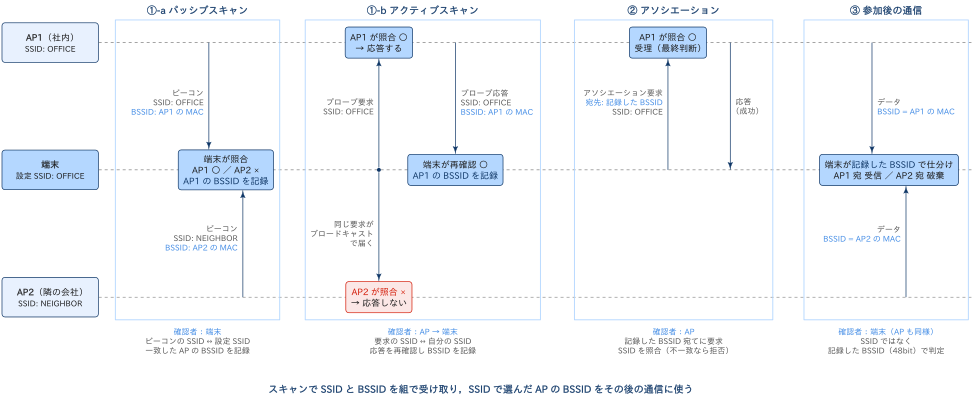
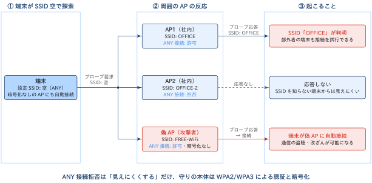
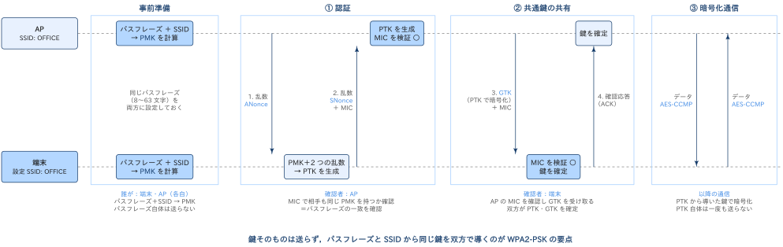
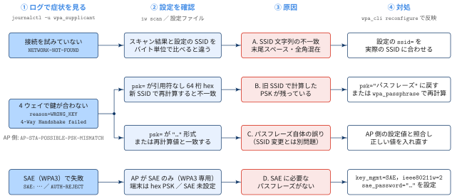
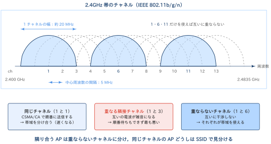

## SSIDとは

::: {#def- .custom_problem .blog-custom-border}
### SSID（Service Set Identifier

- SSID は，無線LANのネットワークを識別するための名前
- IEEE 802.11 で定義されており，最大32オクテットの任意の文字列を設定できる
- スマートフォンやPCのWi-Fi一覧に表示される「OFFICE」「FREE-WiFi」のような名前がSSIDにあたる

:::

[SSIDは混信を避けるための仕組み]{.mini-section}

オフィスビルや集合住宅では，自社のAPと隣の会社のAPが同じチャネルを使っていることも珍しくないです．
このとき端末が「どのフレームが自分の参加したいネットワークのものか」を区別できないと，
他のネットワークのフレームを受け取ったり，意図しないAPに接続したりする混信状態になります．

{width="90%" fig-align="center"}

SSIDは，この混信を論理的に避けるための仕組みです

- 端末は「接続したいSSID」をあらかじめ設定しておく
- APは自分が所属するネットワークのSSIDをフレームに載せて名乗る
- 両者のSSIDが一致した場合にだけ接続処理を進める

### SSIDの仕組み


::: {.callout-note}
### SSIDの照合

SSIDの照合は，接続までの流れの中で次の3段階で行われる．

1. **スキャン**：端末が周囲のAPを探し，SSIDとBSSIDの組を集める
   - パッシブスキャン：APが定期的に送る**ビーコン**を受信し，端末側でSSIDを照合する
   - アクティブスキャン：端末がSSIDを指定した**プローブ要求**をブロードキャストし，SSIDが一致したAPだけが**プローブ応答**を返す
2. **アソシエーション**：端末はスキャンで記録したBSSID宛てにアソシエーション要求を送り，AP側がSSIDを照合して参加を受理する
3. **参加後の通信**：以降のデータフレームはSSIDではなく，記録した**BSSID（APのMACアドレス，48bit）**で自分宛てかどうかを仕分ける


:::

{width="100%" fig-align="center"}

- SSIDは「どのネットワークに参加するか」を選ぶための名前
- 選んだ後の個々のフレームの宛先判定はBSSIDが担う．
- 複数のAPで同じSSIDを名乗れば（ESSとして構成すれば），端末はSSIDを変えずにAP間を移動（ローミング）可能

## ANYの設定

端末側のSSIDを **空欄** または **「ANY」** にすると，端末は特定のネットワークを指定せずに周囲のAPを探します．
このとき送られるプローブ要求は，SSIDの長さが0の**ワイルドカードSSID（ブロードキャストSSID）**になります．

AP側には，このワイルドカードSSIDのプローブ要求にどう応じるかを決める設定があります．

:::: {.no-border-top-table}

| AP側の設定 | 挙動 |
|---|---|
| ANY接続 許可 | SSIDが空のプローブ要求にも応答し，自分のSSIDを返す．SSIDを知らない端末からも見つけられる |
| ANY接続 拒否 | SSIDが空のプローブ要求を無視．SSIDを正しく指定した端末にだけ応答する |
: {tbl-colwidths="[20,80]"}
::::

似た設定に **SSIDステルス**（ビーコンにSSIDを載せない設定）があります．
ANY接続拒否とSSIDステルスを組み合わせると，SSIDを知らない端末のWi-Fi一覧にはネットワークが表示されなくなります．

### セキュリティリスク：ANYに関するリスクは，AP側と端末側の両方にある

{width="100%" fig-align="center"}

[AP側：ANY接続を許可している場合]{.mini-section}

- SSIDが分かれば，部外者の端末もそのネットワークへの接続を試行可能
- 暗号化を設定していない，あるいは推測しやすいパスフレーズを使っている場合は，そのまま不正利用へ

[端末側：SSIDをANYにしている場合]{.mini-section}

- SSIDを指定しない端末は，応答してきたAPに接続してしまう可能性があり
- 攻撃者が暗号化なし・ANY接続許可の**偽AP（Rogue AP / Evil Twin）**を設置すると，端末はそのAPに自動接続し，以降の通信は攻撃者を経由
  - これにより，通信の盗聴・改ざん（中間者攻撃）が可能になります．

[ANY接続拒否・SSIDステルスの限界]{.mini-section}

ANY接続拒否やSSIDステルスには，ネットワークを「見えにくくする」効果しかありません．

- 正規の端末が送るプローブ要求やアソシエーション要求にはSSIDが平文で載るため，パケットキャプチャすればSSIDは判明する
- SSIDステルスのネットワークに接続する端末は，SSIDを指定したプローブ要求を場所を問わず送り続けるため，社外でSSIDを漏らす原因にもなる

したがって，対策の本体は次のようになります．

- APでは **WPA2/WPA3** による認証と暗号化を必ず有効．組織ではIEEE 802.1X（WPA2/WPA3-Enterprise）を検討
- 端末では SSIDをANYにしない，暗号化なしのネットワークへの自動接続を無効にする，不要な保存済みネットワークを削除する，といった設定を実施
- 公衆無線LANを使う場合は，VPNやHTTPSで通信路を別途保護

## WPA2-PSK：パスフレーズとSSIDによる認証

ANY接続拒否やSSIDステルスに代わる「守りの本体」が，WPA2/WPA3 による認証と暗号化です．
ここでは個人宅や小規模オフィスで最もよく使われる **WPA2-PSK（WPA2 Pre-Shared Key）** の仕組みを整理します．

::: {#def- .custom_problem .blog-custom-border}
### WPA2（Wi-Fi Protected Access 2）

- WPA2 は，無線LANの認証と暗号化のためのセキュリティ規格
- Wi-Fi Alliance が IEEE 802.11i をもとに2004年に策定し，WEP・WPA（TKIP）の後継として AES ベースの暗号化方式 CCMP を必須とている

:::

[認証方式は2種類]{.mini-section}

- **パーソナルモード（WPA2-PSK）**：APと端末で事前に共有した8〜63文字のパスフレーズとSSIDで認証する（個人宅・小規模オフィス向け）
- **エンタープライズモード（WPA2-Enterprise）**：IEEE 802.1X に準拠した認証サーバ（RADIUS など）でユーザーごとに認証する（組織向け）

どちらのモードでも，認証後は4ウェイハンドシェイクで共通鍵を共有し，通信を暗号化

WPA2-PSK は WPA2 のうち小規模ネットワーク向けの **パーソナルモード** です．
APと端末の間で事前に **8〜63文字のパスフレーズ**（いわゆる認証に求められるパスワード）を共有しておき，そのパスフレーズとSSIDによって端末を認証します．

{width="100%" fig-align="center"}

| 段階 | 何が起きるか |
|---|---|
| 事前準備 | 端末とAPに同じパスフレーズを設定．双方がパスフレーズとSSIDから **PMK（Pairwise Master Key，256bit）** を計算 |
| ① 認証 | 4ウェイハンドシェイクの1・2番目のメッセージで乱数（ANonce / SNonce）を交換．双方が PMK と2つの乱数から共通鍵 **PTK** を生成し，メッセージに付けた **MIC** を検証して「相手も同じパスフレーズを知っている」ことを確かめる |
| ② 共通鍵の共有 | 3・4番目のメッセージで，APがブロードキャスト用の鍵 GTK を暗号化して渡し，端末が確認応答を返す．双方が鍵を確定する |
| ③ 暗号化通信 | 以降のデータは PTK から導いた鍵で AES（CCMP）により暗号化 |

: {tbl-colwidths="[20,80]"}

[WPA2-PSK の弱点とエンタープライズモード]{.mini-section}

- 4ウェイハンドシェイクを傍受されると，攻撃者はパスフレーズの候補を手元で試す総当たり（オフライン辞書攻撃）ができる
  - 短い・推測しやすいパスフレーズは避けること
- 全員が同じパスフレーズを使うため，退職者などが知っている場合はパスフレーズごと変更する必要がある

パスフレーズの代わりに **IEEE 802.1X** に準拠した認証サーバ（RADIUS など）でユーザーごとに認証する方式は **WPA2 エンタープライズモード（WPA2-Enterprise）** と呼ばれます．

### WPA-PSK・WPA2-PSK・WPA3-SAE の違い

パーソナルモード（パスフレーズを共有する方式）には，世代ごとに次の3つがあります．
どれも「事前に共有したパスフレーズで認証し，共通鍵を作って暗号化する」という目的は同じですが，
**暗号化方式** と **パスフレーズから鍵を作る方法** が異なります．

| 項目 | WPA-PSK | WPA2-PSK | WPA3-SAE（WPA3-Personal） |
|---|---|---|---|
| 登場 | 2003年（WEPの暫定的な後継） | 2004年（IEEE 802.11i 準拠） | 2018年 |
| 暗号化方式 | TKIP（RC4ベース） | CCMP（AES） | CCMP（AES） |
| PMK の作り方 | パスフレーズ＋SSIDから計算（固定） | パスフレーズ＋SSIDから計算（固定） | SAE の鍵交換で接続ごとに生成 |
| 認証の流れ | 4ウェイハンドシェイク | 4ウェイハンドシェイク | SAE → 4ウェイハンドシェイク |
| オフライン辞書攻撃 | 可能 | 可能 | 困難（1回の推測ごとにAPとのやり取りが必要） |
| 前方秘匿性 | なし | なし | あり |
| 現在の扱い | 使わない（TKIPは非推奨） | 最低限の選択肢 | 推奨 |

: {tbl-colwidths="[22,22,24,32]"}

## トラブルシューティング: SSIDを変えたら，パスワードは同じなのに一部の端末だけ繋がらない


::: {.callout-note}
### TL:DRs

- WPA2-PSK の PMK は **パスフレーズとSSIDの両方** から計算される．
- そのため SSID を変えると，パスフレーズが同じでも PMK は別の値になる
- 古い SSID で計算したPSKを用いて接続しようと試みる端末は， APへの接続に失敗する

:::


{width="100%" fig-align="center"}

| 原因 | ログの症状 | 確認すること | 対処 |
|---|---|---|---|
| A. SSID 文字列の不一致 | `NETWORK-NOT-FOUND`（接続を試みていない） | 末尾スペース・全角混在など，バイト単位で SSID が違う | 設定の `ssid=` を実際の SSID に合わせる |
| B. 旧 SSID で計算した PSK が残っている | `WRONG_KEY` / `4-Way Handshake failed` | `psk=` が引用符なしの64桁 hex で，新 SSID で再計算した値と一致しない | `psk="パスフレーズ"` に戻すか，`wpa_passphrase` で再計算 |
| C. パスフレーズ自体の誤り | 同上（AP側は `AP-STA-POSSIBLE-PSK-MISMATCH`） | `psk=` が `"…"` 形式，または再計算値と一致する | AP 側の設定値と照合して入れ直す |
| D. SAE に必要なパスフレーズがない | `SAE: …` / `AUTH-REJECT` | AP が WPA3 専用で，端末は hex PSK のみ・SAE 未設定 | `key_mgmt=SAE`，`ieee80211w=2`，`sae_password="…"` を設定 |

: {tbl-colwidths="[22,22,30,26]"}

[B が起きる理由]{.mini-section}

`wpa_passphrase` が出力する64桁 hex の `psk=` は，パスフレーズではなく **計算済みの PMK** です．
SSID を含めて計算した値なので，SSID を変えると古いまま使えなくなります．

```bash
# 新しい SSID で PMK を計算し直す
wpa_passphrase "NEW-SSID" "passphrase"

# 設定を反映する
wpa_cli reconfigure
```

WPA3-SAE は PMK を接続ごとの鍵交換で作るため，計算済みの PMK を設定する方法自体が使えません（原因 D）．


## Appendix: 無線LAN（IEEE 802.11）のチャネル

無線LANは，決められた周波数帯（2.4GHz 帯・5GHz 帯・6GHz 帯）の電波を使って通信します．
**チャネル** とは，この周波数帯を一定の幅ごとに区切って番号を付けたものです．
APは1つのチャネルを選んで，その周波数の範囲だけを使って電波を送受信します．

{width="100%" fig-align="center"}

[2.4GHz 帯：チャネルどうしが重なる]{.mini-section}

2.4GHz 帯（IEEE 802.11b/g/n/ax）には，日本では 1〜13 チャネルがあります（802.11b のみ 14 チャネルも使えます）．

- 各チャネルの中心周波数は **5 MHz 間隔**（1チャネル = 2.412 GHz，2チャネル = 2.417 GHz，…）で並びます
- 一方で，1つのチャネルが実際に使う幅は **約 20 MHz**（802.11b は 22 MHz）あります
- そのため，番号が近いチャネルどうしは周波数の範囲が重なります

互いに重ならないように選べるのは 1・6・11 の3つ（20 MHz 幅の OFDM なら日本では 1・5・9・13 の4つ）だけです．
2.4GHz 帯で複数のAPを近くに置くときは，これらの組み合わせからチャネルを割り当てるのが基本になります．

[5GHz 帯：チャネルが重ならない]{.mini-section}

5GHz 帯（IEEE 802.11a/n/ac/ax）では，各チャネルが 20 MHz 幅で重ならないように並んでいます（36, 40, 44, 48, … と4つおきの番号になります）．
日本では次の3つのグループに分かれます．

| グループ | チャネル | 特徴 |
|---|---|---|
| W52 | 36〜48 | 屋内専用．DFS（レーダー検知）は不要 |
| W53 | 52〜64 | 屋内専用．気象レーダー等を検知するとチャネルを変える（DFS） |
| W56 | 100〜144 | 屋外でも使える．DFS が必要 |

: {tbl-colwidths="[15,20,65]"}

802.11n 以降では，隣り合う 20 MHz のチャネルを束ねて 40 / 80 / 160 MHz 幅として使う **チャネルボンディング** により通信速度を上げられます．
ただし，束ねるほど使えるチャネルの数は減り，他のAPと重なりやすくなります．

[チャネルと SSID の役割分担]{.mini-section}

2台のAPのチャネルの関係は，上の図の下段の3通りに分かれます．

| チャネルの関係 | 何が起きるか |
|---|---|
| 同じチャネル | 互いの電波を正しく受信できるため，**CSMA/CA** で「空いているときに順番に送る」ことで共存します．帯域を分け合うので遅くはなりますが通信は成り立ちます．どちらのネットワークのフレームかは **SSID / BSSID** で見分けます |
| 重なる隣接チャネル | 互いの電波を復号できず，単なる雑音として受け取ります．順番待ちもできないため，衝突や再送が増えて最も性能が落ちます |
| 重ならないチャネル | 周波数が分かれているため干渉しません．それぞれが帯域を使い切れます |

: {tbl-colwidths="[22,78]"}

つまり，**電波の干渉を避けるのはチャネル設計の役割**であり，**同じチャネルを共有するネットワークを見分けるのが SSID の役割** です．
本文で扱った「自社のAPと隣の会社のAPが同じチャネルを使っている」状況は，1つ目の「同じチャネル」にあたります．

## Appendix: 用語集

:::{.glossary-container}

```yaml
glossary:
  - def: AP (Access Point)
    description: |
      無線LANの端末を有線ネットワークへ中継する機器．
      自分が所属するネットワークのSSIDをビーコンやプローブ応答で名乗り，端末の接続（アソシエーション）を受け付ける．

  - def: BSSID (Basic Service Set Identifier)
    description: |
      1台のAPが形成するネットワーク（BSS）を識別する48bitの識別子．通常はAPの無線インターフェースのMACアドレスが使われる．
      同じSSIDを名乗るAPが複数あっても，BSSIDはAPごとに異なるため，参加後のフレームの宛先判定に使われる．

  - def: IEEE 802.11
    description: |
      IEEEが策定した無線LANの標準規格群．物理層とMAC層の仕様を定め，SSID・BSSID・ビーコン・プローブ・アソシエーションなどの仕組みもここで定義される．
      802.11a/b/g/n/ac/ax（Wi-Fi 6）などの拡張規格がある．

  - def: チャネル (Channel)
    description: |
      無線LANの周波数帯を一定の幅ごとに区切って番号を付けたもの．APは1つのチャネルを選んで通信する．
      2.4GHz 帯では中心周波数が 5 MHz 間隔なのに対して幅が約 20 MHz あるため隣接チャネルが重なり，互いに重ならないのは 1・6・11 などの組み合わせに限られる．

  - def: CSMA/CA (Carrier Sense Multiple Access with Collision Avoidance)
    description: |
      無線LANのアクセス制御方式．送信前に電波が使われていないかを確認し（キャリアセンス），空いていればランダムな待ち時間の後に送信することで衝突を避ける．
      同じチャネルを使う複数の端末・APは，この仕組みで送信の順番を譲り合う．

  - def: WEP (Wired Equivalent Privacy)
    description: |
      IEEE 802.11 の初期（1997年）に定められた無線LANの暗号化方式．RC4 を使い，共有した固定の鍵で通信を暗号化する．
      初期化ベクトル（IV）が短いなどの設計上の欠陥があり，傍受した通信から短時間で鍵を解読できるため，現在は使ってはならない．

  - def: WPA (Wi-Fi Protected Access)
    description: |
      WEP の脆弱性を受けて Wi-Fi Alliance が 2003年に策定したセキュリティ規格．既存機器のファームウェア更新で導入できるよう，暗号化方式に RC4 ベースの TKIP を採用した暫定規格である．
      後継として WPA2（2004年）・WPA3（2018年）がある．パスフレーズを共有するパーソナルモード（PSK / SAE）と，IEEE 802.1X で認証するエンタープライズモードがある．

  - def: WPA2-PSK (WPA2 Pre-Shared Key)
    description: |
      WPA2 のパーソナルモード．APと端末で事前に共有した8〜63文字のパスフレーズとSSIDから PMK を計算し，4ウェイハンドシェイクで認証と鍵共有を行う．

  - def: 4ウェイハンドシェイク (4-way handshake)
    description: |
      WPA2 で端末とAPが交わす4つのメッセージ．乱数を交換して共通鍵 PTK を各自で生成し，MIC により同じ PMK を持つことを確認したうえで，GTK を配布して鍵を確定する．

  - def: SAE (Simultaneous Authentication of Equals)
    description: |
      WPA3-Personal で使われる鍵交換方式．パスフレーズを直接使わずに端末とAPが対等な立場で鍵交換を行い，接続ごとに異なる PMK を生成する．
      オフライン辞書攻撃への耐性と前方秘匿性を持つ．

  - def: 前方秘匿性 (Forward Secrecy)
    description: |
      長期的に使う秘密（パスフレーズなど）が将来漏れても，過去のセッションの通信内容は復号できないという性質．
```

:::
