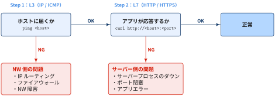
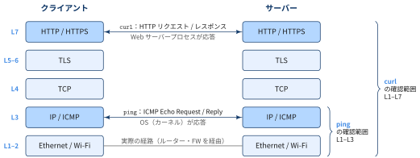
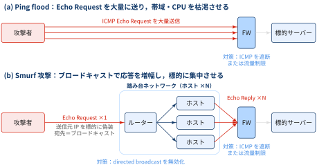

## ネットワークの基礎: 通信はレイヤーで分かれている

ネットワーク通信は **OSI 参照モデル** という 7 階層のモデルで整理され，各レイヤーが独立した役割を担っています．下位レイヤーが動いていないと上位レイヤーは成立しません．

:::: {.no-border-top-table}

| OSI層 | 名称 | 役割 | 代表的なプロトコル |
| --- | --- | --- | --- |
| L7 | アプリケーション層 | アプリ間のやり取り | HTTP / HTTPS / DNS / SSH |
| L6 | プレゼンテーション層 | データ表現の変換（文字コード・圧縮・暗号化） | TLS / JPEG / UTF-8 |
| L5 | セッション層 | 通信の開始・維持・終了の管理 | TLS セッション / RPC |
| L4 | トランスポート層 | ポート単位の通信・到達保証 | TCP / UDP |
| L3 | ネットワーク層 | ホスト間のルーティング | IP / ICMP |
| L2 | データリンク層 | 同一ネットワーク内の転送 | Ethernet / ARP |
| L1 | 物理層 | 電気信号・光・電波 | ケーブル / Wi-Fi |
: {tbl-colwidths="[16,28,28,28]"}
::::

::: {.callout-note}
## L5・L6 はなぜ影が薄いのか

実際のインターネットで使われている **TCP/IP モデル** は 4 階層で，OSI の L5〜L7 をまとめて「アプリケーション層」として扱います．
そのため L5・L6 の機能は独立したプロトコルとして現れることが少なく，HTTP や SSH などのアプリケーションプロトコルや TLS の中に吸収されています．

- **L6（プレゼンテーション層）**: 文字コード（UTF-8）や画像形式（JPEG），暗号化といった「データをどう表現するか」を扱う層です．HTTPS の暗号化を担う TLS はここに分類されることが多いです．
- **L5（セッション層）**: 通信の「開始・維持・終了」を管理する層です．TLS のハンドシェイクやセッション再開，RPC の呼び出し管理などが該当します．

疎通確認の文脈では，「L4（TCP）は繋がるが TLS ハンドシェイクで失敗する」= 証明書や暗号スイートの問題，と切り分けられる点が実用上のポイントです．
:::

疎通確認のコマンドは「どのレイヤーまで到達できているか」を切り分けるための道具です．たとえば次のように，レイヤーごとに「届いているか」を確認していくと原因の位置が特定できます．

- L3 でホストに届かない → IP ルーティング / ファイアウォール / NW 障害
- L3 は届くが L7 が応答しない → サーバープロセスのダウン / ポート閉塞 / アプリエラー

{width="100%" fig-align="center"}

## ping と curl は確認するレイヤーが違う

`ping` と `curl` はどちらも「疎通確認」に使われますが，確認しているレイヤーが異なります．

| コマンド | 確認対象 | OSI層 | 例 |
| --- | --- | --- | --- |
| `ping` | ホスト到達性 | L3 (IP) | サーバーに届くか |
| `curl` | アプリケーション応答 | L7 (HTTP/HTTPS) | Webサービスが動いているか |
: {tbl-colwidths="[16,28,28,28]"}

{width="100%" fig-align="center"}

[`ping`: L3 (IP) の到達性を確認する]{.mini-section}

`ping` は **ICMP** という L3 のプロトコルを使い，相手ホストに「Echo Request」を送って「Echo Reply」が返ってくるかを確認します．HTTP サーバーが動いているかどうかは一切関係なく，**IP レベルでパケットが往復できるか**だけを見ます．

```bash
# ホストに IP レベルで届くか（4回だけ送信）
ping -c 4 example.com
```

```
PING example.com (93.184.216.34): 56 data bytes
64 bytes from 93.184.216.34: icmp_seq=0 ttl=56 time=11.5 ms
64 bytes from 93.184.216.34: icmp_seq=1 ttl=56 time=11.2 ms
...
4 packets transmitted, 4 packets received, 0.0% packet loss
round-trip min/avg/max = 11.2/11.4/11.5 ms
```

`time` は往復にかかった時間 (RTT)，`packet loss` はパケットの欠落率です．

[`curl`: L7 (HTTP/HTTPS) の応答を確認する]{.mini-section}

`curl` は実際に **HTTP/HTTPS リクエスト**を送り，Web サービスがアプリケーションとして
応答するかを確認します．TCP 接続 (L4)，TLS ハンドシェイク (HTTPS の場合)，
HTTP レスポンスまでの一連の流れが成立して初めて成功します．

```bash
# HTTP ステータスコードだけを確認する
curl -o /dev/null -s -w '%{http_code}\n' https://example.com

# レスポンスヘッダを確認する（-I は HEAD リクエスト）
curl -I https://example.com
```

```
HTTP/2 200
content-type: text/html; charset=UTF-8
...
```

ステータスコード `200` が返れば L7 まで疎通しています．`000` の場合は接続そのものが
確立できていない (TCP / TLS / DNS のいずれかで失敗) ことを示します（see [Appendix: 主な HTTP ステータスコード](#sec-http-status)）．

[1 つの `curl` は複数レイヤーを通過している]{.mini-section}

`curl` は「L7 の確認」と書きましたが，実際には下位レイヤーを順番に積み上げてから
HTTP 応答に到達します．`-w` でフェーズ別の所要時間を出力すると，どのレイヤーまで
進んだか・どこで時間がかかっているかが分かります．

```bash
curl -o /dev/null -s -w "
  dns:        %{time_namelookup}s
  tcp:        %{time_connect}s
  tls:        %{time_appconnect}s
  ttfb:       %{time_starttransfer}s
  total:      %{time_total}s
  http_code:  %{http_code}
" https://example.com
```

各フェーズと OSI 層の対応は次の通りです．

:::: {.no-border-top-table}

| `curl` 変数 | フェーズ | 何が起きているか |
| --- | --- | --- | --- |
| `time_namelookup` | DNS 解決 | ドメイン名 → IP アドレス | - |
| `time_connect` | TCP 接続 | 3-way handshake の完了 | L4 (TCP) |
| `time_appconnect` | TLS ハンドシェイク | 暗号化セッションの確立 (HTTPS のみ) | L5–L6 (セッション/プレゼンテーション) |
| `time_starttransfer` | TTFB | リクエスト送信〜最初の応答バイト受信 | L7 (HTTP) |
| `time_total` | 全体 | 全フェーズの合計 | — |
: {tbl-colwidths="[24,16,36,24]"}
::::

::: {.callout-important}
### 各 `time_*` はフェーズの長さではなく「開始からの累積時間」

これらの値はリクエスト開始時点を 0 とした**累積値**です
(`time_namelookup` ≤ `time_connect` ≤ `time_appconnect` ≤ `time_starttransfer` ≤ `time_total`)．
個々のフェーズの所要時間が欲しいときは差分を取ります．

- TCP 接続だけの時間 = `time_connect` − `time_namelookup`
- TLS だけの時間 = `time_appconnect` − `time_connect`
- サーバー処理時間 = `time_starttransfer` − `time_appconnect`
:::

この内訳を見ると，`ping` (L3) では見えない上位レイヤーのどこで詰まっているかを
切り分けられます．たとえば `dns` だけ極端に遅ければ DNS の問題，`tls` で止まれば
証明書 / TLS ネゴシエーションの問題，`ttfb` が長ければサーバー側の処理が遅い，
と判断できます．

{width="100%" fig-align="center"}

## 切り分けの考え方

::: {.callout-note}
### RULE: 下位レイヤーから順に確認する

- 「つながらない」ときは **L3 → L4 → L7** の順で確認して，原因が絞り込む

:::

| 症状 | 推定される原因 | 確認コマンド |
| --- | --- | --- |
| ping は通るが curl が `000` | サーバープロセス停止 / ポート閉塞 / TLS 失敗 | `curl -v`, `nc -vz host port` |
| ping も curl も通らない | NW 障害 / ファイアウォール / DNS 解決失敗 | `ping`, `dig`, `traceroute` |
| ping は通らないが curl は通る | ICMP がブロックされているだけ（正常なことも多い） | `curl -I` で実応答を確認 |

[`ping` が通らない＝障害，とは限らない]{.mini-section}

セキュリティ上の理由で ICMP (ping) をブロックしているサーバーは珍しくありません．
その場合 ping は失敗しますが，HTTP は正常に応答します．**「ping が通らない」だけで
サービス停止と判断しない**ようにしましょう．L7 の確認には curl を使います．

::: {#exm-icmp-dos .custom_problem }
### ICMP を悪用した DoS 攻撃への対策

ICMP をブロックする理由の一つが DoS 攻撃への対策です．ICMP は「届いたら応答を返す」という性質を持つため，攻撃に悪用されやすいプロトコルです．

- **Ping flood**: 攻撃者が ICMP Echo Request を大量に送りつけます．標的は1件ずつ Echo Reply を返そうとするため，回線帯域や CPU が使い果たされ，正規の通信を処理できなくなります．
- **Smurf 攻撃**: 攻撃者は **送信元 IP を標的のアドレスに偽装** した Echo Request を，踏み台ネットワークの **ブロードキャストアドレス** 宛てに送ります．ネットワーク内の N 台のホストが一斉に Echo Reply を返すため，攻撃者の1パケットが N 倍に **増幅** され，返信がすべて標的に集中します．

{width="100%" fig-align="center"}

対策は，標的側の FW で **ICMP Echo を遮断する，または流量を制限する** ことです．Smurf 攻撃に対しては，踏み台側のルーターで **directed broadcast（外部からのブロードキャスト宛てパケットの転送）を無効化** するのも有効です．現在のルーターでは既定で無効になっています．

こうした理由から，外部公開サーバーやクラウドでは ICMP Echo を受け付けない設定が一般的です．その結果，サービスは正常に動いているのに `ping` だけが失敗する，という状況が生まれます．
:::
***

## Appendix: 主な HTTP ステータスコード {#sec-http-status}

`curl -w '%{http_code}'` で返ってくる 3 桁の番号は，先頭の数字でおおまかな意味が決まります．
**`000` 以外の何かが返ってきた時点で，L7 までは疎通している**（サーバーが HTTP で応答している）点に注意してください．

| 分類 | 意味 | 切り分けの目安 |
| --- | --- | --- |
| `000` | HTTP 応答なし（curl 独自の値） | DNS / TCP / TLS の段階で失敗．L7 に届いていない |
| `1xx` | 情報 | 処理の継続中．疎通確認で見ることはほぼない |
| `2xx` | 成功 | 正常 |
| `3xx` | リダイレクト | 正常．`curl -L` で転送先までたどる |
| `4xx` | クライアント側エラー | リクエスト（URL・認証・権限）を見直す |
| `5xx` | サーバー側エラー | アプリ・バックエンド・プロキシを調べる |
: {tbl-colwidths="[12,30,58]"}

:::: {.no-border-top-table}

| コード | 名前 | よくある原因・意味 |
| --- | --- | --- |
| `200` | OK | 正常に応答 |
| `201` | Created | POST などでリソースが作成された |
| `204` | No Content | 成功したが本文なし（ヘルスチェックや DELETE で使われる） |
| `301` | Moved Permanently | 恒久的な移転．http → https への転送でよく見る |
| `302` | Found | 一時的な転送．ログイン画面へのリダイレクトなど |
| `304` | Not Modified | キャッシュが有効なので本文を返さない |
| `400` | Bad Request | リクエストの書式が不正（パラメータ・JSON の誤り） |
| `401` | Unauthorized | 認証が必要，または認証情報が誤っている |
| `403` | Forbidden | 認証はできたが権限がない．IP 制限・WAF によるブロックもここ |
| `404` | Not Found | パスが存在しない．URL の誤りやルーティング設定の漏れ |
| `405` | Method Not Allowed | そのパスで使えない HTTP メソッド（GET / POST の取り違え） |
| `408` | Request Timeout | クライアントからの送信が遅く，サーバーが待ちきれなかった |
| `429` | Too Many Requests | レート制限に達した．時間を置いて再試行する |
| `500` | Internal Server Error | アプリ内部の例外．アプリのログを確認する |
| `502` | Bad Gateway | プロキシ・LB の先のアプリが不正な応答を返した，または落ちている |
| `503` | Service Unavailable | 過負荷・メンテナンス中．LB 配下に正常なサーバーがない場合も |
| `504` | Gateway Timeout | プロキシ・LB の先のアプリが時間内に応答しなかった |
: {tbl-colwidths="[12,26,62]"}

::::

::: {.callout-tip}
## 502 / 503 / 504 は「手前までは届いている」

`502` / `503` / `504` を返しているのは，多くの場合アプリ本体ではなく **手前のリバースプロキシやロードバランサー**（nginx・ALB など）です．
つまり「プロキシまでは L7 で疎通しているが，その先のアプリとの間で問題が起きている」と切り分けられます．
:::


## 📘 用語集

:::{.glossary-container}

```yaml
glossary:
  - def: OSI参照モデル
    description: |
      ネットワーク通信の機能を 7 つの階層に分けて整理したモデル．下位層 (物理・データリンク・ネットワーク) から上位層(トランスポート・セッション・プレゼンテーション・アプリケーション)まであり，各層が独立した役割を持つ．

  - def: ICMP (Internet Control Message Protocol)
    description: |
      IP (L3) で動作する制御・エラー通知用のプロトコル．`ping` は ICMP のEcho Request / Echo Reply を使ってホストの到達性を確認する．

  - def: ping
    description: |
      ICMP を使ってホストに到達できるか (L3) を確認するコマンド．往復時間 (RTT) やパケットロス率を測定できる．HTTP サーバーの稼働とは無関係．

  - def: curl
    description: |
      HTTP/HTTPS をはじめとする各種プロトコルでリクエストを送る CLI ツール．Web サービスがアプリケーションレベル (L7) で応答するかを確認できる．

  - def: RTT (Round-Trip Time)
    description: |
      パケットが送信先まで往復するのにかかる時間．`ping` の `time` 値として表示される．

  - def: DNS解決 (Name Resolution)
    description: |
      ドメイン名 (例 `example.com`) を IP アドレスに変換する処理．curl の`time_namelookup` で計測でき，ここが遅い・失敗する場合は DNS 側の問題．

  - def: TLSハンドシェイク
    description: |
      HTTPS 通信の冒頭で暗号化セッションを確立する手順 (証明書検証・鍵交換)．curl では `time_appconnect` として計測される．OSI 上はセッション/プレゼンテーション層(L5–L6) 相当．

  - def: TTFB (Time To First Byte)
    description: |
      リクエスト送信から最初の応答バイトを受信するまでの時間．curl の`time_starttransfer` に対応し，サーバー側の処理時間 (L7) の目安になる．

  - def: TCP / UDP
    description: |
      トランスポート層 (L4) のプロトコル．TCP は到達保証・順序保証つきの接続型，UDP は保証のない非接続型．HTTP は TCP の上で動く．

  - def: HTTPステータスコード
    description: |
      HTTP レスポンスの結果を表す 3 桁の番号．`200` は成功，`4xx` はクライアント側エラー，`5xx` はサーバー側エラー．curl の `000` は HTTP 応答に到達する前に接続が失敗したことを示す．
```

:::
