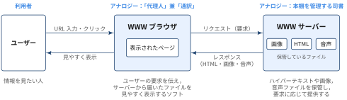
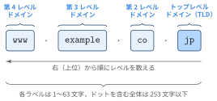
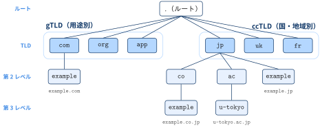
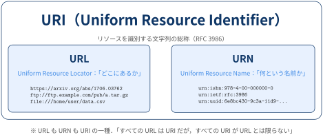

::: {.callout-note}
## TL;DRs

- URI（Uniform Resource Identifier）は，リソースを識別する文字列の総称
- URL（Uniform Resource Locator）は URI の一種で，リソースがどこにあり，どうやって取りに行くかを表す
- URN（Uniform Resource Name）も URI の一種で，リソースの場所に関係なく変わらない名前を表す
- すべての URL は URI ですが，すべての URI が URL とは限らない
:::


## URLとは

::: {#def- .custom_problem .blog-custom-border}
[Uniform Resource Locator]{.def-title}

- インターネット上のリソース（Webページ，画像，ファイル，APIなど）の場所を一意に指定するための文字列
- 「どの通信方式で（スキーム）」「どのサーバーへ（ドメイン）」「どの場所にあるか（パス）」を表現する住所のような役割を持つ


```ini
https://www.example.com:443/docs/tutorial/index.html?lang=ja#section1
```

:::: {.no-border-top-table}

| 要素                           | サンプル              | 説明                                 |
| ---------------------------- | ----------------- | ---------------------------------- |
| スキーム (Scheme)                | `https`           | 通信プロトコル．`http`，`https`，`ftp` など．   |
| ホスト名 / ドメイン名 (Host / Domain) | `www.example.com` | 接続先サーバーの名前．DNSによってIPアドレスへ変換される．    |
| ポート番号 (Port)                 | `443`             | サーバー上のサービス識別番号．省略時はスキームのデフォルト値を利用． |
| パス (Path)                    | `/docs/tutorial/` | サーバー内のディレクトリやリソースの場所．              |
| ファイル名 (File Name)            | `index.html`      | 取得したい具体的なファイル．                     |
| クエリ文字列 (Query String)        | `?lang=ja`        | サーバーへ渡す追加パラメータ．                    |
| フラグメント (Fragment)            | `#section1`       | ページ内の特定位置を指定．ブラウザ側で解釈される．          |

::::


:::

[URLの分解図]{.mini-section}

```
https://www.example.com:443/docs/tutorial/index.html?lang=ja#section1
│     │               │   │              │          │       │
│     │               │   │              │          │       └─ フラグメント
│     │               │   │              │          └──────── クエリ文字列
│     │               │   │              └────────────────── ファイル名
│     │               │   └───────────────────────────────── ポート番号
│     │               └───────────────────────────────────── ドメイン名
│     └───────────────────────────────────────────────────── "://"
└─────────────────────────────────────────────────────────── スキーム
```

:::: {.no-border-top-table}

| URL要素  | 住所で例えると           |
| ------ | ----------------- |
| スキーム   | 配送方法（宅配便・郵便など）    |
| ドメイン   | 建物・会社名            |
| ポート    | 部署番号・受付窓口         |
| パス     | フロアや部屋への道順        |
| ファイル名  | 受取人               |
| クエリ    | 配送メモ              |
| フラグメント | 「資料の3ページ目を見てください」 |

::::

::: {.callout-note}
### WWWサービスとは？

Webページは，ページの一部に別ページの位置情報を埋め込んで両者を結びつけることのできるハイパーテキストという文章で作られています．
このハイパーテキストを使って世界中のネットワークで情報を公開・共有するサービスをWWWサービスと呼びます．

WWW は World Wide Web の略で，ふだんは単に「Web」と呼ばれます．そのため WWWサービスは**Webサービス**とも呼ばれ，WWWサーバー・WWWブラウザも，それぞれ Webサーバー・Webブラウザと呼ぶのが一般的です．

WWWサービスは，WWWサーバーとWWWブラウザのやり取りで成り立ちます．

:::: {.no-border-top-table}

| 項目| WWWサーバー| WWWブラウザ |
| ------- | ---------------- | ---------------- |
| 機能 | ハイパーテキストや画像，音声ファイルを保管し，要求に応じて提供する | ユーザーの要求を伝え，サーバーから届いたファイルを見やすく表示するソフト |
| アナロジー | 本棚を管理する司書のような存在 | ユーザーの代わりに情報を取ってくる「代理人」兼「通訳」 |

::::

{width="100%" fig-align="center"}

:::

[スキームの種類]{.mini-section}

| スキーム | 用途 | 例 |
|-----|------|------|
| `https` | 暗号化されたWeb通信（現在の標準） | `https://www.example.com` |
| `http` | 暗号化されていないWeb通信 | `http://www.example.com` |
| `ftp` | ファイル転送 | `ftp://ftp.example.com/data.csv` |
| `sftp` | SSHを利用した安全なファイル転送 | `sftp://server.example.com/report.pdf` |
| `ssh` | リモートサーバーへの接続 | `ssh://user@example.com` |
| `file` | ローカルファイルの参照 | `file:///home/user/report.pdf` |
| `mailto` | メール作成 | `mailto:user@example.com` |
| `tel` | 電話発信 | `tel:+81-90-1234-5678` |
| `ws` | WebSocket通信 | `ws://example.com/socket` |
| `wss` | 暗号化されたWebSocket通信 | `wss://example.com/socket` |

### ドメイン名 (Domain Name)

- ドメイン名は，インターネット上のサーバーを識別するための人間向けの名前
- 本来コンピュータ同士は IPアドレス（例: `142.250.196.78`）で通信

```text
www.yahoo.co.jp
│   │      │  │
│   │      │  └─ 国コード (ccTLD)
│   │      └──── 組織の属性
│   └────────── 組織名
└────────────── ホスト名
```

:::: {.no-border-top-table}

| 要素    | 例        | 説明                                       |
| ----- | -------- | ---------------------------------------- |
| ホスト名  | `www`    | Webサーバーやサービスを表す名前                        |
| 組織名   | `yahoo` | 企業・組織・サービスの名前                            |
| 組織の属性 | `co`     | 組織種別（Company, Organization, Academic など） |
| 国コード  | `jp`     | 国や地域を表すコード                               |

::::

::: {#exm- .custom_problem }
[u-tokyo.ac.jp]{.def-title}

```
www.u-tokyo.ac.jp
│   │       │  │
│   │       │  └─ 日本
│   │       └──── 教育機関
│   └────────── 東京大学
└────────────── Webサーバー
```

:::
***


::: {.callout-note}
### `co.jp` は参照先サーバーが日本国内にあることを示しているわけではない

- `co.jp` が示すのは**ドメインを登録した組織の属性**（日本国内で登記された営利法人）であり，サーバーの物理的な所在地ではない
    - 日本で登記していれば外国企業も登録できるので，`co.jp` だから日本企業とも限らない
- ドメイン名は任意のサーバーに対応付けられる．サーバーの所在地は，DNS がドメイン名を解決した先の IPアドレス（＝どこでホスティングしているか）で決まる
    - 海外リージョンのクラウドや CDN を使っていれば，`co.jp` でも海外のサーバーに接続される
    - 逆に `.com` のサイトが日本国内のサーバーで運用されていることもある
- 個人データを扱う外部サービスについて「国内で保存されているか」を確認したいときは，ドメイン名から推測せず，契約書や利用規約に書かれたデータ保管場所（リージョン）を確認する

```bash
# ドメイン名 → IPアドレスを確認
dig +short www.example.co.jp

# IPアドレスの割り当て先（組織・国）を確認
whois <IPアドレス>
```


:::


### URLを読むときに勘違いしやすいポイント

[スキームはアクセスに使うプロトコルを表す]{.mini-section}

- `http://host.example.co.jp/...` の `http:` は，HTTP を使って目的のデータにアクセスすることを示す
- スキームを見れば通信方式は分かるが，ドメイン名やポート番号からサーバーの役割や所在地までは分からない

[ポート番号 `:8080` はプロキシ経由の接続を意味しない]{.mini-section}

- HTTP は通常ポート80番，HTTPS は443番を使う．これらは既定値なので，普段のURLでは省略される
- 8080番は「代替HTTPポート」と呼ばれ，80番の代わりに使われることがある
    - プロキシサーバーや開発用のWebサーバーでよく使われるが，8080番＝プロキシという決まりはない
- プロキシを経由するかどうかはブラウザやOSのプロキシ設定で決まり，URLには現れない

```ini
http://host.example.co.jp/file          # ポート省略 → 80番に接続
http://host.example.co.jp:8080/file     # 8080番で待ち受けているWebサーバーに接続
```

[ファイル名の部分はHTMLファイルに限らない]{.mini-section}

- ファイル名の部分には，HTML だけでなく画像，PDF，CSV など任意の形式のファイルを指定できる
- 拡張子は目安にすぎない．ブラウザはサーバーが返す `Content-Type` ヘッダを見て，ファイルの形式を判断する
- `/docs/` のようにファイル名を省略すると，サーバーが既定のファイル（`index.html` など）を返す


### gTLD vs ccTLD

::: {#def- .custom_problem .blog-custom-border}
[トップレベルドメイン (Top-Level Domain, TLD)]{.def-title}

- ドメイン名をドット `.` で区切った1つ1つの部分をラベルと呼ぶ
- ラベルのうち最も右側にあるものをトップレベルドメイン（TLD）という
- TLDから左へ順に，第2レベルドメイン，第3レベルドメイン，…と呼ぶ
- 各ラベルは1〜63文字，ドットを含むドメイン名全体は253文字以下とする
- TLDは，用途別に設けられた gTLD（generic TLD）と，国・地域ごとに割り当てられた ccTLD（country code TLD）に大別する

{width="80%" fig-align="center"}

:::

ドメイン名は**右へ行くほど上位の階層**を表します．住所を「番地，町，市，国」の順に並べると右端が最も大きな単位になるのと同じで，`www.example.co.jp` は「日本（`jp`）の企業（`co`）である example 社の `www` というサーバー」と読めます．

レベルは右から数えるので，同じ `www` でもドメイン名によって何番目のレベルになるかが変わります．

:::: {.no-border-top-table}

| ドメイン名 | 第4レベル | 第3レベル | 第2レベル | TLD |
| ---- | ---- | ---- | ---- | ---- |
| `www.example.co.jp` | `www` | `example` | `co` | `jp` |
| `www.example.com` | | `www` | `example` | `com` |

::::

::: {#exm- .custom_problem }
[URLからTLDを読み取る]{.def-title}

URLからTLDを読み取るときは，まずスキーム（`http://`）とパス（`/index.html` 以降）を取り除いてドメイン名だけを取り出し，その最も右側のラベルを見ます．

:::: {.no-border-top-table}

| URL | ドメイン名 | TLD | 種類 |
| ---- | ---- | ---- | ---- |
| `http://example.co.jp/index.html` | `example.co.jp` | `jp` | ccTLD |
| `https://www.example.com/docs/` | `www.example.com` | `com` | gTLD |
| `https://www.u-tokyo.ac.jp/` | `www.u-tokyo.ac.jp` | `jp` | ccTLD |

::::

- `example.co.jp` の `co` は TLD ではない．`co` は第2レベルドメインで，`jp` の中での組織の種別を表す

:::
***

[gTLD と ccTLD の違い]{.mini-section}

DNS はドメイン名を，ルート（`.`）を頂点とする木構造で管理しています．ルートの直下に置かれるのが TLD で，その下に第2レベル，第3レベルと枝分かれしていきます．
各階層の管理者は自分の直下の名前だけを管理するので，`.jp` を管理する組織は `co.jp` や `example.jp` を割り当て，`example.co.jp` の下にある `www` は example 社が自由に決められます．

{width="100%" fig-align="center"}

:::: {.no-border-top-table}

| 項目   | gTLD (Generic Top-Level Domain) | ccTLD (Country Code Top-Level Domain) |
| -------- | ----------------------------- | ----------------------------------- |
| 意味   | 分野別トップレベルドメイン（汎用目的）       | 国コードトップレベルドメイン                        |
| 割り当て単位 | 用途・分野ごと．国に依存しない          | 国・地域ごと                                |
| 文字数  | 3文字以上 (`.com`, `.museum`, `.app`) | 2文字．ISO 3166-1 の国コードがもと (`.jp`, `.us`) |
| 管理者  | ICANN と契約したレジストリ（`.com` は Verisign） | 各国・地域のレジストリ（`.jp` は JPRS）            |
| 登録条件 | 多くは誰でも登録できる                    | 国・地域ごとに異なる（`.jp` は日本国内の住所が必要）       |
| 主な用途 | グローバルな組織やサービス                   | 特定の国・地域向けサービス                         |
| 例    | `.com`, `.org`, `.net`, `.app`  | `.jp`, `.uk`, `.de`, `.fr`            |

::::

::: {#exm- .custom_problem }
[代表例]{.def-title}

:::: {.no-border-top-table}

| gTLD    | 意味               |
| ------- | ---------------- |
| `.com`  | Commercial（商用）   |
| `.org`  | Organization（組織）．非営利団体用 |
| `.net`  | Network          |
| `.info` | Information      |
| `.app`  | アプリケーション         |
| `.dev`  | 開発者向け            |

::::

:::: {.no-border-top-table}

| ccTLD  | 国・地域    |
| ------ | ------- |
| `.jp`  | 日本      |
| `.us`  | アメリカ合衆国 |
| `.uk`  | イギリス    |
| `.de`  | ドイツ     |
| `.fr`  | フランス    |
| `.cn`  | 中国      |

::::

:::
***

[`.jp` ドメインの種類]{.mini-section}

ccTLD の下をどう区切るかは，国・地域ごとのレジストリが決めます．`.jp` では，第2レベルの付け方によって次の種類があります．

:::: {.no-border-top-table}

| 種類 | 形 | 例 | 登録できる組織 |
| ---- | ---- | ---- | ---- |
| 属性型 JP ドメイン | `○○.co.jp` など | `co.jp`（企業），`ac.jp`（大学），`go.jp`（政府機関），`or.jp`（財団法人など），`ne.jp`（ネットワークサービス） | 組織の種別ごとに決まった組織．1組織1つまで |
| 汎用 JP ドメイン | `○○.jp` | `example.jp` | 日本国内に住所があれば個人・組織を問わない |
| 都道府県型 JP ドメイン | `○○.<都道府県名>.jp` | `example.tokyo.jp` | 日本国内に住所があれば個人・組織を問わない |

: {tbl-colwidths="[22,18,35,25]"}

::::

`co.jp` は1組織1つまでしか登録できず，登記の確認もあるため，`co.jp` のドメイン名はその企業が実在することの目安になります（ただし，サーバーの所在地を示すものではありません．上の callout を参照）．

::: {.callout-note}
### ドメイン名の見た目だけで gTLD か ccTLD かを判断しない

- `.tokyo` や `.osaka` は地名だが ccTLD ではない．2012年以降に追加された新しい gTLD（地理的名称の gTLD）に分類される
- 逆に `.io`（英領インド洋地域），`.ai`（アンギラ），`.tv`（ツバル）は ccTLD だが，「I/O」「AI」「TV」の連想から国と関係なく汎用的に使われている
- イギリスの ISO 3166-1 の国コードは `GB` だが，ccTLD は歴史的な経緯から `.uk` を使う
- 確実に区別したいときは，IANA の [Root Zone Database](https://www.iana.org/domains/root/db) で TLD の種類（generic / country-code など）を確認する

:::

## URL vs URI vs URN

::: {#def- .custom_problem .blog-custom-border}
[Uniform Resource Identifier (URI)]{.def-title}

- リソースを識別するための文字列の総称を URI と呼ぶ．書式は RFC 3986 で定める
- URI のうち，リソースの**場所**（どこにあるか）を示すものを URL（Uniform Resource Locator）という
- URI のうち，リソースの**名前**（何という名前か）を示すものを URN（Uniform Resource Name）という．URN は場所が変わっても変わらない
- URL も URN も URI の一種である．すべての URL は URI だが，すべての URI が URL とは限らない

{width="100%" fig-align="center"}

:::

本を例にとると，次のように対応します．

:::: {.no-border-top-table}

| 種類 | 本の例 | 文字列の例 |
| ---- | ---- | ---- |
| URN（名前） | ISBN 番号．どの図書館にあっても同じ | `urn:isbn:978-4-00-000000-0` |
| URL（場所） | 「○○図書館 3階 B棚 5段目」 | `https://arxiv.org/abs/1706.03762` |
| URI | 上の2つをまとめた「本を特定する情報」の総称 | 上の両方 |

: {tbl-colwidths="[15,45,40]"}

::::

URN は名前を表すだけなので，それだけではブラウザで開けません．一方 URL にはアクセス方法（`https` などのスキーム）と場所が入っているので，そのままリソースを取りに行けます．

[URI の構成要素]{.mini-section}

URI の一般形は，RFC 3986 で次のように定められています．

```ini
scheme ":" [ "//" authority ] path [ "?" query ] [ "#" fragment ]
```

:::: {.no-border-top-table}

| 構成要素 | 例 | 役割 |
| ---- | ---- | ---- |
| scheme | `https` | どのプロトコル・方式で扱うか |
| authority | `www.example.com:8080` | どのサーバーか（`userinfo@host:port`） |
| path | `/docs/uri` | サーバー内のどの場所か |
| query | `lang=ja` | 追加のパラメータ（`key=value&...`） |
| fragment | `sec2` | ページ内の位置．サーバーには送られない |
: {tbl-colwidths="[20,35,45]"}


::::

上の構成要素を，URL, URNと対応させると次のようになります．

- `www.example.com` は authority の中の host にあたる．[ドメイン名](#ドメイン名-domain-name) の節で見た `www` は，このホスト名の先頭のラベルにすぎない
- 冒頭の表のポート番号は authority の `:port`，パスとファイル名はまとめて path にあたる
- URN（`urn:isbn:...`）には `//` も authority もない．同じ一般形のうち `scheme:path` だけを使った URI だとわかる

```ini
https://www.example.com:8080/docs/uri?lang=ja#sec2
└─┬─┘   └────────┬─────────┘└───┬───┘ └──┬──┘ └┬─┘
scheme       authority        path   query   fragment

urn:isbn:978-4-00-000000-0
└┬┘ └─────────┬──────────┘
scheme       path
```


## Appendix: スラッグ (slug)

::: {#def- .custom_problem .blog-custom-border}
[slug]{.def-title}

- URLのパスのうち，記事やページを識別する部分に使う文字列
- 人間が読める短い文字列にすることが多く，記事のユニークなIDの役割を果たす

```ini
https://zenn.dev/ユーザー名/articles/example-article
                                     └────────────── slug
```

:::

::: {#exm- .custom_problem }
[Zennのslug]{.def-title}

Zennでは記事や本ごとにslugが割り当てられ，そのままURLのパスになります．

- Web上のエディタで記事を作成した場合，slugはランダムに生成される
- コンテンツをGitHubリポジトリで管理する場合は，ファイル名やディレクトリ名でslugを指定できる

:::: {.no-border-top-table}

| コンテンツ | slugの指定方法 | URL |
| ---- | ---- | ---- |
| 記事 | `articles/[slug].md` というファイル名にする | `https://zenn.dev/ユーザー名/articles/[slug]` |
| 本 | `books/[slug]` というディレクトリ名にする | `https://zenn.dev/ユーザー名/books/[slug]` |

: {tbl-colwidths="[20,40,40]"}

::::

:::
***


::: {#exm- .custom_problem }
[このブログのslug]{.def-title}

このブログも，記事ディレクトリ名がそのままURLのパスになります．`posts/2026-06-01-uniform-resource-locator/index.qmd` はレンダリング後に次のURLで公開されます．

```ini
https://ryonakagami.github.io/regmonkey-datascience-blog/posts/2026-06-01-uniform-resource-locator/
                                                               └─────────────────────────────────┘
                                                                              slug
```

:::
***
