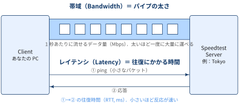
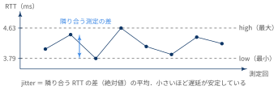
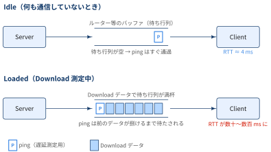
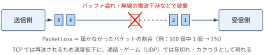
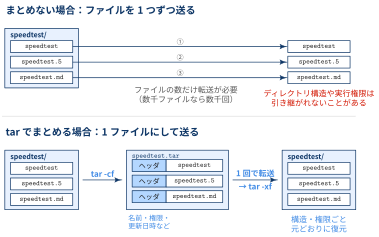
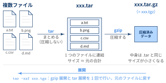

## Speedtestとは？

::: {#def- .custom_problem .blog-custom-border}
### Speedtest CLI

- Ookla社が提供する回線速度測定サービス [Speedtest](https://www.speedtest.net/) のコマンドライン版
- ブラウザを開かずに，ターミナルから以下を測定できる
    - Download / Upload の帯域 (Mbps)
    - Latency (ping) と Jitter
    - Packet Loss
- 出力形式を `json` / `csv` などに切り替えられるため，cronで定期実行してログを取るといった用途にも使える

:::


::: {.callout-note}
### REMARKS

`pip install speedtest-cli` や `apt install speedtest-cli` で入るものはコミュニティ製の Python 実装 (別物) 

:::


## Install方法

公式が配布している tgz アーカイブをダウンロードし，展開したバイナリを `/usr/local/bin` に配置します．

[Step 1: アーカイブのダウンロード]{.mini-section}

```zsh
% wget https://install.speedtest.net/app/cli/ookla-speedtest-1.2.0-linux-x86_64.tgz
--2026-06-19 18:19:55--  https://install.speedtest.net/app/cli/ookla-speedtest-1.2.0-linux-x86_64.tgz
Resolving install.speedtest.net (install.speedtest.net)... 151.101.2.219, 151.101.66.219, 151.101.130.219, ...
Connecting to install.speedtest.net (install.speedtest.net)|151.101.2.219|:443... connected.
HTTP request sent, awaiting response... 200 OK
Length: 1106829 (1.1M) [application/x-tar]
Saving to: ‘ookla-speedtest-1.2.0-linux-x86_64.tgz’

ookla-speedtest-1.2.0-linux-x86_6 100%[============================================================>]   1.05M  --.-KB/s    in 0.01s

2026-06-19 18:19:55 (79.5 MB/s) - ‘ookla-speedtest-1.2.0-linux-x86_64.tgz’ saved [1106829/1106829]
```

- URL中の `1.2.0` (バージョン) と `x86_64` (アーキテクチャ) は環境に応じて読み替えてください
    - ARM環境なら `aarch64` 版を選択
    - 最新版のURLは [公式ページ](https://www.speedtest.net/apps/cli) で確認できます

[Step 2: アーカイブの展開]{.mini-section}

```zsh
% tar -xzf ookla-speedtest-1.2.0-linux-x86_64.tgz
% ls
ookla-speedtest-1.2.0-linux-x86_64.tgz  speedtest*  speedtest.5  speedtest.md
```

展開すると以下の3ファイルが得られます．

| ファイル | 内容 |
|---|---|
| `speedtest` | 実行バイナリ本体 |
| `speedtest.5` | man page |
| `speedtest.md` | README |

[Step 3: バイナリの配置]{.mini-section}

```zsh
% sudo install -m 755 speedtest /usr/local/bin/
```

`/usr/local/bin` は通常 `PATH` に含まれているため，以降は任意のディレクトリから `speedtest` を実行できます．
`install` コマンドの詳細は [Appendix](#appendix-install) を参照．

[Step 4: 動作確認]{.mini-section}

```zsh
% cd
% speedtest
```

::: {.callout-note}
### 初回実行時のライセンス同意

初回実行時にはライセンス (および GDPR) への同意を求められます．対話的に `YES` と入力するか，
スクリプトから実行する場合は以下のようにフラグで同意できます．

```zsh
% speedtest --accept-license --accept-gdpr
```

:::

[よく使うオプション]{.mini-section}

| オプション | 説明 |
|---|---|
| `-L`, `--servers` | 近隣の測定サーバー一覧を表示 |
| `-s <id>`, `--server-id=<id>` | 測定サーバーをIDで指定 |
| `-f <fmt>`, `--format=<fmt>` | 出力形式 (`human-readable`, `json`, `jsonl`, `json-pretty`, `csv`, `tsv`) |
| `-u <unit>`, `--unit=<unit>` | 表示単位 (`Mbps`, `MB/s` など) |
| `-p no`, `--progress=no` | 進捗表示を無効化 |

## Terminal上での結果の表示方法

`speedtest` の出力は `-f` (`--format`) で切り替えられます．
「人が目で見る」なら `human-readable`，「スクリプトで加工する」なら `json` / `csv` 系，と使い分けます．

| 形式 | 用途 | 速度の単位 |
|---|---|---|
| `human-readable` (デフォルト) | ターミナルで目視確認 | `-u` で指定 (デフォルト `Mbps`) |
| `json` / `jsonl` / `json-pretty` | `jq` などで加工 | bytes/s 固定 |
| `csv` / `tsv` | ログとして追記・表計算ソフトで集計 | bytes/s 固定 |

### human-readable: そのまま表示

オプションなしで実行すると，進捗バーの後に以下のような形式で結果が表示されます (筆者環境での実行例)．

```zsh
% speedtest

   Speedtest by Ookla

[error] Error: [0] Cannot read from socket: 
      Server: XXXXXXXX - Tokyo (id: 00000)
         ISP: XXXXXXXX
Idle Latency:     4.19 ms   (jitter: 0.47ms, low: 3.79ms, high: 4.63ms)
    Download:   515.11 Mbps (data used: 488.5 MB)
                 12.79 ms   (jitter: 31.58ms, low: 3.38ms, high: 223.49ms)
      Upload:   487.39 Mbps (data used: 518.5 MB)
                  3.97 ms   (jitter: 0.29ms, low: 3.26ms, high: 4.51ms)
 Packet Loss:     0.0%
  Result URL: https://www.speedtest.net/result/c/xxxxxxxx-xxxx-xxxx-xxxx-xxxxxxxxxxxx
```

各行の読み方は [結果の読み方](#sec-reading) で解説します．

表示単位は `-u` で変更できます．

```zsh
# MB/s で表示
% speedtest -u MB/s

# 値に応じて kbps / Mbps / Gbps を自動選択 (-u auto-decimal-bits の短縮形)
% speedtest -a
```


## 結果の読み方 {#sec-reading}

先ほどの実行例を1行ずつ読んでいきます．

:::: {.no-border-top-table}

| 行 | 値 (実行例) | 意味 |
|---|-----|-----|
| `Server` | XXXXXXXX - Tokyo (id: 00000) | 測定相手のサーバー．指定しなければ近くて応答の速いサーバーが自動選択される |
| `ISP` | XXXXXXXX | 自分が契約・接続しているプロバイダ |
| `Idle Latency` | 4.19 ms | 何も通信していない状態での往復遅延 (いわゆるping) |
| `Download` 1行目 | 515.11 Mbps (data used: 488.5 MB) | 下り帯域．`data used` は測定中に実際に転送したデータ量 |
| `Download` 2行目 | 12.79 ms | **Download 測定中**の往復遅延 (loaded latency) |
| `Upload` 1行目 | 487.39 Mbps (data used: 518.5 MB) | 上り帯域 |
| `Upload` 2行目 | 3.97 ms | **Upload 測定中**の往復遅延 |
| `Packet Loss` | 0.0% | 届かなかったパケットの割合 |
| `Result URL` | `https://www.speedtest.net/result/c/...` | 同じ結果をブラウザで見るためのURL (見なくても値はすべてターミナルに出ている) |

::::

Latency の各行に付く `(jitter, low, high)` は，その区間で複数回測ったRTTの「ばらつき・最小・最大」です．

### 帯域 (Mbps) とレイテンシ (ms)

回線の速さには「どれだけたくさん運べるか (帯域)」と「どれだけ速く返事が返るか (レイテンシ)」という別々の軸があります．

{width="90%" fig-align="center"}

- **帯域 (Download / Upload)**: 大きいほど良い．動画視聴・大きなファイルのダウンロード・`docker pull` などの体感に効く
- **レイテンシ (Latency)**: 小さいほど良い．Web会議・オンラインゲーム・SSH の打鍵の反応などに効く

帯域が十分でもレイテンシが大きければ「ダウンロードは速いのに操作がもっさりする」ということが起こります．

### jitter・low・high

- レイテンシは1回だけでなく何度も測定されます
- `low` / `high` はその最小値・最大値，`jitter` はばらつきの大きさ

{width="80%" fig-align="center"}

- `jitter` は「隣り合う測定のRTTの差 (絶対値) の平均」で，**遅延の揺れ**を表す
- 平均的なレイテンシが小さくても jitter が大きいと，Web会議の音声が途切れたり，ゲームで引っかかりを感じたりする
- 実行例の `Idle Latency` は jitter 0.47 ms，low〜high が 3.79〜4.63 ms と非常に安定している

### Idle Latency と Download / Upload 中の Latency の違い

`Download` / `Upload` の2行目は，**回線を目一杯使っている最中**に測った遅延です．
回線が混雑すると，ルーターなどのバッファ (待ち行列) にデータが溜まり，pingパケットはその後ろに並んで待たされます．

{width="90%" fig-align="center"}

この「負荷時に遅延が大きく膨らむ」現象を **bufferbloat** と呼びます．Idle と負荷時の差が小さいほど，
「家族が動画を見ている or 大きなファイルを落としている最中でも Web会議が快適」な回線と言えます．

::: {.callout-note}
### 2行目の数値は IQM

- `Download` / `Upload` の2行目の値 (実行例では 12.79 ms) は，JSON出力では `latency.iqm` に対応．
- IQM (interquartile mean) は測定値の上下25%を除いた中央50%の平均

:::

::: {#exm- .custom_problem }
### 実行例の解釈

:::: {.no-border-top-table}

| 区間 | IQM | jitter | high | 解釈 |
|---|---|---|---|--------|
| Idle | 4.19 ms | 0.47 ms | 4.63 ms | 非常に安定 |
| Download | 12.79 ms | 31.58 ms | 223.49 ms | 代表値は小さいが，ときどき 200 ms 超まで跳ねる |
| Upload | 3.97 ms | 0.29 ms | 4.51 ms | 負荷をかけてもほぼ悪化しない |

::::

- **下り方向でのみ軽い bufferbloat が起きている**ことが読み取れる
- 普段使いでは問題になりにくいですが，大きなダウンロード中に Web会議をすると一瞬音声が遅れる，といった症状として現れる可能性がある

:::
***

### Packet Loss

送ったパケットのうち，途中で失われて届かなかったものの割合です．

{width="90%" fig-align="center"}

- [有線接続なら通常 0% が期待値]{.regmonkey-bold}
- TCP (Web・ダウンロード) では失われたパケットは再送されるため，主に**速度低下**として現れる
- UDP (通話・ゲーム) では再送されないため，**音切れ・カクつき**として現れる
- 測定環境によっては `Packet Loss: Not available.` と表示されることもある 

## Appendix: `install -m 755` 構文 {#appendix-install}

`install` はファイルをコピーしつつ，パーミッションや所有者を同時に設定するコマンドです．
`cp` + `chmod` (+ `chown`) を1コマンドで行えるため，バイナリを `bin` ディレクトリへ配置する際によく使われます．

```zsh
# 以下の2つはほぼ同等
% sudo install -m 755 speedtest /usr/local/bin/

% sudo cp speedtest /usr/local/bin/
% sudo chmod 755 /usr/local/bin/speedtest
```

:::: {.no-border-top-table}

| オプション | 説明 |
|---|---|
| `-m <mode>` | コピー先ファイルのパーミッションを指定 (デフォルトは `755`) |
| `-o <owner>` | 所有者を指定 |
| `-g <group>` | グループを指定 |
| `-d` | ファイルではなくディレクトリを作成 (`mkdir -p` 相当) |

::::

`755` は8進数表記のパーミッションで，「誰でも実行できるが，書き換えられるのは所有者 (ここでは root) のみ」に対応します．

なお，同梱の man page も配置したい場合は，実行権限不要なので `644` で配置します．

```zsh
% sudo install -m 644 speedtest.5 /usr/local/share/man/man5/
```

## Appendix: tarとは？

::: {#def- .custom_problem .blog-custom-border}
### `tar` コマンド

- `tar` (**t**ape **ar**chive) は，複数のファイル・ディレクトリを1つのファイルにまとめる (アーカイブする) コマンド
- 元々は磁気テープへのバックアップ用途で作られたもの
- `tar` 自体は「まとめる」だけで，**圧縮は行わない**
  - 圧縮は `gzip` / `bzip2` / `xz` などと組み合わせて行う

:::

:::: {.no-border-top-table}

| オプション | 意味 |
|---|---|
| `-c` | アーカイブを作成 (create) |
| `-x` | アーカイブを展開 (extract) |
| `-t` | アーカイブの中身を一覧表示 (list) |
| `-z` | gzip で圧縮/展開する |
| `-f <file>` | 対象のアーカイブファイルを指定 |
| `-v` | 処理中のファイル名を表示 (verbose) |
| `-C <dir>` | 展開先ディレクトリを指定 |

::::

本記事の `tar -xzf ookla-speedtest-1.2.0-linux-x86_64.tgz` は「gzip圧縮された (`-z`) アーカイブファイル (`-f`) を展開する (`-x`)」という意味になります．

```zsh
# 展開前に中身を確認
% tar -tzf ookla-speedtest-1.2.0-linux-x86_64.tgz

# 展開先を指定
% mkdir -p ~/tmp/speedtest && tar -xzf ookla-speedtest-1.2.0-linux-x86_64.tgz -C ~/tmp/speedtest

# 逆にアーカイブを作成する場合
% tar -czf archive.tgz dir/
```

### なぜ1つにまとめるのか？

複数のファイルをそのまま配布せず，わざわざ `tar` で1ファイルにまとめるのには次のようなメリットがあります．

{width="90%" fig-align="center"}

1. **転送・配布が1回で済む**
   - ダウンロードもアップロードも1ファイル分の操作で完結する
   - 小さいファイルが大量にある場合，1ファイルずつ送るより通信のオーバーヘッドが小さくなり，取りこぼしも起きない
2. **ディレクトリ構造とメタ情報を保持できる**
   - tar ファイルの中では，各ファイルの中身の前に「ヘッダ」が置かれ，パス・パーミッション・所有者・更新日時などが記録される
   - 展開すると，ディレクトリ階層や実行権限ごと元どおりに復元される
   - 本記事の `speedtest` バイナリを展開直後にそのまま実行できるのも，実行権限 (`x`) がアーカイブ内に保存されているため
3. **まとめて圧縮できる**
   - `gzip` は単一ファイルしか圧縮できないため，複数ファイルを圧縮するには先に1ファイルにまとめる必要がある
   - 1本につないでから圧縮することで，ファイルをまたいだ重複パターンも圧縮対象になり，個別に圧縮するより小さくなりやすい
4. **1つの単位として扱いやすい**
   - `xxx-1.2.0.tgz` のようにバージョン単位で保存・バックアップ・チェックサム検証ができる

## Appendix: tgzとは？

::: {#def- .custom_problem .blog-custom-border}
### `.tgz` 拡張子

- `.tgz` は `.tar.gz` の短縮形の拡張子で，「tarでまとめたファイルをgzipで圧縮したもの」を指す
- 中身・形式は `.tar.gz` と全く同じです．

:::

{width="90%" fig-align="center"}

:::: {.no-border-top-table}

| 拡張子 | 圧縮形式 | `tar` の展開オプション |
|---|---|---|
| `.tar` | なし | `tar -xf` |
| `.tar.gz`, `.tgz` | gzip | `tar -xzf` |
| `.tar.bz2`, `.tbz2` | bzip2 | `tar -xjf` |
| `.tar.xz`, `.txz` | xz | `tar -xJf` |

::::

なお，GNU tar では圧縮形式を自動判別するため，`tar -xf xxx.tgz` のように `-z` を省略しても展開できます．
