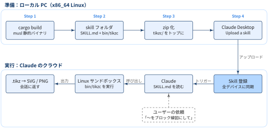
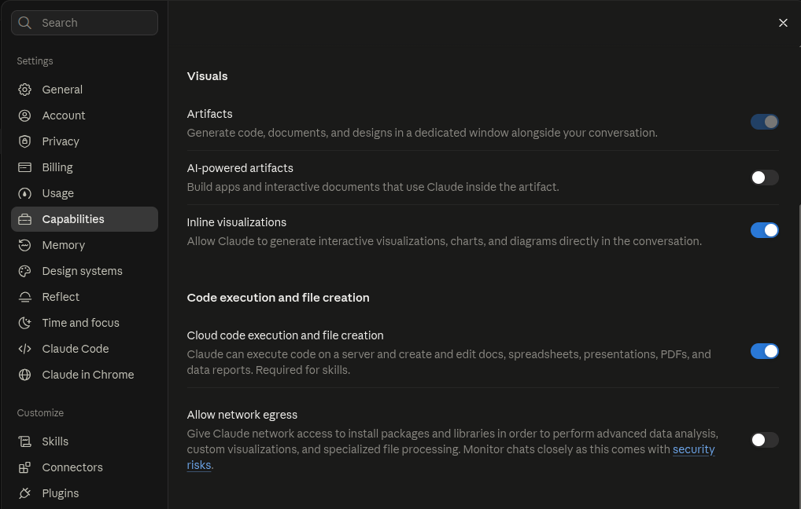
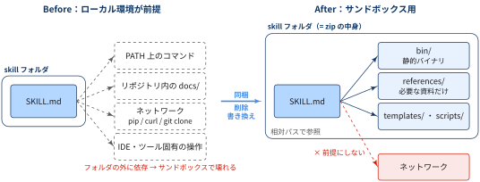

## この記事について

:::: {.no-border-top-table}

| 観点 | 内容 |
|---|---|
| **What：何のドキュメントか** | tikzc を Claude Desktop の Skill としてアップロードし，Claude のクラウド上で `.tikz` をコンパイルできるようにする手順をまとめたドキュメント． |
| **Who：誰に向けたものか** | Claude Desktop で TikZ の図を作りたい人， |
| **Why：なぜ重要か** | Skill はローカルではなくクラウドの Linux サンドボックスで動くため，バイナリのターゲットや zip の構成を誤るとアップロードや実行に失敗するため． |
| **How：どう使うか** | 初回のアップロード時と tikzc の更新時に，Step 1〜4 を上から順に実施する． |

: {tbl-colwidths="[30,70]"}

::::

## 仕組み

- [tikzc](https://github.com/RyoNakagami/tikzc) を Skill としてアップロードすると，tikzc は**Claude のクラウド上の Linux サンドボックス**で動きます．
- 手元のマシンにインストールした tikzc が呼ばれるわけではない点に注意．

{#fig-skill-upload-flow}

- 準備（Step 1〜4）はローカル PC で行い，Linux 向けバイナリと `SKILL.md` を zip にまとめて Claude Desktop からアップロードする
- アップロードした Skill はクラウドに登録され，全デバイスに同期される
- 会話中にユーザーの依頼が `SKILL.md` の `description` にマッチすると，Claude が `SKILL.md` を読み，サンドボックス内で `bin/tikzc.gz` を展開・実行して SVG / PNG を返す


## 手順

### Step 0: Claude Desktop の前準備

Skill はクラウドのサンドボックスでコードを実行するので，Claude Desktop 側でコード実行を有効にしておく必要があります．
個人プラン（Free / Pro / Max）では次の手順で設定します．

1. Claude Desktop で Settings → Capabilities を開く
2. 「Code execution and file creation」セクションの **Cloud code execution and file creation** をオンにする
3. **Allow network egress** はオフのままでよい（tikzc は依存のない静的バイナリを Skill に同梱するため，サンドボックスからのネットワークアクセスは不要）

{#fig-claude-settings-capabilities width="80%" fig-align="center"}

コード実行とファイル作成がオンであれば，Claude は Skill が必要な場面を依頼内容から判断して自動的に使います．
会話の中で Skill を明示的に呼び出す必要はありません．

::: {.callout-note}
### REMARKS

Team / Enterprise プランでは，ここに挙げた個人向けの手順とは設定方法が異なり，組織の管理者側でコード実行や Skill を許可する必要がある場合があります．
:::

### Step 1: Linux 向けの静的バイナリをビルドする

- サンドボックスは x86_64 Linux なので，`x86_64-unknown-linux-musl` ターゲットで静的バイナリを作ります．
- macOS 用のバイナリはサンドボックスでは動きません．

[musl-tools コンパイラの準備]{.mini-section}

ビルドには Rust 1.92 以上と，musl 用の C コンパイラ（`musl-gcc`）が必要です．
依存クレートの一部（`psm`）が C コードをビルドするため，`musl-gcc` がないと `failed to find tool "x86_64-linux-musl-gcc"` で失敗します．

```bash
sudo apt install musl-tools   # Ubuntu / Debian の場合
```

[tikzcのビルド]{.mini-section}

作業用の一時ディレクトリを `mktemp -d` で作り，その中でリポジトリを clone してビルドします．
以降の Step 2・3 でも `$WORK` を使うので，同じシェルで続けて実行してください．

```bash
WORK=$(mktemp -d) && cd "$WORK"
git clone https://github.com/RyoNakagami/tikzc.git
cd tikzc

rustup target add x86_64-unknown-linux-musl

# サイズ優先の設定でビルドする（Cargo.toml は書き換えず，環境変数で上書き）
CARGO_PROFILE_RELEASE_LTO=fat \
CARGO_PROFILE_RELEASE_CODEGEN_UNITS=1 \
CARGO_PROFILE_RELEASE_OPT_LEVEL=z \
CARGO_PROFILE_RELEASE_PANIC=abort \
  cargo build --release --locked --target x86_64-unknown-linux-musl
```

::: {.callout-warning}
Skill の zip は**展開後のサイズが 30MB 以下**でないとアップロードできません（`Zip file uncompressed size exceeds 30MB`）．
tikzc はフォントを埋め込んでいるため，通常のビルドで約 54MB，上のサイズ優先ビルドでも約 40MB あります．
そのため Step 2 でバイナリを gzip 圧縮して同梱し（約 20MB），サンドボックス側で展開して使います．
:::

生成物は `target/x86_64-unknown-linux-musl/release/tikzc` に出力されます．
日本語・数式フォントをバイナリに埋め込むため，初回のビルドには時間がかかります．
静的リンクになっているかは `file` で確認できます．

```bash
file target/x86_64-unknown-linux-musl/release/tikzc
# ... ELF 64-bit LSB executable, x86-64, ... statically linked ...
```

### Step 2: Skill フォルダを作る

`SKILL.md` とバイナリを次の構成で配置します．

```
tikzc/
├── SKILL.md        # いつ・どう tikzc を呼ぶか
└── bin/tikzc.gz    # x86_64-unknown-linux-musl の静的バイナリ（gzip 圧縮）
```

clone したリポジトリも `tikzc/` なので，Skill フォルダはリポジトリの外（`$WORK/skill/`）に作ります．

```bash
cd "$WORK"
mkdir -p skill/tikzc/bin
gzip -9 -c tikzc/target/x86_64-unknown-linux-musl/release/tikzc > skill/tikzc/bin/tikzc.gz
ls -lh skill/tikzc/bin/tikzc.gz   # 約 20MB
# SKILL.md を skill/tikzc/SKILL.md として作成する（下のサンプル参照）
```

`SKILL.md` の frontmatter の `description` は，Claude がこの Skill を使うかどうかを判断する材料になります．
トリガーとなる依頼の言い回しを具体的に書いておきます．

[SKILL.md のサンプル]{.mini-section}

```markdown
---
name: tikz-block-diagram
description: テキストのシステム説明（制御系・データフロー・アーキテクチャ等）やスライド画像を .tikz のブロック線図に変換し，tikzc（Rust ネイティブエンジン）でコンパイル・PNG目視検証して仕上げる．トリガー例「〜をブロック線図にして」「〜を.tikzに描いて」「tikzで図を作って」．出力はユーザー指定がない限り 1600×900 スライド想定．
---

# tikz-block-diagram

テキストで与えられたシステム説明（制御ループ・データフロー・アーキテクチャ等）を，
tikzc でコンパイル可能な `.tikz` ブロック線図に変換し，PNG レンダリングを目視検証して仕上げる skill．

**tikzc は TeX を呼ばない Rust ネイティブエンジンで，TikZ の実用サブセットだけを解釈する．**
TeX で通る記法でも対応外なら診断エラーで止まり，通っても見た目が TeX と違う箇所がある．
下の「Rust エンジンで書ける範囲」に載っている書き方だけで組み立てること．

## When to use

- 「〜の情報を ○○.tikz にブロック線図として描いて」
- 「この制御系／処理フローを TikZ で図にして」
- 「スライド用にブロック線図を作って」
- 論文・スライド画像をベースにした図の作成・更新
```

::: {.callout-note}
### REMARKS

サンドボックスでは `tikzc` に PATH が通っていないので，`SKILL.md` には「この `SKILL.md` と同じディレクトリにある `bin/tikzc.gz` を `/tmp/tikzc` に展開し，`chmod +x` してから実行する」と明記しておきます．

```sh
gzip -dc "<SKILL.md のディレクトリ>/bin/tikzc.gz" > /tmp/tikzc && chmod +x /tmp/tikzc
```

:::

### Step 3: zip を作る

`tikzc/` がトップレベルになるように zip を作ります．

```bash
cd "$WORK/skill"
zip -r ../tikzc.zip tikzc/
unzip -l ../tikzc.zip   # tikzc/SKILL.md と tikzc/bin/tikzc.gz が並び，合計が 30MB 以下なら OK

# 一時ディレクトリは後で消えるので，zip を残したい場所にコピーしておく
cp ../tikzc.zip ~/Downloads/
```

::: {.callout-note}
### REMARKS

リポジトリのルートから zip すると Skill フォルダが `skills/` の下に埋もれてしまい，アップロードが失敗します．
`tikzc/` の親ディレクトリで zip してください．
:::

### Step 4: Claude Desktop からアップロードする

1. Customize → Skills を開く
2. `+ Create skill` → `Upload a skill` を選ぶ
3. Step 3 で作った zip をアップロードする

## 注意点

- Desktop の Skill はクラウドへのアップロードのみで，全デバイスに同期される
- tikzc を更新したときは，Step 1〜4 をやり直して再アップロードする

## 既存SKILL.mdをCLAUDE sandbox用に編集する観点


::: {.callout-note}
## TL;DRs

- Claude Code 用に書いた SKILL.md は，ローカル環境（PATH，手元のリポジトリ，ネットワーク，エディタ）を暗黙の前提にしていることが多い
- サンドボックス用に直すときの原則は1つで，**SKILL.md が依存するものをすべて skill フォルダ（= zip）の中に閉じ込める**こと


:::


{#fig-skill-sandbox-boundary}

[1. 暗黙の前提を洗い出す]{.mini-section}

まず SKILL.md を読み，「その環境に何があることを前提にしているか」を列挙します．
コマンド名，ファイルパス，URL，ツール名を grep すると漏れが減ります．

```bash
# SKILL.md が参照しているファイルの候補を一覧する
grep -oE '[A-Za-z0-9_./-]+\.(md|py|sh|tikz|json|ya?ml|txt)\b' SKILL.md | sort -u
```

[2. 参照先は「同梱」か「削除」の二択にする]{.mini-section}

フォルダの外を指す参照は，サンドボックスからは必ず読めません．参照先ごとに次のどちらかに決めます．

| 判断 | 対象 | 対応 |
|---|---|---|
| 同梱する | 実行に必要なバイナリ・スクリプト，作業中に読み返す資料，テンプレート | `bin/`，`references/`，`templates/` などに入れ，SKILL.md からは相対パスで参照する |
| 削除・書き換える | 開発者向けの手順（ビルド，インストール，コントリビュート方法），存在しないファイル | 記述を消すか，「対応範囲はこの表を正とする」のように SKILL.md 内で完結させる |

同梱する資料は必要な部分だけにします．SKILL.md 本体と同じ内容を別ファイルにも持つと，片方だけ更新されて食い違う原因になります．

[3. 実行ファイルは自己完結させる]{.mini-section}

- Linux x86_64 で動く**静的リンク**のバイナリにする（macOS 用や glibc 依存のバイナリは動かない可能性がある）
- フォントや辞書などの実行時リソースは，バイナリへの埋め込みか同梱で用意する
- PATH には通っていない前提で，SKILL.md に「この SKILL.md と同じディレクトリの `bin/xxx` を使う」と書く
- zip 経由で実行権限が落ちる場合に備えて，最初に `chmod +x` する手順を入れる

[4. ネットワークに頼らない]{.mini-section}

ネットワークアクセスは設定で無効になっていることがあります．
`pip install`，`curl`，`git clone` などを前提にした手順は，同梱で置き換えるか，使えない場合の代替を書いておきます．

[5. ローカル専用の記述を取り除く]{.mini-section}

- 特定のエディタや IDE（VSCode のプレビューなど）に関するルール
- ソースリポジトリで作業するときの手順（`cargo run`，`cargo install` など）
- Claude Code 固有のツール名（`Read`，`Edit` など）に依存した書き方 → 「ファイルを開いて確認する」のように動作で書く

[6. 状態は持ち越されない前提で書く]{.mini-section}

サンドボックスは会話やコマンドごとにリセットされることがあります．
環境変数や作業ファイルが残っている前提にせず，セットアップ手順（パスの特定，`chmod`）を毎回実行できる形で書きます．

[7. zip にする前にクリーンな環境で試す]{.mini-section}

手元では PATH 上のコマンドや周辺ファイルが見えてしまい，依存漏れに気づけません．
skill フォルダだけをマウントした Linux コンテナで SKILL.md の手順をなぞると，サンドボックスに近い条件で確認できます．

```bash
# skill フォルダだけを見せ，ネットワークも切った状態で試す
docker run --rm -it --network none -v "$PWD/tikzc:/skill:ro" ubuntu:24.04 \
  sh -c 'gzip -dc /skill/bin/tikzc.gz > /tmp/tikzc && chmod +x /tmp/tikzc && /tmp/tikzc -V'
# => tikzc 1.1.x
```

Docker Desktop を使っている場合，`mktemp -d` で作った `/tmp` 配下のディレクトリは既定ではマウントできません（`mounts denied`）．
ホームディレクトリ配下にコピーしてから試します．


References
----------
- [Use skills in Claude](https://support.claude.com/en/articles/12512180-use-skills-in-claude)
