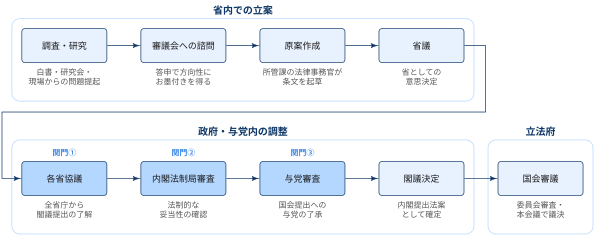
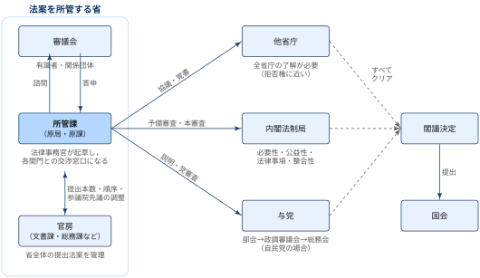
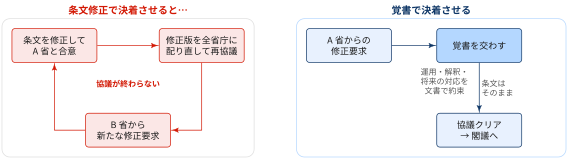
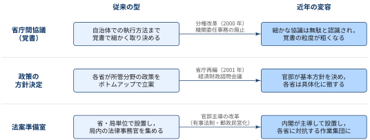
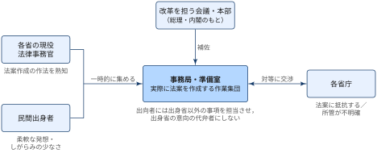

## この記事について

:::: {.no-border-top-table}

| 観点 | 内容 |
|---|---|
| **What：何のドキュメントか** | 省庁が法案（内閣提出法案）を作成し，閣議決定・国会提出に至るまでの過程と，その近年の変容をまとめたノート． |
| **Who：誰に向けたものか** | 政策決定の仕組みに関心のある人．政策評価や行政データの分析で「その政策がどう決まったか」を理解したい人． |
| **Why：なぜ重要か** | 政策は一般に法律または予算の形式で示される．そのため法案の作成過程を体系的に把握することは，省庁における意思決定の仕組みや，法案を起草する法律事務官の思考様式・行動様式を理解するうえで重要． |

: {tbl-colwidths="[30,70]"}

::::

この記事の流れは次のとおり．

1. **従来の型**：法案は所管課を起点にボトムアップで作られ，3つの関門で全会一致の合意を積み上げていく
2. **近年の変容**：分権改革と省庁再編を経て，覚書の役割が縮小し，官邸・内閣が方針決定や法案作成そのものを主導する場面が増えている

## 法案作成過程の全体像

国会に提出される法案には，議員が提出する議員立法と，内閣が提出する**内閣提出法案（閣法）**がある．本記事が扱うのは後者．

{width="100%" fig-align="center"}

| 段階 | 工程 | 内容 |
|---|---|---|
| 省内での立案 | 調査・研究 | 現場の問題提起や研究会を通じて，制度改正の必要性を整理する |
| | 審議会への諮問 | 有識者・関係団体からなる審議会に諮問し，答申を得て方向性を固める |
| | 原案作成 | 所管課の法律事務官が条文を起草する |
| | 省議 | 省としての意思決定を行う |
| 政府・与党内の調整 | ① 各省協議 | すべての省庁から，閣議に提出することへの了解を取り付ける |
| | ② 内閣法制局審査 | 法制的にみて論理的に妥当か，書き方が正しいかを確認する |
| | ③ 与党審査 | 国会に提出することについて与党の了承を得る |
| | 閣議決定 | 内閣として法案を決定し，国会に提出する |
| 立法府 | 国会審議 | 委員会での審査を経て，本会議で議決する |

: {tbl-colwidths="[20,25,55]"}

- 図では①→②→③と順に並べたが，実際には各省協議と法制局審査が並行して進むことも多い
- 重要なのは，**閣議にかけるまでに3つの関門をすべて通過していなければならない**という点

## 登場人物

{width="100%" fig-align="center"}

| 主体 | 役割 | 握っているもの |
|---|---|---|
| **所管課（原局・原課）** | 法案を担当する課．課内の法律事務官が条文を起草し，各関門との交渉窓口になる | 法案の中身 |
| **審議会** | 省が設置する諮問機関．有識者・関係団体が参加する | 改正の方向性への「お墨付き」 |
| **官房（文書課・総務課など）** | 省全体として国会に出す法案を管理する | 提出本数・提出順序・参議院先議 |
| **他省庁** | 法案が自らの所管に関係するかを確認する | 閣議提出への了解（事実上の拒否権） |
| **内閣法制局** | 法令案を法制的な観点から審査する | 閣議に出せる条文かどうかの判断 |
| **与党** | 法案の国会提出を事前に審査・了承する | 国会での可決に必要な賛成票 |

: {tbl-colwidths="[25,45,30]"}

## 従来の法案作成過程

### 関門① 各省協議

- 各省協議は，当該法案を閣議に提出することへの了解を**すべての省庁から**取り付ける過程
- 法案を他省庁に配布して協議を始めてから閣議までは，最低2週間の時間的余裕を取ることが慣行上のルール
- 全省庁の了解が必要ということは，関係する省庁のどこか1つでも反対すれば法案は閣議に進めない

この制約のもとで協議を期限内に決着させる手段として使われてきたのが**覚書**．

#### 覚書の機能

- 覚書は，条文を修正する代わりに，法案の運用・解釈や将来の対応について協議相手の省と文書で約束を交わすもの

{width="100%" fig-align="center"}

- 交渉の結果として条文を修正すると，修正後の法案についてほかの省庁ともう一度協議しなければならない
- その再協議で別の省から新たな修正要求が出れば，さらに再協議が必要になり，協議が終わらない
- 覚書で合意すれば，**条文に手を加えずに協議をクリアできる**．覚書は，限られた時間内で協議を決着に導くための調整手段

### 関門② 内閣法制局審査

- 内閣法制局は，閣議に付される法律案などを審査する内閣の機関
- 法制局審査では，その法案が法制的にみて論理的に妥当か，書き方が正しいかが確認される

[4つの審査のポイント]{.mini-section}

| 観点 | 問われること |
|---|---|
| **必要性** | 新しい法制度はなぜ今必要なのか |
| **公益性** | 必要なだけの公益性を持ち合わせているか．権利を制限したり義務を課したりする場合，それに見合う公益性があるか，過度の権利制限になっていないか |
| **法律事項** | 既存の法制度では解決が困難なのか．そもそも法律で書き表す必要があるのか |
| **整合性** | 憲法に適合しているか．既存の法体系と整合しているか |

: {tbl-colwidths="[20,80]"}

### 関門③ 与党審査

国会が法案の最終的な決定権限を持つ以上，過半数を占める与党が賛成しなければ法案は国会を通過できません．そのため，閣議決定の前に与党の了承を得る**党審査**が行われます．自民党政権の場合，政務調査会の部会，政務調査会審議会（政調審議会），総務会の順に審査を経るのが通例．

与党への提出法案の説明では，省の官房が主に次の3点に注意を払います

| 観点 | 内容 |
|---|---|
| **提出法案の数** | 省全体として今国会に何本の法案を提出するか．法案数の絞り込みが重要になる |
| **提出の順序** | 準備状況・法案の内容・審議の見込みなどを考慮して，省の法案をどの順番で提出するか |
| **参議院先議** | どの法案を衆議院より先に参議院へ提出するか．原局・原課は消極的な態度をとるのが一般的だが，重要法案であっても官房があえて参議院先議の候補とすることもある |

: {tbl-colwidths="[20,80]"}

### 省内の法案準備室

法案作成は通常，所管課の業務の一部として行われます．ただし次のような場合には，法案作成に関わる業務だけを集中的に担うプロジェクトチーム（**法案準備室**）が編成されることがあります．

- 省や局を挙げてのプロジェクトで，その年の法改正の目玉
- 所管課がまだ明確でない，あるいは複数の課にまたがる
- 時間が切迫しており，特にマンパワーが必要

法案準備室は局単位で設置されることが多いです．所管課の法律事務官に加えて，局内の各課に分散配置されている法律事務官の一部や，場合によっては他局にいる前任者も一時的に召集され，会議室などに集まって法案作成の業務だけを扱います．

設置のメリットとして，次の5点

1. 業務を法案作成に特化できる（ほかの業務を行わなくてすむ）
2. 情報を共有しやすい
3. 連絡調整のコストを削減できる
4. 特命による作業を実施できる
5. 情報を秘匿しやすい

## 近年の変容

2000年前後の分権改革と2001年の中央省庁再編を経て，従来の型には次の3つの変化が見られるようになりました．

{width="100%" fig-align="center"}

### 1. 覚書の粒度が粗くなった

各省協議で交わされる覚書の中身が，以前ほど細かくなくなりました．その要因としては，**機関委任事務の廃止**によるところが大きい（らしい）です．

- 2000年施行の地方分権一括法により機関委任事務が廃止され，自治体の事務は自治事務と法定受託事務に再編
- 国の通達は，解釈の指針としての意味しか持たないことが明確に
- 自治事務について，中央から地方へ細かな指示を出すことは不適切であると，分権改革を通じて改めて認識

その結果，自治体での事務の執行方法について省庁間でこまごまとした協議をすることは「エネルギーの無駄遣い」だと組織的に認識されるようになりました．従来は覚書で詰めていた執行方法の細部が，協議の対象から外れていきました．

::: {.callout-note}
## 例：景観法（2004年）

- 2004年に制定された景観法によって自治体は，景観計画で建築行為等の制限に関する事項を定め，それに従って届出・勧告による規制や変更命令を出せるようになった
- このとき，行為の制限に関する事項は「政令で定める基準に従い」定めることとされた

自治体の裁量をどこまで国が枠付けるかという論点が，省庁間の覚書ではなく，法律・政令の文言の問題として現れている例と考えられます．
:::

### 2. 官邸が方針を決め，各省は具体化に徹する

2001年の中央省庁再編で内閣府に設置された**経済財政諮問会議**について，内閣の方針を決定する場であり，各省よりも一段高い位置にあるという認識が各省の共通認識となりました．

ただし，各省は経済財政諮問会議の主張をすべてそのまま受け入れなければならないと理解しているわけではありません．

- 「その主張が最終的に総理・官邸の方針・指示であるならば仕方がない」という消極的な対応
- それでも，総理・官邸が基本方針を決め，省庁はそれを具体化する作業に徹するというスタイルがしばしば見られるように
- 従来のボトムアップ型とは，起点が逆

::: {.callout-tip}
## 潜在的な問題点

このスタイルは，総理・官邸の方針・指示が明確で，強固で，一貫していることを前提にしています．方針が明確でない，強固でない，あるいは一貫していない場合には，各省は従来のボトムアップ型の調整に戻るのではないでしょうか．官邸主導がどこまで定着したかは，方針の強さに依存していると考えられます．
:::

### 3. 内閣主導の法案準備室：カウンター・ビューロクラシー

省庁が抵抗するタイプの法案や，所管がまだ明確でない法案については，**内閣が主導して準備室を設置し，法案を作成する例**が増え始めています．

- 例：有事法制が官邸主導で準備されたこと
- 例：2004年に内閣官房に置かれた郵政民営化準備室

[省内の準備室との違い]{.mini-section}

| | 省内の法案準備室 | 内閣主導の準備室 |
|---|---|---|
| **目的** | 省の法案を効率よく作る | 抵抗する省庁と交渉して法案を通す |
| **集める人** | 所管課・局内の法律事務官 | 各省の現役法律事務官＋民間出身者 |

: {tbl-colwidths="[20,40,40]"}

そのため，事務局メンバーの人選が重要になります．各省からの出向者が出身省の意思を忠実に反映する場になってしまうと，各省庁との交渉を乗り切れないからです．

{width="90%" fig-align="center"}

[先行例：橋本行革期の2つの組織]{.mini-section}

| 組織 | 工夫 |
|---|---|
| **行政改革会議の事務局** | 各省庁から法律事務官を集め，内閣のもとで各省庁と隔絶した形で業務を遂行させた．事務局メンバーの半数近くを民間出身者とした |
| **中央省庁等改革推進本部** | 各省庁から出向してきた参事官に，出身省庁以外の事項を担当させた |

: {tbl-colwidths="[30,70]"}

これらの例は，各省庁との交渉を乗り切り，そのための準備作業を的確に行うには，**各省庁に対抗的な作業集団**が必要であることを示唆しています．

- 法律事務官としての思考様式や行動様式を十分に理解している現役の法律事務官を一時的に集める
- 場合によっては民間人も加えて，柔軟な対応力を備える
- そのうえで，カウンター・ビューロクラシー（対抗的な官僚制）を構成する

改革を担う委員会等が権威の高い第三者機関として機能するのではなく，実質的に法案の作成作業を行い，各省庁と対等の関係で交渉しなければならないとすれば，この方式は戦術として意味を持ちます．

## References

- [田丸大「省庁における法案の作成過程とその変容」年報行政研究，2005 年 2005 巻 40 号 p. 68-86](https://www.jstage.jst.go.jp/article/jspa1962/2005/40/2005_68/_article/-char/ja)
