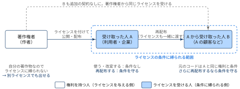
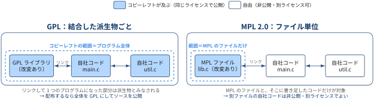

::: {.callout-note}
## TL:DRs

- できるだけ制約を少なくして普及を優先したい場合は MIT か BSD
- 企業が OSS を公開するときによく用いられる Apache 2.0 はパーミッシブでありつつ，特許リスクにも備えたい場合に用いる
- 改変したら必ず公開してほしい場合は GPL を使う．ただし GPL の範囲は「結合したプログラム全体」，MPL 2.0 の範囲は「ファイル単位」と大きく違う
- GPL のソフトでも販売はできる．義務が発生するのは**配布するとき**で，その中身は受け取った人にソースを提供すること

:::

## オープンソースとは？


::: {.callout-note}
### Key Points

- 「ソースコードが公開されている」だけでは，オープンソースとは言えない
- オープンソースかどうかは，そのソフトに付いた**ライセンスが何を許しているか**で決まる

:::


オープンソースの基準として広く使われているのが，Open Source Initiative（OSI）が定める **The Open Source Definition（OSD）** です．OSD は Debian のフリーソフトウェアガイドライン（DFSG）をもとに作られ，オープンソースソフトウェアの頒布条件が満たすべき次の10項目からなります（訳は筆者による）．OSI はこの10項目を満たすライセンスを審査して「OSI 承認ライセンス」として公開しており，この記事で扱う GPL・MPL 2.0・MIT・BSD・Apache 2.0 はいずれも承認済みです．


:::: {.no-border-top-table}

| # | 項目 | ひとことで言うと |
|---|---|---|
| 1 | 自由な再頒布 | 売っても無料で配ってもよい．ライセンス料は取れない |
| 2 | ソースコード | ソースコードを入手できる．難読化したコードはダメ |
| 3 | 派生物 | 改変してよく，改変版を同じ条件で配ってよい |
| 4 | 作者のソースコードの完全性 | 改変版の配布は認める．ただし「パッチで配って」「別の名前にして」と求めるのはよい |
| 5 | 個人・集団の差別の禁止 | 「〇〇さんは使用禁止」はダメ |
| 6 | 利用分野の差別の禁止 | 「商用利用禁止」「研究用途のみ」はダメ |
| 7 | ライセンスの分配 | 受け取った人は，追加の契約なしで同じ権利を得る |
| 8 | 特定製品に依存しない | 特定の製品から取り出して単体で使っても同じ権利 |
| 9 | 他のソフトを制限しない | 一緒に配るだけの別ソフトに条件を付けてはダメ |
| 10 | 技術的に中立 | 特定の技術やインターフェースを前提にしてはダメ |
: {tbl-colwidths="[5,35,60]"}
::::

::: {.callout-note collapse="true"}
## OSD 10項目の全訳

1. **自由な再頒布（Free Redistribution）**：

    いかなる者に対しても，複数の異なる提供元のプログラムをまとめた頒布物の一部として，そのソフトを販売・無償配布することを制限してはならない．その販売にロイヤリティなどの料金を求めてはならない．

2. **ソースコード（Source Code）**：

    プログラムにはソースコードを含め，ソースコードとコンパイル済みの両方の形での頒布を認めなければならない．

    - ソースコードを付けずに頒布する場合は，妥当な複製費用以下でソースコードを入手できる，よく周知された手段を用意する（インターネットからの無償ダウンロードが望ましい）
    - ソースコードは，プログラマーが改変するときに好んで使う形でなければならない
    - 意図的に難読化したソースコードや，プリプロセッサやトランスレータの出力のような中間形式は認められない

3. **派生物（Derived Works）**：

    改変と派生物の作成を認め，それらを元のソフトと同じライセンス条件で頒布することを認めなければならない．

4. **作者のソースコードの完全性（Integrity of The Author's Source Code）**：

    改変版の頒布について，次のように定めている．

    - 改変した形でのソースコードの頒布を制限してよいのは，ビルド時に適用する「パッチファイル」をソースコードと一緒に頒布することを認める場合に限られる
    - 改変したソースコードからビルドしたソフトの頒布は，明示的に認めなければならない
    - 派生物に，元のソフトとは異なる名前やバージョン番号を付けるよう求めることはできる

5. **個人や集団に対する差別の禁止（No Discrimination Against Persons or Groups）**：

    いかなる個人や集団も差別してはならない．

6. **利用分野に対する差別の禁止（No Discrimination Against Fields of Endeavor）**：

    特定の分野でプログラムを使うことを誰に対しても制限してはならない．たとえば，ビジネスでの利用や遺伝子研究での利用を制限することはできない．

7. **ライセンスの分配（Distribution of License）**：

    プログラムに付随する権利は，再頒布を受けたすべての者に，追加のライセンス契約を結ぶことなく適用されなければならない．

8. **特定製品に依存しないこと（License Must Not Be Specific to a Product）**：

    権利は，プログラムが特定の頒布物の一部であることに依存してはならない．プログラムを頒布物から取り出し，そのライセンスの範囲内で使用・頒布する場合も，受け取る者すべてに元の頒布物と同じ権利が与えられるべきである．

9. **他のソフトを制限しないこと（License Must Not Restrict Other Software）**：

    一緒に頒布される他のソフトに制限を課してはならない．たとえば，同じ媒体で頒布される他のプログラムもすべてオープンソースにせよと求めることはできない．

10. **技術的に中立であること（License Must Be Technology-Neutral）**：

    ライセンスのどの条項も，特定の技術やインターフェースの形式を前提にしてはならない．

:::

この10項目から，次のようなことが読み取れます．

- **販売してよい**（第1項）：オープンソースは「無料」という意味ではない
- **「商用利用禁止」はオープンソースではない**（第5項・第6項）：CC BY-NC や Business Source License（BUSL）のように利用を制限するライセンスは，ソースが公開されていてもオープンソースではなく，「ソースアベイラブル」と呼ばれる

## ライセンスは誰を縛るのか

::: {.callout-note}
### Key Points

- ライセンスは，著作権者が「この条件を守るなら使ってよい」と利用者に与える許可
- 縛られるのはライセンスを受けた人で，著作権者自身は縛られない
- 再配布で受け取った人も，同じ権利と条件をもつ

:::

ソフトウェアのコードには著作権があり，他人が複製・改変・配布するには著作権者の許可が要ります．ライセンスは，この許可を「条件付きで，誰にでも」与えるための文書です．そのため，ライセンスの条件に縛られるのは許可を受ける側だけです．

{width="100%" fig-align="center"}

[著作権者はライセンスに縛られない]{.mini-section}

著作権者は，自分の著作物を使うのに許可は要りません．そのため，自分で付けたライセンスの条件にも縛られません．

- GPL で公開したコードを，自社製品では非公開のまま使える
- 同じコードを，GPL と商用ライセンスの両方で提供できる（**デュアルライセンス**．MySQL や Qt が代表例）
- 今後のバージョンのライセンスを変更できる．ただし，すでに公開した版のライセンスは取り消せない

ただし，ほかの人のコントリビューションを取り込んだら，その部分の著作権はコントリビューターにあります．取り込んだ後でライセンスを変えるには，全員の同意か，CLA（Contributor License Agreement）などで事前に権利を集めておく必要があります．

[受け取った人は，再配布するときに条件に縛られる]{.mini-section}

ライセンスを受けた人の行為は，次の2つに分けられます．

- **使う・改変する**：どの OSS ライセンスでも条件なしで認められる（OSD 第5項・第6項）
- **再配布する**：ライセンスの条件を守る必要がある．著作権表示の保持はすべてのライセンスで，ソースの提供はコピーレフトのライセンスで求められる

つまり，OSS ライセンスの条件は，ほぼ再配布のときのルールです．

[再配布で受け取った人も，同じライセンスを受ける]{.mini-section}

A から再配布を受けた B も，元のコードについては A と同じ権利と条件をもちます．OSD 第7項は，再配布を受けた人に追加の契約なしで同じ権利が及ぶことを求めています．GPLv3 第10条も，再配布を受けた人は元の著作権者から自動的にライセンスを受けると定めています．

A が自分で書き足した部分をどう扱えるかは，ライセンスによって変わります．

- **GPL**：A は B に「ソースは渡さない」「再配布は禁止」といった条件を追加できない（GPLv3 第10条）
- **パーミッシブ**：A は自分の改変部分に別の条件を付けてよい．非公開の製品に組み込んで売れるのはこのため

## ライセンスの3分類

OSS ライセンスは，改変物や結合物に同じライセンスを引き継がせる仕組み（**コピーレフト**）がどこまで及ぶかで3つに分けられます．

:::: {.no-border-top-table}

| 分類 | 代表的なライセンス | コピーレフトが及ぶ範囲 |
|---|---|---|
| 強いコピーレフト | GPL | リンクして1つのプログラムになった部分全体 |
| 弱いコピーレフト | MPL 2.0, LGPL など | ライブラリやファイルなど，限られた単位だけ |
| パーミッシブ | MIT, BSD, Apache 2.0 | なし．著作権表示などを残せば，改変物を非公開にしても別ライセンスにしてもよい |
: {tbl-colwidths="[25,25,50]"}

::::

GPL と MPL 2.0 の違いを図にすると次のようになります．

{width="100%" fig-align="center"}

## 主要ライセンスの比較

:::: {.no-border-top-table}

| 観点 | GPL (v2/v3) | MPL 2.0 | MIT | BSD (2/3条項) | Apache 2.0 |
|---|---|---|---|---|---|
| 分類 | 強いコピーレフト | 弱いコピーレフト | パーミッシブ | パーミッシブ | パーミッシブ |
| コピーレフトの単位 | プログラム全体（結合した派生物を含む） | ファイル単位 | なし | なし | なし |
| 配布時のソース開示義務 | あり（派生物全体） | あり（MPL のファイルとその改変分だけ） | なし | なし | なし |
| プロプライエタリ製品への組み込み | 実質不可（全体を GPL で出す必要がある） | 可（MPL のファイルは開示し，自社ファイルは閉じたままでよい） | 可 | 可 | 可 |
| 改変物のライセンス | GPL を維持 | 該当ファイルは MPL を維持 | 自由 | 自由 | 自由 |
| 著作権表示・ライセンス文の保持 | 必要 | 必要 | 必要 | 必要 | 必要（NOTICE ファイルも保持） |
| 改変箇所の明示 | 必要（改変した旨と日付） | 不要（既存のライセンス表示の削除・変更は禁止） | 不要 | 不要 | 改変したファイルに明示が必要 |
| 商標の扱い | v2：規定なし / v3：商標の許諾を拒否する追加条項を付けられる | 許諾しない | 規定なし | 3条項版は名前を宣伝に使うことを禁止 | 許諾しないと明記 |
| ネットワーク越しの利用（SaaS） | 開示義務は発生しない（AGPL なら発生） | 発生しない | — | — | — |
| 主な採用例 | Linux カーネル (v2)，GCC・Bash (v3) | Firefox | React，Node.js | FreeBSD，Go，OpenSSH | Kubernetes，Android (AOSP)，Apache httpd |

::::

::: {.callout-tip}
## GPL でも「配布しない」なら開示義務はない

- GPL のソース開示義務は，プログラムを**配布する**ときに発生
- 社内だけで使う改変版や，サーバー上で動かして機能だけを提供する場合（SaaS）は，GPL では開示義務が発生しない
- SaaS でも開示させたいときのために作られたのが AGPL

:::

### よくある誤解

[誤解①：GPL では，個人の私的利用や組織内での利用は適用範囲外]{.mini-section}

「ソースを公開しなくてよい」という結論は正しいのですが，GPL の適用範囲外になるわけではありません．GPL は私的な利用や改変を**条件なしで許可**しており，そのうえで義務を課すのが配布（convey）のときだけ，という仕組みです．GPLv3 第2条も，配布しない範囲での実行・改変を無条件で認めると明記しています．

適用範囲外と考えると，次のような場面で判断を誤ります．

- **組織の「内側」の線引き**：従業員が業務で使うために組織内で渡すのは配布にあたらないが（GPL FAQ），グループ会社・委託先・顧客など**別の法人**に渡すと配布にあたり，ソースの提供義務が発生する
- **AGPL の場合**：社内サーバーで動かしていても，外部のユーザーがネットワーク越しに使えるならソースの提供義務が発生する
- **無保証条項**：私的利用でも GPL の無保証・責任制限の条項は適用される

[誤解②：BSD では，免責事項の掲載は必要ない]{.mini-section}

BSD ライセンスでは，免責事項（disclaimer）の掲載も必須です．2条項・3条項版はどちらも，再配布するときに次の3点を残すよう求めています．

- 著作権表示
- ライセンスの条件
- 免責事項（「AS IS」で提供し，いかなる保証もしないという条項）

ソースで配布するならファイル内に残し，バイナリで配布するならドキュメントなどの付属物に記載します．製品のマニュアルや「About」画面に OSS ライセンスの全文が載っているのはこのためです．MIT も同様に，著作権表示と許諾表示（免責事項を含むライセンス文全体）の保持を求めています．

[誤解③：オープンソースは，再配布時にソースコードの開示義務がある]{.mini-section}

ソースを出す必要があるかどうかは，誰が配るのかで変わります．

:::: {.no-border-top-table}

| 場面 | 配る人 | ソースを出す必要は？ |
|---|---|---|
| 最初の配布 | 著作権者（作者） | ライセンス上の義務ではない．ただしソース付きで出さなければ，そもそもオープンソースではない（OSD 第2項） |
| 再配布 | ライセンスを受けた人（利用者・企業） | ライセンスによる．コピーレフトならあり，パーミッシブならなし |
: {tbl-colwidths="[15,30,55]"}

::::

著作権者は自分のライセンスに縛られないので，ライセンスの義務がかかるのは再配布する人です．そして再配布時のソース開示義務があるのは，コピーレフトのライセンスだけです．

:::: {.no-border-top-table}

| 分類 | 再配布時のソース開示義務 |
|---|---|
| 強いコピーレフト（GPL） | あり．結合したプログラム全体 |
| 弱いコピーレフト（MPL 2.0, LGPL） | あり．MPL のファイルや LGPL のライブラリとその改変分だけ |
| パーミッシブ（MIT, BSD, Apache 2.0） | なし．著作権表示・ライセンス文の保持だけが必要 |
: {tbl-colwidths="[40,60]"}

::::

パーミッシブライセンスのソフトは，改変したものをバイナリだけで再配布しても，製品に組み込んで非公開のまま販売してもかまいません．たとえば A 社が BSD のライブラリを改変し，ソースを付けずに製品に組み込んで売ったとします．

- A 社の製品は，ソースが入手できないので**オープンソースではない**
- それでも BSD はこの再配布を認めているので，**ライセンス違反ではない**
- 元のライブラリは今もソース付きで公開されているので，**オープンソースのまま**

OSD 第2項の「ソースコードを付けずに頒布する場合は，ソースコードを入手できる手段を用意する」は，オープンソースとして提供されるプログラムが満たすべき条件です．再配布する人にも同じことをさせよ，とライセンスに書くことまでは求めていません．実際，再配布時の開示義務がない MIT や BSD も OSI 承認ライセンスです．

つまり，オープンソースから非公開の製品を作ることを許すのがパーミッシブで，派生物もオープンソースのままにさせるのがコピーレフトです．「オープンソース＝再配布するならソースを開示しなければならない」というイメージは，GPL の性質をすべての OSS ライセンスに当てはめた誤解です．

## GitHub リポジトリでの設定例

[① 自分のコードを GPL / MIT / Apache で公開する場合]{.mini-section}

リポジトリのルートに LICENSE ファイルを置くと，GitHub が自動で判定してリポジトリページにライセンス名を表示します（Add file → Create new file でファイル名を LICENSE にすると，テンプレートを選べます）．

```
my-tool/
├── LICENSE            # ライセンス本文（GPL は COPYING という名前でもよい）
├── NOTICE             # Apache-2.0 の場合だけ。帰属表示を書く
└── src/main.py
```

[② MPL 2.0：ファイル単位なのでヘッダーが特に重要]{.mini-section}

MPL 2.0 はファイル単位でライセンスが決まるので，どのファイルがどのライセンスなのかを各ファイルの先頭に書いておきます．SPDX 識別子を使うと，ツールで機械的にチェックできます．

```
product/
├── LICENSE                      # 自社コードのライセンス（プロプライエタリでも可）
├── src/main.c                   # SPDX-License-Identifier: LicenseRef-Proprietary
└── third_party/mpl-lib/
    ├── LICENSE                  # MPL-2.0 本文
    └── lib.c                    # 改変したら、このファイルのソースは公開する
```

`LicenseRef-` で始まる識別子は，SPDX のリストにない独自ライセンスを表すための書き方です．MPL のファイルには `SPDX-License-Identifier: MPL-2.0` を書きます．

## References

- [The Open Source Definition — Open Source Initiative](https://opensource.org/osd)
- [OSI Approved Licenses](https://opensource.org/licenses)
- [What is Free Software? — GNU Project](https://www.gnu.org/philosophy/free-sw.html)
- [GNU General Public License, version 2](https://www.gnu.org/licenses/old-licenses/gpl-2.0.html)
- [GNU General Public License, version 3](https://www.gnu.org/licenses/gpl-3.0.html)
- [Mozilla Public License, version 2.0](https://www.mozilla.org/en-US/MPL/2.0/)
- [MPL 2.0 FAQ](https://www.mozilla.org/en-US/MPL/2.0/FAQ/)
- [The MIT License — Open Source Initiative](https://opensource.org/license/mit)
- [The 3-Clause BSD License — Open Source Initiative](https://opensource.org/license/bsd-3-clause)
- [Apache License, Version 2.0](https://www.apache.org/licenses/LICENSE-2.0)
- [Apache Software Foundation: GPL compatibility](https://www.apache.org/licenses/GPL-compatibility.html)
- [Free Software Foundation: Various Licenses and Comments about Them](https://www.gnu.org/licenses/license-list.html)
- [Linux kernel: COPYING](https://github.com/torvalds/linux/blob/master/COPYING)
- [Linux kernel: LICENSES/exceptions/Linux-syscall-note](https://github.com/torvalds/linux/blob/master/LICENSES/exceptions/Linux-syscall-note)
- [Linux kernel licensing rules](https://docs.kernel.org/process/license-rules.html)
- [GitHub Docs: Licensing a repository](https://docs.github.com/en/repositories/managing-your-repositorys-settings-and-features/customizing-your-repository/licensing-a-repository)
- [SPDX License List](https://spdx.org/licenses/)

## Appendix: この記事での用語集

:::{.glossary-container}

```yaml
glossary:
  - def: コピーレフト (copyleft)
    description: |
      改変物や結合物を配布するとき，元と同じライセンスで公開することを求める仕組み．
      及ぶ範囲の広さで「強い」（GPL）と「弱い」（MPL 2.0, LGPL）に分かれる．

  - def: パーミッシブライセンス (permissive license)
    description: |
      コピーレフトのないライセンス．著作権表示やライセンス文を残せば，
      改変物を非公開にしたり別ライセンスで配布したりできる．MIT, BSD, Apache 2.0 など．

  - def: プロプライエタリ (proprietary)
    description: |
      利用・改変・再頒布を権利者がライセンス契約で制限するソフトウェア．ソースコードは非公開のことが多い．
      Windows や Microsoft Office などの商用製品が典型例．「有料かどうか」ではなく
      「利用者に改変・再頒布の自由が与えられていないこと」で区別される．

  - def: 派生物 (derived work)
    description: |
      元の著作物を改変・翻案して作ったもの．GPL ではリンクして1つのプログラムになった部分も
      派生物とみなされ，全体に GPL が及ぶ．

  - def: AGPL (GNU Affero General Public License)
    description: |
      GPLv3 に，ネットワーク越しにソフトを利用させる場合（SaaS）にもソース開示を求める条項を
      加えたライセンス．

  - def: LGPL (GNU Lesser General Public License)
    description: |
      ライブラリ向けの弱いコピーレフト．ライブラリ自体の改変は公開が必要だが，
      リンクして使うだけのアプリは非公開にできる．glibc などが採用．

  - def: SPDX 識別子 (`SPDX-License-Identifier`)
    description: |
      ソースファイルの先頭に `SPDX-License-Identifier: MIT` のように書いて，
      そのファイルのライセンスを機械可読に示すための標準的な書き方．

  - def: NOTICE ファイル
    description: |
      Apache 2.0 で使われる帰属表示のファイル．再配布するときは，
      元の NOTICE ファイルの帰属表示を残す必要がある．

  - def: Linux-syscall-note
    description: |
      Linux カーネルの GPLv2 に付いた例外．通常のシステムコールでカーネルを使うだけの
      ユーザープログラムは派生物ではない，と定めている．

  - def: デュアルライセンス (dual licensing)
    description: |
      著作権者が同じコードを2つ以上のライセンスで提供し，利用者がどちらかを選べるようにすること．
      GPL などのコピーレフトと商用ライセンスを組み合わせ，ソースを公開したくない企業には
      商用ライセンスを販売する形が典型．著作権者はライセンスに縛られないので成り立つ．
      MySQL や Qt が代表例．
```

:::
