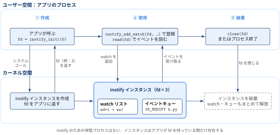
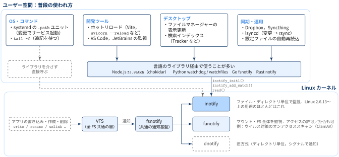
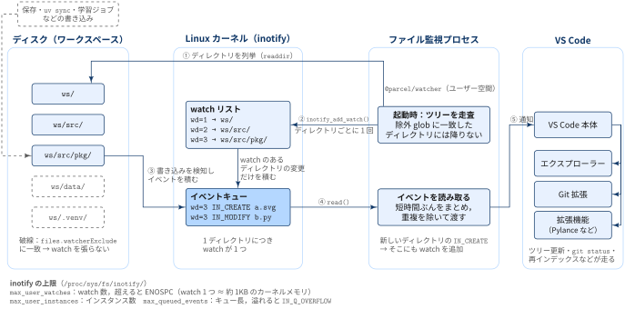

## この記事について

:::: {.no-border-top-table}

| 観点 | 内容 |
|---|---|
| **What：何のドキュメントか** | Linux のファイル監視の仕組み（inotify）と，VS Code で出る「unable to watch for file changes」（ENOSPC）エラーの原因と対処をまとめたドキュメント |
| **Who：誰に向けたものか** | Linux 上で VS Code を使っていて，大きなワークスペースを開いたときに上記のエラーに出会った人 |
| **Why：なぜ重要か** | `max_user_watches` を上げるだけでも直るが，仕組みを知らないと「何をどれだけ上げればよいか」「先に何を除外すべきか」が判断できないため |
| **How：どう使うか** | 前半で仕組みを理解し，後半の「確認 → 除外 → 上限の引き上げ」の順で対処する |

: {tbl-colwidths="[30,70]"}

::::

## きっかけ：VS Code の警告

Python の `.venv` や学習データを含む大きなリポジトリを VS Code で開くと，次の警告が出ることがあります．

```
Visual Studio Code is unable to watch for file changes in this large workspace (error ENOSPC)
```

この状態になると，ファイルを外部で変更してもエクスプローラーに反映されない，Git の変更が出てこない，といった症状が起きます．

[何が起こっているのか]{.mini-section}

- ENOSPC は本来「ディスクの空き容量がない」という意味のエラーですが，ここではディスクは関係はない
- 足りなくなっているのは **Linux カーネルが管理する「ファイル監視（watch）」の数** 

この意味を理解するために，まず Linux でファイルの変更がどうやってアプリに伝わるのかを見ていきます．

## なぜファイル監視はカーネルの機能なのか


::: {.callout-note}
### 原則

- どのプロセスがどのファイルに書き込んだかをすべて見ているのは，カーネル

:::

GNOME などのデスクトップ環境では，「ファイルマネージャーの表示をすぐ更新したい」「検索インデックスを最新に保ちたい」という需要があります．
しかしカーネルによる監視の仕組みがないと，アプリが変更を知る手段は **ポーリング**，つまり数秒ごとに全ファイルの更新時刻を `stat()` で調べ直す方法しかありません．

```c
while true:
    for f in 全ファイル:
        今の更新時刻 = stat(f).mtime
        if 今の更新時刻 != 前回の更新時刻:
            「f が変わった」と処理する
    x秒待つ
```

[ポーリングの問題点]{.mini-section}


- **遅い**：変更を検知できるのは次の確認のときなので，反映が遅れる
- **重い**：ファイルが数万個あれば，何も変わっていなくても毎回すべてを確認するので，CPU やディスク I/O を無駄に消費する

そのため，Linuxでは，カーネルが「変わったときだけ知らせる」仕組み，**inotify** を準備しています．


### inotifyはカーネルに組み込まれた機能 = システムコール


::: {.callout-note}
### REMARKS

- inotify は常駐するサービス（デーモン）ではなく，カーネルに組み込まれた機能
- アプリはシステムコール `inotify_init1()` を呼んで使う
- systemd のユニットとしては存在せず，`systemctl start` のように起動・停止するものではない（状態の確認方法は [Appendix](#appendix-inotify-status) を参照）

:::


[システムコールとサービスの違い]{.mini-section}

- **システムコール** は，アプリがカーネルに仕事を頼むための窓口
- **サービス** は，バックグラウンドで動き続ける普通のプロセス（ユーザー空間のプログラム）

:::: {.no-border-top-table}

| 観点 | システムコール（inotify） | サービス（例：`sshd`，`cron`） |
|---|---|---|
| 正体 | カーネル内の関数 | 独立したプロセス |
| 動いている場所 | カーネル空間 | ユーザー空間 |
| 起動・停止 | 不要．カーネルが動いていれば常に使える | systemd などが起動・停止する |
| 使い方 | アプリが関数として呼ぶ | ソケットや D-Bus などで通信する |
| `ps` に出るか | 出ない（呼び出したアプリが出る） | 出る |

: {tbl-colwidths="[20,40,40]"}

::::

[inotify は「誰かが動かしておくもの」ではなく，使うアプリがそのつど借りるもの]{.mini-section}

inotify の場合，アプリが `inotify_init1()` を呼ぶとカーネル内に「inotify インスタンス」が作られ，それを指すファイルディスクリプタがアプリに返ります．
watch やイベントキューはこのインスタンスに属します．
アプリがファイルディスクリプタを閉じるか終了すれば，インスタンスも消えます．

{width="100%" fig-align="center"}


## inotifyの仕組み


{width="100%" fig-align="center"}

| 分類 | 例 |
|---|---|
| OS・コマンド | systemd の `.path` ユニット（ファイルが変わったらサービスを起動），`tail -f`．ライブラリを介さず inotify を直接呼ぶ |
| 開発ツール | ホットリロード（Vite，`uvicorn --reload`），VS Code・JetBrains のファイル監視 |
| デスクトップ | ファイルマネージャーの表示更新，検索インデックス（Tracker） |
| 同期・運用 | Dropbox，Syncthing，lsyncd，設定ファイルの自動再読み込み |

: {tbl-colwidths="[20,80]"}

## VS Code はどうやってファイルを監視しているか

VS Code は Linux では `@parcel/watcher` というライブラリを使い，inotify でワークスペースを監視しています．

{width="100%" fig-align="center"}

1. 起動時にワークスペースのディレクトリツリーを走査する（`readdir`）
2. 見つけた **ディレクトリごとに 1 回** `inotify_add_watch()` を呼び，watch を登録する
3. ファイルが保存・作成されると，カーネルが watch のあるディレクトリのイベントだけをキューに積む
4. 監視プロセスがキューを `read()` し，短時間ぶんのイベントをまとめて重複を除く
5. VS Code 本体に通知し，エクスプローラーの更新・`git status`・拡張機能の再インデックスなどが走る

## なぜerror ENOSPCにつながるのか？


::: {.callout-note}
### TL;DRs

- inotify には「このディレクトリ以下を再帰的に全部見る」という機能がない
- 監視プロセスは **ディレクトリの数だけ watch を張る**．
- 数千〜数万のディレクトリが一気に作られたとき，監視上限(= watch数の上限)に達して，error ENOSPC

:::

`.venv` や `node_modules` は，数千〜数万のディレクトリを含むことが珍しくありません．
これらを監視対象に含めると，watch の数はあっという間に膨らみます．

[`/proc/sys/fs/inotify/max_user_watches` という上限]{.mini-section}

watch はカーネルのメモリを消費するので，無制限には作れません．
上限は `/proc/sys/fs/inotify/` 以下のファイルで確認できます．

:::: {.no-border-top-table}

| ファイル | 意味 | 超えたとき |
|---|---|---|
| `max_user_watches` | 1 ユーザーが作れる watch の総数 | `inotify_add_watch()` が ENOSPC で失敗する |
| `max_user_instances` | 1 ユーザーが作れる inotify インスタンス（`inotify_init()` の数） | `inotify_init()` が EMFILE で失敗する |
| `max_queued_events` | 1 インスタンスのイベントキューの長さ | イベントが捨てられ `IN_Q_OVERFLOW` が届く |

: {tbl-colwidths="[25,45,30]"}

::::

error ENOSPC は，1 行目の `max_user_watches` を使い切ったことを意味します．
ここでポイントは，この上限が **プロセスごとではなくユーザーごと** だという点です．
VS Code のウィンドウを複数開いている場合や，同じユーザーで Dropbox やホットリロード付きの開発サーバーを動かしている場合，それらの watch はすべて同じ枠を共有します．

なお，`max_user_watches` の初期値は Linux 5.11 以降，搭載メモリから自動で決まります（メモリの約 1% を上限に，8,192〜1,048,576 の範囲）．
そのため，同じ設定でもマシンによって値が異なります．

## 対処の手順

### Step 1：現在の上限と使用量を確認する

まず上限を確認します．

```bash
cat /proc/sys/fs/inotify/max_user_watches
# 65536
```

次に，どのプロセスが watch をいくつ使っているかを数えます．
各プロセスの `/proc/<pid>/fdinfo/` には，inotify の watch 1 つにつき `inotify wd:...` という行が 1 行出るので，その行数を数えれば watch 数が分かります．

```bash
# bash で実行する（zsh では一致しないグロブがエラーになる）
for p in /proc/[0-9]*; do
  n=$(cat "$p"/fdinfo/* 2>/dev/null | grep -c '^inotify')
  [ "$n" -gt 0 ] && echo "$n $(cat "$p"/comm)"
done | sort -rn | head
```

```
32079 code
28263 code
4146 code
184 xdg-desktop-por
176 gsd-xsettings
```

VS Code（`code`）の 3 プロセスだけで約 64,500 個の watch を使っており，上限 65,536 にほぼ達しています．
この状態でさらにワークスペースを開くと ENOSPC になります．

### Step 2：まず監視対象を減らす（`files.watcherExclude`）

上限を上げる前に，**そもそも監視する必要のないディレクトリを除外する** のが先です．
仮想環境・データ・ビルド成果物などは，VS Code がリアルタイムで変更を追う必要がほとんどありません．

`files.watcherExclude` の初期値は `node_modules` と `.git` 以下の一部のフォルダのみを除外しています．

```json
"files.watcherExclude": {
    "**/.git/objects/**": true,
    "**/.git/subtree-cache/**": true,
    "**/node_modules/*/**": true
}
```

統計分析 with Python を行うレポジトリをメインで扱う場合，例えば次のように追加します．

```json
"files.watcherExclude": {
    "**/.git/objects/**": true,
    "**/.git/subtree-cache/**": true,
    "**/node_modules/*/**": true,
    "**/.venv/**": true,
    "**/data/**": true,
    "**/__pycache__/**": true,
    "**/.mypy_cache/**": true,
    "**/.pytest_cache/**": true
}
```

設定後に VS Code を再読み込みし，Step 1 のコマンドで watch 数が減ったことを確認します．
また，他のアプリケーションも同じ枠を使っているので，不要なアプリを閉じるだけで解消することもあります．

### Step 3：(非推奨) それでも足りなければ上限を引き上げる

除外しても足りない場合は，`max_user_watches` を引き上げます．

[一時的に変更する場合]{.mini-section}

一時的に変更するだけなら次のコマンドで足ります（再起動で元に戻ります）．

```bash
sudo sysctl fs.inotify.max_user_watches=524288
```

[永続的に変更する場合]{.mini-section}

永続化するには設定ファイル `/etc/sysctl.d/*.conf` に書きます．

```bash
echo 'fs.inotify.max_user_watches=524288' | sudo tee /etc/sysctl.d/60-inotify.conf
sudo sysctl --system
cat /proc/sys/fs/inotify/max_user_watches
# 524288
```

::: {.callout-note}
## 上限を上げるとメモリはどれだけ使うか

VS Code のドキュメントによると，watch 1 つあたり約 1,080 バイトのカーネルメモリを使います．
524,288 個をすべて使い切った場合，上限は約 540 MiB です．
上限値を設定しただけでメモリが確保されるわけではなく，実際に watch を張った分だけ消費されます．
とはいえメモリの少ない環境では，より小さい値を選んでください．
:::


## Appendix: inotify の状態を確認する {#appendix-inotify-status}

inotify はサービスではないので，`systemctl status` では確認できません．
代わりに次の 3 つの観点で確認します．

| 確認したいこと | 見る場所 |
|---|---|
| カーネルで inotify が使えるか | `/proc/sys/fs/inotify/` |
| カーネルに組み込まれているか | `/boot/config-$(uname -r)` の `CONFIG_INOTIFY_USER` |
| どのプロセスが使っているか | `/proc/<pid>/fd/` の `anon_inode:inotify` |

: {tbl-colwidths="[40,60]"}

[カーネルで使えるかと上限値]{.mini-section}

```bash
# 機能が有効なら，このディレクトリと上限値が見える
ls /proc/sys/fs/inotify/
cat /proc/sys/fs/inotify/max_user_watches
```

`/proc/sys/fs/inotify/` は，カーネルの設定値をファイルとして見せている場所です．
このディレクトリがあれば，カーネルで inotify が使える状態です．

[カーネルのビルド設定]{.mini-section}

```bash
# カーネルのビルド設定で有効か（=y なら有効）
grep INOTIFY_USER /boot/config-$(uname -r)
# CONFIG_INOTIFY_USER=y
```

`/boot/config-<バージョン>` は，今動いているカーネルをビルドしたときの設定です．
`CONFIG_INOTIFY_USER=y` なら，inotify がカーネルに組み込まれています．
Ubuntu などの主要なディストリビューションでは標準で有効です．

[inotify を使っているプロセス]{.mini-section}

```bash
# 今 inotify を使っているプロセスの一覧
sudo find /proc/*/fd -lname 'anon_inode:inotify' 2>/dev/null \
  | cut -d/ -f3 | sort -u | xargs -r ps -o pid,comm -p
```

inotify インスタンスのファイルディスクリプタは，`/proc/<pid>/fd/` 以下で `anon_inode:inotify` を指すリンクとして見えます．
このコマンドは，そのリンクを持つプロセスの PID を集め（`find` → `cut` → `sort -u`），`ps` でプロセス名を表示します．
`sudo` を付けないと，自分以外のユーザーのプロセスは見えません．

```
    PID COMMAND
   3891 wireplumber
   3908 dbus-daemon
   4196 gnome-session-b
   ...
```

デスクトップ環境の常駐プログラムなど，意識していないプロセスも多く inotify を使っていることが分かります．

## References

- [Visual Studio Code FAQ: "Visual Studio Code is unable to watch for file changes in this large workspace" (error ENOSPC)](https://code.visualstudio.com/docs/setup/linux#_visual-studio-code-is-unable-to-watch-for-file-changes-in-this-large-workspace-error-enospc)
- [inotify(7) — Linux manual page](https://man7.org/linux/man-pages/man7/inotify.7.html)
