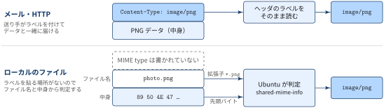

::: {.callout-note}
## TL;DRs

- MIME type（正式名称は media type）は「このデータは何か」を受け手に伝えるための `type/subtype` 形式のラベル
- ラベルはファイルの中ではなく，HTTP やメールのヘッダなど**データの外側**に付く
- ラベルのないファイルの MIME type は，ツールが拡張子や中身から推測する．ツールによって推測方法が違うので，結果が食い違うことがある

:::{.padding-left-10}

| やりたいこと | 書き方 |
|---|---|
| ファイルの中身から判定する | `file --mime-type FILE` |
| GNOME の判定結果を見る | `gio info -a standard::content-type FILE` |
| デスクトップ環境の判定結果を見る | `xdg-mime query filetype FILE` |
| MIME type に対応する既定アプリを見る | `xdg-mime query default image/png` |
| Webサーバーが返すラベルを見る | `curl -sI URL \| grep -i content-type` |
: {tbl-colwidths="[40,60]"}

:::

:::

## MIME Typeとは

::: {#def- .custom_problem .blog-custom-border}
### MIME Type

- データの種類を表すための標準的なラベル．「このデータは HTML 」「これは PNG 画像」と受け手に伝えるために使う
- `type/subtype` の形で書き，必要に応じて `;` 区切りでパラメータを付ける
- 種類の一覧は IANA が管理しており，現在の正式名称は **media type**

[形式]{.mini-section}

`タイプ/サブタイプ` の形 + 必要に応じてパラメータを付与して，以下のように記述

:::{.padding-left-10}

```ini
# HTML 形式のテキストで，文字コードは UTF-8
text/html; charset=utf-8
```

:::
:::

[MIME Typeの構成要素]{.mini-section}

:::: {.no-border-top-table}

| 部分 | 例 | 意味 |
|---|---|---|
| type（トップレベルタイプ） | `text` | データの大分類．人が読めるテキスト |
| subtype | `html` | 大分類の中での具体的な形式 |
| パラメータ | `charset=utf-8` | 解釈に必要な追加情報．`text` では文字コードを指定することが多い |

: {tbl-colwidths="[30,20,50]"}

::::

[代表的な MIME type]{.mini-section}

:::: {.no-border-top-table}

| MIME type | 内容 |
|---|---|
| `text/plain` | プレーンテキスト |
| `text/html` | HTML |
| `text/csv` | CSV |
| `application/json` | JSON |
| `application/pdf` | PDF |
| `image/png` | PNG 画像 |
| `multipart/form-data` | 複数のパートをまとめたもの（フォームの送信など） |
| `application/octet-stream` | 種類不明の汎用バイナリ |

: {tbl-colwidths="[35,65]"}

::::


### 電子メールの MIME との関係

::: {#def- .custom_problem .blog-custom-border}
## 電子メール文脈でのMIME

- Multipurpose Internet Mail Extensions の略
- テキスト（ASCII）しか送れなかった電子メールで日本語・画像・添付ファイルを送るための拡張規格

:::

もともとの電子メール（RFC 822）は，本文に ASCII のテキストを入れることしか想定していませんでした．
画像や添付ファイル，日本語のような ASCII 以外のテキストを送るために，MIME という仕組みが利用されています．

[MIMEの機能]{.mini-section}

- **構造化**: 本文がどんな種類のデータかを `Content-Type` ヘッダで示す
- **符号化**: 画像などのバイナリを，7bit のテキストしか通さないメールの経路に乗せられる形に変換する．方法は `Content-Transfer-Encoding` ヘッダで示す

::: {#exm- .custom_problem }

### MIME メールの例

GIF 画像を1つ添付したメールの中身は以下のようになります．

```ini
From: "Taro Yamada" <taro@example.com>
To: "Hanako Suzuki" <hanako@example.jp>
Subject: 画像です
MIME-Version: 1.0
Content-Type: image/gif; name="logo.gif"
Content-Disposition: attachment; filename="logo.gif"
Content-Transfer-Encoding: base64

R0lGODlhcwA4AOYAAP/////++Pj9+/749fn49/H2+eX27+/v7+H07N3z6eXs8dXw5OLl6N/l68/u
...
VYVxGKjjlEqJQAAAOw==
```

- `From`〜`Subject` は通常のメールのヘッダで，`MIME-Version` 以下の4つが MIME で追加されたヘッダ
- 空行のあとが本文で，GIF のバイナリが Base64 でテキストに変換されて入っている

[MIME で追加されたヘッダ]{.mini-section}

:::: {.no-border-top-table}

| ヘッダ | 役割 | 例 |
|---|---|---|
| `MIME-Version` | MIME のバージョン．`1.0` しか存在しない | `1.0` |
| `Content-Type` | 本文のデータの種類（media type）とパラメータ | `image/gif; name="logo.gif"` |
| `Content-Disposition` | 本文の扱い方．`inline` は本文と一緒に表示，`attachment` は添付ファイルとして扱う．`filename` で元のファイル名を伝える | `attachment; filename="logo.gif"` |
| `Content-Description` | 本文につける説明（コメント） | `"This is My Picture"` |
| `Content-Transfer-Encoding` | 本文をテキストに変換した方法 | `base64` |

: {tbl-colwidths="[28,47,25]"}

::::

`Content-Disposition` は送り手の意図を伝えるもので，受け手のメーラがその通りに表示する保証はありません．

:::
***

## HTMLやPNGファイルのどこにMIME Typeがあるのか？

::: {.callout-note}
## MIME Type はファイルには書かれていない

- 電子メールでは，`Content-Type: image/gif` のように MIME type がメッセージのヘッダに書かれて，データと一緒に届く
- 一方，ローカルにある HTML や PNG のファイルには，MIME type はどこにも書かれていない．ファイルの中身はただの HTML や PNG のデータである
- ファイルの MIME type は OS（Ubuntu ならデスクトップ環境）がその都度判定して分類している

:::

PNG や HTML という**形式**と，MIME type という**ラベル**は別のものです．
メールや HTTP では送り手がラベルを貼ってくれますが，ローカルのファイルにはラベルを貼る場所がありません．
ファイルに付いているのはファイル名（拡張子）と中身だけなので，Ubuntu はこの2つを手がかりに「このファイルは `image/png` だ」と分類しています．

{width="100%" fig-align="center"}

### Ubuntu が MIME type を判定する仕組み

- Ubuntu（GNOME）では，**shared-mime-info** というデータベースに「どんなファイルをどの MIME type に分類するか」のルールがまとめている
- ルールは MIME type ごとに XML で定義されいる

```xml
<!-- /usr/share/mime/packages/freedesktop.org.xml より抜粋 -->
<mime-type type="image/png">
  <comment>PNG image</comment>
  <magic>
    <match type="string" value="\x89PNG\r\n\x1A\n" offset="0"/>
  </magic>
  <glob pattern="*.png"/>
</mime-type>
```

:::: {.no-border-top-table}

| 要素 | 手がかり | 意味 |
|---|---|---|
| `<glob>` | 拡張子 | ファイル名が `*.png` にマッチすれば `image/png` |
| `<magic>` | 中身 | ファイルの先頭（`offset="0"`）が `\x89PNG\r\n\x1A\n` で始まれば `image/png` |

: {tbl-colwidths="[15,15,70]"}

::::


GNOME のアプリやファイルマネージャは，`gio`（GLib）を通じてこのデータベースを引き，ファイルの MIME type を決めています．
判定結果は以下のコマンドで確認できます．

```bash
% gio info -a standard::content-type photo.png
  standard::content-type: image/png

% xdg-mime query filetype photo.png
image/png
```

[拡張子との違い]{.mini-section}

拡張子（`.png` など）は MIME type を判定するための手がかりの1つにすぎず，MIME type そのものではありません．

:::: {.no-border-top-table}

| | 拡張子 | MIME type |
|---|---|---|
| 付いている場所 | ファイル名 | メールや HTTP のヘッダ．ローカルのファイルには付いておらず，OS が判定する |
| ファイル名がない場面 | 使えない（HTTP の URL や API のレスポンスには拡張子がないことが多い） | 使える |
| 中身との一致 | 保証されない（名前は自由に変えられる） | 保証されない（送り手の自己申告，または OS の推測） |

: {tbl-colwidths="[24,38,38]"}

::::

::: {#exm- .custom_problem }
### `open` コマンドでデフォルトアプリケーション起動ができる機序

Ubuntu の `open` は `xdg-open` へのリンクです．

```bash
% readlink -f "$(command -v open)"
/usr/bin/xdg-open
```

`open photo.png` を実行すると画像ビューアが起動するのは，`xdg-open` が「ファイル → MIME type → アプリ」の2段階で開くアプリを決めているからです．
ファイルとアプリを直接結びつけるのではなく，間に MIME type を挟んでいるのがポイントです．

{width="100%" fig-align="center"}

[① 種類を調べる: ファイル → MIME type]{.mini-section}

前節の shared-mime-info を使って，`photo.png` を `image/png` に分類します．

```bash
% xdg-mime query filetype photo.png
image/png
```

[② 開くアプリを決める: MIME type → `.desktop`]{.mini-section}

アプリ側は，自分が開ける MIME type を `.desktop` ファイル（アプリの起動設定）の `MimeType=` に宣言しています．

```ini
# /usr/share/applications/org.gnome.eog.desktop（画像ビューア）より抜粋
Exec=eog %U
MimeType=image/bmp;image/gif;image/jpeg;image/png;...
```

これを MIME type ごとに集計したものが `mimeinfo.cache` で，「`image/png` を開けるアプリの候補一覧」になります．
候補の中からどれを使うかは `mimeapps.list` の既定の指定で決まり，ユーザー設定（`~/.config/mimeapps.list`）が最優先されます．

:::: {.no-border-top-table}

| ファイル | 役割 | 例 |
|---|---|---|
| `*.desktop` の `MimeType=` | アプリが開ける MIME type の宣言 | `MimeType=image/png;...` |
| `mimeinfo.cache` | 上を MIME type ごとにまとめた候補一覧 | `image/png=org.gnome.eog.desktop;...` |
| `mimeapps.list` | MIME type ごとの既定アプリ | `image/png=org.gnome.eog.desktop` |

: {tbl-colwidths="[28,37,35]"}

::::

```bash
# image/png の既定アプリを確認
% xdg-mime query default image/png
org.gnome.eog.desktop

# 既定アプリを変更（~/.config/mimeapps.list に書き込まれる）
% xdg-mime default org.gnome.Shotwell-Viewer.desktop image/png
```

[アプリを起動する]{.mini-section}

最後に，選ばれた `.desktop` ファイルの `Exec=` の行（`eog %U`）の `%U` をファイルの URI に置き換えて実行します．
ファイルの種類の判定（①）と，種類ごとのアプリの割り当て（②）が分かれているので，`mimeapps.list` を1行変えるだけで，すべての PNG ファイルを開くアプリを切り替えられます．

:::
***


## データ分析で使う場面

[API のレスポンスを確認する]{.mini-section}

`requests` のレスポンスを `.json()` で読もうとしてエラーになる場合は，まず `Content-Type` を確認すると原因の切り分けが早くなります．

```python
import requests

r = requests.get(url)
print(r.headers["Content-Type"])  # application/json を期待していたのに text/html（エラーページ）だった，など
```

`curl` でもヘッダだけを確認できます．

```bash
% curl -sI https://example.com | grep -i content-type
content-type: text/html
```

[Jupyter の出力表示]{.mini-section}

Jupyter Notebook でセルの出力が表やグラフになるのも MIME type の仕組みです．
カーネルは1つの出力を複数の MIME type で同時に返し，フロントエンドが表示できる中で最もリッチなものを選びます．

```json
"data": {
  "text/plain": "   a  b\n0  1  3\n1  2  4",
  "text/html": "<table>...</table>"
}
```

上は pandas の DataFrame を表示したときの `.ipynb` の中身です．
Jupyter Lab では `text/html` が表として表示され，ターミナルの IPython では `text/plain` が使われます．

[よく見る MIME type]{.mini-section}

:::: {.no-border-top-table}

| 形式 | MIME type | 備考 |
|---|---|---|
| CSV | `text/csv` | |
| TSV | `text/tab-separated-values` | |
| JSON | `application/json` | |
| JSON Lines | `application/x-ndjson`, `application/jsonl` など | IANA 未登録で，ツールによって表記が揺れる |
| Parquet | `application/vnd.apache.parquet` | |
| Excel (`.xlsx`) | `application/vnd.openxmlformats-officedocument.spreadsheetml.sheet` | 古い `.xls` は `application/vnd.ms-excel` |
| Jupyter Notebook | `application/x-ipynb+json` | |
| Markdown | `text/markdown` | |
| SVG | `image/svg+xml` | `+xml` は中身が XML であることを表す |
| gzip / zip | `application/gzip` / `application/zip` | |

: {tbl-colwidths="[18,42,40]"}

::::

subtype の `vnd.` はベンダー（Apache，Microsoft など）が登録したもの，`x-` は IANA に登録されていない慣習的なものを表します．

## Appendix: 用語集

:::{.glossary-container}

```yaml
glossary:
  - def: IANA (Internet Assigned Numbers Authority)
    description: |
      インターネットで使う番号や名前を管理する組織．
      IP アドレスの割り当てやポート番号の一覧と並んで，media type の登録簿も管理している．

  - def: Content-Type ヘッダ
    description: |
      メールや HTTP のメッセージで，本文のデータの MIME type を伝えるヘッダ．
      `Content-Type: text/html; charset=utf-8` のように，MIME type とパラメータをそのまま書く．

  - def: マジックナンバー
    description: |
      ファイル形式を識別するために，ファイルの先頭に置かれる決まったバイト列．
      例えば PNG は `\x89PNG\r\n\x1a\n`，PDF は `%PDF`，ZIP は `PK\x03\x04` で始まる．
      `file` コマンドはこれを使って，拡張子に頼らずにファイルの種類を判定する．

  - def: shared-mime-info
    description: |
      freedesktop.org が管理する，Linux デスクトップ向けの MIME type データベース．
      拡張子のパターン（`globs2`）とマジックナンバーの両方の判定ルールを持ち，`gio` や GNOME / KDE のファイルマネージャが利用する．

  - def: mimeapps.list
    description: |
      MIME type ごとの既定アプリを書く設定ファイル．
      `[Default Applications]` セクションに `image/png=org.gnome.Loupe.desktop` のように書く．
      `xdg-mime default` で変更すると `~/.config/mimeapps.list` に書き込まれる．

  - def: MIME sniffing
    description: |
      受け手（主にブラウザ）が，送り手の付けた MIME type を信用せずに中身から種類を推測し直す動作．
      ラベルの付け忘れを補える一方，意図しない解釈によるセキュリティ問題の原因にもなる．
```

:::

References
----------
- [RFC 2045: MIME Part One: Format of Internet Message Bodies](https://www.rfc-editor.org/rfc/rfc2045)
- [RFC 2046: MIME Part Two: Media Types](https://www.rfc-editor.org/rfc/rfc2046)
- [RFC 6838: Media Type Specifications and Registration Procedures](https://www.rfc-editor.org/rfc/rfc6838)
- [IANA > Media Types](https://www.iana.org/assignments/media-types/media-types.xhtml)
- [freedesktop.org > Association between MIME types and applications](https://specifications.freedesktop.org/mime-apps-spec/latest/)
- [MDN > MIME types](https://developer.mozilla.org/en-US/docs/Web/HTTP/Guides/MIME_types)
- [regmonkey post > VS Code の使い方（Appendix: `xdg-open` の動作）](../2026-08-21-how-to-use-vscode-editor/index.qmd)
