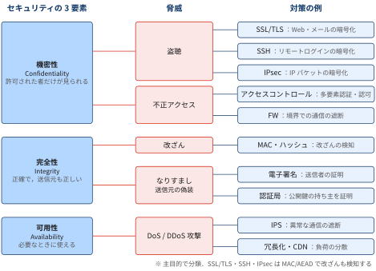
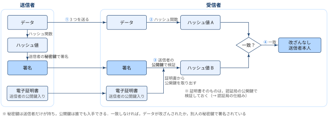
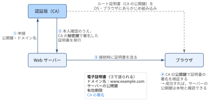

::: {.callout-note}
## TL:DRs

- 「他のコンピューターとつながる」ということは便利な反面，様々な危険も伴う
- 情報セキュリティは **機密性・完全性・可用性** の3要素で捉え，「どの要素が損なわれるか」で脅威を整理する
- 通信路上の主な脅威は **盗聴・不正アクセス・改ざん・なりすまし・DoS/DDoS攻撃**
- 対策は「暗号化（SSL/TLS・SSH・IPsec）」「真正性の保証（電子署名・認証局）」「入口の制御（アクセスコントロール・FW）」の組み合わせ．対策が効いているかはペネトレーションテストで検証する

:::

## セキュリティの捉え方

ネットワークにつながったコンピューターは，世界中の相手とデータをやり取りできます．
その一方で，通信の途中には自分の管理下にない機器（ルーター・Wi-Fiアクセスポイント・プロバイダの設備など）がいくつも挟まり，
悪意のある第三者が通信をのぞいたり，書き換えたり，邪魔したりする余地が生まれます．

「何を守れば安全と言えるのか」を整理する枠組みが，情報セキュリティの3要素です．

::: {#def- .custom_problem .blog-custom-border}
### 情報セキュリティの３要素

- **機密性（Confidentiality）**：許可された者だけが情報にアクセスできること
- **完全性（Integrity）**：情報が正確・完全であり，不正に改ざんされていないこと
- **可用性（Availability）**：許可された者が，必要なときに情報やサービスを利用できること

:::

3要素の頭文字をとって **CIA** と呼ばれます（[ISO/IEC 27000:2018](https://www.iso.org/standard/73906.html) の定義に基づく）．
3要素はトレードオフの関係にあることも多く，たとえば機密性を高めるために認証を厳しくしすぎると，正規の利用者が使いにくくなり可用性が下がります．
セキュリティ対策は「どの要素を，どの脅威から，どの程度守るか」を決める作業だといえます．

{width="100%" fig-align="center"}

::: {.callout-important}
## 図は「主目的」で分類した簡略図

実際の対応関係は多対多です．図だけを見て「この技術はこの脅威にしか効かない」と読まないように注意してください．

- **1つの脅威が複数の要素を損なう**：不正アクセスは情報の漏えい（機密性）だけでなく，侵入後のデータ改ざん（完全性）やランサムウェアによるシステム停止（可用性）にもつながる．
- **1つの対策が複数の脅威に効く**：SSL/TLS・SSH・IPsec は暗号化だけの技術ではなく，MAC や AEAD によって**改ざんの検知（完全性）**も保証している．また SSL/TLS のサーバー証明書は，なりすましや中間者攻撃による盗聴も防ぐ

:::

[なりすましと真正性]{.mini-section}

- **なりすまし**（正規の相手のふりをすること）が損なうのは「相手やデータが，主張どおりの本物であること」＝ **真正性（Authenticity）**．ISO/IEC 27000 では CIA とは別の要素として定義され，CIA を拡張した7要素の1つとして扱われる
- 3要素だけで考える場合は，完全性を「データの中身が正しい（data integrity）」と「送信元が正しい（origin integrity）」の両方を含む広い意味でとらえ，なりすましを完全性の侵害に含めることも多い

### 脅威

::: {#def- .custom_problem .blog-custom-border}
### 脅威

- セキュリティを脅かすものを脅威と呼ぶ
- 脅威は悪意のある外部の者による攻撃の他，自然災害なども含まれる

:::


通信に潜む代表的な脅威は次の5つです．

:::: {.no-border-top-table}

| 脅威 | 内容 | 主に損なわれる要素 |
|---|---|---|
| **盗聴** | 通信経路上のデータを第三者がのぞき見る | 機密性 |
| **不正アクセス** | 権限のない者がシステムに侵入・利用する | 機密性（＋完全性・可用性） |
| **改ざん** | 通信中・保存中のデータを第三者が書き換える | 完全性 |
| **なりすまし** | 正規の利用者や通信相手のふりをして，通信やシステム利用を行う | 完全性（送信元の正しさ．7要素では真正性） |
| **DoS/DDoS攻撃** | 大量の通信や処理要求を送りつけ，サービスを使えなくする | 可用性 |

: {tbl-colwidths="[20,55,25]"}

::::

[盗聴]{.mini-section}

- 暗号化されていない通信は，経路上の機器から内容をそのまま読み取れる
- 公衆Wi-Fiのように同じネットワークに不特定多数が参加する環境では，パケットキャプチャツールで他人の通信を簡単に取得できる
- 盗聴そのものは通信を変化させないため，**被害に気付きにくい**のが特徴

[不正アクセス]{.mini-section}

- 他人のID・パスワードを使ったり，ソフトウェアの脆弱性を突いたりして，本来アクセスできないシステムに入り込む
- 侵入後は情報の持ち出し（機密性），データの書き換え（完全性），システムの破壊や停止（可用性）と，3要素すべてに被害が及びうる
- 乗っ取ったコンピューターを踏み台にして，さらに別のシステムを攻撃することもある

[改ざん]{.mini-section}

- 通信の途中でデータを書き換えたり，Webサイトのコンテンツを書き換えたりする
- 送金先の口座番号や，ダウンロードするソフトウェアの中身が書き換えられると，受け取った側は正しいデータだと信じたまま被害を受ける
- 改ざんと組み合わさりやすいのが次のなりすましで，偽の相手と通信していると気付かなければ改ざんも検知できない

[なりすまし]{.mini-section}

- 盗んだID・パスワードでログインする，送信元のIPアドレスやメールアドレスを偽装する，本物そっくりの偽サイトを用意するなどの手口で，正規の相手のふりをする
- データの中身ではなく「誰が送ったか」を偽るため，受け取った側は内容が正しくても送信元を信じて被害を受ける（偽の請求メールに従って振り込む，など）
- 盗聴（中間者攻撃）や不正アクセスの入口として使われることも多い

[DoS/DDoS攻撃]{.mini-section}

- DoS（Denial of Service）攻撃は，サーバーやネットワークの処理能力を超える要求を送りつけて，正規の利用者がサービスを使えない状態にする
- DDoS（Distributed DoS）攻撃は，マルウェアに感染させた大量のコンピューター（ボットネット）から一斉に攻撃する
- 送信元が分散しているため，特定のIPアドレスを遮断するだけでは防ぎにくい

### 攻撃手法


:::: {.no-border-top-table}

| 攻撃手法 | 概要 | 関連する脅威 |
|---|---|---|
| [パケットスニッフィング](figures/attacks/packet-sniffing.svg){.lightbox gallery="attacks"} | ネットワーク上を流れるパケットを収集し，平文のパスワードや通信内容を読み取る | 盗聴 |
| [中間者攻撃（MITM）](figures/attacks/mitm.svg){.lightbox gallery="attacks"} | 通信する2者の間に割り込み，双方になりすまして通信を中継する．内容をのぞき見るだけでなく書き換えも可能 | 盗聴・改ざん・なりすまし |
| [MITB攻撃](figures/attacks/mitb.svg){.lightbox gallery="attacks"} | PCに感染したマルウェアがブラウザを乗っ取り，利用者が入力した送金先・金額などをブラウザ内で書き換える（Man-in-the-Browser）．通信はTLSで暗号化されていても，暗号化の前に改ざんされるため防げない | 改ざん・なりすまし |
| [偽アクセスポイント](figures/attacks/rogue-ap.svg){.lightbox gallery="attacks"} | 正規と同じSSIDの偽Wi-Fiを設置し，接続してきた端末の通信を経由させる | 盗聴・改ざん |
| [IPスプーフィング](figures/attacks/ip-spoofing.svg){.lightbox gallery="attacks"} | パケットの送信元IPアドレスを偽装する．IPアドレスで相手を判断するアクセス制御をすり抜けたり，攻撃元を隠したりするのに使われる | なりすまし・不正アクセス・DoS |
| [ARPスプーフィング](figures/attacks/arp-spoofing.svg){.lightbox gallery="attacks"} | 同じLAN内で偽のARP応答を送り，「デフォルトゲートウェイのIPアドレスに対応するMACアドレスは自分だ」と他の端末に誤って覚えさせる．以降の通信が攻撃者の端末を経由するようになり，中間者攻撃の足がかりになる | なりすまし・盗聴・改ざん |
| [DNSキャッシュポイズニング](figures/attacks/dns-cache-poisoning.svg){.lightbox gallery="attacks"} | DNSキャッシュサーバーに偽の応答を送り込み，ドメイン名と偽サーバーのIPアドレスの対応を記憶（キャッシュ）させる．利用者が正しいURLを入力しても偽サイトに誘導される | なりすまし・改ざん |
| [フィッシング](figures/attacks/phishing.svg){.lightbox gallery="attacks"} | 実在の企業を装ったメールやSMSで偽サイトに誘導し，ID・パスワードやクレジットカード番号を入力させて盗む | なりすまし・不正アクセス |
| [SEOポイズニング](figures/attacks/seo-poisoning.svg){.lightbox gallery="attacks"} | 検索エンジン最適化（SEO）の手法を悪用し，悪意のあるサイトを検索結果の上位に表示させて，マルウェアのダウンロードや偽サイトへ誘導する | なりすまし・不正アクセス |
| [標的型攻撃](figures/attacks/targeted-attack.svg){.lightbox gallery="attacks"} | 特定の組織を狙い，取引先や上司を装った業務メールでマルウェア付きの添付ファイルを開かせる．侵入後は長期間潜伏して内部の情報を探し，持ち出す | なりすまし・不正アクセス |
| [パスワードリスト攻撃・総当たり攻撃](figures/attacks/password-attack.svg){.lightbox gallery="attacks"} | 他サイトから流出したID・パスワードの組や，考えられる全パターンを順に試してログインする | 不正アクセス |
| [辞書攻撃](figures/attacks/dictionary-attack.svg){.lightbox gallery="attacks"} | 辞書に載っている単語や，よく使われるパスワード（`password`，`123456` など）の一覧を順に試してログインする．全パターンを試す総当たり攻撃より少ない試行回数で，推測しやすいパスワードを破れる | 不正アクセス |
| [ポートスキャン](figures/attacks/port-scan.svg){.lightbox gallery="attacks"} | 標的のポート番号に順に接続を試み，どのサービスが動いているか（開いているポート）を調べる．侵入口を探す下調べとして行われる | 不正アクセス（の準備） |
| [セキュリティホール攻撃](figures/attacks/security-hole.svg){.lightbox gallery="attacks"} | OS・ソフトウェアのセキュリティホール（脆弱性）を突いて侵入し，任意のコードを実行する．バッファオーバーフローが代表例 | 不正アクセス・改ざん |
| [ゼロデイ攻撃](figures/attacks/zero-day.svg){.lightbox gallery="attacks"} | 脆弱性が発見されてから，ベンダーが修正プログラムを公開する（または利用者が適用する）までの間に，その脆弱性を突く攻撃．修正方法がまだ存在しない（対策までの猶予が0日）ため，パッチ適用だけでは防げない | 不正アクセス・改ざん |
| [SQLインジェクション](figures/attacks/sql-injection.svg){.lightbox gallery="attacks"} | Webアプリの入力欄にSQL文の断片を入力し，アプリが組み立てるSQL文の意味を変えて，データベースの情報を盗み出したり書き換えたりする | 不正アクセス・改ざん |
| [OSコマンドインジェクション](figures/attacks/os-command-injection.svg){.lightbox gallery="attacks"} | Webアプリの入力値にOSコマンドを紛れ込ませ，サーバー上で任意のコマンドを実行させる．ファイルの閲覧・削除やマルウェアの設置につながる | 不正アクセス・改ざん |
| [Webサイト改ざん](figures/attacks/web-defacement.svg){.lightbox gallery="attacks"} | 不正アクセスしたサーバーのコンテンツを書き換え，マルウェア配布サイトへ誘導する | 改ざん |
| [SYNフラッド攻撃](figures/attacks/syn-flood.svg){.lightbox gallery="attacks"} | TCPの接続要求（SYN）だけを大量に送り，サーバーの接続待ちの枠を使い切らせる | DoS |
| [DNSアンプ攻撃](figures/attacks/dns-amplification.svg){.lightbox gallery="attacks"} | IPスプーフィングで送信元を標的のIPアドレスに偽装し，多数のDNSサーバーに問い合わせる．小さな問い合わせに対する大きな応答（増幅＝amplification）が標的に集中する．リフレクション（反射）攻撃の一種 | DDoS |

: {tbl-colwidths="[22,56,22]"}

::::

## 対策

### 暗号化：盗聴から守る

- 通信内容を暗号化しておけば，たとえ盗聴されても第三者は内容を読めません．
- どの層で暗号化するかによって代表的な技術が異なります．

:::: {.no-border-top-table}

| 技術 | 暗号化する層 | 主な用途 |
|---|---|---|
| **SSL/TLS** | トランスポート層の上（アプリケーションとTCPの間） | HTTPS（Web），メール送受信（SMTPS/IMAPS）など |
| **SSH** | アプリケーション層 | サーバーへのリモートログイン，ファイル転送（`scp`/`sftp`），ポートフォワーディング |
| **IPsec** | ネットワーク層（IP） | 拠点間VPN，リモートアクセスVPN |

: {tbl-colwidths="[15,43,42]"}

::::

[実際には暗号化と同時に改ざん検知も実施]{.mini-section}

- **SSL/TLS**：ブラウザのURLが `https://` で始まる通信で使われる．暗号化に加えて，証明書によるサーバーの認証と，メッセージ認証コードによる改ざん検知も行う．SSLは脆弱性のため廃止され，現在使われているのはTLS（1.2/1.3）
- **SSH**：`telnet` や `rlogin` のようにパスワードを平文で送る古いリモートログインの置き換えとして普及した．公開鍵認証を使えばパスワード自体を送らずにログインできる
- **IPsec**：IPパケット単位で暗号化するため，上位のアプリケーションが暗号化に対応していなくても，すべての通信をまとめて保護できる

### 電子署名と認証局：改ざん・なりすましから守る

暗号化だけでは「通信相手が本物か」「データが途中で書き換えられていないか」は保証できません．これを担うのが電子署名と認証局です．

::: {#def- .custom_problem .blog-custom-border}
### 電子署名

- 送信者が自分の**秘密鍵**でデータのハッシュ値に署名し，受信者が送信者の**公開鍵**で検証する仕組み
- 検証に成功すれば，(1) 確かにその秘密鍵の持ち主が作成したこと（真正性），(2) 署名後に1ビットも変わっていないこと（完全性）を確認できる

:::

{width="100%" fig-align="center"}

検証に使う送信者の公開鍵は，一般的には **電子証明書に入った状態で，データ・署名と一緒に届けられます**（HTTPSではサーバーが接続時に証明書を送り，署名付きメールやソフトウェアでは証明書が添付・埋め込みされている）．
公開鍵そのものは誰に配ってもよいので入手は簡単ですが，問題は「その公開鍵が本当に送信者のものか」です．

電子署名の検証に使う「公開鍵が本当にその人（サーバー）のものか」が保証されなければ，攻撃者は自分の公開鍵を相手のものと偽って配ることができます．
そこで，信頼できる第三者が「この公開鍵はこの持ち主のものである」と証明するのが **認証局（CA: Certificate Authority）** です．

::: {#def- .custom_problem .blog-custom-border}
### 認証局(CA, Certificate Authority)

- 「この公開鍵は，この持ち主（ドメイン・組織・個人）のものである」ことを証明する，信頼された第三者機関
- 申請者の本人確認を行ったうえで，持ち主の情報と公開鍵をまとめて**認証局自身の秘密鍵で署名**し，**電子証明書**として発行する
- 秘密鍵の漏えいなどで不要になった証明書を**失効**させ，失効リスト（CRL）や OCSP で公開するのも認証局の役割
- 代表例：Let's Encrypt，DigiCert，GlobalSign など

:::

- ブラウザやOSには信頼できる認証局（ルート認証局）の証明書があらかじめ組み込まれており，受け取った証明書をそこまでたどって検証する
- 実際には，ルート認証局が中間認証局に証明書を発行し，中間認証局がサーバー証明書を発行する階層構造になっている．この「サーバー証明書 → 中間認証局 → ルート認証局」のつながりを**証明書チェーン**と呼ぶ

{width="90%" fig-align="center"}

- 認証局の役割は本来 **なりすまし対策（真正性）** だが，TLSのサーバー証明書の検証を通じて中間者攻撃（盗聴・改ざん）も防いでいる
- HTTPSでブラウザに警告が出るのは，この検証に失敗した（期限切れ・ドメイン不一致・信頼できない発行元など）場合

### アクセスコントロールとFW：不正アクセスから守る

暗号化が「通信の中身」を守るのに対し，アクセスコントロールとFWは「誰が・どこから入れるか」を制御します．

- **アクセスコントロール**：利用者を認証（本人確認）したうえで，その利用者に許可された操作だけを認める（認可）．ファイルの権限，データベースのロール，最小権限の原則などが該当する．
- **ファイアウォール（FW）**：ネットワークの境界に置き，送信元・宛先のIPアドレスやポート番号などのルールに基づいて通信を許可・遮断する．外部に公開する必要のないサービスへの通信を入口で止めることで，攻撃対象そのものを減らせる


## 対策の検証
### ペネトレーションテスト：対策が本当に効いているか確かめる

::: {#def- .custom_problem .blog-custom-border}
### ペネトレーションテスト

- 攻撃者と同じ視点・手法で実際にシステムへの侵入を試み，防御が機能しているかを検証する疑似攻撃テストのこと
- FW・アクセスコントロール・暗号化といった個々の対策ではなく，**多層防御全体として攻撃を止められるか**を評価できる

:::


- 専門家（ホワイトハッカー）が，ポートスキャンによる侵入口の調査，セキュリティホール攻撃，パスワード攻撃などを組み合わせて，実際に侵入できるか・侵入後に何ができるかを確かめる
- 似た取り組みに **脆弱性診断** がある．脆弱性診断はツール等で既知の脆弱性を網羅的に洗い出すのに対し，ペネトレーションテストは特定の攻撃シナリオ（例：外部から侵入して顧客データを持ち出せるか）を設定し，実際に目的を達成できるかを検証する

:::: {.no-border-top-table}

| | 脆弱性診断 | ペネトレーションテスト |
|---|---|---|
| 目的 | 既知の脆弱性を網羅的に見つける | 攻撃シナリオが実際に成立するかを確かめる |
| 方法 | 診断ツール中心で，対象を広く浅く調べる | 専門家が手動で攻撃を組み合わせ，狭く深く調べる |
| 得られる結果 | 脆弱性の一覧と危険度 | 侵入経路・被害範囲の実証と，防御の弱点 |

: {tbl-colwidths="[20,40,40]"}

::::

::: {.callout-important}
## 許可なく行わない

- ペネトレーションテストやポートスキャンは，攻撃と同じ手法を使う
- システムの管理者から書面で許可を得て，対象範囲・期間を取り決めたうえで実施
- 許可なく他人のシステムに行うと，不正アクセス禁止法などの法令に違反するおそれあり

:::


## Appendix: この記事での用語集

:::{.glossary-container}

```yaml
glossary:
  - def: CIA
    description: |
      情報セキュリティの3要素である機密性（Confidentiality），完全性（Integrity），可用性（Availability）の頭文字．ISO/IEC 27000 シリーズ（情報セキュリティマネジメントシステムの国際規格）で定義される．真正性・責任追跡性・否認防止・信頼性を加えて7要素とすることもある．

  - def: なりすまし
    description: |
      他人や正規のサーバーのふりをして通信やシステム利用を行うこと．盗んだID・パスワードを使う，送信元アドレスを偽装する，偽サイトを用意するなどの手口がある．電子署名や証明書による相手の認証で防ぐ．

  - def: ボットネット
    description: |
      マルウェアに感染し，攻撃者の指令（C&Cサーバー）に従って動くようになった多数のコンピューターの集まり．DDoS攻撃やスパムメール送信に悪用される．感染した機器の持ち主は気付かないことが多く，IoT機器が狙われる例も多い．

  - def: 中間者攻撃 (MITM: Man-in-the-Middle attack)
    description: |
      通信する2者の間に攻撃者が割り込み，それぞれに対して相手のふりをして通信を中継する攻撃．暗号化していても，相手の公開鍵が本物かを確認しなければ攻撃者の鍵で暗号化してしまうため防げない．証明書の検証が重要な理由はここにある．

  - def: 共通鍵暗号方式
    description: |
      暗号化と復号に同じ鍵を使う方式（AESなど）．処理が高速な一方，鍵を安全に相手へ渡す方法（鍵配送問題）が課題になる．SSL/TLSやSSHでは，公開鍵暗号方式などで共通鍵を安全に共有し，以降のデータ通信は共通鍵暗号で行う．

  - def: 公開鍵暗号方式
    description: |
      対になる2つの鍵（公開鍵と秘密鍵）を使う方式（RSA，楕円曲線暗号など）．公開鍵で暗号化したデータは対応する秘密鍵でしか復号できず，秘密鍵で署名したデータは公開鍵で検証できる．公開鍵は誰に配ってもよく，秘密鍵は本人だけが厳重に保管する．

  - def: ハッシュ関数
    description: |
      任意の長さのデータから固定長の値（ハッシュ値）を計算する関数（SHA-256など）．同じ入力からは必ず同じ値が出て，入力が少しでも変わると全く異なる値になり，ハッシュ値から元のデータを逆算できない．改ざん検知や電子署名，パスワードの保存に使われる．

  - def: メッセージ認証コード (MAC)
    description: |
      送信者と受信者が共有する秘密鍵とメッセージから計算する短い値（HMACなど）．受信側で同じ計算をして一致すれば，メッセージが改ざんされておらず，鍵を持つ相手から送られたことを確認できる．電子署名と異なり共通鍵を使うため，第三者に対する証明（否認防止）にはならない．

  - def: AEAD (Authenticated Encryption with Associated Data)
    description: |
      暗号化と改ざん検知（認証）を1つの処理で同時に行う暗号方式（AES-GCM，ChaCha20-Poly1305 など）．復号時に認証タグを検証し，1ビットでも書き換えられていれば復号に失敗する．TLS 1.3 では AEAD 方式の暗号だけが使える．

  - def: ポート番号
    description: |
      1台のコンピューター上で動く複数の通信サービスを区別するための番号（0〜65535）．HTTPは80番，HTTPSは443番，SSHは22番のように用途ごとに標準の番号が決まっている．使っていないポートを閉じておくことは，ポートスキャンで侵入口を見つけられにくくする基本的な対策．

  - def: セキュリティホール（脆弱性）
    description: |
      設計や実装の不備によって生じた，セキュリティ上の欠陥．攻撃者に悪用されると侵入や情報漏えいにつながる．ベンダーが修正プログラム（パッチ）を公開したら速やかに適用することが基本の対策となる．

  - def: ホワイトハッカー
    description: |
      高度なセキュリティの知識・技術を，システムを守る目的で使う技術者．ペネトレーションテストや脆弱性の調査・報告などを行う．同じ技術を悪用して攻撃する者はブラックハット（クラッカー）と呼ばれる．

  - def: 不正アクセス禁止法
    description: |
      正式名称は「不正アクセス行為の禁止等に関する法律」．他人のID・パスワードを無断で使ったり，セキュリティホールを突いたりしてアクセス制御を回避し，コンピューターを利用する行為などを禁止する日本の法律．

  - def: ARP (Address Resolution Protocol)
    description: |
      同じLAN内で，IPアドレスから対応するMACアドレス（機器固有の物理アドレス）を調べるプロトコル．「このIPアドレスの持ち主は？」と問い合わせ，応答をARPテーブルに一時的に記録する．応答が本物かを確かめる仕組みがないため，ARPスプーフィングに悪用される．

  - def: 電子証明書
    description: |
      公開鍵とその持ち主の情報（ドメイン名・組織名など），有効期限を，認証局が署名して1つにまとめたデータ．形式は X.509 が標準．SSL/TLSで使うものはサーバー証明書と呼ばれる．

  - def: CRL / OCSP
    description: |
      失効した証明書を確認する仕組み．CRL（Certificate Revocation List：証明書失効リスト）は認証局が公開する失効済み証明書の一覧で，OCSP（Online Certificate Status Protocol）は個々の証明書が有効かどうかをその都度問い合わせるプロトコル．有効期限内でも，秘密鍵が漏えいした証明書は失効させて使えなくする．

  - def: PKI (Public Key Infrastructure)
    description: |
      公開鍵暗号を安全に運用するための仕組み全体．認証局による証明書の発行・失効管理，ルート認証局から中間認証局，サーバー証明書へと続く信頼の連鎖（証明書チェーン）などから成る．

  - def: VPN (Virtual Private Network)
    description: |
      インターネットなどの共用ネットワーク上に，暗号化と認証によって仮想的な専用線をつくる技術．IPsecやSSL/TLSを用いて実現され，拠点間の接続や在宅勤務での社内ネットワークへの接続に使われる．

  - def: 認証と認可
    description: |
      認証（Authentication）は「相手が誰か」を確かめること，認可（Authorization）は「その相手に何を許すか」を決めること．アクセスコントロールは認証の後に認可を行うことで成り立つ．

  - def: 多要素認証 (MFA)
    description: |
      知識（パスワード），所有（スマートフォン・ハードウェアキー），生体（指紋・顔）のうち，異なる2種類以上の要素を組み合わせて本人確認する方式．パスワードが漏えいしても，それだけではログインできない．

  - def: 最小権限の原則
    description: |
      利用者やプログラムには，業務に必要な最小限の権限だけを与えるという原則．アカウントが乗っ取られた場合でも被害の範囲を限定できる．

  - def: IDS / IPS
    description: |
      IDS（Intrusion Detection System：侵入検知システム）は通信やログを監視して攻撃の兆候を検知・通知する．IPS（Intrusion Prevention System：侵入防止システム）は検知に加えて該当する通信を自動で遮断する．FWがアドレスやポートで判断するのに対し，通信の中身やパターンまで見て判断する．

  - def: DMZ (DeMilitarized Zone)
    description: |
      インターネットと社内ネットワークの間にFWで区切って設ける中間領域．Webサーバーやメールサーバーなど外部に公開するサーバーを置き，DMZが侵害されても社内ネットワークへ被害が及ばないようにする．

  - def: CDN (Content Delivery Network)
    description: |
      世界各地に分散配置したサーバーにコンテンツのコピーを置き，利用者に近いサーバーから配信する仕組み．アクセスが分散されるため，DDoS攻撃の通信を吸収・緩和する手段としても使われる．

  - def: 多層防御 (Defense in Depth)
    description: |
      境界防御（FW），通信の暗号化，端末の保護，アクセスコントロール，監視など，性質の異なる対策を何層にも重ねる考え方．1つの対策が突破されても，次の層で被害を食い止めることを狙う．
```

:::


References
----------

- [ISO/IEC 27000:2018, Information technology — Security techniques — Information security management systems — Overview and vocabulary](https://www.iso.org/standard/73906.html)
    - 機密性・完全性・可用性・真正性の定義（3章 Terms and definitions）の出典．2026年に第6版 [ISO/IEC 27000:2026](https://www.iso.org/standard/27000) が発行され，2018年版は廃止（withdrawn）となっている
- [IPA 独立行政法人 情報処理推進機構，「情報セキュリティ」](https://www.ipa.go.jp/security/)
- [総務省，「国民のためのサイバーセキュリティサイト」](https://www.soumu.go.jp/main_sosiki/cybersecurity/kokumin/)
