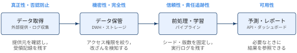

## JIS Q 27000:2019 とは？

::: {#def- .custom_problem .blog-custom-border}
### JIS Q 27000:2019

- 情報セキュリティマネジメントシステム（ISMS）のファミリ規格で共通して使う**用語及び定義**を規定した日本産業規格
- 対応国際規格は ISO/IEC 27000:2018（MOD: 修正している）．国際規格にある「ISMS の概要」（箇条4以降）は削除し，用語集に絞っている
- 営利企業・政府機関・非営利団体など，あらゆる形態及び規模の組織に適用できる

:::

ISMS ファミリ規格は，組織が財務情報，知的財産，従業員情報，顧客や第三者から預かった情報などの**情報資産のセキュリティを管理する枠組み**をつくるための規格群です．
次の 4 種類の規格からなり，JIS Q 27000 はこれらで共通して使う「辞書」の役割を担います．

a. ISMS 及び ISMS を認証する機関に対する要求事項を規定する規格（例: JIS Q 27001）
b. ISMS の確立・実施・維持・改善のプロセス全体を支援する手引・解釈を提供する規格
c. ISMS に関する分野固有の指針を扱う規格
d. ISMS に関する適合性評価を扱う規格

## JIS Q 27000:2019における情報セキュリティ

::: {#def- .custom_problem .blog-custom-border}
### 情報セキュリティ（information security, 3.28）

- 情報の**機密性**（3.10），**完全性**（3.36）及び**可用性**（3.7）を維持すること．
- 広義の意味では，真正性（3.6），責任追跡性，否認防止（3.48），信頼性（3.55）などの特性を維持することを含めることもある．

:::

情報セキュリティの中核は機密性（Confidentiality）・完全性（Integrity）・可用性（Availability）の頭文字をとった **CIA** の 3 要素です．
真正性・責任追跡性・否認防止・信頼性は，必要に応じて追加で維持する特性という位置づけになります．


### 特性の定義の対応

次の定義 a〜g は，それぞれ以下の特性に対応します．

:::: {.no-border-top-table}

| 記号 | 定義 | 特性 | 番号 |
| -- | --------------------------------------------- | ---------------------------- | ---- |
| a | 意図する行動と結果とが一貫しているという特性 | 信頼性（reliability） | 3.55 |
| b | エンティティは，それが主張するとおりのものであるという特性 | 真正性（authenticity） | 3.6 |
| c | 認可されたエンティティが要求したときに，アクセス及び使用が可能である特性 | 可用性（availability） | 3.7 |
| d | 認可されていない個人，エンティティ又はプロセスに対して，情報を使用させず，また，開示しない特性 | 機密性（confidentiality） | 3.10 |
| e | 正確さ及び完全さの特性 | 完全性（integrity） | 3.36 |
| f | 主張された事象又は処置の発生，及びそれらを引き起こしたエンティティを証明する能力 | 否認防止（non-repudiation） | 3.48 |
| g | あるエンティティの動作が，その動作から動作主のエンティティまで一意に追跡できることを確実にする特性 | 責任追跡性（accountability） | ―[^accountability] |
: {tbl-colwidths="[8,57,25,10]"}

::::

[^accountability]: JIS Q 27000:2019 では責任追跡性は 3.28 の注記に現れるのみで，番号付きの定義はありません．ここでは JIS Q 13335-1:2006 の 2.2 の定義を引用しています．


::: {#exm- .custom_problem }
### データサイエンスにおける各特性の例

{width="100%" fig-align="center"}

:::: {.no-border-top-table}

| 特性 | 守るべきこと | 損なわれる例 |
| ---------- | ------------------------------ | ------------------------------ |
| 機密性 | 個人情報を含むデータは，権限のある分析者だけが参照できる | 顧客データの CSV を共有ドライブに置き，誰でもダウンロードできる |
| 完全性 | 元データや集計結果が意図せず書き換わらない | 前処理スクリプトのバグで元テーブルを上書きしてしまう |
| 可用性 | 必要なときに分析基盤・予測 API を使える | DWH の障害で週次レポートが作れない |
| 真正性 | データが主張どおりの提供元・システムから来ている | 出所不明のファイルを正規の売上データとして分析に使う |
| 責任追跡性 | 誰がどのデータを使い，どの処理を実行したかを追跡できる | 共有アカウントで作業しており，誰がテーブルを削除したか特定できない |
| 否認防止 | データの受領やモデルの承認を後から否定できない | 承認記録が残っておらず，「そのモデルのリリースは承認していない」と言われる |
| 信頼性 | 同じデータ・コードから同じ結果が得られる | 乱数シードやライブラリの版数が固定されておらず，再実行のたびに結果が変わる |
: {tbl-colwidths="[16,42,42]"}

::::

:::
***

::: {#exm- .custom_problem }
### ネットワークサービスにおける各特性の例

{width="100%" fig-align="center"}

:::: {.no-border-top-table}

| 特性 | 守るべきこと | 損なわれる例 |
| ---------- | ------------------------------ | ------------------------------ |
| 機密性 | 通信内容を第三者に読まれない | HTTP の平文通信でパスワードを盗聴される |
| 完全性 | 送受信するデータや Web ページが改ざんされない | 中間者攻撃でページに不正なスクリプトを埋め込まれる |
| 可用性 | 利用者がいつでもサービスにアクセスできる | DDoS 攻撃でサイトが停止する |
| 真正性 | 接続先のサーバやログインしている利用者が本物である | フィッシングサイトへの誘導，盗んだパスワードによるなりすましログイン |
| 責任追跡性 | どのアカウントがいつ何をしたかをログから追跡できる | アクセスログを取っておらず，不正操作の実行者を特定できない |
| 否認防止 | 送信や取引の事実を後から否定できない | 電子署名やタイムスタンプがなく，「その注文はしていない」と主張される |
| 信頼性 | サービスが仕様どおり一貫して動作する | 負荷分散先のサーバ間で設定が異なり，同じ操作でも結果が変わる |
: {tbl-colwidths="[16,42,42]"}

::::

:::
***

## Appendix: shall, should, may, can

JIS Q 27000 を含む ISMS ファミリ規格では，文末表現で規定の強さを区別しています（0.3）．

:::: {.no-border-top-table}

| 表現 | 英語 | 意味 |
| ------------------------------------------- | ------ | --------------- |
| 〜しなければならない | shall | 要求事項 |
| 〜することが望ましい | should | 推奨 |
| 〜してもよい | may | 許容 |
| 〜することができる，〜できる，〜し得る など | can | 可能性又は実現能力 |
: {tbl-colwidths="[50,15,35]"}

::::

## 📘 用語集

:::{.glossary-container}

```yaml
glossary:
  - def: 脅威（threat, 3.74）
    description: |
      システム又は組織に損害を与える可能性がある，望ましくないインシデントの潜在的な原因．

  - def: エンティティ（entity）
    description: |
      “実体”，“主体”などともいう．情報セキュリティの文脈においては，情報を使用する組織及び人，情報を扱う設備，ソフトウェア及び物理的媒体などを意味する（3.5 認証の注記より）．

  - def: リスクレベル（level of risk, 3.39）
    description: |
      結果とその起こりやすさの組合せとして表現される，リスクの大きさ．

  - def: 要求事項（requirement, 3.56）
    description: |
      明示されている，通常暗黙のうちに了解されている又は義務として要求されている，ニーズ又は期待．
      注記1: “通常暗黙のうちに了解されている”とは，対象となるニーズ又は期待が暗黙のうちに了解されていることが，組織及び利害関係者にとって，慣習又は慣行であることを意味する．
      注記2: 規定要求事項とは，例えば，文書化した情報の中で明示されている要求事項をいう．
```

:::


References
----------
- [JIS Q 27000:2019](https://kikakurui.com/q/Q27000-2019-01.html)
- [通信に潜む危険](../2026-08-23-security-101/index.qmd)
