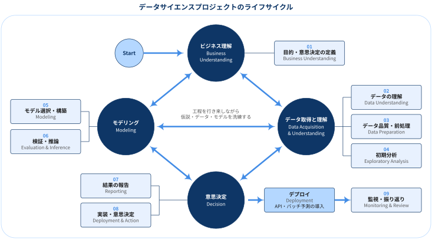
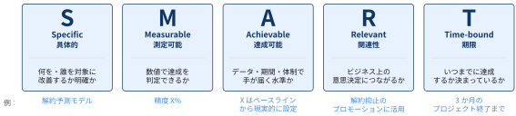

## この記事について

:::: {.no-border-top-table}

| 観点 | 内容 |
|---|---|
| **What：何のドキュメントか** | データサイエンスプロジェクト（分析プロジェクト）を開始から完了まで進めるための **分析ライフサイクル** を，4つの段階と9つの工程に整理したもの．Microsoft の Team Data Science Process（TDSP）のライフサイクルを下敷きにしている． |
| **前提：どんな分析プロジェクトか** | ビジネス上の問いに答える予測モデルを構築し，API やバッチ予測として本番環境に組み込んで意思決定や業務に継続的に活用するプロジェクト（データプロダクト・機械学習アプリケーションの構築）． |
| **Who：誰に向けたものか** | データサイエンスプロジェクトを計画・推進する担当者，レビュー担当者． |
| **Why：なぜ重要か** | 各段階のゴールと成果物を共有しておくことで，クライアント・関係者との認識のずれを防ぎ，プロジェクトを明確な終着点へ進めやすくなるため． |
| **How：どう使うか** | 段階ごとの「ゴール」「やること」「成果物」をプロジェクト計画やレビュー時のチェックリストとして使う． |

: {tbl-colwidths="[30,70]"}

::::

## 分析ライフサイクルの全体像

分析ライフサイクルとは，「データサイエンスプロジェクトが開始から完了までにたどる工程の流れ」のこと

今回想定する分析プロジェクト例として，

- ビジネス上の問いを，数値や名前で答えられる **予測の問題** として定義する（例：来月解約する顧客は誰か）．
- 機械学習や統計モデルで予測モデルを構築・検証する．
- モデルを API やバッチ予測として **本番環境に組み込み**，業務や意思決定で継続的に利用する．
- クライアント・関係者がシステムを受け入れ，運用担当へ引き継いだ時点でプロジェクトが完了する．

### 分析ライフサイクルの4つの段階と9つの工程

{width="100%" fig-align="center"}

:::: {.no-border-top-table}

| 段階 | 工程 |
|---|---|
| ビジネス理解 | 01 目的・意思決定の定義 |
| データ取得と理解 | 02 データの理解 / 03 データ品質・前処理 / 04 初期分析 |
| モデリング | 05 モデル選択・構築 / 06 検証・推論 |
| 意思決定 | 07 結果の報告 / 08 実装・意思決定 |
| （デプロイ → 運用） | デプロイ / 09 監視・振り返り |

: {tbl-colwidths="[25,35,40]"}

::::

- 各段階は一方向に進むものではなく，**工程を行き来しながら仮説・データ・モデルを洗練する**反復的なプロセス
- 例: データの品質が不十分であればビジネス理解に戻ってデータソースを見直し，モデルの精度が不十分であればデータ取得や特徴量の作成に戻る．

## 1. ビジネス理解（Business Understanding）

[01 目的・意思決定の定義]{.step-tag}

::: {.callout-note}
### ゴール

- クライアントの意思決定問題を **Sharp な問い** に落とし込み，モデルの目的変数と対応させる
- 関心のあるデータソースの所在を特定し，他のソースから補助的なデータを持ち込むかを判断

:::

### やること

- クライアント・関係者と協力し，予測分析によって大きく改善できるビジネス課題を理解する
- 中心となるのは，クライアントの意思決定問題と，それに対応して分析で予測すべき主要なビジネス変数＝**目的変数**の特定
- 例: 売上予測，注文が不正である確率

[目的の定義]{.mini-section}

1. **クライアントのビジネス領域を理解する**：その領域で成功を測る主要な指標は何か，どのビジネス課題に取り組めばその指標に影響を与えられるかを把握
2. **Sharp な問いでプロジェクトの目的を定義する**：「宇宙のことなら何でも答えてくれる神託に，答えが数値か名前になる質問をする」つもりで問いを立て，意思決定問題と目的変数を対応させる
    - 例: 「どの顧客に解約抑止クーポンを配るか」→「来月解約する確率はいくらか」
3. **体制と役割・責任を決める**：大まかなマイルストーン計画を立て，新しい事実が分かるたびに更新
4. **成功指標を定義する**：指標は SMART（Specific，Measurable，Achievable，Relevant，Time-bound）であること（→ [Appendix: SMART な成功指標](#appendix-smart)）
    - 例: 「3か月のプロジェクト終了までに解約予測の精度 X% を達成し，解約抑止のプロモーションに活用する」

[データソースの特定]{.mini-section}

- **関連性（Relevant）**：目的変数と，それに関係する特徴量が測定されているか
- **正確性（Accurate）**：目的変数と特徴量を正確に測定しているか

既存システムで追加のデータを収集・記録しないと目的を達成できないケースも珍しくない．その場合は外部データソースを探すか，システムを改修して新しいデータを収集する．

### 成果物

:::: {.no-border-top-table}

| 成果物 | 内容 |
|---|---|
| 分析計画書 | プロジェクトの目的や範囲をまとめた生きたドキュメント．新たな発見やビジネス要件の変化に応じて更新し，変更理由はクライアント・関係者に明確に伝える |
| Data Sources（データソース一覧） | 生データの所在．後の段階で，分析環境へデータを移すスクリプトなどの詳細を追記 |
| Data Dictionaries（データ辞書） | 利用するデータの説明とスキーマ（データ型，バリデーションルール）．可能であれば ER 図も含める |

: {tbl-colwidths="[35,65]"}

::::

## 2. データ取得と理解（Data Acquisition and Understanding）

[02 データの理解]{.step-tag} [03 データ品質・前処理]{.step-tag} [04 初期分析]{.step-tag}

::: {.callout-note}
### ゴール

- データを分析環境に取り込む
- 手元のデータで問いに答えられるかを判断する

:::

### やること

[データの取り込み]{.mini-section}

- データをソースから，学習や予測（スコアリング）を行う分析環境へ移すプロセスを構築

[データの理解・品質確認]{.mini-section}

- 実世界のデータは欠損や誤りを含むことが多いため，モデルを学習する前にデータを深く理解する必要がある
- 要約統計量や可視化を用いてデータ品質を把握し，対処方針を決める
- 可視化で確認する問いの例:
    - 特徴量は役に立つほど一貫して測定されているか，欠損が多すぎないか
    - 対象期間を通じてデータが一貫して収集されているか，観測の抜けがないか
- 品質チェックを通過しない場合は，前の段階に戻ってデータを修正・追加取得する

[初期分析]{.mini-section}

- 品質に問題がなければ，予測モデルの構築に役立つデータの内在的なパターンを探る
- 確認すること: データが目的変数とどの程度関係しているか，次の段階へ進むのに十分なデータ量があるか
- 必要に応じて，より正確・より関連性の高いデータソースを新たに探す

[データパイプラインの設計]{.mini-section}

- 初回の取り込みに加えて，新しいデータのスコアリングや定期的なデータ更新のためのパイプライン（ワークフロー）も必要
- パイプラインのソリューションアーキテクチャはこの段階で設計し，以降の段階と並行して開発

### 成果物

:::: {.no-border-top-table}

| 成果物 | 内容 |
|---|---|
| Data Quality Report（データ品質レポート） | データの要約，各属性と目的変数の関係，変数のランキングなど |
| Solution Architecture（ソリューションアーキテクチャ） | 新しいデータに対するスコアリング・予測と，モデル再学習のためのパイプラインの図・説明 |

: {tbl-colwidths="[35,65]"}

::::

::: {.callout-important}
## チェックポイント

本格的な特徴量エンジニアリングとモデル構築に入る前に，プロジェクトを続ける価値があるかを再評価する．

- 続行する
- データを追加収集する
- 問いに答えるデータが存在しないと判断する
:::

## 3. モデリング（Modeling）

[05 モデル選択・構築]{.step-tag} [06 検証・推論]{.step-tag}

::: {.callout-note}
### ゴール

- 機械学習モデルを構築するための特徴量を作成する（特徴量エンジニアリング）
- 目的変数を予測する有益なモデルを構築・評価する
- 本番利用に適したモデルが得られたかを判断する

:::

### やること

[特徴量エンジニアリング]{.mini-section}

- 生の変数を取り込み・集約・変換して，分析に用いる特徴量を作る
- モデルが何に基づいて予測しているかを理解するには，特徴量同士の関係と，機械学習手法が特徴量をどう使うかの理解が必要
- ドメイン知識とデータ探索で得た知見の組み合わせが欠かせない工程
- 有益な変数は結果を改善するが，無関係な変数はノイズになる．両者のバランスを取る
- スコアリング時にも同じ特徴量を生成できる必要がある．**予測時点で利用できないデータに依存した特徴量は作らない**

[モデルの学習]{.mini-section}

問いの種類に応じて，複数のアルゴリズムが候補になる．学習の流れは次のとおり

1. 入力データを，通常はランダムに学習データとテストデータへ分割
2. 学習データでモデルを構築
3. 複数のアルゴリズムとハイパーパラメータの組み合わせ（パラメータスイープ）を，学習データとテストデータで評価
4. 成功指標を比較し，問いに答える「BEST」な手法を決定

### 成果物

:::: {.no-border-top-table}

| 成果物 | 内容 |
|---|---|
| Feature Sets（特徴量セット） | モデリングに用いた特徴量の説明と，生成コードへの参照 |
| Modeling Report（モデリングレポート） | 試したモデルごとに，標準テンプレートに沿って作成するレポート |

: {tbl-colwidths="[35,65]"}

::::

::: {.callout-important}
## チェックポイント

モデルの性能が本番システムに導入できる水準かを評価する．

- テストデータに対して，モデルは問いに十分答えているか
- データの追加収集，特徴量エンジニアリングのやり直し，他のアルゴリズムの検討が必要ではないか
:::

## 4. 意思決定（Decision）

[07 結果の報告]{.step-tag} [08 実装・意思決定]{.step-tag}

::: {.callout-note}
### ゴール

- 分析結果から，クライアントの意思決定を **どのように変えるべきか** を提言し，合意する
- パイプライン・モデル・その本番環境へのデプロイを確認し，プロジェクトの成果物を確定させる

:::

### やること

[結果の報告]{.mini-section}

- 01 で定義した意思決定問題に対して，分析結果が何を示しているかを報告
- 現状の意思決定と比べて，何をどう変えるべきかを具体的に提言
    - 例: 「全顧客にクーポンを配る」→「解約確率の上位 20% にのみ配る」
- 提言の根拠（成功指標の達成度，期待される効果）と不確実性・前提条件を併せて示す

[実装・意思決定]{.mini-section}

- クライアントが，システムがビジネス上のニーズを満たし，許容できる精度で問いに答えているかを検証し，本番利用の可否を判断
- 提言を受けて，業務プロセスや意思決定ルールをどう変更するかを決定
- すべてのドキュメントを確定させ，レビュー
- 本番運用を担う組織（クライアント側の IT・データサイエンスチーム，またはクライアントの委託先）へプロジェクトを引き継ぐ

### 成果物

:::: {.no-border-top-table}

| 成果物 | 内容 |
|---|---|
| Project Final Report（最終報告書） | 意思決定への提言（何をどう変えるべきか，その根拠と不確実性）と，システムの理解と運用に必要なプロジェクトの詳細をまとめたレポート |

: {tbl-colwidths="[35,65]"}

::::

## デプロイと監視・振り返り（Deployment）

[デプロイ]{.step-tag} [09 監視・振り返り]{.step-tag}

::: {.callout-note}
### ゴール

- モデルとパイプラインを，本番環境（または本番相当の環境）へデプロイする

:::

### やること

性能の良いモデルが得られたら，他のアプリケーションから利用できるよう運用に乗せる．

- ビジネス要件に応じて，リアルタイム予測かバッチ予測かを選ぶ
- Web サイト，スプレッドシート，ダッシュボード，業務アプリケーションなどから利用できるよう，モデルを API として公開
- 本番モデルとデータパイプラインにテレメトリと監視を組み込み，システムの状態報告やトラブルシューティングに備える
- 監視・振り返りで得た知見は，次の課題設定（ビジネス理解）へフィードバック

### 成果物

:::: {.no-border-top-table}

| 成果物 | 内容 |
|---|---|
| ステータスダッシュボード | システムの健全性と主要指標を表示 |
| 最終モデリングレポート | デプロイの詳細を含むモデリングレポート |
| 最終ソリューションアーキテクチャ | 本番構成を反映したアーキテクチャ文書 |

: {tbl-colwidths="[35,65]"}

::::

## Appendix: SMART な成功指標 {#appendix-smart}

::: {#def- .custom_problem .blog-custom-border}
## SMART

- SMART は，目標や成功指標が「達成できたかどうかを後から判定できる形」になっているかを確認するためのチェックリスト．

:::

{width="100%" fig-align="center"}

:::: {.no-border-top-table}

| 観点 | 確認する問い | NG 例 | OK 例 |
|---|---|---|---|
| **Specific**（具体的） | 何を・誰を対象に改善するかが明確か | 「顧客体験を良くする」 | 「月額会員の翌月解約を予測する」 |
| **Measurable**（測定可能） | 数値で達成を判定できるか | 「精度の高いモデルを作る」 | 「テスト期間の AUC が 0.80 以上」 |
| **Achievable**（達成可能） | データ・期間・体制で手が届く水準か | 「解約を 0 にする」 | 「現行ルールベース（AUC 0.70）を上回る」 |
| **Relevant**（関連性） | ビジネス上の意思決定・KPI につながるか | 「特徴量を 100 個作る」 | 「上位 10% にクーポンを配り解約率を下げる」 |
| **Time-bound**（期限） | いつまでに達成するか決まっているか | 「できるだけ早く」 | 「3か月後のプロジェクト終了まで」 |

: {tbl-colwidths="[22,27,25,26]"}

::::

[データサイエンスプロジェクトで使うときの注意]{.mini-section}

- **Measurable と Relevant を分けて考える**：AUC や RMSE などのモデル指標は測定しやすいが，それだけではビジネス上の成果（解約率，売上）に結びつくとは限らない．モデル指標とビジネス KPI の両方を，対応関係とあわせて定義する
- **Achievable はベースラインから決める**：現行の業務ルールや単純なモデルの性能をベースラインとして測り，そこからの改善幅で目標水準を置く．ベースラインがない段階での数値目標は，データ理解の段階で見直す前提にしておく
- **成功指標も分析計画書と同じく生きたドキュメント**：データの品質や入手可能性が分かった時点で達成水準・期限を更新し，変更理由をクライアント・関係者に共有する

## References

- Doran, G. T. (1981). There's a S.M.A.R.T. way to write management's goals and objectives. *Management Review*, 70(11), 35–36.

- [Team Data Science Process Lifecycle](https://github.com/Azure/Microsoft-TDSP/blob/master/Docs/lifecycle-detail.md)
- [Azure-TDSP-ProjectTemplate](https://github.com/Azure/Azure-TDSP-ProjectTemplate)
