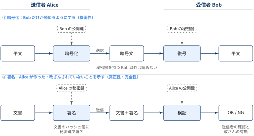
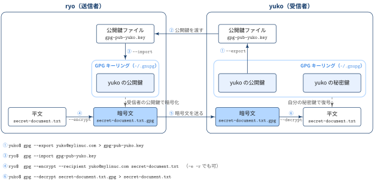
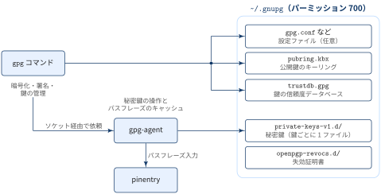

::: {.callout-note}
## TL:DRs

- GPG（GnuPG）は OpenPGP 規格に準拠した暗号化・署名ツールで，コマンド名は `gpg`
- `~/.gnupg` はGPG設定ファイルとキーリングを保存するディレクトリ．秘密鍵は `private-keys-v1.d/` に置かれ，`gpg` ではなく `gpg-agent` が扱う
- 主な活用場面は GitHub のコミット署名と netrc 認証情報の暗号化，他のホストとのファイルのやり取り，APT リポジトリやダウンロードファイルの署名検証など

:::

## GNU Privacy Guardとは

::: {#def- .custom_problem .blog-custom-border}
### GPG

- GNU Privacy Guardの略
- 暗号化と署名を行うツール
- 公開鍵暗号 PGP(Pretty Good Privacy) の標準仕様である OpenPGP の GNU による実装

:::

PGP はもともと Phil Zimmermann が開発した暗号ソフトウェアで，その形式が OpenPGP として標準化されました（RFC 4880）．GPG はこの OpenPGP を実装したフリーソフトウェアで，GnuPG とも呼ばれます．Ubuntu などの多くの Linux ディストリビューションには最初から入っており，パッケージの署名検証などで OS 自身も利用しています．

```zsh
% gpg --version | head -1
gpg (GnuPG) 2.4.4
```

[GPG 公開鍵暗号を使用した処理]{.mini-section}

- GPG の処理は，自分専用の **秘密鍵** と，他人に配ってよい **公開鍵** の組（キーペア）を使います
- 公開鍵暗号を使った処理は大きく「暗号化・復号」と「署名・検証」の2つで，それぞれで使う鍵の持ち主と向きが逆になります

{width="100%" fig-align="center"}

| 処理 | 目的 | 使う鍵 | 対応するコマンド |
|---|---|---|---|
| 暗号化 | 受信者以外に読ませない（機密性） | 受信者の公開鍵 | `gpg -e -r <受信者>` |
| 復号 | 自分宛ての暗号文を読む | 自分（受信者）の秘密鍵 | `gpg -d` |
| 署名 | 作成者が自分であり，内容が改ざんされていないことを示す（真正性・完全性） | 自分（送信者）の秘密鍵 | `gpg -s` / `--clearsign` / `-b` |
| 検証 | 署名が正しいか確かめる | 送信者の公開鍵 | `gpg --verify` |
: {tbl-colwidths="[15,35,25,25]"}

署名は，文書そのものではなく文書のハッシュ値に対して秘密鍵で計算します．検証側は受け取った文書からハッシュ値を計算し直し，署名と送信者の公開鍵を使って一致を確かめます．文書が1ビットでも書き換えられていれば検証は失敗します．


::: {#exm- .custom_problem }
### 公開鍵を受け取ってファイルを暗号化して送る

ryo が yuko に秘密のファイル `secret-document.txt` を送る場合を考えます．yuko は受信者なので，使うのは yuko のキーペアです．

{width="100%" fig-align="center"}

1. **公開鍵の書き出し（yuko）**：`gpg --export` で自分の公開鍵をファイルに書き出す
2. **公開鍵を渡す**：メールやチャットなどで公開鍵ファイルを ryo に渡す．公開鍵は知られても問題ないので，経路が暗号化されている必要はない
3. **公開鍵の取り込み（ryo）**：`gpg --import` で yuko の公開鍵を自分のキーリング（`~/.gnupg`）に追加する．このとき `gpg --fingerprint yuko@mylinuc.com` の結果を yuko 本人に別経路で確認しておく
4. **暗号化（ryo）**：`gpg --encrypt --recipient` で，キーリングにある yuko の公開鍵を使って暗号化する
5. **暗号文を送る**：`secret-document.txt.gpg` は yuko の秘密鍵がないと読めないので，どの経路で送ってもよい
6. **復号（yuko）**：`gpg --decrypt` で，キーリングにある自分の秘密鍵を使って復号する

秘密鍵は yuko の `~/.gnupg` から一度も外に出ていない点がポイントです．やり取りされるのは公開鍵と暗号文だけです．

:::
***

### `~/.gnupg` ディレクトリ

::: {#def- .custom_problem .blog-custom-border}
### `~/.gnupg` ディレクトリ

- `~/.gnupg` は GPG のホームディレクトリで，設定ファイルとキーリングを保存するディレクトリ

鍵を1つ作ったあとの `~/.gnupg` は次のようになっています．

```zsh
% ls -F ~/.gnupg
crls.d/  openpgp-revocs.d/  private-keys-v1.d/  pubring.kbx  pubring.kbx~
random_seed  sshcontrol  tofu.db  trustdb.gpg
```

:::

GnuPG 2.1 以降，秘密鍵の操作は `gpg` コマンド自身ではなく常駐プロセスの `gpg-agent` が担当します．`gpg` は公開鍵のキーリングや信頼データベースを直接読み書きし，秘密鍵が必要な処理（復号・署名）だけを `gpg-agent` に依頼します．パスフレーズの入力画面は `gpg-agent` が `pinentry` を呼び出して表示します．


{width="90%" fig-align="center"}

:::: {.no-border-top-table}


| ファイル／ディレクトリ | 内容 |
|---|---|
| `pubring.kbx` | 公開鍵のキーリング（keybox 形式）．自分の公開鍵と，取り込んだ他人の公開鍵が入る．`pubring.kbx~` はそのバックアップ |
| `private-keys-v1.d/` | 秘密鍵．鍵ごとに `<keygrip>.key` という1ファイルで保存され，パスフレーズで保護される |
| `trustdb.gpg` | 各公開鍵をどの程度信頼するか（ownertrust）を記録するデータベース |
| `openpgp-revocs.d/` | 鍵の生成時に自動で作られる失効証明書 `<フィンガープリント>.rev` |
| `tofu.db` | TOFU（Trust On First Use）信頼モデル用のデータベース |
| `sshcontrol` | `gpg-agent` を SSH エージェントとして使うときに，SSH 認証に使う鍵の keygrip を列挙する |
| `random_seed` | 乱数生成器の状態を次回起動時に引き継ぐためのシード |
| `crls.d/` | `dirmngr` が X.509 証明書の失効リスト（CRL）をキャッシュする |
| `gpg.conf` / `gpg-agent.conf` / `dirmngr.conf` / `common.conf` | 設定ファイル．必要なときだけ自分で作る |
: {tbl-colwidths="[25,75]"}

::::

::: {.callout-warning}
### パーミッションは 700 にする

`~/.gnupg` には秘密鍵が入っているので，所有者以外がアクセスできないようにします．グループやその他のユーザーに権限があると，`gpg` は `WARNING: unsafe permissions on homedir` という警告を出します．

```zsh
% chmod 700 ~/.gnupg
% find ~/.gnupg -type f -exec chmod 600 {} \;
```

バックアップするときも，`~/.gnupg` を丸ごとクラウドストレージに同期するのは避け，秘密鍵は `gpg --export-secret-keys` で書き出してオフラインの媒体に保管します．

:::

## gpg コマンド

::: {#def- .custom_problem .blog-custom-border}
### gpg コマンド

```zsh
gpg [オプション] <コマンド> [引数またはファイル]
```

- GnuPG の機能を呼び出すコマンドラインツール
- **コマンド**（`--encrypt` など）で「何をするか」を1つ選び，**オプション**（`--recipient` など）で「誰の鍵で・どこへ・どの形式で」を指定する

:::

[主要コマンド]{.mini-section}

:::: {.no-border-top-table}

| 長い形式 | 短い形式 | 内容 |
|---|---|---|
| `--full-generate-key` | | 対話形式で鍵ペアを作る．アルゴリズムや有効期限も選べる |
| `--quick-generate-key <uid>` | | 既定値で鍵ペアを作る |
| `--list-keys` | `-k` | キーリング内の公開鍵を一覧表示する |
| `--list-secret-keys` | `-K` | 秘密鍵を持っている鍵を一覧表示する |
| `--fingerprint` | | 鍵をフィンガープリント付きで表示する |
| `--export` | | 公開鍵を書き出す |
| `--export-secret-keys` | | 秘密鍵を書き出す（バックアップ・移行用） |
| `--import` | | ファイルから鍵（公開鍵・秘密鍵・失効証明書）を取り込む |
| `--encrypt` | `-e` | 受信者の公開鍵で暗号化する |
| `--decrypt` | `-d` | 自分の秘密鍵で復号する |
| `--symmetric` | `-c` | パスフレーズだけで暗号化する（公開鍵を使わない） |
| `--sign` | `-s` | 署名する（署名と内容を1つのファイルにまとめる） |
| `--clear-sign` | | 本文を読める形で残したまま署名する（旧名 `--clearsign`） |
| `--detach-sign` | `-b` | 署名だけを別ファイルに作る |
| `--verify` | | 署名を検証する |
| `--edit-key` | | 鍵を対話形式で編集する（有効期限・パスフレーズ・副鍵・信頼度） |
| `--quick-set-expire` | | 有効期限を変更する |
| `--generate-revocation` | | 失効証明書を作る |
| `--delete-keys` | | 公開鍵をキーリングから削除する |
| `--delete-secret-keys` | | 秘密鍵を削除する |
| `--send-keys` | | 公開鍵を鍵サーバーに送る |
| `--receive-keys` | | 鍵サーバーから公開鍵を取得する（`--recv-keys` でも可） |
| `--list-packets` | | OpenPGP データのパケット構造を表示する |
: {tbl-colwidths="[30,12,58]"}

::::

短い形式は組み合わせて書けます．たとえば `gpg -se -r bob@example.com file` は，署名（`-s`）と暗号化（`-e`）を同時に行います．

[主要オプション]{.mini-section}

:::: {.no-border-top-table}

| 長い形式 | 短い形式 | 内容 |
|---|---|---|
| `--recipient <uid>` | `-r` | 暗号化に使う受信者の公開鍵を指定する．複数回指定できる |
| `--local-user <uid>` | `-u` | 署名に使う自分の鍵を指定する（既定の鍵以外で署名したいとき） |
| `--armor` | `-a` | バイナリではなくテキスト（ASCII armor）で出力する |
| `--output <file>` | `-o` | 出力先のファイルを指定する |
| `--keyid-format <long>` | | 鍵IDの表示形式を指定する．`long` で16桁表示 |
| `--with-keygrip` | | 鍵一覧に keygrip（`private-keys-v1.d/` のファイル名）も表示する |
| `--keyserver <url>` | | 使う鍵サーバーを指定する |
| `--encrypt-to <uid>` | | `--recipient` に加えて，常にこの鍵でも暗号化する．`gpg.conf` に書いて自分を指定しておくと，送った暗号文を自分でも復号できる |
| `--default-key <uid>` | | 既定で使う秘密鍵を指定する |
| `--homedir <dir>` | | `~/.gnupg` の代わりに使うディレクトリを指定する（環境変数 `GNUPGHOME` と同じ） |
| `--batch` | | 対話プロンプトを出さずに実行する（スクリプト用） |
| `--yes` | | 上書きなどの確認にすべて yes と答える |
| `--verbose` | `-v` | 詳しいメッセージを出す |
: {tbl-colwidths="[30,12,58]"}

::::

`<uid>` には，ユーザーID（名前やメールアドレス），鍵ID，フィンガープリントのいずれかを指定できます．同じメールアドレスの鍵が複数あると，メールアドレス指定では1本しか選ばれず，どれが選ばれるかは鍵の状態によって変わります．鍵を確実に指定したいときはフィンガープリントを使います．

[鍵ペアの作成と確認]{.mini-section}

```zsh
# 対話形式で作成（アルゴリズム・有効期限・名前・メールアドレス・パスフレーズを聞かれる）
% gpg --full-generate-key

# 既定値で手早く作成
% gpg --quick-generate-key "Alice <alice@example.com>"
```

GnuPG 2.4 の既定値では，署名用の主鍵 `ed25519` と暗号化用の副鍵 `cv25519` が作られ，有効期限は3年です．作った鍵は `-k`（公開鍵の一覧）と `-K`（秘密鍵の一覧）で確認します．

```zsh
% gpg -K --keyid-format=long
/home/alice/.gnupg/pubring.kbx
------------------------------
sec   ed25519/FE71574597B377B2 2026-11-10 [SC] [expires: 2029-11-09]
      9AEA55CCBCFD672730CDA97DFE71574597B377B2
uid                 [ultimate] Alice <alice@example.com>
ssb   cv25519/993E9AE906EFCCD8 2026-11-10 [E]
```

:::: {.no-border-top-table}

| 表示 | 意味 |
|---|---|
| `pub` / `sec` | 主鍵（公開鍵／秘密鍵） |
| `sub` / `ssb` | 副鍵（公開鍵／秘密鍵） |
| `uid` | ユーザーID（名前とメールアドレス）．`[ultimate]` は自分の鍵として完全に信頼していることを表す |
| `9AEA...77B2` | フィンガープリント．鍵を一意に識別する40桁の16進数 |
| `FE71574597B377B2` | 鍵ID（long 形式）．フィンガープリントの末尾16桁 |
| `[S]` `[C]` `[E]` `[A]` | 鍵の用途．Sign（署名），Certify（他の鍵への署名・副鍵の作成），Encrypt（暗号化），Authenticate（認証） |
: {tbl-colwidths="[25,75]"}
::::


[鍵の書き出しと取り込み]{.mini-section}

| コマンド | 内容 |
|---|---|
| `gpg --armor --export <鍵ID> > pub.asc` | 公開鍵をテキスト形式（ASCII armor）で書き出す．相手に渡すのはこれ |
| `gpg --import pub.asc` | 相手の公開鍵をキーリングに取り込む |
| `gpg --fingerprint <鍵ID>` | フィンガープリントを表示する．取り込んだ鍵が本人のものか照合するときに使う |
| `gpg --armor --export-secret-keys <鍵ID> > secret.asc` | 秘密鍵をバックアップ用に書き出す．取り扱い注意 |
| `gpg --keyserver keys.openpgp.org --send-keys <鍵ID>` | 公開鍵を鍵サーバーに送る |
| `gpg --keyserver keys.openpgp.org --recv-keys <鍵ID>` | 鍵サーバーから公開鍵を取得する |

`--armor`（`-a`）を付けると，バイナリではなく `-----BEGIN PGP PUBLIC KEY BLOCK-----` で始まるテキストで出力されるので，メールやWebフォームに貼り付けられます．

[暗号化と復号]{.mini-section}

```zsh
# Bob の公開鍵で暗号化 → report.pdf.gpg ができる
% gpg -e -r bob@example.com report.pdf

# 自分でも復号できるように，自分も受信者に加える
% gpg -e -r bob@example.com -r alice@example.com report.pdf

# 復号（秘密鍵のパスフレーズを聞かれる）
% gpg -d -o report.pdf report.pdf.gpg

# 公開鍵を使わず，パスフレーズだけで暗号化（共通鍵暗号のみ）
% gpg -c report.pdf
```

`-r` に指定した受信者の公開鍵でしか復号できないので，自分も受信者に加えないと，暗号化した本人も復号できなくなる点に注意します．

[署名と検証]{.mini-section}

署名には3つの形式があります．

| コマンド | 出力 | 用途 |
|---|---|---|
| `gpg -s file` | `file.gpg`（署名と内容を1つのバイナリにまとめる） | 内容と署名をまとめて渡す |
| `gpg --clearsign file` | `file.asc`（本文をそのまま残し，前後に署名を付ける） | メールやテキストを，読める状態のまま署名する |
| `gpg -b file`（`--detach-sign`） | `file.sig`（署名だけの別ファイル） | 元ファイルを変えずに署名する．配布物の署名で一般的 |

```zsh
% gpg -b -a release.tar.gz          # release.tar.gz.asc を作る
% gpg --verify release.tar.gz.asc release.tar.gz
gpg: Signature made Tue 10 Nov 2026 04:18:41 PM JST
gpg:                using EDDSA key 9AEA55CCBCFD672730CDA97DFE71574597B377B2
gpg: Good signature from "Alice <alice@example.com>" [ultimate]
```

暗号化と署名は同時にできます（`gpg -s -e -r bob@example.com file`）．

[鍵の編集と失効]{.mini-section}

| コマンド | 内容 |
|---|---|
| `gpg --edit-key <鍵ID>` | 対話モードで鍵を編集する．`expire`（有効期限の変更），`passwd`（パスフレーズ変更），`addkey`（副鍵の追加），`trust`（信頼度の設定）などを実行し，`save` で保存 |
| `gpg --quick-set-expire <フィンガープリント> 1y` | 有効期限を1年延長する |
| `gpg --generate-revocation <鍵ID>` | 失効証明書を作る |
| `gpg --import <失効証明書>` | 失効証明書を取り込むと，その鍵は失効扱いになる．失効させた公開鍵を配り直して周知する |
| `gpg --delete-secret-keys <鍵ID>` / `gpg --delete-keys <鍵ID>` | 鍵をキーリングから削除する（秘密鍵 → 公開鍵の順） |
| `gpgconf --kill gpg-agent` | `gpg-agent` を停止する．キャッシュしたパスフレーズを破棄したいときや，設定を反映したいときに使う |

失効証明書は鍵の生成時に `~/.gnupg/openpgp-revocs.d/` へ自動で作られています．秘密鍵を紛失したりパスフレーズを忘れたりすると新たに作れないので，別の場所に控えておきます．

## gpg キーペアの活用場面

[GitHub：GPG 署名鍵によるコミット署名]{.mini-section}

コミットに GPG で署名しておくと，GitHub 上で `Verified` と表示され，そのコミットを本人が作ったことを示せます．SSH 鍵や認証トークンが「push する権限があるか」を確かめるのに対し，GPG 署名はコミット自体に埋め込まれ，「誰がそのコミットを作ったか」を記録します．設定手順の詳細は [GPG Signing Key の設定](https://ohgoshgit.github.io/posts/2026-11-04-gpg-signing-key/index.html) にまとめています．

```zsh
# 1. 署名用の公開鍵を書き出し，GitHub の Settings > SSH and GPG keys > New GPG key に登録
% gpg --armor --export <フィンガープリント>

# 2. Git に署名鍵を設定
% git config --global gpg.format openpgp
% git config --global user.signingkey <フィンガープリント>
% git config --global commit.gpgsign true
% git config --global tag.gpgSign true

# 3. 署名の確認
% git log -1 --show-signature
```

- `Verified` になるのは，コミットが署名されている・公開鍵が GitHub に登録されている・鍵の `uid` のメールアドレスが GitHub で確認済みのメールアドレスである，の3つがそろったときだけ
- `user.signingkey` にはメールアドレスではなくフィンガープリントを指定する．同じメールアドレスの鍵が複数あっても署名に使う鍵が一意に決まる
- `error: gpg failed to sign the data` で失敗する場合は，パスフレーズ入力画面を出す端末が分からないことが多い．シェルの設定ファイルに `export GPG_TTY=$(tty)` を追加する
- パスフレーズは `gpg-agent` がキャッシュするので，毎回は聞かれない．既定では最後に使ってから10分（`default-cache-ttl`），入力から最大2時間（`max-cache-ttl`）で，`~/.gnupg/gpg-agent.conf` で変更できる

[GitHub：netrc 認証の認証情報を暗号化する]{.mini-section}

HTTPS で GitHub に push するとき，Personal Access Token（PAT）を `~/.netrc` に書いておくと，Git や curl が自動で使ってくれます．

```default
machine github.com
login <GitHubのユーザー名>
password ghp_xxxxxxxxxxxxxxxxxxxx
```

ただし `~/.netrc` は平文なので，ファイルが漏れるとトークンもそのまま漏れます．そこで `~/.netrc` を自分の公開鍵で暗号化して `~/.netrc.gpg` とし，Git の認証ヘルパー `git-credential-netrc` に復号させます．

```zsh
# 自分宛てに暗号化し，平文の .netrc は消す
% gpg -e -r alice@example.com -o ~/.netrc.gpg ~/.netrc
% shred -u ~/.netrc

# Git に同梱されている helper を PATH の通った場所に置く（Ubuntu の場合）
% install -m 755 /usr/share/doc/git/contrib/credential/netrc/git-credential-netrc.perl \
    ~/.local/bin/git-credential-netrc

# 認証ヘルパーとして登録
% git config --global credential.helper "netrc -f ~/.netrc.gpg -v"
```

- `git-credential-netrc` は，拡張子が `.gpg` のファイルを `gpg` で復号してから読み，`machine` が一致する行の `login` と `password` を Git に渡す．復号には `gpg-agent` が保持する秘密鍵を使うので，パスフレーズのキャッシュが切れていれば入力を求められる
- このヘルパーは読み出し（`get`）専用で，Git が認証情報を保存・削除しようとしても `~/.netrc.gpg` は書き換えない．トークンを更新したら，平文で編集して暗号化し直す
- `-v` を付けると，どのファイルのどのエントリを使ったかが表示される．動作を確認できたら外してよい

[他のホストとのファイルのやり取り]{.mini-section}

`scp` や `rsync` は通信経路を SSH で暗号化しますが，転送先に置かれたファイル自体は平文のままです．共有サーバーやクラウドストレージ，USB メモリを経由して渡すときは，渡す前に GPG で暗号化・署名しておくと，途中の置き場所で読まれたり差し替えられたりしても検知できます．

```zsh
# 送信側：相手の公開鍵で暗号化し，自分の秘密鍵で署名してから転送
% gpg -s -e -r bob@example.com -o data.csv.gpg data.csv
% scp data.csv.gpg bob-host:/tmp/

# 受信側：自分の秘密鍵で復号し，送信者の公開鍵で署名を検証
% gpg -d -o data.csv data.csv.gpg
```

復号時に `Good signature from "Alice <alice@example.com>"` と表示されれば，Alice が送ったファイルが改ざんされずに届いたことになります．相手の公開鍵は，あらかじめ `gpg --import` で取り込み，フィンガープリントを照合しておきます．

自分の鍵ペアを別のホストでも使いたいときは，鍵自体を書き出して移します．

```zsh
# 移行元：公開鍵・秘密鍵・信頼度を書き出す
% gpg --armor --export <フィンガープリント> > pub.asc
% gpg --armor --export-secret-keys <フィンガープリント> > secret.asc
% gpg --export-ownertrust > trust.txt
% scp pub.asc secret.asc trust.txt new-host:~/

# 移行先：取り込んだら書き出したファイルを消す
% gpg --import pub.asc secret.asc
% gpg --import-ownertrust trust.txt
% shred -u secret.asc
```

書き出した秘密鍵はパスフレーズで保護されていますが，パスフレーズを総当たりされる危険はあるので，転送後は残さないようにします．

[パッケージ・ダウンロードファイルの署名検証]{.mini-section}

- **APT**：リポジトリの `Release` ファイルは配布元の秘密鍵で署名されており，`apt update` のたびに配布元の公開鍵で検証されます．サードパーティのリポジトリを追加するときに `/etc/apt/keyrings/` などへ置く `*.gpg` ファイルがその公開鍵で，`sources.list` の `signed-by=` で指定します
- **ISO イメージなど**：Ubuntu のインストールイメージには，ハッシュ値の一覧 `SHA256SUMS` とその署名 `SHA256SUMS.gpg` が配布されています．署名を検証してからハッシュ値を照合すれば，ダウンロードしたファイルが配布元のものと同一だと確かめられます

```zsh
% gpg --verify SHA256SUMS.gpg SHA256SUMS
% sha256sum -c SHA256SUMS --ignore-missing
```

[秘密情報の暗号化]{.mini-section}

- パスワードマネージャー `pass` は，パスワードを1件ずつ GPG で暗号化したファイルとして保存する
- `sops` や `git-crypt` を使うと，リポジトリに置く設定ファイルの秘密情報を GPG 鍵で暗号化できる


## 📘 用語集

:::{.glossary-container}

```yaml
glossary:
  - def: GNU (GNU's Not Unix)
    description: |
      Richard Stallman が1983年に開始した，UNIX 互換の OS を自由ソフトウェアだけで作るプロジェクト．名前は「GNU's Not Unix」の再帰的頭字語．
      GCC，Bash，coreutils，GnuPG など多くのソフトウェアを開発しており，Linux カーネルと組み合わせた OS は GNU/Linux とも呼ばれる．
      多くの GNU ソフトウェアは GPL（GNU General Public License）で配布されている．
  - def: キーペア (key pair)
    description: |
      公開鍵暗号で使う，秘密鍵と公開鍵の組．2つは数学的に対応しており，公開鍵で暗号化したものは対応する秘密鍵でしか復号できず，秘密鍵で付けた署名は対応する公開鍵で検証できる．
      公開鍵から秘密鍵を計算することは事実上できないので，公開鍵は誰に配ってもよく，秘密鍵は本人だけが保管する．
      GPG のキーペアは主鍵（署名・証明用）と副鍵（暗号化用など）からなり，ユーザーID（名前とメールアドレス）が結び付けられている．
  - def: キーリング (keyring)
    description: |
      鍵を保管するファイル（またはデータベース）．鍵束になぞらえた呼び方．
      GPG では，自分と他人の公開鍵を `~/.gnupg/pubring.kbx` に，自分の秘密鍵を `~/.gnupg/private-keys-v1.d/` に保存する．
      `gpg --import` で取り込んだ公開鍵はキーリングに追加され，暗号化や署名検証のときにそこから参照される．
      APT が `/etc/apt/keyrings/` に置く `*.gpg` ファイルも，リポジトリ検証用の公開鍵だけを集めたキーリングである．
```

:::
