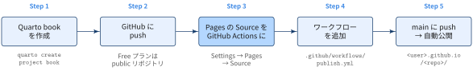
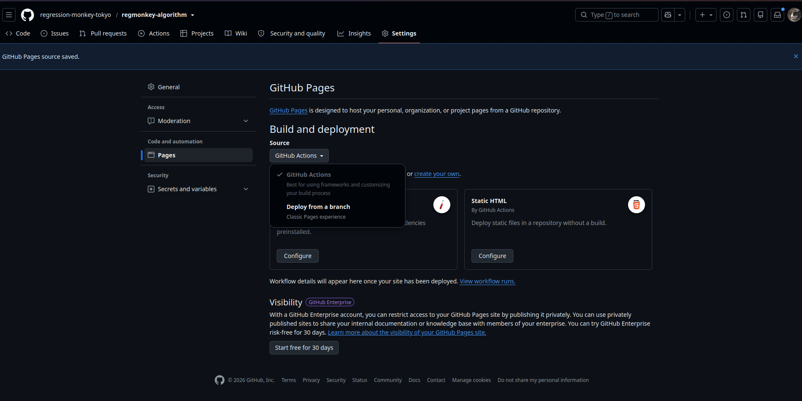
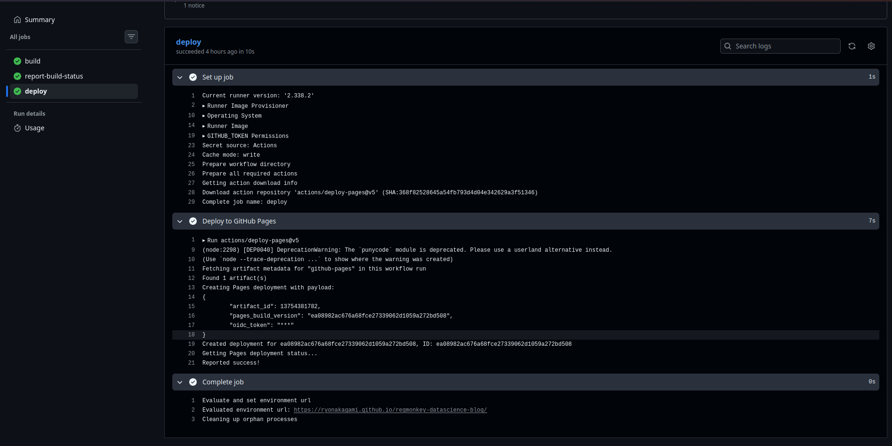

::: {.callout-note}
## TL:DRs

{width="100%" fig-align="center"}
- Settings → Pages の **Source** を「GitHub Actions」にしても，デプロイ用ワークフロー（Step 4）がなければ何も公開されない．
- Source の設定とワークフローの追加は必ずセットで行う．

:::

## Step 1：Quarto book を作成する

```bash
quarto create project book mybook
cd mybook
quarto preview   # ローカルで表示を確認
```

- book プロジェクトの出力先は既定で `_book/` になる
- ビルド成果物はコミットしないので `.gitignore` に追加すること

```ini
/.quarto/
/_book/
```

## Step 2：GitHub に push する

```bash
git init && git add . && git commit -m "init quarto book"
git remote add origin git@github.com:<user>/<repo>.git
git push -u origin main
```

- Free プランでは，GitHub Pages を使えるのは public リポジトリだけ
- private のまま公開するには Pro / Team 以上のプランが必要

## Step 3：Pages の Source を GitHub Actions にする



- リポジトリの **Settings → Pages → Build and deployment → Source** で **GitHub Actions** を選ぶ．
- 画面に出る「Jekyll」「Static HTML」の **Configure** は押さなくてよい．ワークフローは次の Step で自分で書く．

## Step 4：ワークフローを追加する

`.github/workflows/publish.yml` を作成する．

```{.yaml filename=".github/workflows/publish.yml"}
name: Publish Quarto Book

on:
  push:
    branches: [main]
  workflow_dispatch:

permissions:
  contents: read
  pages: write
  id-token: write

concurrency:
  group: pages
  cancel-in-progress: false

jobs:
  build:
    runs-on: ubuntu-latest
    steps:
      - uses: actions/checkout@v7
      - uses: quarto-dev/quarto-actions/setup@v2
      - uses: quarto-dev/quarto-actions/render@v2
        with:
          to: html          # PDF も出すと TeX が必要になるため HTML だけビルド
      - uses: actions/configure-pages@v6
      - uses: actions/upload-pages-artifact@v5
        with:
          path: _book       # Quarto book の出力先

  deploy:
    needs: build
    runs-on: ubuntu-latest
    environment:
      name: github-pages
      url: ${{ steps.deployment.outputs.page_url }}
    steps:
      - id: deployment
        uses: actions/deploy-pages@v5
```

| 項目 | 役割 |
|---|---|
| `permissions` | `pages: write` と `id-token: write` がないとデプロイできない |
| `render` の `to: html` | `quarto create` の book テンプレートには PDF 出力も含まれる．PDF を出す場合は TinyTeX のセットアップが別途必要 |
| `path: _book` | `_quarto.yml` で `output-dir` を変えた場合はそれに合わせる |
| `environment: github-pages` | 初回デプロイ時に自動作成される |

## Step 5：main に push して公開を確認する

```bash
git add .github/workflows/publish.yml
git commit -m "ci: publish quarto book to github pages"
git push
```

- **Actions** タブでワークフローの成功を確認する
- `deploy` ジョブのログ末尾に `Reported success!` と公開 URL が出ていれば完了
- 公開 URL は Settings → Pages にも表示される


{width="100%" fig-align="center"}

## Google Analytics を設定する（任意）

- [旧ブログ（Jekyll）](https://ryonakagami.github.io/2020/10/13/Blog-development/)では，GA4 が発行する gtag.js のスニペットを `<head>` に手で貼り付けていました．
- 一方，Quarto では `_quarto.yml` に測定 ID を書くだけで，全ページに gtag.js が挿入されます

[Step 1. アカウントとプロパティを作成する]{.mini-section}

1. [Google Analytics](https://analytics.google.com/analytics/web/) にアクセスする
2. アカウントを設定する（基本的には自分の Google アカウントを入力）
3. **Admin（管理）** をクリックする
4. **Create Property** をクリックする
5. Property setup（プロパティ名・タイムゾーン・通貨など）を入力する
6. 利用規約に同意すると，Google Analytics のダッシュボードが開く

[2. 測定 ID を取得する]{.mini-section}

- **Admin → データストリーム → ストリームを追加 → ウェブ** で，公開 URL（`https://<user>.github.io/<repo>/`）を登録する．
- 発行された測定 ID（`G-XXXXXXXXXX`）を控える．

[3. `_quarto.yml` に設定する]{.mini-section}

```{.yaml filename="_quarto.yml"}
book:
  site-url: https://<user>.github.io/<repo>
  google-analytics:
    tracking-id: "G-XXXXXXXXXX"
    anonymize-ip: true    # 任意：IP アドレスを匿名化
  cookie-consent: true    # 任意：Cookie 同意バナーを出し，同意後に計測する
```

- book プロジェクトでは `website:` ではなく `book:` の下に書く
- 測定 ID は公開 HTML に埋め込まれる値なので，リポジトリにコミットしてよい
- push して再デプロイした後，GA の **レポート → リアルタイム** で自分のアクセスが計測されれば完了

## Tips

:::: {.no-border-top-table}

| 症状・状況 | 対処 |
|---|---|
| コードセル（Python / R）を含む章のビルドが失敗する | `_quarto.yml` に `execute: freeze: auto` を設定し，ローカルで `quarto render` してから `_freeze/` をコミットする．Runner に実行環境を用意しなくて済む |
| ワークフローが動かない | Settings → Actions → General で Actions が無効化されていないか確認する |
| main 以外のブランチからデプロイすると拒否される | `github-pages` environment は既定でデフォルトブランチからのデプロイだけを許可する．Settings → Environments → github-pages で許可するブランチを追加する |
| カスタムドメインを使いたい | Settings → Pages の Custom domain に入力し，DNS を設定してから Enforce HTTPS を有効にする |
| ワークフローを書かずに公開したい | ローカルで `quarto publish gh-pages` を実行し，Source を「Deploy from a branch」（`gh-pages` / `/(root)`）にする |


::::
