## リアルタイムに処理するとは？

自動車のエアバッグは，衝突を検知してから数十ミリ秒程度で膨らみ切らなければ乗員を守れません．
どれほど正確に衝突を判定できても，膨らむのが乗員がハンドルにぶつかった後では意味がありません．
このように，組込みシステムでは **計算結果が正しいことに加えて，決められた時間内に結果を出すこと** が求められます．
これがリアルタイム処理です．

::: {#def- .custom_problem .blog-custom-border}
### リアルタイム処理

- システムへの入力（イベント）が発生してから，応答を返すまでの制限時間が決まっている処理のこと
- 制限時間の終わりの時刻を **デッドライン**（締切）と呼ぶ
- デッドラインまでに応答できなければ，計算結果が正しくても処理は失敗とみなす

:::

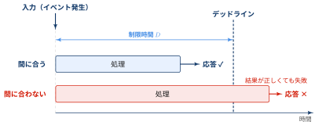{width="100%" fig-align="center"}

[リアルタイム ≠ 高速]{.mini-section}

リアルタイム処理で大事なのは，平均的に速いことではなく，**最悪の場合でもデッドラインに間に合うと保証できること** です．

- 平均応答時間が 1 ミリ秒でも，1万回に1回 100 ミリ秒かかるシステムは，デッドラインが 10 ミリ秒なら使えない
- 平均 5 ミリ秒でも，毎回必ず 8 ミリ秒以内に応答するシステムなら使える

::: {#exm- .custom_problem }
### 平均・パーセンタイル・最大値で2つのシステムを比べる

デッドライン $D = 10$ ミリ秒の処理について，応答時間 $X$（ミリ秒）が次の分布に従う2つのシステムを考えます．

- システム A：確率 $1 - 10^{-4}$ で $0.99$，確率 $10^{-4}$（1万回に1回）で $100$
- システム B：区間 $[2, 8]$ の一様分布

よく使われる性能指標を計算すると次のようになります．

:::: {.no-border-top-table}

| 指標 | システム A | システム B |
| --- | --- | --- |
| 平均 $E[X]$ | 約 1.00 | 5.00 |
| 中央値（p50） | 0.99 | 5.00 |
| p99 | 0.99 | 7.94 |
| p99.99 | 0.99 | 7.9994 |
| 最大値 | **100** | **8** |
| デッドライン超過確率 $P(X > D)$ | $\mathbf{10^{-4}}$ | $\mathbf{0}$ |
: {tbl-colwidths="[40,30,30]"}

::::

A の平均は $(1 - 10^{-4}) \times 0.99 + 10^{-4} \times 100 \approx 1.00$ です．
平均・中央値・p99 のどれで比べても A のほうが速く，p99.99 でさえ A は 0.99 ミリ秒です（$P(X_A \leq 0.99) = 0.9999$ なので，100 ミリ秒の応答はこの分位点に現れない）．
A がデッドラインを守れないことは，**最大値** と **デッドライン超過確率** を見て初めてわかります．

:::
***

::: {#exm- .custom_problem }
### 「1万回に1回」を頻度に直す

上の例のシステム A（確率 $10^{-4}$ で応答に 100 ミリ秒かかり，デッドライン $D = 10$ ミリ秒を超過する）を，ブレーキ制御のループで使うとします．

- 制御周期は 10 ミリ秒（100 Hz）で，デッドラインと同じとする．処理は **10 ミリ秒ごとに必ず1回** 起動される（周期タスク）
- 各回の処理は互いに独立に，確率 $p = 10^{-4}$ でデッドラインを超過する
- 超過した回が後続の回を遅らせる影響は無視する

起動は周期どおりなので， $n = 60^2 \times 10^{2} = 3.6 \times 10^{5}$ 回です．
ランダムなのは各回が超過するかどうかだけで，1時間の超過回数は二項分布 $\mathrm{Bin}(n, p)$ に従います．
その期待値は

$$
np = 3.6 \times 10^{5} \times 10^{-4} = 36 \text{ 回／時間}
$$

です．
「1万回に1回」は，平均して 100 秒に1回の頻度でブレーキ制御が遅れるということです．
超過確率を $p$，実行回数を $n$ とすると，1回以上超過する確率は $1 - (1 - p)^{n} \approx 1 - e^{-np}$ で，$np$ が大きくなればほぼ確実に起こります．

:::
***


::: {.callout-note}
### テストで測った最大値は上限ではない

上の例のシステム A を 1000 回動かして応答時間を測ったとします．
1000 回のうち一度も 100 ミリ秒の応答が出ない確率は

$$
(1 - 10^{-4})^{1000} \approx e^{-0.1} \approx 0.90
$$

で，約9割の確率で「最大 0.99 ミリ秒，デッドラインまで余裕あり」という誤った結論になります．

逆に，$n$ 回のテストで超過が1回もなかったとき，そこから言えるのは超過確率の上限だけです．
$(1 - p)^{n} = 0.05$ を解くと $p \approx -\ln 0.05 / n \approx 3/n$ となり，超過確率の95%信頼上限は約 $3/n$ です（3の法則，rule of three）．

法規制などで $p \leq 10^{-9}$ が求められているとしたとき，それをテストで示すには $3 \times 10^{9}$ 回，1 kHz で動かし続けて約35日間，一度も超過しないことを確かめる必要があります．しかも，その間の入力や内部状態が，本番で起こりうる最悪のケースを網羅している保証はありません．


:::


### ハードリアルタイムとソフトリアルタイム

デッドラインを過ぎたときにどれだけ困るかは，システムによって異なります．
デッドラインを過ぎた後の結果の価値によって，リアルタイム処理は次のように分類されます．

:::: {.no-border-top-table}

| 分類 | デッドラインを過ぎると | 例 |
| --- | --- | --- |
| ハードリアルタイム | システムの故障や事故につながる．1回の遅れも許されない | エアバッグ，ブレーキ制御（ABS），ペースメーカー，産業用ロボットの制御 |
| ファームリアルタイム | 遅れた結果には価値がなく捨てられる．ただし，ときどき遅れてもシステムは壊れない | 映像のフレーム描画（間に合わないフレームは表示を飛ばす），音声通話のパケット |
| ソフトリアルタイム | 遅れるほど結果の価値が下がるが，遅れた結果にもある程度の価値は残る | Web ページの表示，動画のストリーミング再生 |
: {tbl-colwidths="[22,40,38]"}

::::

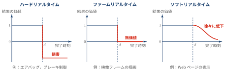{width="100%" fig-align="center"}

ファームリアルタイムはソフトリアルタイムに含めて，ハード／ソフトの2分類で説明されることもあります．
組込みシステムで特に問題になるのは，1回の遅れも許されないハードリアルタイムです．

## リアルタイムOS（RTOS）

組込みシステムでも，CPU が行う仕事は1つではありません．
たとえば自動車のブレーキ制御用のマイコンは，車輪の回転センサの読み取り，ブレーキ圧の計算，他の制御装置との通信，故障診断のログ記録などを並行して行います．
これらをそれぞれ **タスク** として分け，どのタスクにいつ CPU を割り当てるかを管理するのが OS の役割です（タスクとその状態遷移については [プログラムが動く環境とは (1)](../2020-10-08-how-program-works/index.qmd) を参照）．

::: {#def- .custom_problem .blog-custom-border}
### リアルタイムOS:

- RTOS（Real-Time Operating System）とも呼ぶ
- タスクの応答時間の上限を保証できるように設計されたOS
- 優先度の高いタスクが実行可能になったら，すぐに CPU を割り当てる（優先度ベースのプリエンプティブスケジューリング）
- 割込みの受付やタスクの切り替えにかかる時間の上限が決まっている

:::

[汎用OSとの違い]{.mini-section}

Windows や Linux などの汎用OSも，複数のタスクを切り替えて実行します．
ただし，汎用OSが目指しているのは「全体として多くの処理をこなすこと（スループット）」と「どのタスクにも公平に CPU を割り当てること」であり，個々のタスクのデッドラインは保証しません．

:::: {.no-border-top-table}

| 観点 | 汎用OS | リアルタイムOS |
| --- | --- | --- |
| 設計の目標 | スループット，公平性，平均応答時間 | 決定性，最悪応答時間の保証 |
| スケジューリング | タイムシェアリング（各タスクに公平に時間を配分） | 優先度ベースのプリエンプティブ（優先度の高いタスクが常に先） |
| 応答時間 | 平均は速いが，ばらつきが大きい | 上限を見積もれる |
| 仮想記憶 | 使う（ページフォールトで待たされることがある） | 使わないか，限定的に使う |
| 規模 | 大きい（数百万行以上） | 小さい（数KB〜数百KB のメモリで動くものも多い） |
| 例 | Windows，macOS，Linux | μITRON / T-Kernel，FreeRTOS，Zephyr，VxWorks，QNX |
: {tbl-colwidths="[18,41,41]"}

::::

::: {.callout-note}
### 代表的なリアルタイムOS

- **μITRON / T-Kernel**：日本発の TRON プロジェクトの仕様に基づく RTOS．家電やデジタルカメラ，車載機器などで広く使われている
- **FreeRTOS**：マイコン向けのオープンソース RTOS．現在は AWS が管理している
- **Zephyr**：Linux Foundation がホストするオープンソース RTOS．IoT 機器向け
- **VxWorks**：Wind River 社の商用 RTOS．火星探査機などの宇宙機にも使われている
- **QNX**：マイクロカーネル構成の商用 RTOS．車載のインフォテインメントや医療機器で使われている

:::

### 優先度ベースのプリエンプティブスケジューリング

::: {.callout-note}
### RTOS のスケジューリングの基本

- RTOS のスケジューリングの基本は，**実行可能なタスクのうち，最も優先度の高いものに必ず CPU を割り当てる** こと
- 低優先度のタスクの実行中に高優先度のタスクが実行可能になれば，その場で CPU を取り上げて（プリエンプション）高優先度のタスクに切り替える
- 汎用OSのラウンドロビンのように，実行中のタスクがタイムクォンタムを使い切るまで待つことはない

:::


::: {#exm- .custom_problem }
### ブレーキ制御とログ保存

次の2つのタスクが1つの CPU で動いているとします．時間の単位はミリ秒です．

- タスク H（高優先度）：ブレーキ制御．センサ入力から **3 ミリ秒以内** に処理を終える必要がある．処理時間は 2 ミリ秒
- タスク L（低優先度）：ログ保存．デッドラインはない

時刻 0 にタスク L が実行を始め，時刻 2 にセンサ入力が発生してタスク H が実行可能になります．
タスク H のデッドラインは時刻 $2 + 3 = 5$ です．

- **(a) ラウンドロビン（タイムクォンタム 4 ミリ秒）**：タスク L は時刻 4 までタイムクォンタムを使い続ける．タスク H は時刻 4 から実行され，時刻 6 に完了する．デッドラインを 1 ミリ秒超過する
- **(b) 優先度ベースのプリエンプティブ**：時刻 2 にタスク L から CPU を取り上げ，タスク H をすぐに実行する．タスク H は時刻 4 に完了し，デッドラインに間に合う

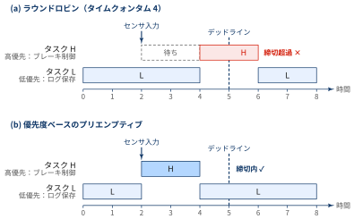{width="100%" fig-align="center"}

タスク L の処理時間の合計は，どちらの方式でも 6 ミリ秒で変わりません．
変わるのは **どのタスクを先に実行するか** だけですが，それによってデッドラインを守れるかどうかが決まります．

:::
***

ここで，優先度は「どちらのタスクが重要か」ではなく，**どちらのデッドラインが厳しいか** で決めるのが基本です．
この考え方は，後で説明するレートモノトニックスケジューリングにつながります．

### 応答時間の内訳

優先度ベースのプリエンプティブスケジューリングでも，イベントが発生した瞬間に高優先度のタスクが動き出すわけではありません．
イベントが発生してから応答するまでの時間（応答時間）は，次の3つに分けられます．

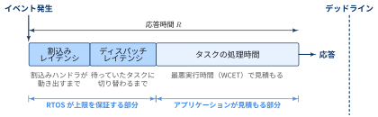{width="100%" fig-align="center"}

:::: {.no-border-top-table}

| 区間 | 内容 | 長くなる原因 |
| --- | --- | --- |
| 割込みレイテンシ | 割込みが発生してから，割込みハンドラが動き出すまでの時間 | OS やドライバが割込みを禁止している区間が長い |
| ディスパッチレイテンシ | 割込みハンドラが終わってから，イベントを待っていたタスクに CPU が切り替わるまでの時間 | カーネル内にプリエンプトできない区間がある，タスクの切り替え処理が重い |
| タスクの処理時間 | タスクが実際に処理を行う時間 | 処理内容による．最悪の場合の実行時間（WCET: Worst-Case Execution Time）で見積もる |
: {tbl-colwidths="[20,45,35]"}

::::

デッドラインを $D$ とすると，リアルタイム処理の要件は

$$
\underbrace{\text{割込みレイテンシ} + \text{ディスパッチレイテンシ}}_{\text{RTOS が上限を保証}} + \underbrace{\text{WCET}}_{\text{アプリが見積もる}} \leq D
$$

と書けます．
RTOS が割込みレイテンシとディスパッチレイテンシの **上限** を示してくれるので，アプリケーションの開発者は自分のタスクの WCET を見積もれば，デッドラインに間に合うかを判断できます．
汎用OSではこの上限がわからないため，平均的には間に合っていても，間に合うことを保証できません．

### 優先度逆転と優先度継承

複数のタスクが同じ資源（共有メモリ上のデータ，通信バスなど）を使う場合，同時に書き換えて壊さないように，ミューテックスやセマフォで排他制御を行います．

[セマフォの仕組み]{.mini-section}

セマフォは，資源の残り数を表す整数のカウンタ $S$ と，資源が空くのを待つタスクの待ち行列を組にしたものです．
タスクはカウンタを直接書き換えず，OS が用意する次の2つの操作だけを使います．
どちらの操作も，途中でほかのタスクに割り込まれない（不可分な）操作として OS が実行します．

:::: {.no-border-top-table}

| 操作 | 別名 | 動作 |
| --- | --- | --- |
| P 操作 | wait，acquire，take | $S > 0$ なら $S$ を1減らして先に進む．$S = 0$ なら，呼び出したタスクを待ち状態にしてセマフォの待ち行列に入れる |
| V 操作 | signal，release，give | 待ち行列にタスクがいれば，そのうち1つを実行可能状態に戻す．いなければ $S$ を1増やす |
: {tbl-colwidths="[14,26,60]"}

::::

資源を使う区間（クリティカルセクション）を，P 操作と V 操作で挟んで使います．

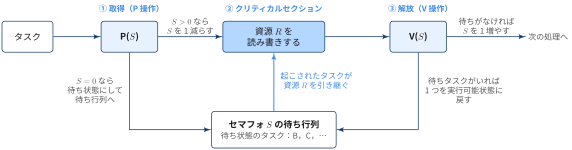{width="100%" fig-align="center"}

- カウンタの初期値を資源の数 $N$ にすると，同時に資源を使えるタスクは最大 $N$ 個になる（**計数セマフォ**）．例：3つあるバッファの割り当て
- 初期値を1にすると，同時に使えるのは1タスクだけになり，排他制御に使える（**バイナリセマフォ**）
- P 操作で待たされている間，タスクは CPU を使わずに待ち状態にいるので，その間にほかのタスクが実行される．待ち行列から起こす順番は，RTOS では優先度順にできることが多い

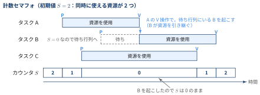{width="100%" fig-align="center"}

セマフォには「誰が P 操作したか」という情報がありません．
あるタスクが P 操作し，別のタスクや割込み処理が V 操作してもかまわないので，セマフォは排他制御だけでなく，「割込み処理がデータの到着をタスクに知らせる」といった同期（イベント通知）にも使われます．

[ミューテックスの仕組み]{.mini-section}

ミューテックス（mutex：mutual exclusion の略）は，排他制御のための専用のロックです．
バイナリセマフォに似ていますが，**ロックしたタスクがそのミューテックスの所有者になり，所有者しか解放できない** 点が異なります．

:::: {.no-border-top-table}

| 操作 | 動作 |
| --- | --- |
| lock（取得） | 所有者がいなければ，呼び出したタスクが所有者になって先に進む．ほかのタスクが所有していれば，呼び出したタスクを待ち状態にして待ち行列に入れる |
| unlock（解放） | 所有者だけが呼び出せる．待ち行列にタスクがいれば，そのうち1つ（RTOS では通常，最も優先度の高いタスク）に所有権を渡して実行可能状態に戻す．いなければ所有者なしに戻る |
: {tbl-colwidths="[18,82]"}

::::

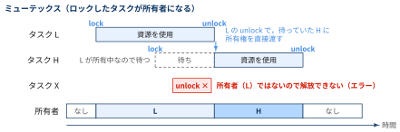{width="100%" fig-align="center"}

所有者が決まっていることで，次のことができるようになります．

- **誤った解放を防げる**：所有者でないタスクが unlock しようとするとエラーになる．セマフォでは誰でも V 操作できるので，バグで余計に V 操作すると，資源を使用中なのに別のタスクが入れてしまう
- **優先度継承**：OS は「誰が資源を持っていて，誰が待っているか」を把握できるので，所有者の優先度を，待っているタスクの優先度まで一時的に引き上げられる（後で説明する）
- **再帰ロック**：所有者が同じミューテックスを重ねて lock しても，自分自身を待たないようにできる（再帰ミューテックス）．lock した回数だけ unlock すると解放される

一方で，割込み処理はタスクではないので所有者になれず，ミューテックスは割込み処理からは使えません．
割込み処理からタスクに知らせたいときは，セマフォを使います．

:::: {.no-border-top-table}

| 観点 | セマフォ | ミューテックス |
| --- | --- | --- |
| 中身 | カウンタと待ち行列 | 所有者と待ち行列 |
| 同時に資源を使えるタスク数 | カウンタの初期値 $N$ まで | 1 |
| 解放できるのは | 誰でも（ほかのタスクや割込み処理も可） | lock した所有者だけ |
| 優先度継承 | できない | できる |
| 主な用途 | 個数のある資源の管理，割込み処理からタスクへのイベント通知 | 共有資源の排他制御 |
: {tbl-colwidths="[28,36,36]"}

::::

- 共有資源を守る排他制御にはミューテックス
- 個数のある資源の管理やイベントの通知にはセマフォ

と使い分けるのが基本です．

ところが，セマフォやミューテックスによる排他制御と優先度ベースのスケジューリングを組み合わせると，**優先度の高いタスクが，優先度の低いタスクより後回しにされる** 現象が起こることがあります．

::: {#def- .custom_problem .blog-custom-border}
### 優先度逆転

- 高優先度のタスクが，それより優先度の低いタスクの実行のために待たされ続ける現象
- 低優先度のタスク L が共有資源 R のロックを持ったまま，中優先度のタスク M に CPU を奪われる
- R を待っている高優先度のタスク H は，R と無関係なタスク M が終わるまで待たされる
- タスク M の実行時間に上限がなければ，タスク H の待ち時間にも上限がなくなる

:::

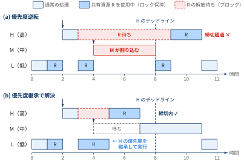{width="100%" fig-align="center"}

図の (a) を順に追うと次のようになります．

1. 時刻 1 に，タスク L が共有資源 R をロックする
2. 時刻 2 にタスク H が実行可能になり，タスク L から CPU を奪う
3. 時刻 3 にタスク H が R を使おうとするが，L がロックしているのでブロックされる．CPU はタスク L に戻る
4. 時刻 4 にタスク M が実行可能になる．M は L より優先度が高いので，L から CPU を奪う
5. タスク M が終わる時刻 8 まで，タスク L は R を解放できず，タスク H も動けない

タスク H が待たされるのは，L が R を使っている時間（クリティカルセクション）だけであれば仕方ありません．
問題は，H と無関係な M の実行時間（時刻 4〜8）まで待たされることです．
この区間では，中優先度の M が実質的に高優先度の H より先に実行されており，優先度が逆転しています．

[対策：優先度継承プロトコル]{.mini-section}

優先度逆転の代表的な対策は，**ロックを持っているタスクに，そのロックを待っているタスクの優先度を一時的に引き継がせる** ことです．
これを優先度継承（priority inheritance）といいます．

図の (b) では，時刻 3 にタスク H が R を待ち始めた時点で，タスク L の優先度が H と同じまで引き上げられます．
時刻 4 にタスク M が実行可能になっても，L のほうが優先度が高いので CPU を奪われません．
L は時刻 5 に R を解放して元の優先度に戻り，H がすぐに R を使って時刻 7 に完了します．
H の待ち時間は L のクリティカルセクションの長さだけで済み，上限を見積もれるようになります．

ほかに，資源ごとに「その資源を使うタスクの最高優先度」を決めておき，ロックを取った時点でその優先度まで引き上げる **優先度上限プロトコル**（priority ceiling protocol）もあります．
多くの RTOS は，ミューテックスの設定でこれらのプロトコルを選べるようになっています．

::: {.callout-note}
### 火星探査機 Mars Pathfinder のリセット

1997年に火星に着陸した Mars Pathfinder は，着陸後しばらくして，システムのリセットを繰り返すようになりました．
原因は優先度逆転でした．

- 低優先度の気象データ収集タスクが，情報バスのミューテックスを持ったまま，中優先度の通信タスクに CPU を奪われた
- そのミューテックスを待っていた高優先度のバス管理タスクがデッドラインまでに動けず，異常を検知したウォッチドッグがシステムをリセットした

探査機の RTOS は VxWorks で，ミューテックスには優先度継承を有効にするオプションがありましたが，無効になっていました．
地上からの指令でこのオプションを有効にすることで，問題は解決しました．

:::

## 周期タスクとスケジュール可能性

組込みシステムのタスクの多くは，「1 ミリ秒ごとにセンサを読む」「10 ミリ秒ごとに制御量を計算する」のように一定の周期で繰り返し実行されます．
このようなタスクを **周期タスク** と呼びます．
周期タスクの集まりについては，実際に動かす前に「すべてのタスクが毎周期デッドラインを守れるか」（スケジュール可能性）を計算で確かめられます．

::: {#def- .custom_problem .blog-custom-border}
### 周期タスクとCPU使用率

周期タスク $\tau_i$ を，最悪実行時間 $C_i$ と周期 $T_i$ の組で表す．

- タスク $\tau_i$ は時間 $T_i$ ごとに実行可能になり（ジョブのリリース），次のリリースまでに $C_i$ の処理を終える必要がある（デッドライン $= T_i$）
- タスク $\tau_i$ が CPU を使う割合は $C_i / T_i$ である
- $n$ 個のタスク全体の CPU 使用率を次で定義する

$$
U = \sum_{i=1}^{n} \frac{C_i}{T_i}
$$

:::

- $U > 1$ であれば，どんなスケジューリングをしても CPU の処理能力が足りないので，デッドラインを守れない
- $U \leq 1$ ならいつでも守れるかというと，優先度の付け方によって結果が変わる

[レートモノトニックスケジューリング]{.mini-section}

周期タスクの優先度を **周期が短いタスクほど高くする** 付け方を，レートモノトニック（RM: Rate Monotonic）スケジューリングといいます．
周期が短いタスクほどデッドラインまでの余裕が少ないので，先に実行させるという考え方です．
各タスクの優先度は周期だけで決まり，実行中に変わらない（固定優先度）ので，RTOS の優先度ベースのスケジューラでそのまま実現できます．

RM については，CPU 使用率だけでスケジュール可能性を判定できる十分条件が知られています．

::: {#thm- .custom_problem .blog-custom-border}
### Liu & Layland の上限

$n$ 個の周期タスクを RM で優先度付けして実行するとき，

$$
U = \sum_{i=1}^{n} \frac{C_i}{T_i} \leq n\left(2^{1/n} - 1\right)
$$

が成り立てば，すべてのタスクは毎周期デッドラインを守れる．

:::

右辺の値は次のとおりで，$n \to \infty$ で $\ln 2 \approx 0.693$ に近づきます．

:::: {.no-border-top-table}

| タスク数 $n$ | 1 | 2 | 3 | 4 | 5 | $\infty$ |
| --- | --- | --- | --- | --- | --- | --- |
| 上限 $n(2^{1/n}-1)$ | 1.000 | 0.828 | 0.780 | 0.757 | 0.743 | 0.693 |

::::

つまり，RM では CPU 使用率を **約69% 以下に抑えておけば，タスク数によらずデッドラインを守れる** ことが保証されます．
裏を返すと，この条件だけで判断する場合は，CPU の能力の約3割を余裕として残しておく必要があります．

::: {#exm- .custom_problem }
### 3つの周期タスクを RM で動かす

次の3つの周期タスクを考えます（時間の単位はミリ秒）．
RM では周期の短い順に $\tau_1$，$\tau_2$，$\tau_3$ の優先度になります．

| タスク | 最悪実行時間 $C_i$ | 周期 $T_i$ | 使用率 $C_i / T_i$ | 優先度 |
| --- | --- | --- | --- | --- |
| $\tau_1$ | 1 | 4 | 0.250 | 高 |
| $\tau_2$ | 2 | 6 | 0.333 | 中 |
| $\tau_3$ | 3 | 12 | 0.250 | 低 |

CPU 使用率は

$$
U = \frac{1}{4} + \frac{2}{6} + \frac{3}{12} \approx 0.833
$$

で，$n = 3$ の上限 $0.780$ を超えています．
したがって Liu & Layland の条件では，スケジュール可能とは **判定できません**．

ところが，タスクの周期の最小公倍数である 12 ミリ秒の間のスケジュールを実際に書いてみると，すべてのジョブがデッドラインに間に合っています．

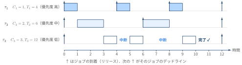{width="100%" fig-align="center"}

- $\tau_1$ は毎周期の先頭ですぐに実行され，1 ミリ秒で完了する
- $\tau_2$ は $\tau_1$ の後に実行され，時刻 3 と時刻 8 に完了する（デッドラインは 6 と 12）
- $\tau_3$ は空いた時間に少しずつ実行され，時刻 4 と時刻 6〜9 に中断されながらも，時刻 10 に完了する（デッドラインは 12）

Liu & Layland の条件は **十分条件** であって必要条件ではないので，上限を超えてもスケジュール可能な場合があります．

:::
***

::: {.callout-note collapse="true"}
### 応答時間解析による厳密な判定

上の例のように，使用率の上限を超えた場合でも，**応答時間解析** によってスケジュール可能性を厳密に判定できます．
タスク $\tau_i$ の最悪応答時間 $R_i$ は，自分より優先度の高いタスクの集合を $hp(i)$ として，次の式を満たす最小の値です．

$$
R_i = C_i + \sum_{j \in hp(i)} \left\lceil \frac{R_i}{T_j} \right\rceil C_j
$$

右辺第2項は，$R_i$ の間に優先度の高いタスクが割り込んでくる時間の合計です．
$R_i^{(0)} = C_i$ から始めて，右辺に代入する計算を値が変わらなくなるまで繰り返します．

例の $\tau_3$ について計算すると，

$$
\begin{aligned}
R_3^{(0)} &= 3 \\
R_3^{(1)} &= 3 + \lceil 3/4 \rceil \cdot 1 + \lceil 3/6 \rceil \cdot 2 = 6 \\
R_3^{(2)} &= 3 + \lceil 6/4 \rceil \cdot 1 + \lceil 6/6 \rceil \cdot 2 = 7 \\
R_3^{(3)} &= 3 + \lceil 7/4 \rceil \cdot 1 + \lceil 7/6 \rceil \cdot 2 = 9 \\
R_3^{(4)} &= 3 + \lceil 9/4 \rceil \cdot 1 + \lceil 9/6 \rceil \cdot 2 = 10 \\
R_3^{(5)} &= 3 + \lceil 10/4 \rceil \cdot 1 + \lceil 10/6 \rceil \cdot 2 = 10
\end{aligned}
$$

となって $R_3 = 10$ に収束します．$R_3 = 10 \leq T_3 = 12$ なので，$\tau_3$ はデッドラインを守れます．
これは図で $\tau_3$ が時刻 10 に完了していることと一致します．
同様に $R_1 = 1 \leq 4$，$R_2 = 3 \leq 6$ なので，3つのタスクはすべてスケジュール可能です．

:::

::: {.callout-note}
### 動的優先度：EDF

優先度を固定せず，**その時点でデッドラインが最も近いジョブを優先する** 方式を EDF（Earliest Deadline First）といいます．
デッドラインが周期と等しい周期タスクでは，EDF は $U \leq 1$ であれば必ずスケジュール可能であり，CPU を100%まで使い切れます．
一方で，実行のたびに優先度を計算し直す必要があることや，過負荷になったときにどのタスクが遅れるかを予測しにくいことから，実際の RTOS では RM のような固定優先度方式が広く使われています．

:::

## 例題：携帯端末の省電力

RTOS の優先度スケジューリングは，デッドラインを守るためだけでなく，**電池で動く機器の省電力** にも使われます．
「やることがないときだけ MPU のクロックを止める」仕組みが，タスクの優先度とどう結びついているかを見ていきます．

### 問題の設定を分解する

問題文は長いですが，登場するのは次の4つの要素です．

:::: {.no-border-top-table}

| 要素 | 問題文での設定 |
| --- | --- |
| クロック制御回路 | MPU へのクロック供給，タイマ割込み，クロック発振の停止／再開を担当するハードウェア．タイマ割込み用のタイマは MPU とは別のクロックで動く |
| リアルタイムOS | タスクの状態は実行・実行可能・待ちの3つ．優先度の高いタスクが起動すると実行中のタスクは実行可能状態になる（プリエンプティブ）．タスク間通信はメールボックスで行い，受信要求したタスクはメールが届くまで待ち状態になる |
| 省電力状態 | スタンバイモード（MPU へのクロック供給が停止）とアイドルモード（クロックは供給されたまま，割込みを検出するまで命令の実行を停止）の2つ |
| タスク | クロック制御タスクは「①クロック発振の停止を指示 → ②MPU をアイドルモードにする」を繰り返す．それ以外のタスクは「メールボックスに受信要求 → メールを受信して処理 → 再び受信要求」を繰り返す |
: {tbl-colwidths="[20,80]"}

::::

この問題の肝は，**クロックの発振を止めるのは一瞬だが，再開してから安定するまでに $T$ ミリ秒かかる** という点です．
そのため，クロック制御回路は次のルールで動きます．

::: {#def- .custom_problem .blog-custom-border}
### クロック制御回路のルール

- **停止**：停止指示を受けたら，次のタイマ割込みまでの時間を調べる．$T$ ミリ秒より長ければ発振を止め，$T$ ミリ秒以下なら停止指示を取り消して発振を続ける
- **再開**：発振を止めている間に，タイマ割込みの $T$ ミリ秒前になるか，ほかの割込みを検出したら，発振を再開する
- **供給**：MPU へのクロック供給は，発振の再開から $T$ ミリ秒後
- **保留**：クロック制御タスクの①と②の間に割込みがあれば保留し，②の後に MPU に通知する

:::

- 次のタイマ割込みまで $T$ ミリ秒以下のときに止めないのは，止めても再開がタイマ割込みに間に合わないから
- 逆に，タイマ割込みの時刻は事前にわかっているので，$T$ ミリ秒前から再開しておけば，タイマ割込みの時刻ちょうどに MPU が動ける状態になる

::: {#exr- .custom_problem .blog-custom-border}
### クロック再開時に最初に実行される処理
 
クロックの発振が再開し，MPU にクロックが供給されたとき，最初に実行される処理は，必ず [ a ] となる．
それが [ b ] であれば遅延なく実行されるが，[ b ] 以外の場合は，ほかに割込みがなければ，割込み要求発生から [ c ] ミリ秒遅延してから実行される．

:::

発振が止まるのは，クロック制御タスクが①で停止を指示し，②で MPU をアイドルモードにした後です．
①と②の間に来た割込みも②の後まで保留されるので，MPU は必ず **アイドルモード中に割込みを受けて** 再開します．
アイドルモードは割込みを検出すると終了するので，再開後に最初に動くのは割込み処理です．

発振を再開するきっかけは2通りあり，割込み処理が始まるまでの遅れが異なります．

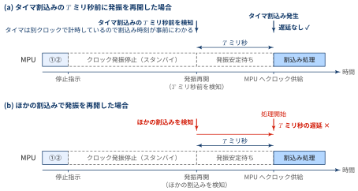{width="100%" fig-align="center"}

::: {.callout-note collapse="false" icon=false}
## 解答

- a：**割込み処理**
- b：**タイマ割込み**
- c：**$T$**

:::

[応答時間の内訳との関係]{.mini-section}

(b) の $T$ ミリ秒は，[応答時間の内訳](#応答時間の内訳) でいう割込みレイテンシにそのまま上乗せされます．
発振停止中にボタン操作や受信などの外部割込みが来ると，その応答は最悪で $T$ ミリ秒遅れます．
クロックを止めて節電するほど，タイマ以外のイベントへの応答は遅くなるというトレードオフがあり，
デッドラインのある処理では，この $T$ を見込んで最悪応答時間を見積もる必要があります．

::: {#exr- .custom_problem .blog-custom-border}
### 省電力の効果

MPU の単位時間当たりの消費電力は，命令を実行している場合 $P$，アイドルモードの場合 $0.5P$，スタンバイモードの場合 $0$ である．

- 端末が通信中のとき，クロック供給は停止せず，80% は命令を実行している状態，20% はアイドルモードである．単位時間当たりの消費電力は [ d ] $\times P$
- 端末が通信を行っていないとき，1秒ごとに 10 ミリ秒間 MPU にクロックが供給され，それ以外はスタンバイモードである．その 10 ミリ秒のうち 90% は命令を実行，10% はアイドルモードである．単位時間当たりの消費電力は [ e ] $\times P$

:::

時間の割合で重み付けした平均を取るだけです．
通信中は

$$
d = 0.8 \times 1 + 0.2 \times 0.5 = 0.9
$$

通信していないときは，1000 ミリ秒のうちクロックが供給される 10 ミリ秒だけ電力を使うので，

$$
e = \frac{10}{1000} \times \left(0.9 \times 1 + 0.1 \times 0.5\right) = 0.01 \times 0.95 = 0.0095
$$

::: {.callout-note collapse="false" icon=false}
## 解答

- d：**0.9**
- e：**0.0095**

:::

通信していないときの消費電力は通信中の約 $1/95$ です．
アイドルモードでも $0.5P$ を使うので，クロック供給そのものを止めるスタンバイモードに入れることが，電池を長持ちさせる鍵になっています．

::: {#exr- .custom_problem .blog-custom-border}
### クロック制御タスクの優先度

1. クロック制御タスクの優先度はどのように設定すべきか，ほかのタスクの優先度を考慮して，25字以内で答えよ
2. クロック制御タスクが実行状態にあるとき，ほかのタスクが取り得るタスクの状態をすべて選び，タスクの状態遷移図の状態で答えよ

:::

クロック制御タスクは，動き出すとすぐに MPU を止めてしまうタスクです．
もしほかのタスク X より優先度が高いと，X が処理すべきメールを受け取って実行可能になっていても，クロック制御タスクが先に実行されて MPU を止めてしまいます．
クロックを止めてよいのは **ほかのタスクにやることが何もないとき** だけなので，クロック制御タスクは最も低い優先度にします．

このとき，RTOS のルール「実行状態になるのは，実行状態と実行可能状態のタスクのうち最も優先度の高いもの」から，(2) の答えが決まります．
最低優先度のクロック制御タスクが実行状態にあるなら，実行可能状態のタスクは1つもないはずです（あればそちらが実行される）．
したがって，ほかのタスクはすべて待ち状態，つまりメールボックスでメールを待っている状態です．

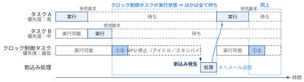{width="100%" fig-align="center"}

::: {.callout-note collapse="false" icon=false}
## 解答

1. **ほかのすべてのタスクよりも低い優先度に設定する**
2. **待ち状態**

:::

ほかのタスクがすべて待ち状態なら，次に何かが起こるきっかけは，タスクにメールが届くこと，つまり割込み処理からのメールだけです．
だから MPU を止めて割込みを待っても取りこぼしはなく，設問1で見たように，再開後は必ず割込み処理から始まります．
優先度の設定と割込みによる再開が組み合わさって，止めても安全な瞬間にだけ止める仕組みになっています．

## 例題：多言語多通貨対応両替システム

次は，駅や商店に置かれ，訪日客の外貨紙幣を日本円に両替する両替機の制御です．
両替機の制御部は RTOS の上で複数のタスクを動かし，紙幣の入金・出金・明細書の印刷を担当する装置とは，10 ミリ秒周期のポーリングで通信します．
**最悪のケースでも周期内に通信が終わるか** を見積もる設問と，**RTOS のタイマでタイムアウトを作る** 設問が，ここまでの話につながります．

### 問題の設定を分解する

:::: {.no-border-top-table}

| 要素 | 問題文での設定 |
| --- | --- |
| ハードウェア | 制御部（両替機全体の制御と管理サーバとの通信）と，タッチパネル・入金部・出金部・印刷部．入金部・出金部・印刷部はシリアルバスで制御部につながる |
| 動作 | 利用可のときに1枚目の外貨紙幣が挿入されると両替状態になる．紙幣は1枚ずつ通貨・金種を識別し，入金部の内部に格納するか入金口に戻す．両替ボタンで明細書の印刷・排出と日本円の出金を行い，すべて完了したら両替状態を解除する |
| シリアルバス通信 | ポーリング方式．制御部が入金部 → 出金部 → 印刷部の順に 10 ミリ秒周期でデータを送り，各部は自分宛てのデータを受信したら制御部へデータを返す |
| 制御部のタスク | RTOS 上で，メイン（両替機全体の管理），表示操作（タッチパネル），シリアルバス（入金部・出金部・印刷部との通信），通信（管理サーバとの通信）の4つのタスクが動く |
: {tbl-colwidths="[20,80]"}

::::

両替機の仕様のうち，設問に関わるものを抜き出すと次のとおりです．

::: {#def- .custom_problem .blog-custom-border}
### 両替機の仕様（抜粋）

- 1回の両替で出金できる日本円額の合計は，1円以上 10 万円以下
- 次のいずれかの場合は，挿入された外貨紙幣を格納せずに入金口に戻す：識別できない，格納できない状態，格納しても合計が1円に満たない，**格納すると合計が 10 万円を超える**，格納すると出金部の紙幣・硬貨の組合せで出金できない
- 入金部の内部に一度格納した外貨紙幣は，入金口に戻さない
- 両替状態でないときは，定期的に管理サーバに問い合わせて両替レートを更新する．両替状態では更新せず，両替状態を解除した時に更新する
- 両替状態となってから，入金部の内部に外貨紙幣を1枚も格納しないまま **3分経過** した場合も，両替状態を解除する
- 印刷・排出と出金が全て完了した時，「外貨紙幣を格納できない」「出金部の日本円の合計が 10 万円未満」「明細書の用紙不足」のどれかがあれば利用不可とし，管理サーバに利用可・利用不可を報告する

:::

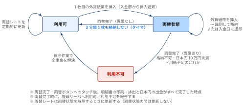{width="100%" fig-align="center"}

制御部と各部の間でやりとりされる主なメッセージは次のとおりです．

:::: {.no-border-top-table}

| メッセージ | 送信元 → 送信先 | 内容 |
| --- | --- | --- |
| 出納指示 | 制御部 → 入金部 | 挿入された外貨紙幣を内部に格納させる，または入金口に戻させる |
| 格納通知 | 入金部 → 制御部 | 外貨紙幣の格納完了と，まだ格納できるかどうか |
| 挿入通知 | 入金部 → 制御部 | 挿入された外貨紙幣の通貨・金種，または識別失敗 |
| 出金指示 | 制御部 → 出金部 | 日本円紙幣・硬貨を出金口から出金させる |
| 出金通知 | 出金部 → 制御部 | 出金完了と，日本円紙幣・硬貨の残り枚数 |
| 印刷指示 | 制御部 → 印刷部 | 明細書を印刷して排出させる |
| 印刷通知 | 印刷部 → 制御部 | 明細書の印刷・排出完了と，用紙が不足しているかどうか |
: {tbl-colwidths="[16,22,62]"}

::::

::: {#exr- .custom_problem .blog-custom-border}
### 両替状態の判断と利用可否の報告

1. 制御部が両替状態となったことを判断するのは，どの構成要素から通知を受けたときか．構成要素名で答えよ
2. 制御部が管理サーバに利用可・利用不可のいずれかを報告するのは，二つのメッセージを受信した後である．その二つのメッセージ名を答えよ

:::

(1) 両替状態になるきっかけは，利用者が1枚目の外貨紙幣を入金口に挿入したことです．
挿入された紙幣を識別して制御部に知らせるのは入金部（挿入通知）なので，制御部は入金部からの通知で両替状態になったと判断します．
利用者はタッチパネルに触れずに紙幣を入れ始めるので，タッチパネルではありません．

(2) 利用可・利用不可を報告するのは「印刷・排出と出金が全て完了した時」です．
完了を知らせるメッセージは，印刷部からの印刷通知と出金部からの出金通知です．
しかも，利用不可の判定に使う「明細書の用紙不足」は印刷通知に，「出金部の日本円の合計が 10 万円未満」は出金通知の残り枚数に含まれています．
残る「外貨紙幣を格納できない」は，それ以前に受け取った格納通知でわかっています．
2つの通知がそろったところで，利用不可の判定に必要な情報がすべてそろいます．

::: {.callout-note collapse="false" icon=false}
## 解答

1. **入金部**
2. **出金通知，印刷通知**

:::

::: {#exr- .custom_problem .blog-custom-border}
### シリアルバスの通信速度

シリアルバスの最適な通信速度を検討するために，通信データ量が最も多く，処理時間が最も長くなるケースを調査した結果，当該ケースは次のとおりであった．

1. 制御部は，894 バイトのデータを印刷部に送信する
2. 印刷部はデータを受信し終えたら，750 マイクロ秒の処理を行った後に，6 バイトのデータを制御部に送信する
3. 制御部はデータを受信し終えたら，250 マイクロ秒の処理を行った後に，入金部へのデータ送信を開始する

当該ケースにおいて，シリアルバスの通信速度は最低何ビット／秒必要か．
答えは小数第1位を切り上げて，整数で求めよ．
ここで，1 バイトはスタートビット，ストップビットを含めて 10 ビットで送信されるものとする．

:::

ポーリングでは，入金部・出金部・印刷部にそれぞれ 10 ミリ秒の区間が割り当てられています．
印刷部の区間（⑤⑥）では，制御部の送信，印刷部の処理，印刷部の返信，制御部の処理をすべて終えてから，次の区間で入金部への送信を始めなければなりません．
つまり，**この区間の中身すべてを 10 ミリ秒以内に収める** という時間の制約です．

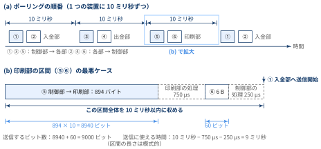{width="100%" fig-align="center"}

送信するビット数と，送信に使える時間は

$$
\begin{aligned}
\text{ビット数} &= (894 + 6) \times 10 = 9000 \text{ ビット} \\
\text{送信に使える時間} &= 10 \text{ ミリ秒} - 750 \text{ マイクロ秒} - 250 \text{ マイクロ秒} = 9 \text{ ミリ秒}
\end{aligned}
$$

なので，必要な通信速度は

$$
\frac{9000 \text{ ビット}}{9 \times 10^{-3} \text{ 秒}} = 1{,}000{,}000 \text{ ビット／秒}
$$

です．

::: {.callout-note collapse="false" icon=false}
## 解答

**1,000,000 ビット／秒**

:::

[最悪ケースで設計する]{.mini-section}

この設問は，[リアルタイム ≠ 高速](#リアルタイムに処理するとは) で見た「最悪の場合でもデッドラインに間に合う」考え方そのものです．
データ量が少ない普段の通信に合わせて通信速度を決めると，明細書の印刷データのように大きなデータを送るときに 10 ミリ秒の区間に収まらず，次の入金部への送信が遅れてしまいます．
そこで，**データ量が最も多く，処理時間が最も長いケース** でも区間に収まる通信速度を求めています．

また，ポーリングでは装置ごとに通信の順番が決まっているので，入金部で紙幣が挿入されてから制御部がそれを知るまでの時間も，最悪で1周分（30 ミリ秒）程度と見積もれます．
割込みと比べると反応は遅くなりますが，各装置との通信のタイミングが周期的に決まるので，最悪の応答時間を見積もりやすいという利点があります．

::: {#exr- .custom_problem .blog-custom-border}
### メインタスクのタイマ利用処理

メインタスクは両替状態となった時，[ a ] 後にイベントを受信するように，リアルタイム OS のタイマを設定する．
このイベントの受信時，両替状態となってから，①ある条件を満たしたら，[ b ] して，[ c ] を行う．

1. 本文中の [ a ] 〜 [ c ] に入れる適切な字句を答えよ
2. 本文中の下線①の条件とは何か．30 字以内で述べよ

:::

この処理は，仕様の「両替状態となってから，入金部の内部に外貨紙幣を1枚も格納しないまま3分経過した場合も，両替状態を解除する」と「両替状態を解除した時に両替レートを更新する」をそのまま実装したものです．

- 両替状態になった時に，**3分後** にイベントが届くようにタイマを設定する（a）
- 3分後にイベントを受信したら，それまでに **入金部の内部に外貨紙幣を1枚も格納していない** かを確かめる（①）
- 1枚も格納していなければ，**両替状態を解除** して（b），**両替レートの更新** を行う（c）

①の条件を確かめるのは，1枚でも格納していれば利用者が両替の途中だからです．
一度格納した紙幣は戻さない仕様なので，ここで両替状態を解除すると，利用者の入れたお金が宙に浮いてしまいます．
紙幣を挿入したが識別できずに戻された場合も，格納枚数は0枚のままなので解除の対象になります．

::: {.callout-note collapse="false" icon=false}
## 解答

1. a：**3分**，b：**両替状態を解除**，c：**両替レートの更新**
2. **入金部の内部に外貨紙幣を1枚も格納していないこと**

:::

[RTOS のタイマとタイムアウト]{.mini-section}

メインタスクは，入金部や表示操作タスクからの通知を待つのと同じように，タイマからのイベントも待ち状態で待ちます．
「3分たったか」を自分で繰り返し確かめる（ビジーウェイト）必要はなく，その間 CPU はほかのタスクの実行に使われます．
指定した時間後に1回だけイベントを送る RTOS のタイマ（ワンショットタイマ）は，このようなタイムアウト処理によく使われます．

::: {#exr- .custom_problem .blog-custom-border}
### 外貨紙幣が戻された原因

ある両替において，両替状態となってから，日本円額 91,000 円分の外貨紙幣を入金部の内部に格納したところに，利用者が 100 米ドル紙幣 1 枚を挿入したら，格納されずに入金口に戻された．
戻された原因を 25 字以内で述べよ．

ここで，両替機が故障していない状態で，入金部は 100 米ドル紙幣が両替可能な通貨・金種と認識し，外貨紙幣を内部に格納できる状態であるものとする．
また，両替レートは 1 米ドル 100 円とし，出金部は全ての金種の日本円紙幣・硬貨をそれぞれ 10 枚以上もっているものとする．

:::

仕様の「格納せずに入金口に戻す」5つの条件を1つずつ確かめます．

:::: {.no-border-top-table}

| 条件 | この場合 |
| --- | --- |
| 識別できない | 両替可能な通貨・金種と認識している → 該当しない |
| 格納できない状態 | 格納できる状態 → 該当しない |
| 合計が1円に満たない | 合計は 1 円以上 → 該当しない |
| **合計が 10 万円を超える** | $91{,}000 + 100 \times 100 = 101{,}000$ 円 $> 100{,}000$ 円 → **該当する** |
| 出金できない組合せ | 全金種を 10 枚以上もっている → 該当しない |
: {tbl-colwidths="[30,70]"}

::::

この判定は，紙幣を格納する **前** に行う必要があります．
一度格納した紙幣は戻さない仕様なので，格納してから 10 万円を超えたことに気づいても取り返しがつかないからです．

::: {.callout-note collapse="false" icon=false}
## 解答

**日本円額の合計が 10 万円を超えてしまうから**

:::


## 📘 用語集

:::{.glossary-container}

```yaml
glossary:
  - def: デッドライン (Deadline)
    description: |
      リアルタイム処理で，処理を完了していなければならない時刻．イベントの発生時刻に制限時間を足した時刻として決まる．周期タスクでは，次のジョブのリリース時刻をデッドラインとすることが多い．

  - def: ハードリアルタイム (Hard Real-Time)
    description: |
      デッドラインを1回でも過ぎると，システムの故障や事故につながるリアルタイム処理．エアバッグやブレーキ制御が代表例．遅れた結果の価値はゼロではなくマイナス（損害）になる．

  - def: ソフトリアルタイム (Soft Real-Time)
    description: |
      デッドラインを過ぎると結果の価値が下がるが，ある程度の価値は残るリアルタイム処理．Web ページの表示などが例．遅れた結果の価値がゼロになり捨てられるものは，ファームリアルタイムとして区別することもある．

  - def: 決定性 (Determinism)
    description: |
      同じ入力に対して，処理にかかる時間が毎回ほぼ同じで，最悪の場合の時間を事前に見積もれる性質．リアルタイムシステムでは，平均的な速さよりも決定性が重視される．

  - def: 最悪実行時間 (WCET: Worst-Case Execution Time)
    description: |
      タスクの処理にかかる時間のうち，あらゆる入力・状態を考えたときの最大値．リアルタイム処理の設計では，平均ではなく WCET を使ってデッドラインに間に合うかを判断する．

  - def: プリエンプション (Preemption)
    description: |
      実行中のタスクから OS が CPU を取り上げ，別のタスクに割り当てること．RTOS では，優先度の高いタスクが実行可能になった時点ですぐにプリエンプションが起こる．

  - def: 割込みレイテンシ (Interrupt Latency)
    description: |
      割込みが発生してから，対応する割込みハンドラが動き出すまでの時間．OS やデバイスドライバが割込みを禁止している区間が長いほど大きくなる．

  - def: 優先度逆転 (Priority Inversion)
    description: |
      共有資源のロックを持つ低優先度のタスクが中優先度のタスクに CPU を奪われ，そのロックを待つ高優先度のタスクが，無関係な中優先度のタスクの実行の間も待たされる現象．待ち時間に上限がなくなるため，ハードリアルタイムシステムでは致命的になりうる．

  - def: 優先度継承 (Priority Inheritance)
    description: |
      ロックを持っているタスクに，そのロックを待っているタスクのうち最も高い優先度を一時的に引き継がせる仕組み．ロックを解放すると元の優先度に戻る．優先度逆転を防ぐ代表的な方法．

  - def: レートモノトニックスケジューリング (Rate Monotonic Scheduling)
    description: |
      周期タスクに対して，周期が短いタスクほど高い優先度を固定で割り当てるスケジューリング方式．CPU 使用率が n(2^(1/n) − 1) 以下であれば，すべてのタスクがデッドラインを守れることが知られている（Liu & Layland の上限）．

  - def: ウォッチドッグ (Watchdog Timer)
    description: |
      システムが正常に動いているかを監視するためのタイマー．ウォッチドッグタイマー（WDT）とも呼ぶ．正常に動作しているソフトウェアは，決められた時間内に定期的にタイマーをクリアする（「キックする」「餌をやる」と表現される）．暴走や無限ループ，デッドロック，優先度逆転などでクリアが途絶えてタイマーが満了すると，システムに異常があるとみなしてリセットや割込みを発生させ，停止したままになるのを防ぐ．Mars Pathfinder でシステムのリセットを引き起こしたのも，この仕組みである．

  - def: タイムクォンタム (Time Quantum)
    description: |
      ラウンドロビンなどのタイムシェアリング方式で，1つのタスクが連続して CPU を使える時間の上限．タイムスライスとも呼ぶ．使い切ったタスクは CPU を手放して実行可能なタスクの列の最後尾に回り，次のタスクに CPU が割り当てられる．短くするとタスクの切り替えが増えてその負担が大きくなり，長くするとほかのタスクが待たされる時間が長くなる．

  - def: MPU (Micro Processing Unit)
    description: |
      命令を読み込んで実行する処理装置（マイクロプロセッサ）．CPU の機能を1つの半導体チップにまとめたもので，情報処理技術者試験の組込みシステムの問題では，CPU とほぼ同じ意味で使われる．クロックが供給されている間だけ命令を実行し，クロック周波数が高いほど，また命令を実行しているほど消費電力が大きくなる．なお，ARM Cortex-M などの組込み向けプロセッサでは，メモリ保護機構（Memory Protection Unit）も MPU と略されるので，文脈で区別する．
```

:::
