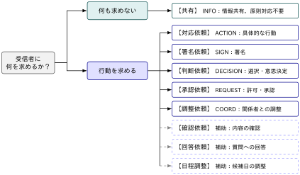
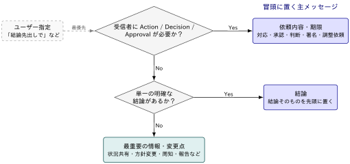
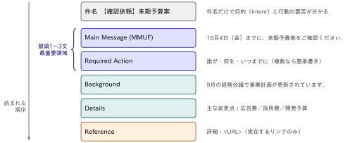
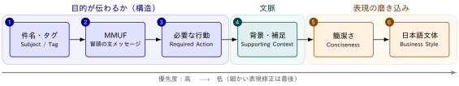

## この記事について

:::: {.no-border-top-table}

| 観点 | 内容 |
|---|---|
| **What**：何のドキュメントか | 日本語ビジネスメールを「読み手がすぐに理解して動ける」形で書くためのお作法まとめ．|
| **Who**：誰に向けたものか | 業務でメールを書く人全般|
| **Why**：なぜ重要か | 読みづらいメールは，確認の往復，対応漏れ，判断の遅れにつながる．成果を左右するのは丁寧さより「伝わって動ける」かどうか |
| **How**：どう活用するか | 一度通読して全体像をつかんだら，実務では末尾の「送信前に見直す順番」をチェックリストとして使う．件名タグの一覧や Bad / Better の例は，書くときのテンプレートとして参照する |

: {tbl-colwidths="[25,75]"}

::::

## 良いメールとは？


メールの良し悪しは，丁寧な日本語かどうかよりも，読み手がすぐに理解して動けるかどうかで決まります．

::: {.callout-note}
### 良いメールの必要条件

 読み手がメールを開いた瞬間に

 - 何のメールか
 - 自分は何をすればよいか
 - 一番重要な情報は何か

 が理解できる

:::


### 良いメールの構成要素

上の3条件を満たすために，メールを次の構成要素に分けて考えます．読み手は上から順に読むので，**重要なものほど上に置く**のが基本です．

| 構成要素 | 役割 | 答える問い | 主に満たす条件 |
|---|---|---|---|
| 件名（タグ） | 開く前にメールの目的と行動の要否を伝える | What（何のメールか） | 何のメールか |
| 冒頭1〜3文（MMUF） | メインメッセージ・依頼内容・期限を伝える | What / When | 一番重要な情報は何か |
| 依頼（Action） | 誰が・何を・いつまでにするかを明示する | Who / How | 自分は何をすればよいか |
| 背景 | 依頼・判断に必要な理由だけを補う | Why | （上記3つの理解を補助） |
| 詳細・参照 | 変更点，確認事項，リンクなどを整理して示す | Where | （必要なときに参照） |

前半の「件名・冒頭・依頼」の3つが必要条件を直接満たす**骨格**で，「背景・詳細」はそれを支える**補足**です．

なお，すべての要素が毎回必要なわけではありません．返信不要の共有メールなら依頼（Action）は「ご対応は不要です」の一言で済みますし，短い連絡なら背景や詳細を省いても構いません．以降の節では，この構成要素を件名から順に見ていきます．


[よくある失敗]{.mini-section}

よくある失敗は，この順序が逆になり，経緯の説明から書き始めて依頼が最後の一文に埋もれてしまうこと


- ❌ Bad:  経緯 → 背景 → 詳細 → （最後に）ご確認お願いします
- ✅ Good: 件名で目的 → 冒頭でメインメッセージと依頼・期限 → 背景 → 詳細

## 件名：目的をタグで示す

::: {#cor-naming .custom_problem .custom_rule .blog-custom-border}
## 目的をタグで示す

件名には，メールの目的を示すタグを原則1つ付ける

```text
【対応依頼】契約書の確認
【共有】10月のプロジェクト体制
【承認依頼】来期予算案
```

:::

[タグ体系]{.mini-section}

{width="85%" fig-align="center"}

| Semantic Type | Japanese Tag | 意味 |
|---|---|---|
| ACTION | `【対応依頼】` | 受信者に具体的な行動を求める |
| SIGN | `【署名依頼】` | 署名を求める |
| INFO | `【共有】` | 情報共有のみで原則対応不要 |
| DECISION | `【判断依頼】` | 選択・意思決定を求める |
| REQUEST | `【承認依頼】` | 許可・承認を求める |
| COORD | `【調整依頼】` | 関係者との調整を求める |


::: {#cor-tag .custom_problem .custom_rule .blog-custom-border}
## タグは「受信者に何を求めるか」で選ぶ

- タグは「メールに何が書いてあるか」ではなく，受信者に何を求めているかで決め
- 求めるものが複数だと混乱を生むので，原則タグは１つ

:::

[受信者に何を求めているか]{.mini-section}

タグは「メールに何が書いてあるか」ではなく，**受信者に何を求めているか**で決めます．

```text
契約書を送ります．
内容をご確認ください．
```

は資料を送っていても，求めているのは確認なので `【確認依頼】` です．一方，

```text
契約書の最新版を共有します．
ご対応は不要です．
```

であれば `【共有】` になります．

[タグは原則1つ]{.mini-section}

```text
【共有】【確認】【重要】【依頼】契約書について
```

のようにタグを重ねると，結局何を求めているのかが分からなくなります．Primary Intent を1つに決め，`【確認依頼】契約書ドラフト` とします．期限は件名に含めても構いません．

```text
【確認依頼｜10/4まで】契約書ドラフト
```


::: {.callout-note}
### 件名を見直す3観点

| 観点 | Bad | Better |
|---|---|---|
| Intent：件名だけで目的が分かるか | `資料について` | `【確認依頼】来期予算案` |
| Action：行動の要否が件名から分かるか | `契約書` | `【署名依頼】業務委託契約書` |
| Specificity：何についてか具体的か | `【確認依頼】確認お願いします` | `【確認依頼】10月プロジェクト体制案` |


:::


## MMUF（Main Message Up Front）

::: {#cor-mmuf .custom_problem .custom_rule .blog-custom-border}
## 読み手が最初に知るべきメインメッセージをメール冒頭に置く

- 受信者に行動・判断・承認が必要 → 依頼内容・期限をメインメッセージにする
- 行動は不要だが，単一の明確な結論がある → 結論をメインメッセージにする
- 情報共有・状況報告・周知が中心 → 最も重要な情報・変更点をメインメッセージにする

:::

[メインメッセージはメールの種類で変わる]{.mini-section}

何が「メインメッセージ」になるかは，受信者に何を求めるメールかによって変わります．

{width="90%" fig-align="center"}

[MMUF は「ラベル」ではなく「構造」]{.mini-section}

よくある失敗が，`結論：` `背景：` といった見出しを機械的に付けてしまうことです．

```text
結論：10月4日までにご承認ください．
```

よりも，

```text
10月4日（金）までに，本資料のご承認をお願いいたします．
```

のほうが自然な日本語ビジネスメールです．MMUF は表示形式ではなく**情報配置の原則**として扱います．見出しは，長めのメールで情報整理に有効な場合に限って使います．


::: {.callout-note}
### 冒頭1〜3文が最重要

- メール冒頭の1〜3文は最重要領域．ここには Who / What / When / Where / Why / Required Action のうち，メールの理解に必要なものをできるだけ含める
- ただし5Wを機械的にすべて詰め込んで冗長にしてはいけない．特に重要なのは **What / Required Action / When** の3つ．


:::


## 本文：行動を明示する（Who / How）

::: {#cor-action .custom_problem .custom_rule .blog-custom-border}
## 誰が・何を・いつまでにを明示する

- 受信者に行動を求めるなら，依頼先・依頼内容・期限を曖昧にしない
- 丁寧さのために Action を曖昧にしてはいけない
- 責任主体が曖昧になる場合は行動主体を補う

:::

[誰が・何を・いつまでに]{.mini-section}

受信者に行動を求めるメールでは，**誰が・何を・いつまでに**を明確にします．複数人に送る場合も，依頼先や意思決定者を曖昧にしません．

- ❌ Bad:    こちらについて確認できればと思っています．
- ✅ Better: 10月4日（金）までに，内容をご確認ください．


[日本語特有の曖昧表現]{.mini-section}

次のような表現には注意が必要です．

```text
〜できればと思います
〜いただければと思います
〜かと思います
〜という認識です
〜の方
〜についてですが
一応
念のため
とりあえず
```

これらを一律に禁止する必要はありません．**行動・責任・結論を曖昧にしていないか**で判断します．たとえば `ご確認いただければと思います．` は，依頼であることをはっきりさせたいなら `ご確認をお願いいたします．` とします．

[能動態と行動主体]{.mini-section}

- ❌ Bad:    資料について確認が行われました．
- ✅ Better: 営業チームが資料を確認しました．

<!-- -->

- ❌ Bad:    対応をお願いできればと思います．
- ✅ Better: 山田さんにご対応をお願いいたします．

主語を書くことが目的ではなく，主語を明示することによって**責任主体が曖昧になるのを防ぐ**であることを忘れないでください．

## 本文：背景は必要な分だけ（Why）

::: {#cor-why .custom_problem .custom_rule .blog-custom-border}
## 背景は What の理解・判断に必要な分だけ書く

- 経緯をすべて説明する必要はない
- 背景はメインメッセージと依頼の後ろに置く

:::

[背景に書くこと]{.mini-section}

相手が「なぜ今この連絡を受け取っているのか」「なぜ対応が必要なのか」を理解できるように，背景を添えます．

- メールを送る目的
- 依頼・判断が必要になった背景
- 対応しない場合の影響
- 必要であれば期限を設定する理由

ただし，経緯をすべて説明する必要はありません．**What を理解・判断するために必要な Why** だけを，メインメッセージと依頼の後ろに置きます．

## 本文の構成

::: {#cor-structure .custom_problem .custom_rule .blog-custom-border}
## メインメッセージ → 依頼 → 背景 → 詳細の順に組み立てる

- 複数の Action・変更点・確認事項・日程候補などは箇条書きにする
- 参照先は添付よりリンクで具体的に示すことも検討する

:::

[長いメールの構成]{.mini-section}

ここまでの要素をまとめると，情報量が多いメールは次の順序で組み立てます．

{width="100%" fig-align="center"}

```text
山田さん

10月4日（金）までに，来期予算案をご確認ください．

主な変更点は以下の3点です．

- 広告費を前年比10%増額
- 採用費を500万円追加
- 開発予算を第2四半期へ移動

背景として，9月の経営会議で事業計画が更新されています．

詳細：
<URL>
```

複数の Action，複数の変更点，背景情報，複数の確認事項，日程候補などは，長い文章にまとめず箇条書きにします．

```text
以下3点をご確認ください．

- 金額
- 契約期間
- 支払条件
```

[リンクと添付ファイル]{.mini-section}

- Google Drive，Notion，SharePoint などの共有ドキュメントがあるなら，添付ファイルではなくリンクで示すことも検討します
- How の「どこを確認すればよいか」を明確にするためにも，参照先は具体的に示します．

## 簡潔に書く

::: {#cor-concise .custom_problem .custom_rule .blog-custom-border}
## 明確・簡潔・礼儀正しいのバランスを取る

- 重複・不要な前置き・名詞化・回りくどい表現を削る
- 「短くする＝無愛想にする」ではない．一方で過剰敬語は修正対象

:::

::: {.callout-note}
### 簡潔にする4観点

| 種類 | Before | After |
|---|---|---|
| 重複 | 念のため改めて再度共有します． | 改めて共有します． |
| 不要な前置き | お忙しいところ大変恐縮ではございますが，一点ご相談させていただきたい事項がございます． | ○○についてご相談です． |
| 名詞化 | 確認の実施をお願いいたします． | ご確認をお願いいたします． |
| 回りくどい表現 | 対応いただくことは可能でしょうか． | ご対応いただけますでしょうか．／ご対応をお願いいたします． |

:::

[丁寧さと明確さのバランス]{.mini-section}

日本語メールでは「短くする＝無愛想にする」ではありません．**明確・簡潔・礼儀正しい**の3つのバランスを取ります．一方で過剰敬語は修正対象です．

- ❌ Bad:    ご確認していただけますでしょうか．
- ✅ Better: ご確認いただけますでしょうか．
- ✅ Better: ご確認をお願いいたします．

## 推敲・添削で守ること

::: {#cor-edit .custom_problem .custom_rule .blog-custom-border}
## 事実を追加せず，原文の意図を変えない

- 日付・人名・金額・URL・締切などを推測で書き足さない
- 依頼・提案・命令・相談・共有・報告の強さは変えない

:::

[事実を追加しない]{.mini-section}

自分のメールを推敲するときも，他人のメールを添削するときも，日付，時刻，人名，金額，URL，プロジェクト名，決定事項，締切，承認状況を推測で書き足してはいけません．情報が欠けている場合は `[期限]` `[URL]` `[担当者]` などのプレースホルダーを置くか，不足していることを指摘します．

[原文の意図を変えない]{.mini-section}

文章を短くするときも，依頼・提案・命令・相談・共有・報告の**強さ**は変えません．

```text
可能であれば10月4日までにお願いします．
```

を

```text
10月4日までに必ず対応してください．
```

に変えるのは，簡潔化ではなく改変です．

## 送信前に見直す順番

::: {#cor-review .custom_problem .custom_rule .blog-custom-border}
## 構造 → 文脈 → 表現の順に見直す

- 文章表現の細かい修正から始めない
- 構造が壊れているメールの表現をいくら磨いても，読み手の負担は減らない

:::

最後に，書き上げたメールを見直す順番です．文章表現の細かい修正から始めると，「丁寧だけれど何をすればよいか分からないメール」が完成しがちです．

{width="100%" fig-align="center"}

::: {.callout-note}
### 送信前チェックリスト

1. 件名から目的が分かるか
2. 冒頭からメインメッセージ（MMUF）が分かるか
3. 受信者が何をすべきか分かるか
4. その後に背景説明があるか
5. 文章が簡潔か
6. 日本語ビジネス文体として自然か

:::

前半3つは「メールの目的が伝わるか」という**構造**の問題で，後半は**表現**の問題です．構造が壊れているメールの表現をいくら磨いても，読み手の負担は減りません．

References
----------
- [米軍に学ぶ，相手に一瞬で伝わるメール術](https://dhbr.diamond.jp/articles/-/4662)
