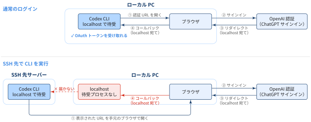

## Problem

::: {.callout-note}
## Problem

- SSH 接続先（Ubuntu サーバーなど）で Codex CLI に ChatGPT アカウントでログインしようとしても，通常のブラウザログインができない

:::

Codex CLI の通常の ChatGPT ログインは，ブラウザでサインインした後に localhost へのコールバックで OAuth トークンを CLI に返す仕組みです．そのため，

- リモート環境やヘッドレス環境（SSH 先のサーバーなど）で CLI を動かしている
- ローカルのネットワーク設定によって，localhost へのコールバックがブロックされている

ような状況ではブラウザベースのログインがうまく動きません．

{width="100%" fig-align="center"}

## Solution

::: {.callout-note}
### TL:DRs

- `codex login --device-auth` によるデバイスコード認証（beta）を使う
- 公式ドキュメントでも，このような場合にはデバイスコード認証が推奨されている

:::

SSH 先にブラウザがなくても，手元の PC のブラウザで ChatGPT 認証を完了できます．

## Steps

::: {.callout-note}
### 事前準備

デバイスコード認証を使うには，以下の設定を有効にしておく必要があります．

- 個人アカウント: ChatGPT の Settings > Security and login で **Enable device code sign-in for Codex, Excel, PowerPoint, and Word** を ON にする
- ワークスペース: ワークスペース管理者が ChatGPT workspace permissions でデバイスコードログインを許可する

この設定が OFF のままだと，リモート環境やヘッドレス環境からデバイスコードで Codex にサインインできません．なお，デバイスコードはフィッシングに悪用されうるため，他人と共有しないよう注意してください．


:::

[認証手順]{.mini-section}

1. SSH 接続先にログイン

    ```bash
    ssh user@remote-host
    ```

2. SSH 先でデバイスコード認証を開始

    ```bash
    codex login --device-auth
    ```

    `codex` を起動したときの対話型ログイン UI で **Sign in with Device Code** を選んでも同じです．実行すると，以下のように認証用 URL とワンタイムコードが表示されます．

    ```zsh
    user@remote-host ~ % codex login --device-auth

    Welcome to Codex [v0.166.0]
    OpenAI's command-line coding agent

    Follow these steps to sign in with ChatGPT using device code authorization:

    1. Open this link in your browser and sign in to your account
       https://auth.openai.com/codex/device

    2. Enter this one-time code (expires in 15 minutes)
       1234-56789

    Continue only if you started this login in Codex. If a website or another person gave you this code, cancel.
    ```

3. ローカル PC で認証
    1. 手元の PC のブラウザで，表示された認証用 URL を開く
    2. 表示されたコードを入力する
    3. ChatGPT アカウントでログインして認証を完了する

4. 認証状態を確認

    SSH 先で以下を実行します．

    ```bash
    codex login status
    ```


[SSH 接続先の Codex CLI からログアウト]{.mini-section}

:::{.padding-left-20}

```bash
codex logout
```

:::

- 上記ログアウトコマンドは，認証情報を削除しますが、Codex の設定ファイルやセッション履歴までは削除しません


## デバイスコード認証が使えない場合

環境によってデバイスコード認証が使えない場合は，ブラウザが使えるマシンでログインし，認証キャッシュをヘッドレス環境にコピーする方法があります．

1. ブラウザベースのログインが使えるマシンで `codex login` を実行する
2. `~/.codex/auth.json` にログインキャッシュが作成されていることを確認する
3. `~/.codex/auth.json` をヘッドレス環境の `~/.codex/auth.json` にコピーする

    ```bash
    scp ~/.codex/auth.json user@remote-host:~/.codex/auth.json
    ```

::: {.callout-warning}
`~/.codex/auth.json` にはアクセストークンが含まれるため，パスワードと同様に扱ってください．Git にコミットしたり，チケットやチャットに貼り付けたりしないようにしましょう．
:::

## Appendix: SSH ポートフォワーディングでコールバックを転送する

通常のブラウザログインが SSH 先で失敗するのは，ブラウザがリダイレクトする `localhost` が手元の PC を指し，SSH 先の CLI が待ち受けているポートに届かないためでした．
そこで，SSH の[ポートフォワーディング]{.regmonkey-bold}で手元の PC の `localhost:1455` を SSH 先の `localhost:1455` へ転送すれば，通常の `codex login` のままでもコールバックを CLI に届けられます．
`1455` は Codex CLI がコールバックを待ち受ける既定のポートです．

1. ローカル PC からポートフォワーディング付きで SSH 接続する

    ```bash
    ssh -L 1455:localhost:1455 user@remote-host
    ```

2. その SSH セッションで `codex login` を実行し，表示された URL を手元の PC のブラウザで開く

    ```bash
    codex login
    ```

3. ChatGPT アカウントでサインインする．`localhost:1455` へのリダイレクトは SSH トンネル経由で SSH 先の CLI に届く

4. 認証状態を確認する

    ```bash
    codex login status
    ```

::: {.callout-note}
この方法を使うには，以下を満たしている必要があります．

- SSH サーバー側でポートフォワーディングが許可されている（`sshd_config` の `AllowTcpForwarding` が `no` になっていない）
- 手元の PC の `1455` 番ポートを他のプロセスが使っていない

公式ドキュメントでは，デバイスコード認証が使えない場合のフォールバックの1つとして紹介されています．
:::

## 📘 用語集

:::{.glossary-container}

```yaml
glossary:
  - def: ポートフォワーディング (SSH ポート転送)
    description: |
      あるポートに届いた通信を，SSH 接続（トンネル）を経由して別のホストのポートへ転送する仕組み．
      `ssh -L <ローカルポート>:<転送先ホスト>:<転送先ポート> user@remote-host` の形で指定するものをローカルフォワードと呼び，
      手元の PC の `localhost:<ローカルポート>` への通信が，SSH 先から見た `<転送先ホスト>:<転送先ポート>` に届く．
      `<転送先ホスト>` に `localhost` を指定した場合は SSH 先サーバー自身を指す．
      逆向きに，SSH 先のポートへの通信を手元側へ転送するものは `ssh -R` によるリモートフォワードと呼ぶ．
      通信は SSH で暗号化されるため，外部に公開していないサーバー上のサービスへ安全にアクセスする用途でも使われる．
```

:::

References
----------
- [Open AI > Authentication - Login on headless devices](https://learn.chatgpt.com/docs/auth?utm_source=chatgpt.com&surface=cli#cli-login-on-headless-devices)
