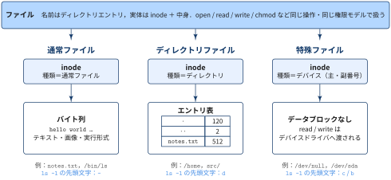
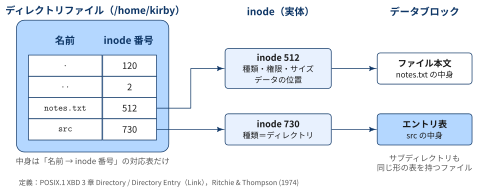
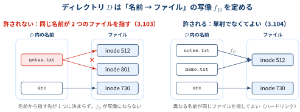

::: {.callout-note}
### TL:DRs

- Linux（UNIX系OS）では，ディレクトリは「ファイルを入れる箱」ではなく，**ファイル名の一覧表を中身として持つ1つのファイル**
- 一覧表の1行が **ディレクトリエントリ**（「ファイル名 → inode」の対応）であり，POSIX ではハードリンクと同義
- **ファイル名は inode の中ではなく，親ディレクトリのエントリが持っている**
- `ln`・`rm`・`mv`・ディレクトリの `rwx` 権限は，すべて「エントリ表の操作」として統一的に理解できる

:::

## ディレクトリファイルとは？

::: {#def- .custom_problem .blog-custom-border}
### 3.103 ディレクトリファイル

- 「ファイル名」と「ファイルの実体」を対応付けるファイル
- POSIXの定義(3.103)におけるディレクトリを，「ファイル」として見たときの呼び名
  - 「ディレクトリも通常ファイルと同じくファイルの一種である」 という側面を強調した言い方
- 同じディレクトリ内に同じ名前のディレクトリエントリは2つ存在しない

:::

Linux（UNIX系OS）では，ディレクトリは「ファイルを入れる箱」ではなく，**ファイル名の一覧表を中身として持つ1つのファイル** です．

{width="100%" fig-align="center"}

- 3種類とも，**名前はディレクトリエントリが持ち**，実体は inode で表されるという点で同じ「ファイル」
- 違うのは inode に記録された **種類** と，それに応じた **中身の解釈** だけ
  - 通常ファイル：中身は任意のバイト列
  - ディレクトリファイル：中身は「名前 → inode番号」のエントリ表
  - 特殊ファイル（デバイスファイル）：中身を持たず，`read` / `write` はデバイスドライバに渡される
- そのため，どれも同じパス名・同じ権限モデル（`rwx`）・同じシステムコール（`open` など）で扱える

[「ファイル」は inode で表される]{.mini-section}

- POSIXの定義では，ディレクトリエントリが対応付ける相手は抽象的な「ファイル」．
- Linuxの実装（ext4 など）では，ファイルの実体は **inode** というデータ構造で管理され，inode番号で識別される
- つまり，ディレクトリファイルの中身は実質的に「名前 → inode番号」の対応表

{width="100%" fig-align="center"}

## 同じディレクトリ内に同じ名前のディレクトリエントリは2つ存在しない

::: {#def-posix-dirent .custom_problem .blog-custom-border}
[3.104 Directory Entry (or Hard Link)]{.def-title}

- An object that associates a filename with a file. Several directory entries can associate names with the same file.
- ディレクトリエントリ（ハードリンク）とは，ファイル名とファイルを対応付けるオブジェクト．複数のディレクトリエントリが同じファイルに名前を対応付けてもよい

:::

3.103（冒頭のディレクトリファイルの定義）と 3.104 は，ディレクトリエントリの「名前」と「ファイル」それぞれの側に，次のような制約を課しています．

:::: {.no-border-top-table}

| 定義 | 制約 | 意味 |
| --- | --- | --- |
| 3.103 | 同じディレクトリ内で **名前は重複しない** | 名前を1つ決めれば，指すファイルは高々1つに決まる |
| 3.104 | 複数のエントリが **同じファイルを指してよい** | 1つのファイルが複数の名前を持てる（ハードリンク） |
: {tbl-colwidths="[10,45,45]"}

::::

{width="100%" fig-align="center"}

## Appendix: POSIX.1-2024

本記事で引用した定義は POSIX.1-2024（The Open Group Base Specifications Issue 8，IEEE Std 1003.1-2024）に基づいています．
規格自身は，その目的を次のように説明しています．

> POSIX.1-2024 defines a standard operating system interface and environment, including a command interpreter (or "shell"), and common utility programs to support applications portability at the source code level. It is intended to be used by both application developers and system implementors.

- POSIX.1-2024 は，OSのインタフェースと環境を定める標準規格
- 対象はシステムコール相当のAPIだけでなく，コマンドインタプリタ（シェル）や共通ユーティリティ（`ls`，`ln`，`mv` など）も含む
- 目的は **ソースコードレベルでのアプリケーションの移植性** を確保すること
- 読者として，アプリケーション開発者と，OSを実装する側（システム実装者）の両方を想定している

## References

- [The Open Group Base Specifications Issue 8 (POSIX.1-2024), Base Definitions, Chapter 3 Definitions](https://pubs.opengroup.org/onlinepubs/9799919799/basedefs/V1_chap03.html)
- [inode(7) — Linux manual page](https://man7.org/linux/man-pages/man7/inode.7.html)
- [getdents(2) — Linux manual page](https://man7.org/linux/man-pages/man2/getdents.2.html)
- [unlink(2) — Linux manual page](https://man7.org/linux/man-pages/man2/unlink.2.html)
- [The Linux Kernel documentation: ext4 Directory Entries](https://docs.kernel.org/filesystems/ext4/directory.html)
- Ritchie, D. M., & Thompson, K. (1974). The UNIX time-sharing system. *Communications of the ACM*, 17(7), 365–375.
