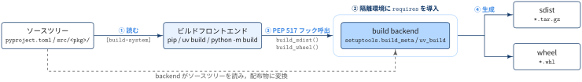
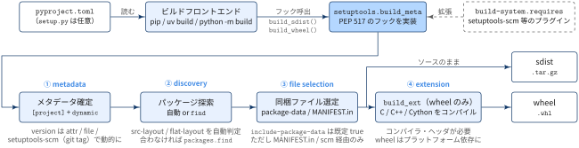
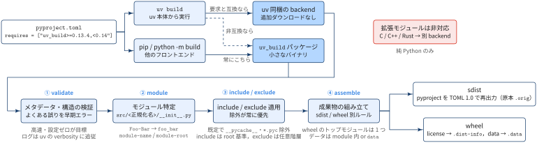
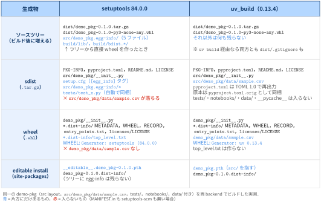
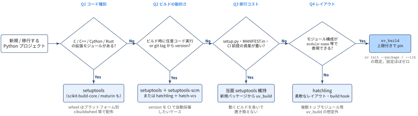

## 1. 前提：build backend とは

::: {#def- .custom_problem .blog-custom-border}
### build backend

- build backend は **ソースツリー（ディレクトリ）を sdist / wheel に変換する役**
- `pip` / `uv build` / `python -m build` などの **フロントエンド**が，`pyproject.toml` の `[build-system]` を読んで backend を呼び出す（[PEP 517](https://peps.python.org/pep-0517/)）
- uv はどの PEP 517 backend でも使えるが，それとは別にネイティブ backend `uv_build` を持っている

:::



[生成物: sdist と wheel]{.mini-section}

`test-package` というプロジェクトで `uv build` を実行すると，`dist/` に2つのファイルができます．

```zsh
% uv build
Building source distribution...
Building wheel from source distribution...
Successfully built dist/test_package-0.1.0.tar.gz
Successfully built dist/test_package-0.1.0-py3-none-any.whl
```

ファイル名ではパッケージ名が正規化され，`-` が `_` に変わります（`test-package` → `test_package`）．

| | sdist（`.tar.gz`） | wheel（`.whl`） |
|---|---|---|
| 正式名 | source distribution | built distribution（[PEP 427](https://peps.python.org/pep-0427/)） |
| 中身 | ソースコード，`pyproject.toml`，`PKG-INFO`，README / LICENSE など，**ビルド前の材料** | `site-packages` にそのまま置けるファイルと `.dist-info/`（メタデータ）．**ビルド済みの完成品** |
| 形式 | tar + gzip | zip（拡張子が `.whl`） |
| インストール時の動作 | 利用者の環境で **build backend を動かして wheel を作り**，それをインストールする | 展開してコピーするだけ．**ビルドは走らない** |
| 環境依存 | なし．どの環境でもビルドを試せる | ファイル名のタグで対応環境が決まる |

wheel のファイル名は `{名前}-{バージョン}-{Python タグ}-{ABI タグ}-{プラットフォームタグ}.whl` という形です．`py3-none-any` は「Python 3 ならどれでも，C 拡張の ABI に依存せず，どの OS / CPU でも動く」，つまり **純 Python の wheel** を表します．C 拡張を含む場合は `cp312-cp312-manylinux_2_17_x86_64` のように，環境ごとに別の wheel が必要です．

**なぜ2種類あるのか**

- **wheel はインストールを速く，安全にするため．** 利用者の環境で backend やコンパイラを動かさずに済み，`setup.py` のような任意コードも実行されません．`pip` / `uv` は対応する wheel があればそちらを優先します
- **sdist は wheel がない環境の受け皿と，ソースの原本を残すため．** 対応する wheel がない OS / Python では，installer が sdist から wheel をビルドします．

`uv build` のログにある「Building wheel from source distribution」は，ソースツリーから直接ではなく，**一度作った sdist を展開してから wheel をビルドしている**ことを示しています．こうすると sdist に必要なファイルが欠けていた場合にこの時点でビルドが失敗するので，「sdist からは wheel が作れない」という壊れた配布物を事前に防げます


::: {.callout-note}
### パッケージを配布する場合の選択肢

:::: {.no-border-top-table}

| 配り方 | コマンド例 | 備考 |
|---|---|---|
| PyPI / 社内 index に公開 | `uv publish`（既定で `dist/*` をアップロード） | sdist と wheel を **両方** 上げるのが慣例．index 側は環境に合うものを選ばせる |
| ファイルを直接渡す | `uv pip install ./dist/test_package-0.1.0-py3-none-any.whl` | GitHub Releases に添付したり，共有ストレージに置いたりする．純 Python なら wheel 1つで全環境をカバーできる |
| sdist から入れる | `uv pip install ./dist/test_package-0.1.0.tar.gz` | 利用者側でビルドが走るので，build backend の取得が必要 |

: {tbl-colwidths="[25,35,40]"}

::::

- 純 Python のパッケージなら，**wheel（`py3-none-any`）1つ + sdist 1つ** をセットで配れば十分です．


:::

## 2. build backend それぞれの動作

PEP 517 に従っていれば誰でも backend を作れるので，選択肢は複数あります．代表的なものは次のとおりです．

:::: {.no-border-top-table}

| backend | `build-backend` | 特徴 |
|---|---|---|
| setuptools | `setuptools.build_meta` | 最古参で，事実上の標準．C 拡張・動的メタデータ・`setup.py` との互換まで何でもこなす |
| hatchling | `hatchling.build` | Hatch の backend．設定が素直で，プラグイン（hatch-vcs など）で拡張できる |
| flit-core | `flit_core.buildapi` | 純 Python 専用の最小構成．依存がほぼ無く軽い |
| pdm-backend | `pdm.backend` | PDM の backend．ビルドスクリプトも書ける |
| poetry-core | `poetry.core.masonry.api` | Poetry の backend．`[tool.poetry]` の設定も読む |
| uv_build | `uv_build` | uv ネイティブ．純 Python 専用で，設定ゼロかつ高速 |
| scikit-build-core / meson-python / maturin | `scikit_build_core.build` など | C / C++（CMake・Meson）や Rust（maturin）の拡張モジュールをビルドする専用 backend |

: {tbl-colwidths="[30,30,40]"}

::::

ざっくり使い方を分けると，

- **純 Python なら uv_build / hatchling / flit-core**
- **コンパイルが必要なら setuptools か言語別の専用 backend** 

以下では，汎用 backend の代表として setuptools を，uv 環境での既定として uv_build を取り上げます．

### 2-1. setuptools


::: {.callout-note}
### REMARKS

- **柔軟で何でもできる代わりに，設定経路が多い**（pyproject / setup.cfg / setup.py / MANIFEST.in / プラグイン）

:::




```toml
[build-system]
requires = ["setuptools", "setuptools-scm"]   # プラグインもここに並べる
build-backend = "setuptools.build_meta"

[project]
name = "my_package"
dynamic = ["version"]                          # version をビルド時に決める

[tool.setuptools.packages.find]                # 自動探索で足りないときだけ
where = ["src"]
exclude = ["my_package.tests*"]
```

:::: {.no-border-top-table}

| ステップ | 中身 |
|---|---|
| ① metadata | `[project]` を読む．`dynamic` に挙げた項目は `tool.setuptools.dynamic`（`attr` / `file`）やプラグイン（setuptools-scm が git から version を算出）で埋める |
| ② discovery | `packages` / `py-modules` 未指定なら **自動探索**（src-layout / flat-layout を判定）．合わなければ `find` ディレクティブや明示リスト |
| ③ file selection | `include-package-data` は pyproject 利用時 **既定 true**．ただし拾うのは **MANIFEST.in か setuptools-scm（git 管理下）で sdist に載ったファイルだけ**．明示するなら `package-data` / `exclude-package-data` |
| ④ extension | `setup.py` の `Extension` や（実験的な）`ext-modules` で C / C++ / Cython をコンパイル → プラットフォーム依存 wheel |
: {tbl-colwidths="[25,75]"}

::::


### 2-2. uv_build


::: {.callout-note}
### ポイント

- ：**設定ゼロ・高速・検証付き**，ただし **純 Python 専用**
- ビルドスクリプトや柔軟なレイアウトが要るなら hatchling の検討推奨

:::




```toml
[build-system]
requires = ["uv_build>=0.13.4,<0.14"]   # 上限付きが公式推奨
build-backend = "uv_build"

# 既定 (src/<正規化名>/__init__.py) から外れるときだけ
[tool.uv.build-backend]
module-name = "FOO"
module-root = ""
```

:::: {.no-border-top-table}

| ステップ | 中身 |
|---|---|
| フロントエンド | `uv build` は **uv 本体に同梱の backend**を使う（`requires` と互換な場合）．非互換なら，また pip / `python -m build` からは **常に `uv_build` パッケージ**を取得して使う |
| ① validate | メタデータとプロジェクト構造を検証し，よくあるミスをビルド前に弾く |
| ② module | 既定は `src/<正規化名>/__init__.py` 1つ．名前は小文字化＋`.`/`-`→`_`（`Foo-Bar`→`foo_bar`）．`module-name` / `module-root` で変更，`foo.bar` 形式で namespace，`-stubs` で型スタブ |
| ③ include / exclude | 追加 → 除外の順で適用，**除外が常に勝つ**．既定で `__pycache__` / `*.pyc` / `*.pyo` を除外．include は root 基準（anchored），exclude は任意階層にマッチ（`/dist` で root 固定） |
| ④ assemble | sdist：pyproject.toml を TOML 1.0 で書き直して同梱（原本は `.orig`）＋ readme / license / `data` / `source-include`．wheel：module・license（→`.dist-info`）・`data`（→`.data`）．wheel 専用の include は無く，トップレベルモジュールは1つ |

: {tbl-colwidths="[25,75]"}

::::


## 3. 生成物一覧

同じプロジェクトを両 backend でビルドし，**何がどこに生成されるか**を実物で確認してみます．

検証用プロジェクト（`demo-pkg`）：

```ini
demo-pkg/
├── pyproject.toml          # [project] 共通，[build-system] だけ差し替え
├── README.md               # readme
├── LICENSE                 # license-files = ["LICENSE"]（PEP 639）
├── src/
│   └── demo_pkg/
│       ├── __init__.py     # [project.scripts] demo = "demo_pkg:main"
│       ├── data/
│       │   └── sample.csv  # パッケージ内データ
│       └── __pycache__/
│           └── x.pyc       # キャッシュ
├── tests/
│   └── test_x.py
├── notebooks/
│   └── eda.ipynb
└── data/
    └── raw.csv             # パッケージ外の生データ
```

- setuptools は **84.0.0**（`setuptools.build_meta`．MANIFEST.in・setuptools-scm なし）
- uv_build は **0.13.4**（uv 0.13.4 同梱の backend による `uv build` と，PyPI の `uv_build` パッケージを使う `uv build --force-pep517` の両方で確認．結果は同じ）

{width="100%"}

### 3-1. ソースツリーに生成されるもの

| 場所 | setuptools | uv_build |
|---|---|---|
| `dist/*.tar.gz` / `dist/*.whl` | ✅ | ✅ |
| `src/<pkg>.egg-info/`<br>（`PKG-INFO` `SOURCES.txt` `entry_points.txt` `top_level.txt` `dependency_links.txt`） | ✅ **ツリー内に残る** | — |
| `build/lib/`, `build/bdist.<platform>/` | ✅ ツリーから直接 wheel を作ったとき（`uv build --wheel`，`pip wheel .` など） | — |
| `dist/.gitignore`（中身は `*`） | `uv build` 経由なら作られる（フロントエンド側の挙動） | 同左 |


::: {.callout-note}
### REMARKS

- setuptools では `.gitignore` に `build/` と `*.egg-info/` が必須

:::


### 3-2. sdist（`.tar.gz`）の中身

| ファイル | setuptools | uv_build |
|---|---|---|
| `PKG-INFO`（Metadata-Version 2.4） | ✅ | ✅ |
| `pyproject.toml` | ✅ そのまま | ✅ TOML 1.0 で再出力 |
| `pyproject.toml.orig` | — | ✅ 原本をそのまま同梱 |
| `README.md` / `LICENSE` | ✅ | ✅ |
| `src/demo_pkg/__init__.py` | ✅ | ✅ |
| `src/demo_pkg/data/sample.csv` | ❌ **落ちる** | ✅ module 配下なので入る |
| `setup.cfg`（`[egg_info] tag_build / tag_date`） | ✅ 自動生成 | — |
| `src/demo_pkg.egg-info/*` | ✅ | — |
| `tests/test_x.py` | ✅ 既定で `tests/test*.py` を同梱 | — |
| `notebooks/` / `data/` / `__pycache__` | — | — |


[なぜ `tests` が同梱されるのか？]{.mini-section}

- sdist は開発やビルドに使う材料一式という位置づけ
- 実行時には不要なテスト・ドキュメント・サンプルなども入れてよいとされている（[setuptools docs](https://setuptools.pypa.io/en/latest/userguide/miscellaneous.html#id3)）

上記の理由から， setuptools は既定で `tests/test*.py` を sdist に入れます．


### 3-3. wheel（`.whl`）の中身

| ファイル | setuptools | uv_build |
|---|---|---|
| `demo_pkg/__init__.py` | ✅ | ✅ |
| `demo_pkg/data/sample.csv` | ❌ **なし**（sdist に載っていないため） | ✅ |
| `*.dist-info/METADATA` | ✅（`Dynamic: license-file` 行が付く） | ✅ |
| `*.dist-info/WHEEL` | ✅ `Generator: setuptools (84.0.0)` | ✅ `Generator: uv 0.13.4` |
| `*.dist-info/RECORD` | ✅ | ✅ |
| `*.dist-info/entry_points.txt` | ✅ `[console_scripts] demo = demo_pkg:main` | ✅ 同内容 |
| `*.dist-info/licenses/LICENSE` | ✅（PEP 639 形式） | ✅ |
| `*.dist-info/top_level.txt` | ✅ | — |
| `<name>-<ver>.data/…` | `data-files` 指定時のみ | `tool.uv.build-backend.data` 指定時のみ |

### 3-4. editable install（`uv pip install -e .`）で生成されるもの

| 場所 | setuptools | uv_build |
|---|---|---|
| site-packages の `.pth` | `__editable__.demo_pkg-0.1.0.pth`（`src/` を指す） | `demo_pkg.pth`（`src/` を指す） |
| site-packages の `*.dist-info/` | ✅ | ✅ |
| ソースツリーの残骸 | なし（84.0.0 は一時ディレクトリで egg_info を処理） | なし |

### 3-5. setuptools のデータ漏れを防ぐには

[方法1：MANIFEST.in に追記する]{.mini-section}

1行足せば，`sample.csv` が sdist と wheel の両方に入ります．

```text
# MANIFEST.in
recursive-include src/demo_pkg/data *.csv
```

[方法2：`package-data` で明示する]{.mini-section}

```toml
[tool.setuptools.package-data]
demo_pkg = ["data/*.csv"]
```

[方法3：setuptools-scm を使う]{.mini-section}

`requires` に入れると，git 管理下のファイルを自動で拾わせることができます．

```toml
[build-system]
requires = ["setuptools", "setuptools-scm"]
```

**どの方法でも，ビルド後に `unzip -l dist/*.whl` で確認するのが確実**です．

## 4. パッケージ化にあたっての注意点と選択観点

:::: {.no-border-top-table}

| 注意点 | 具体的に |
|---|---|
| **そもそもパッケージ化が要るか** | 分析ノートブック・単発スクリプトだけなら build backend 不要（`uv run` + lockfile で十分）．社内で `import` して使い回す段階になったら backend を入れる |
| **import 名と配布名のズレ** | `my-analysis` → import 名は `my_analysis`．uv_build はこの正規化名で `src/` 配下を探すので，ディレクトリ名を合わせる |
| **flat layout の罠** | ノートブックと同階層にパッケージを置く flat layout は，uv_build では `module-root = ""` が必要．setuptools は自動探索で拾えるが，`notebooks/` や `data/` まで誤検出しやすい → どちらでも **src layout 推奨** |
| **データ・モデル同梱** | uv_build は `src/<pkg>/` 内の CSV / JSON をそのまま同梱する．**setuptools は MANIFEST.in・`package-data`・setuptools-scm のどれかがないと落ちる**（§3-2・§3-3 の実測，対策は §3-5）．大きなモデル重みや生データは wheel に入れない（`source-exclude` / `wheel-exclude`，setuptools なら `exclude-package-data`） |
| **ノートブックの紛れ込み** | sdist に `.ipynb` / 出力データが入っていないか `tar tzf dist/*.tar.gz` で確認 |
| **Cython・C 拡張** | 自作の Cython / pybind11 を含むなら uv_build は不可 → setuptools（or scikit-build-core）．numba のような JIT は純 Python 扱いで問題なし |
: {tbl-colwidths="[30,70]"}

::::

[意思決定フロー]{.mini-section}



- Q1〜Q3 のどれかが Yes → setuptools 系（or 目的特化の backend）
- 全部 No で Q4 が Yes → **uv_build**
- Q4 が No（複数トップモジュール・特殊配置・build hook が欲しい）→ hatchling


## Appendix: 用語集

:::{.glossary-container}

```yaml
glossary:
  - def: sdist (source distribution)
    description: |
      ソースコードと `pyproject.toml`・`PKG-INFO` などのメタデータをまとめた配布物（`.tar.gz`）．
      インストール時に backend を呼んで wheel をビルドしてから入れるため，ビルド環境が必要になる．

  - def: wheel
    description: |
      ビルド済みの配布物（`.whl`，中身は zip）．展開して site-packages に置くだけでインストールでき，ビルド処理は走らない．
      ファイル名のタグ（例: `py3-none-any`，`cp313-cp313-linux_x86_64`）で対応する Python・ABI・プラットフォームを表す．

  - def: ビルドフロントエンド (build frontend)
    description: |
      `pyproject.toml` の `[build-system]` を読み，`requires` を入れた環境で build backend を呼び出すツール（PEP 517）．
      `pip`，`uv build`，`python -m build` などが該当する．実際に sdist / wheel を作るのは backend 側．

  - def: hatchling
    description: |
      Hatch プロジェクトの build backend．純 Python 向けで，ビルドフックや柔軟なファイル選択・レイアウト指定に対応する．
      uv_build で表現できない構成のとき，uv の公式ドキュメントが代替として勧めている．

  - def: setuptools-scm
    description: |
      git などの VCS の情報（tag・コミット）から version を算出する setuptools のプラグイン．
      `[build-system] requires` に入れて `dynamic = ["version"]` と組み合わせる．git 管理下のファイルを sdist に自動で含める機能も持つ．

  - def: setup.py
    description: |
      setuptools の従来の設定ファイル．Python スクリプトとして `setup()` を呼び，メタデータやパッケージ構成を定義する．
      現在はメタデータを `pyproject.toml` に書くのが推奨で，C 拡張（`Extension`）などコードでしか書けない設定に使う．

  - def: setup.cfg
    description: |
      setuptools の宣言的な設定ファイル（INI 形式）．`[metadata]`・`[options]` セクションに，`setup.py` に書いていた内容をコードなしで記述できる．
      `pyproject.toml` の `[project]` が使えるようになってからは，新規プロジェクトで使う必要はない．
      setuptools でビルドした sdist には，`[egg_info]`（`tag_build` / `tag_date`）だけを書いた `setup.cfg` が自動生成されて同梱される）．

  - def: MANIFEST.in
    description: |
      setuptools で sdist に含めるファイルを指定するテンプレートファイル（例: `recursive-include src/demo_pkg/data *.csv`）．
      `include-package-data = true` の下では，ここで sdist に載せたパッケージ内ファイルが wheel にも入る．

  - def: C 拡張 (C extension module)
    description: |
      C / C++（Cython・Rust なども同様）で書かれ，ビルド時に共有ライブラリ（`.so` / `.pyd`）へコンパイルされる Python モジュール．
      コンパイラが必要で，生成物が OS・CPU・Python バージョンに依存するため，wheel は環境ごとに別ファイル（例: `cp313-cp313-manylinux_2_17_x86_64`）になる．
      numpy などの高速化に使われる．uv_build は対応しておらず，setuptools や scikit-build-core・maturin などの backend を使う．

  - def: 動的メタデータ (dynamic metadata)
    description: |
      `pyproject.toml` の `[project]` に直接書かず，ビルド時に backend が値を決めるメタデータ．`dynamic = ["version"]` のように項目名を列挙して宣言する．
      例: setuptools-scm で git tag から version を算出する，`tool.setuptools.dynamic` で `__init__.py` の `__version__` を読む．
      静的に書いた項目と違い，ビルドするまで値が確定しない．

  - def: 型スタブ (type stub)
    description: |
      関数・クラスの型情報だけを書いたファイル（拡張子 `.pyi`）．実装は持たず，mypy・pyright などの型チェッカーや IDE の補完が読む．
      型注釈のないライブラリや C 拡張に型を付けるために使い，`<パッケージ名>-stubs` という名前の別パッケージとして配布できる（PEP 561，例: `pandas-stubs`）．
      uv_build では `module-name` を `foo-stubs` の形にすると，型スタブパッケージとしてビルドできる．

  - def: PEP 639 (license-files)
    description: |
      パッケージのライセンス情報の書き方を定めた PEP．`[project]` に `license = "MIT"` のような SPDX 式と，`license-files = ["LICENSE"]` のような同梱ファイルの glob パターンを書く．
      メタデータには `License-Expression` / `License-File` 項目（Metadata-Version 2.4）として記録され，wheel ではライセンスファイルが `*.dist-info/licenses/` に入る．
      従来の `license = {file = "LICENSE"}` / `license = {text = "..."}` や `License ::` classifier は非推奨になった．
```

:::

## References

- [uv docs — Build backend](https://docs.astral.sh/uv/concepts/build-backend/)
- [setuptools — Configuring setuptools using pyproject.toml](https://setuptools.pypa.io/en/latest/userguide/pyproject_config.html)（2026-10-21 時点，setuptools docs は 84.2.1）
