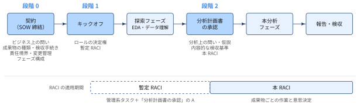
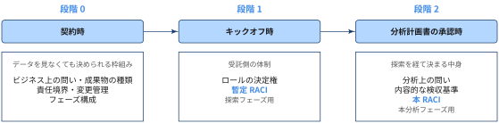

## RACIとは

::: {#def- .custom_problem .blog-custom-border}
### RACI

- RACI（レイシー）は，プロジェクトのタスクごとに「誰がどのように関わるか」を明確にするための責任分担のフレームワーク

:::


[4つの役割]{.mini-section}

:::: {.no-border-top-table}

| 記号 | 役割 | 意味 |
|---|---|---|
| R | Responsible（実行責任者） | 実際に作業を行う人 |
| A | Accountable（説明責任者） | 結果に最終責任を持ち，完了を承認する人 |
| C | Consulted（相談先） | 作業の途中で意見や専門知識を求める人 |
| I | Informed（報告先） | 進捗や結果を共有する人 |

: {tbl-colwidths="[10, 45, 45]"}
::::

- RACIチャートは，行にタスク，列に人や役割を並べ，交差するマスにR・A・C・Iを記入して作ります
- 「誰がやるのか」「誰が決めるのか」「誰に聞くのか」「誰に伝えるのか」が一目でわかるため，担当の重複や抜け漏れ，「誰かがやっていると思っていた」といった行き違いを防ぐメリットがある

## RACIの前提

RACIは便利なツールですが，効果を発揮するにはいくつかの前提条件があります．

### 1. 作業がタスクとして分解できていること

- [ ] RACIは「タスク × 人」の表なので，まずプロジェクトの作業や成果物，意思決定のポイントが洗い出されている必要がある
- [ ] 何をするか決まっていない段階では，割り当てる対象そのものがありません．

### 2. 役割がある程度安定していること

RACIは役割を固定することで明確さを生み出します．RACIは，作業が成果物と締め切りを持つ計画として固まってから導入するのが適切です．

- [ ] 担当が週ごとに入れ替わるような実験的な作業や，初期の探索・リサーチのフェーズには向かない
- [ ] こうした段階では，手を挙げた人がその作業のオーナーになるような緩い進め方のほうが，柔軟に動けて成果につながりやすい

### 3. 基本ルールを守ること

- [ ] **Aは各タスクに必ず1人**：2人以上いると，互いに相手が責任を持つと考え，結果的に誰も責任を持たなくなります．
- [ ] **Rは最低1人**：Rがいないタスクは実行されません．
- [ ] **特定の人に役割を集中させない**：1人にRが偏っていないか，人ごとにも確認
- [ ] **CとIを増やしすぎない**：関係者を広げすぎると，相談や連絡の負担が増えて意思決定が遅くなります．

### 4. 作る手間に見合う規模であること

- [ ] 2〜3人の小さな作業で，全員が自分の役割を把握しているなら，わざわざ表にする必要はない
- [ ] チャートを作ることが目的にならないよう，必要性を見極めること

## RACIを使うべきタイミング

上記の前提を踏まえると，RACIは次のような場面で特に効果を発揮します．

:::: {.no-border-top-table}

| タイミング | 期待効果 |
| --- | --- |
| プロジェクトの開始時 | キックオフの段階で役割を定義しておくと，各メンバーに期待されることと誰と連絡を取ればよいかが最初から明確になる．曖昧さが減って連携がスムーズになり，締め切りを守りやすくなる |
| 関係者が多い複雑なプロジェクト | 部署をまたぐなど関係者が多いと，責任の重複や誤解が起きやすい．役割と連絡経路を整理することで，調整の手間と混乱を減らせる |
| 組織変更や人事異動があるとき | 体制が変わっても役割の連続性を保てる．新メンバーが誰が何を担っているかを把握するオンボーディング資料としても役立つ |
| アジャイルへの移行時 | プロダクトオーナーやスクラムマスターといった新しい役割の責任範囲や，スプリント計画・コードレビューなどへの参加の仕方を整理でき，新しい進め方に慣れるまでの足がかりになる |
| プロジェクトのレビュー時 | 特定の人に負荷が集中しているボトルネックや計画からのずれを見つけやすくなる．課題やスコープの変化に合わせて定期的に更新し，役割を割り当て直すことで変化に対応できる |

: {tbl-colwidths="[30,70]"}

::::

## 受託分析プロジェクトにRACIを導入する

ここからは，具体例として受託分析プロジェクトを考えます．受託分析は「開始時に役割を定義したい」「クライアントと受託側をまたいで関係者が多い」という点で，上で挙げたRACIが効く場面にそのまま当てはまります．

一方で，キックオフでいきなりRACIチャートを埋めようとしても，たいていうまくいきません．行（タスク）が曖昧で，Aを1人に絞る根拠もないまま，空欄を埋めるだけの作業になるからです．RACIの前提を満たすには，チャートを書く前に決めておくべきことがあります．

ただし，それらを一度にすべて決めることはできません．受託分析プロジェクトは，時系列で見るとおおよそ次のように進みます．

{width="100%" fig-align="center"}

契約の時点では，まだデータを見ていません．そのため「どの分析をするか」「何が含まれていれば完了か」といった中身は，探索フェーズでデータを見てからでないと決まりません．つまり，決められることはプロジェクトの進行に合わせて段階的に増えていきます．

そこで以下説明では，この流れに沿って決める時点を3つに分けます．

{width="100%" fig-align="center"}

RACIを1枚で作るのではなく，暫定RACIと本RACIの2段階で作るのがポイントです．

### 契約時に決めること，探索後に決まること

特に混ざりやすいのが「問い」「成果物」「検収基準」です．これらは，契約時（business SOW）に決められるレイヤーと，分析計画書で決まるレイヤーに分けて考えます．

:::: {.no-border-top-table}

| 項目 | 契約時（business SOW）で決められること | 分析計画書で決まること |
|---|---|---|
| 問い | **ビジネス上の問い**：クライアントが下したい意思決定（例：来期の販促予算をどのチャネルに配分するか） | **分析上の問い**：検証可能な形に分解したもの（例：チャネル別の増分効果の推定，比較の単位と期間） |
| 成果物 | 種類・形式・回数（レポート，データマート，報告会×2など） | 各成果物の中身（どの分析を載せるか，どのモデルを作るか） |
| 検収基準 | **手続き的な基準**：誰が，いつ，何をもって検収するか（例：報告会後10営業日以内に検収者が確認） | **内容的な基準**：その成果物に何が含まれていれば完了か（例：仮説H1〜H3の検証結果と，感度分析が含まれる） |

: {tbl-colwidths="[12, 44, 44]"}
::::

内容的な検収基準を契約時に書き込むのは，そもそも危険です．分析の結論は事前に保証できず，データを見て問いを修正するのはむしろ健全だからです．また，契約形態（準委任か請負か）によって「完了」の意味自体も変わります．SOWで固定すべきなのは，手続きの側です．

この2層を前提に，決めることを次の3段階に振り分けます．

### 段階0：契約・business SOW（キックオフ前）

#### 成果物と検収手続き（→ 前提1：タスク分解）

RACIの行は，成果物と意思決定ポイントから作ります．受託分析では「何を問うのか」が曖昧なまま走り出しやすいので，まずは次の項目を契約・SOWのレベルで確定させます．

- [ ] **ビジネス上の問い**：クライアントがこの分析を使って下したい意思決定
- [ ] **成果物の種類と形式**：例として，分析用データマート，分析レポート，モデル，ダッシュボード，報告会など
- [ ] **スコープ外の事項**：やらないこと
- [ ] **検収の手続きと検収者**：誰が，いつ，何をもって検収するか

検収の手続きがないと，Aが「完了を承認する」タイミングと方法が定まりません．その結果，Aは名目だけの存在になります．

#### 発注側と受託側の責任境界

社内プロジェクトとの最大の違いはここです．RACIの列には，クライアント側の人も入ります．特に次の境界を決めておかないと，Aを1人に絞れません．

- [ ] **データ品質の責任**：ソースデータの正しさや定義の解釈はクライアントがAか，受託側のETLオーナーはどこから責任を持つか（データ受領時点からか，抽出処理からか）
- [ ] **データ提供の前提**：クライアントが提供するデータの範囲，提供時期，アクセス権限
- [ ] **業務解釈の責任**：「この指標の定義でよいか」を決めるのは誰か
- [ ] **検収者**：クライアント側で検収する人を1人特定する．窓口担当者と実際の意思決定者がずれていることが多いので，ここは名指しで確認します．

#### 変更管理とエスカレーション経路

受託分析では，途中で「この切り口も見たい」という要望が必ず出ます．次の2点を事前に決めておかないと，RACIが初月で崩れます．

- [ ] **スコープ変更の起票・承認フロー**：誰が受け，誰が判断し，クライアント側の誰が合意するか
- [ ] **ロール間で対立したときの裁定者**：例えば分析リードとPMの意見が割れたとき，どちらに寄せるか，あるいは上位の誰に上げるか

#### フェーズ構成（→ 前提2：役割の安定）

初期のEDAやデータ理解のフェーズは探索的で，前提2で述べた通りRACIには向きません．そこで，プロジェクトを探索フェーズと本分析フェーズに分け，次の点をSOWに明記します．

- [ ] 探索フェーズを置くこと
- [ ] 探索フェーズの期間（タイムボックス）と成果物（データ理解メモなど）
- [ ] 探索フェーズの終了条件：分析計画書の承認

フェーズ区分は，段階0と段階2をつなぐ役割を持ちます．探索フェーズの出口が分析計画書の承認であり，そこが「RACIの行を確定できる時点」になるからです．この出口を契約時に決めておかないと，探索がいつまでも終わらず，本RACIを作るきっかけを失います．

### 段階1：キックオフ

#### 受託側ロールの決定権（decision rights）（→ 前提3：Aは1人）

責任境界が決まったら，次は受託側の内部です．ETLオーナー，分析リード，PMを置くこと自体よりも，それぞれが何を単独で決められるかを先に定義します．

:::: {.no-border-top-table}

| ロール | 単独で決められること（Aになる領域） | 決められないこと |
|---|---|---|
| データETLオーナー | データ仕様，加工ロジック，データ品質問題の一次判断，データマートのリリース | 分析上の除外条件の最終判断（分析リードがC） |
| 分析リード | 分析設計・手法の選択，結論が妥当かどうか | スコープ・納期の変更 |
| PM（クライアントフェイシング） | スコープ・納期・優先順位，クライアントへの提出可否，変更要求の受付 | 分析結論の中身を書き換えること |

: {tbl-colwidths="[20, 45, 35]"}
::::

ここで必ず衝突が起きるのが「クライアントに出す報告書のA」です．中身の正しさは分析リード，提出判断はPMの領域なので，そのままではAが2人になります．

Aが2人になりそうなときは，タスクを分割します．「分析結果の妥当性レビュー（A：分析リード）」と「報告書の提出（A：PM）」を別の行にすれば，それぞれAは1人で済みます．この分割ができるかどうかで，ロール定義の解像度が試されます．

#### 探索フェーズ用の暫定RACI

この時点では分析の中身が決まっていないので，作業単位の細かいRACIは作りません．暫定RACIに置くのは次の2種類だけです．

- [ ] **プロジェクト管理系のタスク**：定例会，進捗報告，データ受領など
- [ ] **「分析計画書の承認」という意思決定のA**：探索フェーズの出口を誰が承認するか

探索中の作業そのものは，手を挙げた人がオーナーになる緩い進め方で構いません．

### 段階2：探索フェーズ終了時（分析計画書の承認）

探索を経て，ようやく契約時には決められなかったレイヤーが決まります．

- [ ] **分析上の問い，仮説，データ・手法**
- [ ] **成果物ごとの内容的な検収基準**

これをもとに，本分析フェーズの本RACIを作ります．成果物の中身が決まったことでRACIの行が確定し，役割も安定するので，前提1と前提2がここで初めてそろいます．

### 決める順序

各段階の中では，前の項目が次の項目の前提になります．ビジネス上の問いと成果物の種類が決まらなければ責任境界は引けず，責任境界がなければ決定権も定義できません．一方で，成果物の中身は探索を経ないと決まらないので，段階2まで待ちます．人を当てはめるのは，それぞれの段階の最後です．

1. **段階0：契約・business SOW**
    1. ビジネス上の問い，成果物の種類・形式，検収手続き
    2. 責任境界（クライアント／受託），データ提供の前提
    3. 変更管理・エスカレーション
    4. フェーズ構成（探索フェーズの期間と終了条件）
2. **段階1：キックオフ**
    1. 受託側ロールの決定権
    2. 人のアサイン → 暫定RACIを記入
3. **段階2：探索フェーズ終了時**
    1. 分析上の問い，仮説，内容的な検収基準（分析計画書の承認）
    2. 人のアサインを見直し → 本RACIを記入

### 記入後のチェック

本RACIを記入したら，前提3の基本ルールに照らして次の2点を確認します．

- [ ] **兼任によるチェック機能の喪失**：小規模案件ではPMと分析リードの兼任がよくあります．この場合，上記の「妥当性レビュー」と「提出」のAが同一人物になり，相互チェックが働かなくなります．兼任するなら，妥当性レビューのCかRに別の人を入れてください．
- [ ] **Rの偏り**：ETLオーナーにRが集中していないかを確認します．

## まとめ

- RACIは「タスク × 人」の表であり，タスク分解・役割の安定・Aは1人という前提が満たされて初めて機能する
- 受託分析では，「問い」「成果物」「検収基準」を，契約時に決められるレイヤー（ビジネス上の問い，成果物の種類，検収手続き）と，探索後に決まるレイヤー（分析上の問い，成果物の中身，内容的な検収基準）に分ける
- RACIは1枚で作らず，キックオフ時の暫定RACIと，分析計画書承認後の本RACIの2段階で作る．両者をつなぐ探索フェーズの期間と終了条件は，SOWの段階で決めておく
- Aが2人になりそうなときはタスクを分割し，兼任でチェック機能が失われる箇所には別の人をCかRとして入れる

## Appendix: この記事での用語集

:::{.glossary-container}

```yaml
glossary:
  - def: SOW (Statement of Work, 作業範囲記述書)
    description: |
      発注側と受託側の契約の中で「具体的に何をするか」を定めた文書．契約書の別紙や個別契約として添付されることが多い．
      契約が報酬・知的財産権・秘密保持など「どういう条件で取引するか」を定めるのに対し，SOWは「その取引で何を作り，どうなれば完了か」を定める．
      一般に，目的・背景，作業範囲（やること／やらないこと），成果物，検収基準，スケジュール，体制・役割，前提条件（クライアントが提供するデータ，その提供時期など），変更管理の手続きを記載する．
      成果物や検収基準をSOWに書いておくと，途中で出た追加要望がスコープ内かスコープ外かをSOWと照らして判断でき，変更管理の起点になる．
      受託分析では，SOWでは成果物の種類と検収手続きを定め，成果物の中身や内容的な検収基準は探索フェーズ後の分析計画書で具体化する．
```

:::
