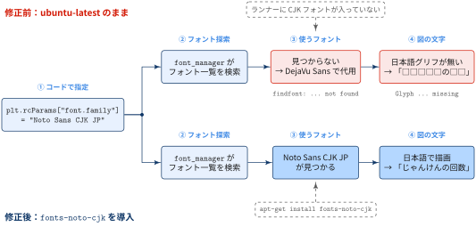
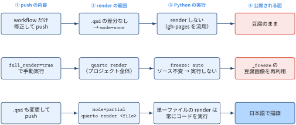

::: {.callout-note}
## TL:DRs

- GitHub Actions の `ubuntu-latest` ランナーには日本語フォントが入っていない．
- `plt.rcParams["font.family"] = "Noto Sans CJK JP"` と指定しても見つからず，matplotlib は DejaVu Sans で代用し，日本語は豆腐（□）になる．
- 対策は workflow で `apt-get install fonts-noto-cjk` を入れること．

:::

## Problem Setting

### やりたいこと


::: {.callout-note}
### Goal

- **手元で render したときと同じ日本語のグラフが，GitHub Actions 経由で公開したページにも出ること**．

:::


- このブログは Quarto で構築しており，`main` に push すると GitHub Actions が `quarto render` して gh-pages に publish する．
- 記事の中には Python のコードチャンクがあり，matplotlib のグラフをその場で描いている．
- グラフの軸ラベルや凡例には日本語を使いたいので，チャンクの先頭で次のようにフォントを指定していた．

    ```{.python}
    import matplotlib.pyplot as plt

    plt.rcParams["font.family"] = "Noto Sans CJK JP"

    fig, ax = plt.subplots(figsize=(8, 4))
    ax.set_xlabel("じゃんけんの回数")
    ax.set_ylabel("1回あたりの平均利得")
    ```

やりたいことは，**手元で render したときと同じ日本語のグラフが，GitHub Actions 経由で公開したページにも出ること**．

### 発生したトラブル

- 手元（Ubuntu）で `quarto render` すると日本語は正しく出る．
- GitHub Actions で publish したページでは，軸ラベルの日本語が「□□□□□の□□」のような豆腐になっていた．

workflow 自体は成功しており，エラーで止まることはありません．
同じ状況は手元でも，存在しないフォント名を指定すれば再現できます．

```{.python}
plt.rcParams["font.family"] = "Missing Font JP"  # 手元に無いフォント名
fig, ax = plt.subplots()
ax.set_xlabel("じゃんけんの回数")
fig.savefig("tofu.png")
```

このとき出るのは次のような警告だけ（matplotlib 3.11.0）．

```{.text}
findfont: Font family 'Missing Font JP' not found.
findfont: Font family ['Missing Font JP'] not found. Falling back to DejaVu Sans.
UserWarning: Glyph 12376 (\N{HIRAGANA LETTER ZI}) missing from font(s) DejaVu Sans.
UserWarning: Glyph 12435 (\N{HIRAGANA LETTER N}) missing from font(s) DejaVu Sans.
UserWarning: Glyph 22238 (\N{CJK UNIFIED IDEOGRAPH-56DE}) missing from font(s) DejaVu Sans.
```

### 何が起きていたか

{width="100%" fig-align="center"}

`plt.rcParams["font.family"]` で指定しているのは**フォントの名前だけ**で，フォントのファイルそのものではありません．
描画するときの流れは次のとおりです．

1. matplotlib の `font_manager` が，システムのフォントディレクトリ（`/usr/share/fonts` など）と matplotlib 同梱のフォントから作ったフォント一覧を調べる．一覧は `~/.cache/matplotlib/fontlist-v*.json` にキャッシュされる
2. 指定した名前のフォントが一覧に無いと `findfont: ... not found` を出し，matplotlib に同梱されている **DejaVu Sans** で代用する
3. DejaVu Sans には日本語のグリフ（字形）が無いので，日本語の文字は □ で描かれる

手元の PC には `Noto Sans CJK JP` が入っているので 2 で見つかります．
GitHub Actions の `ubuntu-latest` ランナーには CJK フォントが入っていないので，2 で DejaVu Sans に落ちます．

::: {.callout-note}
## tikzc で描いた SVG は影響を受けない

- tikzc は，SVG を生成するときに文字を輪郭（`<path>`）にして書き出し，`<text>` 要素を使いません
- 字形は生成した時点で図形として固定されるので，SVG を表示するブラウザやサイトをビルドするマシンにどのフォントが入っているかは関係ありません

:::

## 解決方針

### ランナーにフォントを入れる

[手法比較]{.mini-section}

| 方法 | 内容 | 判断 |
|---|---|---|
| ランナーに `fonts-noto-cjk` を apt で入れる | workflow に1行足す | **採用**．手元と同じフォント名になり，記事のコードを変えなくてよい |
| `japanize-matplotlib` を使う | IPAex ゴシックを同梱したパッケージを import する | 不採用．メンテナンスが止まっており，Python 3.12 で標準ライブラリから消えた `distutils` に依存している（CI は Python 3.13） |
| フォントファイルをリポジトリに置く | `font_manager.fontManager.addfont()` で登録する | 不採用．数十 MB のフォントをリポジトリで管理することになり，全記事のコードにも登録処理が要る |
| 描画結果（`_freeze` や画像）をコミットする | CI では Python を実行しない | 不採用．今の運用（`_freeze` は Actions のキャッシュに置く）を大きく変えることになる |

- `fonts-noto-cjk` を入れれば，手元と CI で `Noto Sans CJK JP` という同じ名前のフォントが使える
- GitHub Actions のランナーは毎回まっさらな状態で起動するので，`~/.cache/matplotlib` に古いフォント一覧が残る心配もない
- Python を実行するより前にフォントを入れておけば，matplotlib は最初の import でフォントを含めた一覧を作ってくれる

### 記事を描き直させる

{width="100%" fig-align="center"}

このブログの workflow は，push の差分から render する範囲を決めています．

- `.qmd` の差分が無いと `mode=none` になり，何も render せず前回の gh-pages をそのまま使う
- `_quarto.yml` などが変わったとき，または `full_render=true` で手動実行したときは `quarto render`（プロジェクト全体）になる
- `.qmd` の差分があれば `mode=partial` になり，変わった記事だけを `quarto render <file>` する

プロジェクト全体の render では `_quarto.yml` の `freeze: auto` が効き，ソースが変わっていない記事はコードを実行しません．
`_freeze` は Actions のキャッシュから復元されるので，豆腐入りの画像がそのまま使われます．
一方，単一ファイルの render は `freeze` に関係なく常にコードを実行します（[Quarto: Managing Execution](https://quarto.org/docs/projects/code-execution.html#freeze)）．

そこで，workflow の修正と同じコミットで記事の `.qmd` も変更して，partial render の対象にします．

## 実行

### Step 1: workflow にフォントのインストールを足す

`.github/workflows/publish.yml` の既存の apt ステップに `fonts-noto-cjk` を足します．

```{.diff}
-      - name: Install jq
+      - name: Install jq and Japanese fonts
         run: |
           sudo apt-get update -qq
-          sudo apt-get install -y -qq jq
+          sudo apt-get install -y -qq jq fonts-noto-cjk
           jq --version
+          fc-list | grep -q "Noto Sans CJK JP"
```

最後の `fc-list | grep -q` は確認用です．
フォントが入らなかったときはこのステップで失敗するので，豆腐のまま publish されることはありません．

このステップは `poetry install` や `quarto render` より前にあるので，matplotlib が最初にフォント一覧を作る時点でフォントは入っています．


### Step 2: 記事の `.qmd` も変更する

豆腐になっていた記事の `date-modified` を更新します．

```{.diff}
-date-modified: "2026-11-17"
+date-modified: "2026-11-25"
```

これで push 時に `.qmd` の差分ができ，その記事が `mode=partial` で `quarto render <file>` されます．
単一ファイルの render なのでコードが実行され，日本語のグラフで描き直されます．

### Step 3: 確認

1. 手元で `quarto render <記事>/index.qmd` を実行し，エラーやフォントの警告が出ないことを確かめる
2. push した後，Actions の「Install jq and Japanese fonts」ステップが通っていることを確認する
3. render のログに `findfont` や `Glyph ... missing` が出ていないことを確認する

```{.bash}
gh run view <run-id> --log | grep -E "findfont|Glyph .* missing"
```

4. 公開ページのグラフで，軸ラベルや凡例の日本語が正しく出ていることを確認する

## 📘 用語集

:::{.glossary-container}

```yaml
glossary:
  - def: 豆腐（tofu）
    description: |
      フォントに字形が無い文字が □ で表示される現象，またはその □ のこと．
      見た目が豆腐に似ていることからこう呼ばれる．

  - def: グリフ（glyph）
    description: |
      フォントが持つ，1文字ごとの字形のデータ．フォントにその文字のグリフが無いと，その文字は描けない．

  - def: フォールバック（fallback）
    description: |
      指定したものが使えないとき，代わりのものを使うこと．
      matplotlib では，指定したフォントが見つからないと同梱の DejaVu Sans にフォールバックする．

  - def: DejaVu Sans
    description: |
      matplotlib に同梱されている既定のフォント．
      欧文の文字は多く持つが，日本語のグリフは持たない．

  - def: fonts-noto-cjk
    description: |
      Debian / Ubuntu のパッケージ．Google と Adobe が作った Noto Sans CJK（日本語・中国語・韓国語）のフォントを
      `/usr/share/fonts/opentype/noto/` に入れる．`Noto Sans CJK JP` はこのパッケージに含まれる．

  - def: GitHub Actions ランナー
    description: |
      GitHub Actions のジョブを実行するマシン．`runs-on: ubuntu-latest` は GitHub が用意する Ubuntu の仮想マシンで，
      ジョブごとにまっさらな状態で起動する．日本語フォントは入っていない．

  - def: freeze（Quarto）
    description: |
      Quarto の計算結果を `_freeze/` に保存して再利用する仕組み．
      `freeze: auto` はプロジェクト全体の render で，ソースが変わった記事だけコードを実行する．
      単一ファイルや一部のディレクトリだけを render するときは，`freeze` に関係なくコードを実行する．

```

:::
