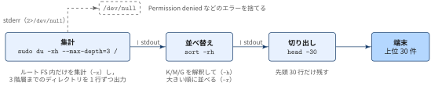

::: {.callout-note}
## TL;DRs

- **df コマンド**: ファイルシステムの使用状況の表示
- **du コマンド**: ファイル，ディレクトリの使用容量の表示
- `2>/dev/null` を用いることでアクセスエラーが `sort` に渡さないようにする

:::

## ルート直下ディレクトリにおける使用容量上位30件の表示

::: {#cmd- .custom_command .blog-custom-border}
### ルートファイルシステムの中で容量を食っているディレクトリの上位30件を表示

```bash
sudo du -xh --max-depth=3 / 2>/dev/null | sort -rh | head -30
```

- 役割は、du が集計、sort が並べ替え、head が切り出し


:::

{width=100%}


### du コマンドとは

::: {#cmd- .custom_command .blog-custom-border}
### du コマンド

- 指定したパス以下を再帰的にたどり，ディレクトリごとに配下を含めた合計を出力するコマンド
- 既定ではファイルの見かけの長さではなく実際に確保されたブロック数をベースに容量を推定


```bash
du [OPTION]... [FILE]...
```

:::

[options]{.mini-section}

:::: {.no-border-top-table}

| オプション | 意味 | 補足 |
|---|---|---|
| `-x`, `--one-file-system` | 起点と違うファイルシステムには降りない | マウントポイントを境に止まる． |
| `-h`, `--human-readable` | K/M/G 表記（1024 単位）にする | 表示は切り上げ．`sort -h` と組で使う前提の形式 |
| `--max-depth=N`, `-d N` | 起点から N 階層までの行だけ表示する | 集計自体は全階層で行い，深い階層の量も親の合計に入る |
| `-s`, `--summarize` | 引数ごとに合計1行だけ出す | `-d 0` と同じ．`du -sh *` が定番 |
| `-a`, `--all` | ディレクトリだけでなくファイルも1行ずつ出す | 大きい単体ファイルを探すとき |
| `-c`, `--total` | 最後に総計行を足す | 複数の引数をまとめて比べるとき |
| `--si` | 1000 単位で表示する | クラウドの課金表示（GB）と合わせたいとき |
| `-k` / `-m` / `-B SIZE` | KiB / MiB / 任意の単位で表示する | 数値で `sort -n` したいときは `-k` |
| `--apparent-size`, `-b` | 確保ブロックではなく見かけのサイズで数える | スパースファイルや圧縮FSでは値が大きく変わる |
| `-t SIZE`, `--threshold` | SIZE 未満の行を出さない | `-t 1G` で小物を消す |
| `--exclude=PAT`, `-X FILE` | パターンに合うものを除外する | `--exclude=.git` など |
| `--inodes` | 容量ではなく inode（ファイル数）を数える | 「容量はあるのに書けない」ときに使う |
| `--time` | 配下の最終更新時刻も出す | 古くて大きいディレクトリを探すとき |
| `-L` / `-P` | シンボリックリンクをたどる / たどらない | 既定は `-P`（たどらない）．`-L` だと二重計上の原因になる |
| `-l`, `--count-links` | ハードリンクを毎回数える | 既定では同じ inode は1回しか数えない |

: {tbl-colwidths="[26,34,40]"}

::::

[`-x`: ファイルシステムをまたがないようにする]{.mini-section}

知りたいのは「`/` のパーティション（`df -h /` の行）を何が埋めているか」です．一方， `/` の下には，マウントポイントを介して別ディスク・メモリ・ネットワーク・カーネルの疑似ファイルが「普通のディレクトリの顔をして」ぶら下がっています．

`-x` を付けると，

1. du はディレクトリに降りる前にその `st_dev`（デバイスID）を起点と比べる
2. 違えばそこで止まる

その結果，起点 `/` と同じ `st_dev` の `/usr` `/var` `/etc` `/opt` だけを集計し，`/proc` `/sys`，tmpfs，別ディスクの `/home`，NFS，overlay には降りないように制御できます．

{width="100%" fig-align="center"}

[`2>/dev/null` を含めた理由]{.mini-section}

`/` から全体を走査すると，du は読めないディレクトリに出会うたびにエラーメッセージを出します．

```txt
du: cannot read directory '/var/lib/gnome-remote-desktop': Permission denied
```

`sudo` を付ければ権限エラーはほぼ消えますが，走査中に削除された一時ファイルなどで `No such file or directory` が出ることは残ります．

これらのエラーメッセージは標準出力（stdout）ではなく**標準エラー出力（stderr）**に書かれます．パイプ `|` がつなぐのは stdout だけなので，stderr は `sort` も `head` も通らずに直接端末に出ます．そのため `head -30` で30行に絞っていても，エラーは何行でもそのまま表示され，見たい上位30件がエラーに埋もれてしまいます．

{width="100%" fig-align="center"}

`2>/dev/null` は「ファイルディスクリプタ 2（stderr）の出力先を `/dev/null` にする」という意味で，エラーだけが消した上で，集計結果の stdout はそのまま `sort` に渡すことができます．

### sort コマンド

::: {#cmd- .custom_command .blog-custom-border}
### sort コマンド

- 入力を行単位で並べ替えて出力するコマンド
- 既定では行全体を文字列として辞書順に比べる．数値・単位として比べるにはオプションで指定する
- 全行を読み終えてから出力するため，パイプの途中に置くと前段のコマンドが終わるまで何も表示されない

```bash
sort [OPTION]... [FILE]...
```

:::

[options]{.mini-section}

:::: {.no-border-top-table}

| オプション | 意味 | 補足 |
|---|---|---|
| `-h`, `--human-numeric-sort` | K < M < G < T の単位付き数値として比べる | `-n` だと先頭の数値だけを見るため，900M > 1.5G と判定してしまう |
| `-r`, `--reverse` | 降順にする | 大きい順にするため |
| `-n`, `--numeric-sort` | 数値として比べる | `du -k` など単位なしの出力向け |
| `-k N` / `-t SEP` | N 列目をキーにする / 区切り文字を指定する | `du --time` の出力を時刻で並べるときなど |

: {tbl-colwidths="[26,34,40]"}

::::

## 📘 用語集

:::{.glossary-container}

```yaml
glossary:
  - def: マウントポイント
    description: |
      別のファイルシステムを接続しているディレクトリ．見た目は普通のディレクトリだが，その先は別ディスク・メモリ・ネットワーク・カーネルの疑似ファイルなど，起点とは別のファイルシステムになる．
      `df -hT` や `findmnt` で一覧できる．

  - def: st_dev（デバイスID）
    description: |
      `stat` で得られる，ファイルが属するファイルシステム（デバイス）の識別番号．同じファイルシステム上のファイルは同じ `st_dev` を持つ．`du -x` はこの値を起点と比べて，跨ぐかどうかを判定する．

  - def: 疑似ファイルシステム（/proc, /sys）
    description: |
      中身はカーネルがその場で作る情報で，ディスク上に実体がないファイルシステム．`/proc` はプロセスやカーネルの状態，`/sys` はデバイスやドライバの情報を見せる．

  - def: tmpfs
    description: |
      RAM（とスワップ）上に置かれるファイルシステム．`/dev/shm` や `/run` で使われる．ここの使用量はディスクではなくメモリの使用量になる．

  - def: ネットワークファイルシステム（NFS, sshfs, gcsfuse）
    description: |
      ネットワーク越しのサーバやストレージを，ローカルのディレクトリとしてマウントするファイルシステム．ファイルへのアクセスごとにネットワーク越しの問い合わせが発生する．y

  - def: overlay（OverlayFS）
    description: |
      複数のディレクトリ（下層の読み取り専用レイヤと上層の書き込みレイヤ）を重ねて，1つのディレクトリに見せるファイルシステム．Docker（overlay2 ドライバ）では，実行中のコンテナが `overlay2/<ID>/merged` に別ビューとしてマウントされる．実体は `overlay2/…/diff` などの下層ディレクトリにある．

```

:::
