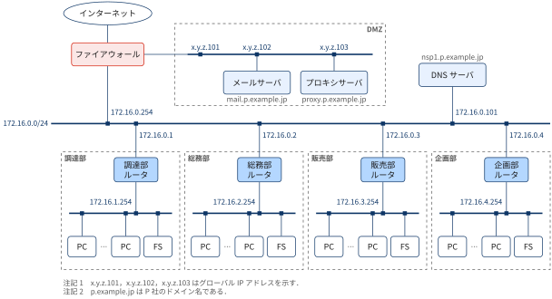
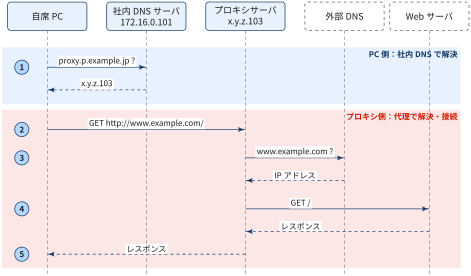
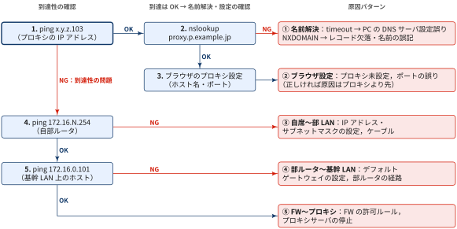
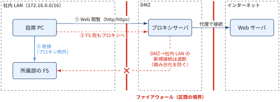

## 前提：ネットワーク構成

{width="100%" fig-align="center"}

- PCのIPアドレス・DNSサーバ等は**手動設定**（DHCPは不使用）
- Web閲覧は必ずプロキシサーバ（DMZ，`proxy.p.example.jp` = x.y.z.103）を経由する
- 社内の名前解決は DNSサーバ（172.16.0.101）が担う

### プロキシ経由のWebアクセスの機序

{width="100%" fig-align="center"}

1. PCが社内DNSサーバに `proxy.p.example.jp` を問い合わせ，x.y.z.103 を得る
2. PCはプロキシにHTTPリクエストを送る．宛先はリクエストの中身（`GET http://www.example.com/`）としてプロキシに渡すだけで，PCは宛先のIPアドレスを知らない
3. プロキシが宛先ホスト名 `www.example.com` を解決する
4. プロキシが自分の名前でWebサーバに接続し，レスポンスを受け取る
5. プロキシがレスポンスをPCに返す

PC自身が解決する必要があるのは**プロキシのホスト名だけ**．外部サイトの名前解決はプロキシ側の仕事．

### この構成のメリット

:::: {.no-border-top-table}

| メリット | 理由 |
|---|---|
| 社内DNSが外部の名前を扱わなくてよい | 社内DNSは社内の名前（`proxy.p.example.jp` など）を引ければ足りる．インターネットへ問い合わせる設定が要らないため，構成と運用が単純になる |
| FWのルールが少なく済む | 社内LAN→インターネットの通信（HTTPもDNSも）を許可する必要がない．外へ出られるのはプロキシだけ，と絞れる |
| PCの通信が外部から見えない | Webサーバから見える接続元はプロキシ（x.y.z.103）だけ．社内のアドレス（172.16.x.x）は外に出ない |
| 外向き通信を1か所で管理できる | アクセスログの取得，URLフィルタリング，キャッシュを，プロキシ1台に集めて実施できる |
| PCの設定が少ない | PCに入れる設定は「社内DNSサーバ」と「プロキシのホスト名・ポート」だけでよい |
: {tbl-colwidths="[35,65]"}

::::

## Trouble 1: 自席からインターネットにアクセスできない

::: {.callout-note}
### ポイント

- Webアクセスで最初に通る相手はプロキシなので，まず**プロキシのIPアドレスへ `ping`** を打つ．
- 原因が「到達性」と「名前解決・設定」のどちら側にあるか判別する

:::

{width="100%" fig-align="center"}

| 手順 | 確認内容 | 結果と次の一手 |
|---|---|---|
| 1. `ping x.y.z.103` | プロキシまでの到達性 | OK → 到達性は正常なので手順2 / NG → **到達性の問題**なので手順4 |
| 2. `nslookup proxy.p.example.jp` | 名前解決 | timeout：PCのDNSサーバ設定の誤り / NXDOMAIN：レコードの欠落，プロキシ名の誤記（①）/ OK → 手順3 |
| 3. ブラウザのプロキシ設定 | 使うプロキシの指定 | プロキシの未設定，ホスト名・ポート番号の誤り（②）．正しければ原因はプロキシより先 |
| 4. `ping 172.16.N.254` | 自席〜自部ルータ | NG → IPアドレス・サブネットマスクの誤り，ケーブル（③）/ OK → 手順5 |
| 5. `ping 172.16.0.101` | 部ルータ〜基幹LAN | NG → デフォルトゲートウェイの誤り，部ルータの経路（④）/ OK → FWの許可ルール，プロキシの停止（⑤） |

- 手順1がOKで手順2がtimeoutなら，DNSサーバへは届くはずなのに応答がない．原因はPC側の**DNSサーバのアドレス設定**にほぼ絞れる
- 手順1〜3がすべてOKなら，原因はプロキシより先（プロキシ自身の名前解決，外向きのFW，外部サイト）にある
- `ping` はFWがICMPを遮断していればNGになる．手順1がNGで手順5までOKのときは，プロキシのポートへのTCP接続（`curl -x x.y.z.103:<port> ...` など）でも確かめる

## Trouble 2: 自席から所属部のFSにプロキシ経由でアクセスしてしまった

::: {.callout-important}
## 前提

- FWは **DMZ（プロキシサーバ）→ 社内LAN（FS）の通信を禁止している** ものとする

:::

{width="100%" fig-align="center"}

### 何が起きたか

FSは自席PCと同じ部のLAN上にあり，本来は直接届く（図の経路③）．
ところがブラウザがプロキシ設定のままFSのURLを開くと，FS宛の通信もいったんプロキシへ送られる（経路②）．

1. PC → プロキシ：「FSのページを取ってきて」と依頼する
2. プロキシ（DMZ）→ FS（社内LAN）：プロキシがFSへ**新しく接続しようとする**
3. FWが前提のルールによりこの接続を遮断する → FSにアクセスできない

### なぜFWはDMZ→社内LANを遮断するのか

前提としたFWのルールを，通信の向きごとに整理すると次の通り．ルールは「誰が通信を**始めて**よいか」で決まる．

| 通信の向き（開始する側 → 相手） | 可否 | 例 |
|---|---|---|
| 社内LAN → DMZ | 許可 | PC → プロキシ，PC → メールサーバ |
| DMZ → インターネット | 許可 | プロキシ → Webサーバ |
| インターネット → DMZ | 必要なものだけ許可 | 外部 → メールサーバ（メール受信） |
| **DMZ → 社内LAN** | **遮断** | プロキシ → FS |

応答パケット（PC→プロキシへの返事など）は，始めた側への返信として通る．遮断されるのは，DMZ側から**新しく**始める通信だけ．

遮断する意図は，**DMZのサーバが乗っ取られたときに被害を社内へ広げない**ことにある．

- DMZのサーバ（プロキシ・メールサーバ）はインターネットと直接やり取りするため，社内で最も攻撃を受けやすい
- もしDMZ→社内LANを許可していると，乗っ取られたプロキシを踏み台にしてFSへ侵入され，業務データを抜き取られる
- DMZ→社内LANを遮断しておけば，DMZが侵害されても被害をDMZの中に閉じ込められる

### 対処

- ブラウザのプロキシ例外設定に社内の宛先（`172.16.0.0/16`，社内のホスト名）を加え，社内宛はプロキシを通さず直接アクセスさせる
- 切り分けでは，まず `ping` でFSに届くか確かめる．届くのにブラウザからだけ開けないなら，原因はプロキシ設定と判断できる
