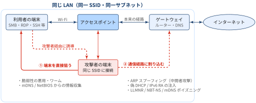
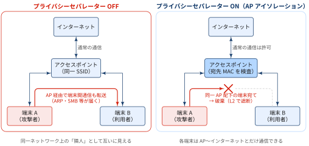
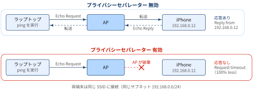
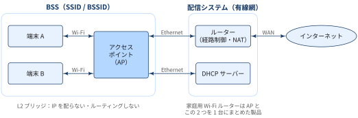
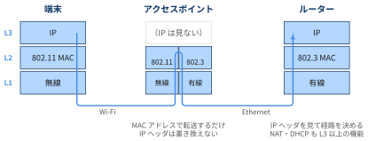

## 公共無線LANアクセスポイントに潜む危険

公共無線 LAN に接続すると，見知らぬ利用者と同じ LAN に入ることになります．そこに攻撃者がいれば，自宅や社内の LAN で想定される攻撃がそのまま成立します．攻撃は大きく，① 端末を直接狙うものと，② 通信経路に割り込むものに分けられます．

{width="100%" fig-align="center"}

[① 端末を直接狙う]{.mini-section}

- **[端末への直接攻撃](figures/direct-attack.svg){.lightbox gallery="lan-attacks"}**：開いている SMB 共有フォルダ，リモートデスクトップ，SSH，開発用サーバへアクセスしたり，その脆弱性を悪用したりする．WannaCry のような SMB 経由のワームの感染経路にもなる
- **[情報収集](figures/info-gathering.svg){.lightbox gallery="lan-attacks"}**：mDNS や NetBIOS から「〇〇の MacBook」のようなホスト名，OS，共有名が漏れ，個人や所属の特定につながる

[② 通信経路に割り込む]{.mini-section}

- **[ARP スプーフィング](figures/arp-spoofing.svg){.lightbox gallery="lan-attacks"}による中間者攻撃**：攻撃者がゲートウェイになりすまして全通信を中継し，HTTP の盗聴，DNS 応答の改ざん，偽ログインページへの誘導を行う
- **[偽 DHCP / IPv6 ルーター広告（RA）の注入](figures/rogue-dhcp-ra.svg){.lightbox gallery="lan-attacks"}**：不正な DNS サーバーやゲートウェイを配布して通信を乗っ取る．IPv4 しか意識していない環境では，IPv6 RA 経由の攻撃が見落とされがち
- **[名前解決ポイズニング](figures/name-poisoning.svg){.lightbox gallery="lan-attacks"}**：LLMNR / NBT-NS / mDNS に偽の応答を返し，Windows に NTLM 認証をさせてハッシュを取得する．取得したハッシュはオフライン解析やリレー攻撃に使われる

[利用者側の対策]{.mini-section}

- OS のネットワーク種別を「パブリック」にする
- ファイル共有や不要なサービスを止める
- ファイアウォールを有効にする
- VPN を使う

::: {.callout-tip}
### VPN が一番効果の大きい対策

VPN は通信を端末から VPN サーバーまで暗号化するので，同じ LAN 上での盗聴や改ざんを無力化できます．後述のプライバシーセパレーターでは防げない盗聴や偽 AP（Evil Twin）にも効く点で，利用者側でできる対策のなかで最も効果が大きいものです．

:::


## プライバシーセパレーター

::: {#def- .custom_problem .blog-custom-border}
### プライバシーセパレーター

- 同じアクセスポイント（AP）に接続している無線端末同士の通信を，AP 側で遮断する機能
- 端末は AP の先（ゲートウェイ・インターネット）とだけ通信でき，「隣の利用者」には届かなくなる

:::

メーカーによって「プライバシーセパレーター」「ネットワーク分離機能」「AP/Client Isolation」などと呼ばれます．「プライバシーセパレーター」は国内メーカーの呼び名で，英語では一般的な言葉ではありません．英語の資料を調べるときは **AP isolation** や **wireless (client) isolation** で検索します．

{width="100%" fig-align="center"}

[仕組み: L2 での転送制御]{.mini-section}

インフラストラクチャモードの無線 LAN では，端末 A から端末 B へのフレームも直接は飛ばず，必ず AP を経由します．通常の AP は受信フレームの宛先 MAC アドレスを見て，自分に関連付け済みの無線端末宛てなら無線側へ折り返して中継します．

プライバシーセパレーターは，この「無線 → 無線の折り返し」を禁止します．

- 宛先が同一 AP 配下の端末なら，フレームを破棄する
- 上流（有線側）宛てのフレームだけを転送する
- ブロードキャスト／マルチキャスト（ARP 要求・mDNS など）も，他の端末へ中継しないか制限するのが一般的．

::: {.callout-warning}
### プライバシーセパレーターで防げないこと

- **AP をまたぐ通信**：複数の AP で同じ SSID を運用する場合，有線側のスイッチでもポート分離（Private VLAN など）をしないと，AP1 配下から AP2 配下への通信は通ってしまう
- **盗聴**：WPA2-PSK で全員が同じパスワードを使う公衆 Wi-Fi では，他人の 4-way ハンドシェイクを捕捉すればその通信を復号できる．また，全端末が共有するグループ鍵（GTK）を使って，AP になりすましたブロードキャストを直接注入する手口（Hole196）もセパレーターをすり抜ける
- **偽 AP（Evil Twin）**：そもそも攻撃者の AP に接続してしまえば，セパレーターは意味をなさない

:::


## プライバシーセパレーターが機能しているかの確認

::: {.callout-note}
## TL:DRs

- 同じ Wi-Fi（SSID）に iPhone とラップトップをつなぎ，ラップトップから iPhone に ping を送って確かめます．
- プライバシーセパレーターが有効なら，AP が端末同士の通信を破棄するので応答は返ってきません．

:::

{width="100%" fig-align="center"}

[Step 1: iPhone の IP アドレスを調べる]{.mini-section}

1. 「設定」アプリを開く
2. 「Wi-Fi」をタップする
3. 接続中のネットワーク名の右にある「ⓘ」をタップする
4. 「IP アドレス」の欄に表示される（例：`192.168.0.12`）

[Step 2: ラップトップから ping を送る]{.mini-section}

ラップトップを iPhone と同じ SSID に接続し，ターミナルで Step 1 のアドレスに `ping` を送ります．

```bash
ping -c 4 -n 192.168.0.12
```

- `-c 4`：4 回送って終了する
- `-n`：応答元アドレスの逆引き（DNS 問い合わせ）をしない．逆引きの待ち時間で結果の表示が遅れるのを防ぎ，IP アドレスのまま表示させる

プライバシーセパレーターが**無効**なら，次のように応答が返ります．

```bash
64 bytes from 192.168.0.12: icmp_seq=1 ttl=64 time=5.12 ms
64 bytes from 192.168.0.12: icmp_seq=2 ttl=64 time=4.87 ms
...
4 packets transmitted, 4 received, 0% packet loss
```

**有効**なら応答は返らず，すべて失われます．

```bash
4 packets transmitted, 0 received, 100% packet loss
```

## Appendix: アクセスポイント

::: {#def- .custom_problem .blog-custom-border}
### アクセスポイント

- アクセスポイント（AP）は，無線 LAN の端末を有線のネットワークにつなぐための中継機器
- 無線（Wi-Fi）と有線（Ethernet）の間で通信を橋渡しするのが基本の役割

:::


{width="100%" fig-align="center"}


::: {.callout-note}
### 規格上の定義（IEEE 802.11）

IEEE 802.11 では，AP は「自分に接続（アソシエーション）した端末に，配信システム（Distribution System, DS）への入口を提供する局（station）」とされています．DS は AP の背後にある有線網のことで，複数の AP 同士もここでつながります


:::

[Wi-Fi ルーターとの違い]{.mini-section}

家庭用の「無線 LAN ルーター」は，AP の機能に加えて，ルーター（インターネットへの経路制御，NAT），DHCP サーバなどを 1 台にまとめた製品です．厳密な AP は L2 のブリッジにすぎず，IP アドレスを配ったりルーティングしたりはしません．家庭用ルーターの「AP モード（ブリッジモード）」は，ルーター機能を切って AP の役割だけにする設定です．

{width="100%" fig-align="center"}

## Appendix: ping疎通ができないパターン

ping が通らないとき（= ICMP Echo Reply が返ってこない）も，原因によって表示が変わります．

:::: {.no-border-top-table}

| 状況 | ping の表示 |
|---|---|
| 途中や相手でパケットが**破棄（drop）**された | 何も表示されず，最後に `100% packet loss`（一部だけ欠けることもある）．`icmp_seq` の番号が飛ぶこともある |
| ファイアウォールが**拒否（reject）**した | `Destination Host Unreachable`，`Destination Port Unreachable`，`Communication administratively prohibited` などのエラー行が出る |
| 経路がない | `Network is unreachable` など |
: {tbl-colwidths="[40,60]"}

::::

drop は黙って捨てるので，送信側はタイムアウトを待つしかありません．reject は「拒否した」という ICMP エラーを送り返すので，すぐにエラー行が表示されます．

::: {.callout-note}
### プライバシーセパレーターの場合

AP が端末間のフレームを黙って破棄するので，基本は drop のパターン（`100% packet loss`）になります．ただし同じサブネット内では，ping の前に相手の MAC アドレスを調べる ARP 要求も届かないことがあります．このとき Linux などでは，自分のアドレスから `Destination Host Unreachable` が返ります．これは相手が拒否したのではなく，宛先 MAC アドレスがわからず送信できなかったという意味です．

:::


📘 用語集
------------

:::{.glossary-container}

```yaml
glossary:
  - def: L2 ブリッジ
    description: |
      OSI 参照モデルの第 2 層（データリンク層）で動作し，フレームの宛先 MAC アドレスを見て，つながっている別のネットワークへフレームを転送する機器・機能．IP ヘッダは参照も書き換えもしないため，ブリッジの両側は同じ IP サブネット（同じブロードキャストドメイン）になる．AP は 802.11（無線）と 802.3（有線）のフレーム形式を相互に変換するブリッジとして動作する．
```

:::


📘 References
-------------

- [IEEE Std 802.11-2024: Wireless LAN Medium Access Control (MAC) and Physical Layer (PHY) Specifications](https://standards.ieee.org/ieee/802.11/10548/)
