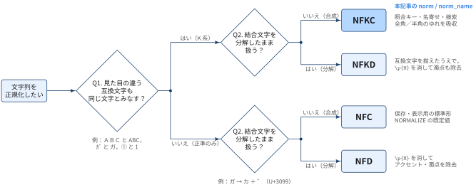

## この記事について

:::: {.no-border-top-table}

| 観点 | 内容 |
|---|---|
| **What：何のドキュメントか** | BigQuery で表記ゆれを吸収する照合キーを作る一時関数 `norm` / `norm_name` の挙動を，公式ドキュメントと実行結果をもとに解説したメモ |
| **Who：誰に向けたものか** | 全角・半角や空白の混在した文字列を BigQuery 上で JOIN / GROUP BY したい人 |
| **Why：なぜ重要か** | `NORMALIZE(s, NFKC)` は便利だが，何が揃い何が揃わないか，どこで情報が落ちるかを知らないと，照合漏れや誤マッチの原因になるため |
| **How：どう使うか** | 各関数の役割と処理順を理解したうえで，「注意点」の項目を自分のデータに当てはめて確認する |

: {tbl-colwidths="[30,70]"}

::::

## 対象の関数

::: {.callout-note}
### **表記ゆれを吸収した比較用のキーを作る**ための関数

:::{.padding-left-10}

```sql
CREATE TEMP FUNCTION norm(s STRING) AS (UPPER(NORMALIZE(s, NFKC)));

CREATE TEMP FUNCTION norm_name(s STRING) AS (UPPER(REGEXP_REPLACE(NORMALIZE(s, NFKC), r'[\s〈〉<>]', '')));
```

:::

:::
関数呼び出しは内側から評価されるので，処理は次の順に進みます．

| 段 | 処理 | `norm` | `norm_name` | 役割 |
|---|---|:---:|:---:|---|
| 1 | `NORMALIZE(s, NFKC)` | ✓ | ✓ | 全角英数・半角カナ・互換文字などを標準的な形に揃える |
| 2 | `REGEXP_REPLACE(..., r'[\s〈〉<>]', '')` | | ✓ | 空白と山括弧を取り除く |
| 3 | `UPPER(...)` | ✓ | ✓ | 英字を大文字に揃える |

: {tbl-colwidths="[5,40,10,10,35]"}

[使い分け]{.mini-section}

- `norm` は一般的な文字列（コード値・品番など）向け
- `norm_name` は会社名・氏名のように空白や括弧の入れ方が人によって違う「名前」向け，

## `CREATE TEMP FUNCTION`：一時的な SQL UDF

::: {#def- .custom_problem .blog-custom-border}
### `CREATE TEMP FUNCTION`

- `CREATE TEMP FUNCTION` は SQL で本体を書くユーザー定義関数（SQL UDF）を，そのクエリの中だけで使える形で定義する仕組み
- 名前にピリオドは使えない

:::

公式ドキュメント [User-defined functions](https://docs.cloud.google.com/bigquery/docs/user-defined-functions) には次の記述があります．

- 一時 UDF はクエリが終わった時点で消える（"temporary UDFs expire as soon as the query finishes"）
- ビューと永続 UDF からは一時 UDF を参照できない（"Views and persistent UDFs cannot reference temporary UDFs"）
- 一時 UDF の名前にピリオドは使えない

[How to Use]{.mini-section}

関数定義と呼び出しは同じクエリ（マルチステートメントクエリ）に書きます．

```sql
CREATE TEMP FUNCTION norm(s STRING) AS (UPPER(NORMALIZE(s, NFKC)));
CREATE TEMP FUNCTION norm_name(s STRING) AS (UPPER(REGEXP_REPLACE(NORMALIZE(s, NFKC), r'[\s〈〉<>]', '')));

SELECT
  a.*,
  b.customer_id
FROM `project.dataset.orders` AS a
LEFT JOIN `project.dataset.customers` AS b
  ON norm_name(a.company_name) = norm_name(b.company_name);
```

`bq` コマンドからは GoogleSQL を明示して，ファイルを標準入力で渡すのが楽です．(see [CASE 4: ファイルに書いた SQL を `bq query` に渡す](../2025-08-31-stdout-stderr/index.qmd#case-4-ファイルに書いた-sql-を-bq-query-に渡す))

```bash
bq query --use_legacy_sql=false < query.sql
```


::: {.callout-note}
### Tips

- 複数のクエリやビューから使い回したくなったら，`CREATE FUNCTION dataset.norm_name(...)` として永続 UDF にします．

:::


## `NORMALIZE(s, NFKC)`：Unicode 正規化

[String functions: NORMALIZE](https://docs.cloud.google.com/bigquery/docs/reference/standard-sql/string_functions#normalize) のシグネチャは次のとおりです．

```sql
NORMALIZE(value[, normalization_mode])
```

ドキュメントには "If you don't provide a normalization mode, `NFC` is used." とあり，**モードを省略すると NFC** になります．
モードは `NFC` / `NFKC` / `NFD` / `NFKD` の4つです．

[NFC と NFKC の違い]{.mini-section}

NFC は「見た目も意味も同じ文字」（たとえば濁点が分かれた `カ` + `゛` と1文字の `ガ`）を揃えるだけで，全角英数は全角のまま残ります．
全角・半角の違いまで揃えたいときは，互換分解を含む **NFKC** を指定する必要があります．

```sql
SELECT NORMALIZE('ＡＢＣ') AS nfc_default, NORMALIZE('ＡＢＣ', NFKC) AS nfkc;
-- nfc_default: ＡＢＣ / nfkc: ABC
```

また，モードは文字列ではなく**キーワード**として書きます．`NORMALIZE(s, 'NFKC')` と書くと `Argument is not a valid NORMALIZE mode` というエラーになります．

[4つの正規化形式の使い分け]{.mini-section}

4つの形式は「互換文字も同一視するか（K の有無）」と「最後に合成するか，分解したままにするか（C / D）」の2つの問いで選べます．



| 形式 | 互換文字の同一視 | 結合文字 | 主な用途 |
|---|:---:|---|---|
| NFC | ✗ | 合成 | 保存・表示用の標準形．`NORMALIZE` の既定値 |
| NFD | ✗ | 分解 | 結合文字（`\p{M}`）を消してアクセント・濁点を落とす前処理 |
| NFKC | ✓ | 合成 | 照合キー・名寄せ・検索．本記事の `norm` / `norm_name` |
| NFKD | ✓ | 分解 | 全角・半角を揃えたうえでアクセント・濁点も落とす |

: {tbl-colwidths="[12,20,13,55]"}


::: {.callout-note}
### Tips

- 濁点まで消えて `ガ` と `カ` が同じになるので，日本語の照合キーでは D 系 + `\p{M}` 除去は使わず NFKC を選びます．


:::


[NFKC で何が変わるか]{.mini-section}

BigQuery で実際に `NORMALIZE(s, NFKC)` を実行した結果です．

| 入力 | 出力 | 内容 |
|---|---|---|
| `ａｂｃ１２３` | `abc123` | 全角英数 → 半角英数 |
| `ｶﾞｷﾞ` | `ガギ` | 半角カナ → 全角カナ（濁点も1文字に合成） |
| `株式会社　ABC`（U+3000） | `株式会社 ABC`（U+0020） | 全角スペース → 半角スペース |
| `a b`（U+00A0, NBSP） | `a b`（U+0020） | ノーブレークスペース → 半角スペース |
| `＜abc＞` | `<abc>` | 全角記号 → 半角記号 |
| `㈱abc` | `(株)abc` | 囲み文字 → 括弧つきの文字列 |
| `①` | `1` | 丸数字 → 数字 |
| `m²` | `m2` | 上付き数字 → 通常の数字 |
| `file` | `file` | 合字 → 分解 |

: {tbl-colwidths="[30,30,40]"}

## `UPPER`：大文字化

[String functions: UPPER](https://docs.cloud.google.com/bigquery/docs/reference/standard-sql/string_functions#upper) には "For `STRING` arguments, returns the original string with all alphabetic characters in uppercase." とあり，大文字と小文字の対応は言語固有のルールを考慮せず Unicode の文字データベースに従います．

- 日本語の文字には大文字・小文字がないので影響はなく，実質的には英字の大文字・小文字のゆれを揃える役割
- なお，1文字が複数文字に変わるケースもあり，`UPPER('Straße')` は `STRASSE` になる（文字数が変わる）．

```zsh
% bq query "SELECT UPPER('Straße')"
+---------+
|   f0_   |
+---------+
| STRASSE |
+---------+
```


## `REGEXP_REPLACE(..., r'[\s〈〉<>]', '')`：空白と山括弧の除去

[String functions: REGEXP_REPLACE](https://docs.cloud.google.com/bigquery/docs/reference/standard-sql/string_functions#regexp_replace) は，正規表現 `regexp` にマッチした部分をすべて `replacement` に置き換えます．
BigQuery の正規表現は [RE2](https://github.com/google/re2/wiki/Syntax) ライブラリで実装されています．

- `r'...'` は raw 文字列リテラルで，`\s` のバックスラッシュをエスケープせずに書ける
- `[...]` は文字クラスで，`\s`・`〈`（U+3008）・`〉`（U+3009）・`<`・`>` のどれか1文字にマッチする
- 置換先が `''` なので，マッチした文字を削除する

![`REGEXP_REPLACE(x, r'[\s〈〉<>]', '')` の読み方](./figures/regexp-replace-anatomy.svg)

[`\s` は ASCII の空白だけ]{.mini-section}

RE2 のドキュメントでは Perl 由来の文字クラスは "all ASCII-only" とされ，`\s` は `[\t\n\f\r ]` と定義されています．
つまり **`\s` 単体では全角スペース（U+3000）にマッチしません**．

それでも `norm_name` で全角スペースが消えるのは，先に `NORMALIZE(s, NFKC)` が U+3000 を U+0020 に変換しているからです．
処理順を逆にして `NORMALIZE(REGEXP_REPLACE(s, ...), NFKC)` と書くと，全角スペースが半角スペースとして残ります．

```sql
SELECT
  s,
  UPPER(REGEXP_REPLACE(NORMALIZE(s, NFKC), r'[\s〈〉<>]', '')) AS nfkc_first,   -- norm_name と同じ順
  UPPER(NORMALIZE(REGEXP_REPLACE(s, r'[\s〈〉<>]', ''), NFKC)) AS regexp_first  -- 順番を逆にした版
FROM UNNEST(['株式会社　ABC', '株式会社 ABC', '＜ABC＞']) AS s;
```

| `s` | `nfkc_first` | `regexp_first` |
|---|---|---|
| `株式会社　ABC`（全角スペース U+3000） | `株式会社ABC` | `株式会社 ABC`（半角スペース U+0020 が残る） |
| `株式会社 ABC`（半角スペース） | `株式会社ABC` | `株式会社ABC` |
| `＜ABC＞`（全角山括弧） | `ABC` | `<ABC>`（半角の `<>` が残る） |

: {tbl-colwidths="[34,22,44]"}

`regexp_first` で何が起きているかを1行目で追うと，次のとおりです．

1. `REGEXP_REPLACE`：U+3000 は `\s`（ASCII の空白だけ）にマッチしないので，削除されずに残る
2. `NORMALIZE(..., NFKC)`：残った U+3000 が U+0020 に変換される
3. `UPPER`：空白はそのまま

削除のあとで正規化しているので，正規化で生まれた半角スペースを消す処理がもう残っていません．
その結果，入力時点の空白が全角か半角かによって，`株式会社ABC` と `株式会社 ABC` の別々のキーになり，JOIN で一致しなくなります．
`＜＞` も同じ理由で，`<>` に変換されたあと削除されずに残ります．

::: {.callout-note}
### Tips

- 「削除・置換」より先に「正規化」を行う
- 置換パターンは正規化後の文字（半角スペース・半角記号）だけを想定して書けばよくなる

:::

[山括弧のゆれも NFKC 経由で吸収される]{.mini-section}

文字クラスに書いているのは `〈〉<>` の4文字ですが，NFKC が先に走るので次の文字も結果的に削除されます．

| 入力 | NFKC 後 | 削除されるか |
|---|---|:---:|
| `<` `>`（半角） | そのまま | ✓ |
| `＜` `＞`（全角，U+FF1C / U+FF1E） | `<` `>` | ✓ |
| `〈` `〉`（CJK，U+3008 / U+3009） | そのまま | ✓ |
| `〈` `〉`（U+2329 / U+232A） | `〈` `〉`（U+3008 / U+3009） | ✓ |
| `《` `》`（二重山括弧，U+300A / U+300B） | そのまま | ✗ |

: {tbl-colwidths="[40,40,20]"}

## 実行結果

BigQuery で両関数を実行した結果です．

```sql
CREATE TEMP FUNCTION norm(s STRING) AS (UPPER(NORMALIZE(s, NFKC)));
CREATE TEMP FUNCTION norm_name(s STRING) AS (UPPER(REGEXP_REPLACE(NORMALIZE(s, NFKC), r'[\s〈〉<>]', '')));

SELECT s, norm(s) AS norm, norm_name(s) AS norm_name
FROM UNNEST(['ａｂｃ１２３', '株式会社　ＡＢＣ', '〈ABC〉', '＜abc＞', '㈱abc', 'a\tb\nc', CAST(NULL AS STRING)]) AS s;
```

| `s` | `norm(s)` | `norm_name(s)` |
|---|---|---|
| `ａｂｃ１２３` | `ABC123` | `ABC123` |
| `株式会社　ＡＢＣ` | `株式会社 ABC` | `株式会社ABC` |
| `〈ABC〉` | `〈ABC〉` | `ABC` |
| `＜abc＞` | `<ABC>` | `ABC` |
| `㈱abc` | `(株)ABC` | `(株)ABC` |
| `a\tb\nc`（タブ・改行） | `A\tB\nC` | `ABC` |
| `NULL` | `NULL` | `NULL` |

: {tbl-colwidths="[34,33,33]"}

## 注意点

[1. NFKC は情報を落とす]{.mini-section}

NFKC は「見た目は違うが互換性のある文字」を同じ文字にまとめるので，元の区別は復元できません．
`m²` と `m2`，`①` と `1`，`㈱` と `(株)` は区別できなくなります．
`½` は `1⁄2`（U+2044 の分数スラッシュ）になり，`/` とも一致しません．

::: {.callout-note}
### Tips

- 正規化した値は**照合用のキーとしてだけ使い**，表示や集計の出力には元の列を残しておく

:::

[2. NFKC でも揃わない表記ゆれがある]{.mini-section}

NFKC が揃えるのは Unicode が互換文字と定めたものだけです．日本語データでよく問題になる次のゆれは残ります．

| 種類 | 例 | NFKC 後 |
|---|---|---|
| 波ダッシュと全角チルダ | `〜`（U+301C）と `～`（U+FF5E） | `〜` と `~`（不一致のまま） |
| ハイフン類 | `‐`（U+2010），`−`（U+2212），`ー`（U+30FC），`－`（U+FF0D） | `－` だけ `-` になり，他は残る |
| 異体字 | `髙橋` と `高橋` | 変わらない |
| ひらがなとカタカナ | `さくら` と `サクラ` | 変わらない |
| 法人格の書き方 | `(株)` と `株式会社` | 変わらない |
| 二重山括弧 | `《ABC》` | `norm_name` でも残る |

: {tbl-colwidths="[25,45,30]"}

これらを揃えたいときは，`REPLACE` や `TRANSLATE` で対応表を明示的に書き足します．

[3. ゼロ幅文字や垂直タブは消えない]{.mini-section}

`\s` は `[\t\n\f\r ]` なので，垂直タブ（`\v`）は含みません．
また，ゼロ幅スペース（U+200B）や BOM（U+FEFF）は空白の扱いではなく，NFKC でも変換されないため，`norm_name` 後もそのまま残ります．
Web やExcel からコピーしたデータには混ざりがちで，見た目は同じなのに一致しない原因になります．

消したい場合は文字クラスを広げます．実行して `a​b`（U+200B 入り）が `AB` になることを確認しています．

```sql
CREATE TEMP FUNCTION norm_name(s STRING) AS (
  UPPER(REGEXP_REPLACE(NORMALIZE(s, NFKC), r'[\s\v\p{Z}\x{200B}\x{FEFF}〈〉<>]', ''))
);
```

`\p{Z}` は Unicode の区切り文字（Separator）カテゴリで，NFKC で U+0020 にならない空白類も拾えます．

[4. 空白を消すと別物が衝突する]{.mini-section}

`norm_name` はすべての空白を消すので，`ABC D` と `ABCD` は同じ `ABCD` になります．
名前の照合では便利な反面，本来別の会社・人物が同じキーになる誤マッチが起こりえます．
JOIN する前に，同じキーに複数の元の値が対応していないかを確認しておきます．

```sql
SELECT norm_name(company_name) AS key, ARRAY_AGG(DISTINCT company_name) AS originals
FROM `project.dataset.customers`
GROUP BY key
HAVING COUNT(DISTINCT company_name) > 1;
```

[5. 空文字キーは大量に一致する]{.mini-section}

`NULL` を渡すと `NULL` が返り，`NULL` どうしは `=` で一致しないので JOIN では落ちます．
一方，`〈　〉` や `< >` のように空白と山括弧だけの値は `norm_name` で空文字 `''` になり，**空文字どうしは一致します**．
ダミー値が入った行どうしが全部つながってしまうので，必要なら `NULLIF(norm_name(s), '')` で空文字を `NULL` に寄せます．

[6. 大文字・小文字を無視した比較なら `NORMALIZE_AND_CASEFOLD` もある]{.mini-section}

公式ドキュメントでは，大文字・小文字を区別しない比較には `NORMALIZE_AND_CASEFOLD` を使うよう案内されています．

```sql
NORMALIZE_AND_CASEFOLD(s, NFKC)  -- 'Straße' -> 'strasse', 'ＡＢＣ' -> 'abc'
```

結果は小文字側に揃うので，キーとして比べるだけならこちらでも同じ目的を果たせます．
`UPPER(NORMALIZE(...))` を使うのは，キーを目で見て確認するときに大文字のほうが読みやすい，という程度の理由です．

[7. 関数をかけた JOIN は毎回計算される]{.mini-section}

`ON norm_name(a.x) = norm_name(b.x)` は，クエリを実行するたびに両テーブルの全行で正規化を計算します．
何度も使うキーであれば，正規化済みの列をテーブルに持たせておくほうが速く，ビューからも参照できます（ビューは一時 UDF を参照できないため）．

## References

- [BigQuery: String functions — NORMALIZE](https://docs.cloud.google.com/bigquery/docs/reference/standard-sql/string_functions#normalize)
- [BigQuery: String functions — NORMALIZE_AND_CASEFOLD](https://docs.cloud.google.com/bigquery/docs/reference/standard-sql/string_functions#normalize_and_casefold)
- [BigQuery: String functions — UPPER](https://docs.cloud.google.com/bigquery/docs/reference/standard-sql/string_functions#upper)
- [BigQuery: String functions — REGEXP_REPLACE](https://docs.cloud.google.com/bigquery/docs/reference/standard-sql/string_functions#regexp_replace)
- [BigQuery: User-defined functions](https://docs.cloud.google.com/bigquery/docs/user-defined-functions)
- [BigQuery: bq command-line tool reference](https://docs.cloud.google.com/bigquery/docs/reference/bq-cli-reference)
- [RE2 Syntax](https://github.com/google/re2/wiki/Syntax)
- [Unicode Standard Annex #15: Unicode Normalization Forms](https://unicode.org/reports/tr15/)

## 📘 用語集

:::{.glossary-container}

```yaml
glossary:
  - def: 正規化（文字処理）
    description: |
      同じ意味の文字列が，異なる文字・コードポイントの並びで表されているときに，一定の規則で1つの表現に揃える処理．たとえば `ガ`（U+30AC）と `カ` + 濁点（U+30AB U+3099），`ＡＢＣ` と `ABC` は見た目や意味が同じでも，そのままでは `=` で一致しない．

  - def: --use_legacy_sql
    description: |
      `bq query` などで，クエリを legacy SQL と GoogleSQL のどちらで解釈するかを指定するフラグ．`false` で GoogleSQL，`true` で legacy SQL になる．設定ファイルで指定していない場合の既定値は `true`（legacy SQL）なので，GoogleSQL の構文（`CREATE TEMP FUNCTION`，バッククォートで囲んだ `project.dataset.table` 形式のテーブル名など）を使うクエリでは`--use_legacy_sql=false` を明示する．
```

:::
