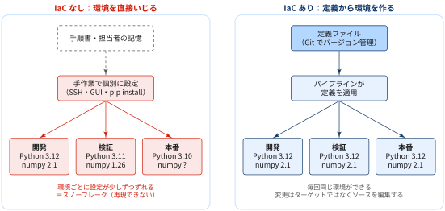
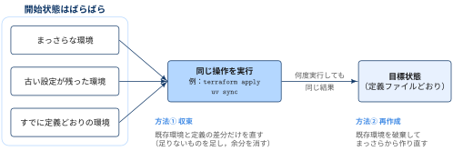
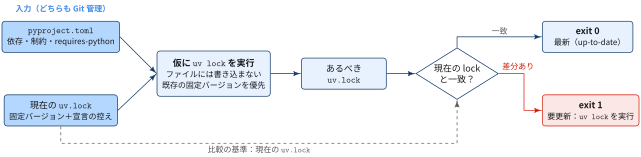
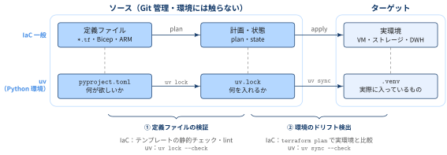
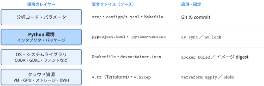
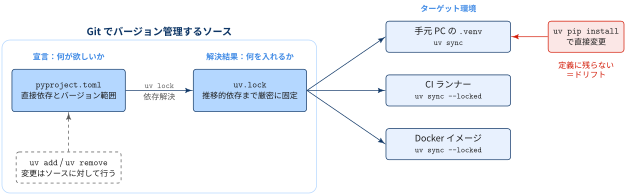

::: {.callout-note}
## TL;DRs

- 分析結果の再現性は，コードだけでなく **実行環境が同じであること** に依存する．ここでいう実行環境には，Python のバージョン，パッケージのバージョン，OS・システムライブラリ（CUDA など），クラウド資源が含まれる
- 環境を手作業で管理すると，その場しのぎの `pip install` や設定変更が記録に残らないまま積み重なる．その結果，気づかないうちに環境ごとの差（**環境ドリフト**）が生まれ，最終的には誰も再現できない一点物の環境（**スノーフレーク**）になる
- 1つ1つの差は小さくても，チリツモで「手元では動くのに CI や本番で動かない」「半年前の分析結果を再現できない」という問題に直面しやすくなる
- IaC は，環境を **バージョン管理された宣言的な定義ファイル** で記述し，**冪等な操作** で何度でも同じ環境を作ることで，この問題を防ぐ
- Python 環境では，`uv` のワークフローがそのまま IaC にあたる．`pyproject.toml` に「何が欲しいか」を宣言し，`uv.lock` に「何を入れるか」を固定し，`uv sync` で定義どおりに環境を揃える

:::

## IaC とは

::: {#def- .custom_problem .blog-custom-border}
### IaC

> Just as the same source code always generates the same binary, an IaC model generates the same environment every time it deploys.

- **Infrastructure as Code（IaC）** とは，ネットワーク・仮想マシン・ロードバランサー・それらの接続構成といったインフラを，**バージョン管理された記述的なモデル（定義ファイル）** で定義し，そこから環境をデプロイするプラクティスのこと
- 例: 望ましい環境の状態を[よく文書化されたコード（JSON などの形式）]{.regmonkey-bold}として表現する

:::

同じソースコードからは常に同じバイナリができるのと同じように，同じ IaC モデルからは何度デプロイしても同じ環境ができる（＝[再現性の確保]{.regmonkey-bold}）ようにしよう，というのが IaC の考え方です．

IaC は DevOps の中心的なプラクティスであり，継続的デリバリー（Continuous Delivery）の構成要素の1つです．アプリケーションとそれを支えるインフラを，チームが同じ手順・同じツールで，速く・確実に・大規模に届けるために使われます．

::: {.callout-note}
## データサイエンスに置き換えると

「インフラ」を「分析の実行環境」と読み替えると，IaC の考え方はそのままデータサイエンスに当てはまります．

- 同じ `pyproject.toml` と `uv.lock` からは，誰の PC でも，CI でも，Docker イメージの中でも，同じ Python 環境ができる
- 環境を変えたいときは，環境（`.venv`）を直接いじるのではなく，定義ファイルを編集する

この対応は後半の「[データサイエンスにおける IaC：uv と pyproject.toml](#sec-uv)」で詳しく扱います．
:::

## IaC が解決する問題：環境ドリフトとスノーフレーク

IaC は，リリースパイプラインにおける **環境ドリフト（environment drift）** の問題を解決するために発展してきました．

IaC がない場合，開発・検証・本番といったデプロイ先の環境設定を，それぞれ個別に手作業で維持することになります．

- 手順書を見ながら SSH でログインして設定を変える
- GUI でパラメータを変える
- 必要になったパッケージをその場でインストール．

このような運用を続けると，各環境は少しずつ異なる設定を持つようになり，最終的には自動では再現できない一点物の構成になります．これを **スノーフレーク（snowflake）** と呼びます．

{width="100%" fig-align="center"}

環境間の不整合は，デプロイ時のトラブルの原因になります．また，手作業によるインフラの管理・保守は，間違いが起きやすく，誰がいつ何を変えたかを追跡するのも困難です．

IaC は，望ましい環境の状態を **よく文書化されたコード（JSON などの形式）** として表現することで，手作業の設定をなくし，環境間の一貫性を強制します．リリースパイプラインは，この環境定義を実行し，バージョン管理された構成モデルにしたがってターゲット環境を構成します．

::: {.callout-important}
## RULE: 変更はターゲットではなくソースを編集する



> To make changes, the team edits the source, not the target.

環境を変えたいときは，動いている環境（ターゲット）を直接変更するのではなく，定義ファイル（ソース）を編集し，それを適用します．ターゲットを直接変更すると，その変更は定義ファイルに残らず，次にデプロイしたときに失われるか，環境ごとの差として残り続けます．

:::

::: {#exm- .custom_problem }
### データ分析の現場で起きるスノーフレーク

データ分析の現場でも，同じ問題は頻繁に起きます．

- 分析担当者の PC では `numpy 2.x` が入っているが，共有サーバーには `numpy 1.x` が残っている
- ノートブックの途中で `!pip install` したパッケージが，どこにも記録されていない
- 半年前のレポートを再現しようとしたら，当時のライブラリのバージョンがわからない

これらはいずれも，分析環境がスノーフレークになっている状態です．

:::
***


## 冪等性（Idempotence）

::: {#def- .custom_problem .blog-custom-border}
### 冪等性

- 冪等性とは，ある操作を何回実行しても常に同じ結果になる性質のこと

:::

IaC の重要な原則の1つが **冪等性（idempotence）** です．

IaC におけるデプロイ操作は，**ターゲット環境の開始時の状態にかかわらず**，常に同じ構成をもたらす必要があります．

{width="100%" fig-align="center"}

[冪等性の実現方法]{.mini-section}

:::: {.no-border-top-table}

| 方法 | やり方 | 特徴 |
|---|---|---|
| ① 収束 | 既存のターゲット環境を自動で構成し直し，定義との差分だけを修正する | 速い．ただし差分を正しく検出できることが前提 |
| ② 再作成 | 既存のターゲット環境を破棄し，まっさらな環境を作り直す | 確実．ただし作り直しのコストがかかる |

: {tbl-colwidths="[15,50,35]"}

::::

`uv` で言えば，`uv sync` が ① 収束にあたります．`uv sync` は既定で，`uv.lock` に記載されたパッケージを過不足なくインストールし，**lock にない余分なパッケージは削除** します（残したい場合は `--inexact` を付ける）．`.venv` を削除してから `uv sync` するのが ② 再作成にあたります．

## 本番に近い環境で早くテストする


::: {.callout-note}
### IaC のメリット

- IaC を使うと，開発サイクルの早い段階で，本番に近い環境でアプリケーションをテストできる

:::

IaC を使うと，開発サイクルの早い段階で，本番に近い環境でアプリケーションをテストできます．定義ファイルがあれば，テスト環境を必要なときに必要な数だけ確実に用意できるからです．クラウドでは，IaC の定義にもとづいて環境を動的に作成し，使い終わったら破棄できます．

また，インフラのコードそのものも検証・テストの対象になります．定義ファイルに対して静的チェックをかけることで，デプロイ時によくある問題を事前に防げます．Microsoft Defender for Cloud のように，IaC テンプレートの設定ミスを検出するツールもあります．

[`uv lock --check` を用いたインフラコードの検証]{.mini-section}

- `uv lock --check` は，`uv.lock` が `pyproject.toml` に対して最新（up-to-date）かどうかを検査するコマンド
- 最新なら exit 0，更新が必要なら exit 1 で終了し，`uv.lock` にも `.venv` にも書き込まない
- 環境（`.venv`）には一切触れず，**ソースである定義ファイルどうしが整合しているか** を検査

```bash
uv lock --check
```


つまるところ，`uv lock --check` の動作は，「**仮にいま `uv lock` を実行したら，`uv.lock` は書き換わるか？**」を確かめることで，これは IaC の「インフラのコードそのものも検証・テストできる」ことと対応しています．

{width="100%" fig-align="center"}


一方，定義どおりの環境が実際にできているか（ターゲットがドリフトしていないか）を確かめるのは， `uv sync --check` の役割です．

{width="100%" fig-align="center"}

| 検証 | 何と何を比べるか | IaC 一般 | uv |
|---|---|---|---|
| ① 定義ファイルの検証 | 定義ファイル ↔ 計画（ソースどうし） | テンプレートの静的チェック・lint | `uv lock --check` |
| ② 環境のドリフト検出 | 計画 ↔ 実環境（ソースとターゲット） | `terraform plan` で実環境との差分を確認 | `uv sync --check` |

: {tbl-colwidths="[22,30,26,22]"}

CI で使うときは，①を最初に実行して「`pyproject.toml` を変えたのに `uv.lock` を commit し忘れた」状態を検出します．これは，デプロイ前にインフラのコードを検証するのと同じ位置づけです．環境を作る段階では `uv sync --locked` を使います．これは「lock の更新が必要なら止める（①）」と「lock どおりに環境を作る」をまとめて行います．

```bash
# CI：インフラのコード（定義ファイル）を検証してから，環境を作ってテストする
uv lock --check
uv sync --locked
uv run pytest
```

***


## 宣言的定義と命令的スクリプト

::: {.callout-important}
## RULE: 宣言的な定義ファイルの使用



> IaC should use declarative definition files if possible.

IaC では，可能な限り **宣言的（declarative）** な定義ファイルを使うべき

:::

宣言的な定義ファイルは，環境に必要なコンポーネントと構成（**何が欲しいか**）を記述しますが，その構成を実現する手順（**どうやるか**）は必ずしも記述しません．たとえば，必要なサーバーのバージョンと構成は定義するが，インストールや設定の手順は書きません．

:::: {.no-border-top-table}

| 観点 | 宣言的（declarative） | 命令的（imperative） |
|---|---|---|
| 記述する内容 | 最終的にあるべき状態 | 状態にたどり着くための手順 |
| 例 | `pyproject.toml`，Terraform（`.tf`），Bicep | シェルスクリプト，手順書 |
| 再実行したとき | 定義との差分だけが適用される | 開始状態によって結果が変わりうる |
| 手順の最適化 | ツール（インフラの提供者）に任せられる | 書いた人が自分で最適化する |
| 保守 | 定義だけを保守すればよい | スクリプトの技術的負債が溜まりやすい |

: {tbl-colwidths="[20,40,40]"}

::::

この抽象化によって，インフラの提供者が用意する最適化された手法を柔軟に利用できます．また，デプロイスクリプトのような命令的なコードは時間とともに技術的負債になりがちですが，宣言的な定義はその負債を減らします．

::: {#exm- .custom_problem }
### Python 環境セットアップ

Python 環境で比べると，declarative vs imperative の違いがわかりやすくなります．

```bash
# 命令的：手順を書く（setup.sh）
python3 -m venv .venv
source .venv/bin/activate
pip install pandas
pip install scikit-learn==1.5.2
pip install lightgbm
```

このスクリプトには次の問題があります．

- 実行した日によって `pandas` や `lightgbm` のバージョンが変わる（同じソースから同じ環境ができない）
- 既存の `.venv` に余分なパッケージが入っていても，それは残り続ける（開始状態によって結果が変わる）
- 推移的依存（`numpy` や `scipy` など）のバージョンはどこにも記録されない

```toml
# 宣言的：あるべき状態を書く（pyproject.toml）
[project]
name = "churn-analysis"
version = "0.1.0"
requires-python = ">=3.12,<3.13"
dependencies = [
    "pandas>=2.2",
    "scikit-learn>=1.5",
    "lightgbm>=4.5",
]

[dependency-groups]
dev = [
    "pytest>=8.3",
    "ruff>=0.8",
]
```

`pyproject.toml` には「どのパッケージがどの範囲で必要か」だけを書きます．依存関係をどう解決するか，どの順序でダウンロード・インストールするか，キャッシュをどう使うかは `uv` に任せます．

:::
***


## Appendix: データサイエンスにおける IaC：uv と pyproject.toml {#sec-uv}

### 分析環境はレイヤーの積み重ね

分析の実行環境は，いくつかのレイヤーの積み重ねとして捉えられます．IaC の考え方は，どのレイヤーにも同じように適用できます．各レイヤーで「宣言ファイル（ソース）」と「適用・固定の手段」の組を用意するのが基本です．

{width="100%" fig-align="center"}

データサイエンティストが最も頻繁に触るのは **Python 環境** のレイヤーです．このレイヤーの IaC ツールとして `uv` を位置づけると，運用ルールが整理しやすくなります．

### uv を IaC として読む

`uv` のワークフローは，IaC の構成要素にそのまま対応します．

{width="100%" fig-align="center"}

| IaC の概念 | uv での対応 |
|---|---|
| 宣言的な定義ファイル | `pyproject.toml`（直接依存とバージョン範囲），`.python-version` |
| 定義のバージョン管理 | `pyproject.toml` と `uv.lock` を Git に commit する |
| 同じソースから同じ環境 | `uv.lock` が推移的依存まで，バージョンとハッシュで固定する |
| 冪等なデプロイ（収束） | `uv sync`（lock にないパッケージは削除して一致させる） |
| 冪等なデプロイ（再作成） | `.venv` を削除してから `uv sync` |
| ソースを編集する | `uv add` / `uv remove` で `pyproject.toml` と `uv.lock` を同時に更新する |
| ドリフトの検出 | `uv lock --check`，`uv sync --locked`，`uv sync --check` |
| 本番に近い環境でのテスト | CI や Docker の中で，同じ `uv.lock` から `uv sync` する |

: {tbl-colwidths="[35,65]"}

`pyproject.toml` と `uv.lock` の役割分担は，Terraform の定義ファイル（`.tf`）と実行計画の関係に似ています．`pyproject.toml` は「`pandas>=2.2` が欲しい」という **意図** を表し，`uv.lock` は「その意図を満たすために，`pandas 2.3.3`・`numpy 2.3.4`・… を入れる」という **解決結果** を表します．意図だけでは環境は一意に決まらないため，再現性のためには `uv.lock` まで commit する必要があります．

### 主なコマンドと IaC 上の意味

| コマンド | 何をするか | IaC 上の意味 |
|---|---|---|
| `uv add pandas` | `pyproject.toml` に依存を追加し，`uv.lock` を更新し，環境を同期する | ソースを編集して適用する |
| `uv remove pandas` | 依存を削除し，`uv.lock` と環境を更新する | ソースを編集して適用する |
| `uv lock` | `pyproject.toml` から依存を解決し，`uv.lock` を書き出す | 定義から計画を作る |
| `uv lock --check` | `uv.lock` が `pyproject.toml` に対して最新かを検査する | 定義ファイルの検証 |
| `uv sync` | `uv.lock` どおりに `.venv` を構成する（余分なものは削除） | 冪等なデプロイ |
| `uv sync --locked` | `uv.lock` の更新が必要ならエラーにして止める | CI 向け：ドリフトを検出したら失敗させる |
| `uv sync --frozen` | `uv.lock` を更新せず，そのまま使う | lock を唯一の正とみなして適用する |
| `uv run python train.py` | 実行前に環境が lock と一致することを確認してから実行する | 適用してから実行する |
| `uv pip install foo` | `.venv` を直接変更する．`pyproject.toml` には残らない | **ターゲットを直接編集する（アンチパターン）** |

: {tbl-colwidths="[25,45,30]"}


### 運用ルール

::: {.callout-important}
## Python 環境を IaC として運用するためのルール

- `pyproject.toml` と `uv.lock` は必ず Git に commit する．`.venv` は commit しない（`.venv` はターゲットであってソースではない）
- パッケージの追加・削除は `uv add` / `uv remove` で行う．`uv pip install` や `pip install` で `.venv` を直接いじらない
- ノートブックの中で `!pip install` しない．必要になったらターミナルで `uv add` する
- Python のバージョンは `requires-python` と `.python-version`（`uv python pin` で作成）で宣言する
- 環境がおかしくなったら，原因を手で直すより `.venv` を削除して `uv sync` で作り直す（再作成による冪等性）
- CI では `uv sync --locked` を使い，lock のずれを失敗として扱う
:::

### uv.lock だけでは固定できないもの

`uv.lock` が固定するのは Python パッケージのレイヤーだけです．分析結果の再現性のためには，他のレイヤーも IaC で扱う必要があります．

| 固定できないもの | 例 | 対処 |
|---|---|---|
| OS・システムライブラリ | CUDA・cuDNN のバージョン，GDAL，日本語フォント | `Dockerfile` や `devcontainer.json` で宣言する |
| クラウド資源 | GPU インスタンスの種類，ストレージ，DWH のデータセット | Terraform や Bicep で宣言する |
| 入力データ | 分析時点のテーブルの中身 | データのスナップショット・バージョンを記録する |
| 実行時の設定 | 乱数シード，ハイパーパラメータ | 設定ファイル（`configs/*.yaml`）にして Git で管理する |

: {tbl-colwidths="[22,43,35]"}

「同じ環境」は「同じ結果」の必要条件ではあっても十分条件ではありません．環境の IaC 化は，再現性を確保するための土台と位置づけるのがよいでしょう．

## 📘 用語集

:::{.glossary-container}

```yaml
glossary:
  - def: 環境ドリフト（configuration drift）
    description: |
      本来同じであるべき複数の環境（開発・検証・本番など）の設定が，手作業での変更や記録されない修正の積み重ねによって，少しずつ食い違っていく現象．ドリフトが進むと，ある環境で動いたものが別の環境で動かない，という問題が起きる．
  - def: スノーフレーク（snowflake）
    description: |
      手作業での変更が積み重なった結果，自動では再現できなくなった一点物の環境（サーバー）のこと．雪の結晶が1つとして同じ形を持たないことに由来する．壊れたときに作り直す手段がなく，変更するのも怖いため，さらに手作業での延命が続くという悪循環に陥りやすい．
  - def: 冪等性（idempotence）
    description: |
      ある操作を1回実行しても複数回実行しても，結果が同じになる性質．IaC では，ターゲット環境の開始時の状態にかかわらず，デプロイ操作を実行すれば常に定義どおりの状態になることを指す．
  - def: 宣言的（declarative）
    description: |
      最終的にあるべき状態（何が欲しいか）を記述し，そこに至る手順はツールに任せる記述スタイル．`pyproject.toml`，Terraform，Bicep などが該当する．対になるのが，手順（どうやるか）を順番に記述する命令的（imperative）なスタイルで，シェルスクリプトや手順書が該当する．
  - def: ロックファイル（lockfile）
    description: |
      依存関係の解決結果を，推移的依存も含めて厳密なバージョン（とハッシュ）で記録したファイル．`uv` では `uv.lock` がこれにあたる．`pyproject.toml` に書いたバージョン範囲だけでは，解決した日によって入るバージョンが変わるため，同じ環境を再現するにはロックファイルが必要になる．
```

:::


References
----------
- [learn microsoft.com > What is infrastructure as code (IaC)? - Azure DevOps](https://learn.microsoft.com/en-us/devops/deliver/what-is-infrastructure-as-code)
- [uv documentation > Locking and syncing](https://docs.astral.sh/uv/concepts/projects/sync/)
- [uv documentation > Locking and syncing > Automatic lock and sync](https://docs.astral.sh/uv/concepts/projects/sync/#automatic-lock-and-sync)
- [uv documentation > Using uv in Docker](https://docs.astral.sh/uv/guides/integration/docker/)
- [Python Packaging User Guide > pyproject.toml specification](https://packaging.python.org/en/latest/specifications/pyproject-toml/)
