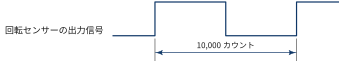
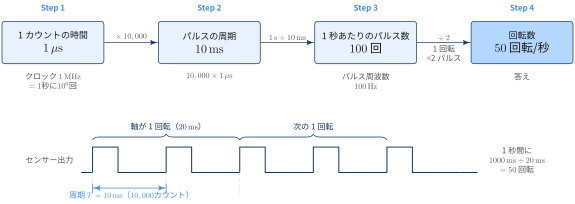
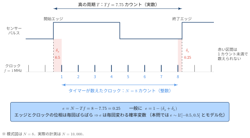

## 基本問題

::: {#exr- .custom_problem .blog-custom-border}
### 令和7年秋期 問10

モーターの軸に装着された回転センサーから出力されるパルスの周期を，1 MHz のクロック周波数でカウントアップするタイマーで計測したところ，10,000 カウントであった．モーターの回転数は毎秒何回転か．

ここで，回転センサーはモーターの軸が 1 回転するごとに図のようなパルスを 2 回出力するものとする．

{width="100%"}


:::

::: {.callout-note collapse="true" icon=false}
## Solution

{width="100%"}

[Step 1：1カウントは何秒か]{.mini-section}

1 MHz のクロック周波数でカウントアップするタイマーなので，１カウントにかかる時間は

$$
1 \div 1,000,000 = 1\si{\micro\second} 
$$

[Step 2: パルスの周期を時間に直す]{.mini-section}

パルス1周期の長さが 10,000 カウントだったので，

$$
10,000 × 1 \si{\micro\second}  = 10,000 \si{\micro\second}  = 10 \si{\milli\second}
$$

[Step 3: 1秒間のパルス数を求める]{.mini-section}

$$
1\si{\second} \div  10 \si{\milli\second} = 100 \text{回}
$$

[Step 4: 回転数に直す]{.mini-section}

センサーは軸が 1回転するごとにパルスを2回 出します．したがって，

$$
100\text{回} \div 2 = 50\text{回転}
$$

つまり，$50\text{rps}$．回転数を毎分で表したい場合は，$50\,\text{rps} \times 60 = 3000\,\text{rpm}$ となります

なお，上記を整理すると

$$
\text{rps} = \frac{\text{クロック周波数}}{\text{カウント数}\times\text{1回転あたりのパルス数}}
$$

となります．


:::

## 応用問題

::: {#exr- .custom_problem .blog-custom-border}
### rpmからの逆算

回転数 3,000 rpm のモーターに，1 回転で 4 パルスを出す回転センサーが付いている．パルス周期を 2 MHz のタイマーで計測すると，何カウントになるか．

:::

::: {.callout-note collapse="true" icon=false}
## Solution

$3000\text{rpm} = 50\text{rps}$ であることから


$$
50 \text{rps} = \frac{2,000,000}{\text{カウント数} \times 4}
$$

したがって，カウント数は $10,000$ カウント．

:::


::: {#exr- .custom_problem .blog-custom-border}
### タイマーの限界

1 回転で 2 パルスを出す回転センサーを1 MHzのタイマーで計測するとする．タイマーが 16 ビット（最大 65,535 カウント）の場合，オーバーフローせずに計測できる最低の回転数は毎秒約何回転か．

:::

::: {.callout-note collapse="true" icon=false}
## Solution

$$
\text{観測可能 rps} = \frac{1,000,000}{2 \times 2^{16}} \approx \frac{2^{20}}{2^{17}} = 8
$$

のオーダーであると言える．実際に計算すると，$7.62939453125$

:::

## 応用問題（統計・データサイエンス）
::: {#exr- .custom_problem .blog-custom-border}
### 誤差の伝搬

- モーターの軸に回転センサーが付いており，軸が 1 回転するごとにパルスを $k = 2$ 回出力する．
- このパルスの周期（立ち上がりから次の立ち上がりまでの時間）を，クロック周波数 $f = 1$ MHz でカウントアップするタイマーで計測する．1 カウントは $1,\mu$s に相当する．
- ある時点で計測したカウント値は $N = 10{,}000$ であった．
- タイマーは 1 カウント単位でしか時間を測れないため，カウント値には量子化誤差が含まれる．真の周期を $T$ とすると $N = T f + e$ と表せ，誤差 $e$ は区間 $[-0.5,\ 0.5]$ 上の一様分布に従うものとする．
- 回転数（毎秒）は $\text{rps} = \dfrac{f}{kN}$ で計算する．

[Questions]{.mini-section}

1. 量子化誤差 $e$ の標準偏差 $\mathrm{SD}(e)$ を求めよ．
2. デルタ法（1 次のテイラー近似）を用いて，回転数 $r$ の標準誤差を求めよ．有効数字 2 桁で答えること．
3. 回転数の相対誤差 $\mathrm{SD}(r)/r$ は何 % か．また，同じタイマーとセンサーで計測したカウント値が $N = 100$ だった場合（高速回転），相対誤差は何 % になるか．

:::

::: {.callout-note collapse="true" icon=false}
## Solution

[Q1: 量子化誤差 $e$ の標準偏差 $\mathrm{SD}(e)$ を求めよ．]{.mini-section}

確率変数 $X\sim\operatorname{U}[a,b]$ とするとき

$$
\operatorname{SD}(X) = \frac{b-a}{\sqrt{12}}
$$

したがって，

$$
\mathrm{SD}(e) = \frac{1}{\sqrt{12}} \approx 0.289 \text{カウント}
$$

[Q2: デルタ法を用いて，回転数 $\text{rps}$ の標準誤差を求めよ．]{.mini-section}

$\text{rps} = \dfrac{f}{kN} = g(N)$ であり，量子化誤差発生より $N$ は確率変数とみなせます．問題の仮定より

$$
N = Tf + e
$$

$\mu \equiv Tf$ と表記したとき，デルタ法より

$$
\operatorname{Var}(X) = \operatorname{Var}(g(N)) \approx g^\prime(\mu)^2\operatorname{Var}(N)
$$

つまり，

$$
\operatorname{SD}(\text{rps})\approx |g^\prime(\mu)|\operatorname{SD}(e)
$$

$g^\prime(\mu) \approx \frac{f}{kN^2} = \frac{\text{rps}}{N}$ であることから

$$
\operatorname{SD}(\text{rps})\approx \frac{\operatorname{SD}(e)}{N}
$$

したがって，

$$
\operatorname{SD}(\text{rps})\approx \frac{50}{10,000}\frac{1}{\sqrt{12}} \approx 0.0014\text{rps}
$$

[Q3: 相対誤差の導出]{.mini-section}

$$
\frac{\operatorname{SD}(\text{rps})}{\text{rps}} \approx \frac{0.289}{10,000} \approx 0.0029 \,\%
$$

また，$N = 100$ という高回転モーターの場合は

$$
\frac{0.289}{100} \approx 0.29 \,\%
$$

周期計測は，カウント数が多い（低速）ほど相対精度が高く，高速になるほど悪くなることがわかります．

:::

::: {#exr- .custom_problem .blog-custom-border}
### 打ち切りの扱い

- 工場のモーター 1,000 台について，回転数を 1 回ずつ計測した．
- 各モーターの軸には，1 回転するごとにパルスを 2 回出力する回転センサーが付いている．回転数は，このパルスの周期（立ち上がりから次の立ち上がりまでの時間）をタイマーで計測して求める．
- タイマーは 1 MHz のクロックでカウントアップし（1 カウント $= 1\,\mu$s），16 ビットのため最大 65,535 カウントまでしか数えられない．パルス周期がこれを超えるとオーバーフローとなり，カウント値は得られず「OVF」フラグだけが記録される．
- 計測結果は，カウント値が得られた 800 台と，OVF の 200 台（2 割）であった．
- 担当者は OVF の 200 台を「欠損」として除外し，残り 800 台の平均回転数を報告しようとしている．

[Questions]{.mini-section}

1. OVF が記録されたモーターについて，回転数に関して何が分かるか．「回転数は毎秒約○回転未満」の形で答えよ．
2. 800 台だけで平均を取ると，全 1,000 台の平均回転数に対してどちら向きに偏るか．理由とともに答えよ．
3. OVF のデータを捨てずに分析するには，どのような統計手法を使えばよいか．
4. 計測側（ハードウェア・ファームウェア）でできる対策を 2 つ挙げよ．

:::

::: {.callout-note collapse="true" icon=false}
## Solution

[Q1]{.mini-section}

$$
\text{観測可能 rps 下限} = \frac{1,000,000}{65535 \times 2} \approx 7.63
$$


したがって， OVF が記録されたモーターについて，回転数は毎 7.63 rps未満

[Q2]{.mini-section}

00 台だけで平均を取ると，全 1,000 台の平均回転数に対してrps 過大評価になる

[Q3]{.mini-section}

何かしらの分布を仮定して，そのパラメーターを推定する形で行くならばcensored MLEとして

$$
\text{likelihood} = \Pi_{i\in \text{not OVF}}f_D(\text{rps}_i) \times F_D(c)^{200}
$$

- $c$: $\text{観測可能 rps 下限}$ 
- $f_D$: 仮定した密度関数
- $F_D$: 仮定した累積分布関数

[Q4]{.mini-section}

OVF の原因は「パルス周期 > タイマーの最大計測時間（$65535 \times 1\,\mu\text{s} \approx 65.5\,\text{ms}$）」なので，最大計測時間を延ばすか，パルス周期を短くすれば対策になります．

| 対策 | 仕組み | OVF になる回転数（現状 7.63 rps 未満） | トレードオフ |
|---|---|---|---|
| オーバーフロー回数をカウントしてタイマーを拡張 | タイマーがあふれるたびに割り込みで上位カウンタを +1 し，実質 32 ビット以上のタイマーとして扱う | 約 0.0001 rps 未満（32 ビット相当） | 分解能は 1 µs のまま．ファームウェアが複雑になり，割り込みとキャプチャが同時に起きたときの処理に注意が必要 |
| プリスケーラでクロックを分周 | タイマーのクロックを 1 MHz → 125 kHz（÷8）などに下げ，1 カウントあたりの時間を延ばす | 約 0.95 rps 未満（÷8 の場合） | 1 カウント = 8 µs と粗くなり，量子化誤差による相対誤差が 8 倍に悪化する |
| 1 回転あたりのパルス数を増やす | パルス数の多いセンサーに替える（$k = 2 \to 8$ など）と，パルス周期が $2/k$ 倍に縮む | 約 1.9 rps 未満（$k = 8$ の場合） | センサー交換のコストがかかる．高速回転ではカウント値 $N$ が小さくなり相対誤差が悪化する |
| オートレンジ（分周比の自動切替） | OVF したら分周比を上げて計測し直し，使った分周比をカウント値と一緒に記録する | 分周比の上限次第 | 計測に時間がかかる．分周比の記録が漏れると回転数を誤って換算する |

設問の「2 つ」としては，分解能を落とさずに済む **オーバーフロー回数のカウント（タイマー拡張）** と，設定変更だけで済む **プリスケーラによる分周** が代表的です．

:::


## Appendix: 量子化誤差発生の仕組み

{width="100%"}

[タイマーは「刻みの本数」しか数えられない]{.mini-section}

タイマーは，パルスの開始エッジから終了エッジまでの間に入ったクロックの立ち上がり（刻み）の本数 $N$ を数えます．
一方で，センサーのパルスはクロックとは無関係なタイミングで立ち上がるので，エッジが刻みと刻みの間に来ることがほとんどです．

上図の例では，

- 開始エッジから最初の刻みまでの端数：$\delta_s = 0.5$ カウント
- 最後の刻みから終了エッジまでの端数：$\delta_e = 0.25$ カウント
- 真の周期：$Tf = 7.75$ カウント（実数）
- タイマーが数えた刻みの本数：$N = 8$ カウント（整数）

となっています．赤い区間（端数）は 1 カウント未満なので，タイマーには見えません．

[誤差 $e$ の式]{.mini-section}

数えた $N$ 本の刻みの間には $N-1$ 個の間隔があり，真の周期はその両端に端数を足したものです．

$$
Tf = \delta_s + (N - 1) + \delta_e
$$

したがって量子化誤差は

$$
e = N - Tf = 1 - (\delta_s + \delta_e)
$$

となり，上図では $e = 8 - 7.75 = 0.25$ です．
つまり誤差の大きさは端数 $\delta_s,\ \delta_e$ だけで決まり，周期の長さ（$N = 8$ でも $N = 10{,}000$ でも）にはよりません．

[なぜ確率変数として扱うのか]{.mini-section}

パルスのエッジとクロックの位相関係は計測のたびにばらばらなので，$\delta_s,\ \delta_e$ も，したがって $e$ も毎回変わります．
そこで，本問では $e$ を確率変数とみなして $e \sim \operatorname{U}[-0.5,\ 0.5]$ と簡易的にモデル化しています．

誤差の絶対的な大きさが $N$ によらずほぼ一定であることから，相対誤差 $e / N$ は $N$ が小さいほど（高速回転・低クロック周波数ほど）大きくなります．


## 📘 用語集

:::{.glossary-container}

```yaml
glossary:
  - def: 量子化誤差 (Quantization Error)
    description: |
      連続的な量（時間・電圧など）を，離散的な最小単位（タイマーの 1 カウント，ADC の 1 LSB など）に丸めて表すときに生じる誤差．真の値と，丸めた結果の値との差として定義される．タイマー計測では 1 カウント未満の時間を区別できないため，カウント値 N は真の値 T × f から最大で約 ±0.5 カウントずれる．誤差の大きさはカウント値によらずほぼ一定なので，カウント値が小さいほど（高速回転・低クロック周波数ほど）相対誤差は大きくなる．

  - def: 分解能 (Resolution)
    description: |
      計測器が区別できる最小の変化量．タイマーによる周期計測では 1 カウントに相当する時間 1/f が時間の分解能で，1 MHz クロックなら 1 µs，プリスケーラで ÷8 に分周すると 8 µs になる．回転数に換算した分解能は 1 カウントの違いによる rps の差（およそ rps/N）なので，カウント値 N が小さい高速回転ほど粗くなる．分解能は「どこまで細かく読めるか」を表す量であり，「真の値にどれだけ近いか」を表す精度（確度）とは別の概念である．
```

:::
