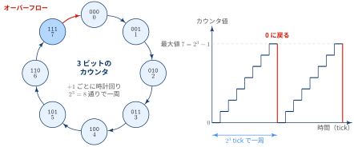

## 数のスケールは時間をもちいて説明する

百万・億・兆といった大きな数は，字面だけではどれも「とても大きい」としか感じられず，桁の違いが実感しにくいです．
そこで，数を **時間** に置き換えて考えると，その差がはっきり見えてきます．

::: {.callout-note}
### RULE

- 数を「１秒に１ずつ数えたら，どれくらいの時間がかかるか」に置き換える
- 目安として **１日 ≒ 10万秒**（86,400秒），**１年 ≒ 3,000万秒**（31,536,000秒）を覚えておく
- 桁が１つ増えると，かかる時間も10倍になる

:::

::: {#exm- .custom_problem }
### 百万，千万，億，兆

１秒に１ずつ数えたとき，および１ミリ秒に１ずつ数えたとき（1,000倍速）にかかる時間は次のとおりです．

| 数 | 値 | １秒に１ずつ | １ミリ秒に１ずつ |
|---|---:|---|---|
| 百万 | $10^6$ | 約11.6日 | 約17分 |
| 千万 | $10^7$ | 約116日（約４ヶ月） | 約2.8時間 |
| 億 | $10^8$ | 約3.2年 | 約1.2日 |
| 兆 | $10^{12}$ | 約31,700年 | 約32年 |
: {tbl-colwidths="[16,20,32,32]"}

百万は「２週間弱」，億はオリンピック周期くらいの時間ですが，兆になると旧石器時代までさかのぼる長さになります．
億と兆の間には「万倍」の差があることが，時間に置き換えるとよくわかります．

２を基底とした場合も，$2^{10} = 1{,}024 \approx 10^3$ なので，指数が10増えるごとに約1,000倍になります．

| 数 | 値 | 10進での目安 | １秒に１ずつ | １ミリ秒に１ずつ |
|---|---:|---|---|---|
| $2^{10}$ | 1,024 | 約千 | 約17分 | 約1秒 |
| $2^{20}$ | 1,048,576 | 約百万 | 約12.1日 | 約17分 |
| $2^{30}$ | 1,073,741,824 | 約十億 | 約34年 | 約12.4日 |
| $2^{32}$ | 4,294,967,296 | 約43億 | 約136年 | 約49.7日 |
| $2^{40}$ | 1,099,511,627,776 | 約一兆 | 約34,900年 | 約35年 |
| $2^{64}$ | 18,446,744,073,709,551,616 | 約1,800京 | 約5,850億年 | 約5.8億年 |

１秒に１ずつカウントアップする手法を 64 bit マシーンで採用すると，仮に符号で 1 bitを使用したとしても，約2900億年カウントできることになります．
宇宙の年齢が約138億年と考えると，宇宙の年齢の21倍の長さの時間を管理できることになるので，2038年問題のような出来事の心配はいらないことがわかります．

:::
***

::: {#exm- .custom_problem }
### 時給１万円と百万，千万，億，兆

時給１万円（秒給 $10{,}000 \div 3{,}600 \approx 2.78$ 円）で働いたとき，その金額を稼ぐのにかかる時間を考えます．

| 金額 | 必要な労働時間 | 休まず働き続けた場合 | 年2,000時間働いた場合 |
|---|---:|---|---|
| 百万円 | 100時間 | 約4.2日 | 約0.05年（約２週間半） |
| 千万円 | 1,000時間 | 約42日 | 約0.5年 |
| 一億円 | １万時間 | 約1.1年 | ５年 |
| 一兆円 | １億時間 | 約11,400年 | ５万年 |

時給１万円は高給ですが，それでも１億円を稼ぐには５年分の労働が必要です．
１兆円となると，１日も休まず働いても１万年以上かかり，個人の労働で到達できる規模ではないことがわかります．

:::
***

## カウントアップとオーバーフロー

コンピュータでは，経過時間をカウンタ（整数）で数えることがよくあります．
整数は決まったビット数で表されるため，数えられる上限があります．

::: {#def- .custom_problem .blog-custom-border}
### オーバーフロー: 表示可能な範囲を超えた数値を表現するときに起こる現象

$n$ ビットの符号なし整数が表せる値は $0$ から $2^n - 1$ までの $2^n$ 通り．
最大値 $2^n - 1$ に $1$ を足すと，結果は $2^n$ にならずに $0$ へ戻る．これをオーバーフローという．

- $n$ ビットのカウンタは，$2^n$ 回カウントアップするたびに $0$ へ戻る
- 符号付き整数（2の補数）では，最大値 $2^{n-1} - 1$ に $1$ を足すと最小値 $-2^{n-1}$ になる

:::

{width="100%" fig-align="center"}

::: {#exm- .custom_problem }
### 1ミリ秒ごとにカウントアップするカウンタ

1ミリ秒ごとに $1$ 増えるカウンタが，オーバーフローするまでの時間は次のとおりです．

| ビット数 | 符号なし（$2^n$ ミリ秒） | 符号付き（$2^{n-1}$ ミリ秒） |
|---|---|---|
| 32ビット | $2^{32} \approx 43$ 億ミリ秒 ≒ **約49.7日** | $2^{31} \approx 21$ 億ミリ秒 ≒ 約24.9日 |
| 64ビット | $2^{64} \approx 1.8 \times 10^{19}$ ミリ秒 ≒ **約5.8億年** | $2^{63} \approx 9.2 \times 10^{18}$ ミリ秒 ≒ 約2.9億年 |

32ビットのカウンタは２ヶ月もたずに一周します．
一方，64ビットにするとビット数は２倍ですが，表せる数は $2^{32}$ 倍（約43億倍）になり，カンブリア爆発（約5.4億年前）から今日まで数え続けても一周しません．

:::
***

::: {.callout-note}
### 実際に起きたオーバーフロー

- Windows 95/98 は，起動からの経過ミリ秒を32ビット符号なし整数で数えていたため，連続稼働 **約49.7日** でハングアップする不具合があった
- 1970年1月1日からの経過秒を32ビット符号付き整数で表すシステムは，2038年1月19日にオーバーフローする（2038年問題）．$2^{31}$ 秒 ≒ 約68年

:::

::: {#exm- .custom_problem }
### 16 bit 符号付き加算とオーバーフロー

負数を２の補数で表す16ビット符号付き整数の範囲は $[-2^{15},\ 2^{15}-1] = [-32768,\ 32767]$ です．
この範囲の $x_1, x_2$ について $x_1 + x_2$ を計算するとき，すべての組み合わせでオーバーフローしないわけではありません．

- 同符号ならオーバーフローしうる：$32767 + 1$ は `0111 1111 1111 1111` $+$ `0000 0000 0000 0001` $=$ `1000 0000 0000 0000` となり，$-32768$ と解釈される

一方，**$x_1$ と $x_2$ の符号が異なる場合は，打ち消し合うのでオーバーフローしない** ことを示します．

::: {.callout-note collapse="false" icon=false}
## Proof

対称性より $x_1 \geq 0$，$x_2 < 0$ としてよい（$0$ は非負側に含める）．
すなわち

$$
0 \leq x_1 \leq 2^{15} - 1, \qquad -2^{15} \leq x_2 \leq -1
$$

**上限側**：$x_2 \leq -1$ より

$$
x_1 + x_2 \leq x_1 - 1 \leq 2^{15} - 2 < 2^{15} - 1
$$

**下限側**：$x_1 \geq 0$ より

$$
x_1 + x_2 \geq x_2 \geq -2^{15}
$$

したがって

$$
-2^{15} \leq x_2 \leq x_1 + x_2 < x_1 \leq 2^{15} - 1
$$

となり，$x_1 + x_2$ は16ビット符号付き整数の範囲 $[-2^{15},\ 2^{15}-1]$ に収まる．
つまり和は $x_1$ と $x_2$ の間にあり，どちらの値も範囲内なので，和も範囲を超えない．$\blacksquare$

:::

:::
***

## Appendix: 時間と秒数

:::: {.no-border-top-table}

| 期間 | 秒（seconds） | 分（minutes） | 時間（hours） |
|---|---:|---:|---:|
| １時間 | 3,600 | 60 | 1 |
| １日 | 86,400 | 1,440 | 24 |
| １週間 | 604,800 | 10,080 | 168 |
| １ヶ月（30日） | 2,592,000 | 43,200 | 720 |
| １年（365日） | 31,536,000 | 525,600 | 8,760 |
: {tbl-colwidths="[25,25,25,25]"}

::::
