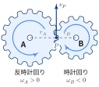
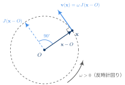
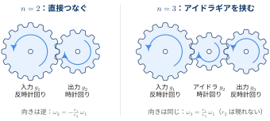
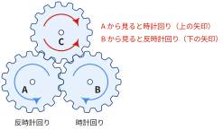
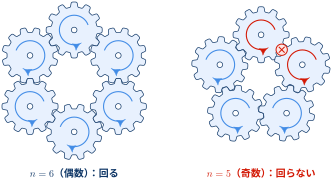
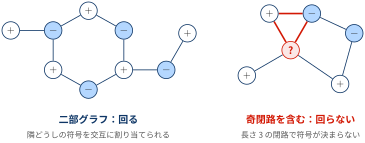

::: {.callout-note}
## TL;DRs

- この記事では，平面上で，固定された軸のまわりに回る 外歯車（平歯車）どうしの噛み合いを扱う
- 歯車は，噛み合うたびに回転方向が反転する


:::

## 歯車の回転方向は偶奇で決まる


::: {.callout-note}
### 歯車の回転方向は偶奇で決まる

- 歯車を3つ，互いに噛み合うように三角形に並べると，どれも回らなくなります．
- 同じように，歯車をぐるりと輪に並べるとき，枚数が奇数だと回らず，偶数だと回ります．

:::


どちらも「噛み合うたびに回転方向が反転する」という1つの性質から説明でき，
最終的には「**歯車の配置をグラフと見たとき，奇数長の閉路をもたないか（二部グラフか）**」で回るかどうかが決まります．
つまり，回転方向の符号を一周たどったときの偶奇（パリティ）の問題です．

[記法]{.mini-section}

| 記号 | 意味 |
|---|---|
| $g$ | 歯車 |
| $\omega_g$ | 歯車 $g$ の角速度．**反時計回りを正** とする |
| $r_g$ | 歯車 $g$ のピッチ円半径．$r_g > 0$ |
| $z_g$ | 歯車 $g$ の歯数 |
| $u_g := r_g\,\omega_g$ | 歯車 $g$ の（符号付き）周速度 |

「歯車 $g$ が回る」とは $\omega_g \neq 0$ のことを指します．
$r_g > 0$ なので，$\omega_g$ と $u_g$ の符号は常に一致し，$\omega_g = 0 \Leftrightarrow u_g = 0$ です．

## 噛み合った歯車は反対方向に回る

2つの歯車 A, B が噛み合っている接点 $P$ に注目します．
A の歯が接点で上向きに動くと，その歯に押される B の歯も上向きに動きます．
接点 $P$ は A から見ると右端，B から見ると左端にあるので，

- A の右端が上に動く $\Rightarrow$ A は **反時計回り**
- B の左端が上に動く $\Rightarrow$ B は **時計回り**

となり，回転方向は逆になります．

{width="55%" fig-align="center"}

::: {#thm- .custom_problem .blog-custom-border}
### 噛み合いの符号則

外歯車 A, B が滑らずに噛み合うとき，

$$
\omega_B = -\frac{r_A}{r_B}\,\omega_A = -\frac{z_A}{z_B}\,\omega_A
$$

が成り立つ．特に，回転している（$\omega_A \neq 0$）ならば $\operatorname{sgn}\omega_B = -\operatorname{sgn}\omega_A$，すなわち A と B は反対方向に回る．

:::

::: {.callout-note collapse="false" icon=false}
## Proof

A の中心を原点 $O_A = (0, 0)$，B の中心を $O_B = (d, 0)$ に置く．
外歯車どうしが噛み合うとき，2つのピッチ円は外接するので $d = r_A + r_B$ であり，接点は $P = (r_A, 0)$ である．

中心 $O$ のまわりを角速度 $\omega$ で回る剛体上の点 $\mathbf{x} = (x, y)$ は円運動をするので，その速度は中心からの位置ベクトル $\mathbf{x} - O$ に直交し，大きさは $|\omega|\,\|\mathbf{x} - O\|$ である．
反時計回りを正としているので，$\omega > 0$ のとき速度は $\mathbf{x} - O$ を反時計回りに $90^\circ$ 回した向きを向く．
$90^\circ$ 回転行列

$$
J = \begin{pmatrix} 0 & -1 \\ 1 & 0 \end{pmatrix}
$$

を用いると，これは

$$
\mathbf{v}(\mathbf{x}) = \omega\, J\,(\mathbf{x} - O) = \omega\,\bigl(-(y - O_y),\ x - O_x\bigr)
$$

と書ける．

{width="60%" fig-align="center"}

これを接点 $P$ に当てはめると，

$$
\begin{align*}
\text{A 上の点としての速度:}\quad \mathbf{v}_A(P) &= \omega_A\,(0,\ r_A)\\
\text{B 上の点としての速度:}\quad \mathbf{v}_B(P) &= \omega_B\,(0,\ r_A - d) = \omega_B\,(0,\ -r_B)
\end{align*}
$$

滑らずに噛み合うことは，接点で両者の速度が一致すること $\mathbf{v}_A(P) = \mathbf{v}_B(P)$ を意味するので，

$$
r_A\,\omega_A = -\,r_B\,\omega_B
$$

を得る．2つ目の等号は，噛み合う歯車どうしは歯の大きさ（モジュール $m$）が等しく，ピッチ円半径が $r = m z / 2$ と歯数に比例することから従う．$\blacksquare$

:::

速度比の大きさ $r_A / r_B$ は歯数比で決まり，**符号は大きさに関係なく常に $-1$** です．この「符号は常に反転する」という性質が，以降の議論のすべてです．

周速度 $u_g = r_g\,\omega_g$ を使うと，噛み合いの条件は

$$
u_A + u_B = 0
$$

と，半径を含まない形に書けます．噛み合う歯車どうしは周速度の大きさが等しく，符号が逆ということです．以降はこちらの形を主に使います．

::: {#exm- .custom_problem }
### 直列につないだ歯車とアイドラギア

歯車 $g_1, g_2, \ldots, g_n$ を一列に並べ，隣どうしだけを噛み合わせると，噛み合いの条件 $u_i + u_{i+1} = 0$ を順に適用して

$$
u_n = (-1)^{n-1} u_1
\quad\Longleftrightarrow\quad
\omega_n = (-1)^{n-1}\,\frac{r_1}{r_n}\,\omega_1
$$

となります．途中の歯車の半径は約分されて消えるので，**最後の歯車の速さは最初と最後の半径だけで決まり，向きは枚数の偶奇だけで決まります**．

入力軸と出力軸の間に1枚だけ歯車を挟む（$n = 3$）と，速度比を変えずに回転方向だけを揃えられます．この役目の歯車をアイドラギア（遊び歯車）と呼びます．

{width="100%" fig-align="center"}

:::
***

## 3つが互いに噛み合うと回らない

歯車 A, B, C を，どの2つも噛み合うように三角形に配置します．

- A が反時計回りなら，A と噛み合う B は時計回り
- B が時計回りなら，B と噛み合う C は反時計回り
- しかし C は A とも直接噛み合っているので，A から見ると C は時計回りでなければならない

C の回転方向が2通りに決まってしまい，矛盾します．実物では歯車列がロックして動かず，無理に回すと歯が破損します．

{width="65%" fig-align="center"}

::: {#thm- .custom_problem .blog-custom-border}
### 3つの歯車の三角配置

外歯車 A, B, C のどの2つも滑らずに噛み合っているならば，$\omega_A = \omega_B = \omega_C = 0$ である．

:::

::: {.callout-note collapse="false" icon=false}
## Proof

3組の噛み合いに噛み合いの条件を適用すると，

$$
u_A + u_B = 0, \qquad u_B + u_C = 0, \qquad u_C + u_A = 0
$$

1つ目と2つ目から $u_C = -u_B = u_A$．これを3つ目に代入すると $2u_A = 0$，よって $u_A = 0$，続いて $u_B = u_C = 0$．
$r_g > 0$ より $\omega_A = \omega_B = \omega_C = 0$ である．

行列で書けば，この連立方程式の係数行列は

$$
M_3 = \begin{pmatrix} 1 & 1 & 0 \\ 0 & 1 & 1 \\ 1 & 0 & 1 \end{pmatrix}, \qquad \det M_3 = 2 \neq 0
$$

なので，解は自明解 $u = 0$ しかない，と言うこともできる．$\blacksquare$

:::


## 輪をなす歯車は偶数個でないと回らない

三角配置の議論は，$n$ 枚の輪に広げてもそのまま使えます．
輪に沿って隣へ進むたびに回転方向が反転するので，$n$ 枚進んで最初の歯車に戻ったとき，回転方向は $n$ 回反転しています．

- $n$ が偶数：元の向きに戻る．矛盾しない
- $n$ が奇数：元の向きと逆になる．矛盾する

{width="90%" fig-align="center"}

歯車 $g_0, g_1, \ldots, g_{n-1}$（$n \geq 3$）を輪に並べ，$g_i$ と $g_{i+1}$ が噛み合っているとします（添字は $\bmod n$ で考え，$g_{n-1}$ と $g_0$ も噛み合う）．

::: {#thm- .custom_problem .blog-custom-border}
### 輪の偶奇

$n$ 枚の外歯車が輪をなして噛み合っているとき，

- $n$ が奇数ならば，すべての歯車について $\omega_{g_i} = 0$（回らない）
- $n$ が偶数ならば回ることができ，その回り方は $u_i = (-1)^i\,u_0$（$u_0 \in \mathbb{R}$ は任意）に限られる

すなわち，輪が回るための必要十分条件は $n$ が偶数であることである．

:::

::: {.callout-note collapse="false" icon=false}
## Proof

噛み合いの条件は

$$
u_i + u_{i+1} = 0 \qquad (i = 0, 1, \ldots, n-1,\ \ u_n := u_0)
$$

である．$i = 0, \ldots, n-2$ の式から順に $u_i = (-1)^i u_0$ が決まる．残る $g_{n-1}$ と $g_0$ の噛み合い条件に代入すると

$$
u_{n-1} + u_0 = \bigl((-1)^{n-1} + 1\bigr)\,u_0 = 0
$$

$n$ が奇数なら $(-1)^{n-1} = 1$ なので $2u_0 = 0$，よって全歯車が止まる．
$n$ が偶数なら $(-1)^{n-1} + 1 = 0$ で，この式は $u_0$ によらず常に成り立つ．$\blacksquare$

:::

角速度で書けば，三角配置と同様に

$$
\omega_0 = (-1)^n\,\frac{r_0}{r_1}\cdot\frac{r_1}{r_2}\cdots\frac{r_{n-1}}{r_0}\,\omega_0 = (-1)^n\,\omega_0
$$

となり，半径の比は打ち消し合って $(-1)^n$ だけが残ります．$n = 3$ のときが三角配置です．

[線形代数による見方]{.mini-section}

$u = (u_0, \ldots, u_{n-1})^\top$ とおくと，噛み合いの条件は $M_n u = 0$，ただし

$$
M_n = I + P, \qquad
P = \begin{pmatrix}
0 & 1 & & \\
 & 0 & \ddots & \\
 & & \ddots & 1 \\
1 & & & 0
\end{pmatrix}
$$

と書けます．$P$ は成分を1つずらす巡回置換行列です．
$P$ の固有値は1の $n$ 乗根 $\zeta^k$（$\zeta = e^{2\pi i/n}$, $k = 0, \ldots, n-1$）で，固有ベクトルは $(1, \zeta^k, \zeta^{2k}, \ldots, \zeta^{(n-1)k})^\top$ です．
したがって $M_n$ の固有値は $1 + \zeta^k$ です．

- $1 + \zeta^k = 0 \iff \zeta^k = -1$ です．これを満たす $k$ が存在するのは $n$ が偶数で $k = n/2$ のときに限られます
- このとき固有ベクトルは $(1, -1, 1, -1, \ldots)^\top$ で，証明で求めた $u_i = (-1)^i u_0$ に一致します

行列式でも確認できます．$x^n - 1 = \prod_{k=0}^{n-1}(x - \zeta^k)$ に $x = -1$ を代入すると $(-1)^n - 1 = (-1)^n \prod_k (1 + \zeta^k)$ なので，

$$
\det M_n = \prod_{k=0}^{n-1} (1 + \zeta^k) = 1 - (-1)^n =
\begin{cases}
2 & (n \text{ が奇数}) \\
0 & (n \text{ が偶数})
\end{cases}
$$

です．$n = 3$ では三角配置で計算した $\det M_3 = 2$ に一致します．

## 歯車の配置をグラフとして見る

三角配置と輪は，より一般の配置に対する1つの定理の特殊例になっています．

::: {#def- .custom_problem .blog-custom-border}
### 歯車グラフ

歯車を頂点，噛み合っている歯車の組を辺とするグラフ $G = (V, E)$ を **歯車グラフ** と呼ぶ．
歯車列の回転状態 $u : V \to \mathbb{R}$ が満たすべき条件は

$$
u_v + u_w = 0 \qquad \text{for all } \{v, w\} \in E
$$

である．

:::

三角配置は長さ3の閉路 $C_3$，輪は長さ $n$ の閉路 $C_n$ にあたります．

::: {#thm-bipartite .custom_problem .blog-custom-border}
### 回る歯車列の特徴づけ

歯車グラフ $G$ が連結であるとき，次の3つは同値である．

1. 歯車列が回る（噛み合いの条件が $u \neq 0$ の解をもつ）
2. $G$ は二部グラフである（頂点を2組に分け，すべての辺が異なる組どうしを結ぶようにできる）
3. $G$ は奇数長の閉路をもたない

:::

::: {.callout-note collapse="false" icon=false}
## Proof

**(1 ⇒ 2)** $u \neq 0$ を解とする．噛み合いの条件より隣り合う頂点の $|u|$ は等しいので，$G$ が連結であることから，すべての頂点で $|u_v| = c$ が成り立つ．
$u \neq 0$ なので $c > 0$ である．
よって各頂点は $u_v = +c$ の組 $V_+$ と $u_v = -c$ の組 $V_-$ のどちらかに属し，各辺は $V_+$ と $V_-$ を結ぶ．

**(2 ⇒ 1)** 二部グラフの分割 $V = V_1 \sqcup V_2$ に対し，$V_1$ の頂点に $u_v = 1$，$V_2$ の頂点に $u_v = -1$ を割り当てれば噛み合いの条件を満たす．

**(2 ⇒ 3)** 閉路をたどると $V_1$ と $V_2$ を交互に行き来する．出発点に戻るには偶数回の移動が必要なので，閉路の長さは偶数である．

**(3 ⇒ 2)** 頂点 $v_0$ を1つ固定し，各頂点 $v$ までの最短距離を $d(v)$ とする．$d(v)$ が偶数の頂点を $V_1$，奇数の頂点を $V_2$ とする．
仮に同じ組の2頂点 $v, w$ を結ぶ辺があったとする．$v_0$ から $v$ への最短路，辺 $\{v, w\}$，$w$ から $v_0$ への最短路をつなぐと，長さ $d(v) + d(w) + 1$ の閉じた道ができる．$d(v) \equiv d(w) \pmod 2$ なのでこの長さは奇数である．
奇数長の閉じた道は必ず奇数長の閉路を含むので，仮定 3 に矛盾する．$\blacksquare$

:::

2 ⇔ 3 はグラフ理論で König の定理として知られる，二部グラフの古典的な特徴づけです．

{width="90%" fig-align="center"}

[自由度の数]{.mini-section}

$G$ が連結でない場合は，連結成分ごとに独立に @thm-bipartite を適用できます．
二部グラフである成分は回転方向と速さを1つの値 $u_{v_0}$ で自由に選べ（自由度1），奇閉路を含む成分は止まります（自由度0）．したがって，噛み合いの条件の解空間 $\mathcal{U}$ について

$$
\dim \mathcal{U} = \#\{\text{二部グラフである連結成分}\}
$$

が成り立ちます．これは，符号なし接続行列 $B$ を用いた signless Laplacian $Q = BB^\top = D + A$（$D$：次数行列，$A$：隣接行列）の零固有値の重複度が二部連結成分の数に等しい，という既知の結果と同じ内容です．
実際，$u^\top Q u = \sum_{\{v,w\} \in E} (u_v + u_w)^2$ なので，$Qu = 0$ と噛み合いの条件は同値です．

[パリティとして見る]{.mini-section}

回転方向を $\operatorname{sgn} u_v = (-1)^{s_v}$，$s_v \in \mathbb{Z}/2\mathbb{Z}$ と書くと，噛み合いの条件の符号部分は

$$
s_v + s_w \equiv 1 \pmod 2 \qquad \text{for all } \{v, w\} \in E
$$

という $\mathbb{Z}/2\mathbb{Z}$ 上の連立一次方程式になります．
長さ $\ell$ の閉路に沿ってこの式を足し合わせると，左辺では各頂点が2回ずつ現れるので $0$，右辺は $\ell$ です．
よって解が存在するには，すべての閉路で $\ell \equiv 0 \pmod 2$ でなければなりません．
「一周して戻ってきたときに向きが反転しているかどうか」が，閉路の長さのパリティそのものだということです．

::: {.callout-note}
### 位相幾何の言葉で言うと

辺ごとに「向きを反転する（$=1$）」という値を割り当てた $\mathbb{Z}/2\mathbb{Z}$ 値の1-コチェイン $c$ を考えます．
上の方程式は $c = \delta s$（$s$ の余境界）となる $s$ を探す問題です．
グラフ上では，これは「すべての閉路上で $c$ の和が $0$」，すなわち $c$ が $H^1(G;\mathbb{Z}/2\mathbb{Z})$ で消えることと同値です．
回る歯車列とは，一周したときの符号のずれ（ホロノミー）がどの閉路でも自明になっている配置，と言い換えられます．

:::


## 📘 用語集

:::{.glossary-container}

```yaml
glossary:
  - def: ピッチ円 (Pitch Circle)
    description: |
      噛み合う2つの歯車が滑らずに転がり合うとみなせる仮想的な円．歯車の速度比はピッチ円半径の比で決まり，外歯車どうしが噛み合うとき2つのピッチ円は外接する．

  - def: モジュール (Module)
    description: |
      歯の大きさを表す値で，ピッチ円直径を歯数で割ったもの（m = 2r / z）．噛み合う歯車どうしはモジュールが等しいため，ピッチ円半径は歯数に比例し，速度比は歯数比で表せる．

  - def: アイドラギア (Idler Gear)
    description: |
      入力側と出力側の歯車の間に挟み，速度比を変えずに回転方向だけを変えるための歯車．遊び歯車ともいう．途中の歯車の半径は速度比の式で約分されて消えるため，速度比には影響しない．

  - def: 二部グラフ (Bipartite Graph)
    description: |
      頂点集合を2つの組に分け，すべての辺が異なる組の頂点どうしを結ぶようにできるグラフ．奇数長の閉路をもたないことと同値であり，歯車グラフが二部グラフであることは歯車列が回るための必要十分条件になる．

  - def: 奇閉路 (Odd Cycle)
    description: |
      長さ（辺の数）が奇数の閉路．歯車グラフが奇閉路を含むと，閉路を一周したときに回転方向の符号が反転して矛盾するため，その連結成分の歯車はすべて止まる．

  - def: 内歯車 (Internal Gear)
    description: |
      円環の内側に歯を切った歯車．リングギアともいう．内側で噛み合う外歯車とは同じ方向に回るため，外歯車どうしの噛み合いとは符号則が逆になる．
```

:::
