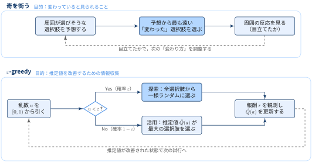
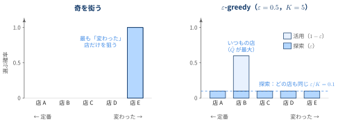
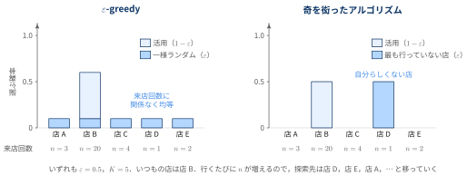

::: {.callout-note}
## TL:DRs

- 「奇を衒う」の目的は「変わっていると見られること」で，変わった選択肢を意図的に選ぶ．
- epsilon-greedy の探索の目的は，推定値を改善するための情報収集で，選択肢を一様ランダムに選ぶ．
- 違いは **動機**（見栄か情報収集か）と **選び方**（変わったものを狙うか一様ランダムか）の二つ．
- ただし「自分らしくない手（これまで最も出していない手）」を狙う奇を衒ったアルゴリズムは，結果的に試行回数の少ない手を優先する探索になり，じゃんけんでは ε-greedy と同等以上に戦える．このとき違いは動機だけになり，行動からは区別できない．

:::

## epsilon-greedy と 奇を衒う の違い

::: {#def- .custom_problem .blog-custom-border}
### 奇を衒う

- 「奇を衒う」は，人目を引くためにわざと変わったことをする
- 目的は「変わっていると見られること」

:::


「奇を衒う」の目的は「変わっていると見られること」です．
一方 epsilon-greedy は，確率 $1-\varepsilon$ で現時点の最良の選択肢を選び，確率 $\varepsilon$ でランダムに選びます．
ランダムに選ぶ目的は，まだよく知らない選択肢の情報を集めることで，目立つことではありません．

日本語で喩えるなら，epsilon-greedy は「基本はいつもの店に行くが，たまにサイコロを振って知らない店に入ってみる」が近いです．
サイコロの目は店の珍しさとは無関係なので，入ってみた店が結果的に平凡な店であることも普通にあります．

両者を行動アルゴリズムとして並べると次のようになります．

{width="100%" fig-align="center"}


### 選び方の違いを選択確率で見る

選択肢が $K$ 個あり，現時点の推定値を $\hat{Q}(a)$ とすると，epsilon-greedy が選択肢 $a$ を選ぶ確率は

$$
P(a) = (1-\varepsilon)\,\mathbf{1}\!\left[a = \operatorname*{arg\,max}_{a'} \hat{Q}(a')\right] + \frac{\varepsilon}{K}
$$

です．探索部分の $\varepsilon/K$ は，選択肢が定番か変わっているかに依存しません．
これに対して奇を衒う行動は，「変わっている度合い」が最も大きい選択肢に確率を集中させます．

{width="100%" fig-align="center"}

## 奇を衒ったアルゴリズム

epsilon-greedy を「改良」して，確率 $\varepsilon$ のときにランダムに選ぶのではなく，**自分がこれまで最も選んでいない選択肢**を選ぶようにしてみます．

$$
a_t =
\begin{cases}
\displaystyle \operatorname*{arg\,max}_a \hat{Q}(a) & \text{確率 } 1-\varepsilon \\[6pt]
\displaystyle \operatorname*{arg\,min}_a n(a) & \text{確率 } \varepsilon
\end{cases}
$$

$n(a)$ は，自分がこれまで選択肢 $a$ を選んだ回数です．

「奇を衒う」は，人目を引くためにわざと変わったことをすることでした．
自分をいつも見ている人（じゃんけんなら対戦相手）にとって，「変わったこと」とは **自分らしくない行動**，つまりこれまでほとんど選んでこなかった選択肢です．
確率 $\varepsilon$ の部分にこの行動を入れたアルゴリズムなので，これを奇を衒ったアルゴリズムと呼ぶことにします．

### 結果的に探索と同じ行動になる

{width="100%" fig-align="center"}

自分らしくない選択肢を選ぶと，その選択肢の $n(a)$ が増えるので，次に「自分らしくない」のは別の選択肢になります．
そのため探索先はすべての選択肢を順に回り，次のことが起きます．

- どの選択肢も試され続けるので，epsilon-greedy と同じく $\hat{Q}$ は真の値に近づいていく
- 試行回数が少ない選択肢ほど優先して試されるので，一様ランダムよりも偏りなく情報が集まる．これは試行回数が少ない選択肢に加点する UCB と同じ発想
- 最も試していない選択肢は，推定値が最も不確かな選択肢でもある．目立つために選んだ「自分らしくない選択肢」が，情報収集の観点で最も価値のある選択肢と一致する

つまり奇を衒ったアルゴリズムは，動機（見栄）が違っても，行動としては情報収集のための探索とほとんど区別がつかなくなります．

## じゃんけんアルゴリズムバトル

奇を衒ったアルゴリズムが探索としてどれくらい働くのかを，じゃんけんで確かめます．
自分の3つの手（グー・チョキ・パー）を腕とみなし，利得は勝ち $+1$，あいこ $0$，負け $-1$ とします．
戦わせるのは次の4つです．

| アルゴリズム | 手の決め方 | 学習に使う情報 |
|---|---|---|
| ε-greedy | 確率 $1-\varepsilon$ で $\hat{Q}(a)$ 最大の手，確率 $\varepsilon$ で一様ランダム | 自分が出した手の利得 |
| 奇を衒った | 確率 $1-\varepsilon$ で $\hat{Q}(a)$ 最大の手，確率 $\varepsilon$ で自分がこれまで最も出していない手 | 自分が出した手の利得 |
| Thompson | 手ごとの勝ち・あいこ・負けの回数から $\mathrm{Dirichlet}$ 事後分布を作り，引いた確率で期待利得が最大の手 | 自分が出した手の利得 |
| Hedge | $\pi(a) \propto \exp(\eta \cdot \texttt{score}[a])$ で確率的に出す | 相手の手（全手の「出していたら」の利得） |

: 対戦させるアルゴリズム {tbl-colwidths="[15,60,25]"}

- $\varepsilon = 0.1$，$\eta = 0.1$，$\hat{Q}(a)$ は標本平均で初期値は $0$
- Hedge だけは相手の手を見て，出さなかった手の利得も使って更新する（じゃんけんでは相手の手が見えるので，これは反則ではない）
- 1試合 $T = 1000$ 回のじゃんけんを，乱数を変えて $1000$ 試合くり返す

```{python}
#| code-fold: true
#| code-summary: "シミュレーションのコード"
import numpy as np
import matplotlib.pyplot as plt
from IPython.display import Markdown

plt.rcParams["font.family"] = "Noto Sans CJK JP"

T, R = 1000, 1000  # 1試合の回数，試合数
G, C, P = 0, 1, 2  # グー，チョキ，パー（a は (a+1)%3 に勝つ）
PAYOFF = np.array([0, 1, -1])  # (h - a) % 3 -> a から見た利得


def payoff(a, h):
    return PAYOFF[(h - a) % 3]


class EpsGreedy:
    """kiwo=False なら ε-greedy，kiwo=True なら奇を衒ったアルゴリズム"""

    def __init__(self, eps=0.1, kiwo=False):
        self.eps, self.kiwo = eps, kiwo

    def reset(self, rng):
        self.rng = rng
        self.Q = np.zeros((R, 3))
        self.n = np.zeros((R, 3))  # 自分がその手を出した回数

    def act(self):
        # 同点は乱数でくずす
        greedy = np.argmax(self.Q + 1e-9 * self.rng.random((R, 3)), axis=1)
        explore = self.rng.random(R) < self.eps
        if self.kiwo:
            # 自分がこれまで最も出していない手（自分らしくない手）
            alt = np.argmin(self.n + 1e-9 * self.rng.random((R, 3)), axis=1)
        else:
            alt = self.rng.integers(3, size=R)
        self.explore = explore  # 探索した回かどうか（対戦3の集計用）
        return np.where(explore, alt, greedy)

    def update(self, a, h):
        r = np.arange(R)
        self.n[r, a] += 1
        self.Q[r, a] += (payoff(a, h) - self.Q[r, a]) / self.n[r, a]


class Thompson:
    def reset(self, rng):
        self.rng = rng
        self.cnt = np.ones((R, 3, 3))  # [試合, 自分の手, 勝ち/あいこ/負け]

    def act(self):
        g = self.rng.gamma(self.cnt)
        p = g / g.sum(axis=2, keepdims=True)
        return np.argmax(p[:, :, 0] - p[:, :, 2], axis=1)

    def update(self, a, h):
        outcome = np.array([1, 0, 2])[(h - a) % 3]  # あいこ→1, 勝ち→0, 負け→2
        self.cnt[np.arange(R), a, outcome] += 1


class Hedge:
    def __init__(self, eta=0.1):
        self.eta = eta

    def reset(self, rng):
        self.rng = rng
        self.S = np.zeros((R, 3))  # score[a]：毎回 a を出していたときの累積利得

    def act(self):
        w = np.exp(self.eta * (self.S - self.S.max(axis=1, keepdims=True)))
        cdf = np.cumsum(w / w.sum(axis=1, keepdims=True), axis=1)
        return (self.rng.random((R, 1)) > cdf).sum(axis=1).clip(max=2)

    def update(self, a, h):
        self.S += payoff(np.arange(3)[None, :], h[:, None])


class Fixed:
    def __init__(self, p):
        self.p = np.asarray(p, dtype=float)

    def reset(self, rng):
        self.rng = rng

    def act(self):
        return self.rng.choice(3, size=R, p=self.p)

    def update(self, a, h):
        pass


def play(A, B, seed):
    """R 試合を並列に行い，A から見た利得と両者の手を返す"""
    rng = np.random.default_rng(seed)
    A.reset(rng)
    B.reset(rng)
    u = np.zeros((R, T))
    ha = np.zeros((R, T), dtype=int)
    hb = np.zeros((R, T), dtype=int)
    for t in range(T):
        a, b = A.act(), B.act()
        u[:, t] = payoff(a, b)
        ha[:, t], hb[:, t] = a, b
        A.update(a, b)
        B.update(b, a)
    return u, ha, hb


algos = {
    "ε-greedy": lambda: EpsGreedy(0.1),
    "奇を衒った": lambda: EpsGreedy(0.1, kiwo=True),
    "Thompson": lambda: Thompson(),
    "Hedge": lambda: Hedge(0.1),
}
names = list(algos)
colors = {"ε-greedy": "#0E3666", "奇を衒った": "#D31804",
          "Thompson": "#428CE6", "Hedge": "#575757"}
```

[対戦1：グー:チョキ:パー = 5:3:2 で出す相手]{.mini-section}

[前回](../2020-10-16-rock-paper-scissors-2/index.qmd)と同じ，グー:チョキ:パー = 5:3:2 の確率で出す相手と戦います．
各手の期待利得はグー $+0.1$，チョキ $-0.3$，パー $+0.2$ なので，パーを出し続けるのが最善（1回あたり $+0.2$）です．

```{python}
#| label: fig-vs-532
#| fig-cap: "5:3:2 の相手との対戦．全試合の平均利得を50回の移動平均で表示．破線はパーを出し続けたときの +0.2"
results_532 = {}
for i, k in enumerate(names):
    results_532[k] = play(algos[k](), Fixed([0.5, 0.3, 0.2]), seed=100 + i)

fig, ax = plt.subplots(figsize=(8, 4))
w = 50
for k, (u, ha, hb) in results_532.items():
    ma = np.convolve(u.mean(axis=0), np.ones(w) / w, mode="valid")
    ax.plot(np.arange(w, T + 1), ma, label=k, color=colors[k], lw=1.6)
ax.axhline(0.2, color="#575757", ls="--", lw=1)
ax.set_xlabel("じゃんけんの回数")
ax.set_ylabel("1回あたりの平均利得")
ax.legend(frameon=False, ncol=4, loc="center right", bbox_to_anchor=(1, 0.36))
ax.spines[["top", "right"]].set_visible(False)
plt.show()

rows = ["| アルゴリズム | 平均利得 | 最後の100回の平均利得 | 最後の100回でパーを出した割合 | パーを一度も出さなかった試合 | チョキを出した回数 |",
        "|---|---:|---:|---:|---:|---:|"]
for k, (u, ha, hb) in results_532.items():
    rows.append(f"| {k} | {u.mean():+.3f} | {u[:, -100:].mean():+.3f} | "
                f"{(ha[:, -100:] == P).mean():.1%} | {1 - (ha == P).any(axis=1).mean():.1%} | "
                f"{(ha == C).sum(axis=1).mean():.1f} |")
Markdown("\n".join(rows))
```

チョキを出した回数は1試合あたりの平均です．

- Hedge と Thompson はパーに収束し，最善の $+0.2$ に近づく
- ε-greedy と奇を衒ったアルゴリズムはほぼ同じ成績で，最後の100回にパーを出す割合はどちらも7割台
- どのアルゴリズムも，パーを一度も出さない試合はない

奇を衒ったアルゴリズムも，すべての手を試したうえでパーに落ち着いています．
ε-greedy との違いはチョキを出した回数で，奇を衒ったアルゴリズムのほうが多くなっています．
チョキはこの相手に対して最悪の手（$-0.3$）なので，貪欲部分がまず選ばず，$n(\text{チョキ})$ が最も小さくなります．
そのため「自分らしくない手」として探索でくり返し選ばれ，その分だけ平均利得が ε-greedy をわずかに下回ります．
相手が変わらない場面では，**自分らしくない手は，自分がこれまで避けてきた損な手でもある** ということです．

[対戦2：4つのアルゴリズムの総当たり]{.mini-section}

次に，4つのアルゴリズム同士を総当たりで戦わせます．相手も学習するので，最善の手は対戦中に変わります．

```{python}
#| label: fig-league
#| fig-cap: "総当たりの結果．行のアルゴリズムから見た1回あたりの平均利得（全試合の平均）．右端は行の合計"
M = np.zeros((4, 4))
hands = {}
for i in range(4):
    for j in range(i + 1, 4):
        u, ha, hb = play(algos[names[i]](), algos[names[j]](), seed=300 + 10 * i + j)
        M[i, j], M[j, i] = u.mean(), -u.mean()
        hands[(names[i], names[j])] = (ha, hb)

from matplotlib.colors import LinearSegmentedColormap

cmap = LinearSegmentedColormap.from_list("rb", ["#D31804", "#FFFFFF", "#428CE6"])
Mt = np.c_[M, M.sum(axis=1)]
fig, ax = plt.subplots(figsize=(8.5, 3.6))
ax.imshow(Mt, cmap=cmap, vmin=-0.45, vmax=0.45, aspect="auto")
for (r, c), v in np.ndenumerate(Mt):
    txt = "—" if (c < 4 and r == c) else f"{v:+.3f}"
    ax.text(c, r, txt, ha="center", va="center", fontsize=10,
            color="white" if abs(v) > 0.35 else "#1A1A1A",
            fontweight="bold" if c == 4 else "normal")
ax.set_xticks(range(5), [*names, "合計"])
ax.set_yticks(range(4), names)
ax.axvline(3.5, color="white", lw=4)
ax.tick_params(length=0)
for s in ax.spines.values():
    s.set_visible(False)
plt.show()
```

```{python}
#| code-fold: true
#| code-summary: "手の偏り（最後の200回で最も多く出した手の割合）"
hand_names = ["グー", "チョキ", "パー"]


def max_share(h):
    """試合ごとに，最後の200回で最も多く出した手の割合を求めて平均する"""
    share = np.stack([(h[:, -200:] == x).mean(axis=1) for x in range(3)], axis=1)
    return share.max(axis=1).mean()


rows = ["| アルゴリズム | 対 Thompson | 対 Hedge |", "|---|---:|---:|"]
for k in ["ε-greedy", "奇を衒った"]:
    rows.append(f"| {k} | {max_share(hands[(k, 'Thompson')][0]):.1%} | "
                f"{max_share(hands[(k, 'Hedge')][0]):.1%} |")
Markdown("\n".join(rows))
```

- 合計の順位は Hedge，Thompson，奇を衒ったアルゴリズム，ε-greedy の順
- 奇を衒ったアルゴリズムは ε-greedy に1回あたり約 $+0.06$ 勝ち越し，Thompson と Hedge ともほぼ五分
- ε-greedy は Thompson と Hedge に約 $-0.08$〜$-0.10$ 負け越す
- 最も多く出した手の割合は，ε-greedy が7割台なのに対し，奇を衒ったアルゴリズムは4〜5割で，手の偏りが小さい

ε-greedy は貪欲部分が同じ手を出し続けるので，手の分布が偏り，相手の手を数えている Hedge や自分の手ごとの成績を数えている Thompson に読まれます．
奇を衒ったアルゴリズムは，あまり出していない手を探索で出すので，それだけで手の偏りを打ち消す向きに働きます．
さらに，相手が学習して状況が変わる場面では，最も出していない手は推定 $\hat{Q}$ が最も古い手でもあります．
相手が自分の得意な手に対策してきたとき，その古い推定を真っ先に確かめ直すので，乗り換えが早くなると考えられます．

[対戦3：memory ハッキング野郎]{.mini-section}

[前回](../2020-10-16-rock-paper-scissors-2/index.qmd#sec-hack)の `hack.c` は，コンピュータと同じ `memory` を自分でも付け，次の手を予測してそれに勝つ手を出しました．
ここでの4つのアルゴリズムも，内部状態（$\hat{Q}$ と試行回数，勝ち・あいこ・負けの回数，$\texttt{score}$）は両者が出した手だけで決まるので，相手はそれを正確に複製できます．

そこで，次の相手を用意します．

- **memory は読めるが，サイコロの目は読めない**．相手の内部状態から，相手が次に各手を出す確率 $\pi_t(a)$ を計算する
- 期待利得 $\sum_a \pi_t(a)\, u(b, a)$ が最大の手 $b$ を出す
- 相手が探索する回がいつ来るかは分からない．毎回，$\pi_t$ に対して最善の手を1つ出すだけ

$\pi_t$ は，ε-greedy なら $\hat{Q}$ 最大の手に $1-\varepsilon$，各手に $\varepsilon/3$，奇を衒ったアルゴリズムなら $\hat{Q}$ 最大の手に $1-\varepsilon$，$n(a)$ 最小の手に $\varepsilon$ です．
Hedge は $\exp(\eta \cdot \texttt{score}[a])$ を正規化したもので，Thompson は事後分布から32回引いたときに各手が選ばれる割合で近似します．

```{python}
#| code-fold: true
#| code-summary: "memory ハッキング野郎のコード"
M_SAMPLES = 32  # Thompson の π を近似するサンプル数
U = payoff(np.arange(3)[:, None], np.arange(3)[None, :])  # U[b, a]：b を出して相手が a のときの利得


def policy(alg):
    """相手の memory（内部状態）から，次に各手を出す確率 π を計算する"""
    if isinstance(alg, EpsGreedy):
        is_max = alg.Q == alg.Q.max(axis=1, keepdims=True)
        pi = (1 - alg.eps) * is_max / is_max.sum(axis=1, keepdims=True)
        if alg.kiwo:
            is_min = alg.n == alg.n.min(axis=1, keepdims=True)
            pi += alg.eps * is_min / is_min.sum(axis=1, keepdims=True)
        else:
            pi += alg.eps / 3
        return pi
    if isinstance(alg, Thompson):
        g = alg.rng.gamma(np.broadcast_to(alg.cnt[:, None], (R, M_SAMPLES, 3, 3)))
        p = g / g.sum(axis=3, keepdims=True)
        best = np.argmax(p[..., 0] - p[..., 2], axis=2)
        return np.stack([(best == x).mean(axis=1) for x in range(3)], axis=1)
    if isinstance(alg, Hedge):
        w = np.exp(alg.eta * (alg.S - alg.S.max(axis=1, keepdims=True)))
        return w / w.sum(axis=1, keepdims=True)

class Hacker:
    def __init__(self, target):
        self.target = target

    def reset(self, rng):
        self.rng = rng

    def act(self):
        ev = policy(self.target) @ U.T  # 手 b ごとの期待利得
        return np.argmax(ev + 1e-9 * self.rng.random((R, 3)), axis=1)

    def update(self, a, h):
        pass


def play_hack(A, seed):
    """play と同じ手順で対戦し，A が探索した回・A の貪欲な手・両者の手も記録する"""
    rng = np.random.default_rng(seed)
    B = Hacker(A)
    A.reset(rng)
    B.reset(rng)
    u = np.zeros((R, T))
    explore = np.zeros((R, T), dtype=bool)
    greedy = np.full((R, T), -1)  # Q̂ 最大の手（同点の回は -1）
    ha = np.zeros((R, T), dtype=int)
    hb = np.zeros((R, T), dtype=int)
    for t in range(T):
        if isinstance(A, EpsGreedy):
            is_max = A.Q == A.Q.max(axis=1, keepdims=True)
            greedy[:, t] = np.where(is_max.sum(axis=1) == 1, np.argmax(A.Q, axis=1), -1)
        a, b = A.act(), B.act()
        u[:, t] = payoff(a, b)
        ha[:, t], hb[:, t] = a, b
        if isinstance(A, EpsGreedy):
            explore[:, t] = A.explore
        A.update(a, b)
        B.update(b, a)
    return u, explore, greedy, hb, ha


rows = ["| アルゴリズム | 平均利得 | 探索した回の平均利得 | 貪欲に選んだ回の平均利得 |",
        "|---|---:|---:|---:|"]
hack_results = {}
for i, k in enumerate(names):
    u, ex, g, hb, ha = play_hack(algos[k](), seed=1000 + i)
    hack_results[k] = (u, ex, g, hb, ha)
    if ex.any():
        rows.append(f"| {k} | {u.mean():+.3f} | {u[ex].mean():+.3f} | {u[~ex].mean():+.3f} |")
    else:
        rows.append(f"| {k} | {u.mean():+.3f} | — | — |")
Markdown("\n".join(rows))
```

- ε-greedy と奇を衒ったアルゴリズムは，1回あたり約 $-0.86$ と $-0.83$ で，どちらもほぼ一方的に負ける．$\hat{Q}$ 最大の手は memory から決まるので，貪欲に選んだ回はほぼ確実に読まれる
- 探索した回は，どちらもほぼ五分（約 $0$）
- Thompson と Hedge は約 $-0.03$ で，memory を読まれてもほとんど負けない

奇を衒ったアルゴリズムの探索先 $\operatorname*{arg\,min}_a n(a)$ は memory から正確に分かるので，ハッカーは探索した回の手も読めているはずです．
それでも探索した回が五分になるのは，探索の回がいつ来るか分からないからです．
ハッカーは $\pi_t$ に対して最善の手を出すので，確率 $1-\varepsilon$ の貪欲な手 $g$ に勝つ手を出します．

::: {.callout-note}
## 対戦のまとめ

- 「自分らしくない手」を選ぶ奇を衒ったアルゴリズムは，結果的に試行回数の少ない手を優先する探索になり，ε-greedy と同等以上の成績だった（5:3:2 の相手ではほぼ同じ，総当たりでは ε-greedy に勝ち越し，memory を読まれたときもほぼ同じ）
- **選び方**：一様ランダムとは違うが，「最も試していない手」は「最も推定が不確かな手」でもあるので，情報収集として理にかなった選び方と一致する．相手が変わらない場面では，避けてきた損な手を試し直す分だけわずかに損をする
- **動機**：見栄と情報収集の違いは，行動には表れない．同じ $\operatorname*{arg\,min}_a n(a)$ は，目立ちたい人にも，知らない手を試したい人にも同じに見える
- なお，$\varepsilon$ と $\eta$ は固定，$\hat{Q}$ は相手が変わらないことを前提にした標本平均なので，ε-greedy と奇を衒ったアルゴリズムは学習する相手に対してもともと不利な設定である

:::
