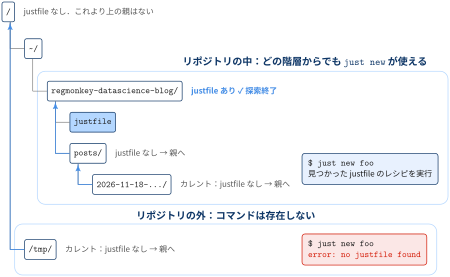
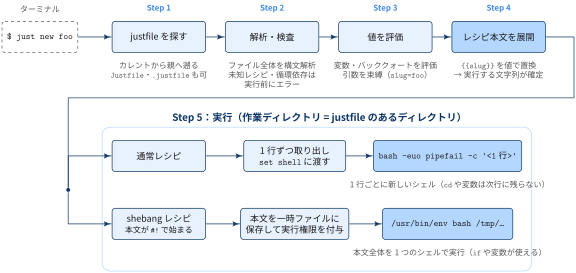
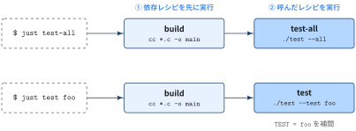
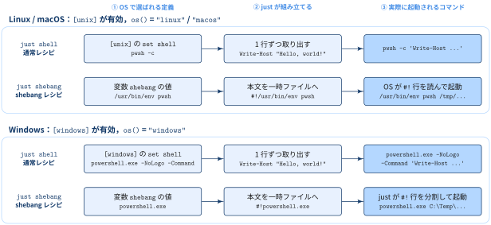

## justfile とは

::: {#def- .custom_problem .blog-custom-border}
### just / justfile

- **just** は，プロジェクト固有のコマンドを保存して実行するための**コマンドランナー**（[casey/just](https://github.com/casey/just)）
- Rust で実装されたシングルバイナリで，Linux / macOS / Windows で動く
- **justfile** は，just が読み込む設定ファイル．実行したいコマンドを**レシピ**（recipe）という名前付きの単位で書く

:::

[repository の内部でのみ有効なコマンド]{.mini-section}

`just` を実行すると，カレントディレクトリから**親ディレクトリへ遡って** `justfile` を探します．
そのため justfile をリポジトリのルートに置くと，

- リポジトリの中（どのサブディレクトリからでも）では `just new` のようなコマンドが使える
- リポジトリの外では `error: no justfile found` になり，コマンドは存在しない

という「そのリポジトリの中でだけ有効なコマンド」が手に入ります．

{width="90%" fig-align="center"}


```zsh
% cd ~/regmonkey-datascience-blog/posts
% just --list
Available recipes:
    help  recipe=""           # レシピのヘルプを表示
    new   slug="" date=today  # 新しい記事を作る

% cd /tmp
% just --list
error: no justfile found
```

[make との違い]{.mini-section}

レシピを名前で呼び出すという点では `make` と似ていますが，just は**ビルドシステムではなくコマンドランナー**であることを明言しています．

| 観点 | make | just |
|---|---|---|
| 本来の目的 | ファイルをビルドする（ビルドシステム） | コマンドを名前で呼び出す（コマンドランナー） |
| 再実行の判定 | ターゲットと依存ファイルのタイムスタンプを比較し，古いものだけ作り直す | 判定しない．呼ばれたら毎回実行する |
| ファイルを作らないタスク | `.PHONY` の宣言が必要 | 不要 |
| 引数 | `make train CONFIG=x.yaml` のように変数で渡す | `just train x.yaml` のように位置引数で渡せる |
| 一覧表示 | 標準機能なし | `just --list` |
| エラー検出 | 実行してみて初めて分かることが多い | 未知のレシピ・循環依存は**実行前**に検出 |
| 呼び出し場所 | Makefile のあるディレクトリ（`-C` で指定） | サブディレクトリからでも可（親へ遡って探す） |
: {tbl-colwidths="[20,40,40]"}


### 仕組み：justfile からコマンドが生成される流れ

just 自身はコマンドを実行しません．やっていることは，justfile を読んで**シェルに渡す文字列を組み立てる**ところまでで，実際の実行はシェル（bash など）に任せています．
justfile は「穴あきのコマンドの型」で，just はその穴を埋めてシェルに渡す係，と考えると分かりやすいです．

{width="100%" fig-align="center"}

次の小さな justfile をリポジトリのルートに置き，`posts/` の中で `just new foo` と打った場合を例に，5つのステップを追ってみます．

```just
today := `date +%F`

new slug:
    mkdir -p posts/{{today}}-{{slug}}
    echo "created {{slug}}"
```

| Step | just がやること | この例では |
|---|---|---|
| 1. 探す | 今いるディレクトリから親へ順に `justfile` を探す | `posts/` には無い → 1つ上のリポジトリのルートで見つかる |
| 2. チェック | justfile 全体を読み，書き間違いが無いか確かめる | `new` というレシピがあるのを確認．`just nwe foo` と打ち間違えると，何も実行せずにエラーになる |
| 3. 値を決める | 変数を計算し，コマンドラインの引数を受け取る | `today` ← `date +%F` の結果 `2026-11-26`，`slug` ← `foo` |
| 4. 穴を埋める | 本文中の `{{{ }}}` を Step 3 の値で置き換える | 下の「置き換え後」のテキストができる |
| 5. 実行 | できあがった文字列をシェルに渡す | リポジトリのルートで `mkdir` と `echo` が実行される |
: {tbl-colwidths="[15,40,45]"}

Step 4 の前後で，レシピ本文は次のように変わります．シェルが受け取るのは「置き換え後」だけで，シェルは `{{{ }}}` を一度も目にしません．

```bash
# 置き換え前（justfile に書いたもの）
mkdir -p posts/{{today}}-{{slug}}
echo "created {{slug}}"

# 置き換え後（シェルに渡されるもの）
mkdir -p posts/2026-11-26-foo
echo "created foo"
```

[Step 5 の注意点]{.mini-section}

`posts/` の中で打っても，コマンドは**justfile のあるディレクトリ（リポジトリのルート）で**実行されます．
そのため，レシピ内の `posts/...` のような相対パスは，どこから `just` を呼んでも同じ場所を指します．

もう1つの注意点は，レシピ本文の書き方によってシェルへの渡し方が変わることです．

| | 通常レシピ | shebang レシピ |
|---|---|---|
| 見分け方 | 本文がコマンドから始まる | 本文の1行目が `#!/usr/bin/env bash` のような `#!` 行 |
| シェルへの渡し方 | **1行ごとに**別々のシェルを起動して実行 | 本文全体をファイルに書き出し，**1つの**シェルでまとめて実行 |
| 前の行の `cd` や変数 | 次の行に引き継がれない | 引き継がれる |
| 向いている用途 | 1行で完結するコマンドを並べる | `if` や変数を使う複数行のスクリプト |
: {tbl-colwidths="[24,38,38]"}

違いは `cd` で確かめられます．

```just
line-by-line:
    cd posts
    pwd           # 別のシェルなので cd は効いておらず，ルートが表示される

script:
    #!/usr/bin/env bash
    cd posts
    pwd           # 同じシェルなので posts/ が表示される
```


### justfile の基本構文

```just
# 変数．バッククォートはシェルコマンドの出力を値にする
today := `date +%F`

# 引数なしの `just` では，ファイル内の最初のレシピが実行される
[doc("挨拶する")]
hello name="world":
    echo "Hello, {{name}}! today is {{today}}"

# レシピ名の後ろの `:` の右側は依存レシピ．先に実行される
greet-all: (hello "alice") (hello "bob")
```

| 要素 | 書き方 | 意味 |
|---|---|---|
| レシピ | `名前 引数...: 依存...` + インデントした本文 | 実行するコマンドのまとまり |
| 引数 | `name="world"` | デフォルト値付きの引数．`just hello ryo` で上書き |
| 変数 | `today := ...` | justfile 全体で使える値 |
| 補間 | `{{{name}}}` | 本文中の変数・引数を値に置き換える |
| 属性 | `[doc(...)]`，`[group(...)]`，`[private]`，`[confirm]` | レシピの説明・分類・非表示・実行前確認 |
| 設定 | `set shell := [...]`，`set dotenv-load` | 使うシェル，`.env` の読み込みなど |
: {tbl-colwidths="[20,40,40]"}

::: {#exm- .custom_problem }
[C プログラムのビルドとテストを just で呼び出す]{.def-title}

公式 README に載っている次の justfile で，上の表の要素がどう動くかを確かめます．
`main.c` をビルドし，テスト用スクリプト `./test` を実行するだけのプロジェクトです．

```just
alias b := build

host := `uname -a`

# build main
build:
    cc *.c -o main

# test everything
test-all: build
    ./test --all

# run a specific test
test TEST: build
    ./test --test {{TEST}}
```

| 行 | 要素 | 意味 |
|---|---|---|
| `alias b := build` | エイリアス | `just b` を `just build` の短縮形にする |
| `` host := `uname -a` `` | 変数（バッククォート） | `uname -a` の出力を値にする |
| `test-all: build` | 依存レシピ | `test-all` の前に `build` を実行する |
| `test TEST: build` | 引数 + 依存レシピ | 既定値なしの引数 `TEST` を必ず1つ受け取る |
: {tbl-colwidths="[30,25,45]"}

`test-all` も `test` も `build` に依存しているので，どちらを呼んでも先に `build` が実行されます．

{width="85%" fig-align="center"}

:::
***

::: {#exm- .custom_problem }
[`set shell` と `--evaluate`：OS ごとにシェルを切り替える]{.def-title}

```just
# Cross platform shebang:
shebang := if os() == 'windows' {
  'powershell.exe'
} else {
  '/usr/bin/env pwsh'
}

# Linux / macOS: PowerShell（pwsh）で通常レシピを実行
[unix]
set shell := ["pwsh", "-c"]

# Windows: Windows PowerShell で通常レシピを実行
[windows]
set shell := ["powershell.exe", "-NoLogo", "-Command"]

shell:
  Write-Host "Hello, world!"

shebang:
	#!{{shebang}}
	$PSV = $PSVersionTable.PSVersion | % {"$_" -split "\." }
	$psver = $PSV[0] + "." + $PSV[1]
	if ($PSV[2].Length -lt 4) {
		$psver += "." + $PSV[2] + " Core"
	} else {
		$psver += " Desktop"
	}
	echo "PowerShell $psver"
```

| 行 | 要素 | 意味 |
|---|---|---|
| `shebang := if os() == 'windows' {...} else {...}` | 変数（条件式） | `os()` は実行中の OS 名（`linux` / `macos` / `windows`）を返す組み込み関数．Windows なら `powershell.exe`，それ以外なら `/usr/bin/env pwsh` を値にする |
| `[unix]` + `set shell := ["pwsh", "-c"]` | 属性 + 設定 | Linux / macOS では，**通常レシピ**の各行を `pwsh -c '<1行>'` で実行する |
| `[windows]` + `set shell := [...]` | 属性 + 設定 | Windows では `powershell.exe -NoLogo -Command '<1行>'` で実行する |
| `shell:` | 通常レシピ | `set shell` のシェルで1行ずつ実行される |
| `shebang:` + `#!{{shebang}}` | shebang レシピ | `set shell` は効かない．1行目の `#!` 行（変数 `shebang` の値）がインタプリタになる |
: {tbl-colwidths="[38,17,45]"}

[`set` はレシピではなく just 自身の設定]{.mini-section}

`set` で始まる行は，レシピを実行するときの just の振る舞いを変える設定です．
`[unix]` / `[windows]` を付けると，その OS で実行したときだけ有効になります．
`set shell` が効くのは**通常レシピとバッククォート**だけで，shebang レシピは `#!` 行で指定したプログラムで実行されます．
そのためこの justfile では，通常レシピ用（`set shell`）と shebang レシピ用（変数 `shebang`）の2か所で OS ごとの切り替えをしています．

{width="100%" fig-align="center"}

- **通常レシピ**（`just shell`）：`[unix]` / `[windows]` のうち，実行中の OS に合う方の `set shell` だけが有効になる．各行はそのシェルに渡される
- **shebang レシピ**（`just shebang`）：属性ではなく，変数 `shebang` の `if os() == 'windows'` で値が切り替わる．その値が `#!{{shebang}}` に補間されるので，OS ごとに `#!` 行の中身が変わる
- shebang 行の扱いも OS で異なる．Linux / macOS では OS 自身が `#!` 行を読んでプログラムを起動する．`#!` を解釈しない Windows では，just が `#!` 行をコマンドと引数に分割し，一時ファイルのパスを最後の引数にして起動する

[`--evaluate`：変数がどの値になったかを見る]{.mini-section}

`if` の条件式がどちらに分岐したかは，`--evaluate` で確認できます．Linux で実行すると次のようになります．

```zsh
% just --evaluate
shebang := "/usr/bin/env pwsh"

# 変数名を指定すると値だけを表示する
% just --evaluate shebang
/usr/bin/env pwsh
```

Windows で同じコマンドを打つと `powershell.exe` が表示されるはずです．
なお `--evaluate` が表示するのは**変数**だけで，`set` の設定値は表示されません．


:::

***


::: {#exm- .custom_problem }
[`--dry-run`：シェルに渡すテキストを実行せずに確かめる]{.def-title}

同じ justfile で `--dry-run`（`-n`）を使うと，Step 4 までの結果，つまり補間を済ませて**シェルに渡す直前のテキスト**が表示されます．
実行はしないので，PowerShell が入っていない Linux マシンでも確認できます．

```zsh
% just --dry-run shell
Write-Host "Hello, world!"

% just --dry-run shebang
#!/usr/bin/env pwsh
$PSV = $PSVersionTable.PSVersion | % {"$_" -split "\." }
$psver = $PSV[0] + "." + $PSV[1]
if ($PSV[2].Length -lt 4) {
	$psver += "." + $PSV[2] + " Core"
} else {
	$psver += " Desktop"
}
echo "PowerShell $psver"
```

出力から次のことが読み取れます．

- `#!{{shebang}}` は `#!/usr/bin/env pwsh` に置き換わっている．Linux なので `else` 側の値が使われた
- `$PSV` や `{"$_" -split "\." }` はそのまま残っている．just が置き換えるのは `{{{ }}}` で囲んだ部分だけで，`$` や1重の `{ }` には触らない
- shebang レシピの本文は，justfile 上のインデント（タブ）が取り除かれた状態でファイルに書き出される

実際に実行すると，必要なプログラムが無いのでどちらも失敗します．
`--dry-run` で文字列が正しく組み立てられていることを確かめておけば，失敗の原因が justfile の書き方ではなく実行環境（PowerShell が入っていない）にあると切り分けられます．

```zsh
% just shell
Write-Host "Hello, world!"
error: recipe `shell` could not be run because just could not find the shell `pwsh`: No such file or directory (os error 2)

% just shebang
/usr/bin/env: ‘pwsh’: No such file or directory
error: recipe `shebang` failed with exit code 127
```

| | `--dry-run` | `--evaluate` |
|---|---|---|
| 表示するもの | レシピ本文の補間後のテキスト | 変数の値 |
| 対応する Step | Step 4（穴を埋める）まで | Step 3（値を決める）まで |
| バッククォート | **実行しない**（`` `date +%F` `` のまま表示） | 実行して結果を表示 |
: {tbl-colwidths="[24,38,38]"}

:::

## install

公式の [Installation](https://just.systems/man/en/packages.html) にパッケージマネージャごとの方法がまとまっています．代表的なものは次の3つです．

```bash
brew install just        # macOS
cargo install just       # Rust 環境があれば
sudo apt install just    # Debian 13 / Ubuntu 24.04 以降
```

| 方法 | 入るバージョン | 更新方法 | 備考 |
|---|---|---|---|
| `brew install just` | Homebrew の最新（リリースへの追従が早い） | `brew upgrade just` | macOS ではこれが手軽 |
| `cargo install just` | crates.io の最新リリース | `cargo install just` を再実行 | Rust ツールチェーンが必要．手元でビルドするので数分かかる |
| `sudo apt install just` | ディストリビューションが固定した版 | `sudo apt upgrade`（ただし版はほぼ上がらない） | Debian 13 / Ubuntu 24.04 以降でのみ提供 |
: {tbl-colwidths="[22,28,25,25]"}

インストール後は，バージョンとシェル補完を設定しておきます．

```zsh
% just --version
just 1.59.0
```

[cargo経由を採択した理由]{.mini-section}

自分の環境（Ubuntu 24.04 LTS）では apt から入る just が古く，このリポジトリの justfile が動きません．

```zsh
% apt-cache policy just
just:
  Installed: (none)
  Candidate: 1.21.0-1
```

また，次のような積極的な理由もあります

- `~/.cargo/bin` にユーザー権限で入るので，システムのパッケージと衝突しない = sudo が不要 
- 最新版にすぐ追従できる: `cargo install just` の再実行でOK


## このレポジトリでの活用方法

このブログのリポジトリでは，ルートに次の justfile を置いています．

```just
set shell := ["bash", "-euo", "pipefail", "-c"]

today := `date +%F`

[doc("レシピのヘルプを表示")]
help recipe="":
    #!/usr/bin/env bash
    # Usage: just help [recipe]
    #
    # recipe の docstring を表示します。省略時はレシピ一覧を表示します。
    set -euo pipefail
    if [[ -z "{{recipe}}" ]]; then
      "{{just_executable()}}" --justfile "{{justfile()}}" --list
      exit 0
    fi
    awk -v r="{{recipe}}" '
      !in_r && $0 ~ ("^@?" r "([ \t][^:]*)?:([^=]|$)") { in_r = 1; found = 1; next }
      in_r && /^[ \t]+#!/ { next }
      in_r && /^[ \t]+#/  { line = $0; sub(/^[ \t]+# ?/, "", line); print line; next }
      in_r { exit }
      END { exit !found }
    ' "{{justfile()}}" || { echo "error: unknown recipe: {{recipe}}" >&2; exit 1; }

[doc("新しい記事を作る")]
new slug="" date=today:
    #!/usr/bin/env bash
    # Usage: just new <slug> [YYYY-MM-DD]
    # ...（中略）...
    set -euo pipefail
    case "{{slug}}" in
      ""|-h|--help|help)
        exec "{{just_executable()}}" --justfile "{{justfile()}}" help new ;;
    esac
    if [[ ! "{{date}}" =~ ^[0-9]{4}-[0-9]{2}-[0-9]{2}$ ]]; then
      echo "error: date は YYYY-MM-DD 形式で指定してください: {{date}}" >&2
      exit 1
    fi
    dir="posts/{{date}}-{{slug}}"
    if [[ -e "$dir" ]]; then
      echo "error: $dir は既に存在します" >&2
      exit 1
    fi
    mkdir -p "$dir/figures"
    cat > "$dir/index.qmd" <<'EOF'
    ---
    title: ""
    author: "Ryo Nakagami"
    date: "{{date}}"
    date-modified: "{{today}}"
    ...
    ---
    EOF
    echo "$dir"
```

[`just new`：記事の雛形を作る]{.mini-section}

```zsh
% just new gnome-extensions 2026-11-22
posts/2026-11-22-gnome-extensions

# 作ったディレクトリにそのまま移動する
% cd "$(just new gnome-extensions)"
```

- `posts/<date>-<slug>/figures/` と frontmatter 入りの `index.qmd` を作る
- 日付を省略すると，変数 `today`（`` `date +%F` `` の結果）が使われる
- 日付の形式チェックと，既存ディレクトリの上書き防止をしている
- 最後に作成したパスだけを標準出力に出すので，`cd "$(just new ...)"` と組み合わせられる

[`just help`：レシピの使い方を表示する]{.mini-section}

```zsh
% just help new
Usage: just new <slug> [YYYY-MM-DD]

新しいブログ記事のディレクトリを作成します。
...
```

`just --list` は `[doc]` 属性の1行説明しか出さないので，レシピ本文の先頭コメントを awk で抜き出して詳しい使い方として表示しています．
`just new` を引数なしで呼んだ場合も，このヘルプにフォールバックします．

[この justfile で使っている just の機能]{.mini-section}

| 機能 | 使いどころ | 効果 |
|---|---|---|
| `set shell := ["bash", "-euo", "pipefail", "-c"]` | ファイル先頭 | 通常レシピを bash の厳格モードで実行する．エラー・未定義変数・パイプ途中の失敗で止まる |
| `` today := `date +%F` `` | 引数 `date` のデフォルト値，frontmatter | 実行日をバッククォートで取得 |
| shebang レシピ（`#!/usr/bin/env bash`） | `help`，`new` | `if` / `case` / ヒアドキュメントを含む複数行スクリプトを1つのシェルで実行 |
| `just_executable()`，`justfile()` | 自分自身の呼び出し | 実行中の just バイナリと justfile の絶対パス．`PATH` や作業場所に依存せずに `help` を呼び直せる |
| `[doc("...")]` | 各レシピ | `just --list` に出る説明文 |
: {tbl-colwidths="[30,25,45]"}


## Appendix: just の属性一覧 {#sec-just-attributes}

`[unix]` や `[doc(...)]` のような属性は，すべて just に組み込まれたものです．
ユーザーが独自の属性を定義することはできず，`[gpu]` のような未知の属性を書くと justfile 全体がエラーになります．

```zsh
% just train
error: unknown attribute `gpu`
 ——▶ justfile:1:2
  │
1 │ [gpu]
  │  ^^^
```

just 1.59.0 の README には約40種類の属性が載っています．主なものを用途別にまとめると次のとおりです．

| 種類 | 例 |
|---|---|
| OS ごとに有効・無効を切り替える | `[unix]` `[windows]` `[linux]` `[macos]` `[freebsd]` `[openbsd]` `[netbsd]` `[dragonfly]` `[android]` |
| 一覧表示や説明 | `[doc(...)]` `[group(...)]` `[private]` `[default]` |
| 実行のしかた | `[confirm]` `[no-cd]` `[working-directory(...)]` `[env(NAME, VALUE)]` `[parallel]` `[script(...)]` `[positional-arguments]` |
| 引数の制約 | `[arg(ARG, pattern=...)]` `[arg(ARG, long=...)]` など |
: {tbl-colwidths="[30,70]"}

全属性の一覧と，それぞれが追加されたバージョンは公式マニュアルの [Attributes](https://just.systems/man/en/attributes.html) にまとまっています．

[項目を有効・無効にできるのは OS の属性だけ]{.mini-section}

- 有効・無効を切り替える属性（conditional attribute）は OS 用のものだけで，「GPU があるときだけ有効」のような独自の条件は書けない
- 複数の OS を並べて `[linux, macos]` と書くと，どれか1つに当てはまれば有効になる
- just 1.56.0 以降は，レシピだけでなく `set` や変数などトップレベルの項目すべてに付けられる

独自の条件で分岐したいときは，属性ではなく式を使います．
`env()` で環境変数を読み，`if` 式で値を切り替えます．条件に合わないときは `error()` で止められます．

```just
device := env("DEVICE", "cpu")

train:
  echo "train on {{device}}"
```

```zsh
% just train
echo "train on cpu"
train on cpu

% DEVICE=gpu just train
echo "train on gpu"
train on gpu
```

## 📘 用語集

:::{.glossary-container}

```yaml
glossary:
  - def: タスクランナー (task runner)
    description: |
      テスト・lint・ビルド・デプロイ・データ処理など，プロジェクトで繰り返し行う作業（タスク）に
      名前を付けて登録し，その名前で呼び出せるようにするツール．
      just，make，npm scripts，Taskfile（go-task），poethepoet などがある．
      手順を README に文章で書く代わりに実行可能な形で残せるので，チーム内で作業手順が揃う．

  - def: コマンドランナー (command runner)
    description: |
      just が自らを位置づける呼び方．タスクランナーのうち，ファイルの更新状況を見ずに「登録したコマンドを呼ばれたら実行する」ことに専念するもの．

  - def: ビルドシステム (build system)
    description: |
      成果物（ターゲット）と入力ファイルの依存関係を管理し，入力が更新されたターゲットだけを作り直すツール．make，Bazel，DVC のパイプラインなど．

  - def: レシピ (recipe)
    description: |
      justfile に書く，名前付きのコマンドのまとまり．引数と依存レシピを持てる．make のターゲットに相当する．

  - def: shebang レシピ
    description: |
      本文が `#!` で始まるレシピ．本文全体が一時ファイルに書き出され，shebang で指定したインタプリタで1つのプロセスとして実行される．

  - def: バッククォート評価
    description: |
      `` x := `cmd` `` のように，シェルコマンドの標準出力を just の変数の値にする書き方．

  - def: 属性 (attribute)
    description: |
      `[doc("...")]` `[group("...")]` `[private]` `[confirm]` のように，レシピの直前に書いて説明文・分類・一覧からの非表示・実行前の確認などを指定する記法．

  - def: cargo / crates.io
    description: |
      cargo は Rust のビルドツール兼パッケージマネージャ．crates.io は Rust のパッケージレジストリで，`cargo install <name>` はそこから取得したソースをビルドして`~/.cargo/bin` に配置する．

  - def: dotenv (.env)
    description: |
      `KEY=VALUE` 形式で環境変数を書いたファイル．just では `set dotenv-load` でレシピの環境変数として読み込める．通常は git の管理対象から外す．
```

:::

References
----------
- [Just Programmer's Manual](https://just.systems/man/en/)（最新リリースに対応した公式マニュアル）
