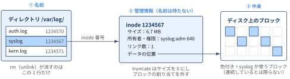
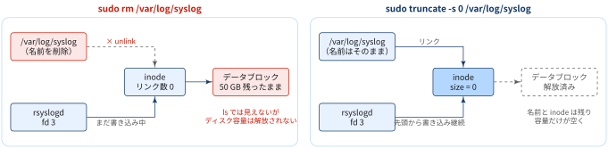
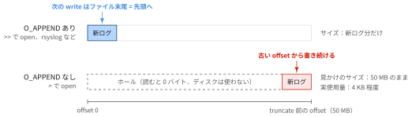
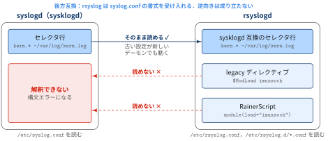
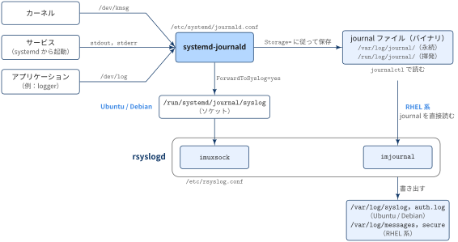

::: {.callout-note}
## TL;DRs

- `truncate` はファイルのサイズを指定値に変更するコマンド
- `truncate` コマンドを実行することで，ファイルそのもの（名前・inode・権限・所有者）は残したまま中身だけを捨てられる
- 肥大化した `/var/log/syslog` を空にするなら `sudo truncate -s 0 /var/log/syslog` を使う
- `rm` で消すと，ログを書いている `rsyslogd` がファイルを開いたままなので **ディスク容量が解放されない**．しかも以後のログは見えない削除済みファイルに書かれ続ける
- 空にするのは応急処置．ログを大量に出している原因の調査と `logrotate` の設定見直しをセットで行う

:::

## truncate commandとは

::: {#def-truncate .custom_problem .blog-custom-border}
### `truncate` コマンド

- **ファイルのサイズを指定した値に変更する** GNU coreutils のコマンド
- 指定サイズより大きいファイルは，はみ出した末尾のデータを捨てる
- 指定サイズより小さいファイルは伸ばし，伸ばした部分はホール（読むと 0 バイトが返る領域）とする
- ファイルの名前・inode・所有者・パーミッションは変えず，中身の長さだけを変える

:::

[syntax]{.mini-section}

```bash
truncate OPTION... FILE...
```

- `FILE` が存在しなければ新規作成されます（`-c` で抑止できます）．

[オプション]{.mini-section}

| オプション | 意味 |
|---|---|
| `-s, --size=SIZE` | サイズを `SIZE` バイトに設定（または `SIZE` だけ増減）する |
| `-r, --reference=RFILE` | `RFILE` と同じサイズにする |
| `-c, --no-create` | ファイルが無くても新規作成しない |
| `-o, --io-blocks` | `SIZE` をバイトではなく I/O ブロック数として解釈する |

: {tbl-colwidths="[35,65]"}

`-s` と `-r` のどちらかでサイズを指定します．基本形は `truncate -s 0 FILE` で，これでファイルを空にできます．

```bash
% printf 'hello world\n' > a.txt
% truncate -s 5 a.txt
% cat a.txt
hello
```

`-o` は `stat -c %o` で表示される I/O ブロックサイズ（ext4 なら通常 4096 バイト）を単位にします．`truncate -o -s 2 f` は 8192 バイトになります．

### SIZE の単位

`SIZE` は整数に単位を付けて書けます．`K` は 1024 倍，`KB` は 1000 倍という違いに注意してください．

| 書き方 | 倍率 | 例 |
|---|---|---|
| `K`, `M`, `G`, `T`, `P`, `E`, `Z`, `Y`, `R`, `Q` | 1024 のべき乗 | `10K` = 10,240 バイト |
| `KiB`, `MiB`, ... | 1024 のべき乗（`K` と同じ） | `10KiB` = 10,240 バイト |
| `KB`, `MB`, `GB`, ... | 1000 のべき乗 | `10KB` = 10,000 バイト |

: {tbl-colwidths="[40,30,30]"}

### SIZE の修飾子

`SIZE` の前に記号を付けると，絶対値ではなく現在のサイズからの相対指定になります．

| 修飾子 | 意味 | 例（実行前のサイズ → 実行後） |
|---|---|---|
| `+` | その分だけ伸ばす | `-s +24`：1000 → 1024 |
| `-` | その分だけ縮める | `-s -100`：1024 → 924 |
| `<` | 最大でもこのサイズ（超えていれば縮める） | `-s '<500'`：924 → 500 |
| `>` | 最小でもこのサイズ（足りなければ伸ばす） | `-s '>2000'`：500 → 2000 |
| `/` | この倍数に切り下げる | `-s /512`：2000 → 1536 |
| `%` | この倍数に切り上げる | `-s %1024`：1536 → 2048 |

: {tbl-colwidths="[15,40,45]"}

`<` と `>` はシェルのリダイレクト記号と衝突するので，必ずクォートで囲みます．

## syslog 削除でなぜ rm はだめなのか

::: {.custom_problem .blog-custom-border}
[状況：/var/log/syslog が肥大化してディスクが埋まる ]{.mini-section}

- アプリケーションの暴走やカーネルのエラーの連発などで，`/var/log/syslog` が数十 GB に膨らんでディスクを使い切ることがある
- ここで `sudo rm /var/log/syslog` を実行しても，これでは容量は空かない場合が多い


:::

### rm はファイルの「名前」を消すだけ

Linux のファイルは，**ディレクトリエントリ（名前）→ inode（ファイル本体の管理情報）→ データブロック（中身）** という構造になっています．

{width="100%" fig-align="center"}

`rm` が行うのは `unlink(2)`，つまりディレクトリエントリを消して inode のリンク数を 1 減らすことだけです．

カーネルがデータブロックを解放するのは，次の2つが両方とも満たされたときです．

1. リンク数（その inode を指す名前の数）が 0 になった
2. そのファイルを開いているプロセスが1つも無い

`/var/log/syslog` は `rsyslogd` が常時開いて書き込んでいるので，2 が満たされません．名前が消えて `ls` では見えなくなっても，inode とデータブロックは残り続けます．

{width="100%" fig-align="center"}

さらに悪いことに，`rsyslogd` は削除されたことに気付かずに開いたままの inode に書き込みを続けます．結果として，

- `df` で見ても空き容量が増えない
- `du -sh /var/log` の合計と `df` の使用量が合わなくなる
- 新しく出たログは，誰も `ls` で辿れない削除済みファイルに溜まっていく

という状態になります．

削除済みでも開かれているファイルの探し方と，`rm` してしまった後の対処は [Appendix](#find-deleted-open-files) にまとめました．

### truncate で中身だけを捨てる

- `truncate -s 0` は `truncate(2)` システムコールでファイルのサイズを 0 にする
- 名前も inode もそのままなので，`rsyslogd` が開いている fd は引き続き有効で，データブロックだけが即座に解放される

```bash
% sudo truncate -s 0 /var/log/syslog
% ls -l /var/log/syslog
-rw-r----- 1 syslog adm 0 Nov 20 15:00 /var/log/syslog
```

所有者 `syslog`，グループ `adm`，パーミッション `640` も変わらないので，`rm` してから作り直す場合のように権限を設定し直す必要もありません．

::: {.callout-note}
## `truncate` は応急処置に過ぎない

`truncate` は応急処置にすぎず，ログを大量に出している原因が残っていればすぐにまた埋まります．

1. **中身を確認する**：消す前に `sudo tail -n 1000 /var/log/syslog` や `sudo journalctl -p err -b` で，何が大量に出ているかを確認する．必要なら直近分だけ退避しておく（例：`sudo tail -n 100000 /var/log/syslog > ~/syslog.tail`）
2. **空にする**：`sudo truncate -s 0 /var/log/syslog`
3. **容量の回復を確認する**：`df -h /var/log`
4. **原因を止める**：ログを出しているサービスの設定やバグを直す
5. **ローテーションを見直す**：Ubuntu では `/etc/logrotate.d/rsyslog` で `weekly`・`rotate 4` が既定になっている．大量に出る環境では `size` や `maxsize` を設定して，サイズでもローテーションされるようにする

:::


### 書き込み側が O_APPEND で開いているかに注意

`truncate` が期待どおりに働くかは，**書き込み側のプロセスがファイルをどう開いているか**で変わります．

ファイルを開いているプロセスは，次に書き込む位置（ファイルオフセット）を fd ごとに覚えています．

- `O_APPEND` 付きで開いた場合（シェルの `>>` に相当）：書き込みのたびにオフセットがファイル末尾へ移動する．`truncate` 後は末尾 = 先頭なので，新しいログは先頭から書かれる
- `O_APPEND` 無しで開いた場合（シェルの `>` に相当）：オフセットは `truncate` 前の位置（例えば 50 MB 地点）のまま．そこに書き込むと，先頭から 50 MB 地点までがホールになる

{width="90%" fig-align="center"}

`O_APPEND` 無しの場合でも，ホールはディスクを消費しないので容量自体は空きます．


`rsyslog` はログファイルを `O_APPEND` 付きで開くので，`/var/log/syslog` では問題になりません．自作のアプリケーションのログなど，書き込み側の開き方が分からないファイルを `truncate` するときは，`/proc/<PID>/fdinfo/<FD>` の `flags` で確認できます．`flags` は8進数で，`02000` のビットが立っていれば `O_APPEND` です．

```bash
% grep flags /proc/<PID>/fdinfo/<FD>
flags:  0102001     # 02000 のビットあり → O_APPEND
flags:  0100001     # 02000 のビットなし
```

## Appendix

### 削除済みでも開かれているファイルを探す {#find-deleted-open-files}

`lsof +L1` でリンク数が 1 未満（つまり削除済み）でも開かれているファイルを一覧できます．

```bash
% sudo lsof -nP +L1
COMMAND    PID   USER  FD  TYPE DEVICE    SIZE/OFF NLINK    NODE NAME
rsyslogd  2219 syslog  7w   REG  259,2 53687091200     0 1234567 /var/log/syslog (deleted)
```

`NLINK` が 0 で，末尾に `(deleted)` が付いているのが目印です．`/proc/<PID>/fd/` 以下のシンボリックリンクからも確認できます．

もう `rm` してしまった場合は，次のどちらかで容量を取り戻せます．

```bash
# 方法1：rsyslogd を再起動してファイルを閉じさせる（新しい /var/log/syslog が作られる）
% sudo systemctl restart rsyslog

# 方法2：プロセスを止めずに，開いている fd 経由で中身を切り詰める
% sudo truncate -s 0 /proc/2219/fd/7
```

### システムログを収集するソフトウェア

カーネルや各デーモンが出すログを受け取り，ファイルなどに書き出すソフトウェアは複数あります．「syslog」は元祖のデーモンの名前であると同時に，ログメッセージの形式・転送のプロトコル（RFC 3164 / RFC 5424）の名前でもあり，rsyslog と syslog-ng はそのプロトコルを実装した後継です．

| | syslog（sysklogd） | rsyslog | syslog-ng | systemd journal |
|---|---|---|---|---|
| デーモン | `syslogd`（カーネルログは `klogd`） | `rsyslogd` | `syslog-ng` | `systemd-journald` |
| 登場 | 1980年代（BSD） | 2004年 | 1998年 | 2011年（systemd の一部） |
| 保存形式 | テキスト | テキスト（DB や Elasticsearch などにも出力可） | テキスト（DB などにも出力可） | 独自のバイナリ形式 |
| 主な保存先 | `/var/log/messages` など | `/var/log/syslog`（Debian/Ubuntu），`/var/log/messages`（RHEL 系） | 設定次第 | `/var/log/journal/`（永続）または `/run/log/journal/`（揮発） |
| 設定ファイル | `/etc/syslog.conf` | `/etc/rsyslog.conf`，`/etc/rsyslog.d/*.conf` | `/etc/syslog-ng/syslog-ng.conf` | `/etc/systemd/journald.conf` |
| 振り分け方 | `facility.severity` のセレクタで出力先を決める | syslog.conf 互換のセレクタ + RainerScript による条件分岐 | `source` → `filter` → `destination` を `log` 文でつなぐ | 振り分けずに1か所へ集め，読むときに絞り込む |
| ネットワーク転送 | UDP | UDP / TCP / TLS / RELP | UDP / TCP / TLS | `systemd-journal-remote` / `-upload`，または他の syslog デーモンへ転送 |
| ローテーション | 外部ツール（`logrotate`） | 外部ツール（`logrotate`） | 外部ツール（`logrotate`） | journald 自身が容量上限（`SystemMaxUse` など）に従って古いものを削除 |
| 現在の主な採用先 | ほぼ使われない | Ubuntu，RHEL 系の標準 | Gentoo などで任意に導入 | systemd を使うほぼすべてのディストリ．Fedora や Debian 12 以降は journald のみが既定 |

systemd を使うディストリでは journald が常に動いており，Ubuntu や RHEL 系ではさらに rsyslog が journald からログを受け取ってテキストファイルに書き出す，という二段構成になっています．`/var/log/syslog` が肥大化するのはこの rsyslog 側の出力です．

journald のみの環境には `/var/log/syslog` 自体が存在しません．journal の容量を減らしたいときは，ファイルを `truncate` するのではなく `journalctl` の機能を使います．

```bash
% journalctl --disk-usage               # journal の使用量を確認
% sudo journalctl --vacuum-size=500M    # 500 MB 以下になるまで古い journal を削除
% sudo journalctl --vacuum-time=2weeks  # 2週間より古い journal を削除
```

[rsyslog.conf と syslog.conf]{.mini-section}

`syslog.conf` は sysklogd の `syslogd` が読む設定ファイル，`rsyslog.conf` は `rsyslogd` が読む設定ファイルです．


:::: {.no-border-top-table}

| | `syslog.conf` | `rsyslog.conf` |
|---|---|---|
| 読むデーモン | `syslogd`（sysklogd） | `rsyslogd` |
| 場所 | `/etc/syslog.conf` の1ファイル | `/etc/rsyslog.conf` と，そこから読み込む `/etc/rsyslog.d/*.conf` |
| 書ける構文 | セレクタ行のみ（1行に「セレクタ + 出力先」） | セレクタ行，legacy ディレクティブ（`$` で始まる行），RainerScript の3種類 |
| ログの入力 | `/dev/log` とカーネルログを自動で読む（設定不要） | 入力モジュール（`imuxsock`，`imklog`，`imjournal`，`imudp` など）を明示的に読み込む |
| 絞り込み | `facility.severity` のみ | セレクタに加え，メッセージ本文やプログラム名による条件（`:msg, contains, "error"`，`if $programname == "sshd" then ...`） |
| リモート転送 | `@host`（UDP） | `@host`（UDP），`@@host`（TCP），`action(type="omfwd" ...)` で TLS も可 |

: {tbl-colwidths="[18,38,50]"}

::::

rsyslog は sysklogd の置き換えとして作られたので，**`syslog.conf` のセレクタ行をそのまま解釈できます**（後方互換）．Ubuntu の `/etc/rsyslog.d/50-default.conf` も中身は sysklogd 時代と同じ書式です．

```bash
% grep -v '^#' /etc/rsyslog.d/50-default.conf | grep -v '^$'
auth,authpriv.*                 /var/log/auth.log
*.*;auth,authpriv.none          -/var/log/syslog
kern.*                          -/var/log/kern.log
mail.*                          -/var/log/mail.log
mail.err                        /var/log/mail.err
*.emerg                         :omusrmsg:*
```

{width="90%" fig-align="center"}

ただし互換なのは「古い書式を新しいデーモンが読める」方向だけです．`$ModLoad` や `module(load=...)`，`@@host` など rsyslog 固有の構文を書いた設定は，`syslogd` では読めません．また，sysklogd から移行するときは，`syslogd` が暗黙に行っていたログの受信を `imuxsock`（ローカルのソケット）と `imklog`（カーネルログ）の読み込みとして明示する必要があります．ディストリが配布する `/etc/rsyslog.conf` には最初から書かれているので，自分のルールは `/etc/rsyslog.d/` に追加するだけで動きます．

[syslog-ng は syslog.conf と互換性がない]{.mini-section}

syslog-ng は rsyslog と違い，`syslog.conf` の書式を解釈できません．設定は「どこから受け取るか（`source`）」「どれを選ぶか（`filter`）」「どこへ出すか（`destination`）」をそれぞれ名前付きで定義し，`log` 文でつなぐ独自の構文です．同じ「カーネルログを `/var/log/kern.log` に書く」ルールでも，書き方がまったく異なります．

```bash
# syslog.conf / rsyslog.conf（セレクタ行）
kern.*    -/var/log/kern.log
```

```bash
# syslog-ng.conf
@version: 4.0
source      s_src  { system(); internal(); };
filter      f_kern { facility(kern); };
destination d_kern { file("/var/log/kern.log"); };
log { source(s_src); filter(f_kern); destination(d_kern); };
```

### systemd journal と rsyslog の組み合わせ

Ubuntu や RHEL 系では，journald がまずすべてのログを受け取り，rsyslog がそれをテキストファイルに書き出します．journald だけでもログは保存できますが，テキストのログファイルを使う従来の運用を続けるために rsyslog を併用しています．

{width="100%" fig-align="center"}

[① journald がすべてのログを受け取る]{.mini-section}

journald は，発生源ごとに異なる経路でログを受け取ります．

| 発生源 | journald への経路 |
|---|---|
| カーネル | `/dev/kmsg`（カーネルのリングバッファ） |
| systemd から起動したサービス | サービスの標準出力・標準エラー出力（`stdout` / `stderr`）をそのまま受け取る |
| `syslog(3)` や `logger` を使うアプリケーション | `/dev/log` |

従来 `/dev/log` は syslog デーモンが待ち受けるソケットでしたが，systemd 環境では journald のソケットへのシンボリックリンクになっています．そのため，syslog 向けに書かれたアプリケーションのログも，まず journald に届きます．

```bash
% ls -l /dev/log
lrwxrwxrwx 1 root root 28 Nov 20 09:00 /dev/log -> /run/systemd/journal/dev-log
```

[② journald が journal ファイルに保存する]{.mini-section}

受け取ったログは，`/etc/systemd/journald.conf` の `Storage=` に従って journal ファイル（バイナリ）に保存されます．

| `Storage=` | 保存先 |
|---|---|
| `persistent` | `/var/log/journal/<machine-id>/`．再起動後も残る |
| `volatile` | `/run/log/journal/<machine-id>/`．メモリ上の tmpfs なので再起動で消える |
| `auto`（既定） | `/var/log/journal/` があれば `persistent`，無ければ `volatile` と同じ |
| `none` | 保存しない（転送だけ行う） |

[③ rsyslog が journald からログを受け取る]{.mini-section}

rsyslog が journald からログを受け取る方法は2通りあり，ディストリによって使い分けられています．

| | `imuxsock` 方式 | `imjournal` 方式 |
|---|---|---|
| 主な採用先 | Ubuntu / Debian | RHEL 系 |
| 受け渡しの向き | journald がソケット `/run/systemd/journal/syslog` へ転送し（push），rsyslog が受け取る | rsyslog が journal ファイルを読みにいく（pull） |
| journald 側の設定 | `ForwardToSyslog=yes` | 不要 |
| 読み込み位置の管理 | 不要（届いたものを順に処理する） | 最後に読んだ位置（カーソル）を状態ファイルに記録し，再起動後はその続きから読む |

`imuxsock` と `imjournal` は，どちらも rsyslogd に組み込まれる入力モジュール（input module．名前の `im` はその略）です．受け取ったログは，`/etc/rsyslog.conf` のルールに従って `/var/log/syslog` や `/var/log/messages` などのテキストファイルに書き出されます．

## 📘 用語集

:::{.glossary-container}

```yaml
glossary:
  - def: syslog
    description: |
      Unix 系 OS で使われる，ログメッセージの送受信と記録の仕組み（およびそのプロトコル．RFC 5424 で標準化されている）．各メッセージは発生源を表す facility（`kern`，`auth`，`cron` など）と重要度を表す severity（`err`，`warning`，`info` など）を持ち，ログデーモンがその組み合わせに応じて出力先のファイルを振り分ける．Debian / Ubuntu では `rsyslogd` が受け取ったメッセージの大半を `/var/log/syslog` に書き込む（RHEL 系では `/var/log/messages`）．systemd 環境では journald が集めたログを rsyslog に転送する構成が一般的である．
  - def: inode
    description: |
      ファイルのメタデータ（サイズ，所有者，パーミッション，タイムスタンプ，データブロックの位置など）を保持するファイルシステム上の管理構造．ファイル名は inode には含まれず，ディレクトリエントリが「名前 → inode 番号」の対応を持つ．
  - def: ディレクトリエントリ（directory entry）
    description: |
      ディレクトリの中に記録された「ファイル名と inode 番号の組」．1つの inode を複数のディレクトリエントリが指すことができ（ハードリンク），その数がリンク数になる．
  - def: unlink
    description: |
      ディレクトリエントリを削除し，inode のリンク数を 1 減らすシステムコール．`rm` の実体．リンク数が 0 になり，かつどのプロセスもファイルを開いていないときに，はじめて inode とデータブロックが解放される．
  - def: ファイルディスクリプタ（file descriptor, fd）
    description: |
      プロセスが開いているファイルを識別するための整数．fd は名前ではなく inode に結び付いているため，開いた後にファイルが削除・名前変更されても，同じ fd で読み書きを続けられる．
  - def: ファイルオフセット（file offset）
    description: |
      開いているファイルの「次に読み書きする位置」．fd（正確にはオープンファイル記述）ごとに保持され，read/write のたびに進む．
  - def: O_APPEND
    description: |
      `open(2)` のフラグの1つ．指定すると，書き込みのたびにファイルオフセットがファイル末尾に移動する．シェルの `>>` リダイレクトはこのフラグを付けてファイルを開く．
  - def: スパースファイル（sparse file）
    description: |
      途中にデータブロックが割り当てられていない領域（ホール）を持つファイル．ホールは読むと 0 バイトが返るが，ディスクを消費しない．そのため `ls -l` の見かけのサイズと `du` の実使用量が食い違う．
  - def: logrotate
    description: |
      ログファイルを定期的に名前変更・圧縮・削除して，ログが無制限に肥大化するのを防ぐツール．Ubuntu では systemd timer から1日1回実行され，`/etc/logrotate.d/` 以下の設定に従ってローテーションする．
  - def: 後方互換性（backward compatibility）
    description: |
      新しいソフトウェアが，古いソフトウェア向けに作られた入力（設定ファイル・データ形式・API など）をそのまま受け付けられる性質．利用者は既存の資産を書き直さずに新しい版へ移行できる．互換は「新 → 旧を読める」方向だけを指し，逆向き（古いソフトウェアが新しい形式を読めること）は前方互換性と呼んで区別する．例えば rsyslog は sysklogd の `syslog.conf` の書式を読めるので後方互換だが，sysklogd は rsyslog 固有の構文を読めない．
```

:::


References
----------
- [GNU Coreutils > truncate invocation](https://www.gnu.org/software/coreutils/manual/html_node/truncate-invocation.html)
- [man7.org > truncate(2)](https://man7.org/linux/man-pages/man2/truncate.2.html)
- [man7.org > unlink(2)](https://man7.org/linux/man-pages/man2/unlink.2.html)
- [man7.org > open(2)](https://man7.org/linux/man-pages/man2/open.2.html)
- [man7.org > proc_pid_fdinfo(5)](https://man7.org/linux/man-pages/man5/proc_pid_fdinfo.5.html)
- [man7.org > lsof(8)](https://man7.org/linux/man-pages/man8/lsof.8.html)
- [logrotate(8)](https://linux.die.net/man/8/logrotate)
