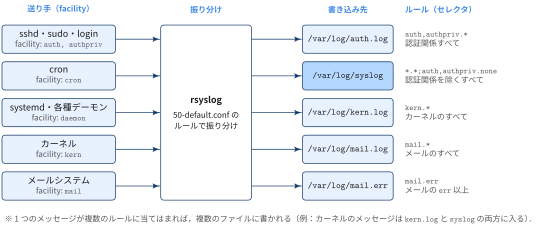
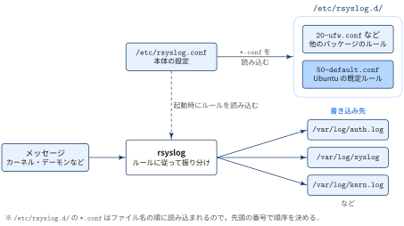
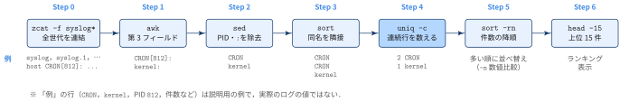

## syslog とは

::: {#def- .custom_problem .blog-custom-border}
### `/var/log/syslog`

- `/var/log/syslog` は，システム全体の「何が起きたか」を1行ずつ時系列で記録したログ
- カーネルや常駐プログラム（デーモン）が rsyslog にメッセージを送り，rsyslog がこのファイルに書き込む

:::

- rsyslog が受け取ったメッセージのうち，どれを `/var/log/syslog` に書くかは `/etc/rsyslog.d/50-default.conf` で決まっています
- Ubuntu の既定では認証関係（ログイン，`sudo` など）は `auth.log` に分けられ，syslog には入りません

{width=100%}


### `/var/log/syslog` 1行の構成

::: {#def-syslog-line .custom_problem .blog-custom-border}
### `/var/log/syslog` のライン構成

1行の構成は次のとおりです


```
2026-11-22T03:17:01.123+09:00  myhost  CRON[812]:  (root) CMD (run-parts /etc/cron.hourly)
|------------(1)------------|  |(2)-|  |--(3)---|  |-----------------(4)-----------------|
```

|番号|部分|この行での値|
|---|---|---|
|(1)|タイムスタンプ|`2026-11-22T03:17:01.123+09:00`|
|(2)|ホスト名|`myhost`|
|(3)|タグ|`CRON[812]:`|
|(4)|メッセージ本文|`(root) CMD (run-parts /etc/cron.hourly)`|
: {tbl-colwidths="[10,35,55]"}

「誰が書いたか」を表すのがタグです．タグは「プログラム名」「`[PID]`（省略されることもある）」「`:`」の3つでできています．


|例|意味|
|---|---|
|`CRON[812]:`|cron の PID 812 のプロセスが書いた|
|`systemd[1]:`|systemd（PID 1）が書いた|
|`kernel:`|カーネル．PID は付かない|
|`systemd-logind[701]:`|ログイン管理のデーモン|

:::


### よく出てくる記録

よく出てくる記録には次のようなものがあります．

- `CRON`：定期ジョブを起動した記録
- `systemd`：サービスの起動・停止・失敗
- `kernel`：ハードウェア，ディスク，ネットワーク，メモリ不足（OOM）などのカーネルメッセージ
- `NetworkManager` や `dhclient`：ネットワークの接続・切断
- アプリケーション：自作のデーモンや Docker など，syslog に出力する設定のもの

一方，ログインや `sudo` の記録は syslog には出てきません．どのメッセージが syslog に入るかは，次の振り分けルールで決まっています．

## 振り分けのルール：`50-default.conf`


::: {.callout-note}
### rsyslog 振り分けルール

- rsyslog は受け取ったメッセージを，設定ファイルに書かれたルールに従って各ログファイルへ振り分ける
- 本体の設定 `/etc/rsyslog.conf` が `/etc/rsyslog.d/*.conf` を読み込む仕組みになっていて，Ubuntu の既定ルールは `/etc/rsyslog.d/50-default.conf` にある

:::

{width=100%}

`50-default.conf` のうち，行頭が `#` の行はコメント（無効）なので，それを除くと有効なルールは次の6行です．

```
auth,authpriv.*             /var/log/auth.log
*.*;auth,authpriv.none      -/var/log/syslog
kern.*                      -/var/log/kern.log
mail.*                      -/var/log/mail.log
mail.err                    /var/log/mail.err
*.emerg                     :omusrmsg:*
```

[ルール1行の読み方]{.mini-section}

各行は「セレクタ」と「アクション」を空白で区切った形をしています．左のセレクタに当てはまるメッセージを，右のアクションで指定した書き込み先へ送ります．

セレクタは `facility.priority` の形で書きます．

- facility：メッセージの出どころの分類．`auth`，`authpriv`，`cron`，`daemon`，`kern`，`mail`，`user`，`local0`〜`local7` など
- priority：メッセージの重要度．低い順に `debug`，`info`，`notice`，`warning`，`err`，`crit`，`alert`，`emerg`

|記法|意味|
|---|---|
|`*`|すべて．facility にも priority にも使える|
|`kern.*`|`kern` facility の全 priority|
|`mail.err`|`mail` facility の `err` 以上（`err`，`crit`，`alert`，`emerg`）|
|`*.=info`|`info` ちょうどだけ（`=` を付けると「以上」ではなく「一致」になる）|
|`auth,authpriv.*`|`,` で facility を並べると，同じ priority 指定をまとめて適用する|
|`auth,authpriv.none`|その facility を除外する|
|`;`|セレクタを並べる．左から順に適用され，後ろの `.none` で前の選択から取り除ける|
: {tbl-colwidths="[25,75]"}


アクションは主に書き込み先のファイルです．

|記法|意味|
|---|---|
|`/var/log/auth.log`|このファイルに追記する|
|`-/var/log/syslog`|先頭の `-` は「書き込みのたびにディスクへ同期（sync）しない」指定．sysklogd 由来の記法で，現在の rsyslog は既定で sync しないため実質的な違いはない|
|`:omusrmsg:*`|ログイン中の全ユーザーの端末にメッセージを表示する|
: {tbl-colwidths="[25,75]"}

[既定ルールの意味]{.mini-section}

|ルール|書き込み先|対象|
|---|---|---|
|`auth,authpriv.*`|`/var/log/auth.log`|認証関係（ログイン，`sudo`，`ssh` など）のすべて|
|`*.*;auth,authpriv.none`|`/var/log/syslog`|認証関係を除くすべて|
|`kern.*`|`/var/log/kern.log`|カーネルのメッセージすべて|
|`mail.*`|`/var/log/mail.log`|メールシステムのメッセージすべて|
|`mail.err`|`/var/log/mail.err`|メールシステムの `err` 以上|
|`*.emerg`|ログイン中の全端末|すべての facility の `emerg`（システムが使えない状態）|

[ここから分かること]{.mini-section}

- 1つのメッセージが複数のルールに当てはまれば，複数のファイルに書かれる．カーネルのメッセージは `kern.log` と `syslog` の両方に，メールのメッセージは `mail.log` と `syslog` の両方に入る
- syslog から除外されているのは `auth` と `authpriv` だけ．ログインや `sudo` の記録を調べるときは `auth.log` を見る
- `cron.log` や `daemon.log` の行はコメントアウトされているので，cron やデーモンのログは syslog に入る．「よく出てくる記録」や後で見るランキングに `CRON` や `systemd` が並ぶのはこのため
- `#cron.*` の `#` を外して rsyslog を再起動（`sudo systemctl restart rsyslog`）すれば `cron.log` に分けて書かれる．ただし syslog の行に `cron.none` を足さない限り，syslog にも引き続き書かれる

## どのプロセスがログを書いているかを調べる

タグをプログラム名ごとに数えると，「どのプロセスがいちばん多くログを書いているか」のランキングが作れます．
ここではローテーション後の世代（`syslog`，`syslog.1`，`syslog.2.gz`，…）をすべて連結して数えます．

```sh
sudo zcat -f /var/log/syslog* | awk '{print $3}' | sed 's/\[[0-9]*\]:*$//; s/:$//' | sort | uniq -c | sort -rn | head -15
```

:::: {.no-border-top-table}

|Step|コマンド|やっていること|
|---|---|---|
|0|`sudo zcat -f /var/log/syslog*`|全世代のファイルを順に読み，1本の流れにつなげます．`.gz` は展開し，圧縮されていない `syslog` と `syslog.1` はそのまま出力します（`-f`）．syslog は一般ユーザーでは読めないことが多いので `sudo` を付けています|
|1|`awk '{print $3}'`|各行を空白で区切り，3番目のフィールドだけを取り出します|
|2|`sed 's/\[[0-9]*\]:*$//; s/:$//'`|1つ目の置換で末尾の `[PID]:` を消し，`CRON[812]:` を `CRON` にします．2つ目で PID のないタグの末尾 `:` を消し，`kernel:` を `kernel` にします|
|3|`sort`|同じプロセス名が隣同士に並ぶように並べ替えます．`uniq` は連続した行しかまとめないので，この並べ替えが必要です|
|4|`uniq -c`|連続する同じ行を1行にまとめ，先頭に件数を付けます（例：`812 CRON`）|
|5|`sort -rn`|件数を数値として（`-n`）大きい順に（`-r`）並べます．`-n` がないと文字列として比べるため，`9` が `100` より上に来てしまいます|
|6|`head -15`|上位15件だけを表示します|
: {tbl-colwidths="[10,35,55]"}

::::


パイプラインの流れを図にすると次のとおりです．各ブロックの下には，その時点のデータ例を入れています．



### Step 1：第3フィールドを取り出す

- `awk '{print $3}'` は，行を空白で区切ったときの3番目のフィールドを取り出す
- @def-syslog-line よりラインは，空白で区切ると (1) タイムスタンプ，(2) ホスト名，(3) タグ の順に並ぶので，3番目は (3) のタグ `CRON[812]:` になる

@def-syslog-line の行を awk のフィールドに分けると次のとおりです．

```
$1 = 2026-11-22T03:17:01.123+09:00   ← (1) タイムスタンプ
$2 = myhost                          ← (2) ホスト名
$3 = CRON[812]:                      ← (3) タグ（Step 1 で取り出す部分）
$4 = (root)                          ← ここから (4) メッセージ本文
$5 = CMD
$6 = (run-parts
$7 = /etc/cron.hourly)
```

### Step 2：sed で PID と記号を落とす

```sh
sed 's/\[[0-9]*\]:*$//; s/:$//'
```

`;` で区切られた2つの置換が，各行に左から順に適用されます．どちらも「見つかった部分を空文字に置き換える」，つまり削除です．この時点で各行には `$3` のタグしか残っていないので，`$` は「タグの末尾」を意味します．

[置換1：`s/\[[0-9]*\]:*$//`（PID 部分を消す）]{.mini-section}

|部品|意味|
|---|---|
|`\[`|文字としての `[`（`\` を付けないと文字クラスの開始と解釈される）|
|`[0-9]*`|数字が0文字以上|
|`\]`|文字としての `]`|
|`:*`|`:` が0個以上|
|`$`|行末|

: {tbl-colwidths="[25,75]"}

たとえば `CRON[812]:` は `CRON` になり，`systemd[1]:` は `systemd` になります．`kernel:` には `[...]` がないので変わりません．

![置換1は末尾の `[PID]:` にマッチした部分だけを削除する．](./figures/sed-pid-removal.svg)

[置換2：`s/:$//`（末尾のコロンを消す）]{.mini-section}

置換1で `kernel:` のように PID がないタグが残るので，末尾の `:` だけを消して `kernel` にします．`CRON` は置換1ですでにコロンが消えているので，ここでは何も起きません．

[なぜこの処理が必要か]{.mini-section}

PID はプロセスを起動するたびに変わります．sed を通さないと `CRON[812]:`，`CRON[813]:`，`CRON[9041]:` などがすべて別のものとして数えられ，件数が細かく分かれてしまいます．sed で PID と記号を落とせば，すべてが `CRON` という1つの名前に揃い，プログラム単位で数えられます．

### 注意点

- **`$3` が正しく効くのはタイムスタンプが ISO 形式のときだけ．** 新しい rsyslog の既定（Ubuntu 23.10 以降など）では，行が `2026-11-22T03:15:01... host CRON[812]: ...` という形になり，`$3` がプロセス名になる．昔ながらの `Nov 22 03:15:01 host CRON[812]:` 形式だと `$3` は時刻（`03:15:01`）になるので，`$5` に変える必要がある．結果に時刻が並んだら，この形式の違いが原因．
- **`sudo awk '{print $3}' /var/log/syslog*` のように awk に直接ファイルを渡すと，圧縮された世代を正しく読めない．** logrotate の `delaycompress` 設定では，圧縮されないのは `syslog` と `syslog.1` だけで，`.2` 以降は `syslog.2.gz` のように gzip 圧縮される．awk は圧縮データをテキストとして読むため，意味のない文字列が集計に混ざる．`zcat -f` で展開してから流せば，圧縮の有無を気にせずに済む．
- `syslog*` は `sudo` が動く前に自分のシェルで展開される．`/var/log` の一覧は一般ユーザーでも見られるので，ファイル名の展開はそのまま動く．
- 連結の順序（`syslog`，`syslog.1`，`syslog.10.gz`，`syslog.2.gz`，… のような名前順）は時系列どおりではないが，件数を数えるだけなので結果には影響しない．
- `systemd[1]:` と `systemd:` のように表記が揺れていても，Step 2 で同じ名前に揃うので，まとめて数えられる．

## 📘 用語集

:::{.glossary-container}

```yaml
glossary:
  - def: セレクタ（selector）
    description: |
      rsyslog の振り分けルール1行のうち，左側に書く「どのメッセージを対象にするか」の指定．`facility.priority` の形で書き，`kern.*`（`kern` facility の全 priority）や `mail.err`（`mail` facility の `err` 以上）のように，メッセージの出どころ（facility）と重要度（priority）の組み合わせで対象を選ぶ．`,` で facility をまとめ，`;` で複数のセレクタを並べられる．`auth,authpriv.none` のように `.none` を付けると，その facility を対象から除外する．

  - def: アクション（action）
    description: |
      rsyslog の振り分けルール1行のうち，右側に書く「セレクタに当てはまったメッセージをどう処理するか」の指定．主に書き込み先のファイルを書き（例：`/var/log/auth.log`），そのファイルに追記する．ほかに，`:omusrmsg:*` のようにログイン中の全ユーザーの端末へ表示するものや，別のサーバーへ転送するものもある．1つのメッセージが複数のルールのセレクタに当てはまれば，それぞれのアクションが実行される．
```

:::


References
----------
- [truncate command: 肥大化した /var/log/syslog を空にする](../2026-11-19-truncate-command/index.qmd)
