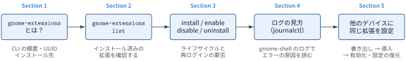
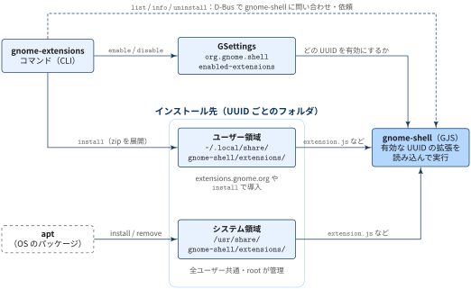
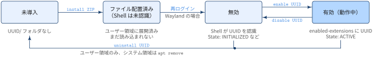
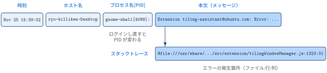
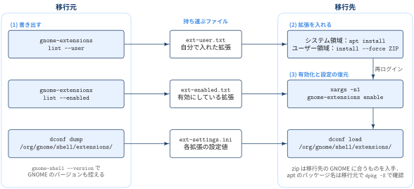
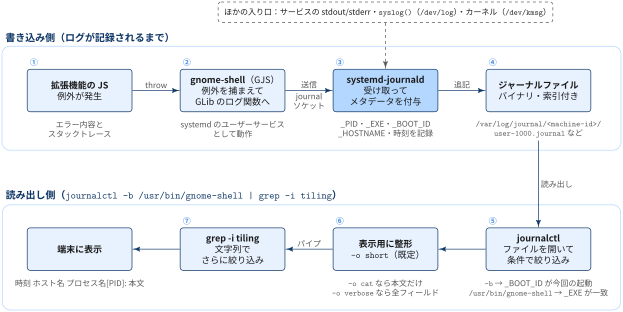
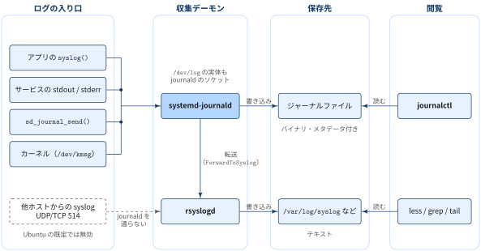

::: {.callout-note}
## TL;DRs

- `gnome-extensions` は，GNOME Shell 拡張機能をターミナルから操作するための公式 CLI
- 拡張機能のインストール先は**ユーザー領域**と**システム領域**の2つ
  - **ユーザー領域**: `~/.local/share/gnome-shell/extensions/`
  - **システム領域**: `/usr/share/gnome-shell/extensions/`
- `uninstall` できるのはユーザー領域だけ
- `install` / `uninstall` は「ファイルの配置」，`enable` / `disable` は「GSettings の書き換え」．install した直後は再ログインしないと有効化できない
- 拡張機能が動かないときは `journalctl -b /usr/bin/gnome-shell` で GNOME Shell のログを見る
- 別のマシンへ移すときは，「入れる拡張」「有効にする拡張」「各拡張の設定値」の3つを書き出して復元する

:::

{width="100%" fig-align="center"}

## `gnome-extensions` とは？

::: {#def-gnome-extensions .custom_problem .blog-custom-border}
### `gnome-extensions`

- GNOME Shell 拡張機能を操作するための公式 CLI
- GNOME Shell に同梱されている
- 「拡張機能」アプリや Extension Manager が GUI で行う操作を，ターミナルから実行できる

:::

- `git` と同じく，`gnome-extensions COMMAND [ARGS…]` の形でサブコマンドを指定して使います
- 使えるサブコマンドを確認するには `--help`
- 個々のサブコマンドのオプションを確認するには `help COMMAND` を実行します

```bash
gnome-extensions --help          # サブコマンド一覧
gnome-extensions help enable     # 個別のヘルプ
gnome-extensions version         # バージョン（GNOME Shell のバージョンと一致する）
```

`help enable` を実行すると，次のように書式とオプションが表示されます．

```text
Usage:
  gnome-extensions enable [OPTION…] UUID

Enable an extension

Application Options:
  -q, --quiet     Do not print error messages
```

[主なサブコマンド]{.mini-section}

| サブコマンド | 内容 |
|---|---|
| `list` | インストール済みの拡張機能の UUID を一覧表示 |
| `info UUID` / `show UUID` | 詳細（パス，状態，バージョンなど）を表示 |
| `enable UUID` / `disable UUID` | 有効化 / 無効化 |
| `install ZIP` | zip をユーザー領域に展開 |
| `uninstall UUID` | ユーザー領域から削除 |
| `prefs UUID` | 設定画面を開く |
| `pack DIR` | ソースフォルダから配布用の zip を作成 |
: {tbl-colwidths="[45,55]"}


### UUID：拡張機能の ID

表のサブコマンドの多くは，引数に拡張機能の **UUID** を取ります．

::: {#def-extension-uuid .custom_problem .blog-custom-border}
### UUID（拡張機能の ID）

- 拡張機能を一意に識別する文字列を UUID と呼ぶ
- `名前@作者ドメイン` の形式をとる（例: `tiling-assistant@ubuntu.com`）
- 拡張機能のフォルダ名，および `metadata.json` の `uuid` と一致する

:::

- 一般的な UUID（`550e8400-e29b-41d4-a716-446655440000` のような 128 bit の識別子）とは別物
- `@` の後ろは実在するドメインとは限らず，`tiling-assistant@leleat-on-github` のように作者名を入れただけのものもあり
- 名前が同じ拡張機能でも，`@` の後ろが違えば別の拡張機能として扱われます．

[UUID の確認方法]{.mini-section}

UUID は次の3か所で確認でき，どれも同じ値になります．

```bash
# 1. gnome-extensions list の出力
gnome-extensions list

# 2. インストール先のフォルダ名
ls ~/.local/share/gnome-shell/extensions/ /usr/share/gnome-shell/extensions/

# 3. metadata.json の uuid
grep '"uuid"' /usr/share/gnome-shell/extensions/*/metadata.json
```

```text
ding@rastersoft.com
ubuntu-appindicators@ubuntu.com
ubuntu-dock@ubuntu.com
apps-menu@gnome-shell-extensions.gcampax.github.com
...
```

[`info` / `show` を用いた場合の例]{.mini-section}

UUID が分かれば，`gnome-extensions info UUID` でその拡張機能の詳細を表示できます（`show` は `info` の別名で，出力は同じ）．
Ubuntu 標準の Tiling Assistant で実行すると，次のようになります．

```bash
gnome-extensions info tiling-assistant@ubuntu.com
```

```text
tiling-assistant@ubuntu.com
  Name: Ubuntu Tiling Assistant
  Description: Expand GNOME's 2 column tiling and add a Windows-snap-assist-inspired popup...
  Path: /usr/share/gnome-shell/extensions/tiling-assistant@ubuntu.com
  URL: https://launchpad.net/ubuntu/+source/gnome-shell-extension-tiling-assistant
  Version: 46
  Enabled: Yes
  State: ACTIVE
```

各項目の意味は次のとおりです．`Name` から `Version` までは `metadata.json` の値をそのまま表示しています．

| 項目 | 出どころ | 意味 |
|---|---|---|
| `Name` | `metadata.json` の `name` | 表示名 |
| `Description` | `metadata.json` の `description` | 説明文 |
| `Path` | インストール先 | 実体のフォルダ．`/usr/share/...` ならシステム領域，`~/.local/share/...` ならユーザー領域 |
| `URL` | `metadata.json` の `url` | 配布元・ソースコードの URL |
| `Version` | `metadata.json` の `version` | 拡張機能自身の版数（GNOME のバージョンではない） |
| `Enabled` | GSettings の `enabled-extensions` | 有効化の設定が入っているか |
| `State` | gnome-shell の実行状態 | 実際に動いているか|
: {tbl-colwidths="[25,35,40]"}

`Enabled` は「設定」，`State` は「実際の状態」を表します．
`Enabled: Yes` なのに `State` が `ACTIVE` でなければ，有効化しようとして失敗しているということになります．

| `State` | 意味 |
|---|---|
| `ACTIVE` | 有効化されて動作している |
| `INACTIVE` | 一度有効化された後，無効化されている |
| `INITIALIZED` | 読み込まれたが，一度も有効化されていない |
| `ERROR` | 読み込みや有効化に失敗した．原因は gnome-shell のログで確認する |
| `OUT OF DATE` | `metadata.json` の `shell-version` が現在の GNOME Shell に対応していない |
: {tbl-colwidths="[25,75]"}


### インストール先：ユーザー領域とシステム領域

拡張機能のインストール先は2か所あります．
`~/.local/share/gnome-shell/extensions/` がユーザー領域，`/usr/share/gnome-shell/extensions/` がシステム領域です．

| | ユーザー領域 | システム領域 |
|---|---|---|
| パス | `~/.local/share/gnome-shell/extensions/` | `/usr/share/gnome-shell/extensions/` |
| 入れ方 | extensions.gnome.org，`gnome-extensions install` | apt（OS のパッケージ） |
| 権限 | 自分だけ・`sudo` 不要 | 全ユーザー共通・root が管理 |
| CLI で `uninstall` | できる | できない（`apt remove` で削除） |
| 同じ UUID が両方にある場合 | こちらが優先 | 読み込まれない |

どちらの領域も，中身は `UUID/` という名前のディレクトリで，そこに `metadata.json`，`extension.js`，`schemas/` などが入っています．

```bash
ls ~/.local/share/gnome-shell/extensions/
ls /usr/share/gnome-shell/extensions/

# システム領域の拡張がどの apt パッケージのものか調べる
dpkg -S /usr/share/gnome-shell/extensions/tiling-assistant@ubuntu.com
```

::: {.callout-important}
### 注意点

- 「同じ UUID なら」ユーザー領域が優先されますが，**UUID が異なる同等の拡張** は，両方とも読み込まれる
- その結果，同じ機能を持つ拡張が2つ動いて衝突するリスクがある

:::

## `gnome-extensions list`

インストール済みの拡張機能の UUID を表示します．

```bash
gnome-extensions list               # すべて
gnome-extensions list --enabled     # 有効なものだけ
gnome-extensions list --disabled    # 無効なものだけ
gnome-extensions list --user        # ユーザー領域のものだけ
gnome-extensions list --system      # システム領域のものだけ
gnome-extensions list -d            # 詳細付き（Path や State も表示）
```

## install / enable / disable / uninstall

[全体像：どのコマンドが何を書き換えるか]{.mini-section}

拡張機能の管理には，`gnome-extensions` コマンド，GSettings，インストール先のフォルダ，gnome-shell 本体の4つが関わります．
コマンドごとに，書き換える場所が異なります．

{width="100%" fig-align="center"}

- `install`: zip をユーザー領域に展開するだけ．gnome-shell には何も伝えない
- `enable` / `disable`: GSettings の `enabled-extensions` を書き換える．gnome-shell はこの値の変化を受けて，拡張を読み込む・止める
- `list` / `info` / `uninstall`: D-Bus で実行中の gnome-shell に問い合わせる・依頼する．`uninstall` では gnome-shell がユーザー領域のフォルダを削除する
- apt で入れたシステム領域の拡張は，apt でしか追加・削除できない

[状態の移り変わり]{.mini-section}

拡張機能は「未導入」「ファイル配置済み」「無効」「有効」の4つの状態を移り変わります．
`install` した直後は，ファイルがあるだけで gnome-shell はまだその UUID を知りません．
再ログインして gnome-shell が UUID を認識してから，`enable` で有効にします．

{width="100%" fig-align="center"}

```bash
# install: zip をユーザー領域に展開する（有効化はしない）
gnome-extensions install foo@example.com.shell-extension.zip
gnome-extensions install --force foo@example.com.shell-extension.zip   # 上書き更新

# enable: GSettings の enabled-extensions に UUID を追加する → gnome-shell が読み込む
gnome-extensions enable foo@example.com

# disable: enabled-extensions から外す（ファイルは残る）
gnome-extensions disable foo@example.com

# uninstall: ユーザー領域のフォルダを削除する（システム領域のものは不可）
gnome-extensions uninstall foo@example.com
```


::: {.callout-note}
### Key Points

1. **install しただけでは動かない．**
   Wayland では，新しい UUID を gnome-shell に認識させるために再ログインが必要（X11 では `Alt+F2` → `r` でも可）．
2. **enable と disable は「設定」の変更．**
   実体は次の GSettings キーで，`gnome-extensions` はこれを書き換えている．

   ```bash
   gsettings get org.gnome.shell enabled-extensions
   gsettings get org.gnome.shell disabled-extensions
   ```

3. **disable しても，読み込み済みの GObject 型は残る．**
   GJS は一度登録した型をセッション中に解除できない．そのため，無効化と有効化を繰り返すと，`Type name ... is already registered` エラーが出ることがある．迷ったら再ログインする．
4. **uninstall できるのはユーザー領域だけ．**
   システム領域のものは `disable` で止めるか，`apt remove` で削除する．


:::


## ログの見方（journalctl）


::: {.callout-note}
### RULE

- 拡張機能は GNOME Shell のプロセス内で動くため，拡張機能のエラーは gnome-shell のログとして journal に記録される
- journal に記録される経路と，`journalctl` で絞り込めるしくみは [Appendix](#appendix-journal) を参照

:::


```bash
journalctl -b /usr/bin/gnome-shell | grep -i tiling
```

| 部分 | 意味 |
|---|---|
| `journalctl` | systemd のログ（journal）を読むコマンド |
| `-b` | 今回の起動（boot）以降に絞る．`-b -1` で前回の起動 |
| `/usr/bin/gnome-shell` | この実行ファイルが出したログだけに絞る |
| `grep -i tiling` | 大文字・小文字を区別せずに絞り込む |

::: {#exm- .custom_problem }
### よく使うオプション

```bash
journalctl -b -f /usr/bin/gnome-shell                   # リアルタイムで追う（tail -f 相当）
journalctl -b /usr/bin/gnome-shell -p warning           # 警告以上だけ
journalctl /usr/bin/gnome-shell --since "16:00" -o cat  # 時刻で絞り，本文だけ表示
```

:::
***


[1行の読み方]{.mini-section}

ログの1行は「時刻」「ホスト名」「プロセス名[PID]」「本文」の4つの部分からなります．
エラーの場合は，本文の後ろにスタックトレース（エラーの発生箇所）が続きます．

{width="100%" fig-align="center"}

- PID が変わっていれば，それは別の gnome-shell プロセス
- ログインし直すたび，またはログイン画面（GDM）用の Shell が起動するたびに，新しい PID になる

## 他のデバイスに同じ拡張機能を設定する


::: {.callout-note}
### 再現に必要な情報

- どの拡張を入れるか
- どれを有効にするか
- 各拡張の設定値

:::

移行元でこの3つをファイルに書き出し，移行先で順に復元します．

{width="100%" fig-align="center"}


[(1) 移行元で書き出す]{.mini-section}

```bash
gnome-shell --version                                        # GNOME のバージョンを控える（拡張は対応バージョンに依存）
gnome-extensions list --user    > ext-user.txt               # 自分で入れた拡張
gnome-extensions list --enabled > ext-enabled.txt            # 有効にしている拡張
dconf dump /org/gnome/shell/extensions/ > ext-settings.ini   # 各拡張の設定値
```

[(2) 移行先で入れる]{.mini-section}

- **システム領域の拡張**（`@ubuntu.com` など）: apt パッケージで入れる．パッケージ名は，移行元で `dpkg -S /usr/share/gnome-shell/extensions/<UUID>` を実行して確認する
- **ユーザー領域の拡張**: 移行先の GNOME バージョンに合う zip を extensions.gnome.org から入手するのが確実．GNOME のバージョンが同じなら，移行元のフォルダを `gnome-extensions pack` で zip にするか，フォルダをそのままコピーしてもよい

```bash
gnome-extensions install --force <UUID>.shell-extension.zip
```

[(3) 有効化と設定の復元]{.mini-section}

install 後に一度再ログインしてから実行します．

```bash
xargs -n1 gnome-extensions enable < ext-enabled.txt
dconf load /org/gnome/shell/extensions/ < ext-settings.ini
```

1行目は「どれを有効にするか」，2行目は「各拡張の設定値」を復元します．


## Appendix：なぜ gnome-shell のログは journalctl で読めるのか {#appendix-journal}

gnome-shell は，`/var/log/gnome-shell.log` のような専用のログファイルを持っていません．
gnome-shell のログは systemd の **journal** に記録され，それを `journalctl` で読み出しています．

{width="100%" fig-align="center"}

[書き込み側：ログが journal に記録されるまで]{.mini-section}

:::{.circle-numbered}

1. **拡張機能の JS で例外が発生する．**<br> 
   拡張機能は gnome-shell と同じプロセス内で動いているため，例外は gnome-shell（GJS）が捕まえ，エラー内容とスタックトレースを GLib のログ関数に渡す
2. **gnome-shell が journal ソケットへ送る．**<br> 
   gnome-shell は systemd のユーザーサービス（`org.gnome.Shell@wayland.service`）として起動され，標準エラー出力が journal につながっている．
   GLib はこれを検出すると，ログを1行のテキストではなく `MESSAGE`（本文）や `PRIORITY`（重要度）などのフィールドの組として，journal ソケット（`/run/systemd/journal/socket`）へ送る
3. **systemd-journald がメタデータを付ける．**<br> 
   受け取った journald は，送り手の PID・実行ファイルのパス・起動 ID などを `_PID`，`_EXE`，`_BOOT_ID` といった `_` で始まるフィールドとして付け加える．
   これらは送り手が自己申告した値ではなく journald が調べて付けるので，送り手が偽ることはできない
4. **ジャーナルファイルに追記される．**<br> 
   ジャーナルファイルは索引付きのバイナリ形式で，永続保存が有効なら `/var/log/journal/<machine-id>/`，無効なら再起動で消える `/run/log/journal/` に置かれる．
   ユーザーのプロセスのログは `user-1000.journal` のように UID ごとのファイルに分かれるため，自分のログは `sudo` なしで読める

:::

[読み出し側：journalctl が絞り込むしくみ]{.mini-section}

:::{.circle-numbered circle-numbered-style="color: #428CE6"}

5. **journalctl が条件で絞り込む．**
   `journalctl` はジャーナルファイルを開き，指定した条件に合うエントリだけを取り出す．
   各エントリは時刻・プライオリティ・送り手などをフィールドとして持っているので，テキストを検索しなくても次のような条件で直接絞り込める

   - **起動**: `-b` で今回の起動，`-b -1` で前回の起動
   - **日時**: `--since` / `--until`．`"2026-11-25 16:00"` のような日時のほか，`today`，`yesterday`，`-1h` のような相対指定も使える
   - **プライオリティ**: `-p warning` で warning 以上（emerg〜warning）．`-p err..warning` のように範囲でも指定できる
   - **ファシリティ**: `--facility=daemon` のように syslog の分類で絞る（`--facility=help` で一覧）．ただし gnome-shell が GLib 経由で送るログにはファシリティが付かないため，gnome-shell のログをこれで絞ると大半を取りこぼす
   - **送り手**: `/usr/bin/gnome-shell` のように実行ファイルのパスを渡すと，そのプログラムのログだけになる
6. **表示用に整形する．**
   絞り込んだエントリを `-o` で指定した形式に整形して出力する．
   既定の `-o short` が，[ログの見方](#ログの見方journalctl) の「1行の読み方」で見た「時刻 ホスト名 プロセス名[PID]: 本文」の形式
7. **grep でさらに絞り込む．**
   `grep -i tiling` は，整形済みのテキストをパイプで受け取って文字列で絞り込んでいるだけで，journalctl のフィールド条件とは別物

:::

### `syslogd` vs `rsyslogd` vs `journalctl`

`journalctl` が読むのは，systemd-journald が書いたジャーナルファイルだけです．
rsyslogd が書いた `/var/log/syslog` などのテキストファイルは読みません．
ただし Ubuntu では journald が受け取ったログを rsyslogd へ転送しているので，多くのログは「同じ内容が2か所に保存されている」状態になります．

{width="100%" fig-align="center"}

| | 役割 | 保存先 |
|---|---|---|
| `syslogd` | 昔からの syslog デーモン（収集＋保存）．今は syslog デーモン全般の総称としても使われる | `/var/log/messages` など（テキスト） |
| `rsyslogd` | `syslogd` の後継実装．互換を保ちつつ，柔軟なフィルタや他サーバへの転送に対応．Debian/Ubuntu の標準 | `/var/log/syslog`，`/var/log/auth.log` など（テキスト） |
| `systemd-journald` | systemd の収集デーモン | ジャーナルファイル（バイナリ） |
| `journalctl` | ジャーナルファイルを読むだけのビューア．収集はしない | — |
: {tbl-colwidths="[18,52,30]"}


## 📘 用語集

:::{.glossary-container}

```yaml
glossary:
  - def: GNOME Shell
    description: |
      GNOME デスクトップのユーザーインターフェース本体．トップバー，アクティビティ画面，ウィンドウ管理などを担う．Wayland セッションではコンポジタ（画面合成を行うディスプレイサーバー）も兼ねる．実行ファイルは `/usr/bin/gnome-shell`．

  - def: GNOME Shell 拡張機能
    description: |
      GNOME Shell に読み込まれて，見た目や動作を変える JavaScript のプログラム．GNOME Shell と同じプロセス内で動くため，拡張機能のエラーは gnome-shell のログに記録される．

  - def: extensions.gnome.org
    description: |
      GNOME 公式の拡張機能配布サイト．ここから入れた拡張機能はユーザー領域にインストールされる．

  - def: GSettings
    description: |
      GNOME のアプリケーション設定を読み書きする仕組みと，その CLI（`gsettings`）．キーの型はスキーマで定義され，実際の値はバックエンドの dconf に保存される．拡張機能の有効・無効は `org.gnome.shell` の `enabled-extensions` / `disabled-extensions` キーで管理される．

  - def: dconf
    description: |
      GSettings の保存先となるキー・バリュー型の設定データベース．
      `dconf dump` / `dconf load` で，指定したパス以下の設定をまとめて書き出し・復元できる．

  - def: GJS
    description: |
      GNOME 向けの JavaScript 実行環境．GNOME Shell 本体と拡張機能は GJS の上で動いている．

  - def: GObject 型
    description: |
      GNOME の基盤ライブラリ（GLib / GObject）の型システムに登録されるクラス．型名はプロセス内で一意である必要があり，一度登録した型はプロセスが終わるまで解除できない．同じ型名を2回登録しようとすると `Type name ... is already registered` エラーになる．

  - def: Wayland / X11
    description: |
      Linux デスクトップで画面表示と入力を扱うための仕組み（ディスプレイサーバーのプロトコル）．Wayland では GNOME Shell 自身がコンポジタなので，Shell を再起動するにはログアウトが必要．X11 では `Alt+F2` → `r` で Shell だけを再起動できる．

  - def: GDM (GNOME Display Manager)
    description: |
      GNOME のログイン画面を提供するプログラム．ログイン画面の表示にも専用の GNOME Shell が起動するため，ユーザーのセッションとは別の PID の gnome-shell がログに現れる．

  - def: D-Bus
    description: |
      Linux デスクトップでプロセス同士が通信するための仕組み．`gnome-extensions` の `list` / `info` / `uninstall` は，D-Bus で実行中の gnome-shell に問い合わせ・依頼している．

  - def: systemd ユーザーサービス
    description: |
      ログインしたユーザーごとに起動される systemd（`user@1000.service` など）が管理するサービス．GNOME のセッションでは gnome-shell も `org.gnome.Shell@wayland.service` として起動され，その標準出力・標準エラー出力は journal につながっている．

  - def: systemd-journald
    description: |
      systemd のログ収集デーモン．`syslog()`，サービスの標準出力・標準エラー出力，journal ソケット，カーネルなどからログを受け取り，`_PID` や `_BOOT_ID` などのメタデータを付けてジャーナルファイルに保存する．

  - def: ジャーナルファイル
    description: |
      systemd-journald が書き込む，索引付きのバイナリ形式のログファイル．永続保存が有効なら `/var/log/journal/<machine-id>/`，無効なら `/run/log/journal/` に置かれる．テキストではないので `less` や `grep` では直接読めない．

  - def: journalctl
    description: |
      ジャーナルファイルを読むためのコマンド．収集はしない．起動（`-b`），日時（`--since` / `--until`），プライオリティ（`-p`），ファシリティ（`--facility`），実行ファイルなどの条件で絞り込み，`-o` で指定した形式で表示する．

  - def: プライオリティ（PRIORITY）
    description: |
      ログの重要度．syslog 由来の 0〜7 の8段階で，数字が小さいほど重要．
      0 `emerg`，1 `alert`，2 `crit`，3 `err`，4 `warning`，5 `notice`，6 `info`，7 `debug`．
      `journalctl -p warning` は 0〜4 を表示する．

  - def: ファシリティ（SYSLOG_FACILITY）
    description: |
      ログを出したプログラムの種類を表す syslog の分類．`kern`（カーネル），`user`，`mail`，`daemon`（常駐サービス），`auth`（認証），`cron`，`local0`〜`local7` などがある．`syslog()` などで送られたログには付くが，journal ソケットへ直接送られたログには付かないことがある．

  - def: syslog
    description: |
      Unix で古くから使われているログの仕組み（プロトコル・API）．アプリは `syslog()` で `/dev/log` にログを送り，syslog デーモンがファシリティとプライオリティに従って振り分けて保存する．

  - def: rsyslogd
    description: |
      syslog デーモンの実装の1つで，従来の `syslogd` の後継．Debian / Ubuntu の標準で，journald から転送されたログを `/var/log/syslog` などのテキストファイルに書き出す．

  - def: PID (Process ID)
    description: |
      OS が実行中のプロセスごとに割り当てる番号．同じ gnome-shell でも，起動し直せば別の PID になる．

  - def: スタックトレース
    description: |
      エラーが発生した時点での関数呼び出しの履歴．GJS のログでは `@file:///…/ファイル.js:行:列` の形で，エラーの発生箇所が示される．
```

:::
